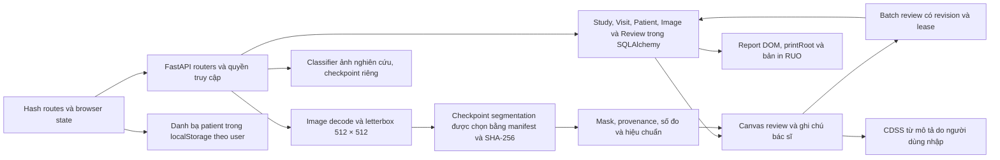

# Kiểm toán độc lập sản phẩm — 04/11/2026

**Kết luận: NO-GO đối với triển khai phục vụ chăm sóc người bệnh trên nhiều cơ sở.** Có 25 phát hiện đã được xác nhận ở mức hành vi/code được mô tả: **1 P0, 7 P1, 14 P2, 3 P3**. Không có P4 được tính vào số lỗi; đề xuất cải thiện được tách bên dưới. Đây là kiểm toán có giới hạn và có phần BLOCKED/NOT TESTED, không phải chứng nhận đầy đủ hoặc bằng chứng lâm sàng.

Không sửa mã ứng dụng, giao diện, cấu hình, API hoặc model; không commit/PR, cài dependency hay chạy script remediation. Chỉ tạo script kiểm toán, dữ liệu tổng hợp, database kiểm thử mới và bằng chứng trong thư mục audit này. Khởi động ứng dụng khởi tạo schema của database kiểm thử mới theo cơ chế sẵn có; không chạy migration command đối với database đang sử dụng. Source integrity xác nhận 412 file nền được hash không đổi. Các thay đổi đã có sẵn trong worktree không thuộc audit.

## 1. Tóm tắt điều hành

| Chỉ số | Kết quả / giới hạn |
|---|---|
| Nhánh | temp/ui-e2e-remediation-20261029, worktree có nhiều thay đổi chưa commit |
| Scope source đã kiểm kê chi tiết | 412 file backend/frontend/ai_training/tests/deploy; danh sách trong inventory.json |
| API tìm thấy | 121 khai báo decorator, chưa khẳng định là 121 endpoint độc nhất; có alias và route trùng |
| Entity ORM | 25, lưu trong inventory.json |
| Màn hình/route family tìm thấy | 31; xem SCREEN_COVERAGE.csv |
| Màn có nội dung được chụp/đọc một phần | 28; không đồng nghĩa mọi state/modal/role đã kiểm thử |
| Màn chưa kiểm tra nội dung | approval theo reviewer, evaluation thực, slides: NOT TESTED/BLOCKED; doctor đi approval nhận 403, đi evaluation quay về dashboard |
| Captures chính | 55 snapshot màn hình/DOM từ hai kịch bản browser; thêm ảnh zoom tương đương, CUA và trang PDF |
| Feature | 42 mục kiểm kê; 18 tình huống giới hạn TESTED, 14 PARTIALLY TESTED, 4 BLOCKED, 6 NOT TESTED; không coi 18 feature là được kiểm thử mọi nhánh |
| API thực thi có quan sát | 37 khai báo decorator có request/response tương ứng; chỉ PARTIALLY TESTED, không chứng nhận mọi contract/role/branch |
| Kiểm thử JavaScript chọn lọc | 23 pass, 0 fail; node-tests.log |
| Page errors trong hai vòng browser hoàn tất | 0; điều này không phủ nhận các lỗi nghiệp vụ và response lỗi đã quan sát |
| Độc lập bệnh nhân / hiệu quả lâm sàng | Chưa xác minh; không có claim performance lâm sàng |

Ba rủi ro cần xử lý trước tiên là hợp nhất bệnh nhân do PID cục bộ trùng giữa cơ sở (AUD-001), quyền quản trị cơ sở tác động vào dữ liệu/cấu hình chung (AUD-002/003), và danh bạ patient có vẻ là hồ sơ chính thức nhưng thực chất cục bộ, có seed ngoài demo và có thể mất cập nhật (AUD-004/005/008). Đổi mật khẩu còn hai lỗi riêng: mất phiên hiện tại do bỏ token mới và bị hoàn nguyên khi restart (AUD-006/007).

Không tái sử dụng kết luận các audit trước làm bằng chứng hiện tại. Bác sĩ cơ sở B đọc ca cơ sở A trả **403** trong probe hợp lệ. Do đó AUD-001 là lỗi **liên kết định danh**, không phải bằng chứng endpoint đọc chéo tenant đã bị xuyên thủng. Mức P0 phản ánh hậu quả trộn liên kết bệnh nhân có thể xảy ra trong bối cảnh PID cục bộ độc lập; không có bệnh nhân thật bị ảnh hưởng trong kiểm toán.

Từ góc nhìn bác sĩ có nhiều bệnh nhân chờ: giao diện hiện tại chưa thích hợp để tin cậy sử dụng mỗi ngày cho chăm sóc bệnh nhân. Nhập thông tin không được chia sẻ giữa máy, đổi mã PID giữa màn, thanh upload che nội dung và phiếu giấu nhận định ở trang sau là những chi phí lặp lại. Những điều này có bằng chứng cụ thể, nhưng không có bác sĩ thật tham gia time-and-motion study trong audit này.

## 2. Bản đồ kiến trúc và data flow

- Frontend: vanilla JS ES modules; `navigation.js` kiểm soát route/permission và cleanup; `state.js` quản lý context; `api.js` bọc request/timeout/session; `leases.js` có local guard và server lease. Intake, upload, viewer, review và report là các boundary riêng.
- Backend: auth/security, cases/workspace, inference, reviews/region measurements, visits/facilities, HITL, corrections, administration, evaluation và health. Endpoint inventory lưu cả file, dòng, method, prefix hiệu lực và response status quan sát.
- Data: 25 ORM model gồm facility, patient, visit/study, images, predictions, reviews, user/auth/token challenges, HITL và region/audit records. `inventory.json` liệt kê từng entity. Không đọc database patient mặc định.
- AI: segmentation manifest-selected, grayscale/CLAHE/normalization/letterbox; inversion về source geometry; classifier ảnh MMOTU riêng có hash check và abstain; CDSS không tự lấy morphology từ binary mask. Checkpoint đang dùng có loss specification lệch core scope, AUD-024.
- Báo cáo: render snapshot đã lưu, protected source images và overlay; nút in dựng `#printRoot` rồi gọi `window.print()`. `/api/generate-report` là endpoint clinical PDF bị khóa 501; không đồng nhất endpoint này với in RUO trên browser.

## 3. Phương pháp và giới hạn bằng chứng

Hai server loopback riêng dùng `tests/serve_isolated_app.py` đã đọc trước: APP_DATA_DIR/APP_DB_PATH nằm trong audit/runtime hoặc audit/probe-runtime; DATABASE_URL rỗng; credentials tổng hợp; không có source patient images. Backend không import với cấu hình database mặc định. Không chạy existing E2E có thể tạo artifact/fixture ngoài audit. Ảnh 640×480 được sinh bằng random noise và ellipse để kiểm tra kỹ thuật; không đại diện anatomy thật.

Chụp intake/upload và viewer ở 1920×1080, 1440×900, 1366×768, 768×1024, 390×844. Captures có fullPage nhưng không đảm bảo nhìn thấy nội dung của mọi nested scroll panel. 683×384 là mô phỏng **diện tích CSS tương đương** 200% trên màn 1366×768, không phải browser zoom thực. Chưa chạy touch trên máy thật, screen reader, đo tương phản toàn bộ hoặc gesture matrix.

CUA provider Windows đã quan sát đúng cửa sổ Chrome audit tại 127.0.0.1:18048/#login; `cua-state.json` và `cua-login.png` lưu tree/screenshot. Tree của browser chủ yếu thấy chrome/translation popup; thao tác đóng popup có metadata **unverified accessibility_action_unasserted**, không tính là tương tác pass. Browser/DOM flows chủ yếu được kiểm tra qua Playwright.

Phân biệt evidence confidence với severity: CONFIRMED có thể là lỗi code-path xác định tĩnh, hoặc đánh giá UX dựa trên artifact; không biến kết quả static thành bằng chứng exploit/live clinical harm. AUD-003 backup chưa thực thi, AUD-021 chưa exercise keyboard runtime. AUD-018 là đánh giá UX có confidence Medium. Các giới hạn này hiện trong từng dòng register.

Sai sót của kịch bản audit được loại khỏi lỗi sản phẩm:

1. Quay lại cùng hash intake giữ bước upload nên script không tìm thấy patient row. Chỉnh **script audit** dùng navigation đầy đủ rồi chạy lại.
2. Các account tổng hợp seed đầu tiên thiếu field user và sau đó token_version=0; requests 401 trong probe-results không được dùng để kết luận authorization. tenant-results.json dùng account đã chỉnh hợp lệ trong DB kiểm thử; response 403/200 mới là bằng chứng tenant.
3. Hard navigation thay page instance gây lease read-only trong lần thử đầu; dùng `page.reload()` để kiểm tra reload chính xác. Không đưa timeout đó vào issue register.
4. `report-reviewed-print.pdf`/print-page-1.png trắng vì script chỉ gọi page.pdf trước khi bấm nút in, không tạo printRoot. **Không dùng làm bằng chứng lỗi in.** `actual-print.pdf` đi qua nút in thật, có 2 trang, text và ảnh; `actual-print-text.json` là bằng chứng có giá trị.
5. Lần supplementary login dùng password mới sau restart không vào dashboard; source bootstrap xác nhận đã reset hash từ environment. Chạy lại bằng password bootstrap cũ thành công. AUD-007 dựa trên observation này và source, không có log login-response riêng cho lần thất bại.

## 4. Kết quả cross-layer và user flows

| Workflow | Thực thi / kết quả | Tương tác và thời gian thực đo | Hạn chế |
|---|---|---|---|
| Login doctor | Form → auth API → dashboard | 3 thao tác Playwright, 289 ms | Không tính thời gian người đọc/gõ hoặc cold startup |
| Tạo patient tổng hợp | Modal → local store → upload; phiên khác không thấy | 6 thao tác sau khi modal mở, 644 ms | Excludes thao tác mở modal, typing thực và clinical task time |
| Tạo ca một bên | POST cases tạo PID giả danh, visit_no 6 số, trạng thái PENDING | API latency trong probe-results.json; không đo click E2E | Không exercise nút Tạo Visit/reservation replay trong audit này |
| Multi-facility identity | Hai cơ sở tạo ca với PID 123456789 | API thực thi; cùng patient_id | Không có global identity agreement nên liên kết tự động không có căn cứ |
| Cross-facility case access | B doctor GET A case | 403 trong tenant-results.json | Không chứng minh toàn bộ endpoint đều scoped |
| Upload → inference | Synthetic 640×480 → upload → prediction → lưu | API latency thật trong probe-results.json | Mask rỗng; không kiểm tra diagnostic validity/nonempty-mask pixel alignment thực tế |
| Classification | Ảnh synthetic → classify | 200/ABSTAIN | Top scores chưa hiệu chuẩn, không phải disease probabilities |
| Calibration | POST spacing=0.1 → prediction measurements/provenance → GET case | 200; calibrated=true | Không có phantom vật lý/anisotropic DICOM test trong lượt này |
| Lưu review | Nhập morphology/note/O-RADS → batch review 200 → GET/reload | 4 thao tác, 174 ms trong lần hoàn tất | Thời gian automation, không phải thời gian hoàn thành examination |
| Network failure khi save | Abort request → Lưu không thành công → draft còn trong input | Không đo tổng thời gian | Toast tiếng Anh; retry/reconnect queue chưa exercise toàn bộ |
| Reopen review | Reload cùng tab giữ note/morphology/O-RADS | Đã quan sát values đúng | Không kiểm thử mọi interruption/multitab race |
| Report/print | Saved snapshot → nút in thật → 2 trang PDF | Có PDF/text/render; không đo completion time | Hệ điều hành/printer thật, 40 ảnh, long text page-break chưa chạy |
| Đổi mật khẩu | 200 nhưng request kế tiếp hết phiên; restart hồi password bootstrap | Không đo time-and-motion | Hai lỗi độc lập, AUD-006/007 |

`summary.json`, `deep-browser-results.json` và probe artifacts lưu số đo gốc. Không cộng ba số đo nhỏ thành thời gian một ca. Không có interaction count/time cho ca song phương hoàn chỉnh; ghi NOT TESTED thay vì ước lượng.

Điểm hoạt động đúng cần bảo toàn: missing CDSS descriptors trả INSUFFICIENT_DATA; unauthenticated case trả 401; scoped cross-facility case trả 403; review save/reopen giữ nội dung đã nhập; network error không báo thành công; O-RADS chưa được AI tự chèn trong probe; classifier có abstain; calibration provenance có history; báo cáo RUO tách cảnh báo và chứa saved note thay vì note chưa lưu. Không phục hồi “Chi tiết nâng cao”.

## 5. UI/UX friction và nội dung

1. **Intake/patient modal:** năm field editable bắt buộc cộng gender selection và optional ID trong danh bạ không nối server. CTA nằm dưới mép modal ở 1440×900, phải cuộn; chưa kết luận không thể submit vì Playwright auto-scroll đã thực hiện được. Nhãn không nói rõ local-only, trong khi toast khẳng định đã tạo hồ sơ. AUD-004/011.
2. **Upload:** banner định danh lặp PID trong field read-only, có thêm “Tạo Visit” trước nút phân tích, privacy disclosure, hai dropzone và stepper. Thanh sticky che vùng cần thao tác ở màn thấp; mobile date bị co. Không đề nghị bỏ disclosure an toàn. Có thể gom thông tin định danh và giải thích chính xác khi nào phải tạo Visit; chưa đo lợi ích số click của phương án thay thế. AUD-012/013/014.
3. **Patient list mobile:** tên gần như xếp dọc từng ký tự, action buttons chiếm không gian. Đây là lỗi readability cụ thể, không phải kết luận từ code. AUD-015.
4. **Viewer:** canvas dark lớn, phân biệt Trái/Phải và nội dung bác sĩ/AI có ý nghĩa; chỉ số và toolbar compact. Panel bên phải dài hơn viewport, notes/save cần cuộn ở một số state. Thông báo lưu hai bên sai đối với ca một bên; network toast tiếng Anh. AUD-022/023. Không có claim tất cả icon/tooltips đều được kích hoạt.
5. **Report:** PID vỡ dòng; trang đầu dành nhiều chỗ cho model/hash/UUID và giải thích, nhận định ở trang 2. Mất lý do không có ảnh bên phải. AUD-016/018/025. Giữ RUO và confirmation status; đề xuất giảm technical noise chỉ áp dụng thông tin không cần cho quyết định tức thời.
6. **Admin analytics:** heading dài/mixed English, nhiều card/legend; lỗi quan trọng hơn thẩm mỹ là null biến thành 0 và ranges lâm sàng khác viewer. Chart rows không native keyboard controls. AUD-019/020/021. Không lấy “Failed to fetch” ở admin-system làm lỗi server: audit cố ý chặn backup list vì constructor có thể tạo thư mục backup ngoài sandbox.

### Phân loại text đã xác minh

| Nhóm | Ví dụ cụ thể | Finding |
|---|---|---|
| Misleading information | Đã tạo hồ sơ bệnh nhân khi chỉ localStorage | AUD-004 |
| Missing context | PID nguồn và SYN cùng gọi PID | AUD-012 |
| Clinically inconsistent communication | <30 mm so với ≤30 mm, 1–9% so với 1–<10% | AUD-020 |
| Unnecessary technical detail / placement | Checkpoint SHA-256 ở trang đầu phiếu | AUD-018 |
| Incorrect confirmation scope | Đã lưu rà soát của hai bên với case chỉ trái | AUD-022 |
| Unclear wording / untranslated error | Failed to fetch | AUD-023 |
| Duplicated information | PID trong banner và field; repeated report explanations | UX opportunity, chưa tính lỗi riêng |

Không kết luận toàn bộ string catalog đã được review thủ công từng biến thể. DOM text/controls của các captures được lưu; hidden states, locale English đầy đủ, tooltips chỉ hiện hover và mọi validation message vẫn PARTIALLY TESTED.

## 6. Input, dữ liệu sinh tự động và business rules

`field-inventory.json` có 415 occurrence field theo snapshot, **không phải 415 field độc nhất**. Có nhãn, name/id, required, readOnly, value tổng hợp và nhiều kích thước control. Backend models/API được map riêng trong inventory và api-coverage.

| Dữ liệu | Nguồn | Xác minh / vấn đề |
|---|---|---|
| PID 9 số trong intake | crypto random + uniqueness chỉ trong danh bạ local | Read-only trong modal; không phải enterprise patient master, không unique toàn mạng |
| Patient SYN-... | UUID + HMAC mapping server | Stable cùng source string, nhưng thiếu namespace facility: AUD-001 |
| Visit No 6 số | Bộ đếm server gắn Study | Có giá trị trong response; tạo Visit UI đầy đủ/idempotent lost-response chưa chạy |
| VIS code | generate_visit_code cho VisitModel riêng | Không đồng nhất với Study.visit_no; standalone visit APIs NOT TESTED |
| Study code | Server generated | Quan sát response; uniqueness/concurrency chưa stress |
| Ngày giờ khảo sát | Giờ browser local, user sửa được | Form/submit trace đã đọc; timezone roundtrip chưa kiểm thử |
| Tuổi | Current year minus birth_year ở frontend | Không truyền sang case creation; không suy ra independent clinical context |
| Reason | Dropdown mặc định Khác/chưa ghi nhận | Truyền clinical_notes/clinical_indication; không xác nhận đã hỏi bệnh sử |
| Pixel spacing | DICOM/calibration hoặc không có | Synthetic upload ban đầu uncalibrated, nhập 0.1 tạo MANUAL/history; phantom chưa chạy |
| AI confidence | Model score | Uncalibrated, không được hiểu là xác suất bệnh; UI đã có cảnh báo |
| O-RADS | Người dùng chọn | Persist/reopen đúng; rule/clinical validation đầy đủ chưa làm |
| Mô tả/notes | Người dùng nhập | Saved values đi vào report; note chưa lưu không thay note trên report đã lấy server |
| Admin report header | JSON cấu hình | Scope toàn cục và không nối renderer: AUD-002/017 |

Trùng PID cross-facility là lỗi quan hệ dữ liệu; không phải yêu cầu tạo patient ID giả cho training. Training tiếp tục được đánh giá ở image-level, không đòi patient ID hoặc dựng patient ID giả. Không xem local patient danh bạ vận hành là nguồn chứng minh patient-level independence.

## 7. AI và an toàn lâm sàng

**Đã chạy:** source decode ảnh synthetic 640×480; upload association L; segmentation inference; classifier whole image với ABSTAIN; calibration persistence; review saved notes/O-RADS; report original/overlay của image được lưu. RLE response 512×512 và source geometry/provenance có sẵn. Mask synthetic rỗng nên đây không phải kiểm chứng pixel alignment của contour thật. 23 unit tests gồm geometry/source-contract, report draft, patient store, voice capability/failure handling và classification UI; test source-pattern không thay thế browser/phantom evidence.

**Giới hạn model:** chỉ đọc manifest/implementation, không chạy lại benchmark hoặc huấn luyện. Không dùng validation-selection metrics như independent test. MMOTU official-split manifest tự khai image-level, patient-level independence=false, no test split và no Vinmec data; các khai báo này chỉ PARTIALLY VERIFIED trong lượt này. Không kiểm chứng license dataset hoặc upstream pathology labels. Không có accuracy/sensitivity/clinical utility claim từ ảnh synthetic.

**CDSS:** missing descriptors fail closed; O-RADS bác sĩ nhập không được gọi là AI-confirmed. Không chạy đối chiếu đầy đủ O-RADS v2022, mọi IOTA Simple Rules/ADNEX combination, coefficients, eligibility population, conflicting descriptors hoặc multi-lesion aggregation. Những hạng mục này cần reference set được chuyên gia phê duyệt. Nguồn ACR đã xác minh cho finding thuật ngữ tại [clinical-sources.md](clinical-sources.md).

**Release blockers ngoài issue count:** health/capabilities công bố clinical_production_ready=false, clinical_validation_status=BLOCKED, case_workflow=false, research_export=false, postgresql_supported=false. Clinical PDF endpoint trả 501. Đây là product limitation có chủ đích của RUO, không tính là functional defect giả để tăng số lỗi. Nó vẫn chặn sứ mệnh triển khai chăm sóc người bệnh. Không có phê duyệt ký số hay validated doctor-confirmation workflow đầy đủ được chứng minh.

## 8. Coverage và các phần chưa kiểm thử

- `SCREEN_COVERAGE.csv`: 31 route families; trạng thái thực tế và lý do. Auth recovery/registration chỉ inspect màn, không gửi email/OTP.
- `api-coverage.csv`: từng decorator có file/dòng/method/full path; 37 có observation nhưng mọi endpoint đều còn branch/role coverage thiếu. Không gộp GET response thành toàn API pass.
- `FEATURE_COVERAGE.csv`: 42 feature cụ thể với status; `coverage-summary.json` tách TESTED, PARTIALLY TESTED, NOT TESTED, BLOCKED.
- `inventory.json`: file list và 25 ORM entity; `repository-files.txt`: toàn bộ đường dẫn không ignored do rg khám phá, dùng để thấy assets/docs/scripts ngoài core inventory. Chưa audit từng research script/doc assertion.
- `source-evidence.md`: đoạn source có số dòng quanh từng finding, lưu riêng để reviewer không phải tin tên file.

| Khu vực | Trạng thái / lý do |
|---|---|
| Registration/SMTP/OTP/reset email | BLOCKED: không cấu hình mail test được xác minh; không gửi ra ngoài |
| Reviewer approval / technician corrections | NOT TESTED: không provision reviewer workflow và không có fixture correction đầy đủ |
| Evaluation screen/data loading | NOT TESTED: doctor redirected; admin evaluation role/session chuyên biệt chưa thử |
| Native PostgreSQL, Docker và deploy nhiều worker | BLOCKED: chưa có sandbox service được xác minh |
| Backup creation/restore | BLOCKED: default constructor dùng repo/backups, có thể ghi ngoài audit; request list bị chặn có chủ đích |
| DICOM PHI cleaning / burned-in annotations / anisotropic spacing | PARTIALLY TESTED bằng source; không dùng DICOM patient thật, chưa chạy DICOM sandbox |
| Nonempty mask registration / brush / eraser / polygon / pan / zoom / undo | PARTIALLY TESTED source/unit; không chạy toàn bộ gesture E2E; không kết luận geometry đúng từ mask rỗng |
| Two-side/consecutive-patient full UI flow, patient switch race | NOT TESTED end-to-end trong lượt này; source guards đã đọc |
| Retry idempotency/concurrency/stress/revision conflicts | PARTIALLY TESTED source; không load/stress/destructive testing |
| Native browser zoom, physical touch, microphone, screen reader | NOT TESTED; CSS-area equivalent không thay browser zoom |
| Full accessibility/contrast/font metrics | PARTIALLY TESTED labels/DOM/layout; không có axe engine installed hoặc full manual WCAG audit |
| CSV export/download, research ZIP, model registration/removal | NOT TESTED; export intentionally unavailable hoặc không chạy write/external effects |
| Training/retraining/data leakage/license external verification | NOT TESTED runtime; manifests inspected only |
| OS print dialog / printer hardware / giant report pagination | NOT TESTED; Chromium print-to-PDF qua actual print handler đã chạy |

## 9. Ưu tiên và checkpoint nghiệm thu đề xuất

1. **Patient safety/data integrity:** giải quyết namespace PID, patient persistence/concurrency, seed ngoài demo. Nghiệm thu bằng hai cơ sở có cùng local PID nhưng khác người, hai thiết bị cùng user, hai tab cập nhật đồng thời và thao tác clear/reopen. Không áp dụng thay đổi dữ liệu trong audit.
2. **Authorization và account:** global settings/backup boundaries, password token rotation và bootstrap durability. Nghiệm thu scoped/global role matrix và restart sau đổi password.
3. **Cross-layer clinical report:** lưu đúng lý do thiếu bên, nối cấu hình đơn vị đã scoped, trình bày nhận định bác sĩ trên phần tổng hợp; giữ provenance và RUO. Xác minh report từ saved snapshot, không draft chưa lưu.
4. **Clinical semantics/model governance:** lexicon duy nhất, nguồn ACR, protocol loss rõ ràng; độc lập validation và reference cases trước clinical consideration.
5. **Usability:** upload sticky overlap, mobile date/table, required inputs, null metric semantics và keyboard chart controls. Đo lại với bác sĩ trên nhiệm vụ thật trong sandbox, không dùng automation ms làm benchmark người dùng.

Các cơ hội P4 chưa triển khai: một vùng định danh gọn thay lặp PID; phân biệt Tạo Visit tùy chọn với hành động bắt buộc; rút đoạn giải thích report và đưa metadata kỹ thuật sang phụ lục truy xuất; hợp nhất format trạng thái lưu; yêu cầu field theo mục đích; kiểm thử task với physician có workload cao. Không bỏ cảnh báo an toàn hoặc tự sinh kết luận để giảm click.

## 10. Tính toàn vẹn và bàn giao

Đọc [ISSUE_REGISTER.md](ISSUE_REGISTER.md) cho đầy đủ 25 finding và mọi trường yêu cầu; [issues.csv](issues.csv) để lọc/sắp xếp; [issues.json](issues.json) để xử lý máy. Không có recommendation nào được triển khai.

Audit hoàn tất ở mức **báo cáo có khai báo coverage/limitations**. Yêu cầu exhaustive every element/all workflows chưa đạt; đã đánh dấu phần thiếu, không tuyên bố 100% coverage, production readiness hoặc clinical validation. Các server và Chrome do audit tạo được đóng sau kiểm thử. Database còn lại chỉ có dữ liệu tổng hợp để giữ bằng chứng, không dùng làm database ứng dụng.
