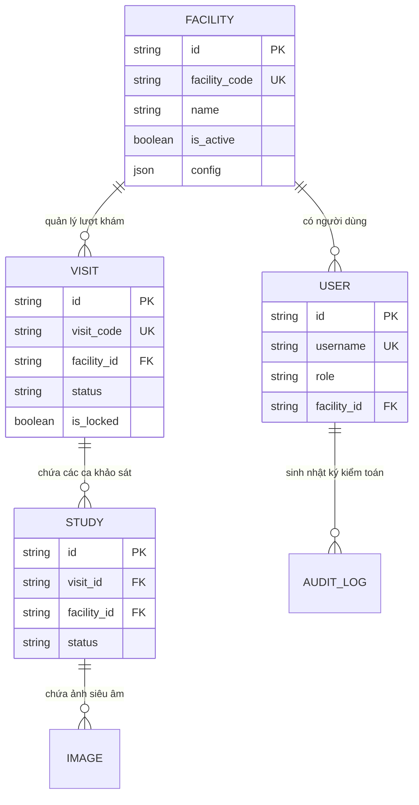

# KIẾN TRÚC VÀ CƠ CHẾ CÁCH LY ĐA CƠ SỞ (MULTI-FACILITY TENANT ISOLATION)
**Phiên bản kiến trúc**: 2026.1\
**Phạm vi áp dụng**: Chuẩn bị kỹ thuật cho việc triển khai thử nghiệm tại nhiều cơ sở y tế độc lập.

---

## 1. Mô hình Dữ liệu Đa cơ sở

Hệ thống thiết lập phân tầng dữ liệu chặt chẽ dựa trên 6 thực thể cốt lõi:

---

## 2. Nguyên tắc Cách ly Dữ liệu (Tenant Isolation Boundaries)

1. **Kiểm soát tại Backend (Server-Side Enforcement)**:
   - Cơ chế cách ly được thực thi tại tầng API và truy vấn ORM (`_check_facility_access`), không dựa vào việc ẩn nút trên giao diện người dùng.
   - Khi một bác sĩ thuộc cơ sở $A$ gửi yêu cầu truy xuất lượt khám hoặc hình ảnh của cơ sở $B$, hệ thống lập tức từ chối với mã lỗi `HTTP 403 Forbidden` kèm thông báo *"Truy cập ngoài phạm vi cơ sở y tế được cấp quyền."*

2. **Bảo vệ đường dẫn ảnh trực tiếp**:
   - Hình ảnh siêu âm lưu trữ tại server không được cung cấp URL tĩnh công khai có thể đoán được.
   - Mọi yêu cầu tải ảnh đều phải qua API kèm Bearer Token xác thực quyền của cơ sở tương ứng.

3. **Phân quyền vai trò (Role-Based Access Control - RBAC)**:
   - `ADMIN` toàn hệ thống (`facility_id = null`): Được phép tạo cơ sở mới, giám sát hoạt động kỹ thuật, xem báo cáo tổng hợp.
   - `ADMIN` cơ sở: Quản lý danh sách người dùng và cấu hình trong nội bộ cơ sở mình.
   - `DOCTOR` / `TECHNICIAN` lâm sàng: Tiếp nhận ca khám, chạy phân đoạn AI, rà soát kết quả HITL, chạy CDSS trong phạm vi cơ sở được phân công.
   - `VIEWER`: Chỉ xem báo cáo đã ký duyệt, không có quyền sửa đổi hay chạy phân đoạn.

4. **Kiểm toán vết thao tác (Audit Trails)**:
   - Mọi hành vi tạo lượt khám (`VISIT_CREATED`), khóa lượt khám (`VISIT_LOCKED`), tạo cơ sở (`FACILITY_CREATED`), và lưu rà soát (`REVIEW_COMMITTED`) đều được lưu vào bảng `audit_logs` với actor ID, timestamp UTC và metadata không chứa thông tin định danh cá nhân (PII).
