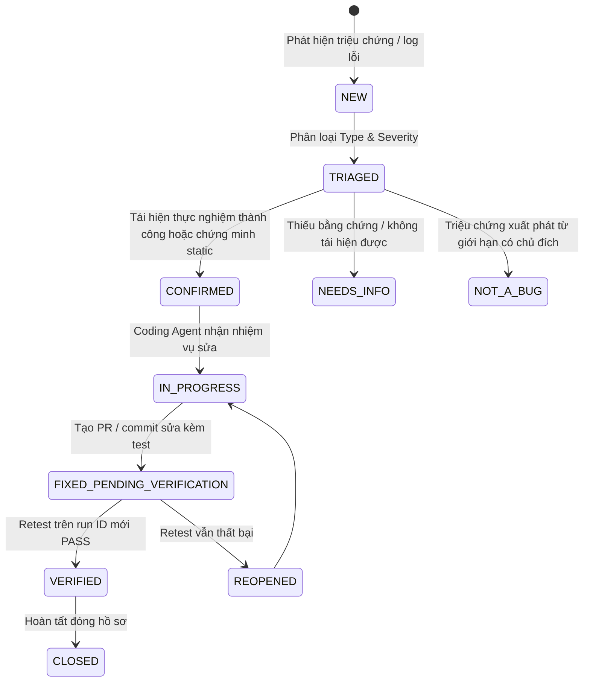

# Sổ Cái Kiểm Toán Lỗi & Bằng Chứng Tái Hiện (Bug Audit & Evidence Registry)
> **Mục tiêu**: Quản lý tập trung các phát hiện kiểm toán kỹ thuật (Findings), phân loại nghiêm ngặt giữa lỗi phần mềm (Product Bug), lỗi mô hình (Model Error), rào cản dữ liệu (Data Blocker) và giới hạn nghiên cứu (Limitation).  
> **Nguyên tắc cốt lõi**: Kiểm toán độc lập phát hiện và ghi nhận bằng chứng; việc sửa lỗi (Bug Fixing) là giai đoạn riêng biệt kế tiếp. Tuyệt đối không sửa code sản phẩm trong quá trình discovery.

---

## 1. Cấu trúc Hệ thống Kiểm toán (Directory Structure)

```text
docs/audit/
├── README.md               # Hướng dẫn quy trình, phân loại và vòng đời lỗi
├── bug_template.md         # Mẫu hồ sơ chi tiết chuẩn hóa cho từng AUD-NNNN
├── bug_index.csv           # Bảng chỉ mục tra cứu toàn bộ các findings đã ghi nhận
└── findings/               # Thư mục chứa các hồ sơ Markdown chuẩn (AUD-0001.md, ...)

evaluation/bug_audit/       # Kho lưu trữ raw evidence độc lập theo từng run_id
└── <run_id>/
    ├── run_manifest.json   # Cấu hình môi trường, Git HEAD, port, runtime
    ├── source_hashes.csv   # Snapshot mã băm SHA-256 các file mã nguồn tại run
    ├── coverage.csv        # Ma trận kiểm thử các phân hệ
    ├── commands.csv        # Nhật ký các lệnh đã thực thi
    └── logs/               # Raw tracebacks, console outputs, network responses
```

---

## 2. Vòng Đời Trạng Thái (Lifecycle State Machine)

Mọi phát hiện tuân thủ quy trình trạng thái rõ ràng:



- **Quy tắc chuyển trạng thái**: Đợt kiểm toán discovery hiện tại chỉ dừng ở các trạng thái: `NEW`, `TRIAGED`, `CONFIRMED`, `BLOCKED`, hoặc `LIMITATION`. Chỉ khi có commit sửa code thực tế và retest xanh mới chuyển sang `VERIFIED` / `CLOSED`.

---

## 3. Thang Phân Loại Mức Độ Nghiêm Trọng (Severity & Priority)

| Severity | Điều kiện kích hoạt | Priority mặc định | Hành động yêu cầu |
|---|---|:---:|---|
| **S0 Critical** | Lộ lọt thông tin nhận dạng y tế (PHI), lộ secret/key, phá hủy CSDL production, ghi đè nhầm ca/mặt nạ của bệnh nhân khác. | **P0** | Dừng ngay lập tức các thao tác liên quan; cách ly môi trường và thông báo khẩn cấp. |
| **S1 High** | Luồng nghiệp vụ chính bị gián đoạn (Upload, AI Inference, Edit, Confirm, Export); sai lệch kích thước mặt nạ hoặc tính toán metric sai; báo cáo readiness sai lệch. | **P0 / P1** | Ưu tiên sửa chữa đầu tiên trước các tính năng mới. |
| **S2 Medium** | Lỗi công cụ giao diện phụ, đo thời gian không đơn điệu, telemetry bị sót sự kiện nhỏ, có giải pháp khắc phục tạm thời (workaround) không gây mất dữ liệu. | **P1 / P2** | Lập kế hoạch xử lý trong sprint kế tiếp. |
| **S3 Low** | Lỗi hiển thị mỹ thuật, lệch khoảng cách pixel nhỏ trên giao diện, thông báo text chưa mượt mà nhưng không gây hiểu nhầm kết quả y tế. | **P2 / P3** | Xử lý khi có điều kiện tối ưu giao diện. |

---

## 4. Triage Các Vấn Đề Lịch Sử (Historical Issues Triage: ISS-01 đến ISS-05)

Các vấn đề từng được ghi nhận trong `evaluation/milestone_3_final/report/open_issues.csv` được phân định bản chất khoa học:

1. **ISS-01 (`DATA_BLOCKER`)**: Tập kiểm thử độc lập thiếu Patient ID gốc khiến Cổng Independent Gate ở trạng thái `BLOCKED`.
   - *Bản chất*: Rào cản dữ liệu nguồn lịch sử từ bệnh viện, **không phải lỗi code phần mềm (Not a Product Bug)**.
   - *Xử lý*: Giữ cổng BLOCKED; công nhận kết quả Retrospective Replay với frozen protocol.
2. **ISS-02 (`STUDY_GAP / CONDITIONAL`)**: Khảo sát người dùng lâm sàng chưa tiến hành (`study_status = NOT_CONDUCTED`).
   - *Bản chất*: Điều kiện tổ chức nghiên cứu thực tế phụ thuộc tiến độ bệnh viện, **không phải lỗi chức năng**.
   - *Xử lý*: Báo cáo trung thực 0 bác sĩ; chứng minh tính sẵn sàng qua bộ kiểm thử kỹ thuật tự động.
3. **ISS-03 (`DATA_LIMITATION`)**: 59 cặp ảnh có tương quan cao xuyên split do quét lát cắt liên tiếp.
   - *Bản chất*: Giới hạn thuộc tính dữ liệu nguồn mở ban đầu, **không phải lỗi thuật toán phân đoạn**.
   - *Xử lý*: Công khai trong MODEL_CARD và limitations.md.
4. **ISS-04 (`LIMITATION / FAIL-SAFE`)**: Phép đo kích thước 2D chỉ hiển thị pixel trên ảnh JPG/PNG khi thiếu `PixelSpacing`.
   - *Bản chất*: Đây là **hành vi thiết kế fail-safe có chủ đích** nhằm ngăn ngừa sai số y tế khi không có thông số chuẩn hóa từ máy siêu âm; không phải bug.
5. **ISS-05 (`LIMITATION`)**: Hệ thống là prototype phòng thí nghiệm chạy đơn máy.
   - *Bản chất*: Ranh giới phạm vi đề tài Khóa luận tốt nghiệp chuyên ngành MIS, **không phải lỗi kiến trúc**.
