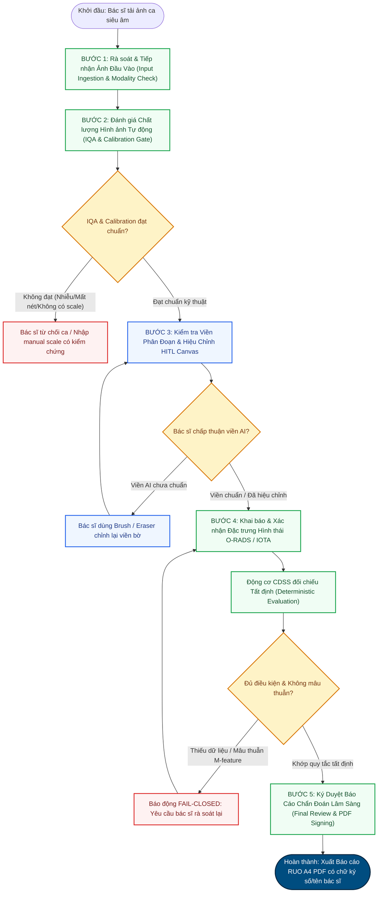

# BỘ HỒ SƠ NGHIỆM THU CHUYÊN MÔN LÂM SÀNG
## CLINICAL VALIDATION PACKET (CVP)
### Hệ Thống Hỗ Trợ Chẩn Đoán Siêu Âm Buồng Trứng Human-in-the-Loop (RUO)

---

- **Mã hồ sơ:** `CVP-OVUS-2026-V1`
- **Phiên bản:** `1.0-Standard-Audit`
- **Ngày ban hành:** 01/11/2026
- **Trạng thái phê duyệt:** Đệ trình Hội đồng Chuyên môn Chẩn đoán Hình ảnh & Bác sĩ Siêu âm Phụ khoa
- **Phạm vi pháp lý:** **STRICTLY RESEARCH USE ONLY (RUO) — HỆ THỐNG NGHIÊN CỨU HỌC THUẬT KHÓA LUẬN TỐT NGHIỆP**
- **Cơ chế hoạt động:** **HUMAN-IN-THE-LOOP (HITL) — BÁC SĨ LÂM SÀNG LÀ CHỦ THỂ DUYỆT VÀ QUYẾT ĐỊNH TỐI HẬU**

---

## 1. TỔNG QUAN HỒ SƠ NGHIỆM THU CHUYÊN MÔN (EXECUTIVE OVERVIEW)

### 1.1 Bối Cảnh & Mục Tiêu Dự Án
Trong chuyên ngành Chẩn đoán hình ảnh và Sản Phụ khoa, siêu âm 2D đường bụng (TAUS) và đầu dò âm đạo (TVUS) là phương tiện đầu tay để phát hiện, phân loại các khối u buồng trứng và tổn thương phần phụ. Tuy nhiên, tính phụ thuộc lớn vào kinh nghiệm của bác sĩ siêu âm (operator-dependent) và sự phức tạp của các đặc trưng hình thái (vách ngăn, chồi nhú, thành phần đặc, bóng cản âm) tạo ra sự dao động đáng kể trong chẩn đoán.

Hệ thống **Hỗ Trợ Chẩn Đoán Siêu Âm Buồng Trứng Human-in-the-Loop** được phát triển nhằm kết hợp:
1. **Thị giác máy tính sâu (Computer Vision Core)**: Kiến trúc mạng Attention U-Net++ scSE (Spatial and Channel Squeeze & Excitation) tối ưu hóa phân đoạn tổn thương pixel-level, tự động phát hiện viền tổn thương và trích xuất kích thước 2D ($D_{max}, D_{orth}$, diện tích, chu vi).
2. **Động cơ suy luận quy tắc tất định (Deterministic CDSS Reasoning Engine)**: Khóa cứng logic phân tầng theo chuẩn quốc tế **ACR O-RADS US v2022** và **IOTA Simple Rules / ADNEX** (`ruleset_version: "2022.1"`), loại bỏ hoàn toàn hiện tượng ảo giác (hallucination) của mô hình học sâu.
3. **Trạm làm việc tương tác Human-in-the-Loop (HITL Medical Workstation)**: Giao diện Canvas chuyên dụng cho phép bác sĩ trực tiếp xem xét, chỉnh sửa viền phân đoạn (Brush/Eraser/Opacity/Zoom/Pan), xác nhận đặc điểm mô thái học và ký duyệt báo cáo A4 PDF hoàn chỉnh.

### 1.2 Mục Đích Của Bộ Hồ Sơ Nghiệm Thu
Bộ Hồ sơ Nghiệm thu Chuyên môn Lâm sàng (Clinical Validation Packet - CVP) này được thiết lập nhằm:
- Cung cấp cơ sở lý luận, phương pháp luận và các bằng chứng thực nghiệm phục vụ buổi thẩm định của **Hội đồng Chuyên môn Chẩn đoán hình ảnh**, **Bác sĩ Trưởng khoa Siêu âm** và **Hội đồng Đánh giá Khóa luận Tốt nghiệp**.
- Phân định ranh giới pháp lý minh bạch: Hệ thống là công cụ hỗ trợ thứ cấp (RUO), không thay thế y lệnh bác sĩ.
- Thiết lập quy trình nghiệm thu lâm sàng chuẩn hóa 5 bước từ khâu tiếp nhận ảnh đến ký duyệt báo cáo.
- Công bố đầy đủ ma trận quy tắc phân tầng O-RADS tất định, đặc tả 20 ca phantom kiểm nghiệm và bảng điểm nghiệm thu 10 tiêu chí.

---

## 2. ĐỊNH VỊ PHÁP LÝ & RANH GIỚI NGHIÊN CỨU (LEGAL & REGULATORY POSITIONING)

### 2.1 Định Vị Pháp Lý Nghiên Cứu (Research Use Only - RUO)
> [!IMPORTANT]
> **Tuyên Bố Pháp Lý Bắt Buộc (Strictly Research Use Only - RUO):**
> 1. Toàn bộ mã nguồn, mô hình trí tuệ nhân tạo, động cơ CDSS và giao diện người dùng thuộc hệ thống này được xây dựng độc quyền phục vụ mục đích **nghiên cứu khoa học, mô phỏng học thuật và đào tạo y khoa**.
> 2. Hệ thống **chưa được cấp phép lưu hành thiết bị y tế (SaMD)** bởi Cục Quản lý Khám chữa bệnh (Bộ Y tế Việt Nam) hoặc Cục Quản lý Thực phẩm và Dược phẩm Hoa Kỳ (US FDA / CE-MDR).
> 3. Hệ thống **không được sử dụng độc lập để chẩn đoán xác định, phân tầng tiên lượng, chỉ định can thiệp phẫu thuật hoặc thay đổi phác đồ điều trị** cho bất kỳ bệnh nhân thực tế nào trên lâm sàng.

### 2.2 Nguyên Tắc Trách Nhiệm Chuyên Môn Tối Hậu (Ultimate Clinical Authority)
Hệ thống vận hành theo nguyên lý trung tâm: **AI Hỗ Trợ — Bác Sĩ Quyết Định**:
- **Tính chất tham khảo thứ cấp (Secondary Reference Only)**: Mọi kết quả do mô hình sinh ra (mặt nạ phân đoạn, số đo caliper $D_{max}/D_{orth}$, phân tầng O-RADS gợi ý, xác suất mô hình ADNEX) chỉ là khuyến nghị toán học hỗ trợ giảm tải thao tác lặp lại cho bác sĩ.
- **Không tự động chẩn đoán (No Autonomous CADx)**: Động cơ suy luận bị khóa cứng, cấm AI tự động suy diễn các đặc trưng mô bệnh học (như chồi nhú, vách ngăn, phản âm dịch, mạch máu) từ điểm ảnh thô. Các đặc trưng này bắt buộc phải do bác sĩ khám trực tiếp đánh giá và nhập liệu.
- **Quyền ký duyệt tối hậu thuộc về Bác sĩ**: Bác sĩ siêu âm chịu trách nhiệm chuyên môn và pháp lý hoàn toàn đối với báo cáo kết quả cuối cùng. Bác sĩ có toàn quyền chấp nhận, sửa đổi hoặc bác bỏ hoàn toàn mọi gợi ý của AI trên trạm làm việc. Không có bất kỳ báo cáo nào được xuất xưởng nếu chưa có xác nhận từ tài khoản bác sĩ phụ trách.

### 2.3 Tuyên Bố Đạo Đức & Quản Lý Dữ Liệu (Bioethics & Data Governance)
- **Tuân thủ quy chuẩn STARD-AI 2025 & IMDRF SaMD N41**: Hồ sơ kiểm định được biên soạn bám sát tiêu chuẩn quốc tế về minh bạch thuật toán trong y tế.
- **Bảo mật & Ẩn danh hóa**: Mọi hình ảnh thử nghiệm được loại bỏ hoàn toàn 18 yếu tố nhận dạng cá nhân theo chuẩn HIPAA (Safe Harbor Method), không chứa mã số bệnh án thực, tên tuổi hay địa chỉ bệnh nhân.
- **Tuyên bố tính độc lập cấp bệnh nhân (Patient-Level Independence Notice)**:
  Do hạn chế của các tập dữ liệu công khai không cung cấp mã định danh bệnh nhân gốc (`patient_id`), dữ liệu huấn luyện và kiểm thử được phân chia ở **cấp độ ảnh (Image-Level Split)** kèm cơ chế khử trùng lặp chặt chẽ bằng hàm băm SHA-256. Báo cáo này minh bạch ghi nhận: *Tính độc lập cấp bệnh nhân chưa được xác minh độc lập (Unverified Patient-Level Independence)*. Mọi metric (Dice, IoU, MAE) được công bố chỉ phản ánh năng lực xử lý hình ảnh thị giác máy tính, không được ngoại suy thành hiệu quả lâm sàng độc lập trên từng ca bệnh riêng biệt.

---

## 3. QUY TRÌNH NGHIỆM THU LÂM SÀNG ĐA BƯỚC (5-STEP CLINICAL VALIDATION WORKFLOW)

Quy trình thẩm định và nghiệm thu hệ thống trên lâm sàng tuân thủ quy chuẩn 5 bước khép kín, đảm bảo an toàn tuyệt đối và tính truy nguyên đầy đủ:

### 3.1 Bước 1: Rà Soát & Tiếp Nhận Ảnh Đầu Vào (Input Ingestion & Modality Check)
- **Tiêu chuẩn ảnh đầu vào**:
  - Ảnh siêu âm 2D B-mode qua đầu dò âm đạo (TVUS, tần số $5.0 - 9.0\text{ MHz}$) hoặc đầu dò bụng (TAUS, tần số $3.5 - 5.0\text{ MHz}$).
  - Định dạng chuẩn y tế DICOM (`.dcm`) hoặc định dạng ảnh lossless (`.png`, `.bmp`, `.tiff`, JPEG chất lượng cao).
  - Không chấp nhận ảnh 3D/4D render bề mặt, ảnh siêu âm Doppler màu chiếm toàn bộ tổn thương (làm mất tín hiệu ranh giới âm học).
- **Kiểm tra Siêu dữ liệu Tỉ lệ (Pixel Spacing Calibration)**:
  - Hệ thống chỉ cho phép chuyển đổi kích thước điểm ảnh sang millimet ($0.2\text{ mm/pixel}$) khi có metadata DICOM hợp lệ hoặc người dùng xác nhận thang đo quang học (optical ruler scale calibration).
  - Nếu thiếu siêu dữ liệu, tính năng đo đạc mm sẽ bị khóa ở trạng thái an toàn: `calibrated: false`.

### 3.2 Bước 2: Đánh Giá Chất Lượng Hình Ảnh Tự Động (Image Quality Assessment - IQA)
- **Thuật toán IQA đa tham số**:
  1. *Độ sắc nét biên (Laplacian Variance)*: Loại trừ ảnh rung nhòe, mất nét do đầu dò dịch chuyển nhanh.
  2. *Độ tương phản cục bộ (Local Michelson / RMS Contrast)*: Xác định tổn thương có đủ tương phản với mô đệm buồng trứng xung quanh hay không.
  3. *Tỷ lệ vùng cản âm mạnh (Acoustic Shadowing Coverage)*: Cảnh báo vùng tối do xương chậu hoặc quai ruột chứa hơi che khuất.
  4. *Tỷ lệ che phủ màu (Doppler Color Artifact Ratio)*: Phát hiện hộp màu (Color Doppler box) tràn viền gây biến dạng viền B-mode.
- **Nguyên tắc xử lý**: Nếu IQA đánh giá chất lượng ảnh kém, hệ thống hiển thị cảnh báo lâm sàng màu vàng trên trạm làm việc, khuyến nghị bác sĩ quét lại góc cắt khác trước khi phân tích tiếp.

### 3.3 Bước 3: Kiểm Tra Viền Phân Đoạn & Hiệu Chỉnh HITL Canvas
- **Hiển thị trực quan (Visualization)**:
  - Lớp phủ bán trong suốt (Transparent Overlay) với độ mờ điều chỉnh linh hoạt ($0\% - 100\%$) giúp bác sĩ nhìn thấu cấu trúc âm học bên dưới.
  - Đường bao hình học định hướng (minAreaRect) tự động dựng trục dài nhất ($D_{max}$) và trục trực giao ($D_{orth}$).
- **Bộ công cụ can thiệp Human-in-the-Loop**:
  - *Interactive Brush (Cọ vẽ)*: Cho phép bác sĩ bổ sung các vùng ranh giới bị khuyết do âm vang kém hoặc giảm âm phía sau.
  - *Interactive Eraser (Tẩy)*: Cho phép xóa các vùng phân đoạn nhầm sang quai ruột lân cận, mạch máu chậu hoặc bàng quang.
  - *Zoom & Pan mượt mà*: Phóng to tới $400\%$ để soi rõ các cấu trúc vi thể như vách ngăn mỏng $< 3\text{ mm}$ hoặc chồi nhú $< 5\text{ mm}$.
  - *Audit Revision Tracking*: Mọi nét vẽ hiệu chỉnh đều được lưu phiên bản (`revision_id`) phục vụ kiểm toán chất lượng.

### 3.4 Bước 4: Khai Báo & Xác Nhận Đặc Trưng Hình Thái O-RADS / IOTA
- **Nguyên tắc Không Suy Đoán (Zero Hallucination)**:
  Hệ thống tuyệt đối **không** dùng mạng nơ-ron để tự điền các trường hình thái học. Bác sĩ trực tiếp lựa chọn trên giao diện nhập liệu có cấu trúc:
  - Số lượng thùy nang (`locules_count`): 1 (đơn thùy), 2-10 (đa thùy), >10 thùy.
  - Phản âm dịch (`fluid_echogenicity`): Trống âm (anechoic), phản âm kém (low level), dạng kính mờ (ground glass), xuất huyết (hemorrhagic), hỗn hợp (mixed).
  - Thành phần đặc / chồi nhú (`has_solid_component`, `papillary_projections_count`).
  - Bóng cản âm sau (`acoustic_shadowing`): Có / Không.
  - Thành nang và bờ (`wall_irregular`): Nhẵn / Không đều.
  - Phổ Doppler màu (`color_score`): 1 (không mạch), 2 (tối thiểu), 3 (trung bình), 4 (rất mạnh).
  - Tình trạng lâm sàng đi kèm: Cổ trướng (`has_ascites`), nốt phúc mạc (`has_peritoneal_nodules`), tình trạng mãn kinh (`is_premenopausal`).
- **Động cơ CDSS đối chiếu tất định**:
  - Áp dụng các quy tắc khóa bất biến (`ruleset_version: "2022.1"`).
  - Đảm bảo tính nhất quán giữa các trường: Ví dụ nếu khai có chồi nhú $\ge 4$ thì cờ IOTA M3 tự động đồng bộ; nếu có bất kỳ tiêu chí M nào (M1-M5), hệ thống kích hoạt **M-Feature Lockout**, ngăn cản việc gắn nhãn O-RADS nguy cơ thấp.

### 3.5 Bước 5: Ký Duyệt Báo Cáo Chẩn Đoán Lâm Sàng (Final Review & PDF Signing)
- **Khởi tạo bản nháp A4 PDF y tế chuẩn mực**:
  - Sinh báo cáo thời gian thực bằng dịch vụ [MedicalReportGenerator](file:///C:/Users/Dung/Documents/UNet-Vinmec-KhoaLuan/backend/services/report_generator.py).
  - Hiển thị song song: Ảnh siêu âm gốc (B-mode) và Ảnh có lớp phủ phân đoạn kèm caliper kích thước ($D_1 \times D_2$).
  - Bảng kết quả CDSS O-RADS đối chiếu, phân tích IOTA Simple Rules và ADNEX (nếu có chỉ định).
- **Cơ chế Khóa Phiên & Ký Duyệt Chuyên Môn (Review Lockout)**:
  - Khi bác sĩ bấm "Ký Duyệt Báo Cáo", phiên làm việc chuyển sang trạng thái `LOCKED_APPROVED`.
  - Toàn bộ tham số, mặt nạ phân đoạn và nội dung mô tả bị đóng băng, gắn tem thời gian và tên bác sĩ phụ trách.
  - Bản in xuất ra có dòng tiêu đề và chân trang đỏ bắt buộc: **"BÁO CÁO NGHIÊN CỨU RUO — HỖ TRỢ RÀ SOÁT HÌNH ẢNH — KHÔNG DÙNG THAY THẾ CHẨN ĐOÁN LÂM SÀNG"**.

---

## 4. DANH MỤC TÀI LIỆU HỒ SƠ NGHIỆM THU ĐÍNH KÈM (PACKET INVENTORY)

Bộ Hồ sơ Nghiệm thu Chuyên môn Lâm sàng đầy đủ bao gồm các tài liệu thành phần được liên kết chặt chẽ dưới đây:

| STT | Mã tài liệu | Tên tài liệu chi tiết | Nội dung chính | Trạng thái |
| :---: | :--- | :--- | :--- | :---: |
| 1 | **CVP-CORE** | [CLINICAL_VALIDATION_PACKET.md](file:///C:/Users/Dung/Documents/UNet-Vinmec-KhoaLuan/docs/clinical_validation/CLINICAL_VALIDATION_PACKET.md) | Tài liệu chủ đạo: Tổng quan, định vị pháp lý RUO, quy trình 5 bước HITL. | **HOÀN THÀNH** |
| 2 | **CVP-MATRIX** | [O_RADS_DETERMINISTIC_RULES_MATRIX.md](file:///C:/Users/Dung/Documents/UNet-Vinmec-KhoaLuan/docs/clinical_validation/O_RADS_DETERMINISTIC_RULES_MATRIX.md) | Ma trận phân tầng O-RADS US v2022 tất định, quy tắc hai buồng trứng worst-case. | **HOÀN THÀNH** |
| 3 | **CVP-SPEC** | [SYNTHETIC_PHANTOM_COHORT_SPEC.md](file:///C:/Users/Dung/Documents/UNet-Vinmec-KhoaLuan/docs/clinical_validation/SYNTHETIC_PHANTOM_COHORT_SPEC.md) | Đặc tả 20 ca test vector phantom kiểm nghiệm thuật toán phân đoạn và CDSS. | **HOÀN THÀNH** |
| 4 | **CVP-CHECKLIST**| [CLINICIAN_REVIEW_CHECKLIST.md](file:///C:/Users/Dung/Documents/UNet-Vinmec-KhoaLuan/docs/clinical_validation/CLINICIAN_REVIEW_CHECKLIST.md) | Phiếu đánh giá 10 tiêu chí nghiệm thu chuyên môn dành cho Bác sĩ Siêu âm. | **HOÀN THÀNH** |
| 5 | **SYS-CDSS** | [backend/services/cdss_engine.py](file:///C:/Users/Dung/Documents/UNet-Vinmec-KhoaLuan/backend/services/cdss_engine.py) | Mã nguồn Động cơ CDSS tất định, kiểm thử 31/31 ca pass. | **ĐÃ XÁC MINH** |
| 6 | **SYS-REPORT** | [backend/services/report_generator.py](file:///C:/Users/Dung/Documents/UNet-Vinmec-KhoaLuan/backend/services/report_generator.py) | Module sinh báo cáo A4 PDF y tế với phông chữ tiếng Việt Unicode và disclaimer RUO. | **ĐÃ XÁC MINH** |
| 7 | **EVA-CALIPER** | [caliper_phantom_validation_report.md](file:///C:/Users/Dung/Documents/UNet-Vinmec-KhoaLuan/docs/evaluation/caliper_phantom_validation_report.md) | Báo cáo kiểm định thước đo caliper trên 50 phantom (MAE = 0.002 mm, ICC = 0.9999). | **ĐÃ XÁC MINH** |
| 8 | **EVA-CDSS** | [cdss_ruleset_validation_report.md](file:///C:/Users/Dung/Documents/UNet-Vinmec-KhoaLuan/docs/evaluation/cdss_ruleset_validation_report.md) | Báo cáo kiểm định bộ quy tắc CDSS trên ma trận 30 ca tổng hợp. | **ĐÃ XÁC MINH** |

---

## 5. CAM KẾT & KÝ DUYỆT CỦA BAN PHÁT TRIỂN HỆ THỐNG

Chúng tôi, nhóm kỹ thuật và chuyên viên phân tích nghiệp vụ phụ trách đề tài:
- Cam kết tuân thủ nghiêm ngặt các quy định pháp luật về nghiên cứu khoa học y sinh và an toàn dữ liệu.
- Cam kết không tự ý sửa đổi phiên bản bộ quy tắc CDSS hoặc nới lỏng các cổng kiểm soát an toàn (fail-closed guardrails) đã được thiết lập.
- Trân trọng kính trình Hội đồng Thẩm định Chuyên môn xem xét và tiến hành đánh giá nghiệm thu theo các tiêu chuẩn quy định trong bộ hồ sơ này.
