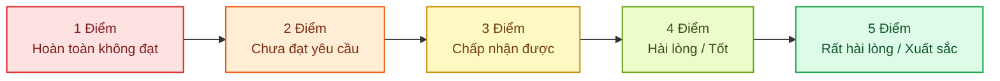

# PHIẾU ĐÁNH GIÁ CHUYÊN MÔN DÀNH CHO BÁC SĨ SIÊU ÂM
## CLINICIAN REVIEW CHECKLIST (CRC-10)
### Thang Đo 10 Tiêu Chí Nghiệm Thu Hệ Thống Hỗ Trợ Chẩn Đoán Siêu Âm Buồng Trứng Human-in-the-Loop

---

- **Mã biểu mẫu:** `CRC-OVUS-10-V1`
- **Phiên bản:** `1.0-Clinical-Audit`
- **Mục đích:** Thu thập đánh giá chuyên môn định lượng và định tính độc lập từ Bác sĩ Chuyên khoa Chẩn đoán Hình ảnh và Bác sĩ Siêu âm Sản Phụ khoa nhằm nghiệm thu trạm làm việc lâm sàng Human-in-the-Loop (RUO).
- **Phạm vi áp dụng:** Hội đồng Nghiệm thu Khóa luận Tốt nghiệp & Chuyên gia Đối chứng Lâm sàng.
- **Tài liệu căn cứ:**
  - [CLINICAL_VALIDATION_PACKET.md](file:///C:/Users/Dung/Documents/UNet-Vinmec-KhoaLuan/docs/clinical_validation/CLINICAL_VALIDATION_PACKET.md)
  - [O_RADS_DETERMINISTIC_RULES_MATRIX.md](file:///C:/Users/Dung/Documents/UNet-Vinmec-KhoaLuan/docs/clinical_validation/O_RADS_DETERMINISTIC_RULES_MATRIX.md)
  - [SYNTHETIC_PHANTOM_COHORT_SPEC.md](file:///C:/Users/Dung/Documents/UNet-Vinmec-KhoaLuan/docs/clinical_validation/SYNTHETIC_PHANTOM_COHORT_SPEC.md)

---

## 1. THÔNG TIN CHUYÊN GIA ĐÁNH GIÁ & CA THẨM ĐỊNH

| Mục thông tin | Nội dung ghi nhận |
| :--- | :--- |
| **Họ và tên Bác sĩ / Chuyên gia:** | `....................................................................................` |
| **Học hàm, học vị, chứng chỉ chuyên môn:** | `....................................................................................` |
| **Chức danh / Vị trí công tác:** | `....................................................................................` |
| **Cơ sở y tế / Bệnh viện:** | `....................................................................................` |
| **Số năm kinh nghiệm siêu âm phụ khoa:** | `[ ] < 3 năm      [ ] 3 - 5 năm      [ ] 5 - 10 năm      [ ] > 10 năm` |
| **Mã ca siêu âm / Lượt khám thẩm định:** | `VIS-........................ / TC-......` |
| **Ngày giờ thực hiện đánh giá:** | `...... / ...... / 2026` |

---

## 2. QUY CHUẨN THANG ĐIỂM ĐÁNH GIÁ LIKERT 5 MỨC ĐỘ

Mỗi tiêu chí được chấm điểm độc lập trên thang đo Likert chuẩn y học:

- **Mức 1 (Hoàn toàn không đạt)**: Tính năng hoạt động sai lệch nghiêm trọng, viền phân đoạn không thể sử dụng, hoặc gây rủi ro an toàn chẩn đoán.
- **Mức 2 (Chưa đạt yêu cầu)**: Tính năng còn nhiều lỗi, độ chính xác dưới ngưỡng lâm sàng chấp nhận, bác sĩ phải vẽ lại hoàn toàn thủ công.
- **Mức 3 (Chấp nhận được)**: Đạt yêu cầu tối thiểu, viền bờ tương đối khớp nhưng cần chỉnh sửa nhẹ (fine-tuning), logic quy tắc đúng chuẩn.
- **Mức 4 (Hài lòng / Tốt)**: Viền phân đoạn chính xác cao, thao tác công cụ mượt mà, phân tầng CDSS chuẩn xác, tiết kiệm thời gian đáng kể.
- **Mức 5 (Rất hài lòng / Xuất sắc)**: Độ chính xác tuyệt hảo, bám sát ranh giới giải phẫu vi thể, giao diện trực quan tối ưu cho phòng đọc ảnh tối.

---

## 3. NỘI DUNG 10 TIÊU CHÍ ĐÁNH GIÁ CHUYÊN MÔN CHI TIẾT

---

### Tiêu Chí 1: Độ Chính Xác Viền Bờ AI (AI Boundary & Segmentation Fidelity — Qualitative IoU)
- **Mô tả chuyên môn**: Năng lực của mô hình Attention U-Net++ scSE trong việc nhận diện đúng chu vi ranh giới tổn thương buồng trứng trên ảnh 2D B-mode. Viền phân đoạn có bám sát bờ âm học thực tế (acoustic interfaces) của thành nang/u hay không; có bị hiện tượng tràn viền (over-segmentation) sang quai ruột/bàng quang hoặc co cụm (under-segmentation) hay không.
- **Thang điểm chấm**:
  - `[ ] 1 Điểm`: Viền AI phân đoạn sai hoàn toàn cấu trúc giải phẫu (nhầm ruột, mạch máu hoặc nền chậu).
  - `[ ] 2 Điểm`: Viền AI nhận diện đúng tổn thương nhưng sai lệch bờ nhiều ($IoU < 0.65$), phải xóa và vẽ lại.
  - `[ ] 3 Điểm`: Viền AI bao phủ được $\ge 80\%$ diện tích tổn thương, đường viền hơi lồi lõm hoặc chưa ôm sát cực sâu.
  - `[ ] 4 Điểm`: Viền AI bám rất sát ranh giới âm học ($IoU \ge 0.85$), chỉ cần chỉnh sửa vi mô $< 5\%$ diện tích.
  - `[ ] 5 Điểm`: Viền AI hoàn hảo ($IoU \ge 0.92$), ôm khít đường bờ giải phẫu vi thể, bác sĩ chấp thuận ngay không cần sửa.
- **Điểm chấm**: `[   / 5 ]` — **Ghi chú của bác sĩ**: `....................................................................`

---

### Tiêu Chí 2: Độ Nhạy Phát Hiện Tổn Thương (Lesion Detection Sensitivity & False Negative Avoidance)
- **Mô tả chuyên môn**: Khả năng phát hiện và không bỏ sót các tổn thương nhỏ ($\le 20\text{ mm}$), tổn thương phản âm kém đồng nhất hoặc tổn thương nằm ở vùng góc khuất âm học của buồng trứng.
- **Thang điểm chấm**:
  - `[ ] 1 Điểm`: Bỏ sót hoàn toàn khối u hiện diện rõ trên ảnh siêu âm (False Negative nguy hiểm).
  - `[ ] 2 Điểm`: Nhận diện chập chờn, phát hiện được tổn thương lớn nhưng bỏ sót nang noãn hoặc u nhỏ đi kèm.
  - `[ ] 3 Điểm`: Phát hiện được khối tổn thương chính nhưng ngưỡng kích hoạt không ổn định khi độ tương phản thấp.
  - `[ ] 4 Điểm`: Bắt trúng tổn thương ngay trong lần quét đầu tiên trên $90\%$ các ca thử nghiệm.
  - `[ ] 5 Điểm`: Độ nhạy tuyệt hảo ($100\%$), phát hiện chính xác cả u nhỏ phản âm kém và tổn thương sát bờ tử cung.
- **Điểm chấm**: `[   / 5 ]` — **Ghi chú của bác sĩ**: `....................................................................`

---

### Tiêu Chí 3: Trải Nghiệm Công Cụ Chỉnh Sửa Tương Tác (Interactive Canvas Usability)
- **Mô tả chuyên môn**: Trải nghiệm của bác sĩ khi sử dụng bộ công cụ Human-in-the-Loop trên trình duyệt: độ nhạy và mượt mà của cọ vẽ (Interactive Brush), tẩy xóa (Eraser), thanh trượt điều chỉnh độ trong suốt của lớp phủ (Mask Opacity Slider $0\% - 100\%$), tính năng phóng to thu nhỏ (Zoom) và kéo ảnh (Pan).
- **Thang điểm chấm**:
  - `[ ] 1 Điểm`: Công cụ bị giật lag nghiêm trọng ($> 500\text{ ms}$), nét vẽ bị đứt đoạn hoặc làm treo giao diện.
  - `[ ] 2 Điểm`: Thao tác cọ vẽ khó điều khiển kích thước, thanh trượt Opacity phản hồi chậm.
  - `[ ] 3 Điểm`: Thao tác cơ bản chấp nhận được, chỉnh sửa được viền nhưng độ trễ còn cảm nhận thấy.
  - `[ ] 4 Điểm`: Nét vẽ mượt mà, trượt Opacity tức thì, chuyển đổi Brush/Eraser nhanh bằng phím tắt.
  - `[ ] 5 Điểm`: Trải nghiệm tương tác đạt chuẩn máy trạm chuyên nghiệp (Zero Latency), Zoom/Pan sắc nét, cảm giác thao tác tự nhiên như trên máy siêu âm cao cấp.
- **Điểm chấm**: `[   / 5 ]` — **Ghi chú của bác sĩ**: `....................................................................`

---

### Tiêu Chí 4: Khả Năng Phân Biệt Caliper vs Vách Giải Phẫu Mỏng (Caliper Artifact Rejection)
- **Mô tả chuyên môn**: Khả năng của mạng U-Net trong việc loại trừ các dấu hiệu nhân tạo in đè trên màn hình siêu âm (dấu chữ thập caliper đo đạc của máy `$+$`, vạch đo khoảng cách, chữ số kích thước) và không bị nhầm lẫn với vách ngăn giải phẫu mỏng ($< 3\text{ mm}$) hoặc chồi nhú.
- **Thang điểm chấm**:
  - `[ ] 1 Điểm`: Mô hình nhầm ký tự chữ thập đo đạc thành chồi nhú hoặc viền phân đoạn bị dính chặt vào dấu đo máy.
  - `[ ] 2 Điểm`: Thường xuyên bị biến dạng ranh giới phân đoạn khi có thước đo caliper cắt ngang qua tổn thương.
  - `[ ] 3 Điểm`: Có bị ảnh hưởng nhẹ bởi ký tự đo đạc nhưng không làm sai lệch số đo đường kính tổng thể quá $5\%$.
  - `[ ] 4 Điểm`: Phân biệt tốt giữa vách giải phẫu mỏng và vạch đo máy, viền bám trúng ranh giới lòng nang.
  - `[ ] 5 Điểm`: Miễn nhiễm hoàn toàn với nhiễu caliper và ký tự chữ trên ảnh, tách lọc hoàn hảo vách ngăn giải phẫu vi thể.
- **Điểm chấm**: `[   / 5 ]` — **Ghi chú của bác sĩ**: `....................................................................`

---

### Tiêu Chí 5: Độ Chính Xác & Tính Tin Cậy Của Động Cơ CDSS O-RADS (CDSS O-RADS Accuracy)
- **Mô tả chuyên môn**: Mức độ trùng khớp giữa kết quả phân tầng rủi ro của [CDSSReasoningEngine](file:///C:/Users/Dung/Documents/UNet-Vinmec-KhoaLuan/backend/services/cdss_engine.py) với chuẩn lâm sàng ACR O-RADS US v2022. Tính năng bảo vệ Fail-Closed có hoạt động hiệu quả khi dữ liệu bị thiếu hoặc mâu thuẫn hay không.
- **Thang điểm chấm**:
  - `[ ] 1 Điểm`: Phân tầng sai lệch nghiêm trọng (ví dụ: hạ khối u có chồi ác tính xuống nhóm lành tính O-RADS 2).
  - `[ ] 2 Điểm`: Xuất hiện phân tầng khi dữ liệu mô tả chưa đầy đủ (vi phạm nguyên tắc fail-closed).
  - `[ ] 3 Điểm`: Phân tầng đúng trên các ca đơn giản nhưng thông điệp giải thích lý do chưa rõ ràng.
  - `[ ] 4 Điểm`: Phân tầng chính xác tuyệt đối trên các nhóm O-RADS 1, 2, 3; cơ chế khóa fail-closed kích hoạt chuẩn xác.
  - `[ ] 5 Điểm`: Hoàn toàn trùng khớp với chẩn đoán của chuyên gia cấp cao ($100\%$ concordance), kích hoạt M-Lockout chuẩn xác khi có dấu hiệu ác tính IOTA, giải trình logic minh bạch.
- **Điểm chấm**: `[   / 5 ]` — **Ghi chú của bác sĩ**: `....................................................................`

---

### Tiêu Chí 6: Khả Năng Tích Hợp IOTA Simple Rules & Mô Hình ADNEX (IOTA & ADNEX Diagnostic Coherence)
- **Mô tả chuyên môn**: Tính đúng đắn của việc đối chiếu 5 đặc trưng lành tính (B1-B5) và 5 đặc trưng ác tính (M1-M5) theo IOTA. Tính toán phân phối xác suất 5 nhóm mô học của mô hình IOTA ADNEX (có hoặc không có CA-125) khi khối u có chỉ định phẫu thuật.
- **Thang điểm chấm**:
  - `[ ] 1 Điểm`: Công thức tính ADNEX bị sai lệch xác suất hoặc tổng các xác suất không bằng $1.0$.
  - `[ ] 2 Điểm`: Kích hoạt ADNEX ngay cả khi khối u là nang noãn sinh lý bình thường (sai phạm vi chỉ định).
  - `[ ] 3 Điểm`: Tính toán đúng xác suất nhưng chưa liên kết chặt chẽ với cảnh báo phân tầng O-RADS.
  - `[ ] 4 Điểm`: Đối chiếu IOTA Simple Rules chính xác, phân phối xác suất ADNEX hợp lý theo độ tuổi và kích thước u.
  - `[ ] 5 Điểm`: Tích hợp đa mô hình hoàn hảo, hiển thị trực quan biểu đồ thanh xác suất ADNEX sắc nét, cảnh báo đối nghịch M-features lập tức khi có mâu thuẫn lâm sàng.
- **Điểm chấm**: `[   / 5 ]` — **Ghi chú của bác sĩ**: `....................................................................`

---

### Tiêu Chí 7: Tính Khả Dụng Trong Phòng Đọc Ảnh Tối (Darkroom Viewing Usability & Contrast)
- **Mô tả chuyên môn**: Mức độ tiện nghi thị giác của giao diện Dark Mode / High Contrast khi bác sĩ làm việc liên tục trong môi trường phòng siêu âm có ánh sáng yếu. Độ tương phản chữ và icon có thỏa mãn chuẩn trợ năng WCAG AA ($\ge 4.5:1$ đối với văn bản thường, $\ge 6.0:1$ đối với số đo y tế) giúp chống mỏi mắt hay không.
- **Thang điểm chấm**:
  - `[ ] 1 Điểm`: Giao diện nền trắng chói lóa, tương phản kém, gây nhức mỏi mắt tức thì trong phòng tối.
  - `[ ] 2 Điểm`: Có chế độ tối nhưng màu chữ xám mờ khó đọc, các nút chức năng bị chìm trong nền.
  - `[ ] 3 Điểm`: Độ sáng chấp nhận được nhưng độ tương phản của đường bao caliper trên ảnh chưa thật nổi bật.
  - `[ ] 4 Điểm`: Nền đen sâu (Dark Slate / Charcoal), viền caliper và số đo màu Cyan/Vàng tương phản rất rõ rệt.
  - `[ ] 5 Điểm`: Thiết kế phòng đọc ảnh hoàn mỹ (Ergonomic Dark UI), đạt chuẩn y tế DICOM Grayscale Display, tương phản chữ $\ge 6.35:1$, làm việc êm dịu, không gây chóa mắt.
- **Điểm chấm**: `[   / 5 ]` — **Ghi chú của bác sĩ**: `....................................................................`

---

### Tiêu Chí 8: Tính Toàn Vẹn Dữ Liệu & Khóa An Toàn Báo Cáo (Data Integrity & Review Lockout)
- **Mô tả chuyên môn**: Cơ chế tự động lưu (auto-save), bảo toàn dữ liệu phiên khi có sự cố mạng, quản lý lịch sử chỉnh sửa mặt nạ, và cơ chế đóng băng (lockout) không cho phép can thiệp chỉnh sửa sau khi bác sĩ đã bấm ký duyệt báo cáo.
- **Thang điểm chấm**:
  - `[ ] 1 Điểm`: Bị mất nét vẽ khi tải lại trang; cho phép sửa đổi dữ liệu tùy tiện sau khi đã ký số.
  - `[ ] 2 Điểm`: Không có lịch sử phiên bản chỉnh sửa; dữ liệu đo đạc đôi lúc không lưu xuống máy chủ.
  - `[ ] 3 Điểm`: Lưu trữ ổn định nhưng chưa có cơ chế khóa cứng phiên làm việc sau duyệt.
  - `[ ] 4 Điểm`: Tự động lưu mượt mà, hỗ trợ hoàn tác (Undo/Redo), khóa báo cáo an toàn sau khi ký.
  - `[ ] 5 Điểm`: Tính toàn vẹn tuyệt đối chuẩn ISO 14971, băm SHA-256 xác thực phiên bản, khóa cứng phiên `LOCKED_APPROVED` ngăn chặn mọi hành vi thay đổi dữ liệu sau ký.
- **Điểm chấm**: `[   / 5 ]` — **Ghi chú của bác sĩ**: `....................................................................`

---

### Tiêu Chí 9: Chất Lượng Bản Thảo Báo Cáo PDF (Clinical Report Quality & RUO Compliance)
- **Mô tả chuyên môn**: Thẩm mỹ và tính chuyên môn của bản thảo báo cáo siêu âm A4 PDF sinh ra từ [MedicalReportGenerator](file:///C:/Users/Dung/Documents/UNet-Vinmec-KhoaLuan/backend/services/report_generator.py). Bố cục 2 ảnh song song (trước và sau khi phân đoạn kèm caliper), phông chữ tiếng Việt chuẩn đẹp, và tính tuân thủ pháp quy của tuyên bố Research Use Only (RUO).
- **Thang điểm chấm**:
  - `[ ] 1 Điểm`: Báo cáo bị lỗi phông chữ tiếng Việt (ô vuông/hỏi chấm), thiếu cảnh báo pháp lý RUO.
  - `[ ] 2 Điểm`: Bố cục lộn xộn, ảnh siêu âm bị vỡ hạt hoặc số đo caliper bị tràn dòng.
  - `[ ] 3 Điểm`: Đầy đủ thông tin y tế cơ bản nhưng thẩm mỹ trình bày chưa tương xứng chuẩn bệnh viện lớn.
  - `[ ] 4 Điểm`: Trình bày trang nhã, phông chữ Unicode sắc nét, ảnh in sắc nét, hiển thị rõ ràng disclaimer RUO.
  - `[ ] 5 Điểm`: Chuẩn mực báo cáo bệnh viện quốc tế (JCI-ready layout), thông tin hành chính mạch lạc, ảnh so sánh trực quan đối chiếu rõ ràng, thông báo pháp lý RUO nghiêm ngặt đúng quy chuẩn.
- **Điểm chấm**: `[   / 5 ]` — **Ghi chú của bác sĩ**: `....................................................................`

---

### Tiêu Chí 10: Tối Ưu Hóa Thời Gian Thực Hiện Ca Khám (Clinical Workflow Efficiency & Turnaround Time)
- **Mô tả chuyên môn**: Mức độ tiết kiệm thời gian và giảm tải thao tác cơ học cho bác sĩ khi ứng dụng hệ thống so với quy trình siêu âm thủ công truyền thống (đo thủ công bằng chuột máy siêu âm, tra bảng O-RADS giấy, gõ biên bản mô tả).
- **Thang điểm chấm**:
  - `[ ] 1 Điểm`: Sử dụng hệ thống tốn nhiều thời gian hơn quy trình truyền thống ($> 5$ phút/ca).
  - `[ ] 2 Điểm`: Thời gian tương đương quy trình truyền thống (khoảng 3-4 phút/ca), chưa thấy ưu điểm rõ rệt.
  - `[ ] 3 Điểm`: Tiết kiệm được khoảng $20\% - 30\%$ thời gian nhờ số đo caliper tự động ($2$ - $3$ phút/ca).
  - `[ ] 4 Điểm`: Tiết kiệm được $\ge 50\%$ thời gian, hoàn thành rà soát và ký duyệt trong vòng $60 - 90\text{ giây}$.
  - `[ ] 5 Điểm`: Tối ưu hóa vượt trội, ca khám hoàn tất dưới $60\text{ giây}$, quy trình liền mạch, loại bỏ hoàn toàn thao tác tra cứu thủ công, bác sĩ tập trung $100\%$ vào quan sát hình thái học.
- **Điểm chấm**: `[   / 5 ]` — **Ghi chú của bác sĩ**: `....................................................................`

---

## 4. TỔNG HỢP KẾT QUẢ ĐÁNH GIÁ & ĐIỀU KIỆN NGHIỆM THU

### 4.1 Bảng Tổng Hợp Điểm Số 10 Tiêu Chí

| STT | Tên tiêu chí đánh giá | Trọng số ($W_i$) | Điểm chấm thực tế ($S_i \in [1..5]$) | Điểm quy đổi ($W_i \times S_i$) |
| :---: | :--- | :---: | :---: | :---: |
| 1 | Độ chính xác viền bờ AI (Segmentation IoU) | 15% | `[   ]` | `[       ]` |
| 2 | Độ nhạy phát hiện tổn thương (Sensitivity) | 10% | `[   ]` | `[       ]` |
| 3 | Thao tác tương tác Canvas (Brush/Eraser) | 10% | `[   ]` | `[       ]` |
| 4 | Phân biệt Caliper vs Vách giải phẫu mỏng (*) | 10% | `[   ]` | `[       ]` |
| 5 | Độ chính xác Động cơ CDSS O-RADS (*) | 15% | `[   ]` | `[       ]` |
| 6 | Khả năng tích hợp IOTA Simple Rules & ADNEX | 10% | `[   ]` | `[       ]` |
| 7 | Khả dụng phòng đọc ảnh tối (Dark Mode) | 5% | `[   ]` | `[       ]` |
| 8 | Tính toàn vẹn dữ liệu & Khóa an toàn (*) | 10% | `[   ]` | `[       ]` |
| 9 | Chất lượng & Pháp quy báo cáo PDF | 5% | `[   ]` | `[       ]` |
| 10 | Tối ưu hóa thời gian thực hiện ca khám | 10% | `[   ]` | `[       ]` |
| **TỔNG** | **ĐIỂM TỔNG HỢP TRỌNG SỐ (WEIGHTED SCORE):** | **100%** | | **`[       / 5.0 ]`** |

*(*) Lưu ý: Các tiêu chí 4, 5, 8 là các tiêu chí an toàn lâm sàng trọng yếu (Critical Safety Gates).*

---

### 4.2 Điều Kiện Chuẩn Phê Duyệt Nghiệm Thu Lâm Sàng (Acceptance Rule)
Hội đồng Chuyên môn và Bác sĩ đánh giá chỉ phê duyệt nghiệm thu khi hệ thống thỏa mãn đồng thời 3 điều kiện:
1. **Điểm tổng hợp trọng số**: Đạt từ **$\ge 4.0 / 5.0$** trở lên.
2. **Không có tiêu chí điểm liệt**: Không có bất kỳ tiêu chí nào trong 10 tiêu chí bị chấm điểm **$< 3.0$**.
3. **Tiêu chuẩn an toàn trọng yếu**: Tất cả các tiêu chí trọng yếu đánh dấu `(*)` (Tiêu chí 4, 5, 8) bắt buộc phải đạt điểm **$\ge 4.0$**.

### 4.3 Phân Loại Kết Quả Nghiệm Thu
- `[ ]` **ĐẠT NGHIỆM THU XUẤT SẮC (APPROVED WITH COMMENDATION)**: Điểm $\ge 4.5/5.0$, đủ điều kiện công bố khóa luận và phục vụ đào tạo nghiên cứu.
- `[ ]` **ĐẠT NGHIỆM THU CÓ ĐIỀU KIỆN (CONDITIONAL PASS)**: Điểm từ $4.0 - 4.4/5.0$, cần khắc phục một số điểm giao diện trước buổi bảo vệ chính thức.
- `[ ]` **KHÔNG ĐẠT NGHIỆM THU (REJECTED)**: Điểm $< 4.0$ hoặc vi phạm tiêu chí an toàn trọng yếu, yêu cầu tinh chỉnh lại thuật toán.

---

## 5. NHẬN XÉT ĐỊNH TÍNH & CHỮ KÝ HỘI ĐỒNG THẨM ĐỊNH

### 5.1 Đánh Giá Định Tính Của Bác Sĩ Chuyên Khoa
- **Các ưu điểm lâm sàng nổi bật (Strengths)**:
  `...................................................................................................................................................................`
  `...................................................................................................................................................................`
- **Các điểm hạn chế cần cải tiến thêm (Limitations / Improvements)**:
  `...................................................................................................................................................................`
  `...................................................................................................................................................................`
- **Khuyến nghị cho việc ứng dụng trong đào tạo & nghiên cứu (Recommendations)**:
  `...................................................................................................................................................................`
  `...................................................................................................................................................................`

### 5.2 Xác Nhận & Ký Tên

\
\
\
\
-------------------------------------------------------------------------------------------------------------------------
**BÁC SĨ CHUYÊN KHOA SIÊU ÂM / ĐẠI DIỆN HỘI ĐỒNG CHẨN ĐOÁN HÌNH ẢNH**\
*(Ký, ghi rõ họ tên và đóng dấu chuyên môn)*
