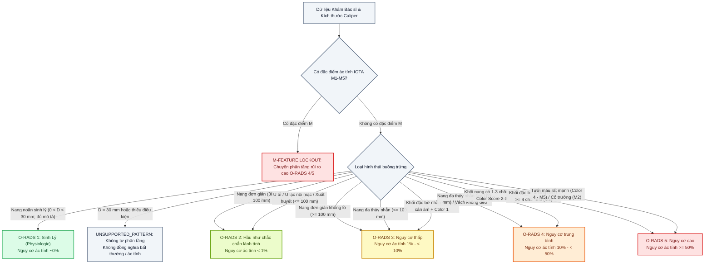
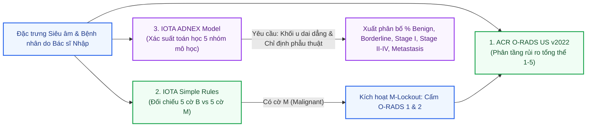

# MA TRẬN PHÂN TẦNG NGUY CƠ BUỒNG TRỨNG TẤT ĐỊNH
## O-RADS US v2022 & IOTA DETERMINISTIC RULES MATRIX
### Tài liệu Đặc tả Kỹ thuật & Lâm sàng Thuật toán Phân Tầng Rủi Ro

---

- **Mã tài liệu:** `SPEC-ORADS-2026-V1`
- **Phiên bản triển khai:** `ruleset_version: "2022.1"` (`CDSSReasoningEngine v0.2.0-research`)
- **Tài liệu tham chiếu chuẩn y khoa:**
  - *ACR O-RADS Ultrasound Committee*: [O-RADS Ultrasound v2022 Assessment Categories](https://edge.sitecorecloud.io/americancoldf5f-acrorgf92a-productioncb02-3650/media/ACR/Files/RADS/O-RADS/O-RADS--Ultrasound-v2022-Assessment-Categories.pdf) `[VERIFIED]`
  - *IOTA Group*: [Simple Rules prospective validation (BMJ 2010)](https://www.bmj.com/content/341/bmj.c6839) `[VERIFIED]`
  - *IOTA Lexicon*: [Updated IOTA terms, definitions and measurements (UOG 2026)](https://obgyn.onlinelibrary.wiley.com/doi/full/10.1002/uog.70191) `[VERIFIED]`
  - *IOTA ADNEX*: [BMJ Medicine 2024 Supplement S1](https://bmjmedicine.bmj.com/content/bmjmed/suppl/2024/02/17/10.1136/bmjmed-2023-000817.DC1/bmjmed-2023-000817supp001_data_supplement.pdf) `[VERIFIED]`
- **Mã nguồn thực thi:** [`backend/services/cdss_engine.py`](file:///C:/Users/Dung/Documents/UNet-Vinmec-KhoaLuan/backend/services/cdss_engine.py)

---

## 1. NGUYÊN TẮC THIẾT KẾ ĐỘNG CƠ QUY TẮC TẤT ĐỊNH (DETERMINISTIC DESIGN PRINCIPLES)

Động cơ suy luận lâm sàng [CDSSReasoningEngine](file:///C:/Users/Dung/Documents/UNet-Vinmec-KhoaLuan/backend/services/cdss_engine.py#L225-L1168) được thiết kế theo phương pháp kỹ thuật y tế chính xác cao với các nguyên tắc cốt lõi:

1. **Tuyệt Đối Không Tự Đoán Điểm Ảnh (Zero Inference from Pixels)**:
   Mô hình phân đoạn sâu U-Net chỉ trích xuất mặt nạ tổn thương nhị phân (Binary Mask) để tính toán hình học 2D. Mô hình **không có năng lực** và **bị cấm tuyệt đối** việc tự suy diễn các đặc trưng hình thái mô học (như mức độ phản âm dịch, tính chất thành nang, bóng cản âm hay chồi nhú) từ điểm ảnh thô.
2. **Khai Báo Lâm Sàng Rõ Ràng (Explicit Clinician Attribution)**:
   Mọi dữ liệu đầu vào bắt buộc phải thỏa mãn:
   - `assessment_source == "clinician"`: Nguồn đánh giá phải do bác sĩ trực tiếp nhập.
   - `modality == "ultrasound_2d"`: Đúng phương thức siêu âm 2D B-mode.
   - `ultrasound_exam_complete == True`: Cuộc thăm khám siêu âm đã hoàn tất toàn diện.
   Nếu thiếu một trong các điều kiện này, hệ thống từ chối phân tầng với mã lỗi `INSUFFICIENT_DATA`.
3. **Cơ Chế Khóa An Toàn Tự Động (Fail-Closed by Design)**:
   Khi thiếu dữ liệu, xuất hiện trường bất thường ngoài đặc tả, hoặc kích thước/hình thái không thỏa mãn một quy tắc được bảo chứng, hệ thống trả về `UNSUPPORTED_PATTERN` hoặc `INSUFFICIENT_DATA`. Hệ thống tuyệt đối không bao giờ tự động suy diễn về nhãn "bình thường" hoặc "nguy cơ thấp".
4. **Khóa Nguy Cơ Ác Tính IOTA (M-Feature Safety Lockout)**:
   Nếu bác sĩ kích hoạt bất kỳ đặc điểm ác tính nào trong 5 tiêu chí IOTA Malignant ($M_1$ đến $M_5$), hệ thống lập tức khóa an toàn, ngăn chặn việc khớp với bất kỳ nhóm O-RADS nguy cơ thấp nào ($O\text{-RADS } 1$ hoặc $O\text{-RADS } 2$).

---

## 2. MA TRẬN PHÂN TẦNG RỦI RO O-RADS US v2022 CHI TIẾT



---

### 2.1 Cấp Độ O-RADS 1: Sinh Lý (Physiologic Normal Category)
- **Xác suất ác tính (Malignancy Risk)**: $\approx 0\%$
- **Định nghĩa lâm sàng theo ACR O-RADS US v2022**:
  - Dành cho phụ nữ trong độ tuổi hoạt động sinh dục (tiền mãn kinh - `is_premenopausal == True`).
  - **Nang noãn sinh lý (Physiologic Follicle)**: Nang đơn thùy, thành mỏng nhẵn, chứa dịch trống âm hoàn toàn (anechoic), không có vách ngăn, không có chồi nhú, không có thành phần đặc, không có bóng cản âm, thang điểm Doppler màu `color_score == 1` (không có mạch máu), đường kính cực đại:
    $$\text{Policy dự án } \texttt{project-follicle-lt30-v3}: 0 < D_{max} < 30.0\text{ mm}$$
    *(ACR O-RADS US v2022 nêu follicle $\le 3\text{ cm}$. Đây là sai khác của policy dự án; đúng $30.0\text{ mm}$ hiện không được tự phân tầng và không đồng nghĩa bất thường/ác tính. [Nguồn ACR](https://cs.acr.org/-/media/ACR/Files/RADS/O-RADS/US-v2022/O-RADS--US-v2022-Assessment-Categories.pdf).)*
  - **Nang hoàng thể sinh lý (Corpus Luteum)**: tài liệu tham chiếu ACR cần được đọc theo đúng bối cảnh hình thái và chu kỳ. Runtime hiện chưa có nhánh xử lý riêng cho `corpus_luteum`; không được giả định rằng nhãn này đã được hệ thống phân tầng.
- **Xử trí lâm sàng khuyến nghị**: Không cần theo dõi thêm hoặc can thiệp y tế.

---

### 2.2 Cấp Độ O-RADS 2: Hầu Như Chắc Chắn Lành Tính (Almost Certainly Benign)
- **Xác suất ác tính (Malignancy Risk)**: $< 1\%$
- **Đặc trưng hình thái đối chiếu trong hệ thống**:
  1. **Nang đơn giản (Simple Cyst)**:
     - Kích thước: $30.0\text{ mm} < D_{max} < 100.0\text{ mm}$ (nang đơn giản từ $3\text{ cm}$ đến dưới $10\text{ cm}$).
     - Hình thái: Đơn thùy (`locules_count == 1`), dịch trống âm (`fluid_echogenicity == "anechoic"`), thành mỏng nhẵn (`wall_irregular == False`), không chồi nhú (`papillary_projections_count == 0`), không thành phần đặc, không bóng cản âm, không cổ trướng, `color_score == 1`.
  2. **Nang xuất huyết điển hình (Classic Hemorrhagic Cyst)**:
     - Kích thước $\le 100\text{ mm}$ ở phụ nữ tiền mãn kinh.
     - Dịch có mạng lưới sợi fibrin (reticular pattern / fishnet) hoặc cục máu đông co rút (retractile clot) không có mạch máu bên trong (`color_score == 1`).
  3. **Nang lạc nội mạc tử cung điển hình (Classic Endometrioma)**:
     - Kích thước $\le 100\text{ mm}$.
     - Phản âm kính mờ đồng nhất (homogeneous ground glass echogenicity), thành nhẵn, không có chồi nhú hay thành phần đặc.
  4. **U quái bì / U bì điển hình (Classic Dermoid / Mature Cystic Teratoma)**:
     - Kích thước: $D_{max} < 100.0\text{ mm}$.
     - Bác sĩ xác nhận cờ hình thái: `classic_benign_lesion_type == "dermoid"` và `classic_benign_morphology_confirmed == True`.
     - Chứa tối thiểu 1 trong các đặc trưng kinh điển (`dermoid_features`):
       - Nốt Rokitansky tăng âm kèm bóng cản âm sau (`hyperechoic_component_with_shadowing`) kết hợp `acoustic_shadowing == True`.
       - Dải sợi và chấm tăng âm mô phỏng tóc trong dịch bã nhờn (`hyperechoic_lines_and_dots`).
       - Các hình cầu mỡ nổi trong dịch nang (`floating_echogenic_spheres`).
     - Không có thành phần đặc dạng mô mềm (`has_solid_component == False`), không có chồi nhú, `color_score == 1`.
- **Xử trí lâm sàng khuyến nghị**: Không can thiệp phẫu thuật; theo dõi siêu âm định kỳ sau 12 tháng nếu kích thước $> 50\text{ mm}$ ở phụ nữ tiền mãn kinh.

---

### 2.3 Cấp Độ O-RADS 3: Nguy Cơ Ác Tính Thấp (Low Risk Category)
- **Xác suất ác tính (Malignancy Risk)**: $1\% \text{ đến } < 10\%$
- **Đặc trưng hình thái đối chiếu trong hệ thống**:
  1. **Nang đơn giản khổng lồ (Giant Simple Cyst)**:
     - Đơn thùy, trống âm, thành nhẵn, kích thước $D_{max} \ge 100.0\text{ mm}$ ($\ge 10\text{ cm}$).
     *(Theo chuẩn ACR O-RADS US v2022, nang đơn giản $\ge 10\text{ cm}$ có nguy cơ bỏ sót các cấu trúc vi nhú ác tính trên diện tích thành nang quá lớn, do đó được xếp vào O-RADS 3 để bác sĩ sản phụ khoa hoặc chẩn đoán hình ảnh chuyên sâu đánh giá lại).*
  2. **U bì điển hình kích thước lớn (Giant Dermoid)**:
     - Thỏa mãn toàn bộ tiêu chí u bì kinh điển nhưng kích thước $D_{max} \ge 100.0\text{ mm}$.
  3. **Nang đa thùy thành nhẵn (Smooth Multilocular Cyst)**:
     - Kích thước $D_{max} < 100.0\text{ mm}$.
     - Vách ngăn nhẵn, dịch trong hoặc dịch không đặc hiệu, không có thành phần đặc, phổ Doppler màu `color_score == 1` hoặc `2` (không có hoặc có mạch máu tối thiểu ở vách ngăn). Tương thích tiêu chuẩn **IOTA B4**.
  4. **Khối đặc bờ nhẵn có bóng cản âm (Smooth Solid Lesion with Acoustic Shadowing)**:
     - Bờ viền nhẵn đều, toàn bộ là mô đặc nhưng kèm bóng cản âm âm học mạnh phía sau (`acoustic_shadowing == True`), không có tín hiệu mạch máu trên Doppler (`color_score == 1`).
     *(Đặc trưng kinh điển của u sợi buồng trứng - Fibroma / Thecoma hoặc u cơ tuyến brenner lành tính, thỏa mãn tiêu chuẩn **IOTA B3**).*
- **Xử trí lâm sàng khuyến nghị**: Khám chuyên khoa phụ khoa, siêu âm chuyên sâu bởi chuyên gia (expert sonologist) hoặc chụp cộng hưởng từ (MRI chậu).

---

### 2.4 Cấp Độ O-RADS 4: Nguy Cơ Ác Tính Trung Bình (Intermediate Risk Category)
- **Xác suất ác tính (Malignancy Risk)**: $10\% \text{ đến } < 50\%$
- **Đặc trưng hình thái đối chiếu trong hệ thống**:
  1. **Nang đa thùy thành nhẵn khổng lồ**: Kích thước $D_{max} \ge 100.0\text{ mm}$ không có thành phần đặc.
  2. **Nang đa thùy có thành hoặc vách ngăn không đều (Irregular Multilocular Cyst)**: Kích thước $< 100\text{ mm}$, không có chồi nhú, `color_score == 1-3`.
  3. **Nang có thành phần đặc nhỏ hoặc chồi nhú giới hạn**:
     - Nang đơn thùy hoặc đa thùy có từ 1 đến 3 chồi nhú (`1 <= papillary_projections_count <= 3`).
     - Hoặc có thành phần đặc kích thước $< 7\text{ mm}$ (tương thích **IOTA B2**).
  4. **Khối đặc bờ nhẵn có tưới máu**: Khối u hoàn toàn đặc, bờ nhẵn nhưng có dòng chảy Doppler mức độ trung bình (`color_score == 2` hoặc `3`), không có bóng cản âm.
- **Xử trí lâm sàng khuyến nghị**: Hội chẩn chuyên khoa Sản Phụ khoa / Ung bướu phụ khoa (Gynecologic Oncologist), chỉ định MRI chậu có đối quang từ, cân nhắc phẫu thuật bóc u nội soi hoặc cắt phần phụ.

---

### 2.5 Cấp Độ O-RADS 5: Nguy Cơ Ác Tính Cao (High Risk Category)
- **Xác suất ác tính (Malignancy Risk)**: $\ge 50\%$
- **Đặc trưng hình thái đối chiếu trong hệ thống**:
  1. **Khối đặc bờ không đều (Irregular Solid Lesion)**: Khối u phần phụ có thành phần đặc chiếm ưu thế, đường bờ phân thùy gồ ghề, không đều (tương thích **IOTA M1**).
  2. **Nang có từ 4 chồi nhú trở lên**: Tổn thương dạng nang có $\ge 4$ chồi nhú nhô vào lòng nang (`papillary_projections_count >= 4`, tương thích **IOTA M3**).
  3. **Tưới máu cực kỳ phong phú (Very Strong Blood Flow)**: Tín hiệu Doppler màu lan tỏa mạnh trong vách ngăn hoặc thành phần đặc (`color_score == 4`, tương thích **IOTA M5**).
  4. **Dấu hiệu di căn phúc mạc đi kèm**: Bất kỳ khối u phần phụ nào xuất hiện đồng thời với dịch ổ bụng lượng vừa/nhiều (`has_ascites == True`, tương thích **IOTA M2**) hoặc có nốt di căn phúc mạc / mạc nối (`has_peritoneal_nodules == True`).
- **Xử trí lâm sàng khuyến nghị**: Chuyển tuyến khẩn cấp tới Trung tâm Ung bướu Phụ khoa (Oncology Center), hội chẩn đa chuyên khoa (MDT), làm xét nghiệm dấu ấn sinh học ung thư (CA-125, HE4, ROMA index) và chụp cắt lớp vi tính (CT scan bụng chậu) đánh giá giai đoạn.

---

## 3. BẢNG MA TRẬN TỔNG HỢP TRA CỨU QUY TẮC CDSS

Bảng dưới đây tổng hợp đầy đủ các điều kiện logic của Động cơ CDSS trong hệ thống:

| Cấp O-RADS | Nguy cơ ác tính | Loại tổn thương | Ngưỡng kích thước ($D_{max}$) | Số thùy (`locules`) | Thành phần đặc / Chồi | Phản âm dịch | Bóng cản âm | Color Score | Cổ trướng / Nốt | Mã trạng thái CDSS |
| :---: | :---: | :--- | :---: | :---: | :---: | :---: | :---: | :---: | :---: | :---: |
| **O-RADS 1** | $\approx 0\%$ | Nang noãn sinh lý theo policy dự án (Premenopausal) | $0 < D < 30.0\text{ mm}$ | 1 | 0 / 0 | Trống âm | Không | 1 | Không | `RULE_MATCHED` khi đủ xác nhận bác sĩ |
| Chưa phân tầng | Không suy ra | Nang noãn đúng $30.0\text{ mm}$ | $D = 30.0\text{ mm}$ | — | — | — | — | — | — | `UNSUPPORTED_PATTERN`; không đồng nghĩa bất thường/ác tính |
| Chưa hỗ trợ runtime | Không suy ra | Nang hoàng thể sinh lý | — | — | — | — | — | — | — | Không có nhánh `corpus_luteum` riêng |
| **O-RADS 2** | $< 1\%$ | Nang đơn giản | $30.0 < D < 100.0\text{ mm}$ | 1 | 0 / 0 | Trống âm | Không | 1 | Không | `RULE_MATCHED` |
| **O-RADS 2** | $< 1\%$ | U quái bì điển hình (Dermoid) | $0 < D < 100.0\text{ mm}$ | 1 - 3 | Không | Mọi loại dịch | Có | 1 | Không | `RULE_MATCHED` |
| **O-RADS 2** | $< 1\%$ | Nang lạc nội mạc tử cung điển hình | $0 < D \le 100.0\text{ mm}$ | 1 - 2 | 0 / 0 | Kính mờ đồng nhất | Không | 1 | Không | `RULE_MATCHED` |
| **O-RADS 2** | $< 1\%$ | Nang xuất huyết điển hình | $0 < D \le 100.0\text{ mm}$ | 1 | 0 / 0 | Mạng sợi fibrin | Không | 1 | Không | `RULE_MATCHED` |
| **O-RADS 3** | $1 - < 10\%$ | Nang đơn giản khổng lồ | $D \ge 100.0\text{ mm}$ | 1 | 0 / 0 | Trống âm | Không | 1 | Không | `RULE_MATCHED` |
| **O-RADS 3** | $1 - < 10\%$ | U quái bì điển hình khổng lồ | $D \ge 100.0\text{ mm}$ | 1 - 3 | Không | Mọi loại dịch | Có | 1 | Không | `RULE_MATCHED` |
| **O-RADS 3** | $1 - < 10\%$ | Nang đa thùy thành nhẵn | $D < 100.0\text{ mm}$ | $\ge 2$ | 0 / 0 | Trống âm/Không đặc hiệu | Không | 1 - 2 | Không | `RULE_MATCHED` |
| **O-RADS 3** | $1 - < 10\%$ | Khối đặc bờ nhẵn (U sợi buồng trứng) | Bất kỳ | Đặc | Có (100% đặc) | N/A | Có | 1 | Không | `RULE_MATCHED` |
| **O-RADS 4** | $10 - < 50\%$ | Nang đa thùy thành nhẵn lớn | $D \ge 100.0\text{ mm}$ | $\ge 2$ | 0 / 0 | Bất kỳ | Không | 1 - 2 | Không | `RULE_MATCHED` |
| **O-RADS 4** | $10 - < 50\%$ | Nang có 1 đến 3 chồi nhú | Bất kỳ | $\ge 1$ | 1 - 3 chồi nhú | Bất kỳ | Không | 1 - 3 | Không | `RULE_MATCHED` |
| **O-RADS 4** | $10 - < 50\%$ | Nang có thành phần đặc nhỏ | Bất kỳ | $\ge 1$ | Đặc $< 7\text{ mm}$ | Bất kỳ | Không | 1 - 3 | Không | `RULE_MATCHED` |
| **O-RADS 4** | $10 - < 50\%$ | Khối đặc bờ nhẵn tưới máu | Bất kỳ | Đặc | Có (100% đặc) | N/A | Không | 2 - 3 | Không | `RULE_MATCHED` |
| **O-RADS 5** | $\ge 50\%$ | Khối đặc bờ không đều (IOTA M1) | Bất kỳ | Đặc | Có bờ gồ ghề | N/A | Không | Bất kỳ | Bất kỳ | `RULE_MATCHED` |
| **O-RADS 5** | $\ge 50\%$ | Nang có từ 4 chồi nhú (IOTA M3) | Bất kỳ | $\ge 1$ | $\ge 4$ chồi nhú | Bất kỳ | Bất kỳ | Bất kỳ | Bất kỳ | `RULE_MATCHED` |
| **O-RADS 5** | $\ge 50\%$ | Tưới máu cực kỳ mạnh (IOTA M5) | Bất kỳ | Bất kỳ | Bất kỳ | Bất kỳ | Bất kỳ | 4 | Bất kỳ | `RULE_MATCHED` |
| **O-RADS 5** | $\ge 50\%$ | U phần phụ kèm Cổ trướng (IOTA M2) | Bất kỳ | Bất kỳ | Bất kỳ | Bất kỳ | Bất kỳ | Bất kỳ | Có | `RULE_MATCHED` |
| **TẤT CẢ** | Không xác định | Thiếu dữ liệu trường bắt buộc | - | - | - | - | - | - | - | `INSUFFICIENT_DATA` |
| **TẤT CẢ** | Không xác định | Hình thái nằm ngoài quy tắc khóa | - | - | - | - | - | - | - | `UNSUPPORTED_PATTERN` |

---

## 4. QUY TẮC TỔNG HỢP ĐA TỔN THƯƠNG HAI BUỒNG TRỨNG (BILATERAL WORST-CASE SEMANTICS)

Khi bệnh nhân có nhiều tổn thương trên cùng một buồng trứng hoặc xuất hiện tổn thương ở cả hai buồng trứng (trái và phải), hệ thống áp dụng cơ chế đánh giá tổng hợp đa tổn thương [evaluate_multi_lesions()](file:///C:/Users/Dung/Documents/UNet-Vinmec-KhoaLuan/backend/services/cdss_engine.py#L674-L744).

### 4.1 Ngữ Nghĩa Tổng Hợp Nguy Cơ Cao Nhất (Worst-Case Aggregation Semantics)
- Mỗi tổn thương $L_i$ ($i = 1 \dots k$) được phân tích độc lập thông qua `evaluate_case()` để xác định phân tầng thành phần $O\text{-RADS}(L_i)$.
- Nếu tất cả các tổn thương đều được đối chiếu thành công (`status == "RULE_MATCHED"`), cấp độ O-RADS toàn thể của ca khám ($O\text{-RADS}_{overall}$) được xác định bởi tổn thương có nguy cơ cao nhất:
  $$O\text{-RADS}_{overall} = \max_{i=1 \dots k} \left\{ O\text{-RADS}(L_i) \right\}$$
- **Ví dụ lâm sàng**:
  - Buồng trứng Phải: Nang noãn sinh lý $22\text{ mm}$ $\rightarrow$ $O\text{-RADS } 1$.
  - Buồng trứng Trái: Nang đơn giản $50\text{ mm}$ $\rightarrow$ $O\text{-RADS } 2$.
  - **Kết luận ca khám**: $O\text{-RADS } 2$ (Lấy theo tổn thương buồng trứng trái).
  - Trường hợp khác: Buồng trứng Phải là U bì $40\text{ mm}$ ($O\text{-RADS } 2$), Buồng trứng Trái là Khối u đặc bờ gồ ghề kèm cổ trướng ($O\text{-RADS } 5$) $\rightarrow$ **Kết luận ca khám**: $O\text{-RADS } 5$.

### 4.2 Nguyên Tắc Bảo Toàn Fail-Closed Tuyệt Đối
Nếu có **bất kỳ một tổn thương nào** trong số $k$ tổn thương không thể xác định phân tầng (ví dụ: thiếu thông tin lâm sàng `INSUFFICIENT_DATA` hoặc rơi vào mẫu chưa hỗ trợ `UNSUPPORTED_PATTERN`):
- Toàn bộ ca khám lập tức bị gắn trạng thái:
  ```json
  {
    "complete": false,
    "status": "INCOMPLETE_OR_UNSUPPORTED",
    "overall_category": null,
    "message": "Không thể xác định mức O-RADS tổng thể do có tổn thương chưa được phân tầng hoặc không hỗ trợ quy tắc."
  }
  ```
- **Ý nghĩa y khoa an toàn**: Hệ thống tuyệt đối **không được phép bỏ qua** tổn thương chưa rõ ràng để lấy tổn thương lành tính làm kết luận, tránh nguy cơ bỏ sót u ác tính (False Negative).

---

## 5. TƯƠNG TÁC GIỮA O-RADS, IOTA SIMPLE RULES VÀ MÔ HÌNH ADNEX

Hệ thống tích hợp 3 bộ công cụ chẩn đoán bổ trợ lẫn nhau, tạo nên bức tranh lâm sàng đa chiều:



1. **ACR O-RADS US v2022**: Cung cấp khung phân tầng nguy cơ chuẩn hóa quốc tế, hướng dẫn thái độ xử trí và theo dõi trên lâm sàng.
2. **IOTA Simple Rules (B1-B5 vs M1-M5)**: Hoạt động như một chốt kiểm soát an toàn độc lập (Safety Cross-Check). Bất kỳ xung đột nào giữa phân tầng rủi ro thấp và cờ M đều kích hoạt cảnh báo chuyên khoa.
3. **Mô hình IOTA ADNEX (BMJ 2014 & BMJ Medicine 2024)**:
   - Chỉ được kích hoạt khi thỏa mãn điều kiện chỉ định phẫu thuật và khối u dai dẳng (`is_persistent_adnexal_mass == True` và `surgery_indicated == True`).
   - Tính toán phân phối xác suất tuyệt đối giữa 5 phân nhóm mô bệnh học: Lành tính (Benign), Giáp biên (Borderline), Ung thư nguyên phát Giai đoạn I, Ung thư nguyên phát Giai đoạn II-IV, và Ung thư di căn phần phụ (Secondary Metastatic).
   - Được gắn nhãn nghiêm ngặt `EVALUATED_RUO` và không tự ý đưa ra kết luận thay thế bác sĩ giải phẫu bệnh.
