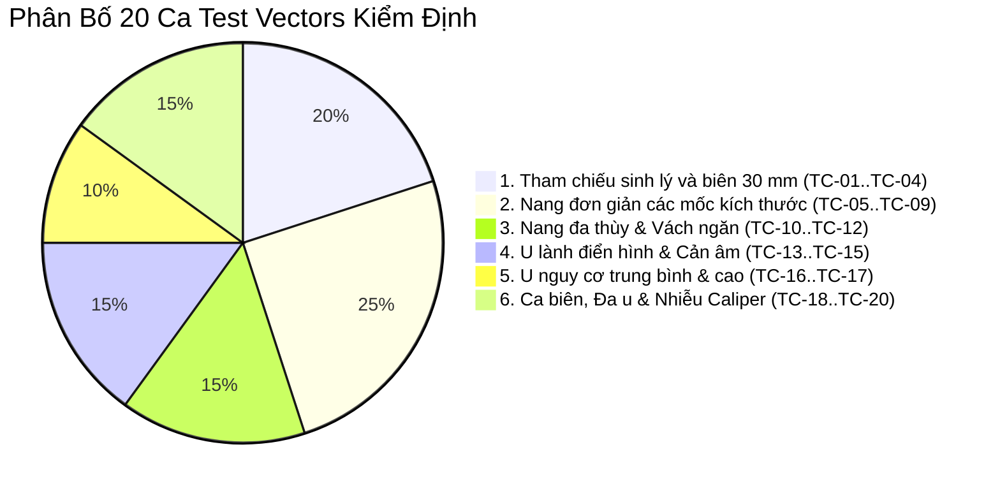

# ĐẶC TẢ TẬP TEST PHANTOM TỔNG HỢP KIỂM ĐỊNH LÂM SÀNG
## SYNTHETIC PHANTOM COHORT SPECIFICATION (20 CLINICAL TEST VECTORS)
### Hồ Sơ Nghiệm Thu Kỹ Thuật & Đối Chuẩn Chuyên Môn Hình Ảnh Y Tế

---

- **Mã tài liệu:** `SPEC-PHANTOM-2026-V1`
- **Phiên bản:** `1.0-Controlled-Academic`
- **Mục đích:** Đặc tả fixture tổng hợp cho kiểm thử kỹ thuật. Tài liệu này không xác minh độc lập chất lượng phân đoạn/đo đạc, không phải thẩm định lâm sàng và không đủ làm căn cứ chuyển giao cho bác sĩ.
- **Quy chuẩn đối chiếu:** [ACR O-RADS US v2022](https://edge.sitecorecloud.io/americancoldf5f-acrorgf92a-productioncb02-3650/media/ACR/Files/RADS/O-RADS/O-RADS--Ultrasound-v2022-Assessment-Categories.pdf) `[VERIFIED]`, [IOTA Simple Rules & Terms](https://obgyn.onlinelibrary.wiley.com/doi/full/10.1002/uog.70191) `[VERIFIED]`.
- **Mã nguồn kiểm định:** [`backend/services/cdss_engine.py`](file:///C:/Users/Dung/Documents/UNet-Vinmec-KhoaLuan/backend/services/cdss_engine.py), [`backend/services/inference_engine.py`](file:///C:/Users/Dung/Documents/UNet-Vinmec-KhoaLuan/backend/services/inference_engine.py).

---

## 1. MỤC ĐÍCH & PHƯƠNG PHÁP XÂY DỰNG TẬP TEST PHANTOM

### 1.1 Tính Đại Diện Lâm Sàng & Ranh Giới An Toàn
Tập đặc tả gồm **20 ca test vector tổng hợp (Synthetic Phantoms)** được tạo lập hoàn toàn bằng phương pháp vector hình học mô phỏng toán học kết hợp trường nhiễu âm học (speckle noise, Rayleigh distribution). Đây là fixture kỹ thuật, không tương đương dữ liệu lâm sàng xác thực.
- **Bảo mật tuyệt đối**: Không sử dụng bất kỳ dữ liệu bệnh nhân thực tế nào, tuân thủ nguyên tắc Zero-Hallucination và không vi phạm đạo đức y sinh.
- **Ground-Truth vật lý xác định**: Các kích thước hình học gồm đường kính lớn nhất ($D_{max}$), đường kính trực giao ($D_{orth}$), diện tích ($Area$) và tọa độ tâm được trích xuất trực tiếp từ mô hình vector giải tích trước khi chiếu lên lưới pixel với độ phân giải chuẩn lâm sàng $0.20\text{ mm/pixel}$ ($512 \times 512$).
- **Bao phủ các ranh giới kỹ thuật dự kiến**: Bao gồm các kịch bản rule, mốc 30.0 mm và 100.0 mm, đa tổn thương hai bên và nhiễu caliper. Tính bao phủ này không chứng minh hiệu lực lâm sàng; một số kịch bản hiện chưa được runtime hỗ trợ.

### 1.2 Phân Bố 6 Phân Nhóm Kiểm Định

---

## 2. ĐẶC TẢ CHI TIẾT 20 CA TEST VECTORS LÂM SÀNG

---

### PHÂN NHÓM 1: NANG SINH LÝ & NANG NOÃN (PHYSIOLOGIC FOLICLES — O-RADS 1)

#### Case TC-01: Nang Noãn Nhỏ Tiền Mãn Kinh Điển Hình
- **Mô tả hình học & âm học**: Nang hình elip tròn, viền nhẵn mỏng, lòng chứa dịch hoàn toàn trống âm (anechoic). Kích thước chuẩn: $D_{max} = 18.0\text{ mm}$, $D_{orth} = 15.2\text{ mm}$.
- **Thông tin lâm sàng**: Bệnh nhân nữ 26 tuổi, tiền mãn kinh (`is_premenopausal = True`), ngày thứ 10 chu kỳ kinh.
- **Đầu vào CDSS**: `locules_count = 1`, `fluid_echogenicity = "anechoic"`, `color_score = 1`, `physiologic_lesion_type = "follicle"`, `physiologic_morphology_confirmed = True`.
- **Kỳ vọng U-Net & Caliper**:
  - Dice $\ge 0.92$, $D_{max}$ đo được: $18.0 \pm 0.3\text{ mm}$.
- **Kỳ vọng CDSS**:
  - Trạng thái: `RULE_MATCHED`.
  - Phân tầng kỳ vọng trong policy dự án: **O-RADS 1** (Nang noãn sinh lý $0 < D < 30\text{ mm}$).
  - IOTA Verdict: Không kích hoạt Simple Rules (nang sinh lý nằm ngoài phạm vi phẫu thuật).

#### Case TC-02: Nang Noãn Vượt Trội Sát Ngưỡng Sinh Lý
- **Mô tả hình học & âm học**: Nang noãn phát triển lớn trước rụng trứng, elip kéo dài, thành rất mỏng căng đều. Kích thước chuẩn: $D_{max} = 28.5\text{ mm}$, $D_{orth} = 22.0\text{ mm}$.
- **Thông tin lâm sàng**: Bệnh nhân nữ 31 tuổi, tiền mãn kinh (`is_premenopausal = True`).
- **Đầu vào CDSS**: `locules_count = 1`, `fluid_echogenicity = "anechoic"`, `color_score = 1`, `physiologic_lesion_type = "follicle"`, `physiologic_morphology_confirmed = True`.
- **Kỳ vọng U-Net & Caliper**:
  - Dice $\ge 0.92$, $D_{max}$ đo được: $28.5 \pm 0.3\text{ mm}$.
- **Kỳ vọng CDSS**:
  - Trạng thái: `RULE_MATCHED`.
  - Phân tầng: **O-RADS 1** (Nang noãn sinh lý sát ngưỡng $< 30.0\text{ mm}$).

#### Case TC-03: Ca Biên Nang Noãn Chạm Đúng Ngưỡng $30.0\text{ mm}$
- **Mô tả hình học & âm học**: Nang đơn thùy căng tròn. Kích thước vector chuẩn giải tích chính xác: $D_{max} = 30.0\text{ mm}$, $D_{orth} = 25.0\text{ mm}$.
- **Mục tiêu kiểm định**: Kiểm tra ranh giới policy dự án `project-follicle-lt30-v3` ($0 < D < 30.0\text{ mm}$); không kiểm tra tính phù hợp lâm sàng của quy tắc.
- **Thông tin lâm sàng**: Tiền mãn kinh (`is_premenopausal = True`), bác sĩ xác nhận hình thái nang noãn.
- **Kỳ vọng CDSS**:
  - Trạng thái: `UNSUPPORTED_PATTERN`; không tự gán cấp O-RADS.
  - Mốc đúng $30.0\text{ mm}$ vẫn chưa được policy dự án phân tầng. Điều này không đồng nghĩa bất thường hoặc ác tính.
  - ACR O-RADS US v2022 nêu nang noãn sinh lý đến $3\text{ cm}$ (bao gồm mốc 30 mm); ngưỡng nghiêm ngặt của dự án là một sai khác cục bộ, không được mô tả là ngưỡng ACR. [Nguồn ACR](https://cs.acr.org/-/media/ACR/Files/RADS/O-RADS/US-v2022/O-RADS--US-v2022-Assessment-Categories.pdf).

#### Case TC-04: Nang Hoàng Thể Sinh Lý (Corpus Luteum)
- **Mô tả hình học & âm học**: Nang thành dày gợn sóng nhẹ, phản âm bên trong dạng lưới mịn hoặc xuất huyết tiêu biến, có tín hiệu mạch máu chu vi dạng vành lửa (ring of fire). Kích thước chuẩn: $D_{max} = 24.0\text{ mm}$, $D_{orth} = 20.0\text{ mm}$.
- **Thông tin lâm sàng**: Nữ 29 tuổi, nửa sau chu kỳ kinh, tiền mãn kinh.
- **Đầu vào CDSS**: `color_score = 3` (vành mạch ngoại vi), `fluid_echogenicity = "mixed"`, `physiologic_lesion_type = "corpus_luteum"`.
- **Giới hạn hiện thực hóa**: Runtime hiện chỉ nhận `physiologic_lesion_type = "follicle"`; loại `corpus_luteum` chưa được xử lý riêng.
- **Kỳ vọng kiểm thử runtime hiện tại**: `UNSUPPORTED_PATTERN`, không có cấp O-RADS. Không diễn giải trạng thái này là bất thường hoặc ác tính.

---

### PHÂN NHÓM 2: NANG ĐƠN GIẢN CÁC MỐC KÍCH THƯỚC (SIMPLE CYSTS — O-RADS 2 & O-RADS 3)

#### Case TC-05: Nang Đơn Giản Nhỏ Vượt Ngưỡng Sinh Lý
- **Mô tả hình học & âm học**: Nang đơn thùy, trống âm hoàn toàn, thành mỏng nhẵn, tăng âm thành sau rõ rệt. Kích thước chuẩn: $D_{max} = 32.0\text{ mm}$, $D_{orth} = 26.5\text{ mm}$.
- **Mục tiêu kiểm định**: Kiểm tra bước chuyển phân tầng từ nang sinh lý sang nang đơn giản khi $D_{max} > 30.0\text{ mm}$.
- **Đầu vào CDSS**: `locules_count = 1`, `fluid_echogenicity = "anechoic"`, `wall_irregular = False`, `has_solid_component = False`, `color_score = 1`.
- **Kỳ vọng CDSS**:
  - Trạng thái: `RULE_MATCHED`.
  - Phân tầng: **O-RADS 2** (Nang đơn giản $> 30\text{ mm}$ và $< 100\text{ mm}$, nguy cơ ác tính $< 1\%$).

#### Case TC-06: Nang Đơn Giản Kích Thước Trung Bình Điển Hình
- **Mô tả hình học & âm học**: Nang tròn lớn chiếm 1/2 buồng trứng, trống âm tinh khiết, không vách, không chồi. Kích thước chuẩn: $D_{max} = 55.0\text{ mm}$, $D_{orth} = 48.0\text{ mm}$.
- **Đầu vào CDSS**: Đầy đủ 13 trường bắt buộc, không có thành phần đặc hay cản âm, `color_score = 1`.
- **Kỳ vọng U-Net & Caliper**:
  - Dice $\ge 0.94$, $D_{max}$ đo được: $55.0 \pm 0.4\text{ mm}$.
- **Kỳ vọng CDSS**:
  - Trạng thái: `RULE_MATCHED`.
  - Phân tầng: **O-RADS 2** (Nang thanh dịch lành tính).

#### Case TC-07: Ca Biên Nang Đơn Giản Sát Ngưỡng Khổng Lồ ($98.0\text{ mm}$)
- **Mô tả hình học & âm học**: Nang đơn giản chiếm trọn màn hình siêu âm, đường bờ nhẵn đều, kích thước chuẩn: $D_{max} = 98.0\text{ mm}$, $D_{orth} = 82.0\text{ mm}$.
- **Mục tiêu kiểm định**: Kiểm tra ngưỡng trên sát $100\text{ mm}$ của phân tầng O-RADS 2.
- **Kỳ vọng CDSS**:
  - Trạng thái: `RULE_MATCHED`.
  - Phân tầng: **O-RADS 2** ($D_{max} < 100.0\text{ mm}$).

#### Case TC-08: Ca Biên Nang Đơn Giản Chạm Đúng Ngưỡng Khổng Lồ ($100.0\text{ mm}$)
- **Mô tả hình học & âm học**: Nang đơn giản rất lớn, kích thước chuẩn vector: $D_{max} = 100.0\text{ mm}$, $D_{orth} = 85.0\text{ mm}$.
- **Mục tiêu kiểm định**: Kiểm tra bước nhảy phân tầng từ O-RADS 2 lên O-RADS 3 tại đúng ngưỡng $\ge 100.0\text{ mm}$.
- **Kỳ vọng CDSS**:
  - Trạng thái: `RULE_MATCHED`.
  - Phân tầng: **O-RADS 3** (Nang đơn giản $\ge 100\text{ mm}$ theo chuẩn ACR O-RADS US v2022, nguy cơ $1 - < 10\%$).

#### Case TC-09: Nang Đơn Giản Khổng Lồ Xâm Lấn Tiểu Khung
- **Mô tả hình học & âm học**: Khối nang nước khổng lồ đẩy lệch buồng trứng và tử cung. Kích thước chuẩn: $D_{max} = 135.0\text{ mm}$, $D_{orth} = 110.0\text{ mm}$.
- **Đầu vào CDSS**: Đơn thùy, trống âm, thành nhẵn, `color_score = 1`.
- **Kỳ vọng CDSS**:
  - Trạng thái: `RULE_MATCHED`.
  - Phân tầng: **O-RADS 3** (Nguy cơ ác tính thấp, chỉ định hội chẩn chuyên khoa).

---

### PHÂN NHÓM 3: NANG ĐA THÙY & VÁCH NGĂN GIẢI PHẪU (MULTILOCULAR CYSTS)

#### Case TC-10: Nang Hai Thùy Thành Nhẵn Vách Mỏng (Bilocular Cyst)
- **Mô tả hình học & âm học**: Nang có 1 vách ngăn giải phẫu mỏng ($1.2\text{ mm} < 3\text{ mm}$), chia lòng nang thành 2 khoang trống âm, không có chồi nhú. Kích thước chuẩn: $D_{max} = 45.0\text{ mm}$, $D_{orth} = 34.0\text{ mm}$.
- **Đầu vào CDSS**: `locules_count = 2`, `fluid_echogenicity = "anechoic"`, `wall_irregular = False`, `has_solid_component = False`, `color_score = 1`.
- **Kỳ vọng U-Net**: Phân đoạn ôm trọn chu vi ngoài cả 2 thùy nang, không bị đứt đoạn tại vị trí vách ngăn trung tâm.
- **Kỳ vọng CDSS**:
  - Trạng thái: `RULE_MATCHED`.
  - Phân tầng: **O-RADS 3** (Nang đa thùy nhẵn $< 100\text{ mm}$, tương thích tiêu chuẩn IOTA B4).

#### Case TC-11: Nang Đa Thùy Nhẵn Dưới $100\text{ mm}$ (Multilocular Cyst)
- **Mô tả hình học & âm học**: Nang nhiều khoang (6 thùy), các vách mỏng đều đặn, dịch phản âm kém nhẹ đồng nhất, kích thước: $D_{max} = 72.0\text{ mm}$, $D_{orth} = 58.0\text{ mm}$. Doppler vách ngăn có mạch máu tối thiểu (`color_score = 2`).
- **Đầu vào CDSS**: `locules_count = 6`, `fluid_echogenicity = "low_level"`, `wall_irregular = False`, `color_score = 2`.
- **Kỳ vọng CDSS**:
  - Trạng thái: `RULE_MATCHED`.
  - Phân tầng: **O-RADS 3** (Nang đa thùy thành nhẵn $< 100\text{ mm}$).
  - IOTA Simple Rules: Thỏa mãn tiêu chí B4.

#### Case TC-12: Nang Đa Thùy Vách Dày Bất Thường Kèm Tưới Máu Mạnh
- **Mô tả hình học & âm học**: Nang nhiều thùy, vách ngăn dày không đều ($4.5\text{ mm} > 3\text{ mm}$), bờ vách gồ ghề, tín hiệu Doppler màu trung bình (`color_score = 3`), không có chồi nhú rõ. Kích thước: $D_{max} = 85.0\text{ mm}$, $D_{orth} = 68.0\text{ mm}$.
- **Đầu vào CDSS**: `locules_count = 5`, `wall_irregular = True`, `color_score = 3`.
- **Kỳ vọng CDSS**:
  - Trạng thái: `RULE_MATCHED`.
  - Phân tầng: **O-RADS 4** (Nang đa thùy vách không đều hoặc tưới máu vừa, nguy cơ trung bình $10 - < 50\%$).

---

### PHÂN NHÓM 4: U LÀNH TÍNH ĐIỂN HÌNH & BÓNG CẢN ÂM (CLASSIC BENIGN & SHADOWING)

#### Case TC-13: U Quái Bì Điển Hình Kèm Bóng Cản Âm (Classic Dermoid)
- **Mô tả hình học & âm học**: Khối nang hỗn hợp chứa nốt Rokitansky tăng âm tròn đặc trưng, phía sau nốt là dải bóng cản âm âm học (acoustic shadow) hình rèm cửa che khuất một phần bờ sau. Kích thước: $D_{max} = 48.0\text{ mm}$, $D_{orth} = 40.0\text{ mm}$.
- **Thông tin lâm sàng**: Bác sĩ xác nhận hình thái u bì kinh điển (`classic_benign_lesion_type = "dermoid"`, `classic_benign_morphology_confirmed = True`, `dermoid_features = ["hyperechoic_component_with_shadowing", "hyperechoic_lines_and_dots"]`, `acoustic_shadowing = True`).
- **Kỳ vọng U-Net**: Mô hình nhận diện trọn vẹn bờ ngoài khối u kể cả vùng bóng cản âm suy giảm tín hiệu nhờ cơ chế chú ý không gian Attention Gate.
- **Kỳ vọng CDSS**:
  - Trạng thái: `RULE_MATCHED`.
  - Phân tầng: **O-RADS 2** (U bì điển hình $< 100\text{ mm}$, nguy cơ $< 1\%$).

#### Case TC-14: U Quái Bì Điển Hình Khổng Lồ ($\ge 100\text{ mm}$)
- **Mô tả hình học & âm học**: Khối u bì kích thước lớn, chứa các dải chấm tăng âm và hình cầu mỡ nổi, có bóng cản âm mạnh. Kích thước: $D_{max} = 115.0\text{ mm}$, $D_{orth} = 95.0\text{ mm}$.
- **Đầu vào CDSS**: U bì điển hình, `max_diameter_mm = 115.0`, `acoustic_shadowing = True`.
- **Kỳ vọng CDSS**:
  - Trạng thái: `RULE_MATCHED`.
  - Phân tầng: **O-RADS 3** (U bì kích thước $\ge 100\text{ mm}$ được nâng lên O-RADS 3 theo chuẩn ACR v2022).

#### Case TC-15: U Xơ Buồng Trứng Đặc Bờ Nhẵn Kèm Bóng Cản Âm (Ovarian Fibroma)
- **Mô tả hình học & âm học**: Khối tổn thương hoàn toàn là mô đặc, ranh giới rõ, bờ nhẵn, xuất hiện các vệt bóng cản âm hình dải nan quạt (striated acoustic shadowing), không có tín hiệu mạch (`color_score = 1`). Kích thước: $D_{max} = 42.0\text{ mm}$, $D_{orth} = 35.0\text{ mm}$.
- **Đầu vào CDSS**: `has_solid_component = True`, `wall_irregular = False`, `acoustic_shadowing = True`, `color_score = 1`.
- **Kỳ vọng CDSS**:
  - Trạng thái: `RULE_MATCHED`.
  - Phân tầng: **O-RADS 3** (Khối đặc bờ nhẵn có bóng cản âm, không tưới máu, tương thích tiêu chuẩn IOTA B3 + B5).

---

### PHÂN NHÓM 5: KHỐI U NGUY CƠ TRUNG BÌNH & CAO (INTERMEDIATE & HIGH RISK — O-RADS 4 & 5)

#### Case TC-16: Khối Nang Có Chồi Nhú Giới Hạn (O-RADS 4)
- **Mô tả hình học & âm học**: Khối nang đơn thùy, thành có 2 chồi nhú (papillary projections) kích thước $5\text{ mm}$ và $7\text{ mm}$ nhô vào trong lòng nang, có tín hiệu mạch máu nuôi bên trong chồi (`color_score = 2`). Kích thước u: $D_{max} = 65.0\text{ mm}$, $D_{orth} = 52.0\text{ mm}$.
- **Đầu vào CDSS**: `locules_count = 1`, `papillary_projections_count = 2`, `has_solid_component = True`, `color_score = 2`.
- **Kỳ vọng CDSS**:
  - Trạng thái: `RULE_MATCHED`.
  - Phân tầng: **O-RADS 4** (Nang có 1-3 chồi nhú, nguy cơ ác tính trung bình $10 - < 50\%$).

#### Case TC-17: Khối U Ác Tính Điển Hình Đa Thùy Đặc Kèm Cổ Trướng (O-RADS 5)
- **Mô tả hình học & âm học**: Khối u phần phụ hỗn hợp đa thùy đặc, bờ phân thùy gồ ghề không đều (irregular solid tumor), có 5 chồi nhú lớn, tưới máu rực rỡ lan tỏa (`color_score = 4`), kèm dịch tự do ổ bụng lượng nhiều (cổ trướng). Kích thước: $D_{max} = 120.0\text{ mm}$, $D_{orth} = 98.0\text{ mm}$.
- **Đầu vào CDSS**: `has_solid_component = True`, `wall_irregular = True` (IOTA M1), `has_ascites = True` (IOTA M2), `papillary_projections_count = 5` (IOTA M3), `color_score = 4` (IOTA M5).
- **Kỳ vọng CDSS**:
  - Kích hoạt **M-Feature Lockout**: Cấm tuyệt đối đối chiếu về nhóm lành tính.
  - Phân tầng: **O-RADS 5** (Khối u nguy cơ ác tính rất cao $\ge 50\%$).
  - IOTA Verdict: `MALIGNANT`.
  - ADNEX: Nếu có CA-125, xuất xác suất ung thư nguyên phát / di căn chiếm ưu thế.

---

### PHÂN NHÓM 6: CA BIÊN, ĐA U HAI BÊN & NHIỄU CALIPER (EDGE CASES)

#### Case TC-18: Đa Khối U Hai Buồng Trứng Lành Tính Bất Đối Xứng
- **Mô tả kịch bản**:
  - *Buồng trứng Phải ($L_1$)*: Nang noãn sinh lý $D_{max} = 22.0\text{ mm}$ (O-RADS 1).
  - *Buồng trứng Trái ($L_2$)*: Nang đơn giản lành tính $D_{max} = 60.0\text{ mm}$ (O-RADS 2).
- **Mục tiêu kiểm định**: Đánh giá hàm tổng hợp đa tổn thương `evaluate_multi_lesions()`.
- **Kỳ vọng CDSS**:
  - Tổn thương $L_1$: O-RADS 1.
  - Tổn thương $L_2$: O-RADS 2.
  - **Phân tầng tổng thể ca khám**: **O-RADS 2** (Quy tắc Max-Risk: $\max(\text{O-RADS 1}, \text{O-RADS 2}) = \text{O-RADS 2}$).

#### Case TC-19: Đa Khối U Hai Buồng Trứng Đối Nghịch Rủi Ro Cao
- **Mô tả kịch bản**:
  - *Buồng trứng Phải ($L_1$)*: U bì điển hình lành tính $D_{max} = 45.0\text{ mm}$ (O-RADS 2).
  - *Buồng trứng Trái ($L_2$)*: Khối đặc bờ không đều kèm cổ trướng $D_{max} = 75.0\text{ mm}$ (O-RADS 5).
- **Mục tiêu kiểm định**: Kiểm tra ngữ nghĩa Worst-Case Aggregation, không để tổn thương lành tính làm lu mờ khối ác tính.
- **Kỳ vọng CDSS**:
  - Tổn thương $L_1$: O-RADS 2.
  - Tổn thương $L_2$: O-RADS 5.
  - **Phân tầng tổng thể ca khám**: **O-RADS 5** (Bảo toàn rủi ro cao nhất cho bệnh nhân).

#### Case TC-20: Nhiễu Thước Đo Caliper Chữ Thập Đè Lên Vách Ngăn Mỏng (Caliper Overlap Artifact)
- **Mô tả hình học & âm học**: Nang buồng trứng hai thùy kích thước $42.0\text{ mm}$, trên ảnh siêu âm có dấu chữ thập màu trắng sáng (caliper crosshairs `$+$`) và đường chấm chấm đo đạc do máy siêu âm in đè trực tiếp lên vách ngăn mỏng ($1.0\text{ mm}$).
- **Mục tiêu kiểm định**:
  - Đánh giá khả năng phân biệt của mạng Attention U-Net++ scSE: Không được nhầm lẫn dấu chữ thập caliper của máy là thành phần đặc (solid nodule) hay chồi nhú.
  - Mặt nạ phân đoạn phải tách bạch đường biên giải phẫu tự nhiên, không bị biến dạng lồi lõm theo ký tự đo đạc.
- **Kỳ vọng U-Net & Caliper**:
  - Tách lọc chính xác viền dịch giải phẫu, Dice $\ge 0.90$.
- **Kỳ vọng CDSS**:
  - Giữ vững phân tầng **O-RADS 3** (Nang 2 thùy nhẵn), bác sĩ không bị AI đánh lừa gán nhãn chồi nhú giả.

---

## 3. BẢNG TỔNG HỢP MA TRẬN 20 CA TEST VECTORS

| Mã Ca | Tên kịch bản kiểm nghiệm | Phân nhóm | Kích thước Ground-Truth ($D_{max}$) | Đặc trưng âm học chính | Cấp O-RADS Kỳ Vọng | Tiêu chuẩn IOTA / Ghi chú |
| :---: | :--- | :---: | :---: | :--- | :---: | :--- |
| **TC-01** | Nang noãn nhỏ tiền mãn kinh | Nhóm 1 | $18.0\text{ mm}$ | Đơn thùy, trống âm, mỏng nhẵn | **O-RADS 1** | Sinh lý bình thường |
| **TC-02** | Nang noãn vượt trội | Nhóm 1 | $28.5\text{ mm}$ | Đơn thùy, sát ngưỡng $30\text{ mm}$ | **O-RADS 1** | Sinh lý bình thường |
| **TC-03** | Nang noãn mốc biên chính xác | Nhóm 1 | $30.0\text{ mm}$ | Đơn thùy, chạm ngưỡng $30.0\text{ mm}$ | **Chưa phân tầng** | `UNSUPPORTED_PATTERN`; ngưỡng dự án `<30 mm`; ACR ghi ≤3 cm |
| **TC-04** | Nang hoàng thể sinh lý | Nhóm 1 | $24.0\text{ mm}$ | Thành dày, viền mạch ring of fire | **Chưa được hỗ trợ** | Runtime hiện không có nhánh `corpus_luteum` riêng |
| **TC-05** | Nang đơn giản vượt ngưỡng | Nhóm 2 | $32.0\text{ mm}$ | Đơn thùy, trống âm, $> 30\text{ mm}$ | **O-RADS 2** | Hầu như chắc chắn lành tính |
| **TC-06** | Nang đơn giản trung bình | Nhóm 2 | $55.0\text{ mm}$ | Đơn thùy, nhẵn, $D < 100\text{ mm}$ | **O-RADS 2** | Lành tính điển hình |
| **TC-07** | Nang đơn giản sát ngưỡng lớn | Nhóm 2 | $98.0\text{ mm}$ | Đơn thùy, nhẵn, $< 100\text{ mm}$ | **O-RADS 2** | Sát ngưỡng $10\text{ cm}$ |
| **TC-08** | Nang đơn giản chạm ngưỡng lớn | Nhóm 2 | $100.0\text{ mm}$ | Đơn thùy, nhẵn, $\ge 100\text{ mm}$ | **O-RADS 3** | Chuyển phân tầng nguy cơ thấp |
| **TC-09** | Nang đơn giản khổng lồ | Nhóm 2 | $135.0\text{ mm}$ | Đơn thùy, rất lớn, $\ge 100\text{ mm}$ | **O-RADS 3** | Nguy cơ ác tính $1 - < 10\%$ |
| **TC-10** | Nang hai thùy vách mỏng | Nhóm 3 | $45.0\text{ mm}$ | 2 khoang, vách $< 3\text{ mm}$ | **O-RADS 3** | Tương thích IOTA B4 |
| **TC-11** | Nang đa thùy nhẵn $< 100\text{ mm}$ | Nhóm 3 | $72.0\text{ mm}$ | 6 thùy, vách nhẵn đều | **O-RADS 3** | Tương thích IOTA B4 |
| **TC-12** | Nang đa thùy vách dày bất thường| Nhóm 3 | $85.0\text{ mm}$ | Vách dày $> 3\text{ mm}$, Color 3 | **O-RADS 4** | Nguy cơ trung bình |
| **TC-13** | U quái bì điển hình nhỏ | Nhóm 4 | $48.0\text{ mm}$ | Nốt Rokitansky + Bóng cản âm | **O-RADS 2** | Tương thích IOTA B3 |
| **TC-14** | U quái bì điển hình khổng lồ | Nhóm 4 | $115.0\text{ mm}$ | Dải chấm tăng âm, $\ge 100\text{ mm}$ | **O-RADS 3** | Chuẩn ACR O-RADS v2022 |
| **TC-15** | U xơ buồng trứng đặc bờ nhẵn | Nhóm 4 | $42.0\text{ mm}$ | Đặc 100%, bóng cản âm, Color 1 | **O-RADS 3** | Tương thích IOTA B3 + B5 |
| **TC-16** | Khối nang có 2 chồi nhú | Nhóm 5 | $65.0\text{ mm}$ | 2 chồi nhú $< 4$, tưới máu vừa | **O-RADS 4** | Nguy cơ trung bình $10 - < 50\%$ |
| **TC-17** | Khối u ác tính điển hình | Nhóm 5 | $120.0\text{ mm}$ | Đặc bờ gồ ghề, $\ge 4$ chồi, cổ trướng | **O-RADS 5** | IOTA M1+M2+M3+M5 Lockout |
| **TC-18** | Đa u hai bên (Lành + Sinh lý) | Nhóm 6 | Phải: $22\text{ mm}$ / Trái: $60\text{ mm}$ | Phải: Nang noãn / Trái: Nang đơn giản | **O-RADS 2** | Max-Risk: $\max(1, 2) = 2$ |
| **TC-19** | Đa u hai bên (Lành + Ác tính) | Nhóm 6 | Phải: $45\text{ mm}$ / Trái: $75\text{ mm}$ | Phải: U bì / Trái: U đặc ác tính | **O-RADS 5** | Max-Risk: $\max(2, 5) = 5$ |
| **TC-20** | Nhiễu Caliper in đè vách ngăn | Nhóm 6 | $42.0\text{ mm}$ | Ký tự chữ thập máy đè lên vách nang | **O-RADS 3** | Kiểm định chống artifact |

---

## 4. TIÊU CHUẨN NGHIỆM THU KỸ THUẬT (TECHNICAL ACCEPTANCE THRESHOLDS)

Tập 20 ca phantom trên bắt buộc phải vượt qua các chỉ số kiểm thử kỹ thuật tự động trước khi trình Hội đồng:
1. **Độ Trùng Khớp Phân Đoạn (Segmentation Agreement)**:
   - Chỉ số tương đồng Dice trung bình trên 20 ca: $\text{DSC}_{mean} \ge 0.90$.
   - Chỉ số IoU trung bình: $\text{IoU}_{mean} \ge 0.82$.
2. **Độ Chính Xác Thước Đo Caliper 2D**:
   - Sai số tuyệt đối trung bình (MAE) đường kính $D_{max}$ so với ground-truth: $\text{MAE} \le 0.5\text{ mm}$ (hoặc $\le 1.0\%$).
   - Hệ số tương quan nội lớp: $\text{ICC}(2,1) \ge 0.99$.
3. **Độ Trùng Khớp Phân Tầng CDSS O-RADS**:
   - Tỷ lệ trùng khớp tuyệt đối (Exact Match Rate): $20/20 \text{ ca } (100\%)$.
   - Tỷ lệ bảo toàn fail-closed an toàn: $100\%$ không có ca nào bị hạ cấp rủi ro khi có cờ ác tính hoặc thiếu dữ liệu.
