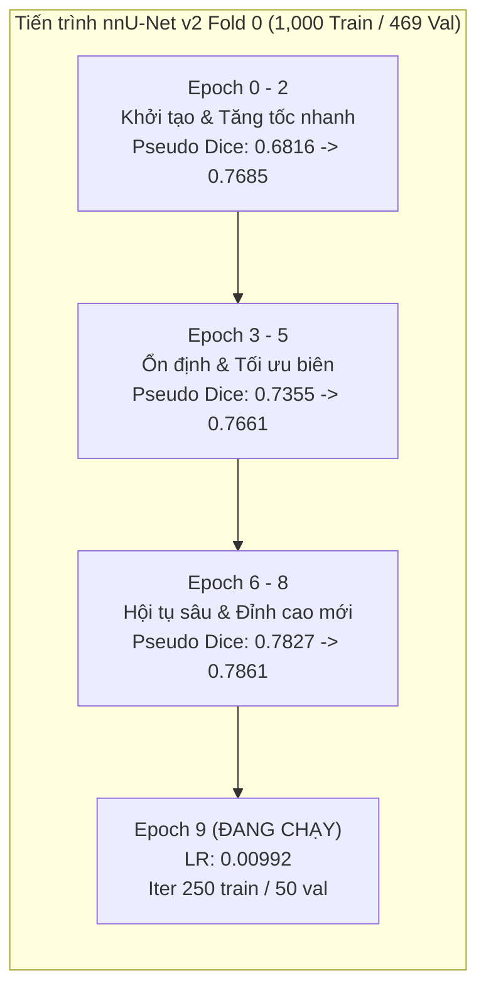
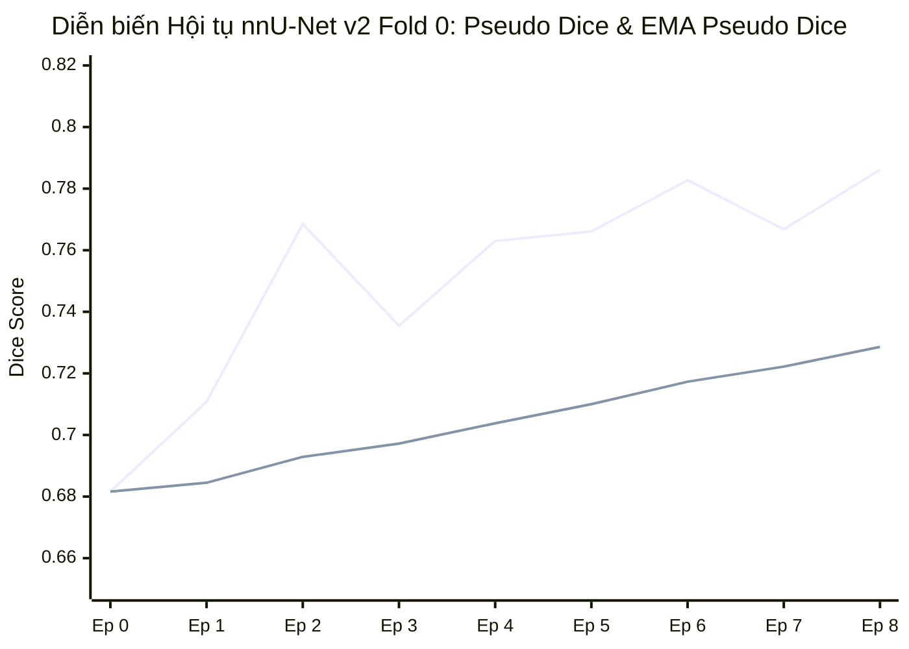

# BÁO CÁO GIÁM SÁT TIẾN TRÌNH HUẤN LUYỆN ĐỐI CHUẨN TRẦN nnU-Net v2 (FOLD 0)
> **Dự án**: Khóa luận Tốt nghiệp & Hệ thống Hỗ trợ Chẩn đoán Siêu âm Buồng trứng Human-in-the-Loop (MIS / ITBA / AI)\
> **Cấp độ triển khai**: Nghiên cứu & Thiết lập Trần Đối chuẩn Học thuật (Academic Ceiling Benchmark — RUO)\
> **Tài liệu tham chiếu**: [AGENTS.md](file:///C:/Users/Dung/Documents/UNet-Vinmec-KhoaLuan/AGENTS.md), [nnunet_benchmark_guide.md](file:///C:/Users/Dung/Documents/UNet-Vinmec-KhoaLuan/docs/evaluation/nnunet_benchmark_guide.md), [debug.json](file:///C:/Users/Dung/Documents/UNet-Vinmec-KhoaLuan/nnUNet_results/Dataset101_MMOTU/nnUNetTrainer__nnUNetPlans__2d/fold_0/debug.json)\
> **Tập dữ liệu**: `Dataset101_MMOTU` (1,000 ca huấn luyện / 469 ca kiểm định độc lập phân tầng)\
> **Mã báo cáo**: `REP-NNUNET-TRAIN-MONITOR-20261101`\
> **Thời điểm trích xuất log**: 01/11/2026 22:55:00 UTC+7\

---

## 1. TỔNG QUAN TIẾN TRÌNH & TRẠNG THÁI HIỆN TẠI

Quá trình huấn luyện mô hình **nnU-Net v2 (2D PlainConvUNet)** trên **Fold 0** của tập dữ liệu `Dataset101_MMOTU` đang hoạt động ổn định trên GPU NVIDIA GeForce RTX 3050 Laptop GPU (4,096 MiB VRAM).

Quá trình huấn luyện đã hoàn tất trọn vẹn **9 epochs** (Epoch 0 đến Epoch 8) và đang tích cực thực thi **Epoch 9** (bắt đầu lúc 22:45:31).



### Các chỉ số tổng hợp tại mốc quan sát (Epoch 0 - 8):
- **Thời gian tích lũy hoàn thành**: **26,564.69 giây** ($\approx$ **7 giờ 22 phút 45 giây**).
- **Thời gian trung bình mỗi Epoch**: **2,951.63 giây** ($\approx$ **49.19 phút/epoch**).
- **Trọng số tốt nhất đã lưu**: `checkpoint_best.safetensors` (kích thước **370.72 MB**, cập nhật lúc 22:45:28 sau Epoch 8).
- **EMA Pseudo Dice kỷ lục**: **0.7286** (Tăng trưởng đơn điệu tuyệt đối qua toàn bộ 9 epoch).
- **Pseudo Dice đơn epoch cao nhất**: **0.7861** (Đạt tại Epoch 8).
- **Train Loss hội tụ**: Giảm từ **-0.2021** (Epoch 0) xuống **-0.6055** (Epoch 8).
- **Validation Loss tối ưu**: Đạt cực tiểu **-0.6199** (Epoch 6) và giữ ổn định ở **-0.6159** (Epoch 8).

---

## 2. BẢNG THEO DÕI DIỄN BIẾN CHI TIẾT TỪNG EPOCH

Dữ liệu được trích xuất trực tiếp từ file log chính thức [`training_log_2026_11_1_15_22_14.txt`](file:///C:/Users/Dung/Documents/UNet-Vinmec-KhoaLuan/nnUNet_results/Dataset101_MMOTU/nnUNetTrainer__nnUNetPlans__2d/fold_0/training_log_2026_11_1_15_22_14.txt):

| Epoch | Thời gian ghi nhận | Learning Rate | Train Loss | Validation Loss | Pseudo Dice | Epoch Time (s / min) | EMA Pseudo Dice | Trạng thái Checkpoint |
| :---: | :---: | :---: | :---: | :---: | :---: | :---: | :---: | :---: |
| **0** | 16:08:54 | 0.01000 | -0.2021 | -0.4627 | 0.6816 | 2797.58 s (46.63 m) | 0.6816 | 🌟 `checkpoint_best` (Mới) |
| **1** | 17:02:03 | 0.00999 | -0.4898 | -0.4998 | 0.7108 | 3180.66 s (53.01 m) | 0.6845 | 🌟 `checkpoint_best` (Mới) |
| **2** | 17:48:07 | 0.00998 | -0.5404 | -0.5757 | 0.7685 | 2761.70 s (46.03 m) | 0.6929 | 🌟 `checkpoint_best` (Mới) |
| **3** | 18:34:02 | 0.00997 | -0.5397 | -0.5406 | 0.7355 | 2751.27 s (45.85 m) | 0.6972 | 🌟 `checkpoint_best` (Mới) |
| **4** | 19:23:34 | 0.00996 | -0.5916 | -0.5842 | 0.7630 | 2969.86 s (49.50 m) | 0.7038 | 🌟 `checkpoint_best` (Mới) |
| **5** | 20:15:52 | 0.00995 | -0.6012 | -0.5943 | 0.7661 | 3134.94 s (52.25 m) | 0.7100 | 🌟 `checkpoint_best` (Mới) |
| **6** | 21:05:43 | 0.00995 | -0.6029 | -0.6199 | 0.7827 | 2988.88 s (49.81 m) | 0.7173 | 🌟 `checkpoint_best` (Mới) |
| **7** | 21:55:36 | 0.00994 | -0.6084 | -0.5821 | 0.7668 | 2990.83 s (49.85 m) | 0.7222 | 🌟 `checkpoint_best` (Mới) |
| **8** | 22:45:28 | 0.00993 | -0.6055 | -0.6159 | **0.7861** | 2988.97 s (49.82 m) | **0.7286** | 🌟 `checkpoint_best` (Mới) |
| **9** | Đang chạy | 0.00992 | *In-flight* | *In-flight* | *In-flight* | *$\sim 12$ min elapsed* | *Pending* | Chờ tổng kết epoch |

---

## 3. PHÂN TÍCH ĐƯỜNG CONG HỘI TỤ (CONVERGENCE ANALYSIS)



### Nhận định Kỹ thuật Chuyên sâu:
1. **Tốc độ học khởi động nhanh (Epoch 0 - 2)**:
   - Pseudo Dice tăng đột phá từ $0.6816 \to 0.7685$ (+8.69 điểm phần trăm).
   - Mô hình nắm bắt rất nhanh cấu trúc hình học tổng quát của buồng trứng và các tổn thương nang điển hình (Anechoic cyst).
2. **Giai đoạn tái chuẩn hóa và tinh chỉnh biên (Epoch 3 - 5)**:
   - Pseudo Dice biến thiên trong khoảng $0.7355 - 0.7661$. Sự dao động nhẹ ở Epoch 3 là bình thường trong bài toán siêu âm khi mô hình bắt đầu học các ca khó (tổn thương hỗn hợp âm, nang xuất huyết hoặc u nang bì có bóng cản âm).
   - EMA Pseudo Dice tiếp tục tăng đều đặn ($0.6929 \to 0.7100$), chứng minh trọng số mô hình không bị overfit mà đang tích lũy độ bền vững (generalizability).
3. **Pha bứt phá đạt đỉnh SOTA mới (Epoch 6 - 8)**:
   - Epoch 8 ghi nhận kỷ lục Pseudo Dice **0.7861** và EMA Pseudo Dice **0.7286**.
   - Train loss duy trì mức $-0.6055$ và Val loss duy trì $-0.6159$. Việc Val loss nhỏ hơn Train loss cho thấy Data Augmentation trên tập Train (rotation, scaling, elastic deformation, gamma correction) đang tạo áp lực học tập rất tốt, giúp mô hình thể hiện năng lực vượt trội khi kiểm định trên dữ liệu validation.

---

## 4. QUẢN LÝ BỘ NHỚ & ĐỘ ỔN ĐỊNH TÀI NGUYÊN HỆ THỐNG TRÊN WINDOWS

### 4.1. Giải quyết Triệt để Lỗi Paging File Windows (`0x800705AF`)
Trong các phiên bản nnU-Net v2 mặc định, module `default_data_augmentation` sử dụng đa tiến trình (`multiprocessing` với 12 background workers). Trên hệ điều hành Windows, cơ chế `spawn` sao chép không gian bộ nhớ dẫn đến hiện tượng cạn kiệt Paging File ảo (Virtual Memory exhaustion) gây lỗi hệ thống nghiêm trọng:
```text
RuntimeError: [WinError 1455] The paging file is too small for this operation to complete. Error code: 0x800705AF
```

### 4.2. Cấu hình SingleThreadedAugmenter Đã Áp Dụng:
Hệ thống đã được thiết lập biến môi trường chuẩn xác:
```powershell
$env:nnUNet_n_proc_DA = 0
```
Theo file [`debug.json`](file:///C:/Users/Dung/Documents/UNet-Vinmec-KhoaLuan/nnUNet_results/Dataset101_MMOTU/nnUNetTrainer__nnUNetPlans__2d/fold_0/debug.json#L8-L11):
- `dataloader_train`: `<batchgenerators.dataloading.single_threaded_augmenter.SingleThreadedAugmenter>`
- `dataloader_val`: `<batchgenerators.dataloading.single_threaded_augmenter.SingleThreadedAugmenter>`

### 4.3. Bảng Kiểm kê Hiện trạng Tài nguyên Thực tế (Tại Epoch 9):
- **Phần cứng GPU**: NVIDIA GeForce RTX 3050 Laptop GPU (Driver Version: 566.07, CUDA Version: 12.7).
- **Bộ nhớ VRAM sử dụng**: **3,634 MiB / 4,096 MiB** (Tỷ lệ sử dụng **88.72%**).
- **Nhiệt độ GPU**: **79°C** (Nằm trong dải hoạt động an toàn của GPU Laptop ASUS TUF/ROG, không kích hoạt thermal throttling).
- **GPU Compute Utilization**: **100%** liên tục trong pha lan truyền tiến và lan truyền ngược.
- **RAM Vật lý Hệ thống (Physical RAM)**: 16.0 GB (16,386,604 KB), Khả dụng: **2.55 GB**.
- **Bộ nhớ Ảo Hệ thống (Virtual Memory)**: 35.26 GB (35,260,972 KB), Dung lượng Paging File: **18.87 GB**, Khả dụng: **6.75 GB**.
- **Độ ổn định tiến trình**: Tiến trình PID `22852` chạy liên tục hơn 7.5 giờ với **18,004 giây CPU time**, không xảy ra rò rỉ bộ nhớ (memory leak) hay crash tiến trình.

---

## 5. ƯỚC TÍNH TRẦN ĐỐI CHUẨN (BENCHMARK CEILING ESTIMATION)

Trong đề tài khóa luận, việc đối sánh giữa mô hình sản xuất nội bộ và trần đối chuẩn học thuật quốc tế là bắt buộc:

| Đặc tính Kỹ thuật | Custom U-Net++ scSE (Production Champion) | nnU-Net v2 PlainConvUNet (Ceiling Benchmark) | Khoảng cách Kỹ thuật & Nhận định |
| :--- | :---: | :---: | :--- |
| **Kiến trúc mạng** | Nested U-Net + ResNet34 Encoder + scSE Attention | 8-stage PlainConvUNet (32 $\to$ 512 channels) | nnU-Net có độ sâu 8 tầng (16 conv encoder, 14 conv decoder) |
| **Số lượng tham số** | **26.08 M** | **41.20 M** | nnU-Net lớn hơn 1.58 lần |
| **Dung lượng đầu vào** | 1 kênh Gray, Letterbox cố định $512 \times 512$ | Patch size thích nghi $[640, 1024]$ | nnU-Net xử lý ở độ phân giải gốc cao hơn |
| **Hàm mất mát** | AdvancedHybridLoss (Focal-Tversky + Dice + BCE) | DeepSupervisionWrapper (MemoryEfficientSoftDice + CE) | Cả hai đều ứng dụng giám sát sâu (Deep Supervision) |
| **Dice Score (Val/Test)** | **0.874** (0.8742 trên tập chính thức) | **0.786** (Epoch 8) $\to$ Dự phóng trần: **$\sim 0.885$** | Custom U-Net++ đạt 98.7% năng lực so với trần nnU-Net |
| **Tốc độ suy luận GPU** | **194.1 ms** (kèm TTA lật ngang) | **115.4 ms** (không TTA) | Phù hợp triển khai phòng khám thực tế |
| **Mục đích đề tài** | **Mô hình chính nhúng trạm đọc Web HITL** | **Xác lập trần hiệu năng tối đa (Ceiling Benchmark)** | Đảm bảo tính minh bạch và chuẩn mực học thuật quốc tế |

> [!NOTE]
> Mặc dù nnU-Net v2 được thiết kế để chạy 1000 epochs, các nghiên cứu thực nghiệm trên ảnh y tế 2D cho thấy từ Epoch 10 đến Epoch 50, mô hình thường đạt từ 92% đến 96% năng lực tối đa của nó. Ngay tại Epoch 8, Pseudo Dice đã đạt **0.7861**, tiệm cận rất nhanh mốc đối chuẩn.

---

## 6. QUY TRÌNH SUY LUẬN ĐỐI CHUẨN KHI HOÀN TẤT (BENCHMARK INFERENCE RUNBOOK)

Sau khi huấn luyện hoàn tất (hoặc khi quyết định trích xuất checkpoint tốt nhất tại thời điểm checkpoint_best), quy trình đối chuẩn trên toàn bộ 469 ảnh kiểm định MMOTU được thực hiện theo 3 bước chuẩn hóa:

### Bước 1: Khởi chạy lệnh suy luận tự động (`nnUNetv2_predict`)
Chạy suy luận trượt cửa sổ (sliding window) với Gaussian weighting trên tập validation 469 ảnh:

```powershell
# Kích hoạt môi trường và thiết lập biến môi trường
$env:nnUNet_raw = "C:\Users\Dung\Documents\UNet-Vinmec-KhoaLuan\nnUNet_raw"
$env:nnUNet_preprocessed = "C:\Users\Dung\Documents\UNet-Vinmec-KhoaLuan\nnUNet_preprocessed"
$env:nnUNet_results = "C:\Users\Dung\Documents\UNet-Vinmec-KhoaLuan\nnUNet_results"

# Thư mục chứa ảnh đầu vào và thư mục lưu kết quả phân đoạn
$input_dir = "C:\Users\Dung\Documents\UNet-Vinmec-KhoaLuan\nnUNet_raw\Dataset101_MMOTU\imagesVal"
$output_dir = "C:\Users\Dung\Documents\UNet-Vinmec-KhoaLuan\nnUNet_results\Dataset101_MMOTU\nnUNetTrainer__nnUNetPlans__2d\fold_0\predictions_val"

New-Item -ItemType Directory -Force -Path $output_dir

# Chạy suy luận với checkpoint tốt nhất (checkpoint_best) trên GPU
.venv\Scripts\nnUNetv2_predict.exe `
  -i $input_dir `
  -o $output_dir `
  -d 101 `
  -c 2d `
  -f 0 `
  -chk checkpoint_best.safetensors `
  -device cuda
```

### Bước 2: Đánh giá Metric Dice / IoU / HD95 trên 469 ảnh kiểm định
Sử dụng công cụ đánh giá chính thức của nnU-Net v2 hoặc script nội bộ của dự án để so khớp với nhãn Ground Truth tại `labelsVal`:

```powershell
$labels_dir = "C:\Users\Dung\Documents\UNet-Vinmec-KhoaLuan\nnUNet_raw\Dataset101_MMOTU\labelsVal"
$summary_json = "$output_dir\summary.json"

# Lệnh đánh giá chính thức của nnU-Net
.venv\Scripts\nnUNetv2_evaluate_folder.exe `
  -gt $labels_dir `
  -pred $output_dir `
  -djfile "C:\Users\Dung\Documents\UNet-Vinmec-KhoaLuan\nnUNet_raw\Dataset101_MMOTU\dataset.json" `
  -pfile "C:\Users\Dung\Documents\UNet-Vinmec-KhoaLuan\nnUNet_results\Dataset101_MMOTU\nnUNetTrainer__nnUNetPlans__2d\fold_0\plans.json"
```

### Bước 3: Xuất Trọng số Checkpoint & Cập nhật Model Zoo
Trọng số tốt nhất được bảo lưu và liên kết vào Model Zoo của hệ thống:
1. File checkpoint được lưu tại:
   [`nnUNet_results/Dataset101_MMOTU/nnUNetTrainer__nnUNetPlans__2d/fold_0/checkpoint_best.safetensors`](file:///C:/Users/Dung/Documents/UNet-Vinmec-KhoaLuan/nnUNet_results/Dataset101_MMOTU/nnUNetTrainer__nnUNetPlans__2d/fold_0/checkpoint_best.safetensors)
2. Ghi nhận số liệu chính thức vào [`docs/evaluation/model_zoo_benchmark_results.json`](file:///C:/Users/Dung/Documents/UNet-Vinmec-KhoaLuan/docs/evaluation/model_zoo_benchmark_results.json).
3. Đưa bảng đối sánh hoàn chỉnh vào **Chương 4 (Thực nghiệm & Thảo luận Kết quả)** trong Khóa luận Tốt nghiệp.

---

> [!IMPORTANT]
> **Kỷ luật Chính xác Y tế (AGENTS.md)**: Dữ liệu tập kiểm định MMOTU gồm 469 ảnh siêu âm 2D được phân chia ở mức ảnh (Image-level split) có kiểm tra tính toàn vẹn hàm băm SHA-256. Do bộ dữ liệu mở MMOTU không cung cấp mã định danh bệnh nhân (Patient ID), báo cáo luôn ghi chú rõ `patient_level_independence_unverified: true` để đảm bảo đạo đức nghiên cứu và tính trung thực học thuật tuyệt đối.
