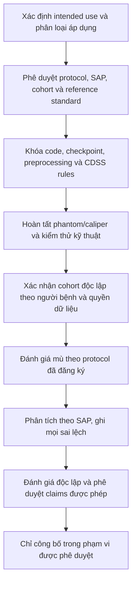

# Khung chuẩn bị xác thực lâm sàng — bản nháp chưa phê duyệt

- **Mã tài liệu:** CVP-OVUS-001
- **Phiên bản:** 0.1-draft
- **Ngày lập:** 2026-10-29

**Trạng thái:** **DRAFT — BLOCKED — KHÔNG ĐƯỢC DÙNG ĐỂ TUYỂN CA, THU THẬP DỮ LIỆU LÂM SÀNG HOẶC CHĂM SÓC BỆNH NHÂN**

## 1. Mục đích và giới hạn

Tài liệu này chuẩn bị các câu hỏi, tiêu chí và hồ sơ cần được chủ nhiệm nghiên cứu, chuyên gia siêu âm, thống kê, đơn vị quản lý dữ liệu, hội đồng đạo đức và đầu mối pháp quy xem xét. Đây **không phải** protocol được phê duyệt và không cho phép bắt đầu nghiên cứu.

Không tự điền thiết kế nghiên cứu, tiêu chí chọn/loại ca, cỡ mẫu, ngưỡng chấp nhận, tuyên bố hiệu năng, phân loại pháp lý hoặc cách xử trí bệnh nhân. Các trường này phải được xác định trước khi mở khóa protocol và trước khi xem kết quả trên tập đánh giá.

Sản phẩm hiện được giới hạn ở **RUO**. Bằng chứng đang có chỉ là kiểm thử kỹ thuật bằng fixture tổng hợp và SQLite cách ly. Không dùng dữ liệu tổng hợp làm bằng chứng xác thực lâm sàng. Không dùng output AI/CDSS để chẩn đoán, phân tầng nguy cơ hoặc quyết định chăm sóc bệnh nhân.

## 2. Hồ sơ sản phẩm phải được khóa trước đánh giá

Chủ sở hữu sản phẩm và chuyên gia lâm sàng phải hoàn tất và ký duyệt các trường sau:

| Trường | Giá trị cần được phê duyệt |
|---|---|
| Mục đích sử dụng và vai trò của AI trong quyết định | **TBD — chưa phê duyệt** |
| Quần thể đích, người dùng dự kiến và môi trường sử dụng | **TBD — chưa phê duyệt** |
| Đầu vào/đầu ra được phép và trường hợp loại trừ | **TBD — chưa phê duyệt** |
| Quốc gia, phân loại pháp lý và lộ trình phê duyệt áp dụng | **TBD — đầu mối pháp quy/site xác định** |
| Commit phần mềm, image/build digest và cấu hình triển khai | **TBD — phải đóng băng trước đánh giá** |
| Checkpoint SHA-256, kiến trúc, preprocessing và cấu hình inference | **BLOCKED — phải truy nguyên và đóng băng artifact** |
| Phiên bản CDSS, bộ quy tắc và nguồn phiên bản được phê duyệt | **TBD — chuyên gia xác nhận** |
| Phiên bản schema, cơ sở dữ liệu, migration và cấu hình lưu trữ | **TBD — phải xác minh trên môi trường đích** |

Tập model đang chọn có vấn đề provenance và ghi nhận AdvancedHybridLoss trong khi scope dự án yêu cầu Combo Loss. Không được bắt đầu clinical validation hoặc relabel checkpoint cho tới khi sai khác này được giải quyết bằng artifact và hồ sơ huấn luyện có thể kiểm chứng.

## 3. Câu hỏi thiết kế nghiên cứu chưa được quyết định

Chủ nhiệm nghiên cứu và chuyên gia thống kê phải chọn, ghi lý do và phê duyệt thiết kế phù hợp. Các lựa chọn dưới đây chỉ là các dạng câu hỏi để xem xét, không phải chỉ định thiết kế:

- Đánh giá kỹ thuật trên phantom/ảnh tham chiếu có kích thước hoặc calibration đã biết.
- Đánh giá chẩn đoán hồi cứu, ngoại bộ trên cohort tách biệt ở cấp người bệnh.
- Nghiên cứu reader/workflow có đối chứng để đánh giá tương tác người–AI.
- Đánh giá tiến cứu hoặc can thiệp tại site, chỉ sau các phê duyệt tương ứng.

- **Thiết kế được chọn:** TBD
- **Lý do chọn và thiết kế thay thế bị loại:** TBD
- **Đơn vị phân tích chính (người bệnh/ca/tổn thương/ảnh):** TBD
- **Đăng ký nghiên cứu, protocol và Statistical Analysis Plan (SAP):** TBD

Không được bỏ qua gate hoặc dùng kết quả một giai đoạn để hợp thức hóa giai đoạn tiếp theo.

## 4. Quần thể, cohort và tính độc lập theo người bệnh

Trước khi truy cập cohort, protocol phải định nghĩa rõ:

- Site, nguồn tuyển/chọn ca, thời gian lấy dữ liệu, phương thức lấy mẫu và cách tránh chọn ca thuận tiện.
- Tiêu chí đưa vào/loại ra ở cấp người bệnh, ca, ảnh và tổn thương; cách xử lý ảnh không đạt chất lượng, nhiều ảnh cùng bên, hai bên, nhiều tổn thương, ảnh thiếu bên hoặc thiếu calibration.
- Đặc điểm phổ bệnh, thiết bị, đầu dò, chế độ ảnh và các nhóm phân tích do chuyên gia lâm sàng xác định trước.
- Cách xử lý dữ liệu thiếu, ảnh trùng, ảnh tái mã hóa và nhiều lần khảo sát của cùng một người bệnh.

**Không tạo patient ID giả.** Dữ liệu nghiên cứu không được chứa định danh trực tiếp trong repository. Nếu cần chứng minh patient-level independence, đơn vị quản lý dữ liệu của site phải giữ bảng liên kết trong môi trường được phê duyệt và cung cấp một mã nhóm không đảo ngược hoặc chứng thư kiểm tra độc lập phù hợp với quy trình bảo mật đã duyệt. Mã này không được dùng để đưa định danh người bệnh vào repository.

Quy tắc phân tách và kiểm tra bắt buộc trước phân tích:

1. Toàn bộ ảnh/ca của cùng một người bệnh phải thuộc cùng một partition đánh giá.
2. SHA-256 được dùng để phát hiện trùng byte; cần quy tắc bổ sung được phê duyệt cho ảnh cùng nguồn nhưng tái mã hóa/crop/resize.
3. Cohort đánh giá phải độc lập với dữ liệu huấn luyện, chọn mô hình, chọn ngưỡng và phát triển quy tắc.
4. Chỉ image-level split hoặc loại bỏ hash trùng không chứng minh patient-level independence.
5. Nếu không thể xác minh sự độc lập theo người bệnh, báo cáo phải ghi rõ **chưa xác minh**; không đưa ra claim patient-level, external validation hoặc clinical performance.

**Phân tách hiện có của dự án:** image-level với SHA-256 deduplication; patient-level independence **chưa được xác minh**. Đây không phải cohort lâm sàng độc lập.

## 5. Reference standard và đánh giá độc lập

Protocol phải chỉ rõ reference standard riêng cho từng đầu ra. Không lấy output AI/CDSS làm ground truth.

| Đầu ra được đánh giá | Hồ sơ reference cần chốt trước nghiên cứu |
|---|---|
| Phân đoạn và vùng/tổn thương | Hướng dẫn gán nhãn, năng lực người gán nhãn, số lượt đọc độc lập, cách làm mù, cách xử lý bất đồng và người/cơ chế adjudication — **TBD/phê duyệt chuyên môn** |
| Caliper và kích thước | Phantom/reference có traceable dimension hoặc phương pháp tham chiếu được chuyên gia xác định; orientation, calibration, thao tác lặp, tolerance/acceptance limit và đơn vị phân tích — **TBD** |
| Đếm cấu trúc/nang | Định nghĩa đơn vị đếm, tiêu chí phân biệt vùng chạm/dính, reference annotation/adjudication và cách xử lý ảnh không đủ chất lượng — **TBD** |
| CDSS/O-RADS/IOTA | Phiên bản lexicon/rules, dữ liệu mô tả được thu thập, expert consensus/reference, quy tắc thiếu/không áp dụng và xử lý không đồng thuận — **TBD** |
| Workflow HITL | Script thao tác, vai trò người dùng, thứ tự AI/human, mức làm mù, training, thời gian, lỗi thao tác và cách ghi can thiệp của người dùng — **TBD** |

Protocol phải định trước chuyên môn/ngưỡng năng lực của người đọc, mức độc lập, cách che output AI khi lập reference, quy trình adjudication, xử lý xung đột lợi ích và kiểm tra nhất quán giữa người đọc. Số người đọc, thời gian washout, thứ tự đọc, randomization và cách chọn comparator cần được chuyên gia thống kê/PI quyết định; tài liệu này không tự ấn định các giá trị đó.

## 6. Đóng băng hệ thống và quản lý thay đổi

Lưu vào hồ sơ nghiên cứu trước khi chạy cohort đánh giá:

- Git commit, build/image digest, dependency lock, cấu hình phần cứng/phần mềm và checksum checkpoint.
- Kiến trúc model, preprocessing, resize/letterbox, CLAHE, TTA, ngưỡng hậu xử lý và cấu hình inference thực sự đang chạy.
- Calibration source, pixel spacing, phép biến đổi source/model/canvas coordinates và cách xử lý giá trị thiếu/không hợp lệ.
- CDSS ruleset/version, schema request/response, descriptor provenance, handling khi thiếu thông tin và nội dung cảnh báo RUO.
- Cấu hình database, migrations, retention, backup/restore, access control và audit log ở site.
- Version của protocol, SAP, CRF/data dictionary, hướng dẫn người đọc và kế hoạch xử lý incident.

Mọi thay đổi phần mềm, model, preprocessing, ruleset, calibration, UI/workflow hoặc schema sau khi khóa phải được ghi change request, đánh giá ảnh hưởng và quyết định chạy lại phần nào trước khi xem/tiếp tục dữ liệu. Không lựa chọn model, ngưỡng hay cohort theo kết quả của tập đánh giá.

## 7. Endpoints và kế hoạch thống kê — chưa có ngưỡng chấp nhận

Chuyên gia thống kê và PI phải chọn endpoint chính/phụ, đơn vị phân tích, phân tích missing data, khoảng tin cậy, xử lý clustering/lặp đo và phân tích subgroup trước khi mở cohort. Các miền dưới đây là danh sách cần xem xét, không phải endpoint hoặc acceptance criteria đã được duyệt:

- Phân đoạn: overlap và biên vùng ở cấp được xác định trước; phân tích false split/merge và vùng bị bỏ sót.
- Region matching/counting: đúng danh tính vùng, sai số đếm và tình huống vùng liền kề/dính nhau.
- Caliper: sai số so với reference, độ lặp lại, hiệu ứng người đọc, calibration failure và tỷ lệ không có số đo hợp lệ.
- CDSS: concordance với reference cho từng ruleset/version; kết quả insufficient-data, không xác định và stale-state.
- HITL/safety: nhầm ca/bên/ảnh/vùng, stale measurement/assessment, retry/mất mạng, lỗi lưu và mức can thiệp của người dùng.
- Hiệu năng/kha dụng: thời gian xử lý theo phân vị, lỗi/timeout, sử dụng bộ nhớ và ngừng hoạt động trên cấu hình mục tiêu.
- Phân tích phân tầng do chuyên gia chọn trước theo phổ hình thái, chất lượng ảnh, thiết bị, site và nhóm liên quan.

| Mục phải khóa | Trạng thái |
|---|---|
| Endpoint chính, estimand và đơn vị phân tích | **TBD — PI + chuyên gia thống kê** |
| Cỡ mẫu/công suất và giả định | **TBD — chuyên gia thống kê; không suy ra từ dữ liệu tổng hợp** |
| Acceptance limit cho từng endpoint | **TBD — chuyên gia lâm sàng + thống kê ký duyệt trước cohort** |
| Khoảng tin cậy, missing data, clustering và sensitivity analyses | **TBD — SAP** |
| Phân tích subgroup, multiplicity và kế hoạch kiểm soát bias | **TBD — SAP** |

Không dùng image-level metric của training/evaluation hiện có làm ngưỡng lâm sàng, bằng chứng độc lập hoặc acceptance criteria.

## 8. Quản lý rủi ro và sai lệch

Trước khi nghiên cứu, safety reviewer phải đánh giá tối thiểu các tình huống sau trong hazard/risk file được kiểm soát: nhầm người bệnh/ca/ảnh/bên; nhầm hoặc mất region identity; caliper ở sai vùng hoặc sai hệ tọa độ; pixel spacing thiếu/sai; stale CDSS sau thay đổi review/caliper; false high-risk/false reassurance; ảnh/descriptor không đủ nhưng UI thể hiện như kết luận; mất mạng/lưu một phần/retry trùng; và báo cáo/ảnh in không khớp trạng thái đã duyệt.

### Mẫu ghi nhận sai lệch

Mỗi sai lệch là một bản ghi có mã duy nhất. Không ghi tên, ngày sinh, PID nguồn, ảnh hoặc nội dung có thể nhận dạng người bệnh vào file này.

| Trường | Nội dung ghi nhận |
|---|---|
| Deviation ID / protocol version |  |
| Ngày giờ và site code |  |
| Study subject code do site quản lý |  |
| Case/image/region/event reference không định danh |  |
| Điều khoản protocol và expected behavior |  |
| Mô tả sai lệch, phát hiện bởi ai và thời điểm |  |
| Ảnh hưởng có thể có đến an toàn, reference hoặc phân tích |  |
| Hành động tức thời / có dừng thao tác hay không |  |
| Quyết định của PI về loại báo cáo/thông báo và cơ sở quyết định |  |
| Phân loại dữ liệu: giữ, loại, adjudicate hoặc phân tích nhạy cảm |  |
| Root cause, corrective/preventive action và owner/due date |  |
| Đánh giá đóng sai lệch, người rà soát và chữ ký/ngày |  |

### Mẫu ghi nhận bất đồng giữa người đọc trước phân xử

Mẫu này tách kết quả đọc độc lập khỏi kết quả phân xử. Khóa từng bản ghi người đọc trước khi mở kết quả người đọc khác hoặc output AI/CDSS theo phương án làm mù đã được phê duyệt. Không sửa hoặc ghi đè đánh giá ban đầu bằng kết quả đồng thuận; lưu kết quả phân xử ở trường riêng. Dùng mã nghiên cứu không định danh do site cấp và không ghi PHI vào repository.

| Trường | Ghi nhận |
|---|---|
| Study-issued code / image / region reference |  |
| Protocol, software build, checkpoint, preprocessing và ruleset version |  |
| Reader A code, qualification reference, thời điểm khóa kết quả |  |
| Reader A independent result / descriptor và trạng thái missing/uncertain |  |
| Reader B code, qualification reference, thời điểm khóa kết quả |  |
| Reader B independent result / descriptor và trạng thái missing/uncertain |  |
| AI/CDSS output đã hiển thị trước khi từng kết quả độc lập bị khóa? Ai đã thấy và khi nào? |  |
| Loại và mô tả bất đồng trước phân xử |  |
| Phương pháp phân xử, adjudicator/qualification reference và lý do |  |
| Kết quả reference sau phân xử (trường riêng; không thay Reader A/B) |  |
| Ảnh hưởng an toàn/phân tích, containment và liên kết deviation nếu có |  |
| Người rà soát, chữ ký/thời điểm và audit/reference record |  |

Các vai trò, mức làm mù, qualification, thời điểm mở khóa, adjudication method và dữ liệu được lưu phải được PI, chuyên gia lâm sàng, statistician và data custodian phê duyệt trước. Mẫu này không tự chọn quy trình, reference value hay tiêu chí chấp nhận.

Không tự suy diễn mức độ nghiêm trọng hoặc reportability. PI, safety lead và đầu mối ethics/regulatory quyết định theo protocol đã phê duyệt và quy trình site.

## 9. Acceptance criteria và các chữ ký bắt buộc

Mọi giới hạn số phải được đặt trước, có lý do chuyên môn/thống kê và chữ ký người có thẩm quyền. Không để placeholder sau khi mở nghiên cứu.

| Hạng mục | Tiêu chí/threshold | Người duyệt | Trạng thái |
|---|---|---|---|
| Segmentation/region/counting | **TBD — không tự đặt** | Chuyên gia hình ảnh + thống kê | BLOCKED |
| Caliper/calibration | **TBD — dựa reference/phantom và protocol đo** | Chuyên gia siêu âm + metrology/QA phù hợp | BLOCKED |
| O-RADS/IOTA/CDSS | **TBD — bộ ca và reference chuyên gia** | Chuyên gia lâm sàng + thống kê | BLOCKED |
| Stale/failure/identity safety | **TBD — hazard analysis và use scenario** | Clinical safety reviewer + site | BLOCKED |
| Workflow/usability/performance | **TBD — cấu hình và acceptance được site duyệt** | Site lead + human factors/QA | BLOCKED |
| Patient-level independence/externality | **TBD — bằng chứng custodian và kế hoạch thống kê** | Data custodian + PI + thống kê | BLOCKED |

### Checklist phê duyệt trước khi mở cohort

- [ ] Intended use, user, population, comparator và claims đã được chốt.
- [ ] Protocol, SAP, CRF/data dictionary, sampling frame và acceptance criteria đã được ký duyệt/versioned.
- [ ] Ethics/research committee và chấp thuận của site đã được cấp; mã phê duyệt và điều kiện được lưu trong hồ sơ kiểm soát.
- [ ] Đầu mối pháp quy đã xác định phân loại, yêu cầu/miễn trừ và các giới hạn áp dụng tại địa bàn; không suy từ tài liệu nước ngoài.
- [ ] Data custodian đã duyệt nguồn/quyền sử dụng, bảo mật, liên kết mã người bệnh, lưu trữ, retention và hủy dữ liệu.
- [ ] Chuyên gia độc lập, kế hoạch làm mù/adjudication và xung đột lợi ích đã được xác định.
- [ ] Checkpoint/software/DB được khóa; model provenance/loss discrepancy được đóng; security, hazard, rollback, backup/restore và incident handling đã được duyệt.
- [ ] Caliper phantom/reference, expert-approved CDSS case set và patient-level independence plan đã có evidence kiểm tra.
- [ ] Người thực hiện được đào tạo; site workstation, thiết bị, mạng, monitoring và hỗ trợ sự cố được xác nhận.
- [ ] Mọi trường acceptance criteria và contact/escalation đều có owner/chữ ký; không còn TBD.

**Quyết định hiện tại:** **BLOCKED — chưa được phê duyệt, không bắt đầu cohort lâm sàng.**

## 10. Tình trạng hồ sơ hiện có

| Bằng chứng/hồ sơ | Trạng thái hiện tại |
|---|---|
| Kỹ thuật region/caliper/CDSS với API/SQLite tổng hợp | PASS kỹ thuật theo test được liệt kê trong `artifacts/audit_remediation_2026_10_28/status.md`; không phải validation lâm sàng |
| Patient-level independent cohort | **BLOCKED — chưa xác minh** |
| Caliper phantom/reference chuyên môn | **BLOCKED — chưa có bộ reference được duyệt** |
| CDSS expert-approved case set | **BLOCKED — chưa có** |
| Checkpoint provenance và đúng scope Combo Loss | **BLOCKED — chưa giải quyết** |
| PostgreSQL/migration/concurrency trên DB đích | **BLOCKED — không có driver/service test và code hiện chỉ hỗ trợ SQLite** |
| Ethics, regulatory, site, hazard/risk approvals | **BLOCKED — chưa có hồ sơ phê duyệt** |
| Clinical validation results | **NOT TESTED — không có và không được suy diễn từ E2E synthetic** |

## 11. Nguồn phương pháp cần được PI/đơn vị pháp quy rà soát

Các nguồn dưới đây đã được đối chiếu trực tiếp ngày 2026-10-29 ở trang chính thức hoặc PubMed. Chúng hỗ trợ hoàn thiện hồ sơ/reporting checklist; không tự quyết định phân loại pháp lý, thiết kế phù hợp, acceptance threshold hay quyền triển khai tại Việt Nam:

- [VERIFIED] IMDRF, *Software as a Medical Device (SaMD): Clinical Evaluation*, N41FINAL:2017 — tài liệu chính thức nêu ba phần valid clinical association, analytical validation và clinical validation: [trang tài liệu IMDRF](https://www.imdrf.org/documents/software-medical-device-samd-clinical-evaluation), [PDF chính thức](https://www.imdrf.org/sites/default/files/docs/imdrf/final/technical/imdrf-tech-170921-samd-n41-clinical-evaluation_1.pdf).
- [VERIFIED] STARD-AI, *The STARD-AI reporting guideline for diagnostic accuracy studies using artificial intelligence* (Nature Medicine, công bố 2025) — reporting guideline cho nghiên cứu độ chính xác chẩn đoán AI, không phải thiết kế nghiên cứu hoặc acceptance limits: [PubMed record](https://pubmed.ncbi.nlm.nih.gov/40954311/), [Nature Medicine](https://www.nature.com/articles/s41591-025-03953-8). Kiểm tra errata/correction mới nhất trước khi protocol được phê duyệt.
- [VERIFIED] SPIRIT 2025 — chỉ xem xét nếu protocol là randomized trial; JAMA mô tả đây là hướng dẫn nội dung protocol, không phải quy định thiết kế hoặc tiêu chuẩn cho phép triển khai: [JAMA](https://jamanetwork.com/journals/jama/fullarticle/2833408).
- [VERIFIED] FDA 2022 CADe guidance — phạm vi tài liệu là 510(k) tại Hoa Kỳ cho CADe áp dụng lên ảnh/dữ liệu radiology; không mặc định áp dụng cho sản phẩm/site này: [FDA](https://www.fda.gov/regulatory-information/search-fda-guidance-documents/clinical-performance-assessment-considerations-computer-assisted-detection-devices-applied-radiology).
