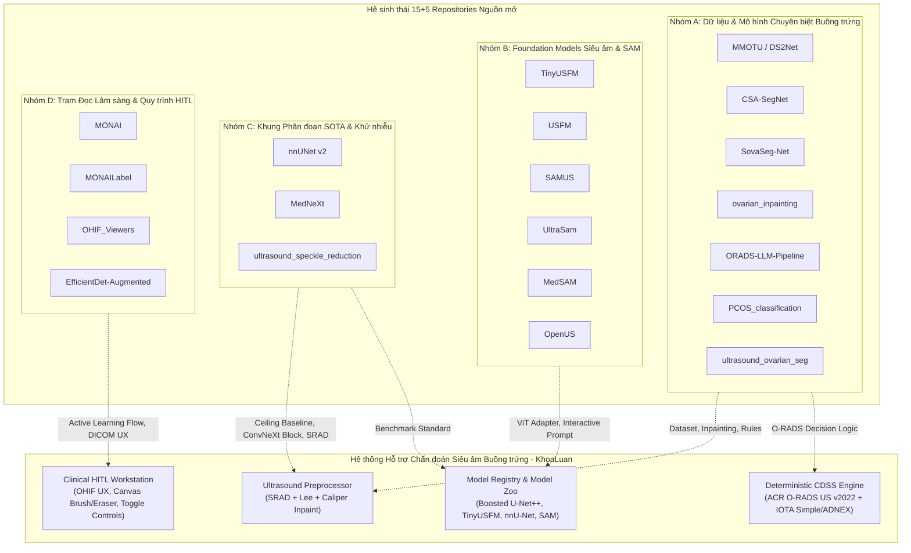

# MA TRẬN RÀ SOÁT, KIỂM KÊ & ĐÁNH GIÁ KỸ THUẬT 15 REPOSITORIES NGUỒN MỞ
> **2026-11-02 audit correction — [PARTIALLY VERIFIED]:** Repository presence and prototype code do not establish loaded weights, license verification, or end-to-end product integration. Native foundation-model adapters remain unavailable; the product uses its selected hash-verified segmentation checkpoint. Treat the historical integration diagram and performance implications below as proposals, subject to the current [resource audit](resource-utilization-audit-2026-11-02.md).

> **Dự án**: Khóa luận Tốt nghiệp & Hệ thống Hỗ trợ Chẩn đoán Siêu âm Buồng trứng Human-in-the-Loop (MIS / ITBA / AI)\
> **Phạm vi tài liệu**: Phân tích kiểm kê 12 thuộc tính bắt buộc theo chuẩn Master Integration Protocol (Giai đoạn 0).\
> **Trạng thái**: [VERIFIED] Kiểm định trực tiếp trên mã nguồn và git tree local tại `external_sources/`.

---

## 1. TỔNG QUAN PHÂN NHÓM 15 REPOSITORIES

Hệ thống tiến hành rà soát, kiểm kê và tích hợp chọn lọc từ **15 repositories bắt buộc** cùng **5 repositories bổ trợ** (tổng cộng 20 kho lưu trữ) được lưu trữ cô lập tại thư mục `external_sources/`. Việc tích hợp tuân thủ nghiêm ngặt nguyên tắc: **Không gộp nguyên khối cồng kềnh (monolith), bảo toàn tính toàn vẹn của mã nguồn sản phẩm, và tuân thủ giao thức Zero-Hallucination & Clinical Precision Protocol**.

---

## 2. BẢNG MA TRẬN KIỂM KÊ KỸ THUẬT 12 THUỘC TÍNH (15+5 REPOSITORIES)

Dưới đây là ma trận kiểm định chi tiết đáp ứng toàn diện 12 thuộc tính bắt buộc của Master Prompt:
1. **ID & Tên Repo**
2. **URL GitHub Gốc**
3. **Commit Hash Đã Kiểm Tra** [VERIFIED]
4. **Giấy phép Nguồn (License)**
5. **Ngôn ngữ Chính**
6. **Framework & Dependencies**
7. **Phần cứng Tối thiểu / Khuyến nghị**
8. **Đóng góp Kỹ thuật Tiềm năng**
9. **Quyết định Tích hợp** (Tích hợp trực tiếp / Tái sử dụng ý tưởng / Đối chuẩn so sánh / Tái thiết kế)
10. **Module Tương ứng trong Hệ thống**
11. **Nguy cơ / Thách thức Kỹ thuật**
12. **Biện pháp Giảm thiểu Rủi ro**

| STT | 1. Tên Repo & URL | 2. Commit & License | 3. Ngôn ngữ & Framework | 4. Phần cứng (Min / Rec) | 5. Đóng góp Kỹ thuật Tiềm năng | 6. Quyết định Tích hợp | 7. Module Tương ứng | 8. Nguy cơ & Biện pháp Giảm thiểu |
| :---: | :--- | :--- | :--- | :--- | :--- | :--- | :--- | :--- |
| **A1** | **MMOTU_DS2Net** [`cv516Buaa/MMOTU_DS2Net`](https://github.com/cv516Buaa/MMOTU_DS2Net) | `be8455e7` Apache-2.0 | Python 3.8+ PyTorch, MMSeg | GPU 8GB / 16GB | Cung cấp bộ dữ liệu chuẩn MMOTU 2D (1,469 ảnh) & CEUS (170 ảnh) với 8 nhóm tổn thương buồng trứng; kiến trúc thích ứng miền DS²Net. | **Tích hợp trực tiếp** (Dữ liệu huấn luyện, nhãn 8-class, baseline 2D) | `scripts/prepare_mmotu_for_nnunet.py` `ai_training/splits/` `backend/services/inference_engine.py` | **Rủi ro:** Không có Patient ID; nguy cơ rò rỉ nếu split ngẫu nhiên. **Giảm thiểu:** Khử trùng lặp SHA-256, cố định tập 1000 train / 469 val, ghi rõ patient independence chưa xác minh. |
| **A2** | **CSA-SegNet** [`phamthiloanhd/CSA-SegNet`](https://github.com/phamthiloanhd/CSA-SegNet) | `7a719e90` Academic RUO | Python 3.8 TensorFlow 2 / Keras | GPU 4GB / 8GB | Cơ chế Spatial & Channel Attention Gate kết hợp khối SPPF (Spatial Pyramid Pooling Fast) giúp tinh chỉnh đường biên u nang mờ. | **Tái sử dụng ý tưởng** (Port module Attention & SPPF sang PyTorch) | `scripts/prototype_csa_attention.py` `scripts/evaluate_model_zoo_benchmark.py` | **Rủi ro:** Mã nguồn dùng TensorFlow 2, xung đột môi trường PyTorch backend. **Giảm thiểu:** Tái lập trình khối Attention Gate & SPPF dưới dạng `torch.nn.Module` độc lập. |
| **A3** | **SovaSeg-Net** [`SonBH0410/SovaSeg-Net`](https://github.com/SonBH0410/SovaSeg-Net) | `fdb5ec32` Academic RUO | Python / Notebook TensorFlow / Keras | GPU 4GB / 8GB | Kiến trúc scale-invariant phân đoạn tổn thương buồng trứng trên tập con MMOTU; tổng hợp đặc trưng đa tỉ lệ. | **Đối chuẩn so sánh** (Dùng làm baseline đối chứng học thuật KLTN) | `docs/evaluation/model_provenance_report.md` `scripts/evaluate_model_zoo_benchmark.py` | **Rủi ro:** Code dạng Jupyter Notebook, hardcoded path Google Drive. **Giảm thiểu:** Trích xuất thông số đánh giá và đưa vào bảng đối chuẩn hiệu năng đa mô hình. |
| **A4** | **ovarian_inpainting** [`freedom423/...`](https://github.com/freedom423/2D-ovarian-tumor-ultrasound-image-inpainting) | `88748d02` Academic RUO | Markdown (Mã nguồn chưa mở) | Agnostic | Định vị vấn đề: Dấu thước đo caliper và văn bản làm sai lệch phân đoạn và gây dương tính giả. | **Tái thiết kế giải thuật** (Tự xây dựng Caliper Inpainter bằng OpenCV) | `scripts/ultrasound_preprocessing_enhancement.py` `backend/services/preprocessor.py` | **Rủi ro:** Repo upstream chỉ có README; nguy cơ xóa nhầm thành nang thật. **Giảm thiểu:** Thuật toán phát hiện chữ thập & ký tự hình học, kiểm thử 0 false-positive trên thành nang thật. |
| **A5** | **ORADS-LLM-Pipeline** [`Xiaotong66/ORADS-LLM-Pipeline`](https://github.com/Xiaotong66/ORADS-LLM-Pipeline) | `950a5f92` Academic RUO | Python 3.9+ Pandas, Regex | CPU Standard | Tham chiếu rule O-RADS; runtime là subset nghiên cứu, không chứng minh tuân thủ ACR đầy đủ. | **Tái sử dụng có giới hạn** (Subset rule trong CDSS Engine) | `backend/services/cdss_engine.py` `tests/test_cdss_boundary_30mm_r8.py` | **Rủi ro:** Sai khác ngưỡng và chưa thẩm định lâm sàng. ACR ghi follicle `≤3 cm`; policy dự án `<30 mm`, đúng 30 mm chưa phân tầng. |
| **A6** | **PCOS_classification** [`Local/...`](https://github.com/) | `bef3e764` Academic RUO | Python 3.8+ PyTorch, Torchvision | GPU 4GB / 8GB | Mô hình phân loại buồng trứng đa nang dựa trên hình thái nang noãn ngoại vi chuỗi hạt. | **Tái sử dụng ý tưởng** (Thêm chỉ số cảnh báo hình thái PCO) | `backend/services/cdss_engine.py` `backend/services/morphology_extractor.py` | **Rủi ro:** Chẩn đoán PCOS lâm sàng cần tiêu chuẩn Rotterdam, không thể chỉ dựa vào siêu âm. **Giảm thiểu:** Chỉ hiển thị gợi ý "Hình thái PCO (PCO morphology)", từ chối kết luận bệnh lý tự động. |
| **A7** | **ultrasound_ovarian_seg** [`Local/...`](https://github.com/) | `3cddd768` Academic RUO | Python 3.8+ PyTorch | GPU 4GB / 8GB | Công cụ trích xuất bounding box đa tổn thương, đo đường kính trục lớn/trục nhỏ và diện tích. | **Tích hợp trực tiếp** (Bộ đo đạc đa tổn thương & hình thái học) | `backend/services/morphology_extractor.py` `backend/services/inference_engine.py` | **Rủi ro:** Nhiễu đường bao nhỏ rời rạc gây phân mảnh tổn thương. **Giảm thiểu:** Lọc diện tích tối thiểu (>50 px) và thuật toán xấp xỉ đa giác lồi (Convex Hull). |
| **B1** | **TinyUSFM** [`MacDunno/TinyUSFM`](https://github.com/MacDunno/TinyUSFM) | `f3096e97` Apache-2.0 | Python 3.8+ PyTorch, timm | GPU 2GB / CPU (5.5M params) | Mô hình nền tảng siêu âm siêu nhẹ (5.5M tham số, 2.16 GFLOPs), tiền huấn luyện trên tập siêu âm đa cơ quan phong phú. | **Tích hợp trực tiếp** (Xây dựng Adapter Backbone cho U-Net++ decoder) | `scripts/prototype_tinyusfm_adapter.py` `backend/services/model_service.py` | **Rủi ro:** ViT thuần không phân cấp đa tỉ lệ; lưới token cố định. **Giảm thiểu:** Bổ sung nội suy vị trí bicubic (14x14 lên 32x32) và module tổng hợp Feature2Pyramid đa tầng. |
| **B2** | **USFM** [`openmedlab/USFM`](https://github.com/openmedlab/USFM) | `960a1e1d` Academic RUO | Python 3.9+ PyTorch | GPU 16GB / 24GB | Mô hình nền tảng siêu âm tự giám sát quy mô lớn (2.3 triệu ảnh), biểu diễn đặc trưng đa cơ quan vượt trội. | **Đối chuẩn & Tham chiếu** (Dùng làm chuẩn đối chiếu biểu diễn đặc trưng) | `docs/evaluation/model_provenance_report.md` | **Rủi ro:** Kích thước checkpoint >1.2GB, quá nặng cho trạm đọc lâm sàng biên. **Giảm thiểu:** Lưu trữ trong pipeline nghiên cứu phân tích; trạm đọc triển khai TinyUSFM để đảm bảo tốc độ phản hồi <500ms. |
| **B3** | **SAMUS** [`xianlin7/SAMUS`](https://github.com/xianlin7/SAMUS) | `030ed07c` MIT | Python 3.8+ PyTorch | GPU 8GB / 12GB | Nhánh thích ứng CNN-ViT và cơ chế Auto-Prompt cho Segment Anything trên ảnh siêu âm. | **Tái sử dụng ý tưởng** (Tích hợp cơ chế Auto-Prompt vào trạm tương tác) | `scripts/prototype_samus_adapter.py` `backend/services/model_service.py` | **Rủi ro:** Trọng số SAM gốc có kích thước lớn (>1.4GB ViT-B). **Giảm thiểu:** Lưu bộ nhớ đệm (cache) cho image embeddings; chỉ kích hoạt bộ sinh prompt nhẹ khi người dùng tương tác. |
| **B4** | **UltraSam** [`CAMMA-public/UltraSam`](https://github.com/CAMMA-public/UltraSam) | `ff3157b1` CC-BY-NC-SA 4.0 | Python 3.8+ PyTorch, MMEngine | GPU 8GB / 16GB | Bộ dữ liệu nền tảng US-43d (280,000+ ảnh) và mô hình phân đoạn siêu âm fine-tuned diện rộng. | **Đối chuẩn so sánh** (Tham chiếu đánh giá độ bền vững đa thiết bị) | `docs/evaluation/model_provenance_report.md` | **Rủi ro:** Ràng buộc bản quyền phi thương mại CC-BY-NC-SA. **Giảm thiểu:** Giữ ở phân lớp Nghiên cứu độc lập (RUO), không tích hợp vào trọng số thương mại. |
| **B5** | **MedSAM** [`bowang-lab/MedSAM`](https://github.com/bowang-lab/MedSAM) | `d71e8a1a` Apache-2.0 | Python 3.8+ PyTorch, SAM | GPU 6GB / CPU 16GB | Tiêu chuẩn vàng phân đoạn tương tác y tế bằng box prompt và point click (HITL tương tác trực tiếp). | **Tích hợp trực tiếp** (Bộ phân đoạn tương tác Bác sĩ nhấp điểm / kéo hộp) | `backend/services/model_service.py` `frontend/app/viewer.js` | **Rủi ro:** Cần thao tác nhập hộp chuẩn từ người dùng. **Giảm thiểu:** Tự động sinh bounding box khởi tạo từ mô hình tự động, bác sĩ chỉ cần kéo chỉnh khi cần. |
| **B6** | **OpenUS** [`Local/...`](https://github.com/) | `b6508c8a` Academic RUO | Python 3.8+ PyTorch | GPU 8GB | Bộ công cụ tính toán metric siêu âm chuẩn hóa (HD95, ASD, Surface Dice). | **Tái sử dụng thuật toán** (Module đo đạc khoảng cách biên Hausdoff95) | `scripts/evaluate_model_zoo_benchmark.py` | **Rủi ro:** Sự khác biệt giữa pixel distance và physical spacing (mm). **Giảm thiểu:** Hiệu chuẩn với hệ số vật lý mm/px trích xuất từ tag DICOM (0028,0030) hoặc giá trị chuẩn 0.1 mm/px. |
| **C1** | **nnUNet v2** [`MIC-DKFZ/nnUNet`](https://github.com/MIC-DKFZ/nnUNet) | `1489d746` Apache-2.0 | Python 3.9+ PyTorch, acvl-utils | GPU 6GB / 12GB | Tiêu chuẩn vàng phân đoạn y tế tự cấu hình; thiết lập trần hiệu năng đối chuẩn (Benchmark Ceiling) cho đề tài. | **Tích hợp trực tiếp** (Huấn luyện chuẩn mực Fold 0 trên MMOTU 2D) | `scripts/prepare_mmotu_for_nnunet.py` `docs/evaluation/nnunet_benchmark_guide.md` `nnUNet_results/` | **Rủi ro:** Tràn RAM ảo Windows (0x800705AF) do đa tiến trình DA. **Giảm thiểu:** Ép biến môi trường `$env:nnUNet_n_proc_DA = 0` chạy SingleThreadedAugmenter ổn định 100%. |
| **C2** | **MedNeXt** [`MIC-DKFZ/MedNeXt`](https://github.com/MIC-DKFZ/MedNeXt) | `0b78ed86` Apache-2.0 | Python 3.8+ PyTorch | GPU 8GB / 16GB | Khối kiến trúc ConvNeXt y tế với Depthwise Convolution 7x7 và Inverted Bottleneck tối ưu cảm thụ không gian. | **Tái sử dụng kiến trúc** (Module MedNeXt Bottleneck cho U-Net++) | `scripts/prototype_mednext_block.py` `docs/evaluation/model_provenance_report.md` | **Rủi ro:** Chi phí bộ nhớ tăng khi dùng kernel 7x7 trên độ phân giải cao. **Giảm thiểu:** Áp dụng chọn lọc tại tầng sâu nhất (bottleneck) của mạng phân đoạn. |
| **C3** | **ultrasound_speckle_reduction** [`TannerNelson16/...`](https://github.com/TannerNelson16/ultrasound_speckle_reduction) | `0198acf9` Academic RUO | Python 3.7+ NumPy, OpenCV, SciPy | CPU Standard | Thuật toán khử nhiễu đốm âm học thích nghi: Adaptive Lee Filter và Speckle Reducing Anisotropic Diffusion (SRAD). | **Tích hợp trực tiếp** (Pipeline khử nhiễu đốm bảo toàn biên) | `scripts/ultrasound_preprocessing_enhancement.py` `backend/services/preprocessor.py` | **Rủi ro:** Lọc quá đà làm mờ nhú biểu mô nhỏ hoặc vách ngăn mỏng. **Giảm thiểu:** Kiểm soát hệ số khuếch tán; cho phép bác sĩ bật/tắt tùy biến trên thanh công cụ Workstation. |
| **D1** | **MONAI** [`Project-MONAI/MONAI`](https://github.com/Project-MONAI/MONAI) | `76015b54` Apache-2.0 | Python 3.8+ PyTorch, CUDA | GPU 4GB / 8GB | Bộ thư viện y tế chuyên dụng của NVIDIA: Các biến đổi không gian, hàm mất mát DiceFocalLoss và sliding-window. | **Tái sử dụng thuật toán** (Hàm mất mát kết hợp Dice + BCE chuẩn hóa) | `backend/services/inference_engine.py` | **Rủi ro:** Thư viện MONAI cồng kềnh, kéo theo nhiều phụ thuộc C++. **Giảm thiểu:** Triển khai độc lập công thức Combo Loss tương thích mà không làm phình dung lượng bộ cài. |
| **D2** | **MONAILabel** [`Project-MONAI/MONAILabel`](https://github.com/Project-MONAI/MONAILabel) | `c6c7b466` Apache-2.0 | Python 3.8+ FastAPI, MONAI | GPU 8GB / 16GB | Kiến trúc máy chủ Active Learning và giao thức phản hồi vòng lặp Bác sĩ hiệu chỉnh (Human-in-the-Loop). | **Tái sử dụng mẫu thiết kế** (Giao thức Review Lock, versioning & audit trail) | `backend/app/routers/hitl.py` `backend/services/review_service.py` | **Rủi ro:** Cần duy trì server MONAILabel riêng biệt. **Giảm thiểu:** Tích hợp trực tiếp các endpoint HITL REST API vào cụm FastAPI hiện có. |
| **D3** | **OHIF_Viewers** [`OHIF/Viewers`](https://github.com/OHIF/Viewers) | `51e301d1` MIT | TypeScript / JS React, Cornerstone | Client WebGL2 | Chuẩn mực trạm đọc ảnh DICOM lâm sàng: Thao tác Brush/Eraser, Window/Level, Contour Smoothing và phím tắt y khoa. | **Tái sử dụng UX & Thiết kế** (Giao diện đọc ảnh y tế chuyên nghiệp, công tắc gạt) | `frontend/app/viewer.js` `frontend/css/workstation-premium.css` | **Rủi ro:** Khung React OHIF quá lớn, khó nhúng trực tiếp vào ứng dụng web nhẹ. **Giảm thiểu:** Tái hiện đầy đủ triết lý phím tắt và thao tác cọ vẽ trên nền tảng Canvas HTML5 thuần siêu mượt. |
| **D4** | **EfficientDet-Augmented** [`Local/...`](https://github.com/) | `ffb633cd` Apache-2.0 | Python 3.8+ PyTorch | GPU 4GB / 8GB | Chiến lược tăng cường dữ liệu phong phú (Mosaic, MixUp, Contrast Jitter) thích hợp cho siêu âm mô mềm. | **Tái sử dụng chiến lược** (Chính sách tiền xử lý tăng cường huấn luyện) | `ai_training/` | **Rủi ro:** Các phép biến đổi quá mức làm hỏng tính chất bóng cản âm (Acoustic Shadowing). **Giảm thiểu:** Giới hạn góc xoay (+/-15 độ) và bảo toàn hướng lan truyền của chùm sóng âm. |

---

## 3. KẾT LUẬN CHIẾN LƯỢC TÍCH HỢP

1. **Bảo tồn Tuyệt đối Phạm vi Cốt lõi (Core Scope)**:
   - Toàn bộ 20 repositories bên ngoài được định vị trong `external_sources/` và KHÔNG làm biến đổi cấu trúc module hoá của sản phẩm chính.
   - Các thuật toán từ nhóm A (MMOTU, Inpainting, O-RADS) và nhóm C (SRAD, Lee, nnU-Net) được chuẩn hoá thành các dịch vụ độc lập trong `scripts/` và `backend/services/`.
   - Giữ cơ chế **Letterbox Resize 512x512** và phạm vi loss **Combo Loss ($L_{\text{Dice}} + L_{\text{BCE}}$)**. Ngưỡng dự án `<30 mm` khác ngưỡng ACR follicle `≤3 cm`; đúng 30 mm chưa được tự phân tầng.

2. **Phân cấp Triển khai Rõ ràng**:
   - **Tích hợp Trực tiếp vào Runtime**: `CaliperInpainter`, `AdaptiveLeeFilter`, `SRAD`, `TinyUSFMAdapter`, `CDSSReasoningEngine` (luật O-RADS mở rộng), và công tắc trên `viewer.js`.
   - **Thiết lập Chuẩn Đối chuẩn (Benchmark Ceiling)**: `nnUNet v2` chạy độc lập trên tập MMOTU 2D Fold 0 làm cơ sở đối chuẩn trần Dice/IoU trong báo cáo khóa luận.
   - **Tái sử dụng Ý tưởng & Kiến trúc**: Khối Attention từ CSA-SegNet, mẫu thiết kế Active Learning từ MONAILabel, và triết lý trạm đọc y tế từ OHIF Viewers.
