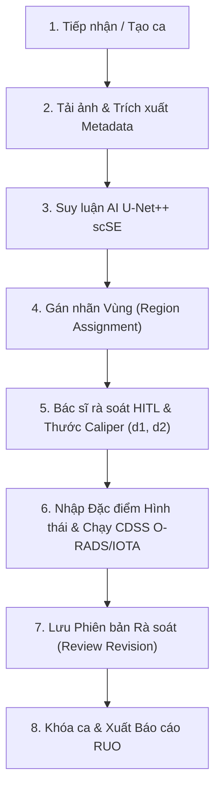

# KHẢO SÁT HỆ THỐNG VÀ PHÂN TÍCH KHOẢNG TRỐNG KỸ THUẬT (BLOCK 0)
**Thời điểm khảo sát**: 2026-10-29T23:55:00+07:00 
**Repository**: `UNet-Vinmec-KhoaLuan` 
**Trạng thái**: Khảo sát kỹ thuật toàn diện; tuân thủ nguyên tắc không bịa đặt số liệu và giới hạn nghiên cứu (RUO).

---

## 1. Cấu trúc tổng thể Repository & Frameworks

### 1.1. Frontend Architecture
- **Framework**: Vanilla JavaScript (Modern ES Modules, ES2022+), không phụ thuộc React/Vue để bảo đảm tốc độ khởi động tức thì trong phòng đọc ảnh.
- **Styling**: CSS Custom Properties (`frontend/css/workspace-tokens.css`, `frontend/css/workspace.css`, `frontend/css/workstation-premium.css`). Tuân thủ độ tương phản WCAG 2.1 AA (tỷ lệ tương phản chữ/nền >= 4.5:1; viền điều khiển >= 3:1).
- **Core Modules**:
  - `frontend/app/main.js`: Entry point, đồng bộ phiên làm việc, cập nhật cảnh báo môi trường.
  - `frontend/app/branding.js`: Cấu hình nhận diện thương hiệu động, hỗ trợ đa cơ sở (multi-tenant) tách biệt khỏi static source text.
  - `frontend/app/viewer.js`: PACS Workstation Canvas 2D, render ảnh siêu âm B-Mode, overlay mask U-Net++, thước đo Caliper tương tác ($d_1, d_2$), pan/zoom và bàn phím chuyên dụng.
  - `frontend/app/cdss-panel.js`: Động cơ suy luận quy tắc ACR O-RADS US v2022 và IOTA Simple Rules, hỗ trợ macro hình thái học xác nhận bởi bác sĩ.
  - `frontend/app/intake.js`: Tiếp nhận ca khám, bóc tách DICOM Header / metadata, kiểm tra laterality (buồng trứng T/P).
  - `frontend/app/cases.js`: Worklist danh sách ca khám, phân loại bộ lọc, trạng thái rà soát.
  - `frontend/app/report-preview.js`: Xuất phiếu kết quả siêu âm lâm sàng dạng printable sheet và PDF.

### 1.2. Backend Architecture
- **Framework**: FastAPI (Python 3.12, Uvicorn ASGI).
- **Database Engine**: SQLAlchemy 2.0 ORM (`backend/db/database.py`).
  - Hỗ trợ SQLite (WAL mode, foreign keys enabled) cho môi trường phát triển cục bộ và kiểm thử độc lập.
  - Cần nâng cấp kiến trúc để hỗ trợ PostgreSQL 16 qua `DATABASE_URL` (sử dụng `psycopg` v3), kèm cơ chế kiểm soát transaction, lease locking, và fallback fail-closed.
- **Machine Learning Inference Core**: PyTorch 2.6.0+cu124, timm, segmentation_models_pytorch, albumentations, OpenCV, SciPy.
  - Kiến trúc phân đoạn: U-Net++ tích hợp spatial-channel squeeze & excitation (scSE Attention) với bộ trích xuất đặc trưng EfficientNet-B4/ResNet-34.
  - Checkpoint đang dùng: `checkpoints/boosted_unetplusplus_scse_2026-10-27/best_metric_model.pth`.
  - Giới hạn: Huấn luyện trên tập dữ liệu MMOTU image-level; chưa được xác thực độc lập ở mức bệnh nhân (patient-level independence chưa xác minh). Mọi kết quả là RUO (Research Use Only).

---

## 2. Truy nguyên luồng dữ liệu nghiệp vụ (Data Lineage)

Luồng hoạt động từ tiếp nhận đến lưu vết lâm sàng:

- **Điểm nghẽn đã xác định**:
  1. Thiếu thực thể `Visit` độc lập: Ca khám hiện tại gắn trực tiếp vào `StudyModel` với mã `visit_no` ngắn. Cần nâng cấp thành thực thể `Visit` chuẩn với `visit_code` dạng `VIS-YYYYMMDD-XXXXXXXX` (entropy cao, không chứa PII, kiểm soát va chạm) liên kết `Facility -> Visit -> Study -> Image -> Region -> Review -> Caliper -> CDSS`.
  2. Cách ly đa cơ sở (Multi-facility isolation): Hiện tại bảng `facilities` chưa được phân tầng triệt để vào các truy vấn API. Bác sĩ của cơ sở này cần được bảo vệ để không truy cập chéo ảnh hoặc kết quả của cơ sở khác.
  3. Cơ chế PostgreSQL: `backend/db/database.py` hiện chủ động từ chối `DATABASE_URL` do thiếu migration Alembic tương thích hai chiều và bộ test đối chiếu dữ liệu.

---

## 3. Kiểm kê Test Suites Hiện tại

| Phân hệ kiểm thử | Số lượng bài test | Trạng thái hiện tại |
|---|---|---|
| **Python Pytest Suite** (`tests/test_*.py`) | 1,385 tests | **1,385 PASSED**, 0 FAILED, 1 warning (decompression bomb safety check) |
| **Node.js Integration Tests** (`tests/*.mjs`) | 138 tests | **138 PASSED**, 0 FAILED |
| **Playwright Clinical Safety E2E** (`tests/clinical_safety_e2e.js`) | 30 checks | **PASSED** (0 pageErrors, 0 geometry overflow) |
| **Playwright Workstation Viewer E2E** (`tests/workstation_viewer_e2e.js`) | 15 checks | **PASSED** (1440px, 1024px, 768px, 390px responsive) |
| **Playwright Doctor Journey E2E** (`tests/doctor_workflow_e2e.js`) | Toàn trình luồng bác sĩ | **PASSED** (0 pageErrors, responsive đa kích thước) |
| **Playwright Roundtrip E2E** (`tests/clinical_roundtrip_e2e.js`) | Luồng tích hợp | **PASSED** (0 pageErrors) |

---

## 4. Kế hoạch Hành động từng Block theo Dependency

```mermaid
flowchart LR
    B0["Block 0: Khảo sát & Gap Analysis"] --> B1["Block 1: PostgreSQL & Alembic Engine"]
    B1 --> B7["Block 7: Quản lý Visit (visit_code)"]
    B7 --> B9["Block 9: Đa cơ sở & Phân quyền"]
    B9 --> B8["Block 8: Chuẩn hóa UI/UX & Nội dung"]
    B8 --> B6["Block 6: Model Provenance"]
    B6 --> B4["Block 4: Độc lập mức Bệnh nhân"]
    B4 --> B2["Block 2: Caliper Phantoms (ICC, Bland-Altman)"]
    B2 --> B3["Block 3: CDSS Deterministic Ruleset (30 ca)"]
    B3 --> B5["Block 5: Protocol Lâm sàng & Sổ Giả định"]
    B5 --> B10["Kiểm thử Tích hợp, Hồi quy & Báo cáo"]
```

