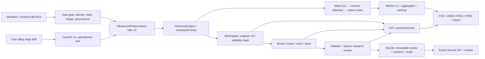

# System Evaluation and Runnable Prototype Implementation Plan

> **For agentic workers:** REQUIRED SUB-SKILL: Use superpowers:subagent-driven-development (recommended) or superpowers:executing-plans to implement this plan task-by-task. Steps use checkbox (`- [ ]`) syntax for tracking. Execution starts only after the user's plan review; this document authorizes no deployment or participant contact.

**Goal:** Bàn giao prototype live có thể trình diễn và dùng thử có giám sát, cùng bằng chứng định lượng, phân tích lỗi, HITL, đánh giá người dùng và báo cáo có thể tái lập.

**Architecture:** Giữ FastAPI + SQLite + PyTorch và Workspace 2.0 hiện có. Hợp nhất đường suy luận cho evaluation với service đang phục vụ; thêm protocol gate, artifact, batch review nghiên cứu, export cố định phiên bản và telemetry tối thiểu. Không triển khai workflow lâm sàng hai cấp mới.

**Tech Stack:** Python, PyTorch, OpenCV, NumPy/SciPy/Pillow, FastAPI/Pydantic, SQLAlchemy/SQLite; HTML/CSS/ES modules; pytest, Node assertions, playwright-core, Windows PowerShell. Phiên bản thực tế lấy từ environment manifest, không dùng phiên bản quảng bá trong README làm bằng chứng.

**Spec:** `docs/superpowers/specs/2026-10-16-system-evaluation-and-prototype-spec.md` (đọc cùng plan).

## Global Constraints

- “Không bắt đầu implement code ngay. Trước tiên hãy khảo sát repository và viết implementation plan hoàn chỉnh.”
- “Không được dùng Test Set để tuning model.”
- “Mọi task phải có acceptance criteria.”
- “Mọi metric phải có test.”
- “Mọi kết quả evaluation phải lưu thành artifact.”
- Letterbox 512×512; Patient-Level Data Split; giữ cấu hình Combo Loss trong hồ sơ huấn luyện.
- Không giả dữ liệu bác sĩ, Patient ID, nhãn chuyên gia, kết quả PASS, metric, DOI hoặc quyền sử dụng dữ liệu.
- Giữ dữ liệu gốc và lịch sử readonly; không `git reset --hard`, `git clean`, `git add .`, không phục hồi/xóa file người dùng đang thay đổi.
- Không thêm dependency runtime, framework UI, model mới, chữ ký số hay backend duyệt hai cấp vào phạm vi bắt buộc.
- Mọi đường dẫn ghi “Create” dưới đây là đề xuất mới; đường dẫn “Modify” đã được khảo sát. Định vị bằng tên function thay cho số dòng dễ đổi trong working tree bẩn.

## Review Focus

1. Hai ảnh lưu mà ảnh thứ hai lỗi: transaction rollback, giữ draft cả ca; test T10 `test_batch_review_rolls_back_second_image`.
2. Phản hồi cũ đến sau đổi ca/người dùng: không gán state/log vào phiên mới; T13 `old_response_cannot_complete_new_session`.
3. Retry do mất response: cùng request_id chỉ tạo một batch, khác body cùng ID trả 409; T10 `test_batch_retry_is_idempotent`.
4. Review gắn prediction cũ, sau đó model chạy lại: export/HITL before phải dùng prediction được review, không lấy latest; T11/T14 `test_export_pins_review_prediction`, `test_hitl_pairs_exact_prediction`.
5. Reload/mất tab, đồng hồ máy bị chỉnh, queue thiếu event: session không được tính là hoàn tất hoặc gán thời gian 0; T12/T14 `test_incomplete_timeline_is_not_zero_duration`.

---

## PHẦN 1 — Trạng thái hiện tại và bằng chứng khảo sát

Khảo sát ngày 16/10/2026 tại `C:/Users/Dung/Documents/UNet-Vinmec-KhoaLuan`, HEAD `deffc37` (Verify frozen mask provenance for accuracy evaluation). Các commit trước gồm `9fc2f0e`, `11515b0`, `84904ae`, `104ca38`. Đây là snapshot của working tree, không chỉ HEAD.

`git status --short`: nhiều file Python/JS/README sửa chưa commit; `frontend/app/` và nhiều test chưa track; nhiều tài liệu `docs/`, script lịch sử, metadata export bị xóa. Tài liệu liên kết từ README có thể không tồn tại. Không commit lẫn các thay đổi đó vào task mới; dùng diff/hashes để ghi nhận và tạo baseline có chọn lọc khi thực thi. Nếu cần worktree, trước hết bảo toàn snapshot working tree vì worktree chỉ từ HEAD sẽ thiếu giao diện hiện tại.

| Thành phần | Đường dẫn/entry đã đọc | Trạng thái và hành động |
|---|---|---|
| Model kiến trúc | `backend/models/unet.py:StandardUNet`, `backend/models/attention_unet.py`, `backend/services/inference_engine.py:InferenceEngine` | Có; mặc định phục vụ Standard U-Net; có U-Net++ qua SMP nhưng không đổi model trong plan |
| Checkpoint chọn | `evaluation/selected_model.json`; `checkpoints/unified_vinmec_refine_2026-10-06/lr_3e-04/baseline_unet_best.pth` | Hash đọc lại khớp `417828fa74349d0f7909434f9ad1ad7cb3258b64d41d3d756e2e80569744697d`; chạy inference live hiện tại chưa xác minh |
| Dataset thực | `dataset/index.csv`, `dataset/2d/images`, `dataset/2d/masks`, `dataset/3d/images`, `dataset/3d/masks` | Index còn nhiều đường dẫn cũ; dùng `backend/core/dataset_paths.py:resolve_dataset_path`; tên thư mục 3d không chứng minh volumetric input |
| Split chọn | `ai_training/splits/unified_vinmec_clean_2026-10-06/{train,val,test,all_samples}.csv`, `manifest.json` | Manifest 661/541/402; patient_id trống; chỉ tách hash ảnh, chưa tách bệnh nhân được xác minh |
| Nhãn và audit | `evaluation/accuracy_2026-10-09/data_audit_v2/dataset_audit.json` | Log lịch sử 1.604 cặp đọc được/hash mask khớp; 2.047 source path references thiếu, không đồng nghĩa 2.047 ảnh canonical mất; expert approval UNKNOWN |
| Ảnh gần trùng | `evaluation/milestone_3_2026-10-07/cross_split_expanded_summary.json` | 59 ứng viên; cần disposition và mapping nguồn; không tự kết luận cùng bệnh nhân |
| Preprocess | `backend/services/preprocessor.py:preprocess_for_inference`, `letterbox_resize`, `inverse_letterbox_mask` | Có; grayscale → letterbox → CLAHE → /255; ROI metadata có nhưng không tự thêm filter; cần parity test |
| Serving | `backend/app/config.py:selected_checkpoint_path`, `backend/services/model_service.py:ModelRegistry`, `backend/app/routers/inference.py:run_ai_prediction` | Có hash gate, fail 503 nếu model chưa load; timing hiện dùng datetime; cần monotonic/CUDA sync và provenance lưu bền |
| Evaluator cũ | `scripts/evaluate_unified_vinmec.py:evaluate` | Có per-image/summary/panel; đọc model riêng, chấm 512 padded, toán tử `>`; khác manifest native-size/`>=`; không sửa hồi tố artifact cũ |
| Metrics cũ | `ai_training/metrics_clinical.py` | Có Dice/IoU/Recall/Precision và HD95; empty conventions khác protocol mới, thiếu shape/finiteness strict; giữ API lịch sử, tạo metric v1 riêng |
| Metric dễ nhầm | `backend/models/metrics.py:compute_hausdorff_95` | Dùng maximum directed Hausdorff dù tên 95; không dùng hàm này cho báo cáo HD95 mới |
| UI active | `frontend/index.html` nạp `/static/app/main.js`; `frontend/README.md` | Workspace 2.0 là active; `frontend/js/` là đường cũ, không sửa nhầm |
| Editing | `frontend/app/viewer.js`, `mask-tools.js`, `coordinates.js`, `state.js` | Có brush/erase/polygon, undo/redo/reset, zoom/pan, draft và guard phiên; chưa có event stream đo tác vụ |
| Save thật | `frontend/app/review.js:saveResearchReview`, `backend/app/routers/reviews.py:submit_doctor_review` | Có; FE gửi lần lượt hai POST, `time_spent_seconds: 0`; thiếu batch atomic/idempotency/version; backend lưu `is_official_ground_truth=False` đúng phạm vi nghiên cứu |
| Reopen | `frontend/app/cases.js:getCase`, `backend/app/routers/cases.py:get_case_detail` | Có chọn prediction theo review; provenance reopen chỉ model_version, chưa persist checkpoint hash đầy đủ |
| Export mask | `/api/images/{image_id}/mask.png` trong `inference.py`; `tests/test_source_mask_export.py` | Có native-size PNG; chọn latest theo kind; cần pin review_id và gói metadata nhất quán |
| Print/report | `frontend/app/report-preview.js` gọi `/api/workspace/cases/{id}/report-export`; `/api/generate-report` trả 501 | Live research export còn thiếu; không bật lâm sàng bằng cách bỏ guard |
| Case list | `frontend/app/cases.js:getCases` gọi `/api/workspace/cases` | API này chưa có trong router đã khảo sát; live list/reopen từ danh sách cần fallback `/api/cases` |
| Demo workflow | `approval.js`, `corrections.js`, `demo.js`, `leases.js` | Có design/demo; backend sign/transitions/remote lease chưa có; chỉ capability-gate và ghi rõ giới hạn |
| Framework test | `pyproject.toml`, `tests/*.py`, `tests/workspace_v2_*.js`, `scripts/verify_workspace_v2.ps1` | pytest + Node + Playwright; browser hardcode Chrome/8027/test password; cần chuẩn hóa cấu hình test |
| Runtime isolation | `tests/serve_isolated_app.py`, `tests/conftest.py` | Server helper patch DB trước import main; conftest lại import main/init_db ở collection; cần env isolation trước import |
| Packaging | `Dockerfile`, `docker-compose.yml`, `requirements.txt` | Có; Docker không COPY `evaluation/selected_model.json`, compose thiếu secret env và DB volume; chưa được xác minh hoạt động. Windows local run là P0; Docker repair P2 |
| Health | `backend/app/routers/health.py:health_check` | Hardcode healthy/Standard U-Net; cần readiness thật, không báo ready khi checksum sai |

**Đã chạy trong lượt khảo sát:** `node tests/workspace_v2_logic.mjs` PASS; `node tests/frontend_review_logic.js` PASS; `git diff --check` không báo whitespace error (có cảnh báo LF/CRLF); `Get-FileHash` checkpoint khớp. Không chạy Python full suite/browser live trong lượt lập plan để tránh collection chạm DB mặc định; trạng thái hiện tại của chúng là UNKNOWN. Log 07/10 có 85 PASS và smoke 08/10 có PASS chỉ là bằng chứng lịch sử.

**Blocker trước hạn:** không có mapping nguồn hoặc holdout chưa dùng thì yêu cầu Test độc lập không thể hoàn thành bằng code. Số bác sĩ, lịch bác sĩ, quyền dữ liệu, phê duyệt nhãn, phần cứng dùng thử, giờ làm còn lại và việc runtime đã ổn định đều UNKNOWN. T01/T02 tạo ledger bằng chứng; người phụ trách nguồn dữ liệu cung cấp hồ sơ, agent không tự chứng nhận.

## PHẦN 2 — Kiến trúc mục tiêu và ranh giới



Evaluation và UI dùng cùng preprocessing + threshold + model engine; evaluator không gọi database hoặc endpoint clinical. GT chỉ được đọc trong evaluation/analysis, không đưa vào UI lúc người dùng sửa. Giữ editable mask 512×512/RLE, nhưng score/export ở native size qua transform đã lưu. ZIP chứa mask AI/final và overlay cùng provenance, không phải PDF có chữ ký.

Ba work package trong một master plan: A dữ liệu/evaluation (T01–T07), B live prototype/HITL (T08–T14), C user/report/release (T15–T20). Không tạo ba kiến trúc riêng hay đổi layout repo. Chúng có gate độc lập; báo cáo cuối liên kết tất cả.

## PHẦN 3 — Evaluation Protocol v1 (khóa trước lượt đánh giá mới)

Tạo `evaluation/protocols/milestone3_v1.json`. Đây là protocol đề xuất cho evaluation mới, không được gọi là preregistration của Test 402 đã xem. `run_kind` chỉ nhận `validation_dry_run`, `retrospective_test_replay`, `independent_test`. Protocol không có tham số CLI override threshold/postprocess/cohort khi chạy.

| Mục | Quyết định cố định |
|---|---|
| Checkpoint | Standard U-Net, đường dẫn/hash ở phần 1; architecture=`standard_unet`, strict load; không auto chọn model điểm cao nhất |
| Input | Một ảnh grayscale 2D; foreground=mask tổn thương được cung cấp, background=0; manifest mới chỉ {0,1} hoặc {0,255}; không diễn giải lesion thành malignant |
| Cohort | Legacy replay giữ toàn bộ 402 record đã khóa, chia strata modality đã xác minh; không gộp CEUS thành B-mode. Holdout mới: 2D B-mode được nguồn xác nhận, không thuộc train/val/development; UNKNOWN modality chưa đủ điều kiện primary cohort |
| Identity gate | Mapping ảnh→patient/exam nguồn có evidence; không overlap patient với toàn bộ lịch sử train/validation/development của checkpoint; nhãn/permission hợp lệ; mọi candidate gần trùng có disposition. `independent_test` thiếu evidence thì exit 2 trước inference |
| Preprocess | IMREAD_GRAYSCALE; `UltrasoundPreprocessor((512,512))`; CLAHE clip 2/grid 8; /255; không augmentation, TTA, median hoặc ROI filtering mới |
| Inference | engine `standard_unet`, threshold=0.5, `sigmoid >= 0.5`, eval/inference_mode, float32, batch=1, device CPU mặc định cho tham chiếu; GPU benchmark là run riêng ghi rõ sai khác |
| Postprocess | Không morphology, không bỏ connected component nhỏ |
| Coordinate | native image dimensions; inverse letterbox nearest-neighbor của binary prediction; native GT chưa resize. Sai shape GT/image là data failure, không ép resize để đạt PASS |
| Scope khác phục vụ | Suitability gate của API vẫn giữ khi dùng thật. Offline eval không âm thầm loại ảnh do IQA; ghi IQA và tính coverage riêng. Ảnh API từ chối được ghi application rejection, không làm mất metric cohort |
| Invalid data | Preflight tất cả ảnh/mask/hash/shape trước model. Thiếu/hỏng/nonfinite/duplicate ID → ghi `failures.csv`, run FAILED/exit 2. Runtime error giữa lượt → artifact PARTIAL, không summary đạt chuẩn; không điền prediction rỗng giả |
| Reproducibility | seed=42 cho sampling/bootstrap; sorted sample_id; torch deterministic; protocol/manifest/checkpoint/source hashes; git HEAD + dirty patch hash; package versions/device; schema_version=1 |
| Output overwrite | Run directory mới; không overwrite hoặc resume bằng cấu hình khác. Rerun để tái lập được phép nhưng ghi parent_run_id; không chọn score tốt nhất giữa các rerun |

**Metric contract:** `score_masks(pred: np.ndarray, gt: np.ndarray) -> dict[str, object]` chỉ chấp nhận 2D same shape, nonzero size, bool hoặc giá trị 0/1, finite. `evaluation/protocol.py:normalize_reference(mask: np.ndarray)->np.ndarray` ở input boundary đổi 255→1 có khai báo và từ chối nhãn ngoài {0,1,255}/trộn convention không hợp lệ. Không broadcast, không threshold GT nhiều lớp. Counts dùng int64.

| GT | Pred | Dice / IoU | Recall | Precision | HD95 |
|---|---|---|---|---|---|
| Empty | Empty | 1 / 1 (quy ước agreement) | null (`no_gt_foreground`) | null (`no_pred_foreground`) | null (`empty_surface`) |
| Nonempty | Empty | 0 / 0 | 0 | null (`no_pred_foreground`) | null (`empty_surface`) |
| Empty | Nonempty | 0 / 0 | null (`no_gt_foreground`) | 0 | null (`empty_surface`) |
| Nonempty | Nonempty | 2TP/(2TP+FP+FN); TP/(TP+FP+FN) | TP/(TP+FN) | TP/(TP+FP) | symmetric 95th percentile của hai tập khoảng cách surface; đơn vị px |

Không epsilon gây bias khi denominator >0. Null có reason, không ghi JSON NaN/Infinity. `specificity=TN/(TN+FP)` nếu denominator>0, còn lại null; chỉ phụ trợ pixel-level. `fp_area_px=FP`, `fn_area_px=FN`; `under_fraction=FN/GT_area` nếu GT_area>0; `over_fraction=FP/GT_area` nếu GT_area>0. Các tỷ lệ này là mô tả kỹ thuật, không phải chẩn đoán.

**Aggregate:** mỗi metric có `n_valid,n_null,mean,median,std(ddof=0),min,max,p25,p75,p95`. Primary: foreground Dice/IoU macro trên GT nonempty. Secondary: agreement trên tất cả ảnh và micro từ tổng TP/FP/FN; báo denominator rõ ràng. Empty-reference cohort báo `n`, số pred nonempty, FP area; không gọi đó là specificity chẩn đoán. Nhóm rỗng cho stats null, không 0. Các nhóm nguồn overlap phải ghi chú, không cộng thành tổng người bệnh.

Per-case: luôn có sample_id và case_id nguồn nếu có. Khi một case có nhiều ảnh, macro ảnh trong case rồi macro case; bệnh nhân có nhiều case thì macro case trong patient. Nếu không xác minh được case/patient, chỉ gọi per-image; `case_id` hash lịch sử không biến thành clinical case. CI 95% percentile 2.000 bootstrap theo patient cho independent cohort đủ ≥2 patient; n=1/thiếu mapping ghi unavailable. Không bootstrap pixel. Phân phối histogram 20 bins cố định [0,1]; HD95 riêng theo px; ranking dùng metric rồi sample_id tie-break.

## PHẦN 4 — Pipeline định lượng và file ownership

Không đổi kết quả lịch sử trong `evaluation/milestone_3_*` hoặc callers của `ai_training/metrics_clinical.py`. New v1 có schema riêng và UI đọc đúng `evaluation/current_run.json` sau explicit release, không tự trỏ latest folder.

| Create / Modify | Trách nhiệm và interface |
|---|---|
| Create `evaluation/protocol.py` | `load_protocol(path: Path)->dict`; `load_cases(root: Path, manifest: Path)->list[dict]`; `audit_inputs(root: Path, cases: list[dict], protocol: dict, run_kind: str)->dict`; strict keys, ID/path/hash/identity gate |
| Create `evaluation/segmentation_metrics.py` | `score_masks(pred,gt)->dict`; `aggregate_metrics(rows:list[dict], bootstrap_seed:int=42)->dict`; metric contract phần 3 |
| Create `evaluation/run_evaluation.py` | `evaluate_run(root:Path, protocol_path:Path, manifest_path:Path, output:Path, run_kind:str)->dict`; CLI cùng tên, readonly dữ liệu |
| Create `evaluation/error_analysis.py` | `rank_cases(rows:list[dict],k:int=5)->dict[str,list[str]]`; `render_case(root:Path,row:dict,output:Path)->Path`; `build_error_analysis(run_dir:Path)->dict` |
| Modify `backend/services/inference_engine.py` | Thêm `predict_binary(self,tensor_512:torch.Tensor)->np.ndarray`; engine.predict dùng helper, đúng input normalization, FP32 mode eval; không đổi threshold |
| Modify `backend/app/routers/evaluation.py` | Đọc run v1 explicit và giữ lịch sử có nhãn riêng; báo missing/stale khi hash không khớp |
| Modify `frontend/app/evaluation.js`, `evaluation-images.js` | Hiển thị metric/null/cohort/run kind/hash; không trình bày retrospective là independent |

Normalized manifest v1 CSV columns: `sample_id,source_case_id,patient_id,split,modality,image_path,mask_path,image_sha256,mask_sha256,identity_evidence,label_evidence,development_history_evidence`. Mỗi evidence là đường dẫn trong root đến hồ sơ được người phụ trách nguồn xác nhận; test fixtures synthetic nằm tmp, không được cấp trạng thái real/verified. Giữ `recorded_path` và `resolved_path` trong audit để kiểm tra relocation.

CLI được triển khai ở T05:

```powershell
.venv\Scripts\python.exe -m evaluation.run_evaluation --root . --protocol evaluation/protocols/milestone3_v1.json --manifest evaluation/manifests/validation_v1.csv --run-kind validation_dry_run --output evaluation/milestone_3_final/validation_v1
.venv\Scripts\python.exe -m evaluation.run_evaluation --root . --protocol evaluation/protocols/milestone3_v1.json --manifest evaluation/manifests/legacy_test_v1.csv --run-kind retrospective_test_replay --output evaluation/milestone_3_final/legacy_test_v1
# Chỉ sau independent gate PASS; freeze và không dùng legacy manifest thay thế:
.venv\Scripts\python.exe -m evaluation.run_evaluation --freeze --protocol evaluation/protocols/milestone3_v1.json --manifest evaluation/manifests/independent_test_v1.csv --output evaluation/milestone_3_final/data_audit/independent_lock
.venv\Scripts\python.exe -m evaluation.run_evaluation --root . --protocol evaluation/protocols/milestone3_v1.json --manifest evaluation/manifests/independent_test_v1.csv --run-kind independent_test --lock evaluation/milestone_3_final/data_audit/independent_lock/protocol_lock.json --output evaluation/milestone_3_final/independent_test_v1
```

Mỗi run sinh `run_manifest.json`, `protocol.json`, `input_audit.json`, `per_image_metrics.csv`, `per_case_metrics.csv`, `summary.json`, `failures.csv`, `predictions/{sample_id}.png`, `distributions/*.png`, `error_analysis/`, `run.log`. Nếu case identity UNKNOWN, per_case CSV chỉ header và reason trong summary. Partial run có audit/failures và bản ghi thành công, `status=PARTIAL`, không publish pointer.

Acceptance toàn pipeline: fixture 3 ảnh có kết quả tính tay đúng; số attempted=success+failed; mỗi prediction cùng native shape; readback PNG score bằng row CSV; protocol/hash đổi thì fail trước model; không sửa split/index/checkpoint; CPU rerun fixture có mask/counts giống hệt và scalar tolerance ≤1e-12.

## PHẦN 5 — Error Analysis

Phân nhóm có thể overlap: best (top 5 Dice foreground), median (5 gần median nhất), worst (bottom 5), FP (top 5 FP px), FN (top 5 FN px), under (top under_fraction), over (top over_fraction), boundary (top 5 HD95 hợp lệ). Tie-break sample_id; n<5 lấy n; không tạo ca thay thế. Một ảnh có thể thuộc nhiều nhóm, tổng membership không bằng tổng ảnh.

Mỗi panel PNG native/canvas tỉ lệ giữ nguyên gồm Original, GT, Prediction, Overlay, Difference (TP xanh lá, FP đỏ, FN xanh lam; legend chữ). Không resize mask để chữa mismatch. `index.html` tĩnh dùng relative local paths và escape notes; `groups.csv`, `error_annotations.csv`, `analysis.json` phục vụ luận văn. Original không CLAHE trong panel; ảnh hiển thị đã khử định danh nếu chia sẻ.

`error_annotations.csv`: sample_id, groups, observed_error, evidence_path, hypothesis, verification_method, verification_status, reviewer_role, suggested_action. Ví dụ “FN tập trung ở rìa trái” là quan sát; “do shadowing” chỉ là hypothesis tới khi đối chiếu ảnh/expert/evidence. Không tự gắn mô bệnh học hoặc chất lượng nhãn. `root_cause_confirmed` chỉ true khi có test/trace hoặc hồ sơ chuyên môn tương ứng. Analysis không thay model sau khi xem Test.

## PHẦN 6 — Prototype Testing và đường live bắt buộc

Live flow P0: login → list/create case → hai ảnh L/R (hoặc case một bên hiện có) → upload/IQA/predict → xem từng ảnh → brush/erase/undo/reset → batch confirm research → reopen → download ZIP nghiên cứu native-size. Demo là route có nhãn, log tách riêng. Không cần backend sign/preliminary/OTP để đạt flow này; nút chưa hỗ trợ bị disable kèm giải thích capability.

Test valid JPG/PNG, DICOM single-frame thuộc phạm vi hiện có; missing file/empty payload/wrong extension/corrupt bytes/decompression limits hiện có/unknown ID; model checksum hỏng; IQA reject; inference exception; shape RLE sai; request lặp; hai ca; đổi L/R; stale response; offline; token expiry; save fail; export fail; browser reload/server restart; localStorage quota; draft khác user và khác prediction. Nếu chưa có giới hạn kích thước upload có thể xác minh, T17 đặt 20 MiB và tối đa 25 triệu pixel decoded, test trước decode lớn; không mở hỗ trợ DICOM mới.

Manual script 15–20 phút: login thật; tạo ca hai bên; xem ảnh; sửa tại zoom 200%; undo/redo; reset rồi sửa lại; save; reload; đổi ca; tải ZIP; so sánh PNG và RLE; restart server mở lại. Cố tình ngắt mạng trước save, session không báo hoàn thành giả. Chụp màn hình và ghi run hash, browser/viewport; không chụp credentials/dữ liệu định danh.

## PHẦN 7 — HITL event contract và phân tích

Session là **một attempt của một người trên một case**, có nhiều image task. `session_id` UUID server, owner từ JWT; `case_id` là StudyModel.id; `participant_code` pseudonym, `participant_role=clinician|technical_tester`, `data_origin=live|technical_fixture|demo`; chỉ live clinician thật mới vào clinician summary. Case metadata có mask references nhưng không gửi GT trong task UI.

Tạo `HITLSessionModel` và `HITLEventModel` trong DB hiện có; API trong `backend/app/routers/hitl.py`. Client event schema: `event_id(UUID), session_id, task_id(UUID), image_id, prediction_id|null, seq(int>=1), type, client_utc(ISO8601), elapsed_ms(finite>=0), session_elapsed_ms(finite>=0), payload`. Server thêm actor_id, received_at UTC. elapsed_ms tính từ task origin, session_elapsed_ms từ session origin trong cùng page; reload tạo session/attempt mới, phiên cũ incomplete/aborted. Không trừ clock giữa hai page. Các type: SESSION_START, INFERENCE_START, INFERENCE_END, INFERENCE_FAILED, PREDICTION_VIEWED, CORRECTION_START, EDIT_COMMITTED, UNDO, REDO, RESET_AI, CLEAR_MASK, PAUSE, RESUME, CONFIRM_ATTEMPT, CONFIRM_ACK, CONFIRM_SUCCEEDED (server-only), SAVE_FAILED, EXPORT_SUCCEEDED, EXPORT_FAILED, SESSION_ABORTED. EDIT_COMMITTED payload tool=brush|erase|polygon|fill|largest|smooth và changed_pixels; không log mỗi pointermove hoặc toàn bộ ảnh.

Endpoints mới: `POST /api/hitl/sessions` body study_id/participant metadata; `POST /api/hitl/sessions/{id}/events` body events (≤100/event batch, ≤10.000/session; body không chứa arbitrary PHI); `GET /api/hitl/sessions/{id}` owner/admin. Unique(event_id) và unique(session_id,task_id,seq); retry cùng ID/body no-op, payload khác trả 409. Validate image thuộc case và prediction thuộc image, owner từ JWT, reject demo upload. Event có thể tới lệch thứ tự, lưu theo seq; phân tích đánh dấu incomplete nếu có gap. Không tuyên bố chống gian lận client clock.

Timing dùng performance.now ở browser, perf_counter ở server; UTC chỉ để ghép và audit. Tính riêng:

- `model_forward_ms`, `server_pipeline_ms`, `request_roundtrip_ms`: không trừ clock client/server; GPU synchronize khi đo forward.
- `review_elapsed_ms`: prediction viewed → confirm thành công trong cùng image task.
- `correction_elapsed_ms`: first effective edit → confirm attempt cuối liên quan lần save thành công; gồm suy nghĩ, không gọi active drawing time.
- `active_edit_ms`: tổng duration stroke/tool operation, nếu có đủ event; không cộng thinking.
- `task_total_ms`: start attempt → server confirm ack; `case_total_ms` từ SESSION_START đến cả batch lưu thành công. Hai bên thao tác xen kẽ không cộng wall time từng ảnh thành thời gian case.
- `edit_count`: số operation thực sự đổi mask; stroke brush từ down→up/cancel flush =1, click không đổi pixel =0. Undo/redo/reset đếm riêng; edit rồi undo về mask AI vẫn có edits nhưng `accepted_raw=true` theo equality cuối.
- acceptance_without_correction = final==initial prediction AND edit_count==0; accepted_raw có thể true dù đã edit rồi reset, báo hai số khác nhau.
- Before/after dùng prediction_id của review và reference độc lập ghép theo image SHA + mask provenance. Native-size score chung `score_masks`; ΔDice/ΔIoU=after-before khi cả hai defined; giữ cả giá trị âm. Thiếu GT/reference không độc lập → null/reason, không zero hoặc self-reference.

Frontend queue sessionStorage theo user/session/task; flush sau operation và trước confirm; xóa queue chỉ sau ack; không auto replay sau logout hoặc sang user khác. Nếu log chưa đồng bộ, vẫn có thể lưu mask để bảo toàn công việc nhưng session=`telemetry_incomplete`, không dùng timing aggregate đầy đủ. Browser hidden: PAUSE/RESUME, báo cả elapsed và pause-adjusted; reload tạo new attempt, attempt cũ ABORTED/INCOMPLETE. Negative/nonfinite time reject; không tự clamp về 0.

## PHẦN 8 — Clinician/User Evaluation gọn

Owner chuẩn bị: `docs/evaluation/clinician_protocol.md`, `questionnaire.csv`, `manual_acceptance.md`. Đề xuất 1–3 bác sĩ, 6–10 ảnh hoặc 3–5 case bilateral/người, 30–45 phút. Đây là convenience pilot, không power claim. Trước thu thập xác nhận quyền dữ liệu, khử định danh, đồng ý tham gia và quy trình trường/cơ sở; trạng thái chưa biết giữ UNKNOWN. Agent chỉ tạo protocol/biểu mẫu, không tự liên hệ người tham gia.

Instructions cố định: “Đối chiếu ảnh gốc và đường viền AI; sửa hoặc từ chối theo nhận định của anh/chị; lưu kết quả rà soát nghiên cứu. Không dùng kết quả này quyết định điều trị.” 5 phút giới thiệu, 5 phút training 1 ca không tính, 15–25 phút task, 5–10 phút hỏi đáp. Không hiển thị GT hoặc điểm Dice trong task. Bộ ca có mức tốt/trung bình/xấu từ Validation/pilot pool, không dùng independent Test cho training người tham gia. Chọn cohort trước và ghi thứ tự; không chỉ lấy ca đẹp.

Per image: accepted raw / minor correction / major correction / rejected, completion, support needed, error labels, notes. Định nghĩa minor=người tham gia đánh giá sửa cục bộ; major=vẽ lại phần lớn; đây là judgement ordinal, không chuyển thành %pixel nếu không đo. Per session Likert 1–5 (1 hoàn toàn không đồng ý, 5 hoàn toàn đồng ý; N/A riêng): dễ học, dễ sửa mask, giúp hoàn thành rà soát, có ích trong workflow, đủ tự tin để quyết định có cần sửa, sẵn sàng dùng thử có giám sát. Trust không hỏi “AI luôn đúng”; thêm câu “Tôi nhận ra khi kết quả cần kiểm tra lại”. Không gọi bộ câu tự thiết kế là SUS/TAM đã chuẩn hóa.

Qualitative: điều gì hữu ích nhất, bước khó nhất, ca nào không tin và vì sao, điều kiện để dùng thử, thay đổi ưu tiên. Tổng hợp từng người và pooled mô tả có mẫu số; median/IQR Likert, số câu N/A, tỷ lệ task hoàn tất/acceptance và timing; không treat nhiều ảnh như nhiều bác sĩ độc lập, không suy luận hiệu quả lâm sàng hoặc lợi ích nhân quả. Chỉ nói tiết kiệm thời gian nếu có manual comparator thực tế được counterbalance; comparator là nice-to-have.

Fallback: ≥1 technical tester thực hiện cùng task với synthetic/Validation được phép; participant_role=technical_tester, không giả bác sĩ. Nếu chỉ agent automated thì gọi automated technical test, không tính questionnaire. Đầu ra `clinician_status=NOT_CONDUCTED`, lý do và protocol chờ; technical usability/HITL vẫn có giá trị. Không thiếu participant mà tự sinh Likert.

## PHẦN 9 — Testing pyramid và oracle

Unit (metric/coordinate/event pure functions) → integration (DB tx/auth/export) → evaluation (fixture pipeline/hash gates) → E2E live (real HTTP/DB/model smoke) → manual pilot. E2E mock API chỉ chứng minh UI contract, không đủ live acceptance. Every numerical output has a named oracle test below and detailed owner task ở phần 13.

| Test file :: name | Input | Expected / failure |
|---|---|---|
| `tests/test_segmentation_metrics_v1.py::test_hand_computed_overlap` | GT `[[1,1],[0,0]]`, P `[[1,0],[1,0]]` | TP=FP=FN=TN=1; Dice=.5, IoU=1/3, R=P=.5, specificity=.5; lệch >1e-12 fail |
| same :: `test_perfect_and_disjoint` | identical nonempty; disjoint masks | 1/1/1/1; 0/0/0/0 |
| same :: `test_empty_contract` | parametrized 3 empty combinations | theo bảng phần 3, null reasons đúng |
| same :: `test_rejects_broadcast_nan_multiclass` | (2,1)/(2,2), NaN, label=2, 3D, size0 | ValueError, không broadcast/binarize âm thầm |
| same :: `test_surface_hd95_one_pixel_shift` | một pixel (2,2) và (2,3) | HD95=1px; identical=0; empty=null |
| same :: `test_auxiliary_counts_and_fractions` | TP=FP=FN=TN=1 | FP area1, FN area1, under=.5, over=.5 |
| same :: `test_aggregate_oracles_and_nulls` | scalar [0,.5,1], null | mean=median=.5,std=sqrt(1/6),min0,max1,p25=.25,p75=.75,p95=.95,n_valid3,n_null1 |
| same :: `test_macro_micro_and_patient_weighting` | hai patient, nhiều ảnh không cân bằng | expected hand macro patient khác image mean; micro từ tổng counts |
| same :: `test_bootstrap_seed_and_unit` | cluster fixture 2+ patient | fixed seed lặp cùng CI; membership nguyên cluster; n1→CI unavailable |
| `tests/test_evaluation_protocol_v1.py::test_independent_gate_rejects_unknown_identity` | legacy manifest | exit gate before forward; không chỉ warning |
| same :: `test_corrupt_pair_fails_preflight` | PNG hỏng/missing mask/hash sai | failure row + status FAILED, forward count0 |
| `tests/test_inference_parity_v1.py::test_threshold_includes_half` | probabilities .49,.5,.51 | 0,1,1 |
| same :: `test_native_mask_and_service_parity` | nonsquare fixture + fake logits | evaluator mask==API/shared engine inverse mask, padding không tính |
| `tests/test_evaluation_run_v1.py::test_pipeline_three_case_oracle` | 3 mask fixtures + fake engine | CSV/summary/readback PNG khớp tay, đủ artifacts |
| same :: `test_partial_run_never_published` | error ở ảnh thứ 2 | PARTIAL, exit2, current_run giữ nguyên |
| `tests/test_error_analysis_v1.py::test_groups_and_difference_colors` | known FP/FN/ties | đúng ID/tie-break/RGB, median/worst/boundary đủ |
| `tests/test_review_batch.py::test_batch_review_rolls_back_second_image` | L hợp lệ, R invalid | 0 new reviews/audit success, revision không đổi |
| same :: `test_stale_version_and_foreign_prediction` | old revision/ID case khác | 409/422, không write |
| same :: `test_batch_retry_is_idempotent` | cùng request/body hai lần; đổi body | response same IDs; body conflict409 |
| `tests/test_research_export.py::test_export_pins_review_prediction` | review P1, newest P2 | ZIP AI=P1/final review; hashes và native shape đúng |
| `tests/test_hitl_events.py::test_owner_and_sequence_validation` | other user, wrong image, duplicate/gap | 403/422/conflict; gap→incomplete |
| `tests/test_hitl_analysis.py::test_timing_and_edit_oracle` | known event times + edit/undo/reset | exact durations/count; accepted_raw != acceptance_without_correction |
| same :: `test_hitl_pairs_exact_prediction` | P1 review + P2 latest + reference | before=P1; Δ giữ âm; no reference→null |
| `tests/workspace_v2_telemetry.mjs::old_response_cannot_complete_new_session` | deferred response/user switch | no update new session |
| `tests/workspace_v2_release_e2e.js` | live login/upload/edit/save/restart/export | DB native artifacts bằng mask UI; no unsupported API success giả |
| `tests/test_release_evidence.py::test_missing_independent_test_blocks_complete` | prototype PASS, identity UNKNOWN | prototype_ready có thể true, evaluation_complete=false |

Các test file v1 ở bảng là Create; giữ regression file hiện có, thêm assertions tại chỗ khi API chủ sở hữu đổi. Python test mới dùng SQLite tmp và env trước import; không nhận PASS bằng cách bỏ test bảo vệ clinical.

## PHẦN 10 — Timeline, dependencies và feasibility

Ngày hiện tại 16/10/2026; giờ khả dụng hôm nay UNKNOWN. Tổng timebox task: khoảng 41–64 giờ kỹ thuật + 1–3 giờ phiên người dùng và thời gian chờ nguồn dữ liệu. Ba ngày 8 giờ/ngày chỉ có tối đa 24 giờ: **không cam kết hoàn thành toàn bộ**. Agent nhanh hơn không tạo được mapping/nhãn/bác sĩ hoặc bằng chứng independent bằng suy đoán.

Timeline lý tưởng 06–15/10 là bảng đối chiếu, không backdate completion:

| Ngày | Sáng (task/giờ) | Chiều (task/giờ) | Deliverable / AC | Dependency / risk |
|---|---|---|---|---|
| 06 | T01 baseline 2h | T02 data gate 2h | ledger + unknowns, bảo toàn dữ liệu | nguồn dữ liệu; lịch sử thiếu |
| 07 | T02 mapping review 2h | T03 metrics 3h | protocol gate + oracle PASS | mapping có thể BLOCKED |
| 08 | T04 parity 2h | T05 evaluator 3h | native fixture PASS | rounding/threshold |
| 09 | T05 Validation 1h | T06 locked run 2h | immutable run artifacts | không gọi legacy independent |
| 10 | T07 analysis 3h | T08 live capability 2h | groups + live case list | archived metrics mismatch |
| 11 | T09 provenance/revision 2h | T10 atomic save 3h | restart persistence/rollback | legacy route bypass |
| 12 | T11 export 2h | T12 event ingest 3h | pinned ZIP + owner validation | session queue/PHI |
| 13 | T13 FE telemetry 3h | T14 HITL analysis 2h | timing/delta oracle PASS | clock + reference mapping |
| 14 | T17 negative tests 3h | T16 live E2E 2h | no blocker bug | browser/decode failures |
| 15 | T15 protocol/pilot prep 1h | T18 packaging 2h | runbook + pilot rehearsal | participant UNKNOWN |

Lịch hành động còn lại, timebox theo giờ làm thực tế, không bắt buộc làm đêm:

| Ngày/buổi | Task và timebox | Deliverable / AC | Dependency | Risk và quyết định |
|---|---|---|---|---|
| 16 sáng | T01 1h, T02 2h | baseline logs + data gate | quyền nguồn | Trưa: chưa mapping thì independent BLOCKED; vẫn làm product |
| 16 chiều | T08 1.5h, T09 1.5h, T10 bắt đầu1h | live list/provenance + batch tests đỏ | baseline | contract thay đổi cần fixtures |
| 16 tối, tùy chọn | T10 2h | atomic save PASS | T09 | không gộp đêm bắt buộc vào cam kết |
| 17 sáng | T10 còn lại1h, T11 2h, T12 bắt đầu1h | persisted save/export | T09–T10 | Nếu chưa PASS dừng pilot live |
| 17 chiều | T12 còn lại1h, T13 2h, T15 chuẩn bị1h | telemetry oracle + protocol | T12 | chỉ run pilot khi protections/consent phù hợp |
| 17 tối, tùy chọn | T03/T04 phần còn thiếu 2–3h | metric/parity fixtures | T02 | không bỏ oracle để chạy Test |
| 18 sáng | T16/T17/T18 tối đa4h | release smoke/negative/restart/runbook | product path | lỗi nghiêm trọng: hoãn dùng thử, vẫn demo có nhãn |
| 18 chiều | T19/T20 tối đa4h | evidence matrix + report + DoD | logs/artifacts có thật | thiếu eval/logging ghi PARTIAL; không COMPLETE giả |

Lịch 3 ngày trên ưu tiên **product release candidate**; T05–T07/T14 đầy đủ có thể phải tiếp tục sau 18/10 nếu chưa tồn tại. Nếu baseline chứng minh save/export/telemetry tương đương đã có, reuse và chuyển giờ sang evaluation. Không bỏ task mà chưa có bằng chứng thay thế. Không yêu cầu người dùng làm 41–64h trong 24h; báo forecast sau T01. Cộng riêng product path T01,T08–T13,T16–T20 khoảng 25–40h: ngay cả release candidate cũng có rủi ro trễ nếu tất cả khoảng trống cần triển khai mới. Muốn giữ hạn mà không làm thêm giờ phải tận dụng thành phần đã được chứng minh hoặc dời các phần còn thiếu; không có cam kết ngầm 24h đủ.

**Critical path product:** T01 → T08 → T09 → T10 → T11 → T12 → T13 → T16/T17 → T18 → T19/T20. T12 có thể chuẩn bị sau T01 nhưng instrumentation cần các identity/review contracts ổn định. **Critical path scientific:** T01 → T02 → T03 → T04 → T05 → T06 → T07 → T14 → T19/T20; T02 là external gate; T14 còn cần T10–T13 và actual sessions. T15 preparation sau T01, actual pilot sau T16/T17 pass. Không lấy clinician scheduling hoặc Docker làm dependency để fix live saving.

Nice-to-have P2: Docker sửa/build, manual-vs-AI comparator, CI/bootstrap figures nâng cao, multi-rater agreement, phân tích subgroup nhỏ, PDF đẹp, remote deployment, backend two-tier workflow. CI bootstrap cơ bản vẫn triển khai khi có patient identity và thời gian; nếu chưa thực hiện, báo thiếu, không giả CI. Không cắt metric oracle, independent gate, atomic persistence, export identity, auth, negative tests, log provenance hoặc báo cáo hạn chế.

## PHẦN 11 — Definition of Done

`prototype_ready_for_supervised_pilot=true` chỉ khi clean local setup chạy theo README, checkpoint checksum/readiness đúng; live login/list/upload/predict/edit/confirm/reopen/export PASS; không mất draft khi lỗi; batch atomic/version/idempotency đúng; source geometry/provenance đúng; telemetry có session/event và thiếu log được gắn cờ; restart persistence PASS; auth negative + regression PASS; có manual acceptance, backup/restore rehearsal và supported/unsupported matrix. User dùng thử trên dữ liệu được phép, có người phụ trách giám sát; chưa tuyên bố clinical deployment.

`evaluation_complete=true` thêm: independent patient-level gate có bằng chứng nguồn; protocol khóa trước holdout mới; đủ per-image/per-case/aggregate, edge-case tests, error analysis và prediction artifacts; HITL analysis từ session thật/reference độc lập khi có GT; clinician thực hiện hoặc fallback rõ ràng theo điều kiện yêu cầu; report, limitations và evidence hashes đầy đủ. Bất kỳ gate bắt buộc FAIL/UNKNOWN → PARTIAL/BLOCKED với owner/action, không ghi “đã hoàn thành toàn bộ”. Không đặt ngưỡng Dice lâm sàng tùy tiện sau khi xem Test; chấp nhận đánh giá chất lượng model thấp nhưng báo đúng.

## PHẦN 12 — Cấu trúc thư mục cuối cùng (giữ convention)

```text
backend/
  app/routers/{cases,inference,reviews,evaluation,health,hitl}.py
  db/database.py
  schemas/schemas.py
  services/{inference_engine,preprocessor,review_validation,review_service,research_export}.py
frontend/
  index.html
  app/{cases,viewer,review,upload,report-preview,evaluation,evaluation-images,state,main,hitl-tracker}.js
ai_training/splits/unified_vinmec_clean_2026-10-06/   # giữ readonly
checkpoints/unified_vinmec_refine_2026-10-06/         # giữ readonly
evaluation/
  selected_model.json                              # giữ checkpoint đã khóa
  current_run.json                                # pointer release có kiểm tra
  protocols/milestone3_v1.json
  manifests/{validation_v1,legacy_test_v1,independent_test_v1}.csv
  {protocol,segmentation_metrics,run_evaluation,error_analysis,hitl_analysis}.py
  milestone_3_final/
    baseline/                                      # status/hash/test logs
    data_audit/                                    # gate + evidence refs
    validation_v1/
    legacy_test_v1/
    independent_test_v1/                           # chỉ có khi gate PASS
    hitl/{sessions.csv,events.jsonl,per_task.csv,summary.json}
    user_study/{participant_metadata.csv,responses.csv,summary.json,feedback.md}
    report/{results.md,evidence_matrix.csv,release_status.json}
artifacts/review-e2e-runtime/                        # tmp DB/uploads, không share
scripts/{run_prototype,verify_evaluation_release}.ps1
scripts/{export_hitl_sessions,build_evaluation_report}.py
tests/                                             # files theo task map
docs/evaluation/{evaluation_protocol,manual_acceptance,clinician_protocol,release_runbook}.md
docs/evaluation/{questionnaire,requirement_traceability}.csv
docs/superpowers/specs/2026-10-16-system-evaluation-and-prototype-spec.md
docs/superpowers/plans/2026-10-16-system-evaluation-and-prototype.md
```

`independent_test_v1.csv` không tạo bằng cách copy legacy rồi đổi tên; vắng mặt hợp lệ khi gate BLOCKED. Artifacts chứa dữ liệu nhạy cảm không commit; commit protocol/code/biểu mẫu và manifest khử định danh được phép, báo cáo hash nguồn private. Không bundle ảnh/checkpoint nếu chưa rõ quyền phân phối.

## PHẦN 13 — Implementation Tasks theo dependency

Các task cụ thể được tiếp tục ở phần dưới. Mọi lệnh chạy từ repo root trong PowerShell. Python verification dùng `.venv\Scripts\python.exe`; bootstrap an toàn của T01/T08 phải hoàn thành trước pytest collection. Các command dưới đây là lệnh cho executor tương lai, không phải kết quả đã chạy.

### Task 1: Bảo toàn baseline và chạy kiểm tra trong runtime cô lập

**Priority / dependency / effort:** P0 / none / 1–2h. Không thay đổi hành vi ứng dụng.

**Files**
- Create: `scripts/verify_evaluation_release.ps1`, `docs/evaluation/requirement_traceability.csv`.
- Modify: none.
- Test: existing `tests/serve_isolated_app.py`, `tests/workspace_v2_logic.mjs`, `tests/frontend_review_logic.js`; Create `tests/test_release_evidence.py`.

**Interfaces**
- Consumes: existing test server import patches DB before main; git working tree; model manifest.
- Produces: verifier flags `-BaselineOnly`, `-SkipBrowser`; `evaluation/milestone_3_final/baseline/{git_status.txt,git_diff.patch,environment.json,checkpoint_hash.json,baseline_results.json,pytest.txt,node.txt}`. `baseline_results.json` records command/exit/start/end/scope, never hardcoded PASS.

- [ ] Step 1: Add `test_verifier_preserves_exit_status` using a child process exit7; assert recorded exit7 and verifier nonzero. Add `test_baseline_paths_exclude_production_db` asserting runtime resolves under artifacts and differs from root DB.
- [ ] Step 2: Run `.venv\Scripts\python.exe -c "import tests.serve_isolated_app; import pytest; raise SystemExit(pytest.main(['tests/test_release_evidence.py','-q']))"`; expected FAIL because verifier contract absent, not because missing model/data dependency.
- [ ] Step 3: Implement verifier using PowerShell native paths, fresh output folder, stdout/stderr files and LASTEXITCODE after each command. Never print secret values. Capture installed versions with Python importlib.metadata, git HEAD/status/diff hash, Node version, checkpoint hash and protected-file hashes. Full pytest uses the same isolated import bootstrap above with `['-q','--tb=short']`; baseline does not start browser or touch production DB.
- [ ] Step 4: Run `powershell -NoProfile -ExecutionPolicy Bypass -File scripts/verify_evaluation_release.ps1 -BaselineOnly`; retain failed test logs too. Run node pure checks. Classify failures source/data/environment using exact traceback; create issue ledger in `baseline_results.json`, no generic “fix all”.
- [ ] Step 5: Re-run the new evidence tests; compare protected hashes before/after. Require no production DB/checkpoint/split changes. Fill 15-section requirement traceability with tasks in this plan.
- [ ] Step 6: Commit only new script/test/traceability with `git add scripts/verify_evaluation_release.ps1 tests/test_release_evidence.py docs/evaluation/requirement_traceability.csv` then `git commit -m "test: establish isolated evaluation baseline"` after reviewing staged diff.

**Acceptance:** actual exit statuses preserved; baseline distinguishes existing failures from new work; no fabricated full-suite PASS; user working changes protected. External missing data is recorded BLOCKED rather than converted to fixtures in production.

### Task 2: Khóa protocol và data independence gate

**Priority / dependency / effort:** P0 / T01 / 2–4h technical + external wait UNKNOWN.

**Files**
- Create: `evaluation/protocol.py`, `evaluation/protocols/milestone3_v1.json`, `evaluation/manifests/validation_v1.csv`, `evaluation/manifests/legacy_test_v1.csv`, `docs/evaluation/evaluation_protocol.md`, `tests/test_evaluation_protocol_v1.py`.
- Create conditionally: `evaluation/manifests/independent_test_v1.csv` only with valid source cohort.
- Modify: none; existing split/index/audits readonly.

**Interfaces**
- Consumes: existing source manifests, relocation resolver, source-owned evidence, schema phần 4.
- Produces: `load_protocol(path:Path)->dict`, `load_cases(root:Path,manifest:Path)->list[dict]`, `audit_inputs(root:Path,cases:list[dict],protocol:dict,run_kind:str)->dict`; audit keys `status,run_kind,errors,counts,patient_independence,label_provenance,protected_hashes`.

- [ ] Step 1: Write tests `test_independent_gate_rejects_unknown_identity`, `test_patient_overlap_across_development_history`, `test_corrupt_pair_fails_preflight`, `test_duplicate_sample_id_rejected`, `test_relocated_path_preserves_hash`, `test_evidence_path_cannot_escape_root`. Use tmp synthetic data tagged technical_fixture. Assert gate fails even when hash overlap is zero but patient mapping absent.
- [ ] Step 2: Run isolated pytest `tests/test_evaluation_protocol_v1.py -q`; expect missing contract/semantic FAIL.
- [ ] Step 3: Implement signatures above, protocol values phần 3, normalized CSV parser, binary label validation, decoded-shape checks and explicit missing reasons. Reuse `resolve_dataset_path`; do not infer identity from names or similarity. Existing historical mask audit is an input, not auto clinical approval.
- [ ] Step 4: Add CLI `python -m evaluation.protocol --root . --protocol ... --manifest ... --run-kind ... --output ...` with outputs `audit.json`, `failures.csv`, exit0/2. Output directory must be fresh; all preflight errors collected before model load.
- [ ] Step 5: Generate Validation/legacy manifests from existing frozen rows preserving hashes. Owner obtains patient/exam mapping + clinical label approval + permission + entire checkpoint development-history evidence. Review near-duplicate candidates and record `same_patient|different_patient|unknown` with source evidence; unknown blocks independent. If unavailable, write gate BLOCKED and stop only independent run.
- [ ] Step 6: Run oracle tests and audit Validation, verify protected hashes unchanged; document retrospective label for known Test. Commit named new files with `test: lock evaluation protocol and data gates`; do not commit private mapping or a fake independent manifest.

**Acceptance:** independent inference impossible without all evidence gates; normal legacy replay remains possible and visibly retrospective; complete audit of missing/corrupt rows; schema/metric decisions fixed before new holdout.

### Task 3: Metrics v1 với oracle tính tay và aggregation

**Priority / dependency / effort:** P0 / T02 protocol / 2–3h.

**Files**
- Create: `evaluation/segmentation_metrics.py`, `tests/test_segmentation_metrics_v1.py`.
- Modify: none; keep historical `ai_training/metrics_clinical.py`, `backend/models/metrics.py` API unchanged.

**Interfaces**
- Consumes: validated 2D binary masks and records with patient/source_case IDs (nullable).
- Produces: `score_masks(pred:np.ndarray,gt:np.ndarray)->dict[str,object]`; `aggregate_metrics(rows:list[dict],bootstrap_seed:int=42)->dict`; exact fields/reasons/stats phần 3, including hd95_px, fp_area_px/fn_area_px, under_fraction/over_fraction.

- [ ] Step 1: Implement named tests in phần 9 for all metrics and aggregation. Primary arithmetic oracle:

```python
g = np.array([[1, 1], [0, 0]], dtype=np.uint8)
p = np.array([[1, 0], [1, 0]], dtype=np.uint8)
r = score_masks(p, g)
assert (r['tp'], r['fp'], r['fn'], r['tn']) == (1, 1, 1, 1)
assert r['dice'] == 0.5
assert r['iou'] == pytest.approx(1 / 3, abs=1e-12)
assert r['recall'] == r['precision'] == r['specificity'] == 0.5
assert r['under_fraction'] == r['over_fraction'] == 0.5
```

- [ ] Step 2: Run isolated pytest `tests/test_segmentation_metrics_v1.py -q`; verify failures point to absent new functions.
- [ ] Step 3: Implement exact integer confusion counts, no epsilon, null reasons, scipy erosion/distance transform symmetric surface HD95, no bogus mm default. Implement deterministic stats/cluster bootstrap as specified. JSON serialization uses allow_nan=False.
- [ ] Step 4: Add symmetry Dice/IoU, value-range, all-foreground/no-background specificity=null, zero-size and nonfinite tests. For HD95 fixture identical surface=0 and one-pixel shift=1; percentile [0,.5,1]→p95=.95; empty dataset stats all null/count0.
- [ ] Step 5: Run unit tests + existing `tests/test_accuracy_candidates.py tests/test_unified_vinmec_evaluation.py` under isolated pytest; require historical metrics unaffected.
- [ ] Step 6: Commit two new files with `feat: add versioned segmentation metrics and oracles`.

**Acceptance:** every reported scalar has numeric oracle; empty conventions explicit; macro/micro/patient calculations distinguish weights; no silent broadcast or relabeling; no normal/malignant claims.

### Task 4: Dùng cùng forward/threshold cho serving và evaluation

**Priority / dependency / effort:** P0 / T02–T03 / 2–3h.

**Files**
- Modify: `backend/services/inference_engine.py:prepare_model_input,predict,post_process_mask`.
- Create: `tests/test_inference_parity_v1.py`.
- Test regression: `tests/test_hitl_contract.py`, `tests/test_unetplusplus_inference.py`, `tests/test_vinmec_pipeline.py`.

**Interfaces**
- Consumes: `UltrasoundPreprocessor.preprocess_for_inference`, locked engine.
- Produces: `InferenceEngine.predict_binary(self,tensor_512:torch.Tensor)->np.ndarray` shape(512,512) uint8 0/1; uses prepare_model_input, one forward/inference_mode, sigmoid >=threshold; existing `predict(...)` calls it and retains current public response fields. Add internal `forward_probabilities(self,tensor_512:torch.Tensor)->np.ndarray` if uncertainty needs same probability tensor; only ONE model forward per predict.

- [ ] Step 1: Tests `test_threshold_includes_half`, `test_native_mask_and_service_parity`, `test_prediction_uses_one_forward`, `test_unloaded_model_fails_closed`; use deterministic fake logits plus nonsquare image 640×479 and explicit transform. Assert small isolated region retained; .5 included; one forward counter.
- [ ] Step 2: Run isolated pytest new file; failures expose absent method or old double-forward behavior, not Test metric discrepancy.
- [ ] Step 3: Implement forward_probabilities helper and have predict_binary/postprocess/predict share it without changing engine configuration, normalization or outputs. Full predict computes uncertainty/overlay from same probs; evaluator uses binary helper without morphology. Never enable AMP/TTA here.
- [ ] Step 4: Test native inverse mask equals shared service result and preserves source geometry. Include GT/image shape mismatch failure and all-padding exclusion; compare loader/preprocessor tensors on Validation fixture tolerance1e-7.
- [ ] Step 5: Run listed regression tests; real checkpoint single Validation image smoke (no Test selection) must have checksum matching locked manifest and same binary mask from both call paths.
- [ ] Step 6: Commit named engine/test files only with `fix: share locked inference path with evaluation`.

**Acceptance:** evaluator/serving differ only in non-metric UI metadata, not mask; >=threshold and native score contract tested; checkpoint unchanged.

### Task 5: Implement evaluator và immutable artifacts

**Priority / dependency / effort:** P0 / T02–T04 / 3–4h.

**Files**
- Create: `evaluation/run_evaluation.py`, `tests/test_evaluation_run_v1.py`.
- Modify: none; historical evaluator remains labeled legacy.

**Interfaces**
- Consumes: T02 load/audit; T03 score/aggregate; T04 engine/preprocessor.
- Produces: `evaluate_run(root:Path,protocol_path:Path,manifest_path:Path,output:Path,run_kind:str)->dict`; CLI phần 4; summary schema includes schema_version,status,run_kind,counts,primary,secondary,patient_independence,metric_resolution,protocol_sha256,checkpoint_sha256.

- [ ] Step 1: Write `test_pipeline_three_case_oracle`, `test_prediction_shape_mismatch_fails`, `test_partial_run_never_published`, `test_no_overwrite`, `test_protocol_override_rejected`, `test_same_cpu_run_reproduces_counts`. Use fake engine on perfect/partial/empty 2D fixtures with independently computed expected scores.
- [ ] Step 2: Run isolated pytest new file, expected absent evaluator FAIL.
- [ ] Step 3: Implement preflight before engine, strict checkpoint load, native mask inverse transformation, one PNG and CSV row per sample, per-case/patient outputs only when verified. Write run_manifest first (RUNNING), finalize COMPLETE only after CSV/PNG readback and counts agree; catch failures to PARTIAL/FAILED and exit2. Flush artifacts/log on exception; no swallowing exceptions to empty mask.
- [ ] Step 4: Implement histogram via Pillow/NumPy fixed bins and PNG; stats from T03, header-only failure CSV for complete run. Save exact protocol/manifest snapshots and versions/dirty patch hash. Never copy private mapping into public artifact automatically.
- [ ] Step 5: Run fixture tests, then Validation command phần 4. Verify protected input hashes unchanged, row counts equal audit, SHA values match actual files and PNG readback recomputes scores. No current_run publish here.
- [ ] Step 6: Commit files with `feat: add reproducible native-space evaluation runner`.

**Acceptance:** complete CLI/artifacts work on fixture and Validation; missing/invalid input fails with inspectable evidence; no Test-dependent parameter choice.

### Task 6: Khóa run và thực hiện đánh giá đúng loại dữ liệu

**Priority / dependency / effort:** P0 / T02 independent evidence; T05 / 1–2h + machine time UNKNOWN.

**Files**
- Create: `evaluation/milestone_3_final/data_audit/protocol_lock.json`, `docs/evaluation/test_access_ledger.csv` (actual execution artifacts).
- Modify: `evaluation/run_evaluation.py` add `freeze_protocol(protocol_path:Path,manifest_path:Path,output:Path)->dict`; `evaluation/protocol.py` lock validation.
- Test: `tests/test_evaluation_run_v1.py` add lock/access tests.

**Interfaces**
- Consumes: Validation smoke PASS, final protocol, chosen cohort evidence.
- Produces: lock with UTC/author, protocol+manifest+checkpoint hashes and `prior_test_access`; immutable selected run folder. `independent_test` requires `--lock path` CLI; locked legacy replay also supported, with honest prior access=true.

- [ ] Step 1: Add `test_changed_protocol_or_manifest_rejected_by_lock` and `test_prior_test_access_prevents_independent_label`; assert model forward0 on mismatch.
- [ ] Step 2: Run targeted tests RED.
- [ ] Step 3: Implement freeze command `python -m evaluation.run_evaluation --freeze --protocol <path> --manifest <path> --output <fresh_lock_dir>`; execution with `--lock` verifies all hashes and requires data gate PASS appropriate to kind. Capture test access ledger on run start/failure/end.
- [ ] Step 4: Owner reviews protocol and gate artifacts; run Validation then fixed legacy replay if useful. Run independent command only when source evidence PASS. If absent, produce `data_audit/independent_gate.json` BLOCKED with missing evidence and no independent inference.
- [ ] Step 5: Tests PASS; inspect entire success/failure count reconciliation and metric coordinate label. Compare legacy/new metrics only as different protocols, never claim model improved just from native-vs-padded metric change.
- [ ] Step 6: Commit code/lock policy/docs without raw private data with `test: enforce frozen evaluation access protocol`.

**Acceptance:** no silent tuning path, no historical first-use claim, proper BLOCKED state; success requires fresh holdout under locked protocol, not merely fresh output folder.

### Task 7: Error analysis, ranking và hình xuất báo cáo

**Priority / dependency / effort:** P0 / T05, actual run T06 / 2–3h.

**Files**
- Create: `evaluation/error_analysis.py`, `tests/test_error_analysis_v1.py`.
- Modify: none; reuse Pillow/OpenCV installed and readonly source artifacts.

**Interfaces**
- Consumes: completed v1 run CSV/PNG/native GT; `score_masks` fields.
- Produces: `rank_cases(rows:list[dict],k:int=5)->dict[str,list[str]]`, `render_case(root:Path,row:dict,output:Path)->Path`, `build_error_analysis(run_dir:Path)->dict`; groups per phần 5.

- [ ] Step 1: Write `test_groups_and_difference_colors`, `test_median_ranking_and_ties`, `test_shape_mismatch_is_not_resized`, `test_html_escapes_annotation`, `test_small_cohort_does_not_invent_cases`; assert best/median/worst/FP/FN/under/over/boundary fixture IDs.
- [ ] Step 2: Run isolated pytest file, expect RED.
- [ ] Step 3: Implement deterministic rankings and panel generation. HTML offline uses only local relative paths; annotation text escaped. Use resolver for original paths and retain true source pixels in Original column.
- [ ] Step 4: Add CLI `.venv\Scripts\python.exe -m evaluation.error_analysis --run evaluation/milestone_3_final/legacy_test_v1`; fresh analysis output; no inference or protocol edits.
- [ ] Step 5: Run tests PASS; manually review 1 panel/group, verify legend, source geometry and annotations separate observation/hypothesis. Produce groups.csv/annotations/index.html/analysis.json and record manual review notes with role.
- [ ] Step 6: Commit new files with `feat: render traceable segmentation error analysis`.

**Acceptance:** every group has real member list or explicit empty reason; figures ready to insert into report; no fabricated causal explanation or mask resize hiding mismatch.

### Task 8: Runtime cô lập và live capability fallback

**Priority / dependency / effort:** P0 / T01 / 2–3h.

**Files**
- Modify: `backend/db/database.py:DB_PATH,init_db`, `backend/app/config.py:DATA_DIR`, `backend/app/routers/health.py:health_check`, `frontend/app/cases.js:getCases`, `frontend/app/main.js` capability bootstrap, `tests/serve_isolated_app.py`.
- Create: `tests/test_runtime_configuration.py`.
- Test: `tests/workspace_v2_capabilities.js`, `tests/workspace_v2_live.js`.

**Interfaces**
- Consumes: existing `/api/cases` list and `/api/health`, app state capabilities.
- Produces: env `APP_DATA_DIR` (absolute or root-relative), `APP_DB_PATH` explicit; defaults retain current paths. Health liveness + `model_ready`, `checkpoint_sha256|null`, capabilities `{case_workflow:false,research_review:true,research_export:bool,hitl_events:bool,manual_review:false,remote_lease:false}` from installed code/readiness. `getCases()` chooses existing API when case_workflow false and maps rows without fake owner/status.

- [ ] Step 1: Add subprocess `test_env_is_read_before_app_import` asserting tmp DB/uploads used and root DB mtime/hash untouched; `test_health_does_not_claim_model_ready_when_unloaded`; UI test `live_case_list_uses_existing_api` asserts GET `/api/cases` and no request workspace route when capability=false.
- [ ] Step 2: Run targeted tests RED; record exact old hardcoded behavior.
- [ ] Step 3: Implement env loading before engines/main imports, idempotent SQLite init against configured DB and readiness fields. Keep existing `status` liveness compatibility; model readiness separate, not hardcoded healthy model. Simplify isolated helper to use env before imports.
- [ ] Step 4: Implement list fallback and disable sign/approval/report-print actions unsupported in live capability. Preserve demo transitions labeled demo. Modify live test expectation from “dashboard unsupported” to actual list from server.
- [ ] Step 5: Run runtime tests + Node capability tests + current pure logic. Verify process with bad checkpoint reports not-ready and predict503; correct checkpoint login/list works isolated.
- [ ] Step 6: Commit named files with `fix: connect workspace to supported live runtime`.

**Acceptance:** true live list/create/reopen path; no missing workspace API on P0 path; no production DB touched by tests; unsupported clinical routes remain explicit.

### Task 9: Persist prediction provenance và review revision

**Priority / dependency / effort:** P0 / T08 / 1.5–2.5h.

**Files**
- Modify: `backend/db/database.py:PredictionModel,StudyModel,init_db`, `backend/app/routers/inference.py:run_ai_prediction`, `backend/app/routers/cases.py:get_case_detail`.
- Create: `tests/test_prediction_provenance.py`.

**Interfaces**
- Consumes: T04 locked model, current preprocessor transform, existing Image/Prediction rows.
- Produces: StudyModel `review_revision:int default0`; PredictionModel `provenance_json:JSON nullable` with checkpoint_sha256, protocol/serving_config_sha256, architecture, threshold, native_shape, transform, created_at. `get_case_detail` exposes `review_revision` and exact persisted provenance; missing legacy value stays null/UNKNOWN. No copying current model hash into old predictions.

- [ ] Step 1: `test_prediction_provenance_survives_restart`, `test_old_prediction_provenance_remains_unknown`, `test_migration_is_idempotent` on existing-schema tmp DB; validate source width/height transform and checkpoint.
- [ ] Step 2: Run tests RED.
- [ ] Step 3: Add nullable columns and idempotent existing sqlite migration pattern. Persist JSON-friendly transform without NumPy ROI array; include only scale/pad/orig dimensions/new dimensions and version. Hash canonical config JSON.
- [ ] Step 4: Return provenance from prediction row on reopen, retaining review-linked prediction selection. Introduce deterministic `(created_at,id)` ordering where needed; no binding review to newest unrelated prediction.
- [ ] Step 5: Run new tests + `tests/test_case_integrity_upgrade.py tests/test_source_mask_export.py tests/test_model_selection.py`; check DB migration preserves prior reviews/masks.
- [ ] Step 6: Commit with `feat: persist prediction provenance and review revision`.

**Acceptance:** restart does not erase checkpoint identity; nullable historical provenance honest; revision ready for atomic save, no fake default values.

### Task 10: Atomic batch review, optimistic revision và retry

**Priority / dependency / effort:** P0 / T09 / 3–5h. Nếu >5h, split backend transaction và frontend adoption thành hai reviewable commits; không bỏ atomicity.

**Files**
- Create: `backend/services/review_service.py`, `tests/test_review_batch.py`.
- Modify: `backend/schemas/schemas.py`, `backend/app/routers/reviews.py`, `backend/app/routers/v1_endpoints.py:confirm_case_v1`, `backend/db/database.py`, `frontend/app/review.js:saveResearchReview`, `frontend/app/cases.js:getCase`.
- Test regressions: `tests/test_hitl_contract.py`, `tests/test_case_integrity_upgrade.py`, `tests/frontend_review_logic.js`; update old payload fixtures only for deliberate revision contract.

**Interfaces**
- Consumes: `review_revision`, validated RLE, current authenticated doctor, prediction/image membership.
- Produces: schema `BatchReviewRequest(study_id:str,expected_revision:int,request_id:UUID,reviews:list[DoctorReviewRequest])`; `persist_review_batch(db:Session,request:BatchReviewRequest,user:UserModel)->dict`.
- Endpoint `POST /api/reviews/batch` response `{status:'SUCCESS',study_id,review_revision,reviews:[{review_id,image_id,prediction_id,...}]}`; server derives doctor_id. Add `ReviewBatchModel` request_id unique, actor_id, request_hash, response_json, study_id for idempotency.
- Legacy `/api/review` and `/api/v1/cases/confirm` use same service as one-image batch and require `expected_revision`/request_id via new optional schema fields validated at endpoint (missing→422). Không còn code path ghi review bỏ revision gate. Batch live bilateral requires exactly image set L/R của case; single-side case permits one; unknown laterality blocks bilateral confirmation.

- [ ] Step 1: Tests rollback ảnh thứ2; stale version409; foreign prediction422; same request/body returns same IDs and revision once; same request changed body409; other actor cannot reuse ID; action mismatch422; reject non-DOCTOR403; old endpoints không bypass. Assert no success audit on rollback, masks immutable và official_ground_truth=False.
- [ ] Step 2: Run targeted new tests RED; failure expected on absent endpoint/atomic contract.
- [ ] Step 3: Implement transactional validation + conditional SQL UPDATE study revision WHERE revision=expected; all writes/reviews/audit/idempotency row in one commit; on conflict rollback409. Each submitted prediction must belong image, be current selectable prediction for this editing revision; archived review read-only/export remains accessible. Idempotency lookup precedes revision check for exact retry. Serialize response only after consistent IDs assigned, flush before storing response.
- [ ] Step 4: Switch FE two sequential POST to one immutable snapshots batch; apply UI review/status only after matching session/case/request ack; success increments revision; failed save keeps all drafts. Retry reuses request_id+exact snapshot; changing masks creates new ID. Server status derives actual reviewed image set, not fake clinical APPROVED.
- [ ] Step 5: Run new+existing regression and JS review logic; test edit while response delayed, navigate away, request timeout then retry, invalid R side, server restart then reopen. Write manual result into baseline issue ledger.
- [ ] Step 6: Commit backend and frontend separately if split, messages `feat: persist atomic versioned research reviews` / `fix: save workspace reviews as one transaction`.

**Acceptance:** partial bilateral save impossible; stale update blocked; retry exactly once; other API cannot bypass revision guard; no clinical sign-off claim.

### Task 11: Export ZIP nghiên cứu gắn đúng review snapshot

**Priority / dependency / effort:** P0 / T09–T10 / 2–3h.

**Files**
- Create: `backend/services/research_export.py`, `tests/test_research_export.py`.
- Modify: `backend/app/routers/reviews.py`, `backend/app/routers/inference.py:export_source_mask`, `frontend/app/report-preview.js`, `frontend/app/viewer.js` export action, `backend/app/routers/health.py` capability.
- Test existing: `tests/test_source_mask_export.py`, `tests/test_protected_clinical_api.py`.

**Interfaces**
- Consumes: exact persisted ReviewModel IDs and their prediction_id/provenance, source image transform.
- Produces: `build_research_bundle(db:Session,study_id:str,review_ids:list[str])->bytes`; `POST /api/cases/{study_id}/research-export` body `{review_ids:[...],expected_revision:int}` returns application/zip. `GET /api/images/{image_id}/mask.png` accepts optional explicit review_id/prediction_id; mismatched kind/ID422. FE uses pinned IDs; legacy default preserved but labeled latest when used without IDs.
- ZIP members `metadata.json`, `{image_id}/ai_mask.png`, `reviewed_mask.png`, `overlay.png`; optional original excluded by default to reduce PHI. Metadata schema_version, study/review/prediction IDs, model/config hashes, revision, geometry/units, file SHA256, disclaimer. No patient name/token/credentials or user path.

- [ ] Step 1: Write `test_export_pins_review_prediction` (P1 reviewed, P2 latest), `test_bundle_requires_persisted_review`, `test_export_rejects_cross_case_ids`, `test_export_auth_and_no_phi`, `test_native_shapes_and_mask_hashes`, `test_stale_export_revision`. Assert output AI mask matches P1 byte pixels, final exact review after native transform; manifest hashes equal file contents; uncalibrated physical units=null.
- [ ] Step 2: Run isolated pytest new file RED; existing mask export regression baseline retained.
- [ ] Step 3: Implement stdlib zipfile/BytesIO, existing image decode/inverse letterbox utilities, no arbitrary caller filesystem paths. Read metadata/reviews as one consistent revision snapshot; archive no absolute path/`..`. Append audit only after bundle successfully built; on exception return error, not partial ZIP with success log.
- [ ] Step 4: Add live “Tải kết quả nghiên cứu” action using Authorization fetch→blob URL→download; check response content-type and nonempty, revoke URL; button enabled only persisted clean matching revision. Keep clinical print/sign route unavailable, do not replace 501 guard. Draft export demands save first.
- [ ] Step 5: Run new+protected/source export tests; browser save/reload/download and inspect zip. Test export while another save advances revision409; no arbitrary newest selection.
- [ ] Step 6: Commit named files with `feat: export pinned research masks and provenance`.

**Acceptance:** user can retrieve final work without unsupported clinical endpoint; bytes/hash/geometry traceable to exact review; demo cannot count as live export evidence.

### Task 12: Server HITL session và event ingestion

**Priority / dependency / effort:** P0 / T08–T09; confirm link uses T10 / 2–3h.

**Files**
- Create: `backend/app/routers/hitl.py`, `tests/test_hitl_events.py`.
- Modify: `backend/db/database.py`, `backend/schemas/schemas.py`, `backend/app/main.py` router registration, `backend/app/routers/health.py` capability, `backend/services/review_service.py` link confirmed review session.

**Interfaces**
- Consumes: JWT owner, case/image/prediction identities; event contract phần 7.
- Produces: `HITLSessionModel`, `HITLEventModel`; `create_hitl_session(db:Session,user:UserModel,request:HITLSessionRequest)->dict`; `append_hitl_events(db:Session,user:UserModel,session_id:str,request:HITLEventBatch)->dict` ack accepted/duplicate IDs. Session fields `id,study_id,actor_id,participant_code,participant_role,data_origin,created_at,completed_at,status`; event stored payload canonical hash for conflict detection.
- Batch review optional `hitl_session_id` validated same owner/case, kèm `telemetry_tasks:[{task_id,last_seq}]` chốt watermark trước save. Successful save persists server CONFIRM_SUCCEEDED with review_ids/revision/request_id, generated by server (client cannot submit this authoritative event type). Client emits CONFIRM_ACK khi nhận response, mang request_id và elapsed_ms/session_elapsed_ms, rồi flush. Session complete only after confirmed full batch, contiguous events tới watermark và ACK khớp server request_id cho mỗi image task; ACK thiếu thì mask vẫn saved nhưng telemetry_incomplete, thời gian ack=null. Như vậy mất event cuối không bị coi là đủ chỉ vì không thấy gap nội bộ.

- [ ] Step 1: Tests `test_owner_and_sequence_validation`, `test_event_duplicate_is_idempotent`, `test_event_id_payload_conflict`, `test_rejects_negative_nonfinite_duration`, `test_rejects_wrong_case_and_demo`, `test_only_server_can_confirm_session`, `test_missing_final_ack_is_incomplete`, `test_event_limits`; assert supplied doctor_id/actor_id cannot spoof owner; contiguous prefix without ACK remains incomplete.
- [ ] Step 2: Run targeted pytest RED.
- [ ] Step 3: Add schemas with Literal event names, StrictInt seq, finite bounded durations, max100 batch/max10000 session, allowed payload keys/tool enums. Store received_at UTC and unique constraints; transaction returns deterministic duplicate ack. Sequence gaps accepted for network reorder but not marked complete. Do not authorize owner access by participant code alone.
- [ ] Step 4: Register authenticated router; expose server capabilities; bind server confirm audit to immutable review batch. Missing telemetry does not discard reviewed mask; flags incomplete. Sessions read restricted owner/admin, no arbitrary DB export endpoint for unauthenticated users.
- [ ] Step 5: Run new tests + auth/protected tests; inspect no raw mask, image, free clinical notes, token or PHI in event rows. Run SQLite migration twice in tmp DB.
- [ ] Step 6: Commit with `feat: record authenticated HITL sessions and events`.

**Acceptance:** actual user/case tied events stored; retries safe; false completion impossible from client event; missing event sequence detectable, no fabricated timing.

### Task 13: Frontend tracking tại upload, editing và save thật

**Priority / dependency / effort:** P0 / T10–T12 / 3–4h.

**Files**
- Create: `frontend/app/hitl-tracker.js`, `tests/workspace_v2_telemetry.mjs`.
- Modify: `frontend/app/upload.js:startBilateral`, `frontend/app/intake.js:renderIntake`, `frontend/app/viewer.js:renderViewer`, `frontend/app/review.js:saveResearchReview`, `frontend/app/state.js`, `frontend/app/main.js` cleanup; `backend/app/routers/inference.py:run_ai_prediction`, `backend/services/inference_engine.py` timing metadata, `backend/schemas/schemas.py:PredictionResponse,DoctorReviewRequest`, `backend/db/database.py:ReviewModel.time_spent_seconds`.

**Interfaces**
- Consumes: T12 session/events API; existing request() identity guards; T10 batch request ack.
- Produces JS `startSession(studyId,participantMetadata)->Promise<object>`, `startTask(imageId,predictionId)->string`, `track(type,payload={})->void`, `flush()->Promise<{complete:boolean}>`, `abortSession(reason)->void`. Tracker state lives in per-case image task map so L/R switching does not lose timing. backend response `timings:{model_forward_ms,server_pipeline_ms}` optional for historical compatibility.

- [ ] Step 1: Write Node fake clock/fetch tests `timing_and_edit_counts_are_exact`, `old_response_cannot_complete_new_session`, `retry_does_not_duplicate_events`, `reload_starts_new_attempt`, `visibility_pause_is_recorded`, `storage_failure_marks_incomplete`, `edit_then_reset_is_not_zero_edit_acceptance`. Input start0, inference start10/end110, viewed120, stroke200–240, confirm attempt700/ack750: assert roundtrip100, active_edit40, review_elapsed630, correction_elapsed500 (start edit200→attempt700), task_total750.
- [ ] Step 2: Run `node tests/workspace_v2_telemetry.mjs`; expected RED before tracker.
- [ ] Step 3: Implement pure tracker using injected `now=performance.now`, UTC generator and request adapter for tests; queue by user/session/task, seq monotonic, ack removal, never cross logout. In intake, session metadata control cho người điều phối nhập participant_code và xác nhận role; mặc định technical_tester, không suy clinician từ JWT DOCTOR. Start session ngay sau case create trước upload/predict; tạo task ngay khi có image_id. No GT data or synthetic reviewer in production. Emit inference boundaries in upload.js, viewed after image decoded, edit committed after changed pixels, undo/reset only effective operations. pointercancel flushes changed stroke once; panning/opacity edits count0.
- [ ] Step 4: Add flush before save, session_id/watermarks in batch, CONFIRM_ACK after exact server response and flush again; save/export outcomes. Replace hardcoded time_spent_seconds0 with measured per-image elapsed seconds rounded once, nullable if missing; server review schema and SQLAlchemy column allow explicit null (avoid ORM default15 substituting for None), legacy uninstrumented values excluded timing aggregate. Do not convert missing clocks into real zero.
- [ ] Step 5: Use perf_counter in serving and forward timer, synchronize CUDA before/after GPU segment; no time subtraction from datetime wall clocks. Add pytest `tests/test_inference_parity_v1.py::test_monotonic_timing_fields` with fake perf counter expected100/150 ms; run new Node tests plus current race/draft/abort logic and metric regressions.
- [ ] Step 6: Commit with `feat: instrument live correction tasks and monotonic timing`.

**Acceptance:** real edit counts/timings persisted and reloaded, session boundary safe; no count inflation per pointermove; edits undone remain represented; incomplete telemetry visible.

### Task 14: Export/analyze HITL, before-after và session summaries

**Priority / dependency / effort:** P0 / T03, T09–T13; real session available / 2–3h.

**Files**
- Create: `scripts/export_hitl_sessions.py`, `evaluation/hitl_analysis.py`, `tests/test_hitl_analysis.py`.
- Modify: none.

**Interfaces**
- Consumes: readonly configured DB, session_id allowlist, immutable review/prediction snapshots, optional reference manifest T02 (matched SHA), events contract.
- Produces: `analyze_hitl(sessions:list[dict],events:list[dict],references:dict[str,dict]|None)->dict`; helper `summarize_timeline(events:list[dict])->dict`. Reference values include validated GT/pred/final arrays at native size and provenance flags, constructed by CLI loader using same preprocess transform. Export CLI produces `sessions.csv`, `events.jsonl`, reviewed/reference mapping without raw PHI; analysis outputs `per_task.csv`, `per_session.csv`, `summary.json`, `before_after.png`, `failures.csv`.

- [ ] Step 1: Tests `test_timing_and_edit_oracle`, `test_incomplete_timeline_is_not_zero_duration`, `test_hitl_pairs_exact_prediction`, `test_reference_is_independent`, `test_demo_and_technical_not_clinician`, `test_paired_deltas_include_negative`, `test_case_wall_time_not_sum_of_images`. Use times from T13; before Dice=.5 after1 → Δ=.5; reversed →-.5; no GT→null/reason.
- [ ] Step 2: Run isolated pytest new file RED.
- [ ] Step 3: Implement read-only sqlite export (URI mode=ro), paths explicit, server actor IDs replaced by participant codes in shared outputs; no doctor names/clinical notes. Reconstruct event order by task/seq, compute metrics definitions phần 7, flag duplicated/conflicting/incomplete/time-reversed timelines.
- [ ] Step 4: Implement CLI `.venv\Scripts\python.exe scripts/export_hitl_sessions.py --db <isolated-or-authorized-pilot-db> --session-ids <comma-separated-actual-ids> --output evaluation/milestone_3_final/hitl/raw`; then `.venv\Scripts\python.exe -m evaluation.hitl_analysis --input evaluation/milestone_3_final/hitl/raw --references <validated-reference-manifest> --output evaluation/milestone_3_final/hitl/analysis`. Omit --references to produce valid timing analysis with quality-delta null. Fail if output exists.
- [ ] Step 5: Run tests PASS; analyze one technical session end-to-end and later clinician sessions separately. Summary shows attempted/complete/incomplete and metric valid/null counts; medians/IQR, edit distribution, raw acceptance and no-correction acceptance, source role. No duration improvement claim without comparator.
- [ ] Step 6: Commit with `feat: analyze measured HITL sessions and paired mask quality`.

**Acceptance:** before mask always correct reviewed prediction; independent reference guarded; incomplete/abandoned attempts included in completion denominator; no synthetic participant mixed with clinicians.

### Task 15: Protocol người dùng, questionnaire và actual pilot/fallback

**Priority / dependency / effort:** P0 protocol/fallback, conditional actual clinician / preparation after T01; live pilot after T16/T17 / 1–2h prep + 1–3h sessions/external.

**Files**
- Create: `docs/evaluation/clinician_protocol.md`, `docs/evaluation/questionnaire.csv`, `docs/evaluation/manual_acceptance.md`, `tests/test_user_study_summary.py`.
- Modify: `evaluation/hitl_analysis.py` add `summarize_questionnaire(responses:list[dict],participants:list[dict])->dict` and CLI `--questionnaire`, `--participants` optional.

**Interfaces**
- Consumes: phần 8 protocol, real consent/permission and participant metadata; T14 timing/quality rows.
- Produces: actual `evaluation/milestone_3_final/user_study/{participant_metadata.csv,responses.csv,summary.json,feedback.md,study_status.json}`. Response columns participant_code,session_id,item_id,rating(1–5|null),na_reason,feedback(optional). Participant metadata role/source/consent_status, no unnecessary name/workplace identifiers. `study_status` preserves PLANNED/CONDUCTED/NOT_CONDUCTED, not inferred from blank form.

- [ ] Step 1: Tests rating [1,3,5]→median3/IQR2; N/A not 0; out-of-range reject; repeated participant not counted twice; technical tester excluded clinician count; no rows→NOT_CONDUCTED and all outcome metrics null. Test name `test_questionnaire_medians_and_no_fake_participants` plus `test_feedback_html_escaped`.
- [ ] Step 2: Run tests RED before summary helper.
- [ ] Step 3: Write instructions/questionnaire exact wording phần 8; add case acceptance form, observed task sheet, consent/permission status fields and data retention owner. Implement grouping by actual participant, n_valid per item; qualitative feedback quoted only if authorized and deidentified. No generated ratings/text to fill empty forms.
- [ ] Step 4: Owner confirms clinicians by trưa16/10 or earliest actual working block; if unavailable record fallback immediately. Rehearse on Validation/pilot pool, training ca excluded; perform actual tasks only after live release safety gates PASS. Keep each person's original responses, distinguish “not asked” from “declined/N/A”.
- [ ] Step 5: Run summary tests PASS; validate all session IDs exist, role matches, consent appropriate and data_origin not demo. If no participants, complete manual technical acceptance and record clinician_status NOT_CONDUCTED, do not call it clinician validation.
- [ ] Step 6: Commit protocol/forms/code only with `docs: define honest clinician and fallback evaluation`; actual private responses stay in controlled storage, only approved aggregate/hash in Git.

**Acceptance:** all requested usability/usefulness/trust/willingness dimensions captured by form; actual collection or honest fallback; no medical effectiveness conclusion from convenience pilot.

### Task 16: Live E2E đầy đủ, restart và đa ca

**Priority / dependency / effort:** P0 / T08–T13 / 2–3h.

**Files**
- Create: `tests/workspace_v2_release_e2e.js`.
- Modify: `tests/workspace_v2_live.js`, `scripts/verify_evaluation_release.ps1`, `tests/serve_isolated_app.py`.
- Test existing: `tests/workspace_v2_races.js`, `workspace_v2_draft_conflict.js`, `workspace_v2_lease_guards.js`, `workspace_v2_api_abort.js`, `workspace_v2_capabilities.js`.

**Interfaces**
- Consumes: real FastAPI test process/isolated DB, locked checkpoint, environment browser path/base URL/test credentials.
- Produces: headless Playwright test with E2E_BASE_URL, CHROME_PATH and env credentials (no new hardcoded passwords); verifier starts/stops hidden child process, bounded health wait, screenshots/log/download hashes under baseline/release_e2e. Existing mock tests retain explicit mock scope.

- [ ] Step 1: E2E test uses real login/create/upload left/right, predicts; modify mask deliberately on known pixel outside original foreground, undo/redo/reset then modify; compare actual mask equality, not just pixel area (same area could be shifted). Save batch; refresh; compare RLE bitwise; new second case edits do not leak.
- [ ] Step 2: Run against current isolated server before fix adoption; expect failure at exact missing feature if not implemented; retain log. Do not weaken existing clinical guard assertion.
- [ ] Step 3: Extend harness env configuration and release scenario: download ZIP via browser, inspect decoded masks and manifest hashes, health checksum; stop and restart server using same runtime DB, reopen IDs and assert persistence. All test case IDs recorded for cleanup in isolated runtime only.
- [ ] Step 4: Inject one save transport timeout after server commit then retry same request_id; assert one batch and unchanged revision on retry. Inject second-side validation failure; assert no first-side save. Change route/logout while request pending; assert no state write to new session.
- [ ] Step 5: Run verifier with browser tests; output per command exit0 and no pageerror/unhandled rejection. Existing unsupported sign endpoint must stay unavailable; live research save/export works despite that.
- [ ] Step 6: Commit with `test: cover live save export restart and case isolation`.

**Acceptance:** full true HTTP/DB/model live path is proven, not screenshots/mock only; no false state; masks not just area counts survive restart/export.

### Task 17: Negative input, inference failure và auth regression

**Priority / dependency / effort:** P0 / T08; regression after T10–T13 / 2–3h.

**Files**
- Create: `tests/test_prototype_release_failures.py`.
- Modify: `backend/app/routers/inference.py:upload_image,run_ai_prediction`, `backend/schemas/schemas.py` only if test exposes missing constraints; `tests/workspace_v2_release_e2e.js` negative scenarios.
- Test existing: `tests/test_auth_boundaries.py`, `test_protected_clinical_api.py`, `test_dicom_scope_guard.py`, `test_duplicate_upload.py`, `test_cdss_fail_closed.py`, `test_2d_measurement_limits.py`.

**Interfaces**
- Consumes: existing decode/IQA/spacing/clinical fail-closed policies; no new DICOM modalities.
- Produces: bounded uploads20MiB/decoded25M pixels if no stricter verified existing limit; HTTP 413 too large, 400 corrupt, 422 invalid schema/IQA, 404 missing image, 503 unloaded model, controlled500 inference internal failure without stack/secret leak. Failure no new success Prediction/Review rows.

- [ ] Step 1: Param tests empty upload/corrupt PNG/wrong extension/missing file/wrong image ID/invalid RLE/nonfinite spacing; fake huge header20MiB+1/decoded25M+1 asserts reject before unbounded tensor allocation. Exact status and rowcount unchanged assertions.
- [ ] Step 2: Run targeted tests RED where guard absent; if current code already PASS, record coverage and skip behavior edit for that guard.
- [ ] Step 3: Implement only failing validated boundary/exception path. Root cause from traceback and call chain, reuse shared decoder/schema instead of per-endpoint patches. Do not bypass IQA to make real UI test pass; choose genuine suitable fixtures and record rejections.
- [ ] Step 4: Negative E2E offline, 401 expiry, download500, storage quota and corrupt draft: drafts retained/separated or explicitly invalidated; no success toast/no confirmation. Clinical CDSS missing info remains insufficient, no invented benign/malignant result.
- [ ] Step 5: Run named regressions and full isolated pytest; classify warnings, require no new failures. Full suite may uncover unrelated pre-existing missing-document tests: report honestly and do not mark full regression PASS until resolved within source-approved scope or explicitly reviewed applicability.
- [ ] Step 6: Commit scoped fixes/tests with `test: enforce prototype failure and access boundaries` (separate `fix:` commit if behavior changed).

**Acceptance:** invalid input/inference failure cannot create plausible false result or lose saved work; no authorization bypass; clinical guards intact; current full test result evidenced.

### Task 18: Windows packaging, readiness và runbook

**Priority / dependency / effort:** P0 Windows; P2 Docker / T08–T13, T16/T17 / 2–3h.

**Files**
- Create: `scripts/run_prototype.ps1`, `docs/evaluation/release_runbook.md`.
- Modify: `README.md`, `frontend/README.md`, `scripts/verify_evaluation_release.ps1`.
- Test: `tests/test_runtime_configuration.py`, `tests/test_release_evidence.py`.
- P2 only Modify: `Dockerfile`, `docker-compose.yml` after Windows release gates; no dependency from P0.

**Interfaces**
- Consumes: authorized checkpoint external file, selected_model manifest, fresh pilot runtime location, secrets supplied via environment.
- Produces: `run_prototype.ps1 -RuntimeDir <absolute-or-root-relative> -Port 8000 [-CheckOnly]`; validates Python/dependencies/manifest/hash, required env APP_JWT_SECRET>=32/APP_ADMIN_PASSWORD/APP_DOCTOR_PASSWORD, sets APP_DATA_DIR/APP_DB_PATH before uvicorn. Runtime app host127.0.0.1 by default; no automatic public deployment/install.

- [ ] Step 1: Tests `test_check_only_fails_on_missing_checkpoint`, `test_launch_uses_configured_runtime`, `test_no_secrets_in_logs`, `test_missing_secret_fails_actionably`; verify exit2, reason, no server spawned, no production path fallback.
- [ ] Step 2: Run tests RED before script.
- [ ] Step 3: Implement native PowerShell script, literal paths/quoting supports spaces/non-ASCII, no string-built nested shell deletion. CheckOnly does not create patient records. README shows venv/pip setup, env variable NAMES and externally sourced secrets, exact checkpoint acquisition/hash verification, run command, login flow, save/export, supported limits and stop/restart.
- [ ] Step 4: Clean-room rehearsal into new runtime with installed environment snapshot. Launch, complete live smoke, restart, backup using SQLite backup API and restore into second fresh runtime; verify IDs/masks match. Record tested OS/Python/browser/device and package list, not “works everywhere”. Do not copy secrets/private DB into release ZIP.
- [ ] Step 5: Run release tests + manual acceptance. Capture reproduction commands and timings; dependencies snapshot via pip freeze to `evaluation/milestone_3_final/baseline/requirements-tested.txt`. No silent claim clean install verified if network/package install wasn't actually tried; explicitly record installed-env rehearsal scope.
- [ ] Step 6: Commit scripts/runbook/docs with `docs: package reproducible supervised prototype run`.

**Acceptance:** another operator follows runbook on target machine, can persist/reopen/export; missing checkpoint/secret actionable; readiness truthful; backup/restore proven. If Docker P2 chosen, add evaluation manifest COPY, env secret passthrough and DB volume then build/smoke test; otherwise document Docker UNVERIFIED, do not advertise it as release path.

### Task 19: Evaluation UI và báo cáo tổng hợp từ artifact

**Priority / dependency / effort:** P0 / T05–T07, T14/T15, T16–T18 / 2–3h.

**Files**
- Create: `scripts/build_evaluation_report.py`, `tests/test_evaluation_report.py`, `evaluation/current_run.json` only for verified publishable run.
- Modify: `backend/app/routers/evaluation.py`, `frontend/app/evaluation.js`, `frontend/app/evaluation-images.js`, `MODEL_CARD.md`, `docs/evaluation/requirement_traceability.csv`.
- Test existing: `tests/test_evaluation_api.py`, `tests/test_historical_evidence_guard.py`.

**Interfaces**
- Consumes: immutable run summaries, gates, error analysis, HITL/user summaries, test metadata; explicit run pointer with summary_path/protocol_sha256/checkpoint_sha256/run_kind.
- Produces: `build_report(root:Path,run_dirs:list[Path],hitl_dir:Path|None,user_dir:Path|None,output:Path)->dict`; `results.md`, `tables/*.csv`, `evidence_matrix.csv`, `limitations.md`, `release_status.json` with separate prototype_ready/evaluation_complete and blockers. Interface preserves existing `/api/evaluation/metrics` train/validation/test keys, adds `schema_version,current_run,historical_runs,evidence_status`; v1 payload uses metric validity/null labels.

- [ ] Step 1: Tests `test_report_values_are_artifact_derived`, `test_missing_cohort_never_becomes_zero_score`, `test_current_run_hash_mismatch_visible`, `test_legacy_evaluation_is_historical`, `test_technical_tester_not_clinician`, `test_missing_independent_test_blocks_complete` (reuse T01 file). Fixture example prototype PASS + independent gate BLOCKED → prototype_ready=true/evaluation_complete=false; clinician NOT_CONDUCTED remains literal.
- [ ] Step 2: Run isolated pytest new tests RED; API tests preserve backwards contract explicitly.
- [ ] Step 3: Implement report generator, validate paths/hashes/schema/counts and fail loudly on inconsistent metric coordinate/model IDs. CLI `.venv\Scripts\python.exe scripts/build_evaluation_report.py --root . --runs evaluation/milestone_3_final/legacy_test_v1 --hitl evaluation/milestone_3_final/hitl/analysis --user-study evaluation/milestone_3_final/user_study --output evaluation/milestone_3_final/report`; --runs accepts zero/many paths, --hitl/--user-study optional, absence explicitly unavailable. Test metadata read canonical baseline/release logs. Report sections cover model, errors, HITL, user study, limitations, remaining issues, conclusion and improvement proposals. No manual copying numbers into template constants. Pointer written atomically only after summary/artifact audit PASS; retrospective pointer permitted with correct label, never “independent” by inference.
- [ ] Step 4: Update evaluation API/UI to read explicit pointer and render null as “chưa có/không xác định” with reason, foreground-vs-all agreement and cohort sizes; keep historical archived runs separately labeled. Do not make archived U-Net metrics appear current. Serve samples only from configured run paths under root with auth.
- [ ] Step 5: Run report/API/history tests + one live evaluation screen E2E. Cross-check 3 rows to CSV/PNG and summary, compare report and screen hashes. Manually review hypotheses/clinical terminology and conclusions against evidence; source approval remains UNKNOWN if missing.
- [ ] Step 6: Commit named code/docs without private artifacts with `docs: assemble traceable evaluation results and limitations`.

**Acceptance:** all 5 original requirements have evidence or explicit blocker; UI metric matches served/reported checkpoint; no fabricated outcomes or stale current metric.

### Task 20: Final regression, self-review và đóng gói release evidence

**Priority / dependency / effort:** P0 / all applicable tasks; actual blockers explicit / 1–2h.

**Files**
- Modify: `scripts/verify_evaluation_release.ps1`, `tests/test_release_evidence.py`, `docs/evaluation/requirement_traceability.csv`, `README.md` final commands.
- Create actual artifacts: `evaluation/milestone_3_final/report/{release_status.json,final_checks.json,open_issues.csv,checksums.csv,demo_script.md}`.

**Interfaces**
- Consumes: current working version with task commits; all logs/gates/artifacts, requirement IDs R1–R5 plus application release criteria.
- Produces: `verify_evaluation_release.ps1` full mode checks syntax/pytest/Node/live browser/artifact validation, exit0 only when requested gate set passes; `-PrototypeOnly` may pass with evaluation blocked but writes evaluation_complete=false. No mode names implying full PASS when skipped.

- [ ] Step 1: Add `test_release_rejects_missing_artifact_or_stale_hash`, `test_prototype_only_does_not_mark_evaluation_complete`, `test_skipped_browser_is_not_live_verified`; complete requirement traceability each row owner/task/evidence/status/next_action.
- [ ] Step 2: Run targeted tests RED for missing release validator semantics.
- [ ] Step 3: Finish verifier without silent skip; collect all command exit/time/environment/protected hashes. Full suite logs raw, concise summary with counts; warnings documented not auto-suppressed. Exclude real participant/private data from shareable ZIP; include manifests/hash list and approved aggregate assets. Do not auto publish/deploy.
- [ ] Step 4: Run `powershell -NoProfile -ExecutionPolicy Bypass -File scripts/verify_evaluation_release.ps1` for full gates, or explicitly `-PrototypeOnly` when scientific evidence blocked; full isolated Python regression + Node syntax/logic + live browser suite + manual acceptance required for product readiness. If failures, trace root cause and open exact follow-up task with failing test/file, not generic “fix bugs”. Re-run affected tests and full final checks after changes.
- [ ] Step 5: Self-review six items at cuối plan against actual result; mark every DoD PASS/FAIL/UNKNOWN. Demo script 5–7 phút shows startup/readiness, two-side upload, AI, manual edit/undo, research save, reload, ZIP and evaluation/error panel. Rehearse once on target machine, screenshot/video optional, not substitute tests.
- [ ] Step 6: Review staged diff and commit scoped metadata/docs with `chore: record prototype evaluation release evidence`; create no tag until checks meet label. Missing independent Test → release candidate prototype with evaluation BLOCKED, not “full evaluation complete”.

**Acceptance:** commands reproducible, exact version/hash logged, all required artifacts attributable, remaining blockers owned and visible. No completion claim exceeds current empirical evidence.

## PHẦN 14 — Commit strategy và rollback

Không dùng blanket git add vì working tree đã bẩn trước plan. Trước mỗi commit: `git diff -- <owned paths>` rồi stage đúng paths/hunks; kiểm tra `git diff --cached --stat` và `git diff --cached`. Nếu file chứa thay đổi người dùng chưa commit, chỉ stage hunk task hoặc thống nhất snapshot baseline, không tự chia ownership bằng suy đoán. Không auto stash/reset. T01 snapshot hash/diff giữ ngoài source release nếu nhạy cảm.

| Milestone | Tasks | Commit / rollback boundary |
|---|---|---|
| M0 | T01–T02 | `test: establish isolated evaluation baseline`; `test: lock evaluation protocol and data gates` |
| M1 | T03–T07 | metrics → shared inference → runner → access lock → analysis; mỗi task commit riêng |
| M2 | T08–T11 | live compatibility → migration/provenance → atomic save → FE adoption → export |
| M3 | T12–T14 | session API → FE instrumentation → analysis |
| M4 | T15–T17 | protocol → E2E → negative/failure fixes |
| M5 | T18–T20 | runbook → report → release evidence |

DB rollback: backup trước migration bằng sqlite backup; additive columns/tables giữ lại an toàn khi rollback code nếu tương thích; không DROP bảng xóa review để rollback. Nếu phải restore, dùng runtime clone và verify hash/row counts trước chuyển, không ghi đè DB pilot đang hoạt động. Export/eval artifacts immutable; rollback pointer về run cũ được phép nếu nhãn đúng, không xóa run thất bại. Mọi rollback code phải chạy lại schema compatibility và live smoke; không dùng revert cả commit chứa thay đổi của người dùng ngoài scope.

## PHẦN 15 — Final deliverables và mapping yêu cầu → evidence

Các checkbox dưới đây mặc định **chưa hoàn thành**; executor chỉ tick sau lệnh/bằng chứng thực tế. “Có file” không tương đương có giá trị kiểm chứng.

- [ ] Product prototype live: `scripts/run_prototype.ps1`, `frontend/app/`, live E2E + manual acceptance trong `evaluation/milestone_3_final/baseline/` (T08–T13,T16–T18).
- [ ] Model checkpoint: file hiện có phần 1 + actual SHA256/environment manifest; không commit weights nếu quyền chưa rõ (T01,T04,T09).
- [ ] Independent Test Set: `evaluation/manifests/independent_test_v1.csv`, source-owned mapping/permission/label evidence, `data_audit/independent_gate.json` PASS và `protocol_lock.json` (T02,T06); absent → BLOCKED.
- [ ] Evaluation pipeline: `evaluation/run_evaluation.py` và Validation/fixture PASS (T03–T05).
- [ ] metrics.csv: canonical filename `per_image_metrics.csv` + `per_case_metrics.csv` + `summary.json` trong đúng run; không tạo alias metrics.csv dễ drift, README ghi rõ tên (T05–T06).
- [ ] Summary/aggregate: `summary.json` có mean/median/std/min/max/valid counts và cohort labels (T03,T05).
- [ ] Prediction artifacts: `predictions/*.png` native-size + file hashes + input manifest (T05–T06).
- [ ] Error analysis: `error_analysis/{groups.csv,error_annotations.csv,analysis.json,index.html}` (T07).
- [ ] Visualization: Original/GT/Prediction/Overlay/Difference PNG và distribution PNG (T05,T07).
- [ ] HITL workflow: atomic saved reviews + reopen + pinned export ZIP, E2E DB assertions (T09–T11,T16).
- [ ] HITL logging: actual HITL tables + deidentified `hitl/raw/events.jsonl`, session metadata and ack/sequence checks (T12–T13).
- [ ] HITL evaluation: `hitl/analysis/{per_task.csv,per_session.csv,summary.json,before_after.png}`; Δ null if no independent reference (T14).
- [ ] User/clinician evaluation: `user_study/study_status.json`, real responses/summary or NOT_CONDUCTED + technical fallback; no fake participants (T15).
- [ ] Final report: `report/{results.md,limitations.md,evidence_matrix.csv,release_status.json}` (T19–T20).
- [ ] Test report: latest raw pytest/Node/browser/manual logs, exit codes, version/hash; historical logs separately labeled (T01,T16–T20).
- [ ] README/runbook: supported scope, secrets/checkpoint setup, source/metric conventions, save/export/restart, failure troubleshooting (T18).
- [ ] Reproducible run commands: phần 4 + frozen-lock command T06 + Windows launcher + HITL CLI + release verification script; exercised log path for each (T05,T06,T14,T18,T20).

| Yêu cầu gốc | Task phủ | Bằng chứng quyết định |
|---|---|---|
| R1 Định lượng/Test độc lập/no leakage | T02–T06 | source evidence + independent_gate PASS + protocol lock + independent run artifacts; legacy replay không đủ |
| R2 Good/median/worst/FP/FN/under/over/boundary + cause evidence | T03,T07 | groups/annotations/panels, observation/hypothesis separation, oracle tests |
| R3 HITL end-to-end/state/save/export/timing/edits/before-after | T08–T14,T16–T18 | batch tx/revision/idempotency tests, pinned ZIP, actual events/timing/delta table |
| R4 Clinician/user acceptance/usefulness/trust/time hoặc fallback | T15,T14 | role/consent/session metadata, questionnaire actual, study_status and limits |
| R5 Tổng hợp/limitations/conclusion/improvement | T19–T20 | report sources/hash checks, evidence matrix/open issues/release status |
| Runnable demo/supervised real trial | T08–T13,T16–T18,T20 | real HTTP+DB restart/download, runbook, backup/restore, 5–7 minute rehearsal |

## Self-review của plan — hoàn thành trong lượt lập kế hoạch

1. **Coverage:** cả 15 phần và 5 yêu cầu gốc có owner task/evidence mapping. Test độc lập/nguồn nhãn/bác sĩ vẫn là external dependency, không được đổi thành việc “tạo CSV”. Doctor conditional fallback và full-DoD blocker ghi rõ.
2. **Task size:** 20 task, phần lớn 1–4h; T10 có giới hạn5h và hai commit reviewable backend/FE. T15 tách prep với actual session; T06 chờ dữ liệu tách khỏi runtime code. Không có task “fix bugs” chung; regression phát hiện lỗi mới yêu cầu task cụ thể + failing test.
3. **Dependency:** no clinician or Docker gate on product fixes; no Test before protocol/oracles/parity; no pilot before T16/T17; report chỉ sau evidence; T14 đòi event+exact masks+reference. Timeline product partial không thay thế scientific complete.
4. **Files/interfaces:** active FE `frontend/app`, old FE untouched; existing ownership paths đã đọc; Create files phân biệt rõ. Types dùng dict schema mô tả thay framework/schema layer mới. API request/response, CLI flags, null rules, event IDs và timing sources đều xác định.
5. **Failure modes:** added explicit tests for batch partial save, timeout retry, stale revision, user/route switch, wrong image/prediction, native geometry, shape broadcast, empty masks, corrupt data, model readiness, incomplete telemetry, clock/reload, false clinical signoff, missing evidence, export provenance and report stale pointer.
6. **Critical path vs nice-to-have:** Docker, digital signing/two-tier backend, model tuning/retraining, manual comparator và fancy PDF không chặn P0. Không để bootstrap chart hay questionnaire visualization chặn persistence. Full scope 41–64h + external wait không phù hợp tối đa24h còn lại; ngay cả product path khoảng25–40h có nguy cơ trễ. Bàn giao 18/10 phải nêu PARTIAL nếu thiếu gate bắt buộc.

**Planning verification status:** repo/source khảo sát và hai Node pure checks được thực hiện; hash checkpoint khớp. Các test/API/CLI mới trong plan chưa được implement/chạy. Không có model Test inference, participant collection hoặc deployment nào được thực hiện trong lượt này.

**Execution handoff:** đọc spec và plan; review scope/unknowns, chọn native (`executing-plans`) hoặc subagent-driven (`subagent-driven-development`) rồi mới bắt đầu T01. Khuyến nghị native cho lần thực hiện đầu vì working tree bẩn và API/DB/frontend đang phụ thuộc chặt; delegate chỉ sau khi người dùng chọn và ownership file được tách rõ. Không cần hỏi lại quyền cho các tác vụ reversible đã được người dùng cho phép sau khi chọn thực thi; các blocker dữ liệu cần thông tin nguồn thật.
