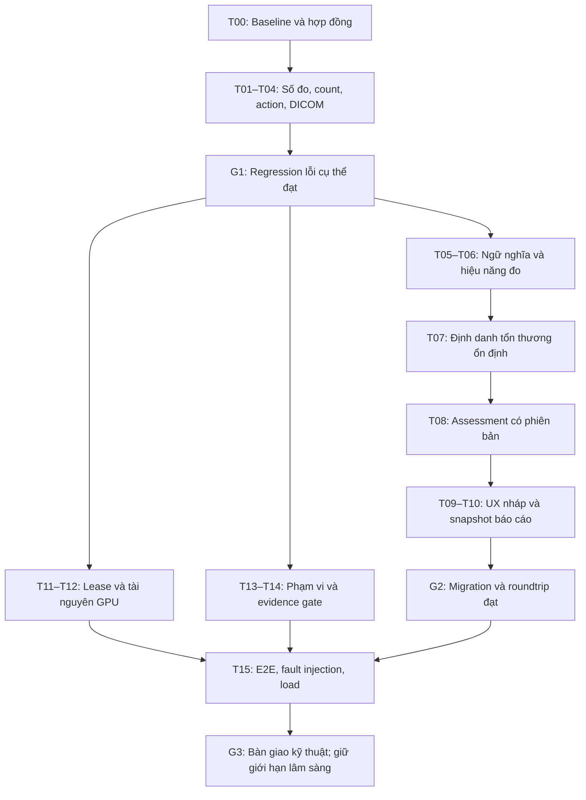

# Kế hoạch xử lý Independent Audit — AI / CDSS / Canvas HITL

Ngày: 2026-10-28. Trạng thái: PLAN READY — CHƯA TRIỂN KHAI.

## 1. Mục tiêu và giới hạn bàn giao

Sửa các lỗi đã được kiểm chứng, đóng khoảng trống truy vết dữ liệu và đo độ bền vận hành của nguyên mẫu nghiên cứu. Kết thúc triển khai phải có bằng chứng chạy thực tế cho từng ticket, không chỉ nhận xét code.

Áp dụng quy trình SUPERPOWERS trong AGENTS.md: xác định yêu cầu → chốt hợp đồng → tái hiện → tìm nguyên nhân → sửa tối thiểu → regression → kiểm chứng tích hợp. Không tìm thấy package SKILL.md Superpowers trong các thư mục skill đã kiểm tra; tài liệu này không tuyên bố đã chạy package đó.

Hai loại hoàn thành phải tách riêng:

- **ENGINEERING COMPLETE:** tất cả ticket kỹ thuật bắt buộc đạt, có log và artifact kiểm chứng; giới hạn còn lại hiển thị đúng.
- **CLINICAL RELEASE ELIGIBLE:** cần thêm bằng chứng dữ liệu, đánh giá chuyên gia và điều kiện triển khai thực tế. Agent không có thẩm quyền tự xác nhận điều này từ unit test hay benchmark tổng hợp.

Không nằm trong đợt sửa mặc định: triển khai đầy đủ mọi nhánh O-RADS, chuyển PostgreSQL, hỗ trợ toàn bộ DICOM/cine, huấn luyện lại dài hạn, phát hành phiếu chẩn đoán chính thức, triển khai production. Với các mục này, đợt sửa phải làm rõ phạm vi và chặn diễn giải sai; không bỏ qua lỗi có thể sửa trong phạm vi hiện tại.

## 2. Ràng buộc không được phá vỡ

1. Giữ Letterbox 512×512, CLAHE theo manifest, HITL, kiểm tra checkpoint SHA-256 và provenance. Thay đổi hậu xử lý/đo lường phải có phiên bản, không giả vờ tương đương kết quả cũ.
2. Theo AGENTS.md, cấu hình huấn luyện chuẩn là Dice+BCE. Không sửa metadata để hợp thức hóa checkpoint dùng loss khác; không tự đổi checkpoint đang chọn hoặc khởi động training dài hạn trong ticket hardening.
3. Đánh giá mô hình vẫn image-level split có SHA-256 dedup. Không yêu cầu/tạo patient ID để chữa giới hạn dữ liệu; patient-level independence chưa được xác minh. Các ID tổn thương/ca thử tổng hợp không phải ID bệnh nhân nguồn hay bằng chứng độc lập theo bệnh nhân.
4. Không biến mask rỗng thành buồng trứng bình thường; không biến thiếu dữ liệu hoặc lỗi thuật toán thành số 0; không coi bất thường là ác tính.
5. Không tự suy Doppler, chồi sùi, vách, bóng cản âm hoặc mô bệnh học từ mask nhị phân. Không đổi PCOM thành PCOS.
6. Giữ lease, optimistic locking, idempotency, auth, phân quyền và transaction audit/review. Không bypass để làm test xanh.
7. Working tree có nhiều thay đổi của người dùng từ trước. Không reset, clean, stash, checkout đè, sửa split, xóa checkpoint hoặc stage toàn repo. Mỗi patch chỉ bao gồm phạm vi ticket.
8. Automated browser/API tests chỉ dùng fixture tổng hợp trong temp/artifacts; không upload ảnh nguồn dataset. DB test tách biệt, không kế thừa APP_DB_PATH/APP_DATA_DIR đang trỏ môi trường thật.
9. Không tự gọi báo cáo nghiên cứu là báo cáo lâm sàng đã duyệt. Không tự bật classifier/clinical-release gate.
10. Không tự sửa historical review/report để làm dữ liệu cũ trông như được tạo bằng thuật toán mới.

## 3. Bằng chứng đầu vào và baseline

Đọc trước:

- `AGENTS.md`.
- `artifacts/audit_2026_10_28/verification.md`, `probes.py`, `worker_probe.cjs`.
- `docs/v21-acceptance-baseline.md`, `docs/developer-backlog.md`, `docs/spec-questions.md`.
- `docs/superpowers/plans/2026-10-26-v21-hardening-r02-r14.md` để tránh đảo ngược fix cũ.

Lần audit trước chạy 176 + 156 Python tests, 90 JS tests và syntax check 49 modules đều đạt. Đây là **bằng chứng lịch sử**, không thay kết quả chạy của agent sửa lỗi.

Probe cũ cố tình xác nhận hành vi lỗi. Sau khi sửa, không chạy chúng như acceptance tests rồi đòi chúng tiếp tục pass; chuyển thành regression tests kỳ vọng hành vi an toàn, giữ probe gốc làm bằng chứng lịch sử.

## 4. Thứ tự thực thi và checkpoint



Thực thi tuần tự mặc định. Các nhánh trong sơ đồ mô tả phụ thuộc, không phải lệnh spawn agent. Nếu sau này giao nhiều agent: chỉ song song ticket không sửa cùng file; một owner duy nhất cho schemas/database, một owner tích hợp viewer/review. Không để nhiều agent tự migration độc lập.

Mỗi ticket dùng checklist:

- [ ] Đọc lại implementation hiện tại, xác nhận audit còn đúng.
- [ ] Viết test hành vi thất bại đúng nguyên nhân; lưu log RED. Với benchmark/giới hạn scope, lưu baseline hoặc evidence gap thay vì tạo test fail giả.
- [ ] Ghi nguyên nhân gốc và hợp đồng đích.
- [ ] Sửa code, kiểm tra mọi producer/consumer/schema/serialization liên quan.
- [ ] Chạy test đích, log GREEN; kiểm tra negative cases.
- [ ] Chạy kiểm tra tích hợp phù hợp, rà diff và ghi rủi ro còn lại.

Các checkpoint là rà soát kỹ thuật, không mặc định yêu cầu hỏi lại người dùng. Agent được tự giải quyết lựa chọn triển khai trong phạm vi. Chỉ tách blocker khi thật sự thiếu dữ liệu/quyết định nghiệp vụ; tiếp tục ticket độc lập.

## 5. Ticket chi tiết

### T00 — Baseline, phân loại evidence và contract đầu đợt

**Phụ thuộc:** không. **Owner:** agent tích hợp. **Mapping:** toàn audit.

1. Ghi `git status --short`, commit HEAD, file đang sửa từ trước; đọc instructions lồng trong thư mục nếu có.
2. Xác minh `.venv/Scripts/python.exe`, Node, trình duyệt, CUDA/device, checkpoint có sẵn. Không in secrets từ môi trường.
3. Chạy hai probe audit và bộ tests đo/review/upload/CDSS hiện có. Nếu kết quả khác audit, cập nhật finding trước khi patch.
4. Tạo thư mục `artifacts/audit_remediation_2026_10_28/` chứa kết quả chạy, không chứa PHI/token/password.
5. Ghi thiết kế contract version mới trước khi đổi schema. Tên trường/model dưới đây là **đề xuất**, không phải mô tả schema đang tồn tại; agent phải quyết định sau khi kiểm tra migration và consumer.

**Nghiệm thu:** baseline đủ tái chạy, biết môi trường nào thiếu, không làm thay đổi DB thật.

### T01 — Nhất quán D1/D2 khi mất API

**Mapping:** BUG-01. **Phụ thuộc:** T00.

**Đọc/sửa:** `frontend/app/measure-worker.js`, `viewer.js`, `backend/services/inference_engine.py`, `source_measurements.py`; tests mới `tests/test_measurement_fallback.mjs`, mở rộng `test_2d_measurement_limits.py`.

**Quyết định mặc định:** backend là nguồn số đo minAreaRect có thẩm quyền. Khi API thất bại, worker chỉ cung cấp tín hiệu UI như có mask/chạm biên; không hiển thị Feret D1/D2 dưới tên số đo backend. Đây là fix an toàn nhỏ trước khi cân nhắc port thuật toán.

1. Tạo rectangle 40×30, elip xoay, vùng lõm, hai component tách xa. Chứng minh worker/backend khác và viewer thực sự dùng nhánh fallback.
2. Sau lỗi API: D1/D2/area từ phép đo mask hiển thị unavailable nếu chưa có cùng method/revision; không dùng 0 làm thay thế.
3. Caliper bác sĩ còn hợp lệ vẫn có thể hiển thị từ tọa độ và calibration đã xác nhận. Tách calibration khỏi object kết quả đo tạm để không mất spacing khi `_pending`/failure.
4. Giữ mask, undo, dirty state; thông báo lỗi đo có thể retry, không khóa chỉnh sửa vô lý.
5. Test response tới sai thứ tự không hồi sinh số đo của mask cũ; px không bị gắn nhãn mm.

**Nghiệm thu:** API down không làm 40 px biến thành 50 px; không có số đo khác method xuất hiện như cùng phép đo. Nếu chọn port minAreaRect sau này, phải có parity suite riêng và quy tắc chọn component giống backend.

### T02 — Ngưỡng nang, trạng thái lỗi và đơn vị

**Mapping:** BUG-02, BUG-03. **Phụ thuộc:** T00.

**Đọc/sửa:** `morphology_extractor.py`, `source_measurements.py`, `inference_engine.py`, `schemas.py`, `report_generator.py`; tests `test_follicle_watershed.py`, `test_live_follicle_counting.py`, `test_spacing_numeric_safety.py`, `test_v21_report_generator.py`.

1. Test 1.999/2.000/2.001/8.999/9.000/9.001 mm; dùng fixture spacing có thể kiểm soát và xác định tolerance số học trước khi assert.
2. So ngưỡng bằng giá trị chưa làm tròn; định dạng chữ số ở tầng hiển thị. Không double-scale sau inverse letterbox.
3. Định nghĩa status phân tích và khả năng đo kích thước độc lập. Gợi ý: `analysis_status=SUCCEEDED|FAILED|NOT_RUN`; `size_status=CALIBRATED|UNCALIBRATED`; count_in_range nullable.
4. Mask rỗng và thuật toán thành công có thể có count=0. Không spacing: count ứng viên có thể tồn tại, count_in_range=null. Thuật toán fail: counts phụ thuộc thuật toán=null và error_code ổn định.
5. Bỏ swallow exception; log loại lỗi/correlation ID không chứa ảnh hoặc dữ liệu định danh. Phản hồi public không lộ stack trace.
6. Cập nhật mọi `.get(..., 0)`/fallback consumer để không lại ép null thành 0. Kiểm thử actual FastAPI response serialization, không chỉ dict dịch vụ.
7. Đọc legacy payload không status theo chế độ chưa xác định; không tự gán thành công.

**Nghiệm thu:** probe 1.999 mm bị loại nhất quán; RuntimeError xuất hiện dưới dạng FAILED ở API/UI/report; zero hợp lệ vẫn phân biệt được.

### T03 — Hợp đồng review action

**Mapping:** BUG-05. **Phụ thuộc:** T00.

**Đọc/sửa:** `review_validation.py`, `review_service.py`, routers `reviews.py`/`cases.py`/`hitl.py`, `schemas.py`, `frontend/app/review.js`; tests `test_hitl_contract.py`, `test_review_batch.py`, `test_review_save.mjs`.

Hợp đồng mặc định tương thích UI hiện tại:

| Prediction / final | Action hợp lệ |
|---|---|
| Không đổi, kể cả cả hai rỗng | ACCEPTED_RAW |
| Thay đổi và final còn pixel | MODIFIED |
| Final rỗng, bác sĩ chủ động bác bỏ | REJECTED_ALL |

1. Test MODIFIED+empty qua endpoint, không chỉ validator; kỳ vọng 422 và không ghi review/audit/active-learning dở dang.
2. Kiểm tra mọi đường review dùng chung rule, kể cả batch/manual nếu semantics áp dụng; manual review không prediction phải có hợp đồng riêng, không tạo prediction giả.
3. Đổi mô tả chẩn đoán nhưng mask giữ nguyên vẫn cho lưu dưới action phù hợp; không đánh tráo chỉnh diagnosis thành MODIFIED mask.
4. Test idempotent replay giữ nguyên kết quả, batch có một item sai rollback toàn batch, final case vẫn read-only.

**Nghiệm thu:** server/UI cùng semantics; không sửa action của historical review một cách âm thầm.

### T04 — DICOM dedup trước biến đổi UID và migration an toàn

**Mapping:** BUG-04. **Phụ thuộc:** T00.

**Đọc/sửa:** `routers/inference.py`, `dicom_privacy.py`, `db/database.py`, schemas trả ảnh; tests `test_duplicate_upload.py`, `test_dicom_scope_guard.py`, `test_database_reference_integrity.py`, `test_database_startup_safety.py`.

1. Thêm endpoint regression: cùng bytes DICOM, cùng study, hai lần upload khác filename/laterality → lần hai 409. Giữ lease thực, DB riêng.
2. Tách ý nghĩa `source_content_sha256` trước minimize và hash bytes đã lưu để kiểm tra integrity. Kiểm tra toàn bộ chỗ đọc `file_hash` trước khi chọn thêm cột hay migration tên trường.
3. Uniqueness đúng scope `(study_id, source_content_sha256)` tại DB; kiểm tra trước insert chỉ để thông báo sớm, không thay DB constraint.
4. Không lưu raw DICOM chứa định danh chỉ để giữ hash; không đưa raw hash vào log công khai/API không cần thiết.
5. Legacy sanitized file không thể khôi phục hash bytes nguồn: giữ null/provenance legacy. Không backfill hash sanitized rồi gọi là source hash. Ghi rõ dedup legacy không đầy đủ; nếu thêm pixel fingerprint thì version hóa thuật toán và đánh giá collision/metadata semantics riêng.
6. Test upload đồng thời, commit conflict, orphan file cleanup, retry cùng request, cùng ảnh ở study khác theo policy hiện hữu.
7. Migration additive, idempotent; test DB cũ có duplicate, migration bị ngắt và FK integrity. Không tự xóa dữ liệu duplicate cũ.

**Nghiệm thu:** endpoint thực chặn duplicate DICOM sau minimize; số hàng/file đúng; không tuyên bố giải quyết mọi bản tái mã hóa JPEG/DICOM bằng raw-byte SHA-256.

### G1 — Chặn tái phát các lỗi đã có probe

T01–T04 phải có RED/GREEN và test API/consumer cần thiết. Chạy test schema, report và batch review liên quan trước khi bước vào refactor rộng. Nếu finding không còn tái hiện ở baseline mới, ghi bằng chứng và không patch thừa.

### T05 — Ngữ nghĩa ứng viên nang và caliper proxy

**Mapping:** CLN-01, CLN-02, CLN-03. **Phụ thuộc:** T01–T02.

**Đọc/sửa:** `morphology_extractor.py`, `inference_engine.py`, `diagnostic_engine.py`, `source_measurements.py`, `schemas.py`, `viewer.js`, report builders; tests morphology, follicle, diagnostic, frontend clinical copy.

1. Phân biệt thuật toán tách vùng và đối tượng lâm sàng. Mask chung mặc định `region_semantics=UNCONFIRMED`, acquisition scope một ảnh 2D; không tự gán follicle/FNPO.
2. Đặt tên hiển thị “ứng viên vùng trên mask”, giữ tên API legacy khi cần nhưng kèm semantics/version rõ ràng; cấm report biến thành tổng nang buồng trứng chưa xác nhận.
3. Giữ `equivalent_area_diameter` là phương pháp đo proxy; không âm thầm thay bằng clinical diameter. Kết quả 2–9 mm chỉ là số ứng viên trong khoảng theo phương pháp này.
4. Caliper tự động và caliper bác sĩ có source riêng. Cảnh báo đoạn proxy vượt vùng hoặc bắc qua khoảng trống; UI không gọi proxy là số đo đã xác nhận.
5. ROI ovary nếu có phải do nguồn được kiểm chứng/xác nhận; không tự lấy bbox tổn thương làm buồng trứng.
6. Chặn diễn giải PCOM/PCOS từ đếm một ảnh; giữ các guard đã có. Case nang 35 mm và cụm vùng nhỏ phải có đánh giá tách biệt.

**Nghiệm thu:** không có clinical claim mới; báo cáo/JSON diễn đạt cùng semantics; chuyên gia chưa xác nhận thì trạng thái giữ unconfirmed.

### T06 — Chi phí Watershed và vòng đo Canvas

**Mapping:** PERF-01, PERF-03. **Phụ thuộc:** T01–T02–T05.

**Đọc/sửa:** `source_measurements.py`, `morphology_extractor.py`, `viewer.js`, `measure-worker.js`, `mask-tools.js`; benchmark mới trong `scripts/`, kiểm thử hiệu năng để riêng unit suite.

1. Đo baseline ảnh 512², 2048² và gần giới hạn 25 triệu pixel trên máy thực; ghi RSS/latency theo component count, CPU/RAM và phương pháp đo. Chạy tuần tự có giới hạn thời gian, không cố OOM máy người dùng.
2. Thay `sum(labels == id)` lặp K lần bằng tổng hợp một lượt như bincount; giữ kết quả tương đương.
3. ROI processing phải giữ padding ngữ cảnh cho distance transform, handling chạm biên, scale và tọa độ. Không đổi độ phân giải/phương pháp trong tối ưu mà thiếu version/parity evidence.
4. Frontend: một request đang chạy + một snapshot mới nhất chờ; phản hồi gắn image ID/mask revision/calibration revision. Không dùng current mutable image để áp dữ liệu snapshot cũ.
5. Hủy request client không được coi là đã hủy compute server. Có hàng đợi/coalescing/cancellation cooperative nếu cần; kiểm soát concurrency server trong T12.
6. Profile encode RLE, undo snapshot, components, structured clone và draw; chỉ chuyển sang worker phần thực sự gây long task.

**Nghiệm thu:** phép đo không thay semantics; không tích lũy request theo số nét vẽ; không stale overwrite; lưu baseline và after. Mục tiêu đề xuất frame p95 ≤33 ms, không có main-thread task >50 ms do nét vẽ trên máy tham chiếu; đây là ngân sách kỹ thuật, chưa phải kết quả đã đo.

### T07 — Tổn thương ổn định qua revision

**Mapping:** BIZ-01, CLN-03. **Phụ thuộc:** G1, T05.

**Đọc/sửa:** `db/database.py`, `schemas.py`, `review_service.py`, `source_measurements.py`, `cases.py`, `frontend/app/state.js`, `viewer.js`, `review.js`, report consumers.

**Thiết kế tối thiểu đề xuất:** thực thể tổn thương thuộc study/image/side; UUID ổn định do server cấp; observation có revision, mask/component selection, calibration reference, caliper source. `lesion_id` integer theo contour sort hiện tại chỉ là index tạm, không được dùng làm khóa lâm sàng.

1. Viết design note về lifecycle và mapping trước migration. Phân biệt một tổn thương qua nhiều ảnh với nhiều tổn thương trên cùng ảnh; không tự ghép xuyên ảnh bằng vị trí gần nhau.
2. UI liệt kê mọi component đủ điều kiện và vùng bị filter; bác sĩ chọn/đặt tên mục tiêu. Không lấy `lesions[0]` làm đại diện duy nhất của ca.
3. Edit nhẹ có matching một-một rõ ràng có thể đề xuất giữ ID; merge/split, ambiguity hoặc crossing phải yêu cầu xác nhận liên kết. Không chuyển descriptors sang vùng khác âm thầm.
4. Hai bộ D1/D2 cho hai tổn thương không ghi đè nhau. Hiện `manual_calipers` tối đa 2 theo ảnh: migration contract phải xử lý chuyển sang tổn thương và đọc dữ liệu cũ.
5. Legacy caliper/mô tả cấp ảnh giữ nguồn legacy/unassigned, không tự gán vào tổn thương lớn nhất. Đưa vào hàng chờ bác sĩ xác nhận nếu cần dùng như evidence theo tổn thương.
6. Test thay đổi thứ tự diện tích, xóa vùng lớn, split/merge, nhiều ảnh cùng bên, cập nhật đồng thời và unauthorized cross-study ID.

**Nghiệm thu:** ca 15 mm + 45 mm và ca nang lớn + vùng nhỏ đáng ngờ giữ hai hồ sơ riêng; chưa đánh giá vùng nào thì tổng hợp không tuyên bố ca đã đánh giá đủ. Không dùng kích thước làm priority nguy cơ.

### T08 — Lưu CDSS assessment có provenance và invalidation

**Mapping:** BIZ-02, BIZ-03. **Phụ thuộc:** T07.

**Đọc/sửa:** `cdss_engine.py`, `schemas.py`, `db/database.py`, `v1_endpoints.py`, `review_service.py`, `cdss-panel.js`; tests fail-closed/CDSS integration/lease/batch.

Contract đề xuất: assessment ID, study/image/lesion ID, revision tham chiếu, descriptors và nguồn, patient context cần thiết, calibration reference, rule-engine version, guideline/policy version, output/missing/unsupported, actor server-side, timestamp, trạng thái xác nhận và supersedes ID.

1. Giữ endpoint evaluate thuần nghiên cứu tương thích nếu cần; thêm đường lưu assessment có auth/lease/CAS. Client không được tự nộp category rồi ghi như output của engine.
2. Server tính lại từ input hợp lệ; lưu input/output/provenance cùng transaction. Hạn chế field ngoài schema, type coercion và payload quá lớn.
3. Snapshot bất biến; sửa tạo assessment mới. Doctor ID lấy từ authenticated principal, không tin request.
4. Thay mask/caliper/calibration/side/descriptor liên quan đánh dấu assessment stale. Lưu dependency chính xác; nếu dùng invalidation bảo thủ toàn ảnh thì ghi rõ và không giữ confirmation cũ.
5. Khi gửi cùng idempotency key khác payload: conflict, không tái sử dụng output trước. Response mất sau commit phải truy hồi cùng assessment, không nhân đôi.
6. Đừng lấy max O-RADS rồi bỏ qua vùng unsupported/unassessed: tổng hợp phải thể hiện cả nguy cơ đã xác nhận lẫn sự chưa đầy đủ.
7. Test rollback, save retry, lease expiry, wrong revision, deleted case, đổi calibration giữa evaluate và persist; old rules không âm thầm chạy lại trong historical report.

**Nghiệm thu:** reload truy được căn cứ kết quả; unsupported vẫn unsupported; input stale không được xác nhận như hiện hành.

### T09 — Nháp CDSS, auto-fill và phục hồi đúng ngữ cảnh

**Mapping:** UX-01. **Phụ thuộc:** T07–T08.

**Đọc/sửa:** `cdss-panel.js`, `state.js`, `viewer.js`, `review-content.js`, `intake-session.js`; tests `test_cdss_panel.mjs`, `test_viewer_mask_draft.mjs`, `test_intake_session.mjs`, E2E doctor.

1. Nháp theo user/study/image/lesion/revision; không reset mất dữ liệu khi xem ảnh khác rồi quay lại.
2. Revision mismatch mở trạng thái conflict/stale; không tự lấy nháp cũ đè server. Kiểm thử logout/login khác user và session hết hạn.
3. Auto-fill chỉ dữ liệu đã biết: hành chính phù hợp và số đo xác nhận đúng lesion/calibration. Mỗi field có provenance; user edit làm mới nguồn và invalidates output.
4. Clinical descriptors chưa đánh giá giữ unknown; không default âm tính để giảm click.
5. Chuyển lesion/side phải hủy response cũ và bật đúng draft. Keyboard/focus không làm mất nét vẽ hay nhập vào field khác.
6. Đo click và thời gian cho cùng kịch bản trước/sau; không hứa số click từ suy đoán code.

**Nghiệm thu:** không nhập lại vô ích khi chuyển ảnh; không rò mô tả giữa hai tổn thương hoặc người dùng.

### T10 — Snapshot báo cáo RUO và ranh giới phát hành

**Mapping:** PAT-01, BIZ-02. **Phụ thuộc:** T07–T09.

**Đọc/sửa:** `report_generator.py`, routers xuất report hiện hữu sau khi xác định call graph, `research-report-draft.js`, `report-preview.js`, `approval.js`, `frontend/css/report-preview.css`; tests report security, preview, research export, roundtrip.

1. Báo cáo lấy snapshot đã lưu: lesion list, caliper được xác nhận, assessment và revision tương ứng. Không ghép ảnh revision mới với chữ revision cũ.
2. Hiển thị nguồn số đo, đơn vị, calibration, trạng thái xác nhận và trường thiếu; không ép null thành 0.
3. In danh sách tất cả tổn thương được ghi nhận; ảnh gốc/overlay và nhãn vùng nhất quán. Giữ tiếng Việt, A4, chữ dài, grayscale print, mask trống và ảnh thiếu.
4. Khác biệt giữa “đã lưu rà soát”, “đã xác nhận nội dung nghiên cứu” và “được phép phát hành lâm sàng” phải rõ. Không thêm chữ ký pháp lý hoặc bật phát hành lâm sàng trong scope này.
5. Kết quả AI không đủ evidence không tạo câu kết luận/xác suất ác tính cho bệnh nhân. Clinical text của bác sĩ vẫn escape và có actor/provenance.
6. Report export dựa quyền server; client không thể sửa flag validation/approved để vượt gate. Thử dữ liệu HTML injection, ID ca khác, stale revision.

**Nghiệm thu:** bản PDF/preview đọc cùng snapshot, nguồn và RUO rõ ràng; patient-facing clinical delivery vẫn NOT AUTHORIZED nếu thiếu gate ngoài kỹ thuật.

### G2 — Tích hợp dữ liệu và migration

- Migration chạy trên bản sao test có dữ liệu legacy, rollback failure và FK bật; không thử lần đầu trên DB thật.
- Roundtrip đầy đủ: 2 lesions → sửa mask → đặt caliper → lưu → CDSS → xác nhận → reload → export. Không mất field khi Pydantic serialize.
- Kiểm tra study version và review_revision có vai trò riêng, không tăng tùy tiện để né conflict.
- App version cũ không hiểu schema mới phải bị chặn ghi hoặc có compatibility được kiểm thử; không giả định downgrade an toàn sau khi có dữ liệu mới.

### T11 — Lease recovery và lưu khi mạng không ổn định

**Mapping:** UX-02; các race scenario của audit. **Phụ thuộc:** G1; tích hợp lại sau T08.

**Đọc/sửa:** `leases.js`, `api.js`, `review.js`, `viewer.js`, `case_lease_service.py`; tests case_leases, review_batch, review_save, save_race_guard và browser safety.

1. Giữ fail-closed khi server chưa xác nhận quyền. Thêm retry lấy lại lease có kiểm soát và nút hành động rõ ràng; không dùng client TTL làm quyền ghi.
2. Khi lấy lại, fetch revision; khớp thì cho tiếp tục nháp, khác thì trình bày conflict. Không silently merge clinical content.
3. Bảo đảm heartbeat không chồng request khi mạng chậm; cleanup timer/listener khi rời route, logout, crash/reload.
4. Fault cases: mất heartbeat đơn lẻ, offline >45 giây, tab sleep, crash, hai tài khoản, hai tab, response save mất sau commit, click lưu kép, save đồng thời navigate.
5. Khôi phục post-commit bằng idempotency/readback; không xóa draft trước acknowledgement. Tách lỗi telemetry sau save khỏi lỗi lưu clinical payload.

**Nghiệm thu:** không khóa vô thời hạn; không hai writer đồng thời; không mất bản chỉnh sửa; stale writer nhận conflict/locked có thể hiểu và phục hồi.

### T12 — Giới hạn GPU và tác vụ nặng

**Mapping:** PERF-02, một phần PERF-01. **Phụ thuộc:** T00; hợp nhất T06.

**Đọc/sửa:** `inference_engine.py`, `model_service.py`, `app/config.py`, inference routers và runtime config; tests `test_cuda_cpu_fallback.py`, `test_runtime_configuration.py`, `test_health_readiness_privacy.py`; benchmark inference.

1. Đo số model/adapter thật sự nạp, worker count và process count. Semaphore trong một process không bảo vệ nhiều worker; mặc định pilot một GPU worker hoặc một owner process rõ ràng.
2. Thêm giới hạn concurrency cấu hình, default GPU=1; hàng chờ hữu hạn và timeout có response ổn định (503 hoặc 429 theo contract chốt). Không unbounded wait.
3. Permit giải phóng ở finally cho success/error/cancel; forward đang thực thi không được thả permit chỉ vì HTTP client đã ngắt kết nối.
4. CPU fallback phải phối hợp condition hiện hữu, không deadlock và không để nhiều request đồng loạt chuyển model. Model load/unload và inference cùng tuân thủ ownership.
5. Không thêm empty_cache mỗi request như cách chữa leak. Theo dõi allocated/reserved/RSS riêng; reserved tăng không tự chứng minh leak.
6. Queue wait/compute/total được đo riêng; không lộ thông tin nhạy cảm qua public health.

**Nghiệm thu:** test semaphore/fallback bằng fake model deterministic; load test thật ở T15 nếu có GPU. Thiếu GPU 4 GB → BLOCKED_HARDWARE cho soak đó, không suy diễn CPU pass thành GPU pass.

### T13 — Công bố phạm vi SQLite/DICOM/rule và biên 30 mm

**Mapping:** ARC-01, UX-03, BIZ-03, CLN-04. **Phụ thuộc:** T00.

1. Kiểm tra capabilities và README để chỉ công bố SQLite được hỗ trợ hiện tại; không nhận cấu hình PostgreSQL rồi âm thầm dùng SQLite. Thêm test unsupported config nếu có đường cấu hình đó.
2. Ghi bảng DICOM thực sự hỗ trợ từ decoder, phân biệt unsupported với corrupt; trả lỗi có thể hành động. Không ép chuyển 16-bit/cine thành ảnh khác mà không giao thức đã xác minh.
3. Ghi coverage table CDSS: implemented/unsupported/insufficient, version và test tương ứng; không dùng O-RADS 0 làm mã generic lỗi.
4. Giữ policy dự án <30 mm, công khai khác ACR ≤30 mm; test đúng 30 mm. Không sửa quy tắc y khoa theo phỏng đoán; cập nhật guideline cần nguồn chính thống và review riêng.
5. DICOM thật tại bệnh viện và phạm vi clinical rules mở rộng ghi như external validation backlog, không coi unit fixture là bằng chứng tương thích thiết bị bệnh viện.

**Nghiệm thu:** khả năng được công bố khớp code; lỗi phạm vi có hướng dẫn; không thêm chức năng ngoài scope để đóng ticket hình thức.

### T14 — Evidence gate, loss và tuyên bố mô hình

**Mapping:** VAL-01, VAL-02. **Phụ thuộc:** T00.

**Đọc/sửa:** `evaluation/selected_model.json`, `MODEL_CARD.md`, model registry/release checks, `scripts/verify_evaluation_release.ps1`, evaluation tests và training manifest liên quan. Không thay weights/splits.

1. Đối chiếu manifest, training summary, hash checkpoint, loss thực tế, preprocessing, threshold/TTA và provenance. Gắn unresolved nếu bằng chứng mâu thuẫn.
2. Thay mô tả validation thành phạm vi image-level phù hợp; không gọi sensitivity lâm sàng nếu chưa có evidence. Giữ gate BLOCKED/candidate khi chưa đạt.
3. Tách runnable RUO candidate khỏi clinically validated model. Endpoint/UI/report không được nâng trạng thái chỉ nhờ request field hoặc docstring.
4. Ghi sai lệch AdvancedHybridLoss với Dice+BCE như blocker tuân thủ phạm vi. Kế hoạch khắc phục là chọn/retrain ứng viên Dice+BCE có đầy đủ evidence trong tác vụ riêng, không đổi chuỗi tên loss và không tự fallback checkpoint cũ.
5. Không tuyên bố patient independence; không tái dùng test set để tune threshold. Kiểm tra SHA-256 split và nguồn nhãn trong evidence pipeline hiện hữu.
6. Các lệnh verify có thể chủ động fail do gate BLOCKED: lưu là EXPECTED_BLOCK, không xóa assertion để thành pass.

**Nghiệm thu:** trạng thái kỹ thuật/chưa đủ evidence trung thực. Ticket hardening có thể DONE với việc enforcement và ghi blocker; clinical/model compliance gate vẫn BLOCKED đến khi có bằng chứng thực.

### T15 — Kiểm thử tích hợp, độ bền và bàn giao

**Phụ thuộc:** T01–T14. **Mapping:** toàn bộ.

1. Chạy toàn bộ backend/frontend suites sau tích hợp, giữ log đầy đủ gồm skipped/warnings; lỗi có sẵn vẫn ghi, không giấu trong tổng pass.
2. E2E browser trên backend test riêng, DB/data temp, fixture synthetic. Đọc script trước khi chạy vì có script mặc định cổng 8027 và tài khoản; không trỏ vào phiên đang dùng của người dùng.
3. Kịch bản: intake trái → ảnh cụm vùng + vùng lớn → xác nhận calibration → sửa vách → hai caliper theo từng lesion → lưu → assessment → đổi ảnh/quay lại → reload → preview/PDF.
4. Negative intake: 1×1, 10000×10000, ảnh corrupt, file giả extension, RLE sai, spacing 0/âm/NaN/inf; từ chối có kiểm soát, không 500/OOM. Không cấp phát ảnh lớn vô ích nếu có thể test header guard.
5. Race/fault: hai bác sĩ, lưu kép, stale revision, lease hết hạn, tab crash, response mất sau commit, inference fail, measurement fail; kiểm tra DB/file/audit/queue sau mỗi case.
6. Performance: 50 lượt tuần tự, burst concurrency 2/4, queue vượt giới hạn, idle recovery. Ghi p50/p95/max, CUDA allocated/reserved, RSS, error/fallback, machine config và commit. Không tự ước lượng số đo nếu phần cứng thiếu.
7. UX: browser trace/frame time, số click/field nhập lại, keyboard, zoom/pan/undo, overlay on/off/opacity và focus. So cùng synthetic scenario trước/sau; không lấy benchmark này chứng minh hiệu quả lâm sàng.
8. Visual: screenshot màn hình và PDF A4, tên dài, ghi chú nhiều trang, ảnh/overlay rõ, L/R không lẫn, field thiếu không biến thành 0. Đánh giá bản in vật lý/chuyên gia là checklist chưa đạt nếu chưa làm.
9. Rà diff cuối: không thay dataset/checkpoint, không làm mất thay đổi của người dùng, không commit secrets/test patient data. Không auto-deploy/publish.

**Nghiệm thu:** có bảng trạng thái từng ticket, evidence link, số test chính xác và giới hạn còn lại. Không ghi ALL DONE khi còn kiểm thử bắt buộc chưa chạy; chỉ tách ENGINEERING COMPLETE khỏi external validation rõ ràng.

## 6. Lệnh kiểm chứng và quản lý log

Chạy từ repository root. Dùng `.venv`, không Python mặc định. Các file test mới ở ticket là tên đề xuất phải tạo trước khi thêm vào lệnh.

```powershell
.venv/Scripts/python.exe -m pytest tests/test_2d_measurement_limits.py tests/test_live_follicle_counting.py tests/test_follicle_watershed.py tests/test_spacing_numeric_safety.py tests/test_hitl_contract.py tests/test_review_batch.py tests/test_duplicate_upload.py tests/test_dicom_scope_guard.py -q
npm test
npm run syntax-check
.venv/Scripts/python.exe -m pytest tests -q
```

Sau khi backend test riêng sẵn sàng và đã xác minh script không dùng dữ liệu nguồn:

```powershell
npm run test:e2e:safety
npm run test:e2e:roundtrip
npm run test:e2e:doctor
npm run test:e2e:workstation
```

Không chạy command nối nhiều shell để che exit code. Khi lưu stdout/stderr bằng Tee-Object hoặc wrapper, phải giữ exit status của tiến trình kiểm thử. Ghi command, timestamp, environment không nhạy cảm và exit code; không chỉ chụp dòng “passed”. Không lặp lại full suite khi không có thay đổi/failure mới.

Mỗi ticket có `Txx-red.log`, `Txx-green.log` nếu áp dụng, `Txx-notes.md`; T15 có `integration-results.md`, `performance.json`, browser traces/screenshots/PDF tổng hợp. Các đường artifact phải nằm trong workspace test đã xác minh.

## 7. Bảng truy vết audit → ticket

| Finding | Ticket |
|---|---|
| BUG-01 | T01 |
| BUG-02, BUG-03 | T02 |
| BUG-04 | T04 |
| BUG-05 | T03 |
| CLN-01, CLN-02 | T05 |
| CLN-03 | T05, T07 |
| CLN-04 | T13 |
| BIZ-01 | T07 |
| BIZ-02 | T08, T10 |
| BIZ-03 | T08, T13 |
| UX-01 | T09 |
| UX-02 | T11 |
| UX-03, ARC-01 | T13 |
| PERF-01, PERF-03 | T06, T12 |
| PERF-02 | T12, T15 |
| PAT-01 | T10, T15 và external clinical gate |
| VAL-01, VAL-02 | T14 và external evidence/model compliance gate |

## 8. Rollback và quy tắc dừng

- Mỗi nhóm T01–T04, T05–T06, T07–T10, T11–T14 là một thay đổi reviewable; không trộn training/UI overhaul vào patch sửa lỗi.
- App rollback sau schema mới phải có compatibility evidence. DB migration ưu tiên additive; không tự drop cột/table để rollback. Khôi phục bản backup test không làm mất dữ liệu mới trong môi trường thật.
- Nếu phát hiện legacy data mâu thuẫn: giữ nguyên, quarantine/flag để rà soát; không tự normalize clinical conclusion.
- Nếu test thất bại: đọc full trace, xác định root cause, sửa rồi chạy lại vùng bị ảnh hưởng. Không tăng timeout/skip test chỉ để xanh.
- Thiếu GPU, ảnh thiết bị bệnh viện hoặc specialist review: đánh dấu đúng blocker, tiếp tục ticket độc lập; không thay kết quả thực bằng mô phỏng.
- Nếu cần mở rộng clinical rules hoặc đổi protocol huấn luyện: lập design/change note riêng; mặc định giữ scope/gate hiện hành, không để quyết định đó chặn các bug fix đã được cho phép.

## 9. Mẫu bàn giao cuối của agent

1. Ticket DONE / PARTIAL / BLOCKED và commit/diff tương ứng nếu đã commit theo yêu cầu.
2. Với mỗi lỗi: nguyên nhân gốc → thay đổi → test tái hiện → log kiểm chứng.
3. Migration/compatibility và hướng rollback thực tế.
4. Kết quả test tự động, E2E và benchmark; tách kết quả phần cứng thật với fake model/synthetic fixture.
5. Rủi ro còn lại và gate clinical/model chưa đạt, có owner/action cụ thể.
6. Xác nhận không thay weights/splits, không mất thay đổi trước đó, không publish/deploy hoặc bật lâm sàng.

## 10. Prompt giao cho agent thực thi

> Đọc AGENTS.md và thực thi `docs/superpowers/plans/2026-10-28-independent-audit-remediation.md` theo thứ tự phụ thuộc. Bắt đầu T00; sau đó T01–T04 và checkpoint G1. Với mỗi lỗi, tái hiện và lưu RED trước khi sửa, xác định root cause, sửa production code và chạy GREEN. Tiếp tục T05–T15 khi checkpoint đạt; không chỉ đưa lời khuyên hoặc dừng sau một nhóm nếu còn việc độc lập có thể làm. Các schema mới trong plan là đề xuất: kiểm tra code thật rồi ghi contract/design note trước migration. Giữ RUO, letterbox 512×512, calibration/source coordinates, lease/CAS/idempotency và mọi giới hạn dữ liệu trong AGENTS.md. Không sửa weights/splits, không giả patient independence, không nâng validation gate hoặc phát hành lâm sàng. Giữ nguyên thay đổi của người dùng. Nếu thiếu phần cứng/dữ liệu/chuyên gia, ghi blocker cụ thể và tiếp tục phần độc lập. Bàn giao bằng bảng ticket và bằng chứng test/E2E/benchmark, không tuyên bố hoàn tất phần chưa kiểm chứng.
