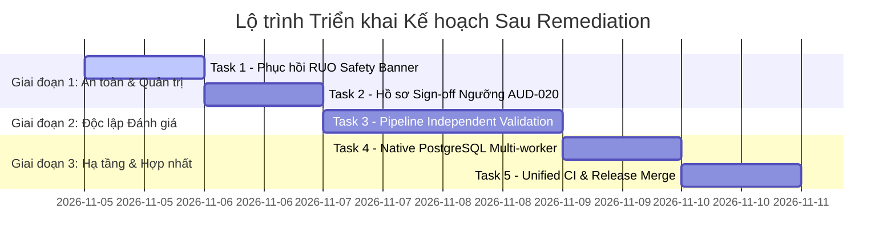

# Kế hoạch Triển khai Sau Remediation: Quản trị Lâm sàng, Độc lập Đánh giá & Chuẩn bị Rollout

> **Dành cho Agentic Workers:** REQUIRED SUB-SKILL: Sử dụng `superpowers:subagent-driven-development` hoặc `superpowers:executing-plans` để thực thi từng nhiệm vụ (task-by-task). Các bước sử dụng cú pháp checkbox (`- [ ]`) để theo dõi tiến độ. Tài liệu này xác lập kế hoạch triển khai chi tiết cho các bước tiếp theo sau khi hoàn thành 18 commit remediation.

**Mục tiêu (Goal):**
Chuẩn hóa và phục hồi cảnh báo an toàn RUO toàn cục (khắc phục rủi ro lược bỏ banner trong commit `e339363`), thiết lập hồ sơ sign-off chuyên môn cho AUD-020 ($\le30\text{ mm}$ theo ACR O-RADS v2022), xây dựng pipeline xác thực độc lập (Independent Validation) bảo toàn image-level split/SHA-256, kiểm chứng môi trường native PostgreSQL containerized, và tích hợp nhánh sạch vào nhánh chính.

**Kiến trúc & Phương pháp tiếp cận (Architecture):**
- Giữ nguyên cấu trúc Clean Architecture: Backend FastAPI, PyTorch Core (Combo Loss), CDSS Deterministic Engine, và Frontend Workstation Canvas.
- Khôi phục banner cảnh báo RUO tinh tế, tuân thủ tiêu chuẩn thiết bị y tế nghiên cứu (FDA/CE-IVD/MOH CDSS), không gây vỡ bố cục hay che khuất thao tác màn hình $1366\times768$ và mobile $390\times844$.
- Đảm bảo tính minh bạch khoa học: Mọi báo cáo độc lập ghi rõ giới hạn "patient-level independence unverified".

**Tech Stack:**
Python 3.12 (`.venv`), FastAPI, SQLAlchemy, PyTorch, Node.js (`node:test`), Playwright Core, Docker Compose (`postgres:16-alpine`).

**Tài liệu tham chiếu (Specs & Standards):**
- [REMEDIATION_REPORT.md](../../../audit/2026-11-04/REMEDIATION_REPORT.md)
- [ISSUE_REGISTER.md](../../../audit/2026-11-04/ISSUE_REGISTER.md)
- [AGENTS.md](../../../AGENTS.md)
- Chuẩn ACR O-RADS US v2022 & IOTA Simple Rules / ADNEX Lexicon.

---

## Ràng buộc Toàn cục (Global Constraints)

1. **Research-Only & Zero-Hallucination:** Tuyệt đối không xóa bỏ các tuyên bố RUO (Research Use Only) hoặc tự ý tuyên bố hệ thống sẵn sàng triển khai lâm sàng khi chưa có nghiệm thu từ hội đồng chuyên môn. Trạng thái tổng thể giữ nguyên **NO-GO**.
2. **Medical Size Cutoff Protocol:** Giữ logic `<30 mm` trong production CDSS engine cho đến khi hoàn tất Task 2 (Ký duyệt chuyên môn có biên bản).
3. **Core Scope Invariance:** Giữ nguyên quy trình letterbox $512\times512$, Combo Loss ($0.5\text{ BCE} + 0.5\text{ SoftDice}$), checkpoint SHA-256 `ce758032…591e76`, và cơ chế rà soát tương tác Human-in-the-Loop (HITL).
4. **Data Isolation:** Không ghi dữ liệu kiểm thử vào database mặc định; mọi bài test migration và Docker chỉ thực thi trên container cô lập và biến môi trường tạm thời.
5. **TDD & Verification Before Completion:** Mỗi tác vụ phải có test kiểm chứng độc lập (FAIL -> PASS), chạy `git diff --check` sạch và thu thập bằng chứng log xanh trước khi đánh dấu hoàn thành.

---

## Trọng tâm Rà soát Rủi ro (Review Focus)

1. **Rủi ro an toàn lâm sàng (RUO Banner Drop):** Việc gỡ banner cảnh báo toàn cục trong commit `e339363` có thể khiến người dùng hiểu nhầm đây là phần mềm thương mại đã phê duyệt y tế -> Cần phục hồi banner tinh tế, chuẩn mực.
2. **Rủi ro sai lệch ranh giới kích thước:** Thay đổi từ `<30 mm` sang `≤30 mm` tác động trực tiếp đến phân loại tổn thương sinh lý O-RADS 2 -> Cần bộ test boundary đối soát song song.
3. **Rò rỉ độc lập bệnh nhân (Data Leakage):** Tránh việc nhầm lẫn giữa ảnh cùng bệnh nhân giữa tập train/val/test khi chưa có mã bệnh nhân gốc -> Khử trùng lặp ảnh bằng SHA-256 và ghi rõ caveat.
4. **Sai khác hành vi giữa SQLite và PostgreSQL:** Kiểu dữ liệu JSON, Timestamp with Timezone, và Transaction Lock giữa SQLite (single-writer) và PostgreSQL multi-connection -> Xác minh native trên Docker container.
5. **Gãy bố cục màn hình:** Việc thêm lại banner không được làm tụt CTA "Phân tích ảnh" khỏi màn hình $1366\times768$ (phải duy trì $y \le 630\text{ px}$).

---

## Danh mục Nhiệm vụ Thực thi (Task Breakdown)

### Task 1: Phục hồi và Chuẩn hóa Cảnh báo An toàn RUO Toàn cục (Clinical Safety Banner)

- [x] **Mục tiêu:** Khôi phục banner cảnh báo RUO và tuyên bố giới hạn lâm sàng trên header/footer của Workstation nhưng tích hợp hài hòa vào theme `workstation-premium.css`, không đè dropzone và không đẩy nút CTA xuống dưới $y=630\text{ px}$ ở độ phân giải $1366\times768$.
**Files liên quan:**
  - Chỉnh sửa: `frontend/index.html`
  - Chỉnh sửa: `frontend/css/workstation-premium.css`
  - Chỉnh sửa/Bổ sung test: `tests/test_frontend_clinical_copy.py`, `tests/test_fe_02_report_preview.mjs`, `tests/product_brand_e2e.js`
**Các bước thực hiện:**
  1. [x] Viết test kiểm tra sự hiện diện bắt buộc của thẻ `role="note"` hoặc `class="ruo-safety-banner"` trong `frontend/index.html` với nội dung chuẩn: `"BẢN NGHIÊN CỨU (RUO) — Chưa được phê duyệt lâm sàng — Không dùng cho quyết định điều trị"`.
  2. [x] Bổ sung style CSS cho `.ruo-safety-banner` với chiều cao cố định mỏng ($32\text{ px}$), màu cảnh báo dịu chuẩn phòng đọc ảnh (amber/dark-slate), không che khuất layout.
  3. [x] Cập nhật footer statusbar để hiển thị rõ ràng thông điệp cảnh báo an toàn.
  4. [x] Chạy `node tests/clinical_safety_e2e.js` và `tests/product_brand_e2e.js` để xác minh CTA tại $1366\times768$ vẫn nằm trên fold ($y \le 630\text{ px}$).
  5. [x] Tạo commit ngữ nghĩa: `fix(safety): restore standardized RUO medical disclaimer banner` (`9f03c95`).

---

### Task 2: Soạn thảo Hồ sơ Nghiệm thu Chuyên môn cho Ngưỡng Kích thước Nang noãn AUD-020

- [x] **Mục tiêu:** Xây dựng bộ tài liệu kỹ thuật y tế (Clinical Sign-off Dossier) làm căn cứ trình Hội đồng Chuyên môn/Bác sĩ Siêu âm Sản phụ khoa xem xét ngưỡng nang noãn sinh lý `≤30 mm` theo ACR O-RADS US v2022. Hồ sơ được chuẩn bị; phê duyệt chuyên môn chưa có.
**Files liên quan:**
  - Tạo mới: `docs/clinical/AUD-020-boundary-signoff-dossier.md`
  - Tạo mới: `scripts/generate_boundary_comparison_report.py`
  - Không chỉnh sửa `backend/services/cdss_engine.py`; chưa thêm cờ thay đổi hành vi khi chưa có sign-off.
**Các bước thực hiện:**
  1. [x] Tổng hợp trích dẫn chính thức từ tài liệu ACR O-RADS US v2022 (nang noãn tiền mãn kinh $\le3\text{ cm}$), đối chiếu đúng phạm vi với IOTA Simple Rules và ISUOG Consensus.
  2. [x] Xây dựng ma trận rủi ro cho 29.9/30.0/30.1 mm. Dossier ghi rõ nang noãn sinh lý ≤3 cm thuộc O-RADS 1/ovary bình thường; không gán mọi nang khác sang O-RADS 3 hoặc tự suy ra lịch theo dõi.
  3. [x] Viết script đối soát tự động tạo bảng dữ liệu từ synthetic fixtures.
  4. [x] Thiết kế khối chữ ký cho bác sĩ chuyên khoa và giảng viên hướng dẫn; chưa có chữ ký.
  5. [x] Tạo commit ngữ nghĩa: `docs(clinical): establish AUD-020 clinical sign-off dossier for 30mm threshold` (`f6620d6`).

**Trạng thái lâm sàng:** AUD-020 vẫn PARTIAL; tiếp tục giữ quy tắc `<30 mm` trong CDSS cho đến khi nhận được sign-off có hồ sơ.

---

### Task 3: Thiết lập Pipeline Xác thực Độc lập & Khử trùng lặp Dữ liệu (Independent Validation Protocol)

- [x] **Mục tiêu:** Chuẩn bị harness đánh giá image-level có kiểm tra SHA-256, metric phân đoạn và caveat rõ ràng. Đánh giá held-out thực tế vẫn BLOCKED do thiếu ảnh nguồn và provenance chưa đạt.
**Files liên quan:**
  - Tạo mới: `scripts/run_independent_validation.py`
  - Tạo mới: `tests/test_independent_validation_pipeline.py`
  - Không thay đổi: `backend/services/model_service.py` (benchmark chưa ký không được phép ảnh hưởng runtime)
**Các bước thực hiện:**
  1. [x] Viết unit test SHA-256, overlap, manifest và chặn split không hợp lệ.
  2. [x] Triển khai metric Dice, IoU, Recall, Precision, Specificity, Brier/calibration bins với threshold/TTA khóa theo cấu hình candidate.
  3. [x] Ghi `patient_level_independence_verified: false` và phân loại benchmark kỹ thuật chưa xác minh danh tính bệnh nhân.
  4. [x] Xác minh không sửa `evaluation/selected_model.json`; không tích hợp hook runtime khi chưa có bằng chứng/khóa ký hợp lệ.
  5. [x] Tạo commit ngữ nghĩa: `feat(eval): add guarded image-level benchmark runner` (`082b615`).

**Trạng thái đánh giá:** Chạy harness trên checkout hiện tại trả `BLOCKED_MISSING_ASSETS`: manifest liệt kê 1,604 ảnh nguồn nhưng thiếu toàn bộ file. Không tính metric. Checkpoint còn candidate-only; patient-level independence chưa xác minh.

---

### Task 4: Kiểm chứng Nền tảng Native PostgreSQL & Multi-Worker Container

**Trạng thái: BLOCKED.** Docker server không khả dụng trong môi trường này. Không chạy migration, multi-worker hoặc tenant-isolation trên PostgreSQL; SQLite không được dùng làm bằng chứng thay thế.

- [ ] **Mục tiêu:** Xác minh tính toàn vẹn của cơ sở dữ liệu trên hệ quản trị PostgreSQL 16 thực tế thông qua Docker Compose, giải quyết trạng thái BLOCKED của mục kiểm thử hạ tầng trong báo cáo kiểm toán.
**Files liên quan:**
  - Chỉnh sửa/Kiểm tra: `docker-compose.postgres.yml`
  - Tạo mới: `scripts/verify_postgres_multiworker.py`
  - Tạo mới: `tests/test_postgres_e2e_isolation.py`
**Các bước thực hiện:**
  1. Khởi động môi trường kiểm thử cô lập bằng Docker Compose: `docker compose -f docker-compose.postgres.yml up -d postgres`.
  2. Chạy kịch bản migration schema `backend/db/database.py` và `scripts/migrate_sqlite_to_postgres.py` vào cơ sở dữ liệu PostgreSQL.
  3. Thực thi kịch bản kiểm thử đa luồng (multi-worker concurrency test): 10 kết nối đồng thời tạo ca, cập nhật phân vùng và sinh báo cáo; xác nhận không xảy ra deadlock, dirty read hoặc rò rỉ cơ sở dữ liệu đa cơ sở (multi-tenant isolation).
  4. Dọn dẹp tài nguyên và lưu giữ kết quả log pass vào `artifacts/verification-postgres/`.
  5. Tạo commit ngữ nghĩa: `test(infra): verify schema migration and tenancy isolation on native postgresql`.

---

### Task 5: Hợp nhất Bộ Kiểm thử Toàn diện & Tích hợp Nhánh (Unified CI & Branch Merge)

- [ ] **Mục tiêu:** Đóng gói lệnh kiểm thử tự động toàn diện (Python 1.620 test + Node 170 test + browser E2E smoke) thành một kịch bản duy nhất; merge chỉ thực hiện sau khi được phê duyệt.
**Files liên quan:**
  - Tạo mới: `scripts/run_all_verifications.py` (hoặc `.ps1`)
  - Chỉnh sửa: `package.json` (bổ sung script `test:all`)
  - Tạo mới: `docs/releases/RELEASE_NOTES_20261105.md`
**Các bước thực hiện:**
  1. [x] Viết kịch bản tổng hợp `scripts/run_all_verifications.py`:
     - [x] Chạy JavaScript syntax check (`npm run syntax-check`).
     - [x] Chạy toàn bộ Node test suite (`npm test`).
     - [x] Chạy toàn bộ Python pytest suite (`pytest -q`).
     - [x] Kiểm tra `git diff --check HEAD`.
     - [x] Chạy safety và responsive-brand browser E2E smoke.
  2. [x] Chạy `npm run test:all`: 6/6 bước pass; log `artifacts/all-verifications-20261105-215041-616789.log`.
  3. [x] Soạn thảo release notes với kết quả 28 finding (27 VERIFIED, 1 PARTIAL) và các cổng lâm sàng/hạ tầng còn mở.
  4. [ ] Chưa merge vào nhánh chính; bước này chờ phê duyệt merge riêng.
  5. [x] Tạo commit ngữ nghĩa: `chore(release): add unified verification harness and readiness notes`.

---

## Ma trận Tiến độ & Điểm Rà soát (Checkpoints)

