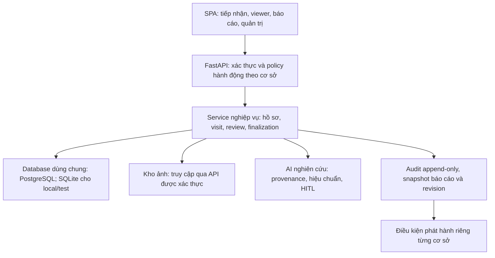
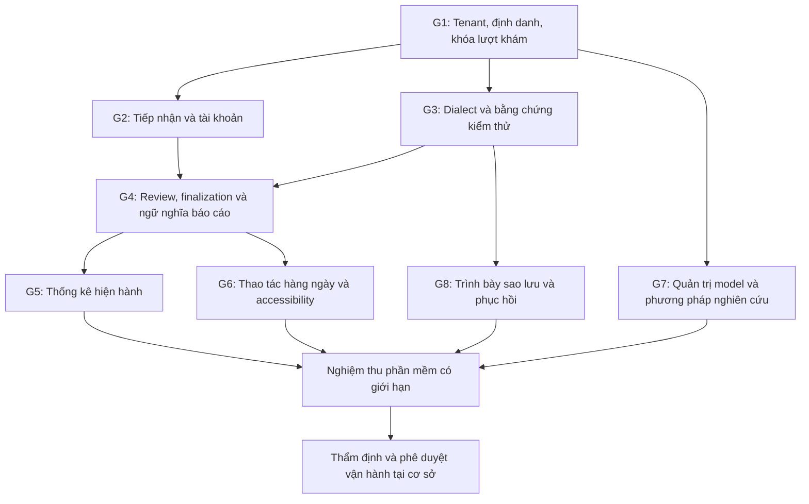

# Thiết kế khắc phục đa cơ sở — 35 finding, 8 gate

**Ngày:** 2026-11-05. **Trạng thái:** APPROVED — người dùng duyệt trong hội thoại ngày 2026-11-05; chỉ cấp quyền viết implementation plan. Chưa cho phép triển khai, chạy migration hoặc deploy.

**Quyết định người dùng đã chốt:** phạm vi gồm toàn bộ 35 finding, nền tảng RUO an toàn, hồ sơ tập trung và quy trình bác sĩ rà soát/ký duyệt; ứng dụng và database **dùng chung** giữa các cơ sở.

**Các quyết định kỹ thuật bên dưới đã được duyệt ở phạm vi thiết kế**, bao gồm bốn điểm được bổ sung sau builder review. Cổng triển khai lâm sàng là điều kiện nghiệm thu độc lập, không tự mở khi hoàn thành code/test; duyệt thiết kế không chứng nhận lâm sàng hoặc cấp quyền thực thi.

## 1. Nguồn chuẩn, mục tiêu và phạm vi

Nguồn issue của thiết kế này là [35 finding AUD-001–AUD-035](../../../artifacts/full_spectrum_audit_20261104/ISSUE_REGISTER.md) và [8 nhóm ưu tiên](../../../artifacts/full_spectrum_audit_20261104/PRIORITIZED_FINDINGS.md). Không đổi số issue hoặc trộn chúng với bộ 25 finding của `audit/2026-11-04/`.

[Spec system-wide hiện có](2026-11-04-system-wide-remediation-design.md) được giữ nguyên làm nguồn tham chiếu cho bộ audit riêng đó. Thiết kế này kế thừa lựa chọn giữ stack, định danh theo cơ sở, danh bạ tối thiểu và bảo toàn provenance; là bản điều phối cho phạm vi **35 finding và mở rộng quy trình lâm sàng** đang thảo luận. Không tuyên bố spec cũ hoặc code hiện tại đã được nghiệm thu.

Mục tiêu là bác sĩ thao tác liên tục trên đúng hồ sơ, lưu và mở lại nhất quán, sửa được AI, biết dữ liệu đã xác nhận đến đâu, và xuất đúng phiên bản có trách nhiệm chuyên môn. Quản trị có số liệu đúng phạm vi, vận hành có khả năng khôi phục và truy vết.

Phạm vi sản phẩm ở đây là danh bạ bệnh nhân tối thiểu, lượt khám/ca siêu âm, ảnh, phép đo, đánh giá hình thái/nguy cơ và báo cáo. Không mở rộng thành hệ thống EMR, kê đơn, viện phí, lịch hẹn hay master patient index toàn mạng khi chưa có yêu cầu riêng.

Ràng buộc:

- Giữ FastAPI, SQLAlchemy, PyTorch và SPA JavaScript hiện có; không thêm microservice, thư viện state hoặc phụ thuộc mới chỉ để thay thế vài hàm đã có.
- Database PostgreSQL là mục tiêu vận hành dùng chung; SQLite phục vụ local/kiểm thử và phải được kiểm chứng riêng. Không suy ra PostgreSQL pass từ SQLite pass.
- Giữ image-level split có khử trùng lặp SHA-256, letterbox 512×512 và HITL. Patient-level independence chưa được xác minh; không diễn giải metric image-level thành hiệu quả chẩn đoán độc lập theo bệnh nhân.
- Core training scope là Dice+BCE. Checkpoint thực tế đang mang lineage khác phải được khai báo trung thực, không đổi manifest để giả thành đã huấn luyện bằng ComboLoss.
- Không tạo PID bệnh nhân giả; mã UUID kỹ thuật, mã ca và pseudonym phải được đặt tên rõ, không giả dạng PID do bệnh viện cấp. Luồng nghiên cứu không định danh không yêu cầu patient ID.
- Không sửa source, cài dependency, gọi API ghi, huấn luyện, commit, deploy hoặc chạy migration trong giai đoạn thiết kế này. Các thay đổi hiện có trong worktree phải được bảo toàn.
- Tất cả phép thử có ghi trong giai đoạn thực thi tương lai phải dùng môi trường cô lập và dữ liệu tổng hợp được xác nhận. Migration vẫn cần được cho phép rõ ràng riêng; duyệt thiết kế không cấp quyền chạy migration.

## 2. Phương án đã cân nhắc

| Phương án | Đánh đổi | Quyết định |
|---|---|---|
| Ứng dụng/database dùng chung, ràng buộc dữ liệu và quyền theo cơ sở | Ít hạ tầng mới, báo cáo tập trung; cần policy truy cập và constraint nhất quán | **Người dùng chọn: dùng chung** |
| Database riêng từng cơ sở | Giảm phạm vi lỗi query; vận hành/nâng cấp/backup và tổng hợp toàn mạng phức tạp hơn | Không chọn cho đợt này |

Không dùng patch riêng lẻ cho từng endpoint như chiến lược kiến trúc. Tái sử dụng service/policy hiện có, sửa một lần ở điểm sở hữu quy tắc rồi kiểm tra mọi caller. Không tạo một framework tenancy/RBAC tổng quát ngoài nhu cầu hiện tại.

## 3. Hiện trạng cần đối chiếu trước khi thực thi

Audit ngày 2026-11-04 là bằng chứng lịch sử có giới hạn; source hiện tại đã thay đổi. Kiểm tra tĩnh ngày 2026-11-05 thấy:

| Thành phần | Dấu vết hiện có | Điều chưa được chấp nhận |
|---|---|---|
| `PatientModel`, `core/patient_identity.py`, `services/patient_identity.py` | Đã có facility, HMAC scope version và đường legacy | Chưa xác nhận đầy đủ issuer, chuyển đổi legacy, constraint và PostgreSQL |
| `PatientDirectoryModel`, router `/api/patient-directory` | Đã có danh bạ tối thiểu name/year, optimistic version và soft deactivate | Không xây danh bạ thứ hai; cần kiểm tra liên kết/định danh/phiên bản xuyên luồng |
| `FacilityModel.config`, admin router | Đã có đường cấu hình theo cơ sở | Chưa chứng minh tất cả setting, department, backup và aggregate đều đúng scope |
| `security.py`, `correction_access.py` | Đã có các dependency đọc ca và evaluator; SENIOR/TK còn có nghĩa chồng lấn | Không coi role cũ là chứng cứ đủ quyền ký chuyên môn |
| Bootstrap database | Không còn đoạn ghi đè password như snapshot audit | Còn nhánh tự nâng `admin` không cơ sở thành global; cần kiểm chứng lại vòng đời quyền |
| Upsert | Auth, patient identity, lease còn nhập SQLite insert | Cần inventory tất cả statement/caller, không chỉ đổi một import |
| Capabilities | `case_workflow=false`, `clinical_production_ready=false`, `clinical_validation_status=BLOCKED` | Không bật bằng thay hằng số để đóng finding |

Đầu mỗi gate, cập nhật từng AUD thành: `OPEN`, `EXISTING_CHANGE_UNVERIFIED`, `VERIFIED_FIXED` hoặc `BLOCKED_EXTERNAL`, kèm bằng chứng mới. Finding không được đóng chỉ vì một đoạn code trông giống bản sửa.

## 4. Kiến trúc mục tiêu và thứ tự gate

8 gate là nhóm sở hữu công việc và tiêu chí thoát, không bắt buộc mọi mục chạy thành một chuỗi tuyến tính. Gate 3 có kiểm tra nền tảng trước G1/G2 và kiểm tra tích hợp sau; G7 phải được xem ngay từ đầu để không mang tuyên bố sai vào UI/report.

## 5. G1 — Ranh giới truy cập, định danh và bất biến lượt khám

### 5.1 Policy truy cập dùng chung

- Nguồn quyền là user đang hoạt động được đọc lại từ DB; không tin role/facility do request body hoặc claim cũ tự cung cấp.
- Global operator hợp lệ cần đồng thời `role=ADMIN`, `is_global_admin=true`, `facility_id=null`. Tổ hợp global flag + facility khác null là cấu hình không hợp lệ và bị chặn, không tự chọn nghĩa rộng hơn.
- Admin cơ sở chỉ quản trị metadata, user, khoa và setting của cơ sở đó. Global operator không mặc nhiên được xem ảnh, note, hồ sơ bệnh nhân hoặc ký báo cáo. API báo cáo toàn mạng chỉ trả các trường metadata/aggregate cho phép, có audit và bộ lọc scope rõ ràng.
- Bác sĩ không có cơ sở hoặc cơ sở inactive: 403. Với item ngoài cơ sở, trả 404 sau query đã scope để không tiết lộ tồn tại; list trả tập dữ liệu hợp lệ của chính scope, không trả rỗng để che tài khoản cấu hình sai. Thiếu login: 401; xung đột phiên bản/trạng thái: 409; input sai: 422.
- Không bypass policy vì object có thuộc tính `dependency`; test gọi đúng dependency thay vì nới code production.
- Mỗi tài khoản lâm sàng thuộc một cơ sở trong đợt này. Bác sĩ làm nhiều cơ sở dùng tài khoản được cấp riêng theo cơ sở; không tự bổ sung chuyển tenant trong một phiên. Quyền và lịch sử không đổi cơ sở theo input người dùng.
- Query list/search/count/CSV/notification/audit/detail dùng cùng phạm vi. Scope review theo tập Study được phép, rồi join Image/Review; không dùng fallback reviewer toàn DB.
- Quyền read/write và quyền ký tách biệt. DB layer không được dùng một `is_global` chung để vượt mọi kiểm tra nghiệp vụ.

### 5.2 Ownership và constraint

Facility là owner của patient namespace, directory, visit và study. Image thuộc một study; prediction/review thuộc đúng image; region/caliper/assessment thuộc đúng review và mask revision. Query tài nguyên con luôn xác minh chuỗi owner, không chỉ tra ID độc lập.

Constraint đề xuất: unique `(id, facility_id)` trên owner được tham chiếu; composite foreign key cho các liên kết patient/directory/visit của Study để chặn liên kết khác cơ sở. Với tài nguyên con chỉ có một parent, giữ đường owner qua parent thay vì sao chép facility vào mọi bảng. Giữ constraint prediction-image hiện có và bổ sung ràng buộc cùng snapshot cho region. Kiểm tra ORM cascade và thứ tự flush khi thiết kế constraint; không tự xóa ca khi deactivate patient.

Không coi PostgreSQL RLS đã tồn tại. Bản đầu dùng policy ứng dụng + DB constraint + role database tối thiểu. RLS là lớp phòng vệ bổ sung chỉ được tuyên bố khi có policy, xử lý connection pooling và kiểm thử đã được nghiệm thu; thiếu RLS không được che bằng tài liệu.

### 5.3 Hợp đồng định danh

- Danh bạ tập trung tối thiểu hiện có là nguồn chọn hồ sơ; directory UUID không phải PID nguồn, và không đủ làm bằng chứng hai bản ghi là cùng người.
- Nếu nhập PID từ HIS/PACS, khóa nguồn là `(facility_id, issuer_id, normalized_source_pid)`. `issuer_id` lấy từ cấu hình có kiểm soát của cơ sở; không tự nhận issuer từ text tự do. Trong giai đoạn chưa tích hợp HIS, có thể cấu hình một issuer nội bộ rõ ràng theo cơ sở.
- Chuẩn hóa theo hợp đồng issuer: trim cho phép, giữ số 0 đầu; không ép tất cả PID thành 9 chữ số, lowercase hoặc đổi Unicode tùy tiện. Không gộp người bằng tên/năm sinh.
- HMAC có domain separator và `scope_version`; mã hóa tuple bằng serialization xác định, không nối chuỗi dấu `:` có thể gây nhập nhằng. Unique identity dựa trên facility + issuer + digest; key version không được tạo bản ghi người mới khi rotate key.
- Lưu HMAC/key ID/scope version, không lưu raw PID trong log, URL, localStorage hay manifest nghiên cứu. Source PID chỉ dùng tạm để exact lookup; pseudonym hiển thị tiếp tục là mã ngẫu nhiên độc lập, không là hash PID được công bố.
- Cho phép directory entry chưa có PID nguồn. Để liên kết PID vào directory, clinician chọn rõ hồ sơ và xác nhận; một source identity không được đồng thời gắn hai directory entry. Dùng khóa duy nhất, expected directory version và một transaction; trùng định danh trả 409, không tự merge. Request tạo ca dùng directory UUID hoặc source identity được giải quyết trên server, không nhận hai định danh mâu thuẫn.
- Nghiên cứu không định danh dùng Study không patient link, không tạo tên/PID giả. Dữ liệu tổng hợp có namespace và nhãn riêng; không nhập vào danh bạ cơ sở vận hành.

### 5.4 Directory và định danh của episode đã tạo

Khi tạo episode, lưu bản sao tối thiểu của tên hiển thị, năm sinh/tuổi với mức chính xác, nguồn và directory version cùng identity binding; UI lâm sàng và báo cáo của episode đọc dữ liệu đã ghi nhận này. Sửa directory chỉ áp dụng cho lựa chọn/episode mới, không tự đổi demographics, patient binding hoặc nội dung in của ca cũ, dù visit cũ chưa khóa. Deactivate directory không xóa hay làm mất khả năng mở lịch sử.

Muốn hiệu chỉnh demographics của episode draft cần thao tác riêng có expected revision, lý do và audit, không thay người bệnh bằng cập nhật directory. Binding tới người khác sau khi Study được tạo không được sửa tại chỗ: trước finalization phải hủy ca sai có lý do và tạo ca đúng; sau finalization dùng correction/amendment với liên kết lịch sử và quy trình đối soát danh tính, không tự gộp người. Những hiệu chỉnh trên episode đã finalized/visit khóa không thể thông qua patient-directory CRUD.

### 5.5 Legacy và schema evolution

Không tự đổi liên kết patient khi worker khởi động. Chuẩn bị quy trình chuyển đổi có manifest dry-run trên bản sao tổng hợp: inventory ca theo facility, giữ mapping ID cũ/mới và checksum, đưa liên kết mơ hồ vào quarantine. Bản ghi legacy không có issuer chỉ được chuyển khi nguồn được đối soát; không đoán người hoặc mất raw source ID thì dựng lại.

Nếu một Patient cũ được dùng ở nhiều cơ sở, tạo mapping theo từng cơ sở trên bản sao kiểm thử, giữ audit và không suy ra các ca đó thuộc một người. History snapshot đã ký không bị viết lại; mapping mới dùng cho xử lý tiếp theo. Báo cáo cũ có thể lưu nhãn legacy; không âm thầm đổi mã trên artifact đã phát hành.

Mọi migration tương lai chạy bằng bước operator riêng khi được phép, có schema version, backup/restore drill, preflight counts, rollback/forward-recovery được kiểm chứng. API worker chỉ kiểm tra schema version hỗ trợ và fail readiness nếu không khớp; không sửa schema hoặc reparent patient trong startup.

### 5.6 Visit và case lifecycle

- `Visit` là lượt tiếp nhận, `Study` là ca khảo sát siêu âm thuộc visit; `visit_no` hiện nằm ở Study được giữ như mã khảo sát để tránh đổi dữ liệu hàng loạt, không gọi nó là Visit.visit_code. UI tạo lượt khám phải dùng Visit API, tạo Study là bước riêng trong cùng hành động nghiệp vụ.
- Với clinical episode, tạo Visit và Study cùng transaction hoặc dùng workflow request idempotent có trạng thái khôi phục rõ; không để retry sinh thêm visit trống. Nghiên cứu không định danh vẫn tạo được Study độc lập.
- Một Study đã gắn visit thì không được chuyển bằng create_visit. Trả 409 khi gắn lại, kể cả visit chưa khóa; đợt này chưa có thao tác chuyển ca. Không auto reparent dưới danh nghĩa retry.
- Khi visit khóa: không thêm/bớt/chuyển Study, không đổi định danh bên trong visit, không sửa ảnh/review/calibration/assessment của các Study đó qua bất kỳ endpoint nào. Một guard owner-level áp dụng cho mọi đường ghi.
- Khóa visit chỉ cho phép khi không có ca clinical còn draft/đang chỉnh; kết thúc một visit không thay thế bước ký từng báo cáo. Khóa không tự xác nhận AI hoặc tạo chữ ký.
- PostgreSQL khóa row theo thứ tự cố định Visit → Study → Image/Review trước khi đổi trạng thái; SQLite dùng transaction write được serialize và compare-and-swap. Không giữ lock DB trong lúc inference, decode file hoặc chờ dịch vụ chữ ký.
- Test race lock-vs-create-link, lock-vs-review/calibration và hai request gắn cùng Study phải chứng minh chỉ một chuyển trạng thái hợp lệ commit; audit cùng transaction, không chỉ kiểm tra `is_locked` ở đầu request.

## 6. G2 — Hồ sơ tập trung và vòng đời tài khoản

- Tái sử dụng `/api/patient-directory` và optimistic `version` hiện có; lưu tên hiển thị và thông tin năm sinh tối thiểu. Phone, quê quán, CCCD không thu thập trong luồng phân đoạn nếu chưa có nghiệp vụ được xác nhận.
- Server là nguồn chuẩn. Danh bạ cục bộ chỉ dùng trong chế độ nghiên cứu được ghi rõ; không silently fallback sang local CRUD khi server lỗi. Không tự đẩy local roster cũ lên server; chỉ nhập có review và nhãn nguồn.
- Empty list `[]` là dữ liệu hợp lệ. Demo seeds chỉ nạp khi synthetic mode đã được máy chủ xác nhận; logout/chuyển tài khoản xóa cache PII thuộc phiên. Draft nghiên cứu không chứa dữ liệu định danh, và mọi draft cần user/facility/study/image/revision key.
- Tuổi tại khảo sát: ngày sinh đầy đủ chưa có thì năm sinh chỉ cho tuổi ước tính theo năm. Không tự xác nhận tuổi chính xác cho ADNEX. Hiển thị giá trị gợi ý có nguồn và yêu cầu bác sĩ xác nhận tuổi lúc khám; snapshot giữ tuổi đã xác nhận, thời điểm khảo sát và nguồn.
- Tạo bác sĩ từ global-admin bắt buộc chọn cơ sở hợp lệ; admin cơ sở được server cố định scope. User chưa đủ điều kiện hiển thị trạng thái chờ gán/chờ duyệt, không bàn giao như tài khoản khám được.
- Bootstrap là create-once: cơ sở cấu hình phải tồn tại rõ ràng hoặc fail với thông báo cấu hình, không dùng `.first()` làm cơ sở mặc định. Compose phải yêu cầu facility operator cấp hoặc tạo fixture cơ sở rõ ràng trong test; không âm thầm gán mọi cài đặt về một bệnh viện.
- Không reset password hay tự nâng global flag khi restart. Cấp lại quyền/reset mật khẩu là thao tác riêng có audit, xác thực admin và revoke token. Temporary password hiển thị một lần, buộc đổi trước nghiệp vụ; không log/đưa vào artifact chia sẻ.
- Quyền REVIEWER và TECHNICIAN phải được phân biệt với DOCTOR. Alias `TK`/`SENIOR` legacy được inventory, không tự suy ra tư cách bác sĩ có thể ký. Mapping legacy mơ hồ không được tự cấp quyền cao hơn.

## 7. G3 — Dialect, kiểm thử và nền tảng vận hành

- Lấy dialect từ `db.get_bind()` của session thực sự thực thi statement. Tái sử dụng SQLAlchemy PostgreSQL/SQLite insert đúng dialect; hỗ trợ upsert theo unique constraint hiện hành. Dialect khác fail rõ ràng, không fallback SQLite.
- Inventory auth limiter, token consumption, identity, case lease, visit sequence và mọi upsert/returning/JSON/date query. Helper nhỏ chỉ chọn insert phù hợp; quy tắc conflict và transaction ở service sở hữu nghiệp vụ.
- Account bootstrap tạo đúng facility được cấu hình trước khi tạo user. Phải tái hiện log migration-regression đã fail bằng môi trường được cho phép rồi xác định root cause; không mặc định `no_autoflush` sẽ sửa được. Facility tồn tại khác mã không làm đáp ứng foreign key của user.
- Bỏ fixture toàn cục tự gán facility, tự tăng global quyền và thay INSERT thành INSERT OR REPLACE. Factory test khai báo actor/scope cụ thể; test âm tính phải giữ nguyên null và false. Không xóa failure bằng cách nới production guard.
- CSV dùng authenticated fetch, kiểm tra response trước khi tạo blob, giải phóng object URL và có trạng thái lỗi; không đặt JWT vào query string. CSV rows/cells cùng tenant policy và chống công thức nguy hiểm khi dữ liệu được mở trong spreadsheet.
- Test SQLite và PostgreSQL cô lập cùng acceptance contract; thêm concurrency/idempotency tests cho write quan trọng. Compile-only là bước đầu, không đủ đóng lỗi PostgreSQL.
- PostgreSQL test không sẵn có: ghi BLOCKED, không cài/chạy service vào máy người dùng tùy tiện và không dùng DB thật. Test setup phải từ chối URL bên ngoài namespace cô lập.
- Tài liệu phải phân biệt implemented/verified/target/blocked cho PACS, HIS, RLS, replication và chữ ký số. Không tạo connector giả để đóng AUD-032.
- Mỗi process đang nạp model và admission lock cục bộ: trước tăng worker cần kiểm tra VRAM/CPU, admission tổng và timeout bằng tải tổng hợp. Mặc định giữ số worker inference được đo an toàn, không áp 4 worker GPU chưa kiểm chứng.

## 8. G4 — Review, báo cáo và xác nhận chuyên môn

### 8.1 HITL và ngữ nghĩa dữ liệu

Gán vùng, chọn vùng hiện hành, nguồn phép đo và retry caliper phải nhìn thấy/truy cập bằng bàn phím. Không bỏ tất cả hidden/inert để lộ control nội bộ; chỉ đưa control nghiệp vụ cần thiết vào luồng. Region assignment ràng buộc review ID, mask hash và revision; thay mask làm context cũ stale, buộc chọn/xác nhận lại. Không tái dùng caliper/assessment của vùng cũ.

Giữ tách biệt: segmentation thành công, có tổn thương được bác sĩ xác nhận, nhận định bác sĩ, O-RADS do bác sĩ nhập và rule probe. Mask rỗng không thành kết luận bình thường. Rule thiếu descriptor phải giữ trạng thái thiếu/unsupported, không quy thành bất thường hoặc ác tính.

IQA chỉ mô tả chất lượng kỹ thuật. Raster ruler đều chỉ là candidate chưa hiệu chuẩn; mm chỉ xuất khi nguồn/đơn vị DICOM hợp lệ hoặc bác sĩ xác nhận scale trên ảnh nguồn. Không suy mm từ resize. Lưu nguồn, phép đo/calibration revision và giữ snapshot cũ, không retrofit calibration mới vào review đã lưu.

Phiếu giữ enum `NOT_VISUALIZED`, `SURGICALLY_ABSENT`, `UNKNOWN`, `NORMAL`, `SUSPECTED` đúng như source. Không thay bằng `SURGICALLY_REMOVED`. Phân biệt thiếu ảnh với xác nhận không thấy/đã cắt bỏ; dữ liệu chưa có không tự thành NORMAL.

Metadata minimization không phải chứng nhận khử định danh pixel. Kiểm tra burned-in annotation nằm ở bước review dữ liệu; research export yêu cầu evidence phê duyệt, consent/phạm vi sử dụng và de-identification thực tế, không chỉ checkbox.

### 8.2 Clinical finalization là phạm vi bổ sung, không chỉ sửa 35 lỗi

Đây là workflow mới theo lựa chọn “tất cả”; cần acceptance bổ sung ngoài issue register. Bác sĩ lưu review chưa đồng nghĩa ký. Đề xuất quy trình tối thiểu:

| Trạng thái nghiệp vụ | Điều kiện/chuyển tiếp |
|---|---|
| Draft | Ảnh/metadata/clinical content có thể chỉnh trong lease và revision hợp lệ |
| Reviewed | Các ảnh cần xem đã được xem; review và nội dung lưu trên server; chưa phải kết luận phát hành |
| Finalized | Bác sĩ được cấp quyền clinical author xác thực lại, xác nhận đúng revision và nội dung báo cáo; server tạo snapshot bất biến |
| Released | Chính sách cơ sở đã cho phép phát hành loại tài liệu tương ứng; artifact có snapshot hash và trạng thái chữ ký được kiểm tra |
| Amended / superseded | Sửa hồ sơ đã finalized tạo bản bổ sung mới với lý do và liên kết bản trước, không overwrite snapshot/artifact cũ |

Đề xuất ánh xạ: giữ `REVIEWED` cho save hiện tại, dùng `SIGNED_PRELIM` cho bước xác nhận nội bộ nếu cần và `APPROVED` cho snapshot được hoàn tất; thêm trạng thái artifact/release riêng, không suy chữ ký số từ enum Study. Tên chính xác được chốt khi viết plan cùng contract hiện có; ý nghĩa trên là bắt buộc.

- Một bác sĩ phụ trách đủ quyền có thể hoàn tất báo cáo; không mặc định bắt ký hai cấp. Cơ sở cần kiểm tra hai người thì cấu hình policy riêng; chính sách đó phải được kiểm chứng trước khi bật, không tự suy từ role SENIOR.
- Quyền `clinical_report_author` cần bằng chứng cấp phép nội bộ cơ sở, trạng thái còn hiệu lực và kiểm tra server; role DOCTOR một mình không đủ để chứng minh tư cách đã được xác minh. Khi chưa có hồ sơ cấp quyền, clinical finalization bị chặn nhưng RUO review vẫn dùng được.
- Finalization request có idempotency key, expected review/clinical revision, lease/page identity và xác thực lại. Server đọc snapshot đã commit, không nhận nội dung “đã ký” chỉ từ DOM.
- Snapshot gồm facility, patient/directory identity reference và dữ liệu hiển thị đúng thời điểm, visit/study IDs, laterality/trạng thái bên, ảnh nguồn/checksum, review/mask IDs/hash, calibration/measurement nguồn, clinical descriptors, O-RADS, kết luận bác sĩ, author ID, thời điểm UTC, policy/template/model provenance và content hash. Không đưa raw PID vào audit event; nếu báo cáo cần định danh thật, hợp đồng dữ liệu có thẩm quyền phải được phê duyệt riêng.
- Xác nhận tài khoản bác sĩ là **electronic attestation nội bộ**, không được gắn nhãn chữ ký số được chứng thực. Không ảnh chữ ký scan hay tên đánh máy thay cho verified digital signature.
- Tích hợp nhà cung cấp chữ ký số/PACS là dependency bên ngoài. Chưa chọn nhà cung cấp thì không viết adapter giả hay coi phần đó hoàn tất. Giữ trạng thái `NOT_CONFIGURED/BLOCKED` và nghiệm thu sau khi có contract, sandbox và chủ thể phê duyệt.
- Chờ signature provider ngoài DB transaction. Request binds snapshot hash; callback xác minh nguồn, hash, status, replay và idempotency. Provider lỗi/timeout không làm UI tuyên bố đã ký hoặc mở bản khác. Thay nội dung giữa lúc ký tạo conflict, không ghi chữ ký lên revision mới.
- Snapshot finalized không sửa; correction tạo amendment mới, ghi người/lý do và bảo toàn lịch sử. Muốn sửa ca trong visit khóa phải có workflow mở phiên bổ sung được phê duyệt riêng; đợt đầu chỉ chặn sửa, không thêm nút unlock tùy ý.
- RUO print vẫn ghi rõ bản nghiên cứu và trạng thái review; clinical artifact chỉ phát hành qua backend khi release policy hợp lệ. Preview/in lại clinical dùng đúng artifact snapshot, không tạo lại từ record mutable. Không gọi browser print là quy trình ký số.

### 8.3 Bất biến sau finalization và workspace bổ sung

**Quyết định thiết kế đề xuất:** finalization đóng băng cả clinical revision và workspace gốc của Study, không chỉ file PDF. Kể cả Visit chưa khóa, các endpoint bình thường không được thay patient binding, demographics episode, laterality, tập ảnh, calibration, mask/review, clinical content hoặc assignment của revision đã finalized. Review append-only gắn revision mới không được lén đổi snapshot hiện hành. Status chữ ký/phát hành là event riêng, không chỉnh nội dung snapshot.

Hỗ trợ amendment bằng revision workspace riêng dưới **cùng Study**, không tạo Study/Visit mới để giả làm lần khám khác:

- Một `ClinicalRevision` xác định parent snapshot, revision number, reason, author, state và tập reference nội dung/ảnh/review/calibration của workspace đó. Baseline revision phục vụ ca chưa finalized; revision bổ sung khởi tạo từ reference bất biến của parent, không sao chép rồi ghi đè hàng cũ.
- Upload bổ sung tạo Image record mới thuộc amendment revision; sửa mask/calibration tạo bản dữ liệu mới gắn amendment. Mọi API ghi có revision context rõ ràng; thiếu context không được fallback sang baseline đã đóng băng. Media nguồn bất biến có thể được dùng lại qua reference/checksum, không sửa file gốc.
- Một Study chỉ có tối đa một draft amendment đang mở; thêm revision khác phải kết thúc/hủy draft trước. Draft có lease và optimistic version riêng. Chỉ bác sĩ phụ trách được cấp quyền clinical author mới mở/finalize amendment; technician chỉ sửa trong scope được giao và không hoàn tất báo cáo.
- `ReportSnapshot` append-only lưu payload chuẩn hóa, hash, revision ID, actor và attestation. `ReportReleaseEvent` lưu trạng thái phát hành/chữ ký/provider với snapshot hash. Snapshot mới chỉ thay con trỏ bản hiện hành sau khi finalized và release hợp lệ; trước đó bản phát hành cũ vẫn là bản chính, UI ghi có amendment draft riêng.
- Visit đã khóa không cho mở amendment trong phiên bản đầu. API trả conflict kèm lý do và giữ báo cáo cũ. Quy trình bổ sung cho visit đã khóa cần thiết kế và phê duyệt vận hành riêng; không coi nút unlock là giải pháp mặc định.
- Hủy amendment giữ lý do/audit và parent snapshot; không xóa báo cáo trước. Số ca luôn distinct Study, không tăng do amendment.

Đây là các entity/contract đích cần được thiết kế schema cụ thể trong plan, không khẳng định các bảng đã tồn tại. Khi nâng từ workflow legacy, baseline revision phải được xây dựng và kiểm tra trên DB cô lập trước khi bật clinical finalization.

### 8.4 Checklist điều kiện chuyển trạng thái

| Điều kiện | Clinical finalization | Khóa clinical Visit |
|---|---|---|
| Identity/owner | Facility hoạt động; episode identity đã đối soát; không có binding mơ hồ/quarantine | Tất cả Study thuộc đúng visit/facility, không có liên kết chờ đối soát |
| Ảnh và bên | Mỗi ảnh được chọn trong revision đã xem, checksum/source và laterality được xác nhận; bên không có ảnh có trạng thái và xác nhận phù hợp | Không có upload/inference/ghi nội dung đang chạy; không cho thêm/bớt ảnh sau khóa |
| Review/mask | Review mới nhất đã commit đúng source/prediction/mask hash; không có correction hoặc region request chưa được giải quyết | Không có review/amendment/correction draft còn mở |
| Đo lường/CDSS | Nguồn/đơn vị và tình trạng chưa hiệu chuẩn được khai báo; giá trị chưa xác minh không được phát hành như mm; CDSS được sử dụng phải gắn descriptor/revision hợp lệ | Các snapshot được phát hành không có nội dung chờ cập nhật |
| Nội dung bác sĩ | Kết luận do bác sĩ nhập và xác nhận; trạng thái mô tả/O-RADS là đã ghi nhận hoặc không áp dụng/chưa đủ dữ liệu có lý do; không bắt tự suy O-RADS để hoàn tất | Mỗi ca không bị hủy có báo cáo của revision hiện hành finalized và released theo policy cơ sở |
| Đồng thời | Expected clinical/review revision khớp; lease hợp lệ; không pending write hoặc stale draft được gửi lên | Khóa transaction kiểm tra lại cả tập Study, disposition và release version trước commit |
| Actor/audit | Clinical author còn hiệu lực, xác thực lại; attestation/audit commit cùng snapshot | Actor đủ quyền kết thúc visit, audit cùng transaction |
| Chữ ký/release | Finalization nội bộ tạo snapshot; provider chưa hoàn tất không được gọi là released | Provider pending/failed hoặc release chưa đủ evidence thì chưa cho khóa clinical visit |

Ca bị hủy cần disposition riêng với người hủy, lý do và audit; không xóa ảnh/review và không tính là ca finalized. Khóa visit chỉ loại các ca có disposition hủy đã xác nhận, không bỏ qua draft bằng cách trả tập query rỗng. O-RADS chưa đủ dữ liệu có thể được mô tả rõ trong kết luận giới hạn; không ép chọn nhãn nguy cơ sai. Mọi yêu cầu bắt buộc bổ sung theo clinical policy phải được version hóa, không hardcode như một chuẩn y khoa chưa được xác minh.

Clinical audit quan trọng phải commit đầy đủ. Telemetry phục vụ phân tích thao tác không được chặn chăm sóc chỉ vì endpoint phân tích tạm lỗi; hiển thị trạng thái chưa đồng bộ riêng. RUO review/print không đi qua checklist phát hành clinical và không được hiển thị như đã ký.

## 9. G5 — Thống kê có đơn vị và snapshot đúng

- Định nghĩa riêng số ảnh, số lần review, số ca đã review, số ca finalized/released và số người được xác minh. Không gọi distinct study là bệnh nhân độc nhất; nghiên cứu không định danh không có patient-level denominator đáng tin.
- Thống kê hiện hành chọn latest committed review theo từng ảnh; lịch sử revision chỉ xuất ở báo cáo lịch sử. Tổng hợp case có nhiều ảnh: ưu tiên nhãn O-RADS cấp ca do bác sĩ xác nhận; khi chưa có, trình bày phân bố theo ảnh và ghi đúng mẫu số, không tự lấy mức cao nhất làm kết luận ca.
- O-RADS 0 là nhóm riêng; null/chưa ghi nhận là nhóm khác. Giữ cả denominator và missingness trong response.
- Năng suất: tách lượt review ảnh với ca finalized; giờ trung bình công bố thời gian đang đo và số mẫu, không gọi event telemetry là thời gian khám. Bản tổng hợp luôn dùng cùng scope/datetime/filter với drilldown và CSV.
- Aggregate không làm mất giới hạn truy cập: admin A không thấy reviewer B, cả reviewer legacy chưa có directory user; global view là thao tác quản trị metadata có audit.

## 10. G6 — Thao tác hàng ngày, nội dung và accessibility

- Trang đầu phiếu ưu tiên định danh đối soát, trạng thái từng bên, kết luận bác sĩ, O-RADS và mô tả đã lưu. Ảnh đại diện do bác sĩ chọn, không tự lấy một ảnh thành ảnh đại diện lâm sàng; appendix có toàn bộ ảnh cần thiết và provenance. Không ép mọi ca vào đúng hai trang khi số ảnh/nội dung lớn.
- PID/pseudonym in đủ ký tự, wrap theo nhóm đọc được; nguồn định danh phải minh bạch. Thiếu kết luận hiển thị chưa ghi nhận, không tự sinh kết luận từ AI.
- Nút export chưa khả dụng được thể hiện trước khi click, có lý do và điều kiện; không bật nút tải rồi chỉ toast. Giữ cảnh báo an toàn bắt buộc ở đúng ngữ cảnh.
- Shortcut được định nghĩa một nguồn cho handler, tooltip và help; chọn một nghĩa duy nhất cho C, giữ không kích hoạt khi nhập text. Tour mô tả đúng ca một bên và thao tác chạy AI có chủ ý.
- Tuổi gợi ý có provenance/xác nhận như G2; không mặc định tuổi chính xác từ năm sinh. Các trường không có mục đích không required và không thu thập PII chỉ cho đủ form.
- Viewer ưu tiên ảnh và công cụ chỉnh, có đường mở panel rõ ràng; toolbar không chồng lớp che action. Không giấu control nghiệp vụ như G4. Tối ưu desktop 1920×1080, 1440×900, 1366×768; kiểm tra 390px và tablet nếu còn tuyên bố hỗ trợ.
- Drilldown dùng button native có accessible name và selected state thay vì div click; focus hợp lý sau lọc. Kiểm tra keyboard, contrast, reduced motion, touch, browser zoom thật và print; CSS zoom không thay thế browser zoom acceptance.
- Offline/failed save giữ draft đúng user/facility/case/revision, không toast success trước ACK. Online lại không tự overwrite server revision mới; stale draft được đối chiếu, không trộn vào ca kế tiếp.

## 11. G7 — Quản trị model và giới hạn lâm sàng

Giữ nguyên checkpoint/manifest có provenance trung thực. Artifact đang dùng AdvancedHybridLoss được gắn trạng thái research candidate và deviation so với core ComboLoss, không sửa trường loss thành Dice+BCE. Cổng phục vụ model phù hợp core scope chỉ mở sau khi có checkpoint ComboLoss có checksum, training provenance và evaluation hợp lệ; việc chọn artifact/huấn luyện lại là tác vụ riêng được cho phép, không thực hiện trong thiết kế này.

Registry chỉ phục vụ model hash đã xác minh; không dùng model chưa nạp như fallback âm thầm. Input preprocessing, mask/source transform, threshold, version và classification provenance lưu cùng prediction. Confidence chưa hiệu chuẩn không thành xác suất mắc bệnh; không tự chèn nhãn ác tính hoặc O-RADS vào kết luận cuối.

Tách metric validation-tuned, independent technical test và clinical validation. Lấy patient independence/label provenance từ evidence thật; thiếu là BLOCKED. Không đổi split, PID hoặc giả lập chuyên gia để làm gate xanh. Reference clinical chưa xác minh thì giữ limited/unsupported, không bổ sung rule y khoa từ suy đoán.

## 12. G8 — Sao lưu và phục hồi vận hành

UI lịch sử backup là bảng thời điểm, dung lượng, loại/phạm vi, phiên bản schema nếu đã có metadata, trạng thái và mã job; không bịa “thành công/khôi phục được” khi chỉ thấy file. Legacy archive thiếu manifest ghi chưa xác minh. Không mở nút download/restore/delete chỉ vì có bảng đẹp.

Whole-database backup chỉ cho global operator, vì chứa nhiều cơ sở. Admin cơ sở không tạo/tải toàn DB. Metadata-only không được gọi là đủ để khôi phục ảnh, calibration và snapshot; backup đầy đủ cần manifest DB/media/artifacts và checksum, kiểm tra tính nhất quán.

PostgreSQL dùng backup cơ sở dữ liệu phù hợp PostgreSQL, không sao lưu SQLite DB_PATH trong cấu hình PostgreSQL. Khôi phục chỉ vào sandbox riêng khi được cho phép, kiểm tra owner, revision, identity mapping và snapshot/media hash. Chính sách retention/encryption/key custody do đơn vị vận hành phê duyệt trước release; không tự đặt lịch xóa dữ liệu bệnh nhân hoặc backup.

## 13. Traceability — đúng 35 finding, mỗi issue một gate chính

| Issue | Gate chính | Thay đổi/tiêu chí nghiệm thu bắt buộc |
|---|---|---|
| AUD-001 | G1 | ADMIN global=false/facility=null bị 403; không có đường list/aggregate tự mở toàn mạng |
| AUD-002 | G1 | Stats/csv/reviewer legacy cơ sở A không chứa hoạt động B |
| AUD-003 | G1 | Setting/khoa theo cơ sở; system setting chỉ global operator; version guard chống mất cập nhật |
| AUD-004 | G1 | Không reparent Study; khóa visit chặn toàn bộ đường ghi và test race |
| AUD-005 | G1 | Namespace facility/issuer/version; không auto merge legacy; unique/owner constraints |
| AUD-006 | G2 | Directory trung tâm cùng hồ sơ khi mở máy khác; lỗi server không fallback local giả thành công |
| AUD-007 | G2 | Normal mode không có seed; synthetic label và storage phân biệt |
| AUD-008 | G2 | Không tự cấp PID bệnh nhân; ca nghiên cứu vẫn không cần định danh |
| AUD-009 | G2 | Lưu/xóa hết rồi mở lại giữ mảng rỗng, không resurrect seed |
| AUD-010 | G2 | Global admin gán facility hợp lệ cho bác sĩ; thử login/first password/first case bằng JWT thật |
| AUD-011 | G3 | Auth/identity/lease/sequence chạy đúng SQLite và PostgreSQL; không đóng bằng compile-only |
| AUD-012 | G2 | Bootstrap/deploy fail rõ khi facility chưa cấu hình, không gán bệnh viện ngầm |
| AUD-013 | G2 | Restart không reset password, không tăng quyền hoặc làm sống lại token đã revoke |
| AUD-014 | G4 | Region assignment/caliper/retry nhìn thấy; đổi mask invalidates context; multi-region UI E2E |
| AUD-015 | G4 | Từng enum bên không có ảnh roundtrip đúng UI/API/preview/PDF |
| AUD-016 | G3 | Hai CSV download có xác thực và scope, báo lỗi hợp lý, không lộ JWT trong URL |
| AUD-017 | G4 | IQA chỉ là chất lượng kỹ thuật; không có copy chứng nhận chẩn đoán |
| AUD-018 | G5 | Phân biệt review ảnh/ca hoàn tất/ca phát hành, không gọi tất cả là đã ký |
| AUD-019 | G5 | Latest review hiện hành và case aggregation đúng; lịch sử có báo cáo riêng |
| AUD-020 | G5 | O-RADS0 khác null trong biểu đồ/CSV/denominator |
| AUD-021 | G6 | Trang đầu có kết quả bác sĩ; provenance/ảnh bổ sung không che thông tin chính |
| AUD-022 | G6 | Export unavailable rõ trước click; không fake download success |
| AUD-023 | G6 | Shortcut C và mọi help/tooltip/handler thống nhất |
| AUD-024 | G6 | Bỏ yêu cầu PII không phục vụ luồng; form giữ validation trường còn cần |
| AUD-025 | G6 | Tuổi lúc khám có nguồn, nhãn ước tính và xác nhận; không nhập lặp không cần thiết |
| AUD-026 | G6 | Tour mô tả một bên/hai bên đúng capability và explicit run |
| AUD-027 | G6 | Desktop/narrow/touch/zoom không che action, ảnh và panel có đường thao tác rõ |
| AUD-028 | G6 | PID/pseudonym đầy đủ và đọc được trên browser/A4 PDF |
| AUD-029 | G6 | Keyboard điều khiển drilldown ngang chức năng chuột |
| AUD-030 | G7 | Manifest đúng lineage; checkpoint trái scope chưa được đánh dấu compliant hoặc clinical-ready |
| AUD-031 | G3 | Fixture không nâng quyền/tự sửa SQL; negative scope cases giữ nguyên dữ liệu test |
| AUD-032 | G3 | PACS/RLS/HA có trạng thái thật và evidence; không quảng bá target như implemented |
| AUD-033 | G4 | Tuyên bố khử định danh đúng evidence metadata/pixel và cohort; export vẫn fail-closed |
| AUD-034 | G4 | Ruler không có đơn vị chỉ là candidate; mm chỉ theo calibration đã xác minh |
| AUD-035 | G8 | Backup history dễ đọc; trạng thái không vượt bằng chứng restore/manifest |

Ghi dependency liên gate trong plan; không nhân đôi công việc nếu một acceptance test bao phủ nhiều issue. Clinical finalization, DB ownership hardening, release policy và restore đầy đủ là phần mở rộng có acceptance riêng, không tự gắn nhãn “đã sửa” vì đủ 35 dòng.

## 14. Nghiệm thu, release policy và bằng chứng

### 14.1 Phần mềm

Mỗi gate có failing reproduction phù hợp → thay đổi nhỏ nhất đúng owner → targeted tests → kiểm tra tích hợp. Không chạy migration test, bootstrap server tự sửa schema hoặc process import có side effect trên DB hiện có. Trước mọi runtime cần kiểm tra env, đường storage và DB ownership; test URL không rõ nguồn phải dừng.

Ma trận identity bắt buộc: doctor A/B, reviewer/technician A/B, admin A/B, admin không facility/global=false, global operator, inactive account/facility và JWT cũ sau đổi quyền. Kiểm tra list/detail/search/aggregate/export/media/correction/lease/finalization, không chỉ utility function.

Concurrency phải có race thực trên SQLite và PostgreSQL cô lập: lock/attach/write, duplicate creation, revision conflict, finalization/review edit, callback/retry, directory update/deactivate. Browser E2E kiểm tra hai ca liên tiếp, một/hai bên, mask correction, multi-region, reopen, offline/network failure, print và stale draft. Không bịa số click hoặc thời gian bác sĩ từ thời gian script.

Audit log cùng transaction với thay đổi quan trọng, gồm actor/facility/action/entity/revision/request ID và safe diff, không raw PID/password/token. File/blob write dùng staging + kiểm chứng checksum + commit/outbox để không ACK khi DB/media chưa nhất quán. Tenant keys phải có trong telemetry context hoặc resolve từ entity an toàn.

### 14.2 Mở sử dụng tại cơ sở

Tách `software_acceptance`, `model_validation`, `clinical_workflow_acceptance`, `privacy_approval`, `integration_acceptance` và `operational_readiness`. Mỗi trạng thái có phạm vi cơ sở, phiên bản cấu hình/model/template/schema và evidence ID; không chỉ một boolean toàn app.

RUO mặc định. Clinical report release chỉ mở nếu evidence tương ứng còn hiệu lực và actor đủ quyền; thiếu/không truy cập được evidence thì fail closed. Việc khám thật cần chủ sở hữu cơ sở xác nhận quy trình, tư cách người ký, quản lý dữ liệu, thẩm định model và nghĩa vụ áp dụng tại nơi triển khai. Thiết kế này không xác nhận đã đáp ứng các điều kiện đó.

PACS/HIS, qualified digital signature, cohort validation và policy retention chưa có đầu vào triển khai được giữ thành external blockers; công việc nội bộ vẫn có thể thiết kế/test bằng dữ liệu tổng hợp nhưng không gọi integration hoàn tất. Không yêu cầu thông tin người bệnh thật để tiếp tục xây phần mềm.

### 14.3 Điều hành release policy tối thiểu

Phần triển khai nội bộ bao gồm UI quản trị trạng thái/evidence và API cùng policy, không chỉ sửa file cấu hình. Dùng các record version hóa tối thiểu:

- `ClinicalAuthorization`: actor, facility, loại quyền (`clinical_report_author` hoặc `facility_clinical_approver`), reference quyết định ủy quyền của cơ sở, ngày hiệu lực/hết hạn/thu hồi. Operator được chỉ định ghi nhận theo hồ sơ có thẩm quyền đã đối soát; tài khoản không được tự nâng quyền bằng profile/form thông thường. Record thiếu evidence không có hiệu lực.
- `FacilityReleasePolicyVersion`: facility, version, chế độ RUO/clinical, `signature_requirement`, tập evidence reference, phạm vi phiên bản model/schema/template được chấp nhận, người chuẩn bị và người phê duyệt. Không có policy approved thì clinical release bị chặn. Đề xuất chỉ hỗ trợ hai mức chữ ký: attestation nội bộ hoặc verified digital signature, do cơ sở phê duyệt theo yêu cầu áp dụng; không tự chọn attestation để thay yêu cầu chữ ký số.
- Evidence reference có loại, phạm vi, phiên bản/checksum tài liệu, người ghi nhận, trạng thái và hiệu lực. Tài liệu có PII không đưa vào artifact dev. Ghi một reference hay upload giấy tờ không tự tạo kết luận đã thẩm định.

Admin cơ sở chuẩn bị bản policy/evidence draft; global operator quản lý cấu hình hệ thống và ghi nhận ủy quyền nhưng không tự phê duyệt chuyên môn chỉ bằng role ADMIN. Người có `facility_clinical_approver` còn hiệu lực phê duyệt policy của đúng cơ sở, sau khi có evidence ngoài phần mềm. Clinical author xem được trạng thái và lý do chặn trong luồng xuất báo cáo. Không cần một hệ thống quản lý tài liệu/chứng chỉ tổng quát ngoài các record và màn hình cần thiết này.

Revocation an toàn có thể do clinical approver của cơ sở hoặc global operator thực hiện để **chặn** release ngay, có lý do/audit; global operator không dùng cùng quyền đó để mở lại. Mở lại cần policy version mới và phê duyệt hợp lệ. Hết hạn được kiểm tra bằng thời gian server trên mỗi finalization/release, không chỉ bằng job nền.

Ở thời điểm commit release, server kiểm tra lại policy/evidence/authorization version đã được khóa hoặc compare-and-swap; nếu bị revoke hoặc thay giữa request thì fail closed. Callback provider thành công sau revoke chỉ được lưu như event kỹ thuật, không phát hành. Bản đã phát hành trước revoke không bị sửa/xóa: hiển thị lịch sử evidence và trạng thái bị hạn chế hiện tại khi truy xuất, không ghi đè chữ ký cũ.

Toàn bộ record demo/test chỉ có hiệu lực trong môi trường tổng hợp; không dùng seed evidence để mở clinical mode trên môi trường vận hành. Thiết kế cơ chế thu nhận và kiểm tra evidence không thay thế việc cơ sở thực hiện thẩm định thật.

### 14.4 Bàn giao và điều kiện chuyển sang plan

Spec cần được duyệt trước khi viết implementation plan theo skill writing-plans. Approval về kiến trúc không phải approval deploy, truy cập production, chạy migration hoặc thay model weights.

Plan phải tái kiểm tra source đang bẩn, phân biệt thay đổi có sẵn, chọn phạm vi cô lập thích hợp và lập ledger 35 issue với evidence mới. Kế hoạch migration có thể được viết nhưng không thực thi nếu chưa có quyền riêng. Không commit toàn worktree hoặc mang dữ liệu ngoài scope vào artifact.

Chi tiết giao cho implementer: tên helper/file nhỏ, tên exact endpoint mới nếu cần, CSS/layout chi tiết và cấu trúc test module. Không được thay các invariant tenant/identity/immutability/clinical authority để làm test xanh.

## 15. Những lựa chọn cần chủ sở hữu cung cấp trước release, không chặn thiết kế nội bộ

- Issuer PID thật, quy tắc chuẩn hóa, mapping directory và chính sách đối soát legacy cho từng cơ sở; chưa có thì chỉ dùng namespace test và không import PID thật.
- Bằng chứng đủ quyền ký nội bộ, yêu cầu một/hai người ký và phân biệt clinician/reviewer/technician; mặc định clinical finalization bị chặn tới khi có evidence.
- Nhà cung cấp chữ ký số, contract PACS/HIS và sandbox; chưa có thì integration BLOCKED, không substitute giả.
- Chính sách lưu trữ, mã hóa/khóa, backup/restore, môi trường triển khai và bộ nghiệm thu lâm sàng có người chịu trách nhiệm.
- Quyết định nghiên cứu khi active checkpoint lệch ComboLoss; giữ artifact hiện tại là research candidate cho tới khi có artifact phù hợp, không sửa provenance.

Không có hạng mục nào ở danh sách này được coi là đã được cơ sở y tế, bác sĩ hoặc người dùng xác nhận chỉ từ lựa chọn “dùng chung”.

## 16. Kiểm tra khả năng lập kế hoạch của reviewer

Reviewer độc lập đã đọc bản nháp và nêu bốn điểm ảnh hưởng implementation. Các quyết định bổ sung dưới đây đã được người dùng duyệt ở phạm vi thiết kế:

| Câu hỏi reviewer | Quyết định đưa vào bản nháp | Vị trí |
|---|---|---|
| Finalization đóng băng snapshot hay cả workspace? | Cả clinical revision và baseline workspace; thay đổi phải đi qua amendment riêng dưới cùng Study | §8.3 |
| Directory correction có đổi nội dung visit cũ? | Chỉ áp dụng prospectively; episode giữ identity/demographics snapshot; không dùng directory CRUD sửa lịch sử | §5.4 |
| Ai quản trị/duyệt/revoke release evidence? | Có UI/API tối thiểu, quyền ủy nhiệm có evidence; admin chuẩn bị, clinical approver phê duyệt; revocation chặn release bằng version check | §14.3 |
| Điều kiện cụ thể để finalize/lock? | Checklist actor/identity/ảnh/review/calibration/nội dung/revision/release; pending provider không được tính released | §8.4 |

Approval chỉ cho phép chuyển sang writing-plans. Không có câu hỏi còn thiếu nào được lấp bằng dữ liệu bệnh nhân thật, clinical credential giả hoặc assertion đã sẵn sàng khám thật.
