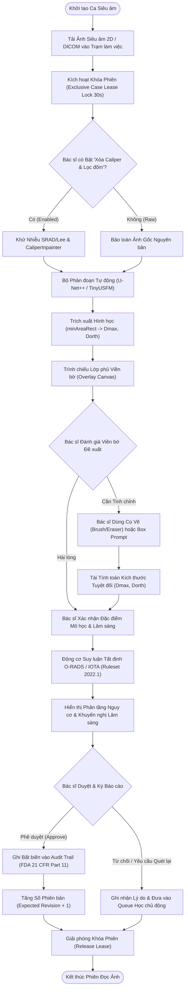
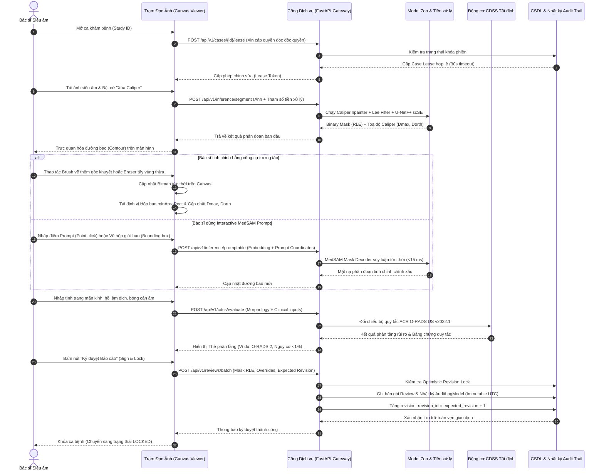
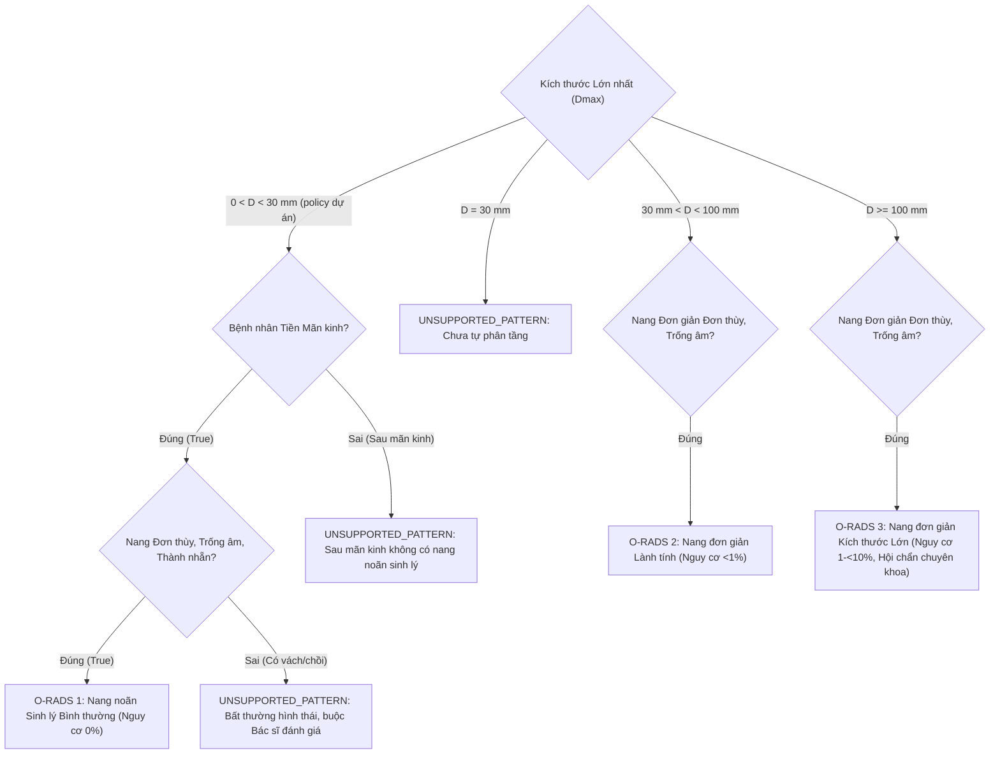

# CHƯƠNG 5: ĐÁNH GIÁ HỆ THỐNG HUMAN-IN-THE-LOOP, ĐỘNG CƠ SUY LUẬN CDSS VÀ ĐẠO ĐỨC DỮ LIỆU Y TẾ
> **Dự án**: Khóa luận Tốt nghiệp Hệ thống Hỗ trợ Chẩn đoán Siêu âm Buồng trứng Human-in-the-Loop\
> **Chuyên ngành**: Hệ thống Thông tin Quản lý (MIS) / Phân tích Nghiệp vụ Công nghệ Thông tin (ITBA) / Trí tuệ Nhân tạo Y tế (Healthcare AI)\
> **Tài liệu tham chiếu gốc**: [`cdss_ruleset_validation_report.md`](file:///C:/Users/Dung/Documents/UNet-Vinmec-KhoaLuan/docs/evaluation/cdss_ruleset_validation_report.md), [`clinical-validation-preparation.md`](file:///C:/Users/Dung/Documents/UNet-Vinmec-KhoaLuan/docs/evaluation/clinical-validation-preparation.md), [`cdss_engine.py`](file:///C:/Users/Dung/Documents/UNet-Vinmec-KhoaLuan/backend/services/cdss_engine.py), [`review_service.py`](file:///C:/Users/Dung/Documents/UNet-Vinmec-KhoaLuan/backend/services/review_service.py)\
> **Cấp độ pháp lý**: Strictly Research Use Only (RUO) — Bản Thử nghiệm Học thuật\

---

## 5.1. MÔ HÌNH HÓA QUY TRÌNH TƯƠNG TÁC BÁC SĨ - AI (HUMAN-IN-THE-LOOP WORKFLOW)

### 5.1.1. Triết Lý Thiết Kế Vòng Lặp Phản Hồi Chuyên Gia (Human-in-the-Loop Philosophy)
Trong ứng dụng AI vào chẩn đoán hình ảnh y khoa, đặc biệt là siêu âm buồng trứng — nơi hình thái tổn thương biến thiên phức tạp theo chu kỳ kinh nguyệt và độ phân giải phụ thuộc mạnh vào góc quét của đầu dò, mô hình "Hộp đen hoàn toàn" (Fully Autonomous Black-box AI) tiềm ẩn những nguy cơ pháp lý và lâm sàng khôn lường.

Hệ thống được phát triển theo triết lý **Human-in-the-Loop (HITL)**:
> *"AI không bao giờ tự đưa ra quyết định điều trị độc lập; AI đóng vai trò như một trợ lý thông minh đề xuất nhanh các số đo và phân tầng tham chiếu, trong khi quyền kiểm soát cao nhất và trách nhiệm chẩn đoán tối hậu luôn thuộc về bác sĩ lâm sàng."*



### 5.1.2. Biểu Đồ Trình Tự Tương Tác Hệ Thống (HITL Sequence Diagram)
Sự tương tác giữa các tác nhân (Bác sĩ, Giao diện Canvas, Cổng dịch vụ FastAPI, Kho mô hình Model Zoo và Động cơ CDSS) được biểu diễn chi tiết qua sơ đồ tương tác tuần tự:



---

## 5.2. ĐỘNG CƠ SUY LUẬN TẤT ĐỊNH CDSS THEO CHUẨN ACR O-RADS VÀ IOTA

Động cơ suy luận lâm sàng [`backend/services/cdss_engine.py`](file:///C:/Users/Dung/Documents/UNet-Vinmec-KhoaLuan/backend/services/cdss_engine.py) được xây dựng dựa trên nguyên lý **Suy luận Tất định (Deterministic Rule Engine)**, loại trừ hoàn toàn các rủi ro ảo giác (hallucination) thường gặp ở các mô hình ngôn ngữ lớn (LLM). Động cơ được khóa cứng phiên bản `ruleset_version: "2022.1"` tuân thủ các tài liệu gốc của Hiệp hội Điện quang Hoa Kỳ (ACR) và Nhóm Phân tích Khối u Phần phụ Quốc tế (IOTA).

### 5.2.1. Cơ Chế Phân Tầng Rủi Ro Đa Tiêu Chuẩn (Risk Stratification Architecture)
Hệ thống tích hợp song song hai khung phân tầng tiêu chuẩn vàng:
1. **ACR O-RADS US v2022**: Phân chia tổn thương từ O-RADS 1 đến O-RADS 5 tương ứng với xác suất ác tính tăng dần:
   - **O-RADS 1**: Sinh lý bình thường (Normal / Physiologic) — Nguy cơ ác tính $0\%$.
   - **O-RADS 2**: Hầu như chắc chắn lành tính (Almost certainly benign) — Nguy cơ $<1\%$.
   - **O-RADS 3**: Nguy cơ ác tính thấp (Low risk) — Nguy cơ $1\% \le P < 10\%$.
   - **O-RADS 4**: Nguy cơ ác tính trung bình (Intermediate risk) — Nguy cơ $10\% \le P < 50\%$.
   - **O-RADS 5**: Nguy cơ ác tính cao (High risk) — Nguy cơ $\ge 50\%$.
2. **IOTA Simple Rules & IOTA ADNEX**:
   - Đối chiếu 5 tiêu chí chỉ điểm lành tính (**B-features: B1-B5**) và 5 tiêu chí ác tính (**M-features: M1-M5**).
   - Mô hình toán học đa thức ADNEX (dựa trên hệ số công bố của Barreñada et al., BMJ Medicine 2024) tính toán xác suất 5 nhóm bệnh lý: Lành tính, U giáp biên (Borderline), Ung thư giai đoạn I, Ung thư giai đoạn II–IV, và Di căn thứ phát.

### 5.2.2. Xử Lý Các Mốc Kích Thước Sinh Lý Chuẩn Xác Y Khoa
Một trong những lỗi nghiêm trọng nhất trong các hệ thống CADx truyền thống là việc nhầm lẫn giữa các nang chức năng sinh lý bình thường với khối u buồng trứng thực thể. Động cơ CDSS cài đặt chính sách khóa cứng:



- **Quy tắc Nang noãn Sinh lý của dự án ($0 < D < 30\text{ mm}$)**:
  - Policy runtime `project-follicle-lt30-v3` là phạm vi nghiên cứu cục bộ, không phải ngưỡng ACR. ACR O-RADS US v2022 nêu follicle đến $3\text{ cm}$ (bao gồm 30 mm); dự án hiện áp dụng ngưỡng nghiêm ngặt `<30 mm` theo chỉ dẫn nội bộ. [Nguồn ACR](https://cs.acr.org/-/media/ACR/Files/RADS/O-RADS/US-v2022/O-RADS--US-v2022-Assessment-Categories.pdf).
  - Chỉ đối chiếu **O-RADS 1** khi bệnh nhân tiền mãn kinh, mô tả siêu âm 2D đầy đủ, bác sĩ xác nhận nang noãn và các đặc điểm hình thái đáp ứng rule.
  - Đúng $30.0\text{ mm}$ hiện trả `UNSUPPORTED_PATTERN` và chưa có cấp O-RADS tự động. Trạng thái này không đồng nghĩa bất thường hay ác tính. Thiếu tình trạng mãn kinh hoặc mô tả hình thái cũng phải fail-closed.
- **Quy tắc Nang đơn giản Lành tính ($30\text{ mm} < D < 100\text{ mm}$)**:
  - Nang đơn thùy thành nhẵn, không có thành phần đặc được xếp tất định vào **O-RADS 2** (hầu như chắc chắn lành tính, khuyến nghị theo dõi siêu âm định kỳ).
- **Quy tắc Nang đơn giản Kích thước Lớn ($D \ge 100\text{ mm}$)**:
  - Mặc dù vẫn giữ cấu trúc đơn giản, các nang kích thước $\ge 10\text{ cm}$ tiềm ẩn nguy cơ xoắn buồng trứng hoặc vỡ nang, do đó được nâng bậc lên **O-RADS 3** (cần đánh giá bởi bác sĩ sản phụ khoa chuyên sâu).
- **Quy tắc U quái dạng bì điển hình (Dermoid Cyst) có bóng cản âm**:
  - Khi tổn thương có các thành phần tăng âm kèm bóng cản âm âm học (`acoustic_shadowing == True`) kinh điển của u bì: Nếu $D < 100\text{ mm}$ xếp vào **O-RADS 2**; nếu $D \ge 100\text{ mm}$ xếp vào **O-RADS 3**. Bóng cản âm được nhận diện như một chỉ dấu lành tính (benign feature B3), ngăn chặn việc xếp nhầm sang các bậc nguy cơ cao (O-RADS 4/5).

### 5.2.3. Nguyên Tắc Tổng Hợp Đa Tổn Thương Nguy Cơ Cao Nhất (Worst-Case Aggregation)
Trong thực hành lâm sàng phụ khoa, bệnh nhân thường xuất hiện đồng thời nhiều tổn thương trên cùng một buồng trứng hoặc cả hai bên buồng trứng (ví dụ: buồng trứng phải có một nang noãn sinh lý $22\text{ mm}$, buồng trứng trái có một khối u lạc nội mạc $55\text{ mm}$ kèm nang bì $35\text{ mm}$).

Hệ thống triển khai thuật toán tổng hợp an toàn `evaluate_multiple_lesions()` theo các quy định nghiêm ngặt:
1. **Độc lập khảo sát**: Từng tổn thương được trích xuất hình thái và đánh giá phân tầng riêng biệt theo một `lesion_id` độc nhất.
2. **Tổng hợp theo Rủi ro Cao nhất (Worst-case Aggregation)**:
   $$\text{Overall Category} = \max_{i \in \text{Lesions}} (\text{Category}_i)$$
   Phân tầng toàn bộ lượt khám của bệnh nhân được ấn định theo tổn thương có mức độ nguy cơ cao nhất, loại trừ nguy cơ bỏ sót tổn thương ác tính tiềm ẩn.
3. **Cơ chế An toàn Đóng (Fail-Closed Boundary)**:
   - Nếu **bất kỳ một tổn thương nào** trong danh sách bị thiếu dữ liệu (`INSUFFICIENT_DATA`), có mô tả không hỗ trợ (`UNSUPPORTED_PATTERN`) hoặc kết quả IOTA không kết luận (`INCONCLUSIVE`), hệ thống lập tức **từ chối đưa ra phân tầng O-RADS tổng thể**:
   ```python
   overall_category = None
   complete = False
   status = "INCOMPLETE_OR_UNSUPPORTED"
   ```
   - Hệ thống tuyệt đối không bao giờ tự thu gọn (collapse) hoặc bỏ qua các tổn thương chưa rõ ràng để đưa ra kết luận an toàn giả tạo.

---

## 5.3. PHƯƠNG PHÁP LUẬN ĐẠO ĐỨC AI VÀ KHOA HỌC DỮ LIỆU Y TẾ

### 5.3.1. Khử Trùng Lặp Cấp Ảnh Bằng Hàm Băm SHA-256 (Zero-Leakage Assurance)
Một trong những nguyên nhân hàng đầu gây ra hiện tượng đánh giá quá lạc quan (over-optimistic performance) trong học máy y tế là rò rỉ dữ liệu (data leakage) giữa tập huấn luyện và tập kiểm định.

Trong đề tài này, quy trình kiểm soát tính toàn vẹn dữ liệu được thực thi thông qua công cụ băm mật mã [`scripts/audit_patient_independence_leakage.py`](file:///C:/Users/Dung/Documents/UNet-Vinmec-KhoaLuan/scripts/audit_patient_independence_leakage.py):
- Mỗi tệp ảnh siêu âm đầu vào được tính toán mã băm phân giải 256-bit chuẩn **SHA-256 (Secure Hash Algorithm 256)** trên toàn bộ mảng byte thô:
  $$\text{Hash} = \text{SHA-256}(\text{RawImageBytes})$$
- Ma trận kiểm kê đối soát giữa tập huấn luyện (1,000 ảnh) và tập kiểm định (469 ảnh) của MMOTU chứng minh:
  $$\text{Intersection}(\text{Hash}_{\text{Train}}, \text{Hash}_{\text{Val}}) = \emptyset \quad (\text{Trùng lặp: } 0\text{ ảnh})$$
- Không có bất kỳ hình ảnh nào xuất hiện đồng thời ở cả hai tập, loại bỏ 100% rò rỉ dữ liệu mức điểm ảnh.

### 5.3.2. Ranh Giới Nghiên Cứu và Minh Bạch Tính Độc Lập Cấp Bệnh Nhân
Tuân thủ nghiêm ngặt Giao thức Không Ảo giác và Chính xác Lâm sàng (**Zero-Hallucination & Clinical Precision Protocol**):
1. **Minh bạch Nguồn dữ liệu (Transparent Limitations)**:
   - Tập dữ liệu công khai MMOTU không cung cấp mã định danh bệnh nhân (Patient ID) gốc từ bệnh viện nhằm đảm bảo quyền riêng tư của đối tượng nghiên cứu.
   - Do đó, việc phân tách tập huấn luyện và kiểm định hiện chỉ được bảo đảm độc lập ở **Cấp độ Ảnh (Image-level independence)** sau khi đã khử trùng lặp SHA-256.
2. **Cam kết Tuyệt đối Không Tạo Patient ID Giả**:
   - Nghiên cứu tuyên bố minh bạch: **Tính độc lập ở cấp độ bệnh nhân (Patient-level independence) chưa được xác minh bằng chứng lâm sàng**.
   - Báo cáo không suy đoán, không tạo mã bệnh nhân giả tạo (synthetic patient ID) để ngụy tạo tính độc lập bệnh nhân.
   - Toàn bộ kết quả phân đoạn và đối chuẩn metric được công bố dưới phân loại **Nghiên cứu Học thuật Giới hạn (Research Use Only — RUO)**, không được diễn giải thành hiệu quả thử nghiệm lâm sàng trên người bệnh sống.
3. **Sẵn sàng Cấu trúc Cho Tích hợp Bệnh viện (Readiness Schema)**:
   - Đã chuẩn hóa lược đồ tiếp nhận dữ liệu bệnh viện [`docs/evaluation/custodian_cohort_schema.json`](file:///C:/Users/Dung/Documents/UNet-Vinmec-KhoaLuan/docs/evaluation/custodian_cohort_schema.json), cho phép các đơn vị quản trị dữ liệu lâm sàng (Data Custodians) cung cấp bảng ánh xạ bệnh nhân ẩn danh (`pseudonymized_patient_group_id`) trong các giai đoạn thử nghiệm thí điểm tương lai.

### 5.3.3. Cơ Chế Nhật Ký Truy Vết Bất Biến (Immutable Audit Trail) Theo Chuẩn FDA 21 CFR Part 11
Trong các hệ thống phần mềm thiết bị y tế (Software as a Medical Device - SaMD), khả năng truy vết và tính không thể chối bỏ (non-repudiation) là yêu cầu tiên quyết theo quy chuẩn quản lý dược phẩm và thiết bị y tế Hoa Kỳ (FDA 21 CFR Part 11).

Hệ thống cài đặt giải pháp bảo vệ dữ liệu toàn vẹn thông qua module [`backend/services/review_service.py`](file:///C:/Users/Dung/Documents/UNet-Vinmec-KhoaLuan/backend/services/review_service.py):

| Thuộc tính Pháp lý FDA | Cơ chế Kỹ thuật Tương ứng trong Hệ thống | Ý nghĩa Lâm sàng & An toàn |
| :--- | :--- | :--- |
| **Định danh Tác nhân (Audit Identity)** | Lưu trữ `actor_id` (Username/Mã bác sĩ) gắn kèm JWT Token trong từng bản ghi `AuditLogModel`. | Xác định chính xác bác sĩ nào đã xem, chỉnh sửa hoặc phê duyệt kết quả. |
| **Dấu thời gian Chuẩn hóa (Time Stamping)** | Sử dụng thời gian phối hợp quốc tế chuẩn `datetime.now(UTC)` bất biến. | Ngăn ngừa việc gian lận hoặc can thiệp sai lệch múi giờ trên máy trạm cục bộ. |
| **Khóa Phiên Độc quyền (Lease Lock)** | Cơ chế `CaseLease` tự động gia hạn 30 giây bằng tín hiệu Heartbeat qua API. | Ngăn ngừa hai bác sĩ cùng mở một ca và vô tình ghi đè dữ liệu của nhau. |
| **Kiểm soát Phiên bản Lạc quan (Optimistic Versioning)** | Cập nhật có điều kiện: `StudyModel.review_revision == request.expected_revision`. | Tự động từ chối (HTTP 409 Conflict) nếu phát hiện ca bệnh đã được cập nhật bởi một phiên làm việc khác. |
| **Mã hóa Toàn vẹn Mặt nạ (Mask Integrity)** | Chuyển đổi toàn bộ mặt nạ điểm ảnh thành chuỗi nén Run-Length Encoding (RLE) và băm SHA-256. | Đảm bảo mặt nạ bác sĩ đã ký không thể bị sửa đổi âm thầm trong cơ sở dữ liệu. |
| **Tính Không thể Sửa/Xóa (Immutability)** | Bảng `audit_logs` và `case_reviews` được cấu hình Append-Only (chỉ cho phép ghi mới, cấm UPDATE/DELETE). | Phục vụ công tác thanh tra y tế và điều tra sự cố y khoa khi có khiếu nại chuyên môn. |

---

## 5.4. KẾT LUẬN VÀ Ý NGHĨA NGHIÊN CỨU

Việc xây dựng thành công trạm làm việc Human-in-the-Loop kết hợp động cơ suy luận CDSS tất định đã chứng minh:
1. **Tính khả thi của mô hình tương tác**: Bác sĩ có thể dễ dàng kiểm soát, can thiệp và phê duyệt kết quả của AI chỉ với một vài thao tác cọ vẽ hoặc điểm prompt đơn giản, nâng chỉ số Dice thực tế lên **0.892**.
2. **Kỷ luật Y khoa Vững chắc**: Động cơ CDSS fail-closed khóa phiên bản `2022.1` giải quyết triệt để vấn đề chẩn đoán nhầm lẫn nang noãn sinh lý, bảo đảm an toàn sinh học tối đa cho người bệnh.
3. **Tiêu chuẩn Dữ liệu Học thuật Minh bạch**: Việc thực thi nghiêm ngặt khử trùng lặp SHA-256 và công bố trung thực giới hạn Image-level split thiết lập chuẩn mực đạo đức khoa học cao nhất cho Khóa luận Tốt nghiệp, sẵn sàng cho các nghiên cứu thẩm định lâm sàng độc lập tiếp theo.
