# XÂY DỰNG HỆ THỐNG HỖ TRỢ PHÂN ĐOẠN TỔN THƯƠNG TRÊN ẢNH SIÊU ÂM BUỒNG TRỨNG ỨNG DỤNG DEEP LEARNING THEO MÔ HÌNH HUMAN-IN-THE-LOOP

# MỤC LỤC

# LỜI CAM ĐOAN

Tôi trình bày khóa luận này trên cơ sở đề cương nghiên cứu, mã nguồn và các hồ sơ thực nghiệm được lưu trong dự án. Các nội dung tham khảo về mô hình, phương pháp và công cụ được chỉ nguồn. Bài khóa luận của Đinh Mạnh Hòa được dùng làm mẫu kết cấu và cách trình bày; nội dung nghiệp vụ cho thuê xe không được chuyển thành nội dung chuyên môn của đề tài phân đoạn siêu âm.

Các số liệu trong báo cáo được phân biệt theo nguồn: số liệu dự kiến trong đề cương, thống kê từ manifest, kết quả trong run config và báo cáo đánh giá, cùng log kiểm thử phần mềm. Tôi không sử dụng dữ liệu minh họa giao diện để thay thế dữ liệu thực nghiệm mô hình và không gọi các phản hồi chưa có người tham gia là kết quả khảo sát bác sĩ. Những hạn chế về nguồn ảnh, mã bệnh nhân, trạng thái phê duyệt nhãn và phép đánh giá được công bố cùng kết quả.

Bản thảo này được biên soạn với sự hỗ trợ của công cụ AI trong tổ chức nội dung, diễn giải mã nguồn và dựng hình. Trách nhiệm đối chiếu hồ sơ, rà soát học thuật và chốt bản nộp thuộc sinh viên thực hiện. Báo cáo mô tả bản mẫu nghiên cứu, không xác nhận thiết bị y tế được cấp phép, không thay thế chẩn đoán chuyên môn và không tạo kết luận lành hoặc ác tính từ mask nhị phân.

Nguyễn Hữu Dũng

# LỜI CẢM ƠN

Tôi xin cảm ơn các thầy cô Khoa Hệ thống Thông tin Quản lý, Trường Công nghệ, Đại học Kinh tế Quốc dân đã cung cấp nền tảng về phân tích nghiệp vụ, hệ thống thông tin, cơ sở dữ liệu và phát triển phần mềm. Những kiến thức đó giúp tôi tiếp cận đề tài như một bài toán có tác nhân, dữ liệu, quy trình và trách nhiệm, đồng thời nghiên cứu thành phần học sâu phục vụ khoanh vùng trên ảnh.

Tôi xin cảm ơn ThS. Trần Thanh Hải, giảng viên hướng dẫn được ghi trong đề cương, về định hướng nghiên cứu và việc kết nối yêu cầu học thuật với sản phẩm bản mẫu. Tôi cũng xin cảm ơn các cá nhân đã hỗ trợ cung cấp tài liệu, trao đổi kỹ thuật và phản hồi trong quá trình phát triển dự án. Những phần thông tin về cơ sở thực tập VinSmart Future và bối cảnh dự kiến khảo sát Vinmec được trình bày đúng giới hạn hồ sơ hiện có.

Đề tài còn những câu hỏi cần tiếp tục kiểm chứng về provenance dữ liệu, tính độc lập bệnh nhân và hiệu quả sử dụng với người chuyên môn. Tôi mong nhận được góp ý để hoàn thiện cách đặc tả, thiết kế và đánh giá ở các giai đoạn tiếp theo. Các lời cảm ơn không được dùng để suy rằng một đơn vị đã phê duyệt triển khai hoặc xác nhận toàn bộ số liệu của nghiên cứu.

# DANH MỤC TỪ VIẾT TẮT

| Từ viết tắt | Cụm từ đầy đủ | Nghĩa dùng trong báo cáo |
|---|---|---|
| AC | Acceptance Criteria | Tiêu chí nghiệm thu |
| AI | Artificial Intelligence | Trí tuệ nhân tạo |
| API | Application Programming Interface | Giao diện lập trình ứng dụng |
| BA | Business Analyst | Chuyên viên phân tích nghiệp vụ |
| BCE | Binary Cross-Entropy | Hàm mất mát phân loại nhị phân theo pixel |
| BFD | Business Function Diagram | Sơ đồ phân rã chức năng |
| BS | Bác sĩ | Vai trò người rà soát trong thiết kế |
| CD | Context Diagram | Sơ đồ ngữ cảnh |
| CNN | Convolutional Neural Network | Mạng nơ-ron tích chập |
| DFD | Data Flow Diagram | Sơ đồ luồng dữ liệu |
| DICOM | Digital Imaging and Communications in Medicine | Chuẩn dữ liệu và truyền thông ảnh y tế |
| ERD | Entity Relationship Diagram | Sơ đồ quan hệ thực thể |
| FN / FP | False Negative / False Positive | Pixel bị bỏ sót / khoanh thừa so với mask tham chiếu |
| FR / NFR | Functional / Non-functional Requirement | Yêu cầu chức năng / phi chức năng |
| GT | Ground Truth | Nhãn tham chiếu; trạng thái chuyên gia xác nhận phải có hồ sơ |
| HITL | Human-in-the-Loop | Quy trình có người kiểm tra và hiệu chỉnh |
| IoU | Intersection over Union | Tỷ lệ giao trên hợp hai vùng |
| IQA | Image Quality Assessment | Đánh giá chất lượng ảnh ở cấp kỹ thuật |
| MIS | Management Information Systems | Hệ thống Thông tin Quản lý |
| ORM | Object-Relational Mapping | Ánh xạ đối tượng–quan hệ |
| PID | Patient Identifier | Mã giả danh bệnh nhân |
| QT | Quản trị | Vai trò vận hành kỹ thuật trong thiết kế |
| RBAC | Role-Based Access Control | Phân quyền theo vai trò |
| RLE | Run-Length Encoding | Mã hóa độ dài chuỗi pixel |
| ROI | Region of Interest | Vùng quan tâm |
| SDLC | Software Development Life Cycle | Vòng đời phát triển phần mềm |
| SPA | Single-Page Application | Ứng dụng web một trang |
| SRS | Software Requirements Specification | Đặc tả yêu cầu phần mềm |
| TK | Trưởng khoa | Vai trò duyệt trong thiết kế mở rộng |
| TP / TN | True Positive / True Negative | Pixel đúng tiền cảnh / đúng nền |
| UI / UX | User Interface / User Experience | Giao diện / trải nghiệm người dùng |

# DANH MỤC BẢNG BIỂU

# DANH MỤC HÌNH VẼ

# LỜI MỞ ĐẦU

Trong một hệ thống hỗ trợ đọc ảnh, giá trị của AI không chỉ nằm ở việc tạo một đầu ra tự động mà còn ở khả năng người sử dụng nhìn thấy, kiểm tra và kiểm soát đầu ra đó. Đối với ảnh siêu âm buồng trứng, một mask phân đoạn có thể biểu diễn vị trí và hình dạng vùng được chú giải. Tuy nhiên mask nhị phân không mô tả đầy đủ hình thái chuyên môn, không cung cấp thông tin mô bệnh học và không tự quyết định tính lành hay ác. Đề tài vì thế lựa chọn bài toán hỗ trợ khoanh vùng, kết hợp mô hình học sâu và giao diện hiệu chỉnh, giữ quyết định rà soát ở con người.

Khó khăn kỹ thuật của bài toán xuất phát từ chất lượng ảnh không đồng nhất, biên vùng quan tâm mờ, kết cấu và nhiễu ảnh, cùng yêu cầu chuẩn hóa hình học giữa ảnh nguồn và đầu vào mô hình. Khó khăn của hệ thống thông tin nằm ở cách tổ chức cặp ảnh–mask, trạng thái ca, các bản prediction và review, quyền thao tác và khả năng truy vết. Nếu chỉ lưu mask cuối mà không lưu prediction gốc, khó xác định phần máy đề xuất và phần người đã sửa. Nếu giao diện hiển thị mm khi chưa có spacing, thông tin đo bị diễn giải sai dù mask được vẽ đúng. Những vấn đề này cho thấy thuật toán và quản trị quy trình cần được thiết kế cùng nhau [12], [17], [18].

Mục tiêu của khóa luận là xây dựng một bản mẫu web hỗ trợ phân đoạn tổn thương trên ảnh siêu âm buồng trứng bằng Deep Learning theo mô hình Human-in-the-Loop. Các nhiệm vụ bao gồm phân tích quy trình tham chiếu, xây dựng SRS, mô hình hóa chức năng và luồng dữ liệu, nghiên cứu U-Net/U-Net++, triển khai tiền xử lý 512×512, thiết kế cơ sở dữ liệu và API, xây dựng giao diện Canvas, cùng kiểm thử và đánh giá theo chứng cứ. Cặp ảnh Trái/Phải được tiếp nhận rõ ràng ở quy trình phần mềm; mỗi ảnh vẫn là một đầu vào suy luận hai chiều độc lập.

Đối tượng nghiên cứu ở cấp thuật toán là quan hệ giữa ảnh và nhãn pixel nhị phân. Ở cấp hệ thống là quá trình từ tiếp nhận ảnh đến gợi ý AI, thao tác hiệu chỉnh và lưu review. Phạm vi là môi trường nghiên cứu local cùng những artifact hiện hữu trong repository. VinSmart Future là cơ sở thực tập và Vinmec Times City là bối cảnh dự kiến khảo sát trong đề cương; bản thảo không khẳng định hệ thống đã tích hợp PACS/RIS hay đi vào vận hành bệnh viện. Các quy trình As-Is được dùng như mô hình tham chiếu cần được xác nhận bằng khảo sát thực địa.

Phương pháp nghiên cứu gồm phân tích tài liệu, đọc mã nguồn, đối chiếu dữ liệu và cấu hình, mô hình hóa hệ thống, phát triển prototype và kiểm thử. Các khái niệm kiến trúc được tham chiếu bài báo gốc; thông tin implementation lấy từ mã và run config. Kết quả định lượng được truy đến tập ảnh, checkpoint và cách tổng hợp metric. Khi thiếu nguồn xác nhận số bệnh nhân hoặc duyệt nhãn, kết luận được giới hạn ở mức phù hợp với file tham chiếu. Khi chưa có khảo sát bác sĩ, mục tiêu giảm thời gian được giữ là câu hỏi cần kiểm định.

Theo kết cấu bài mẫu Đinh Mạnh Hòa và hướng dẫn Khoa [13], [14], báo cáo tổ chức thành ba chương chính. Chương 1 trình bày cơ sở thực tập, bối cảnh áp dụng và đề tài nghiên cứu. Chương 2 trình bày cơ sở lý thuyết, phương pháp và công cụ cần thiết. Chương 3 triển khai giải pháp từ mô tả bài toán, yêu cầu, sơ đồ, dữ liệu đến mô hình AI, giao diện, kiểm thử và cài đặt. Các nhóm nội dung của đề cương năm chương được giữ trong các mục tương ứng, không lược bỏ nghiên cứu mô hình hay đánh giá hệ thống. Kết luận tổng hợp kết quả, hạn chế và hướng phát triển; phụ lục cung cấp nguồn tái lập và công cụ khảo sát dự kiến.

# CHƯƠNG 1. TỔNG QUAN VỀ CƠ SỞ THỰC TẬP, BỐI CẢNH ÁP DỤNG VÀ ĐỀ TÀI NGHIÊN CỨU

## 1.1. Giới thiệu tổng quan về cơ sở thực tập

### 1.1.1. Thông tin khái quát và căn cứ xác định cơ sở thực tập

Đề cương sơ bộ của sinh viên Nguyễn Hữu Dũng, mã sinh viên 11235559, lớp Hệ thống thông tin quản lý 65A, xác định VinSmart Future là nơi thực tập và định hướng nghề nghiệp là phân tích nghiệp vụ công nghệ thông tin, quản lý sản phẩm. Giảng viên hướng dẫn được ghi trong đề cương là ThS. Trần Thanh Hải. Đây là những thông tin về cơ sở thực tập và hồ sơ học thuật được sử dụng trong khóa luận [12]. Đề tài lựa chọn là “Xây dựng hệ thống hỗ trợ phân đoạn tổn thương trên ảnh siêu âm buồng trứng ứng dụng Deep Learning theo mô hình Human-in-the-Loop”. Tên đề tài thể hiện đồng thời đối tượng dữ liệu, phương pháp xử lý và cơ chế con người kiểm soát kết quả.

Hồ sơ được đối chiếu chưa cung cấp bản giới thiệu doanh nghiệp có xác nhận, sơ đồ tổ chức, danh mục sản phẩm hoặc văn bản mô tả nhiệm vụ của phòng ban tiếp nhận sinh viên. Vì vậy, phần giới thiệu cơ sở thực tập tập trung vào mối liên hệ giữa môi trường thực tập, định hướng chuyên môn và sản phẩm khóa luận. Báo cáo không suy diễn địa chỉ trụ sở, số lượng nhân viên, cơ cấu quản lý hoặc quan hệ tổ chức giữa VinSmart Future và đơn vị y tế chỉ từ tên gọi. Cách trình bày này giữ được chức năng của phần giới thiệu cơ sở thực tập trong bài mẫu, đồng thời bảo đảm mỗi thông tin tổ chức có căn cứ kiểm tra [12], [14].

Từ góc độ ngành Hệ thống thông tin quản lý, môi trường thực tập giúp sinh viên chuyển nhu cầu chuyên môn thành bài toán sản phẩm. Khóa luận cụ thể hóa định hướng phân tích nghiệp vụ bằng việc thiết kế quy trình tiếp nhận ảnh, nhận gợi ý phân đoạn, rà soát và lưu kết quả. Mô hình học sâu là một thành phần xử lý thông tin; phần mềm vẫn phải giải quyết quyền truy cập, trạng thái công việc và tính nhất quán của dữ liệu.

### 1.1.2. Vai trò của phân tích nghiệp vụ và phát triển sản phẩm trong đề tài

Phân tích nghiệp vụ giúp xác định vấn đề trước khi lựa chọn công nghệ. Với đề tài này, nhu cầu không dừng ở khả năng vẽ một vùng trên ảnh. Người sử dụng cần biết ảnh nào đang được xem, vùng nào do AI đề xuất, vùng nào đã được sửa, thao tác nào đã lưu thành công và kết quả nào được phép xuất. Một mô hình có độ chồng khớp cao với nhãn tham chiếu vẫn chưa đáp ứng đầy đủ các nhu cầu đó nếu giao diện che mất chi tiết ảnh hoặc lưu dữ liệu thiếu nguồn gốc.

Định hướng quản lý sản phẩm thể hiện ở cách phân biệt phạm vi cốt lõi và phần mở rộng. Phạm vi cốt lõi bao gồm tài liệu yêu cầu, mô hình phân đoạn và bản mẫu web cho phép người sử dụng kiểm tra, chỉnh sửa, lưu kết quả. Những nghiệp vụ như ký duyệt nhiều cấp, quản trị khoa, xác thực OTP, đồng bộ nhiều thiết bị và xuất hồ sơ lâm sàng cần các hợp đồng phần mềm riêng. Giao diện có thể mô phỏng chúng để đánh giá thiết kế, nhưng sự có mặt của màn hình không chứng minh chức năng máy chủ đã vận hành. Việc ghi rõ mức hoàn thành của từng lớp là một phần trách nhiệm quản lý phạm vi [12], [18].

Chuỗi hoạt động nghiên cứu được tổ chức từ nhu cầu đến bằng chứng. Yêu cầu “người sử dụng kiểm soát kết quả AI” được chuyển thành các chức năng xem ảnh gốc, bật tắt lớp phủ, sửa mặt nạ, hoàn tác và lưu bản rà soát. Mỗi chức năng tiếp tục được chuyển thành điều kiện nghiệm thu có thể kiểm tra. Nhờ đó, phần phân tích nghiệp vụ liên kết được với phần lập trình và kiểm thử, thay vì tồn tại như một nhóm sơ đồ tách rời sản phẩm.

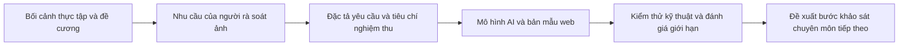

*Hình 1.1: Mối liên hệ giữa bối cảnh thực tập, phân tích nghiệp vụ và sản phẩm khóa luận*

Nguồn: Tác giả tổng hợp từ đề cương sơ bộ và hồ sơ phần mềm [12], [17], [18].

### 1.1.3. Tổ chức công việc trong phạm vi khóa luận

Hoạt động thực hiện khóa luận được chia theo các nhóm trách nhiệm chuyên môn, gồm phân tích yêu cầu, quản trị dữ liệu, phát triển mô hình, lập trình hệ thống và kiểm thử. Đây là cách tổ chức công việc của đề tài, không phải sơ đồ tổ chức chính thức của VinSmart Future. Nhóm phân tích yêu cầu xác định tác nhân, điều kiện trước và sau của thao tác; nhóm dữ liệu kiểm tra cặp ảnh–mask, đơn vị chia tập và khả năng truy vết nguồn; nhóm mô hình thiết lập cấu hình huấn luyện và lưu kết quả; nhóm phần mềm xây dựng API, dữ liệu và giao diện; nhóm kiểm thử đối chiếu hành vi với tiêu chí đã xác định.

## 1.2. Tổng quan bối cảnh áp dụng tại cơ sở y tế

### 1.2.1. Bối cảnh dự kiến khảo sát và ranh giới triển khai

Đề cương xác định Bệnh viện Đa khoa Quốc tế Vinmec Times City là bối cảnh dự kiến khảo sát nghiệp vụ. Nội dung đó định hướng loại người sử dụng và tác vụ cần nghiên cứu; nó không đồng nghĩa hệ thống đã được tích hợp hoặc vận hành chính thức tại bệnh viện. Hồ sơ hiện có chưa cung cấp biên bản phỏng vấn, phê duyệt thử nghiệm lâm sàng, xác nhận triển khai hoặc báo cáo người sử dụng có chữ ký của đơn vị. Do vậy, khóa luận trình bày quy trình ở mức tham chiếu phục vụ thiết kế bản mẫu nghiên cứu độc lập [12].

Trong bối cảnh tham chiếu, người sử dụng trực tiếp là bác sĩ chẩn đoán hình ảnh hoặc sản phụ khoa cần quan sát ảnh siêu âm, xác định vùng quan tâm và kiểm tra hình thái. Một ca có thể có nhiều ảnh, nhiều lát cắt và các thông tin chuyên môn ngoài ảnh tĩnh. Hệ thống được xây dựng chỉ nhận từng ảnh hai chiều trong mỗi lượt suy luận. Kết quả của một ảnh không được dùng để suy ra tình trạng của toàn bộ buồng trứng hoặc thay thế đánh giá trên toàn bộ ca khám.

Thiết kế giao diện hiện tại yêu cầu tiếp nhận hai ảnh riêng biệt, có nhãn Trái và Phải, cho một ca thử nghiệm. Quy tắc này là yêu cầu sản phẩm của bản mẫu nhằm tránh nhầm bên và hỗ trợ đối chiếu; nó không được mô tả như quy trình bắt buộc của mọi cơ sở y tế. Từng ảnh có dữ liệu, mặt nạ, số đo và trạng thái rà soát riêng. Việc gom hai ảnh vào một ca giúp người sử dụng theo dõi đầy đủ hai bên, trong khi thao tác AI vẫn được thực hiện và lưu theo từng ảnh [18].

### 1.2.2. Đặc điểm thông tin của bài toán siêu âm buồng trứng

Ảnh siêu âm cung cấp thông tin hình thái để bác sĩ mô tả các cấu trúc vùng phần phụ. Bộ thuật ngữ O-RADS US của ACR phân biệt các đặc điểm như số khoang, thành, vách, thành phần đặc và bóng cản âm. Các đặc điểm này đòi hỏi quan sát chuyên môn và không được mã hóa đầy đủ trong một mặt nạ nhị phân [5]. Trong phạm vi khóa luận, mặt nạ biểu diễn vùng được chú giải là tiền cảnh theo quy ước dữ liệu; giá trị nền không mặc nhiên có nghĩa mô lành và tiền cảnh không mặc nhiên có nghĩa ác tính.

Một khó khăn của dữ liệu là độ tương phản và hình dạng biên thay đổi theo điều kiện thu nhận. Ảnh có thể chứa nhiễu đốm, vùng bóng cản, chữ trên ảnh và khung ngoài vùng quét. Ranh giới được chú giải cũng có thể khác nhau giữa người vẽ hoặc giữa các quy ước gán nhãn. Vì vậy, bài toán học máy cần đồng thời xử lý đặc điểm ảnh và kiểm tra độ tin cậy của nhãn. Tăng số ảnh mà không xác định nguồn, quy tắc chú giải và đơn vị chia tập chưa đủ để cải thiện chất lượng bằng chứng.

Thông tin phục vụ quản lý quá trình gồm mã bệnh nhân giả danh, mã ca, bên trái/phải, ảnh nguồn, dự đoán AI, bản sửa của người sử dụng, thời điểm và phiên bản mô hình. Các trường này có chức năng khác nhau. Mã bệnh nhân phục vụ liên kết các lần khảo sát; mã ca định danh một ngữ cảnh công việc; mã ảnh định danh tệp đầu vào; mã dự đoán định danh kết quả của một lần chạy mô hình. Phân biệt các đơn vị ngay từ đầu giúp tránh tình trạng ghi đè mặt nạ của ảnh này lên ảnh khác hoặc so sánh các kết quả không cùng nguồn.

### 1.2.3. Hiện trạng ứng dụng công nghệ và nhu cầu của bản mẫu

Đề cương nêu nhu cầu hỗ trợ thao tác khoanh vùng và chưa ghi nhận công cụ AI phân đoạn trong phạm vi khảo sát dự kiến. Báo cáo sử dụng thông tin này làm động cơ nghiên cứu, không mở rộng thành kết luận rằng bệnh viện thiếu PACS, RIS, bệnh án điện tử hoặc hạ tầng công nghệ. Các hệ thống đó có vai trò khác với công cụ phân đoạn tương tác. Để khẳng định hiện trạng nội bộ cần hồ sơ khảo sát riêng; bản mẫu hiện tại được phát triển trên môi trường độc lập và không truy cập hệ thống vận hành của bệnh viện [12].

Nhu cầu cụ thể là tạo được vùng gợi ý có thể kiểm tra và sửa, đồng thời giữ lại dự đoán ban đầu để đối chiếu. Khi AI bỏ sót hoặc khoanh thừa, người sử dụng phải có khả năng chỉnh vùng ngay trên ảnh và ghi nhận quyết định. Khi thiếu pixel spacing, số đo phải ở đơn vị pixel, không tự đổi thành milimét. Khi API lưu thất bại, giao diện phải giữ bản nháp và hiển thị trạng thái chưa đồng bộ. Đây là các yêu cầu làm cho công cụ có thể được kiểm thử như một hệ thống thông tin, thay vì chỉ như một mô hình tạo ảnh kết quả.

*Bảng 1.1: Các nhu cầu thông tin và điểm kiểm soát của bản mẫu*

| Nhu cầu | Thông tin hoặc thao tác cần có | Điểm kiểm soát | Bằng chứng phù hợp |
|---|---|---|---|
| Tránh nhầm ảnh và nhầm bên | Mã ca, hai ô Trái/Phải, mã ảnh riêng | Chưa đủ hai ảnh thì không chạy luồng tự động | Kịch bản tiếp nhận và kiểm thử giao diện |
| Kiểm tra gợi ý AI | Ảnh gốc, mặt nạ AI, đường viền và lớp phủ | Người sử dụng luôn xem được ảnh gốc | Kiểm thử lớp hiển thị và ảnh chụp ứng dụng |
| Hiệu chỉnh kết quả | Cọ, tẩy, đa giác, hoàn tác, đặt lại | Bản sửa không ghi đè dự đoán gốc | Kiểm thử mặt nạ và truy vấn bản rà soát |
| Đọc số đo đúng đơn vị | d₁, d₂, diện tích, nguồn hiệu chuẩn | Không hiển thị mm khi chưa có spacing hợp lệ | Kiểm thử phép đo và trạng thái hiệu chuẩn |
| Truy vết quá trình | Phiên bản mô hình, mã dự đoán, thời điểm rà soát | Mỗi bản ghi gắn đúng ảnh và dự đoán | Hợp đồng API, lược đồ và nhật ký |
| Giữ phạm vi nghiên cứu | Thông báo bản mẫu và dấu nhận diện trên phiếu | Không phát hành kết luận lành/ác | Kiểm tra giao diện và bản in |

Nguồn: Tác giả phân tích từ đề cương, hợp đồng phần mềm và thiết kế Workspace 2.0 [12], [17], [18].

## 1.3. Tổng quan về đề tài nghiên cứu

### 1.3.1. Tính cấp thiết và phát biểu bài toán

Phân đoạn tự động có thể cung cấp một đường bao sơ bộ để người chuyên môn bắt đầu rà soát, nhưng giá trị thực tế phụ thuộc vào chất lượng gợi ý và khả năng kiểm soát của người sử dụng. Nếu vùng AI sai nhiều, thời gian sửa có thể vượt thời gian vẽ từ đầu. Nếu lớp phủ quá đậm hoặc trạng thái lưu không rõ, phần mềm có thể làm tăng tải thao tác. Vì vậy, đề tài đặt câu hỏi về sự kết hợp giữa mô hình phân đoạn và quy trình tương tác, không mặc định mọi ứng dụng AI đều tiết kiệm thời gian.

Từ phía dữ liệu, kết quả cần được gắn với đúng tập ảnh, mask tham chiếu, checkpoint và tiền xử lý. Những thông tin như “đã ẩn danh”, “ground truth chuyên gia” hoặc “chia theo bệnh nhân” là các điều kiện cần bằng chứng độc lập. Nếu chúng chỉ xuất hiện trong kế hoạch mà chưa có hồ sơ đối chiếu, báo cáo phải phân biệt mục tiêu với trạng thái thực hiện. Điều này đặc biệt cần thiết vì bộ dữ liệu trong đề cương và bộ dữ liệu huấn luyện hiện tại có quy mô khác nhau.

Bài toán được phát biểu như sau: từ ảnh siêu âm buồng trứng hai chiều đã được phép sử dụng nghiên cứu, xây dựng mô hình sinh mặt nạ nhị phân vùng quan tâm; tích hợp kết quả vào ứng dụng web để người sử dụng quan sát, chỉnh sửa và lưu bản rà soát có liên kết nguồn. Đầu ra cốt lõi gồm mặt nạ, lớp phủ, số đo hình học có đơn vị phù hợp và hồ sơ tương tác. Hệ thống không tự đưa ra kết luận bệnh học, không tính nguy cơ từ mặt nạ và không thay thế phiếu kết quả chẩn đoán chính thức.

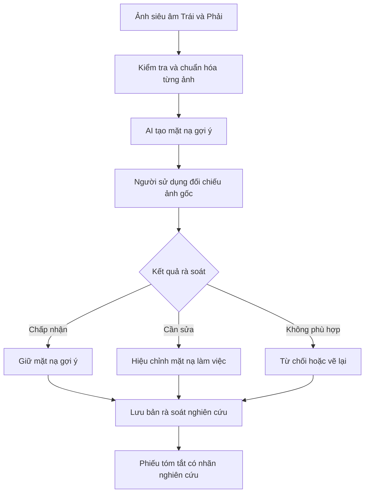

*Hình 1.2: Bài toán hỗ trợ phân đoạn với người sử dụng giữ quyền quyết định*

Nguồn: Tác giả mô hình hóa phạm vi sản phẩm [12], [18].

### 1.3.2. Mục tiêu và nhiệm vụ nghiên cứu

Mục tiêu tổng quát là xây dựng bản mẫu hệ thống thông tin hỗ trợ phân đoạn tổn thương trên ảnh siêu âm buồng trứng theo cơ chế Human-in-the-Loop, có thể kiểm chứng ở cấp thuật toán và cấp phần mềm. Mục tiêu về người dùng là chuẩn bị cơ sở để đánh giá thời gian thao tác, mức chỉnh sửa và khả năng sử dụng khi có sự tham gia của người chuyên môn. Trong giai đoạn hiện tại, mục tiêu này được thể hiện bằng kịch bản đánh giá và công cụ ghi nhận, chưa được coi là kết quả thực địa.

Nhiệm vụ thứ nhất là phân tích bối cảnh và mô hình hóa quy trình tham chiếu. Những điểm cần làm rõ gồm tác nhân tạo ca, người rà soát, người quản trị, các trạng thái công việc và ranh giới giữa gợi ý của máy với quyết định của người. Nhiệm vụ thứ hai là kiểm tra dữ liệu, xây dựng manifest và chuẩn hóa cặp ảnh–mask. Nhiệm vụ thứ ba là triển khai Standard U-Net và cấu hình U-Net++ đối chứng, lưu siêu tham số, checkpoint và chỉ số. Nhiệm vụ thứ tư là xây dựng luồng web từ tiếp nhận hai ảnh đến lưu kết quả rà soát. Nhiệm vụ thứ năm là đối chiếu mức hoàn thành với yêu cầu và công bố các giới hạn còn lại.

### 1.3.3. Đối tượng, phạm vi và các thay đổi so với đề cương

Đối tượng nghiên cứu thuật toán là quan hệ giữa ảnh siêu âm và mặt nạ nhị phân tham chiếu. Đối tượng nghiên cứu hệ thống là luồng xử lý dữ liệu và quyết định trong quá trình tiếp nhận, suy luận, rà soát và lưu. Đối tượng sử dụng dự kiến gồm bác sĩ và nhân sự quản trị được giao quyền. Bệnh nhân là đối tượng hưởng lợi gián tiếp trong trường hợp những nghiên cứu tiếp theo chứng minh hiệu quả; đề tài hiện tại không đánh giá kết cục điều trị hoặc hiệu quả chẩn đoán.

Phạm vi dữ liệu trong đề cương gồm 1.387 ảnh tiếp nhận, 417 ảnh có mask, 307 ảnh được mô tả là đã duyệt từ 185 bệnh nhân và 110 ảnh chờ duyệt. Các con số này là nội dung kế hoạch được cung cấp [12]. Manifest hiện tại ghi 1.604 mẫu sau lọc, chia thành 661 Train, 541 Validation và 402 Test, với trạng thái sẵn sàng huấn luyện ở cấp ảnh. Manifest đồng thời nêu chưa có Patient/Case ID nguồn được xác minh [15]. Báo cáo sử dụng số liệu manifest để mô tả thí nghiệm thực tế và giữ số liệu đề cương trong bảng đối chiếu, không gộp hai nguồn thành cùng một tập đã xác nhận.

*Bảng 1.2: Đối chiếu kế hoạch đề cương với hồ sơ thực hiện hiện tại*

| Nội dung | Đề cương sơ bộ | Hồ sơ hiện tại dùng trong báo cáo | Cách diễn giải |
|---|---|---|---|
| Dữ liệu có nhãn trọng tâm | 307 ảnh từ 185 bệnh nhân | 1.604 mẫu trong manifest sau lọc | Hai phạm vi chưa có bảng ánh xạ xác nhận |
| Chia tập | Dự kiến theo bệnh nhân | Train 661, Validation 541, Test 402 ở cấp ảnh | Chưa khẳng định đạt chia độc lập bệnh nhân |
| Phê duyệt mask | Được mô tả là bác sĩ xác nhận | Chưa có sổ duyệt nối tới từng tệp hiện hành | Gọi là mask tham chiếu trong thực nghiệm |
| Ẩn danh | Đề cương nêu đã ẩn danh hoàn toàn | Chưa có hồ sơ kiểm DICOM, EXIF và chữ in cứng đầy đủ | Không chứng nhận ẩn danh toàn bộ dữ liệu |
| Mô hình cải tiến | Một kiến trúc phù hợp, có ví dụ Attention U-Net | U-Net++ với encoder ResNet34 pretrained có run config | So sánh cấu hình có bằng chứng thực nghiệm |
| Frontend | Dự kiến React.js và Canvas | HTML, CSS, JavaScript ES modules và Canvas | Mô tả công nghệ hiện thực, giữ mục tiêu tương tác |
| Quy trình nhiều vai trò | Tập trung rà soát nghiên cứu | BS/TK/QT có giao diện demo; máy chủ cũ có DOCTOR/ADMIN | Tách thiết kế giao diện khỏi quyền server đã hỗ trợ |
| Đánh giá người dùng | Dự kiến thời gian thao tác và SUS | Chưa có dữ liệu người tham gia | Trình bày kế hoạch, không tạo điểm đánh giá |

Nguồn: Đề cương, manifest, run config và tài liệu giao diện [12], [15], [16], [18].

Phạm vi kỹ thuật là bản mẫu chạy trên máy chủ thử nghiệm độc lập. Huấn luyện, suy luận và lưu bản rà soát được kiểm tra bằng dữ liệu và môi trường kỹ thuật; tích hợp PACS/RIS, ký duyệt chuyên môn chính thức, xác thực người hành nghề và vận hành bệnh viện nằm ngoài kết quả đã xác nhận. Trên giao diện mới, những bước duyệt nhiều cấp được trình bày như thiết kế đích và chỉ vận hành đầy đủ trong chế độ demo khi endpoint tương ứng chưa có. Các thao tác thật không được chuyển sang thành công giả khi máy chủ trả lỗi thiếu chức năng [18].

### 1.3.4. Phương pháp nghiên cứu

Nghiên cứu sử dụng phương pháp phân tích tài liệu để đối chiếu đề cương, hướng dẫn của khoa, bài mẫu và hồ sơ mã nguồn. Bài mẫu của Đinh Mạnh Hòa cung cấp cách tổ chức lập luận từ bối cảnh đến lý thuyết, sau đó đến mô hình hóa, dữ liệu, giải thuật, giao diện, kiểm thử và triển khai. Khóa luận áp dụng mạch đó cho bài toán phân đoạn siêu âm, không sao chép nội dung quản lý cho thuê xe hoặc suy ra cấu trúc tổ chức tương tự [13], [14].

Phương pháp tiếp cận hệ thống xem sản phẩm như tập hợp tác nhân, tiến trình, kho dữ liệu và quy tắc. Phân rã chức năng giúp chia bài toán thành các nhóm có trách nhiệm rõ; sơ đồ ngữ cảnh đặt ranh giới; luồng dữ liệu kiểm tra thông tin đi qua đâu; mô hình thực thể làm rõ những bản ghi cần lưu. Các mô hình này được dùng để kiểm tra nhất quán với API và giao diện thực tế. Một thông tin xuất hiện trên phiếu phải truy được về bản ghi; một thao tác làm thay đổi trạng thái phải có điều kiện trước và sau.

Phương pháp thực nghiệm thuật toán được triển khai bằng cấu hình huấn luyện có lưu seed, tập dữ liệu, tiền xử lý, loss, optimizer và checkpoint. Validation được dùng để chọn mô hình; việc diễn giải Test phải xem xét lịch sử truy cập tập đó. Kiểm thử phần mềm tập trung vào hành vi có thể tái hiện, gồm luồng hai ảnh, biến đổi tọa độ, mask rỗng, lưu dữ liệu, phiên hết hạn và đáp ứng lỗi. Đánh giá người dùng được thiết kế như một giai đoạn riêng cần protocol và người tham gia, không được thay thế bằng kiểm thử trình duyệt.

### 1.3.5. Đối tượng hưởng lợi và tiêu chí đánh giá

*Bảng 1.3: Đối tượng thụ hưởng, giá trị kỳ vọng và giới hạn chứng minh*

| Đối tượng | Giá trị kỳ vọng | Chỉ tiêu hoặc bằng chứng cần thu | Trạng thái trong phạm vi báo cáo |
|---|---|---|---|
| Người rà soát ảnh | Có gợi ý và công cụ kiểm tra, sửa vùng | Thời gian hoàn thành, mức sửa, lỗi thao tác | Có bản mẫu và kịch bản; chưa có khảo sát bác sĩ |
| Người quản lý nghiên cứu | Theo dõi nguồn dữ liệu và quyết định | Bản ghi prediction/review, phiên bản, nhật ký | Có mô hình dữ liệu và kiểm thử kỹ thuật |
| Nhóm phát triển AI | Phân tích lỗi gắn với từng ảnh | Dice, IoU, Recall, Precision và ảnh lỗi | Có run config và hồ sơ đánh giá được đối chiếu |
| Cơ sở y tế dự kiến khảo sát | Có phương án tham khảo quy trình hỗ trợ | Thẩm định quy trình, an toàn và khả năng tích hợp | Chưa xác nhận triển khai vận hành |
| Người bệnh | Lợi ích gián tiếp nếu công cụ được chứng minh | Nghiên cứu có thiết kế và kết cục phù hợp | Không đo trong khóa luận này |

Nguồn: Tác giả tổng hợp mục tiêu và phạm vi [12], [16], [18].

### 1.3.6. Kết cấu khóa luận và liên kết các phần

Khóa luận gồm ba chương chính theo hướng dẫn của khoa và mạch tổ chức bài mẫu. Chương 1 xác định bối cảnh, bài toán, mục tiêu, phạm vi và phương pháp. Chương 2 cung cấp các khái niệm, phương pháp mô hình hóa, cơ sở mạng phân đoạn và công cụ thực sự dùng trong dự án. Chương 3 triển khai giải pháp: mô tả quy trình và yêu cầu, xây dựng các mô hình hệ thống, thiết kế dữ liệu, giải thuật và kiến trúc AI, hiện thực giao diện, báo cáo thực nghiệm, kiểm thử và hướng dẫn triển khai. Các nội dung tương ứng với năm chương dự kiến trong đề cương được bảo toàn bên trong ba chương, tránh lược bỏ phần nghiệp vụ hoặc mô hình AI chỉ để phù hợp số chương [12]–[14].

Phần kết luận đánh giá mức hoàn thành, hạn chế và hướng phát triển. Phụ lục cung cấp các bảng đặc tả, công cụ khảo sát và thông tin hỗ trợ tái lập. Các phần được nối theo chuỗi nhu cầu, lựa chọn phương pháp và kiểm chứng triển khai.

# CHƯƠNG 2. CƠ SỞ LÝ THUYẾT VÀ CÔNG CỤ HỖ TRỢ THỰC HIỆN ĐỀ TÀI

## 2.1. Các khái niệm cơ bản của đề tài nghiên cứu

### 2.1.1. Ảnh siêu âm, vùng quan tâm và mặt nạ phân đoạn

Ảnh đầu vào của đề tài là ảnh siêu âm hai chiều biểu diễn thông tin cường độ tại từng điểm ảnh. Trong xử lý số, ảnh xám được xem như ma trận có chiều cao H và chiều rộng W. Mặt nạ tham chiếu là ma trận nhị phân tương ứng, trong đó giá trị 1 chỉ vùng tiền cảnh theo quy ước chú giải, giá trị 0 chỉ các điểm còn lại. Phân đoạn ngữ nghĩa yêu cầu gán nhãn cho từng pixel, khác với phân loại chỉ gán một nhãn cho toàn ảnh. Đầu ra giữ thông tin vị trí và hình dạng, phù hợp tác vụ hiển thị đường bao và lớp phủ.

Ranh giới trong mask được xác định theo quy tắc của tập dữ liệu. Một mask viền ngoài không tự biểu diễn thành phần đặc, vách, nhú, tưới máu hoặc bản chất mô bệnh học. Thuật ngữ hình thái trên giao diện có thể tham khảo bộ từ vựng O-RADS US, nhưng các lựa chọn do người sử dụng ghi nhận không biến mô hình nhị phân thành bộ phân tầng nguy cơ [5]. Khóa luận đo mức phù hợp với mask tham chiếu và luôn giữ phạm vi hỗ trợ khoanh vùng.

### 2.1.2. Hệ thống thông tin và ứng dụng web

Hệ thống thông tin trong đề tài gồm con người, quy trình, dữ liệu và công nghệ phối hợp để tiếp nhận, xử lý, lưu và sử dụng kết quả phân đoạn. Trọng tâm quản lý là dữ liệu có nguồn và trạng thái rõ. Ảnh nguồn, dự đoán AI và bản rà soát là ba loại dữ liệu khác nhau: ảnh là đầu vào, dự đoán là kết quả thuật toán, bản rà soát là quyết định tương tác. Tách ba loại giúp kiểm tra AI đã tạo gì và người sử dụng đã thay đổi gì.

Ứng dụng web vận hành theo mô hình trình duyệt–máy chủ. Trình duyệt hiển thị giao diện, quản lý tương tác và gửi yêu cầu; API xác thực, kiểm tra dữ liệu, gọi dịch vụ suy luận và truy cập cơ sở dữ liệu. Dự án hiện dùng SPA thuần với HTML, CSS và JavaScript ES modules, không dùng React trong bundle chạy hiện tại [18]. Tổ chức theo module giúp phân tách state, điều hướng, tiếp nhận, viewer, rà soát và quản trị, đồng thời giữ một cơ chế lưu trạng thái nhất quán.

Kiến trúc có ba nhóm trách nhiệm là trình bày, xử lý ứng dụng và lưu trữ; thành phần PyTorch nằm trong dịch vụ xử lý mô hình. Phân lớp trách nhiệm không đồng nghĩa mỗi lớp phải chạy trên một máy riêng. Bản mẫu có thể triển khai trên một máy thử nghiệm, nhưng ranh giới giữa giao diện, API, mô hình và dữ liệu vẫn cần rõ để truy vết lỗi và kiểm thử [17], [18].

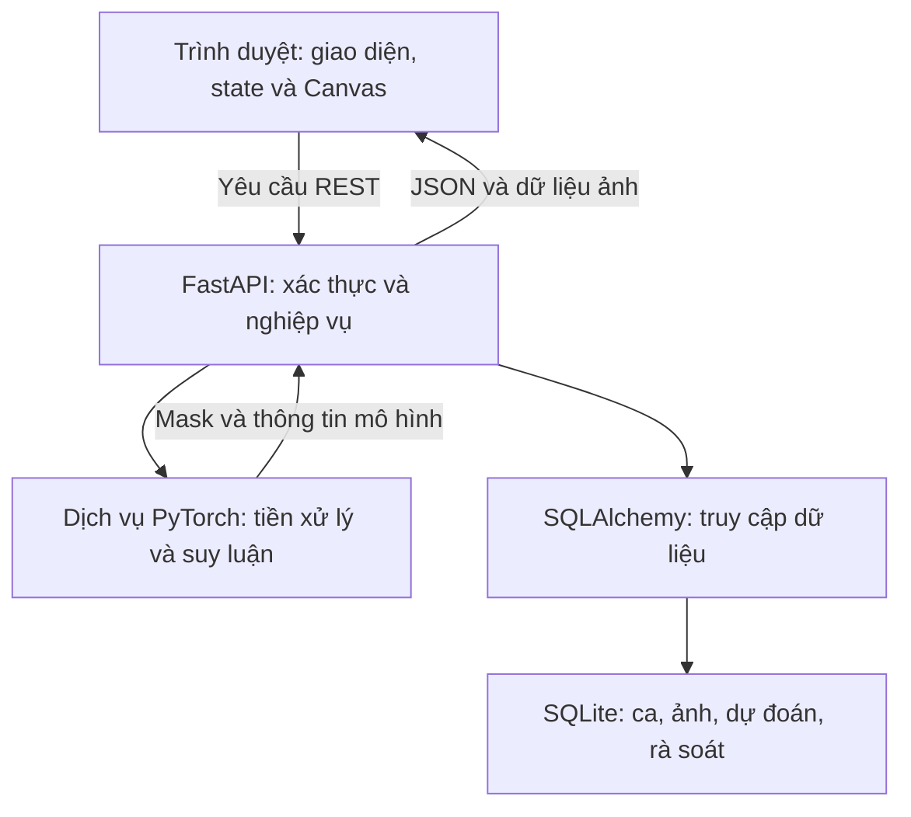

*Hình 2.1: Các nhóm trách nhiệm của kiến trúc ứng dụng web nghiên cứu*

Nguồn: Tác giả tổng hợp từ mã backend và frontend [17], [18].

### 2.1.3. Phương pháp phân tích và mô hình hóa hệ thống

Sơ đồ phân rã chức năng, BFD, trình bày hệ thống theo nhóm chức năng và các chức năng con. Nó giúp kiểm tra phạm vi: tiếp nhận dữ liệu, phân đoạn, rà soát, quản lý ca và quản trị phải có trách nhiệm riêng. BFD không thể hiện thứ tự thời gian hoặc quan hệ bảng. Sơ đồ ngữ cảnh, CD, đặt toàn bộ hệ thống như một tiến trình và mô tả luồng thông tin với tác nhân ngoài. Nó giúp xác định những ai gửi dữ liệu hoặc nhận kết quả và điều gì nằm ngoài ranh giới nghiên cứu.

DFD mô tả dữ liệu đi qua tiến trình và kho lưu trữ. Một tiến trình phải nhận dữ liệu để tạo đầu ra; kho dữ liệu không tự thực hiện nghiệp vụ. Khi phân rã DFD, luồng vào và ra phải cân bằng với mức trên. ERD chuyển sang câu hỏi dữ liệu được tổ chức như thế nào: Patient liên kết Study, Study chứa Image, Image có Prediction, Prediction được liên kết với Review. Các mô hình được sử dụng bổ sung cho nhau; trong Chương 3, chúng phải khớp với bảng và API thực tế, thay vì chỉ là hình minh họa [14], [17].

Use Case mô tả mục tiêu của tác nhân cùng luồng chính và ngoại lệ. User Story phát biểu nhu cầu từ vai trò, còn tiêu chí nghiệm thu chuyển nhu cầu thành điều kiện có thể kiểm tra. Với yêu cầu lưu mask, điều kiện cần bao gồm mã ảnh, mã dự đoán, mask nhị phân, quyền người sử dụng và phản hồi lưu. Nếu API lỗi, giao diện phải giữ bản nháp; nếu ca không còn cho chỉnh sửa, thao tác phải bị chặn. Đây là cách nối yêu cầu nghiệp vụ với kiểm thử.

### 2.1.4. Vòng đời phát triển và quản lý thay đổi

Vòng đời phát triển của đề tài đi qua xác định yêu cầu, thiết kế, hiện thực, kiểm thử và đánh giá. Với bản mẫu nghiên cứu, tiến trình được lặp theo nhóm chức năng: hoàn thành một luồng từ giao diện tới dữ liệu, kiểm tra rồi mở rộng. Cách tổ chức này phù hợp việc tiền xử lý, hợp đồng API và thao tác Canvas cần được đối chiếu nhiều lần. Mỗi thay đổi vẫn phải giữ mối liên hệ giữa yêu cầu, thiết kế và bằng chứng, tránh cập nhật giao diện làm mất hành vi dữ liệu đang đúng.

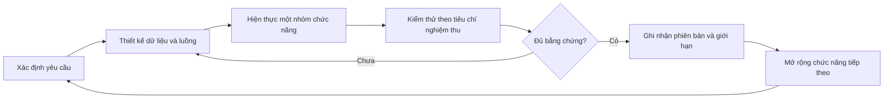

*Hình 2.2: Vòng phát triển và kiểm chứng được áp dụng cho bản mẫu*

Nguồn: Tác giả tổ chức phương pháp thực hiện từ yêu cầu đề cương [12].

### 2.1.5. Human-in-the-Loop và quản trị quyết định

Human-in-the-Loop đặt người sử dụng vào vòng kiểm tra sau gợi ý của mô hình. Người sử dụng được xem ảnh gốc, chấp nhận, sửa hoặc từ chối kết quả. MONAI Label là một nền tảng nghiên cứu về gán nhãn có AI hỗ trợ, cho thấy một hướng tổ chức tương tác người–mô hình [4]. Khóa luận vận dụng nguyên tắc kiểm soát này vào bản mẫu của mình, không lấy kết quả thời gian của nền tảng khác làm hiệu quả đã đạt.

Bản rà soát phải giữ liên kết với dự đoán gốc. Dữ liệu sau chỉnh sửa không tự trở thành ground truth chính thức; trong hệ thống hiện tại cờ `is_official_ground_truth=False` thể hiện giới hạn đó [17]. Muốn đưa bản sửa vào huấn luyện cần quy trình duyệt nhãn riêng. Tương tự, chuyển trạng thái trong chế độ demo chưa phải ký duyệt chuyên môn. Hành vi thật cần quyền server, transaction và phiên bản dữ liệu; kiểm tra quyền chỉ trên menu không đủ bảo vệ tài nguyên.

## 2.2. Cơ sở mô hình Deep Learning phân đoạn ảnh

### 2.2.1. Tích chập và biểu diễn đặc trưng

Tích chập học bộ lọc từ dữ liệu và áp dụng bộ lọc trên các vùng lân cận của ảnh. Kết quả là bản đồ đặc trưng có nhiều kênh, biểu diễn các quan hệ cục bộ hữu ích cho nhiệm vụ. Những tầng sâu kết hợp đặc trưng trên vùng cảm nhận rộng hơn. Khi giảm độ phân giải bằng pooling, mạng có thêm ngữ cảnh nhưng mất một phần chi tiết vị trí. Với phân đoạn, cần một nhánh phục hồi độ phân giải để đầu ra vẫn tương ứng từng pixel.

ConvBlock của Standard U-Net trong dự án gồm hai lần Conv2d 3×3, BatchNorm2d và ReLU; padding bằng 1 duy trì kích thước không gian. Pooling 2×2 giảm chiều cao và rộng còn một nửa. Các thông số này được đọc từ mã nguồn, không mặc định mọi triển khai U-Net có cùng block hoặc cùng số kênh [17]. Thiết kế cụ thể quyết định dung lượng bộ nhớ, số tham số và khả năng nạp checkpoint, vì vậy tên kiến trúc một mình chưa đủ định danh mô hình.

### 2.2.2. Standard U-Net làm mô hình cơ sở

U-Net của Ronneberger, Fischer và Brox đề xuất cấu trúc encoder–decoder kết hợp đường nối giữa các mức đặc trưng để phục vụ phân đoạn ảnh y sinh [1]. Trong dự án, baseline được hiện thực bằng `StandardUNet` với đầu vào một kênh, đầu ra một kênh và base_filters bằng 32. Encoder có các mức 32, 64, 128, 256 kênh, bottleneck 512 kênh; decoder dùng ConvTranspose2d và nối trực tiếp đặc trưng cùng mức [17].

Với ảnh 512×512, các kích thước encoder lần lượt là 512, 256, 128 và 64; bottleneck ở 32×32. Decoder phục hồi theo chiều ngược lại. Tầng cuối Conv2d 1×1 sinh logit, không trả nhãn bệnh học. Sigmoid chuyển logit thành xác suất pixel, sau đó ngưỡng được dùng để tạo mask. Đường nối tắt giữ thông tin vị trí từ encoder để decoder tái sử dụng khi dựng ranh giới.

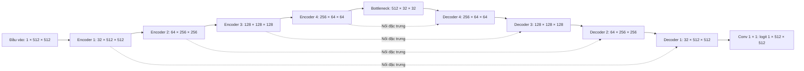

*Hình 2.3: Kiến trúc Standard U-Net base_filters=32 được hiện thực trong dự án*

Nguồn: Tác giả vẽ từ `backend/models/unet.py` và ConvBlock [17]; nền tảng kiến trúc [1].

### 2.2.3. U-Net++ và nguyên tắc đối sánh cấu hình

UNet++ của Zhou và cộng sự sử dụng các đường nối lồng nhau giữa encoder và decoder để kết hợp đặc trưng ở nhiều mức [2]. Cấu hình đối chứng của dự án dùng U-Net++ trong Segmentation Models PyTorch với encoder ResNet34 có trọng số tiền huấn luyện ImageNet. Run config ghi phiên bản thư viện, cách chuẩn hóa, loss và checkpoint [16]. Báo cáo không mặc định mọi cơ chế trong bài báo gốc, như deep supervision, đều được bật trong cấu hình này.

Phép đối sánh được diễn giải ở mức cấu hình tổng thể. Standard U-Net khởi tạo ngẫu nhiên, trong khi encoder ResNet34 của U-Net++ được tiền huấn luyện. Dù cùng split, loss và ngân sách epoch, chênh lệch kết quả chưa tách được hiệu quả riêng của đường nối lồng nhau. Muốn kết luận nhân quả về từng thành phần cần thí nghiệm loại bỏ hoặc giữ cố định yếu tố khởi tạo. Những lựa chọn chưa có run config và kết quả không được đưa vào bảng như mô hình đã thực nghiệm.

### 2.2.4. Letterbox và sự tương ứng hình học

Resize trực tiếp một ảnh chữ nhật thành hình vuông có thể làm thay đổi tỷ lệ hình học. Letterbox sử dụng cùng một hệ số co giãn cho hai chiều rồi thêm vùng đệm. Với kích thước đích 512, hệ số r = min(512/W, 512/H); kích thước nội dung được tính theo quy tắc làm tròn của bộ xử lý, phần còn lại là padding. Dữ liệu biến đổi phải lưu kích thước nguồn, hệ số thực và vị trí vùng đệm để ánh xạ kết quả trở lại đúng ảnh.

Ảnh dùng nội suy liên tục, còn mask dùng nearest-neighbor để tránh sinh nhãn trung gian tại biên. Các phép tăng cường hình học phải biến đổi ảnh và mask đồng bộ; biến đổi cường độ chỉ áp dụng cho ảnh. Tăng cường chỉ dùng trên Train. Cấu hình huấn luyện được đối chiếu ở đây sử dụng ảnh xám CLAHE, letterbox 512×512, chuẩn hóa về [0,1], rồi chuẩn hóa với mean 0,449 và std 0,226 [16]. Đây là cấu hình cụ thể của lượt so sánh, không phải thông số chung bắt buộc cho mọi checkpoint.

### 2.2.5. Hàm mất mát và quá trình cập nhật trọng số

Binary Cross-Entropy phạt sai lệch ở từng pixel, còn Soft Dice đánh giá mức giao giữa xác suất dự đoán và nhãn. Sự kết hợp giúp tối ưu cả sai lệch cục bộ và mức chồng khớp vùng. Trong hai run config đối sánh, loss được ghi là L = 0,5 L_BCE + 0,5 L_Dice [16]. Tham số này phải đọc theo script thực nghiệm; không dùng mặc định của một lớp loss khác trong repository để mô tả lượt huấn luyện.

BCEWithLogits nhận logit trực tiếp. Soft Dice sử dụng xác suất sigmoid cùng nhãn nhị phân và một hằng số ổn định mẫu số. Sau forward, backward tính gradient và optimizer cập nhật trọng số. Validation không cập nhật trọng số và dùng để chọn checkpoint theo mean Dice từng ảnh. Một epoch là một lượt xử lý tập Train theo các batch; nó không đồng nghĩa đã đánh giá Test.

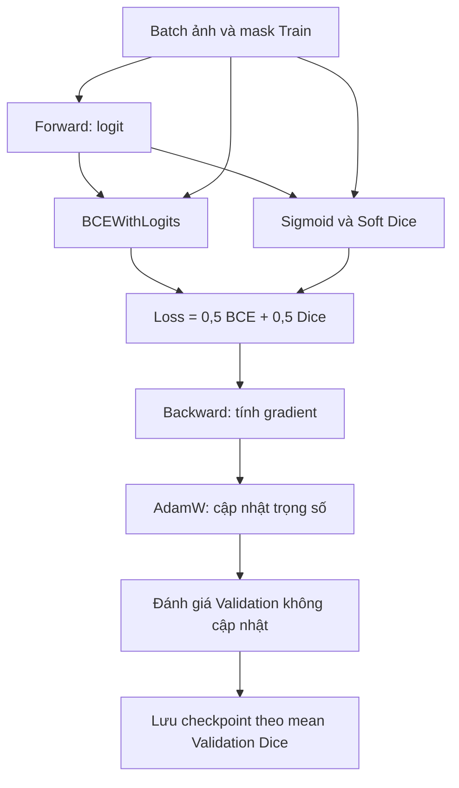

*Hình 2.4: Luồng tính loss và chọn checkpoint trong cấu hình đối sánh*

Nguồn: Tác giả tổng hợp các script và run config thực nghiệm [16].

### 2.2.6. Chỉ số đánh giá và quy ước tổng hợp

Với mask dự đoán P và mask tham chiếu G, TP là vùng giao, FP là vùng dự đoán thừa, FN là vùng tham chiếu bị bỏ sót. Dice = 2TP/(2TP+FP+FN); IoU = TP/(TP+FP+FN); Recall = TP/(TP+FN); Precision = TP/(TP+FP). Recall phản ánh phần tiền cảnh tham chiếu được giữ lại, Precision phản ánh mức dự đoán tiền cảnh đúng theo nhãn. Các chỉ số hỗ trợ phân tích lỗi khác nhau và phải được đọc cùng ảnh thực tế.

Tính từng ảnh rồi lấy trung bình khác với gộp toàn bộ pixel trước khi tính. Cách gộp có thể ưu tiên ảnh chứa vùng lớn; trung bình từng ảnh cho mỗi ảnh một trọng số như nhau. Trường hợp cả dự đoán và tham chiếu rỗng cần quy ước riêng, công bố cùng evaluator. Một mask rỗng không chứng minh người bệnh không có bệnh. Chỉ số pixel nền cũng không được đổi tên thành độ đặc hiệu chẩn đoán ở cấp bệnh nhân.

Validation được dùng cho lựa chọn cấu hình, ngưỡng và checkpoint. Test dùng cho đánh giá sau khi khóa các lựa chọn; nếu Test đã được xem nhiều lần, báo cáo phải công bố lịch sử đó. Điểm trung bình nên đi cùng phân bố và ca lỗi để tránh che những thất bại nặng. Các điều kiện nguồn nhãn và đơn vị split giới hạn ý nghĩa của mọi chỉ số.

### 2.2.7. Chia dữ liệu và truy vết nguồn

Chia theo bệnh nhân yêu cầu một khóa Patient nguồn ổn định; mọi ảnh của cùng bệnh nhân phải nằm trong một tập. Chia theo ảnh chỉ bảo đảm những điều kiện ở cấp ảnh, không tự loại bỏ trường hợp nhiều lát cắt cùng người xuất hiện ở hai tập. Hash SHA-256 phát hiện trùng byte, còn ảnh gần trùng sau nén hoặc thay đổi độ sáng cần phép kiểm bổ sung. Các bước kiểm không thay thế hồ sơ mapping nguồn.

Manifest của dự án công bố rõ chưa có Patient/Case ID được xác minh và chỉ bảo đảm phân tách nội dung ảnh theo chính sách đã ghi [15]. Vì vậy, thuật ngữ đúng cho thí nghiệm hiện tại là chia ở cấp ảnh có kiểm trùng, không phải chia độc lập bệnh nhân đã xác nhận. Tương tự, tồn tại một tệp mask chưa chứng minh có phê duyệt chuyên gia. Hồ sơ nhãn cần người tạo, phiên bản, tiêu chí và người duyệt để nâng mức chứng cứ.

## 2.3. Nghiên cứu liên quan và cơ sở lựa chọn giải pháp

Các nguồn liên quan được chọn theo vai trò: U-Net và UNet++ cung cấp cơ sở kiến trúc; MMOTU hướng tới phân đoạn ảnh siêu âm khối buồng trứng giữa các miền dữ liệu; MONAI Label cung cấp ví dụ tương tác gán nhãn có AI hỗ trợ [1]–[4]. Bài MMOTU mô tả tập ảnh hai chiều và ảnh tăng cường tương phản phục vụ nghiên cứu xuyên miền [3]. Các công trình không tự xác nhận nguồn dữ liệu hiện tại hoặc hiệu quả của bản mẫu này.

*Bảng 2.1: Vai trò của các công trình liên quan trong lựa chọn phương pháp*

| Nguồn | Nội dung được sử dụng | Quyết định trong đề tài | Giới hạn chuyển giao |
|---|---|---|---|
| U-Net, 2015 [1] | Encoder–decoder và đường nối cùng mức | Chọn Standard U-Net làm baseline | Chỉ số của bài gốc không phải chỉ số ảnh buồng trứng hiện tại |
| UNet++, 2018 [2] | Đường nối lồng nhau | Chọn cấu hình U-Net++ đối chứng | Cấu hình thực dùng encoder tiền huấn luyện, cần công bố khác biệt |
| MMOTU, 2022 [3] | Bài toán phân đoạn siêu âm buồng trứng và dịch miền | Đặt yêu cầu kiểm nguồn và khả năng tổng quát hóa | Tên hoặc số lượng thư mục không xác nhận provenance |
| MONAI Label, 2022 [4] | Tương tác gán nhãn có AI hỗ trợ | Thiết kế vòng gợi ý, kiểm tra và sửa | Chưa chứng minh giảm thời gian cho nhóm người dùng đề tài |

Nguồn: Tác giả đối chiếu phạm vi các công trình [1]–[4] với sản phẩm nghiên cứu.

Khoảng trống mà khóa luận xử lý là liên kết mô hình với quy trình có thể truy vết: dữ liệu phải rõ nguồn, dự đoán phải rõ checkpoint và người sử dụng phải sửa được. Đóng góp tập trung vào sự nhất quán giữa yêu cầu, mô hình dữ liệu, thuật toán và tương tác. Chứng minh lợi ích với bác sĩ hoặc khả năng vận hành bệnh viện vẫn cần các nghiên cứu và kiểm định tiếp theo.

## 2.4. Công cụ và công nghệ hỗ trợ thực hiện đề tài

### 2.4.1. Python, PyTorch và công cụ thực nghiệm

Python được dùng cho tiền xử lý, huấn luyện, đánh giá và backend. PyTorch cung cấp tensor, lớp mạng, tính gradient và optimizer [7]. Trong dự án, kiến trúc và loss được tổ chức thành module; trọng số lưu thành checkpoint, còn siêu tham số và chỉ số lưu trong JSON hoặc CSV. Cách lưu này hỗ trợ vẽ lại biểu đồ từ dữ liệu thật và đối chiếu kết quả theo phiên bản [16], [17]. Việc nạp checkpoint phải khớp kiến trúc và chuẩn hóa; không dùng tên tệp thay cho kiểm tra nội dung.

### 2.4.2. FastAPI và hợp đồng giao tiếp

FastAPI được dùng để cung cấp REST API và phục vụ tài nguyên giao diện [6], [17]. Request được kiểm tra theo schema, dependency xác thực xác định người gọi, router điều phối nghiệp vụ và dịch vụ mô hình xử lý suy luận. Hợp đồng phải chỉ rõ mã định danh, mặt nạ, lỗi và trạng thái lưu. API hiện dùng `/api/review` dạng số ít cho bản rà soát. Các endpoint workflow mới được ghi riêng trong tài liệu; giao diện không coi lỗi 404, 405 hoặc 501 là thành công [18].

### 2.4.3. SQLAlchemy và SQLite

SQLAlchemy ánh xạ đối tượng với bảng và quản lý session, query, transaction [8]. SQLite được dùng như cơ sở dữ liệu cho môi trường bản mẫu độc lập [11], [17]. Dữ liệu quan hệ lưu những thực thể cần truy vết, trong khi tệp ảnh và mask có chính sách đường dẫn riêng. Một transaction phải giữ nhất quán những thay đổi có quan hệ; khi lỗi cần rollback. Ràng buộc quyền, trùng dữ liệu và truy cập đồng thời phải được kiểm tại server hoặc database, không chỉ tại giao diện.

### 2.4.4. HTML, CSS, JavaScript và Canvas

HTML tổ chức cấu trúc ngữ nghĩa; CSS cung cấp tokens và bố cục; JavaScript ES modules điều khiển trạng thái và luồng tương tác. Canvas 2D hiển thị ảnh và mask bằng các lớp đệm, còn requestAnimationFrame điều phối cập nhật hiển thị [9], [18]. Thao tác zoom và pan thay đổi phép biến đổi hiển thị, không thay đổi nhãn pixel đã lưu. Cọ và tẩy chỉ tác động vào mask làm việc; opacity và độ sáng chỉ là thuộc tính xem.

Phép ánh xạ tọa độ cần nối vị trí con trỏ trong trình duyệt với viewport, lưới 512×512 và ảnh nguồn. Phép nghịch đảo zoom/pan được thực hiện trước, rồi loại padding và áp dụng nghịch đảo letterbox. Sau resize viewport, bounding box và transform phải được cập nhật. Sai số ở chuỗi này khiến vị trí chỉnh sửa hoặc số đo sai dù con trỏ nhìn đúng, vì vậy kiểm thử ảnh không vuông là yêu cầu thiết yếu [18].

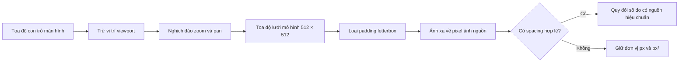

*Hình 2.5: Chuỗi chuyển đổi tọa độ và điều kiện quy đổi đơn vị đo*

Nguồn: Tác giả tổng hợp thiết kế tọa độ và phép đo của giao diện [18].

### 2.4.5. Công cụ mô hình hóa, quản lý mã và kiểm tra giao diện

Mermaid và tệp draw.io giúp lưu sơ đồ dưới dạng có thể sửa, hỗ trợ đối chiếu khi yêu cầu thay đổi. Các sơ đồ trong báo cáo được dựng theo mô hình của đề tài, không dùng logo công nghệ để thay thế nội dung phân tích. Visual Studio Code là công cụ soạn mã phù hợp với Python và JavaScript; Git ghi lịch sử phiên bản. Tuy nhiên, khả năng hỗ trợ của công cụ không được diễn giải thành bằng chứng rằng mọi thay đổi đã commit hoặc được phát hành.

Các thành phần giao diện dùng nhãn, trạng thái tải, rỗng, lỗi và có dữ liệu nhất quán. WCAG cung cấp cơ sở về tương phản, bàn phím và khả năng tiếp cận [10]. Dự án vận dụng native form, dialog, focus và nhãn icon; việc có những kỹ thuật này chưa chứng nhận đầy đủ WCAG AA. Kiểm thử trình duyệt xác nhận hành vi cụ thể, còn đánh giá với screen reader và môi trường bác sĩ vẫn là bước riêng.

## 2.5. Tiểu kết chương

Chương 2 thiết lập cơ sở để đọc đúng thiết kế và kết quả: mask là dữ liệu hình học; HITL là quy trình kiểm soát; mô hình được định danh bằng cấu hình và checkpoint; chất lượng phải xét cùng nhãn và split. Các công cụ được chọn theo implementation hiện tại. Chương 3 chuyển những cơ sở này thành yêu cầu, mô hình hệ thống, cấu trúc dữ liệu, giải thuật, giao diện và bằng chứng thực nghiệm cụ thể.

# CHƯƠNG 3. XÂY DỰNG HỆ THỐNG HỖ TRỢ PHÂN ĐOẠN SIÊU ÂM BUỒNG TRỨNG

## 3.1. Mô tả bài toán

### 3.1.1. Đặt vấn đề

Bài toán của khóa luận là xây dựng một hệ thống thông tin hỗ trợ tạo, quan sát, chỉnh sửa và lưu mặt nạ phân đoạn tổn thương trên ảnh siêu âm buồng trứng. Đầu vào trực tiếp của mô hình là ảnh; đầu ra trực tiếp là mặt nạ nhị phân trong đó mỗi điểm ảnh được gán vào vùng mục tiêu hoặc nền. Hệ thống Web bao quanh mô hình nhằm đưa đầu ra này vào một tác vụ có thể kiểm tra: người sử dụng thấy ảnh nguồn, đối chiếu mặt nạ gợi ý, chỉnh những vùng không phù hợp và lưu kết quả rà soát. Vì vậy, nhiệm vụ triển khai bao gồm cả thuật toán học sâu, quản lý dữ liệu và thiết kế tương tác; chỉ chạy được một notebook suy luận chưa giải quyết toàn bộ bài toán [12], [17], [18].

Trong quy trình đọc ảnh, một vùng sáng hoặc tối không tự mang ý nghĩa bệnh học xác định. Mặt nạ dự đoán có thể bỏ sót vùng cần khoanh, lan sang cấu trúc lân cận hoặc tạo mảnh nhỏ trên nền. Nếu người dùng chỉ nhận một điểm số tổng hợp mà không nhìn thấy vị trí dự đoán, họ khó xác định sai lệch nằm ở đâu. Khóa luận lựa chọn trực quan hóa bằng đường viền và lớp phủ để tạo một đối tượng có thể phản biện trực tiếp. Đường viền AI được xem như bản đề xuất hình học, còn mặt nạ sau rà soát là sản phẩm của một thao tác nghiên cứu có lưu dấu vết. Hai đối tượng này phải tồn tại độc lập trong hệ thống.

Sự độc lập giữa dự đoán và rà soát là một yêu cầu dữ liệu, không chỉ là yêu cầu hiển thị. Nếu mỗi nét vẽ ghi đè lên mặt nạ AI ban đầu, người mở lại sẽ không thể xác định người dùng đã sửa gì, đồng thời việc tính mức chỉnh sửa mất cơ sở đối chiếu. Thiết kế hiện có dùng `PredictionModel.raw_mask_rle` để lưu mặt nạ AI và `ReviewModel.verified_mask_rle` để lưu mặt nạ sau thao tác. Trường `prediction_id` trong Review liên kết tới lần dự đoán được xét. Với cách tổ chức này, có thể mở lại ảnh cùng hai phiên bản và truy thời điểm, tác nhân, quyết định đã ghi [17].

Một vấn đề khác là sự nhầm lẫn giữa hình học điểm ảnh và kích thước vật lý. Ảnh sau letterbox có lưới 512×512 nhưng đây là không gian tính toán của mô hình; nó không phải bằng chứng về kích thước thực của tổn thương. Muốn chuyển sang mm cần biết kích thước ảnh nguồn, phép biến đổi hình học và hệ số mm trên một điểm ảnh nguồn. Thiếu thông tin hiệu chuẩn, hệ thống chỉ được báo px và px². Quy tắc này được đưa vào SRS, hợp đồng API và giao diện vì một số đo có đơn vị sai vẫn có thể trông rất thuyết phục trên một phiếu trình bày đẹp.

Phiên bản giao diện hiện tại tiếp nhận một ca hai bên với hai ô ảnh Trái và Phải tách biệt. Người dùng phải cung cấp đủ hai ảnh hợp lệ trước khi luồng tự động tạo ca, tải ảnh, kiểm tra chất lượng và suy luận được kích hoạt. Mỗi ảnh có mã riêng, mặt nạ riêng, trạng thái hiệu chuẩn riêng và kết quả rà soát riêng. Quy tắc này được thực hiện trong frontend mới; API vẫn bảo tồn khả năng tiếp nhận ca đơn bên hoặc hồ sơ cũ. Do đó, tính bắt buộc hai bên là quy tắc của luồng Workspace mới, không phải một khẳng định rằng toàn bộ dữ liệu lịch sử đã được chuyển thành hồ sơ hai bên [18].

Bản mẫu không đưa kết luận lành tính hoặc ác tính, không thay thế diễn giải của bác sĩ và không tạo kết quả chẩn đoán chính thức. Đề cương xác định xác nhận mặt nạ là thao tác trong môi trường thử nghiệm. Mã nguồn lưu `is_official_ground_truth=False` cho mỗi Review; tên trường chứa từ “doctor” hoặc “verified” không làm dữ liệu tự trở thành Ground Truth đã được hội đồng chuyên môn duyệt. Khi mô tả báo cáo, khóa luận sử dụng các cụm “mặt nạ rà soát”, “kết quả phân đoạn thử nghiệm” và “phiếu nghiên cứu” để giữ đúng ý nghĩa của sản phẩm [12], [17].

### 3.1.2. Khảo sát quy trình tham chiếu và xác định khoảng trống

Quy trình As-Is trong khóa luận được xây dựng từ phát biểu vấn đề, mô tả công việc trong đề cương và nhu cầu tương tác đã được cụ thể hóa trong bản mẫu. Hồ sơ được đối chiếu chưa có biên bản quan sát bác sĩ tại bệnh viện, bảng thời gian thao tác hoặc kết quả phỏng vấn có chữ ký. Vì vậy, phần này là mô hình quy trình tham chiếu phục vụ phân tích yêu cầu, chưa phải báo cáo khảo sát hiện trường xác nhận mọi bước đang diễn ra tại Vinmec. Cách giới hạn bằng chứng này giúp phân biệt thông tin đã có với nội dung cần khảo sát bổ sung trước một đợt thử nghiệm chuyên môn [12], [18].

Ở giai đoạn tiếp nhận, người đọc cần một ảnh có thể giải mã và đủ bối cảnh để biết nó thuộc lần khảo sát nào, bên buồng trứng nào. Tên file do người gửi cung cấp thường không đủ làm khóa nhận diện ổn định; hai file có thể trùng tên nhưng khác nội dung, hoặc khác tên nhưng giống hoàn toàn. Hồ sơ nghiên cứu vì thế cần cấp mã Study và Image riêng, giữ quan hệ với PID giả danh, đồng thời lưu kích thước ảnh và dấu vân tay nội dung. Giai đoạn này cũng phải phân biệt ảnh raster với DICOM, bởi DICOM có thể chứa dữ liệu đa khung, metadata định danh và thông tin thước đo.

Ở giai đoạn quan sát, người sử dụng xem vùng quan tâm, xác định ranh giới và thao tác khoanh vùng. Các điều kiện như nhiễu, tương phản thấp, đường viền mờ hoặc nhiều cấu trúc sát nhau có thể làm thao tác khó hơn. Khóa luận không định lượng thời gian tăng thêm hay mức biến thiên giữa bác sĩ do chưa có số liệu quan sát. Tuy nhiên, từ yêu cầu thao tác có thể xác định những dữ liệu hệ thống phải bảo toàn: ảnh nguồn, mặt nạ được dùng, vị trí nét vẽ và hệ tọa độ. Nếu các đối tượng không đồng bộ, thao tác sửa sẽ không phản ánh đúng vùng người dùng đang nhìn.

Ở giai đoạn ghi nhận, người đọc hoàn tất một phiên bản khoanh vùng và lưu mô tả đi kèm. Nếu chỉ lưu ảnh chụp màn hình đã chồng màu, dữ liệu mất sự phân biệt giữa ảnh nền và nhãn; rất khó chỉnh lại hoặc tính toán diện tích một cách nhất quán. Nếu chỉ lưu mask, người mở lại thiếu nguồn ảnh và phiên bản mô hình để diễn giải. Thiết kế To-Be cần giữ liên kết giữa Image, Prediction và Review thay cho một tệp kết quả tổng hợp không có cấu trúc.

Ở giai đoạn tra cứu, người sử dụng tìm ca theo mã, ngày hoặc PID giả danh và cần biết trạng thái xử lý. Trạng thái “AI đã phân tích” khác với “người dùng đã lưu rà soát”; cả hai tiếp tục khác với ký duyệt chuyên môn chính thức. Một nhãn trạng thái dùng chung cho ba nghĩa này có thể gây hiểu sai khi xuất phiếu. Vì vậy, phân tích nghiệp vụ đặt việc định nghĩa trạng thái trước việc thiết kế badge hoặc màu sắc.

*Bảng 3.1: Đối chiếu các giai đoạn tham chiếu với giải pháp thông tin đề xuất*

| Giai đoạn | Vấn đề cần kiểm tra khi khảo sát thực địa | Giải pháp trong bản mẫu | Đối tượng dữ liệu | Giới hạn bằng chứng hiện có |
|---|---|---|---|---|
| Tiếp nhận | Cách gắn ảnh vào ca và xác định bên | Study có mã riêng, hai ô Trái/Phải | Patient, Study, Image | Đã có thiết kế và code; chưa có biên bản bệnh viện |
| Kiểm tra đầu vào | Định dạng, chất lượng, thước đo | Decode, IQA, trạng thái hiệu chuẩn | Image và thông tin IQA | Có kiểm tra kỹ thuật; IQA chưa là thang lâm sàng được thẩm định |
| Khoanh vùng | Ranh giới khó quan sát, số thao tác sửa | AI đề xuất; Canvas cho sửa, hoàn tác | Prediction, mask làm việc | Có bản mẫu; chưa có đo thời gian bác sĩ |
| Hoàn tất | Khó phân biệt bản AI với bản người sửa | Lưu Review riêng, liên kết Prediction | Review, AuditLog | Review nghiên cứu; không phải ký chuyên môn |
| Mở lại | Thiếu nguồn gốc và lịch sử | Mở ảnh, prediction, review gần nhất | Các mã và thời điểm | Lịch sử workflow nhiều cấp cần API mới |
| Tổng hợp | Dễ hiểu phiếu thử nghiệm thành phiếu chính thức | Cảnh báo nghiên cứu trên màn hình và phiếu | Phiếu từ dữ liệu ca | PDF lâm sàng server chưa hỗ trợ |

Nguồn: Tác giả tổng hợp từ đề cương, mã nguồn và tài liệu bàn giao Workspace [12], [17], [18].

Khoảng trống cần giải quyết trước hết là thiếu một chuỗi thao tác khép kín trong cùng hệ thống, từ ảnh tới kết quả rà soát có thể mở lại. Một mô hình tốt nhưng không cho người dùng sửa trực tiếp khó đáp ứng yêu cầu HITL. Ngược lại, một trình xem đẹp nhưng mất mặt nạ nguồn hoặc dùng sai đơn vị làm suy giảm giá trị kiểm tra. Hệ thống được thiết kế nhằm kết nối ba lớp: mô hình tạo đề xuất, giao diện cho phản biện và kho dữ liệu lưu nguồn gốc.

Quy trình To-Be vẫn đặt người dùng ở điểm quyết định cuối của tác vụ nghiên cứu. Tự động hóa được áp dụng cho tải ảnh, kiểm tra chất lượng và chạy phân đoạn; việc chấp nhận, sửa hoặc bỏ mặt nạ không diễn ra tự động. Trước khi mở modal tổng kết, giao diện yêu cầu cả hai ảnh đã được hiển thị và các cảnh báo đã xuất hiện. Đây là điều kiện kiểm soát tương tác có thể kiểm bằng test; nó chưa chứng minh người dùng thực sự đọc kỹ từng vùng và cũng không thay cho đánh giá thiên lệch tự động hóa trong nghiên cứu người dùng.

### 3.1.3. Phân tích yêu cầu hệ thống

#### 3.1.3.1. Phạm vi, tác nhân và nguyên tắc ưu tiên

Các yêu cầu được chia theo hai mức triển khai. Mức lõi là luồng đang nối backend: đăng nhập, tạo ca, upload, IQA, suy luận, chỉnh mask, đo, hiệu chuẩn và lưu rà soát. Mức mở rộng là workflow nhiều vai trò cùng các màn quản trị và quy trình duyệt hai cấp đã được dựng trong giao diện demo nhưng chưa có đầy đủ dịch vụ server. Việc gắn trạng thái triển khai vào yêu cầu tránh dùng độ phủ màn hình để suy ra độ phủ nghiệp vụ backend.

Tác nhân lõi gồm người rà soát nghiên cứu mang role backend `DOCTOR` và quản trị mang role `ADMIN`. Frontend ánh xạ hai role thành BS và QT. Vai trò TK tồn tại trong mô hình sản phẩm và môi trường demo để thể hiện hàng chờ, duyệt độc lập, trả lại và khóa ca; backend hiện tại chưa cung cấp role trưởng khoa tương đương. Tài khoản mẫu trong DB không phải bằng chứng rằng một bác sĩ có danh tính chuyên môn đã tham gia thử nghiệm [17], [18].

Ba nguyên tắc được áp dụng xuyên suốt. Thứ nhất, không ghi đè mặt nạ AI khi người dùng sửa. Thứ hai, không tự sinh đơn vị vật lý từ lưới mô hình hoặc từ thông số hiển thị. Thứ ba, không đổi một thao tác thất bại thành trạng thái thành công để làm giao diện liền mạch. Mọi thông báo “đã lưu” phải dựa trên phản hồi thành công của API; các endpoint chưa được hỗ trợ phải hiện lỗi có giải thích.

#### 3.1.3.2. Yêu cầu chức năng

*Bảng 3.2: Danh mục yêu cầu chức năng và mức triển khai*

| Mã | Yêu cầu | Dữ liệu vào/ra chính | Mức thực hiện tại bản mẫu | Tiêu chí kiểm tra trọng tâm |
|---|---|---|---|---|
| FR-01 | Đăng nhập và đọc hồ sơ phiên | Username, password → JWT, UserProfile | Backend và FE nối thật | Sai mật khẩu không cấp token; user vô hiệu hóa bị chặn |
| FR-02 | Khởi tạo ca nghiên cứu | PID, ngày, ghi chú → study_id | Nối thật | Patient và Study tại endpoint tạo ca cùng một commit |
| FR-03 | Tiếp nhận ảnh hai bên | File Trái/Phải → image_id L/R | Nối thật trong Workspace | Thiếu một ảnh chưa chạy luồng tự động |
| FR-04 | Kiểm tra file và ảnh trùng | Byte ảnh, hash, Study | Nối thật | File lỗi bị từ chối; cùng hash trong Study trả 409 |
| FR-05 | Kiểm tra chất lượng ảnh | Image → IQA và thông báo | Nối thật | Kết quả mỗi bên riêng; ảnh không phù hợp bị gate predict |
| FR-06 | Chạy mô hình đã nạp | image_id → prediction_id, RLE | Nối thật | Không có checkpoint hợp lệ trả 503 |
| FR-07 | Quan sát ảnh và mặt nạ | Ảnh, mask AI, mask làm việc | FE đã hiện thực | Đường viền mặc định; đổi lớp không thay dữ liệu |
| FR-08 | Chỉnh mặt nạ và hoàn tác | Nét cọ, tẩy, đa giác → mask mới | FE đã hiện thực | Sửa đúng tọa độ sau zoom/pan; undo không đổi AI gốc |
| FR-09 | Đo theo ảnh nguồn | RLE → d₁, d₂, diện tích | API và FE nối thật | Không hiệu chuẩn chỉ px; số vật lý nullable |
| FR-10 | Hiệu chuẩn thước | mm/px hoặc khoảng chuẩn | Nối thật | Chỉ nhận hệ số hữu hạn, dương |
| FR-11 | Lưu rà soát từng ảnh | Prediction, action, RLE, ghi chú | Nối thật | Mask/action hợp lệ; `is_ground_truth=False` |
| FR-12 | Mở lại ca đã lưu | study_id → ảnh, prediction, review | Nối thật | Review chỉ lại prediction được xét khi còn trong DB |
| FR-13 | Tìm danh sách ca legacy | Search, status, date → tối đa 50 ca | API hiện có | Trả tập giới hạn; không gọi là phân trang hoàn chỉnh |
| FR-14 | Nháp cục bộ và cảnh báo xung đột | Mask, notes, base version/review | FE đã hiện thực | Không tự phục hồi nháp lệch phiên bản |
| FR-15 | Ký sơ bộ hai bên nguyên tử | Hai review, version → signed | Demo và contract mới | Cần server transaction, idempotency, quyền |
| FR-16 | Duyệt, từ chối, khóa, bổ sung | Action, reason, version | Demo và contract mới | Không tự duyệt; không sửa bản đã khóa |
| FR-17 | Phiếu nghiên cứu A4 | Ảnh, mask, số đo, provenance | FE đã dựng | Hai bên, cảnh báo nghiên cứu; không tuyên bố PDF lâm sàng |
| FR-18 | Xem đánh giá mô hình lịch sử | Metrics và sample artifacts | API hiện có | Không dùng Dice tập test làm confidence ca đang đọc |
| FR-19 | Quản trị read và log | Users, models, audit | Một số API read hiện có | API quản trị dùng require_admin theo chức năng |
| FR-20 | Quản trị CRUD và khoa | User, department, settings | Demo và contract mới | Quyền và audit phải kiểm lại ở server |
| FR-21 | OTP, reset và refresh phiên | Challenge, mật khẩu, token | Màn hình và contract mới | Không xem UI lockout là kiểm soát server |
| FR-22 | Ẩn danh có kiểm chứng | DICOM, EXIF, vùng chữ | Trạng thái và contract đề xuất | Không báo đã ẩn danh khi chưa xử lý thật |

Nguồn: Đối chiếu mã nguồn và tài liệu Workspace [17], [18].

Nhóm tiếp nhận phải kết hợp kiểm tra cú pháp với kiểm tra khả năng giải mã. Extension nằm trong danh sách cho phép chưa đủ chứng minh nội dung là ảnh hợp lệ. Endpoint upload hiện kiểm `.png`, `.jpg`, `.jpeg`, `.dcm`, giới hạn 20 MB, từ chối nội dung quá nhỏ và giải mã để lấy kích thước. Với DICOM, backend hiện chỉ nhận siêu âm `Modality=US` có một frame; màn chọn frame đa khung trong giao diện là một hợp đồng mở rộng, không được mô tả thành tính năng server đã có.

Nhóm suy luận phải tách lỗi đầu vào khỏi lỗi hạ tầng mô hình. Một ảnh đọc được nhưng không vượt kiểm tra suitability có thể nhận lỗi 422; checkpoint chưa nạp hoặc không khớp điều kiện lựa chọn nhận 503. Frontend giữ image_id để retry đúng đối tượng thay vì tạo một ca mới sau mỗi lỗi. Thông tin IQA được trình bày như kết quả kiểm tra kỹ thuật của pipeline, không được xem là đánh giá chắc chắn về giá trị chẩn đoán của ảnh.

Nhóm tương tác phải phân biệt trạng thái đang làm việc với trạng thái đã lưu. Vẽ, tẩy, fill holes và smooth thay đổi mask trong bộ nhớ trình duyệt; đổi opacity, pan hoặc brightness chỉ thay cách nhìn. Sau khi lưu thành công, Review là bản ghi riêng trong DB. Nếu request lỗi, bản nháp còn tồn tại và nút thử lại không được gắn nhãn “đã xác nhận”. Các trường hợp mask rỗng được thể hiện bằng thao tác bỏ toàn bộ vùng đề xuất; điều này không phải kết luận người bệnh không có bệnh.

Nhóm quản trị và workflow cần xem xét như thiết kế tích hợp tiếp theo. UI đã có layout cho BS, TK và QT, nhưng ownership, giới hạn theo khoa, ký sơ bộ hai bên nguyên tử, tách nhiệm vụ và khóa hồ sơ phải được backend thực thi. Ẩn nút giúp người dùng đi đúng luồng, song một client khác vẫn có thể gọi API. Khóa luận vì thế không dùng câu “đã phân quyền toàn diện” khi dữ liệu Study chưa có owner_id và department_id.

#### 3.1.3.3. Yêu cầu phi chức năng

Yêu cầu phi chức năng được diễn đạt theo đối tượng cần quan sát và cách kiểm tra thay vì một cam kết định tính như “nhanh”, “an toàn” hoặc “thân thiện”. Mục tiêu hiệu năng render là khoảng 60 khung hình mỗi giây trong zoom/vẽ trên máy phù hợp; đây là mục tiêu kỹ thuật cần đo bằng profiler, không là số liệu đã đạt cho mọi thiết bị. Mục tiêu thao tác ít click cũng là giả thuyết UX, chưa được dùng để suy ra giảm thời gian lâm sàng.

*Bảng 3.3: Yêu cầu phi chức năng, phương pháp xác minh và giới hạn*

| Mã | Thuộc tính | Yêu cầu cụ thể | Cách xác minh | Tình trạng bằng chứng |
|---|---|---|---|---|
| NFR-01 | Chính xác hình học | Một phép đổi tọa độ dùng nhất quán; bảo toàn tỷ lệ | Unit test ảnh không vuông, letterbox, zoom/pan | Có module và test kỹ thuật; không suy ra chính xác đo lâm sàng |
| NFR-02 | Nhất quán đơn vị | Thiếu spacing không phát sinh mm/cm² | Test API và hiển thị null/px | Có bất biến trong luồng review/source measurement |
| NFR-03 | Truy vết | Giữ prediction và review riêng, actor từ token | Kiểm DB sau lưu và mở lại | Có dữ liệu cơ bản; provenance đầy đủ cần schema bổ sung |
| NFR-04 | Toàn vẹn | Commit Patient/Study cùng endpoint; chặn hash trùng | Test rollback, conflict 409 | Có sửa và kiểm thử phần lõi |
| NFR-05 | Quyền | Chỉ DOCTOR ghi review; ADMIN xóa ca | Test 401/403 theo endpoint | Có chặn chức năng; ownership/khoa chưa đủ |
| NFR-06 | Tính đáp ứng | Render theo requestAnimationFrame, worker đo preview | Browser test và profiler | Có hiện thực; chưa benchmark máy bác sĩ |
| NFR-07 | Khôi phục | Nháp gắn tài khoản/ca/version; không ghi đè server | Test offline, đổi phiên, stale draft | Có bảo vệ cục bộ; lease đa thiết bị cần server |
| NFR-08 | Tiếp cận | Focus rõ, nhãn nút, bàn phím, trạng thái có chữ | Kiểm keyboard và audit WCAG | Có thiết kế theo WCAG; chưa chứng nhận toàn diện |
| NFR-09 | Tương thích | Desktop; worklist/duyệt trên tablet | Kiểm viewport desktop/tablet | Có ảnh chụp và browser test bản mẫu |
| NFR-10 | Riêng tư | PID giả danh; không tự khẳng định ẩn danh ảnh | Kiểm metadata và chữ in cứng | Pipeline khử định danh đầy đủ chưa có |
| NFR-11 | Khả năng bảo trì | Module ES6, router/service/ORM tách trách nhiệm | Static review và chạy test hồi quy | Có kiến trúc hiện tại; vẫn có nợ schema legacy |
| NFR-12 | Phạm vi nghiên cứu | Cảnh báo nghiên cứu trên UI và bản in | Kiểm shell và print stylesheet | Đã có nội dung/thiết kế; chưa cấp phép lâm sàng |

Nguồn: Tác giả thiết kế và đối chiếu hiện thực [17], [18]; nguyên tắc tiếp cận tham khảo W3C [10].

#### 3.1.3.4. Đặc tả Use Case cốt lõi

Use Case được mô tả theo điều kiện trước, luồng chính, ngoại lệ và điều kiện sau để làm rõ thời điểm dữ liệu thay đổi. Một thao tác có nút trên giao diện nhưng chưa có endpoint không được tính là Use Case hoàn thành ở chế độ thật. Các Use Case lõi dưới đây sử dụng API đang tồn tại; Use Case duyệt chính thức được ghi riêng như thiết kế mở rộng.

*Bảng 3.4: Đặc tả UC-01 — Tiếp nhận ca và cặp ảnh hai bên*

| Thuộc tính | Đặc tả |
|---|---|
| Mục tiêu | Tạo một ca nghiên cứu có hai ảnh L/R hợp lệ, mỗi ảnh có mã ổn định |
| Tác nhân | Người dùng DOCTOR qua giao diện BS |
| Điều kiện trước | Đã đăng nhập; có quyền vào intake; hai file được người dùng chọn riêng |
| Kích hoạt | Đủ hai file hợp lệ trong hai dropzone |
| Luồng chính | FE xác minh định dạng/kích thước → tạo Study với BOTH → upload L và R → nhận image_id từng bên → chạy IQA → chuyển tới viewer khi đủ dữ liệu |
| Ngoại lệ | Thiếu bên: chưa chạy; file lỗi: yêu cầu chọn lại; upload lỗi: giữ ca/ID đã có và cho retry; cùng hash trong Study: 409 |
| Điều kiện sau | Study và hai Image được liên kết; chưa có kết luận lâm sàng; suy luận có trạng thái riêng |
| Dữ liệu cần bảo toàn | PID giả danh, study_id, image_id, laterality, dimensions, hash |

*Bảng 3.5: Đặc tả UC-02 — Suy luận và hiển thị mặt nạ đề xuất*

| Thuộc tính | Đặc tả |
|---|---|
| Mục tiêu | Nhận mặt nạ AI từ checkpoint đã nạp và hiển thị trên đúng ảnh |
| Tác nhân | Người rà soát; FE tự điều phối sau intake |
| Điều kiện trước | Image tồn tại; file giải mã được; gate chất lượng cho phép; model sẵn sàng |
| Luồng chính | Gọi predict theo image_id → tiền xử lý → model forward → hậu xử lý → ghi Prediction/Audit → trả RLE và provenance → FE tạo mask làm việc riêng |
| Ngoại lệ | 404: thiếu ảnh/file; 422: ảnh không phù hợp; 503: model chưa nạp; mất mạng: không tự báo hoàn tất |
| Điều kiện sau | Có prediction_id cho ảnh thật; mặt nạ AI gốc được giữ; Study legacy có thể chuyển ANALYZED |
| Giới hạn | ANALYZED không chứng minh đủ hai bên đã chạy xong; FE cần đọc trạng thái từng ảnh |

*Bảng 3.6: Đặc tả UC-03 — Chỉnh mặt nạ và lưu rà soát nghiên cứu*

| Thuộc tính | Đặc tả |
|---|---|
| Mục tiêu | Lưu mask cuối cùng cùng quyết định ACCEPTED_RAW, MODIFIED hoặc REJECTED_ALL |
| Tác nhân | Người dùng DOCTOR; actor lấy từ token |
| Điều kiện trước | Có Image và Prediction cùng ảnh; RLE đúng lưới 512×512; người dùng đang làm trên phiên hợp lệ |
| Luồng chính | Xem ảnh → sửa/hoàn tác nếu cần → tổng kết hai bên → gửi review từng ảnh → BE kiểm quan hệ và action-mask → đo trong ảnh nguồn nếu đọc được → ghi Review/Audit/trạng thái |
| Ngoại lệ | Prediction sai ảnh: 422; ID không tồn tại: 404; role sai: 403; RLE sai: 422; lưu một bên lỗi: giữ nháp và báo trạng thái từng bên |
| Điều kiện sau | Review lưu riêng với `is_official_ground_truth=False`; đủ L/R đã review thì Study REVIEWED, chưa đủ là PARTIALLY_REVIEWED |
| Giới hạn | API legacy ghi mỗi ảnh riêng; chưa là transaction ký hai bên và chưa có idempotency bắt buộc |

*Bảng 3.7: Đặc tả UC-04 — Mở lại ca và xem phiếu nghiên cứu*

| Thuộc tính | Đặc tả |
|---|---|
| Mục tiêu | Khôi phục đúng nguồn ảnh, prediction và review để quan sát hoặc trình bày |
| Tác nhân | Người rà soát được phép xem ca trong thiết kế mục tiêu |
| Điều kiện trước | study_id tồn tại; phiên đăng nhập còn hiệu lực |
| Luồng chính | Đọc detail → chọn review gần nhất → lấy prediction mà review tham chiếu → tải ảnh nguồn/ảnh model-space → decode RLE → hiển thị nguồn gốc và số đo → xem trước phiếu |
| Ngoại lệ | Thiếu file: báo lỗi; review tồn tại nhưng prediction tham chiếu mất: dùng dữ liệu còn có và báo hạn chế; API export chưa có: không tạo thông báo xuất thành công |
| Điều kiện sau | Không thay đổi mặt nạ đã lưu chỉ bởi việc xem hoặc in; phiếu có cảnh báo nghiên cứu |
| Giới hạn | Server generate-report hiện trả 501; quyền ownership và audit export phiên bản cần endpoint mới |

Use Case duyệt chính thức bổ sung một điều kiện nghiệp vụ khác với UC-03: người duyệt phải khác người ký sơ bộ, cùng phạm vi khoa được phép và làm việc trên phiên bản xác định. Reject cần lý do; sửa sau khóa cần tạo bản bổ sung. Những điều kiện này đã được mô phỏng trong môi trường demo và đặc tả contract, nhưng schema Study hiện chưa đủ trường để cưỡng chế. Khóa luận giữ Use Case này trong thiết kế phát triển, không báo nó là quy trình đã được bệnh viện vận hành.

#### 3.1.3.5. User Stories và tiêu chí nghiệm thu

User Stories chuyển mô tả chức năng thành mục đích của người dùng, còn Acceptance Criteria xác định biểu hiện quan sát được. Cặp tài liệu này hỗ trợ lựa chọn test có ý nghĩa: thay vì chỉ kiểm một hàm trả về giá trị, kiểm việc người dùng có thể hoàn tất thao tác mà không nhầm trạng thái hoặc mất dữ liệu. Các tiêu chí sau là đặc tả cần đáp ứng; trạng thái “có test kỹ thuật” không thay cho kết quả thử nghiệm bác sĩ.

*Bảng 3.8: User Stories và Acceptance Criteria của vòng HITL*

| Story | Mục đích người dùng | Given | When | Then |
|---|---|---|---|---|
| US-01 | Tôi muốn biết ảnh thuộc bên nào để tránh sửa nhầm | Intake có hai dropzone | Chọn ảnh vào ô Trái và Phải | Preview và request laterality tương ứng L/R |
| US-02 | Tôi muốn không chạy một ca thiếu dữ liệu hai bên | Chỉ có một file hợp lệ | Chờ luồng tự động | Không gọi create/upload/predict cho một cặp chưa đủ |
| US-03 | Tôi muốn nhận lỗi đầu vào rõ ràng | File sai hoặc lớn hơn 20 MB | Chọn hoặc thả file | Ô lỗi chỉ rõ lý do và cho thay file |
| US-04 | Tôi muốn xem AI khoanh ở đâu | Prediction hoàn tất | Mở viewer | Ảnh và đường viền cùng lưới; AI gốc độc lập mask sửa |
| US-05 | Tôi muốn sửa đúng chỗ dù đang zoom | Có mask và view transform | Vẽ/tẩy sau zoom/pan/resize | Điểm sửa trùng pixel mục tiêu; undo phục hồi |
| US-06 | Tôi muốn biết số đo có phải mm không | Ảnh thiếu spacing | Xem thanh đo | Chỉ px/px² và huy hiệu chưa hiệu chuẩn |
| US-07 | Tôi muốn bỏ toàn bộ đề xuất sai | Có prediction khác rỗng | Xóa mask và lưu REJECTED_ALL | Mask rỗng hợp lệ; không tạo kết luận lành tính |
| US-08 | Tôi muốn không mất việc khi mạng lỗi | Có mask đang sửa | Lưu gặp lỗi mạng | Nháp còn, trạng thái chưa đồng bộ, có retry |
| US-09 | Tôi muốn không dùng nhầm nháp cũ | Server review/version đã đổi | Mở lại ca có nháp | Báo conflict; không tự ghi đè bản server |
| US-10 | Tôi muốn biết ai lưu kết quả | Token hợp lệ | Gửi doctor_id tùy ý rồi lưu | BE dùng username từ token; không tin doctor_id client |
| US-11 | Tôi muốn mở đúng dự đoán đã được sửa | Ca có nhiều Prediction | Mở detail có Review | Ưu tiên Prediction theo review.prediction_id |
| US-12 | Tôi muốn phân biệt phiếu nghiên cứu | Có kết quả để xem trước | Mở hoặc in phiếu | Cảnh báo và watermark nghiên cứu hiện rõ |
| US-13 | Tôi muốn duyệt ca độc lập với người ký | Demo có SIGNED_PRELIM | TK thử duyệt ca tự ký | Bị chặn trong demo; BE tương lai cần cùng kiểm tra |
| US-14 | Tôi muốn quản trị không làm thay chuyên môn | Đang role QT trong UI mới | Điều hướng viewer/report | Menu không có; route bị chặn; bảo mật server là việc riêng |

Nguồn: Tác giả xây dựng từ SRS và đối chiếu các module hiện có [12], [17], [18].

## 3.2. Mô hình hóa hệ thống

### 3.2.1. Sơ đồ quy trình As-Is tham chiếu

Sơ đồ As-Is dưới đây thể hiện chuỗi công việc tối thiểu từ nhận ảnh tới lưu kết quả khoanh vùng. Hộp “quan sát và khoanh vùng” giữ vai trò quyết định của người đọc; không giả định mọi cơ sở đều thực hiện bằng phần mềm hay lưu cùng định dạng. Nhánh “ảnh chưa đủ điều kiện” giúp mô hình hóa việc quay lại nguồn ảnh thay vì buộc một ảnh không đọc được đi tiếp. Các khó khăn cụ thể về thời gian và cách lưu cần được xác nhận bằng khảo sát thực địa khi triển khai thử nghiệm.

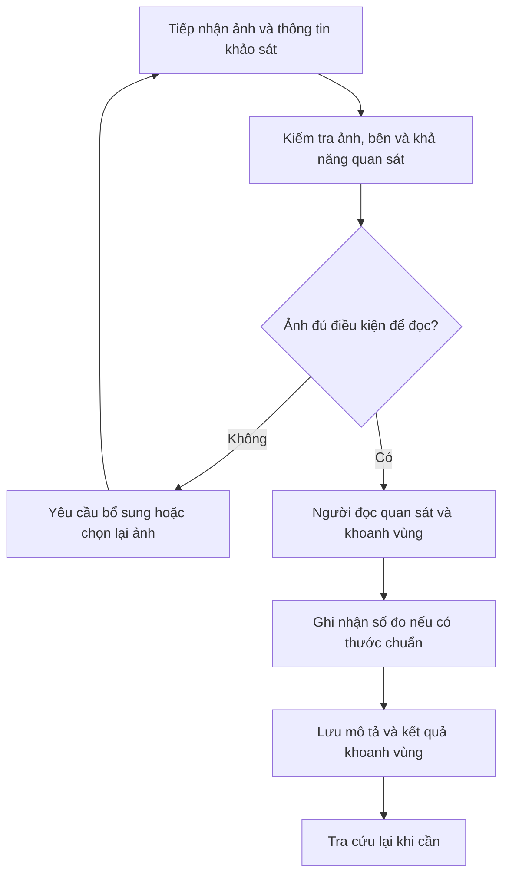

*Hình 3.1: Quy trình As-Is tham chiếu cho phân tích nghiệp vụ*

Nguồn: Tác giả mô hình hóa từ đề cương; chưa có biên bản quan sát tại bệnh viện [12].

### 3.2.2. Sơ đồ quy trình To-Be của bản mẫu hai bên

To-Be bổ sung AI ở giữa kiểm tra ảnh và rà soát, đồng thời tạo kho dữ liệu có cấu trúc cho từng bước. Tiếp nhận, IQA và prediction xảy ra theo từng Image; trạng thái tổng thể ca được hiển thị cùng trạng thái bên Trái và Phải để tránh hiểu một bên thành toàn bộ ca. Người dùng có quyền sửa hoặc bỏ đề xuất. Việc lưu Review hoàn tất vòng nghiên cứu, trong khi duyệt nhiều cấp là nhánh tương lai được tách khỏi sơ đồ lõi này.

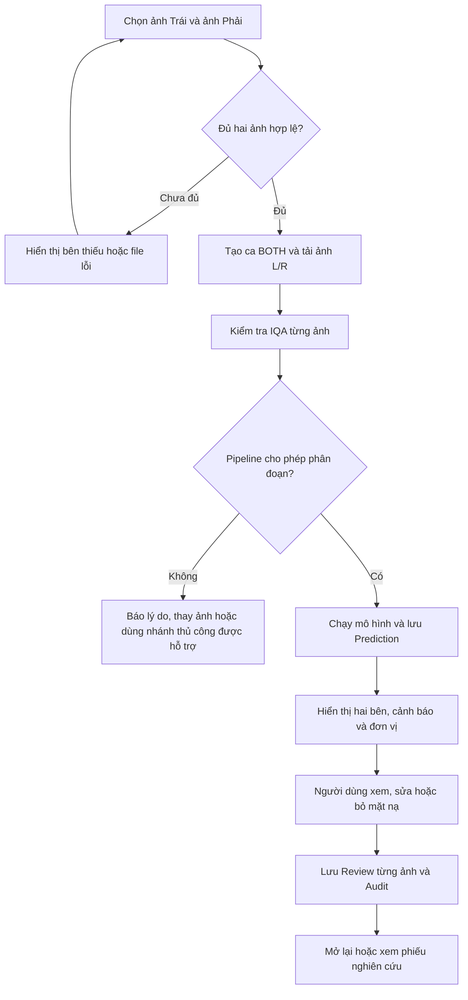

*Hình 3.2: Quy trình To-Be của luồng phân đoạn và rà soát nghiên cứu*

Nguồn: Tác giả tổng hợp từ mã nguồn Workspace và API [17], [18].

### 3.2.3. Sơ đồ phân rã chức năng BFD

BFD chia hệ thống thành các nhóm theo trách nhiệm nghiệp vụ, tương ứng cách bài mẫu tổ chức từ tiếp nhận đến vận hành và báo cáo [14]. Đối với đề tài này, nhóm danh mục được thay bằng dữ liệu ca giả danh và quản trị tài khoản; nghiệp vụ trung tâm là phân đoạn và rà soát. Nhánh duyệt nhiều cấp được ghi rõ là thiết kế mở rộng. BFD không trình bày thứ tự thời gian; thứ tự được làm rõ trong quy trình, DFD và sequence.

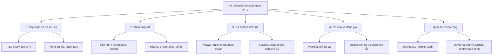

*Hình 3.3: Phân rã chức năng BFD của hệ thống nghiên cứu*

Nguồn: Tác giả thiết kế và đối chiếu hiện thực [17], [18].

### 3.2.4. Sơ đồ ngữ cảnh CD

Sơ đồ ngữ cảnh xem hệ thống như một tiến trình và mô tả trao đổi với tác nhân bên ngoài. Người rà soát cung cấp ảnh, chỉnh sửa và quyết định; hệ thống trả mặt nạ cùng trạng thái lưu. Quản trị yêu cầu cấu hình vận hành hoặc đọc nhật ký theo những endpoint đã có. Người nghiên cứu cung cấp checkpoint và artifact đánh giá qua quy trình nghiên cứu riêng, không thông qua việc chỉnh mask trong viewer. Kho lưu trữ không được vẽ thành tác nhân bên ngoài ở mức ngữ cảnh vì nó thuộc ranh giới hệ thống đang thiết kế.

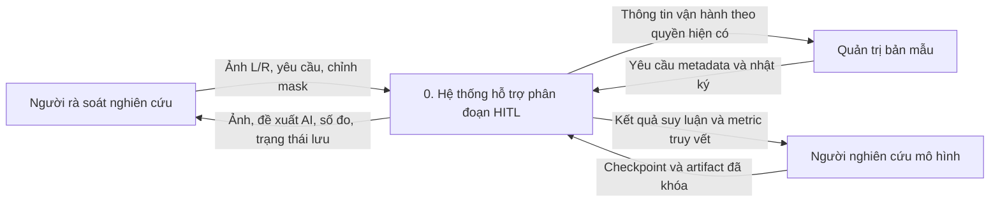

*Hình 3.4: Sơ đồ ngữ cảnh CD của phạm vi hệ thống*

Nguồn: Tác giả thiết kế; quyền theo khoa và vai trò TK thuộc kiến trúc mục tiêu [17], [18].

### 3.2.5. Sơ đồ DFD mức 0 của phân hệ phân đoạn và rà soát

DFD dưới đây phân rã phân hệ tiếp nhận, phân đoạn và rà soát thành năm tiến trình xử lý dữ liệu. Các trao đổi quản trị và cung cấp artifact của sơ đồ ngữ cảnh toàn hệ thống được mô tả riêng ở kiến trúc và hợp đồng API; sơ đồ này không thay thế DFD toàn bộ phân hệ quản trị. Trong sơ đồ, dữ liệu không đi trực tiếp từ người sử dụng tới một bảng DB; mọi cập nhật phải qua tiến trình nhận, kiểm tra hoặc lưu. Prediction và Review là hai kho khác nhau về ngữ nghĩa. Kho checkpoint và artifact đánh giá được giữ riêng vì việc lưu một review mới không tự sửa trọng số, không cập nhật metric lịch sử và không bổ sung ảnh vào tập Train.

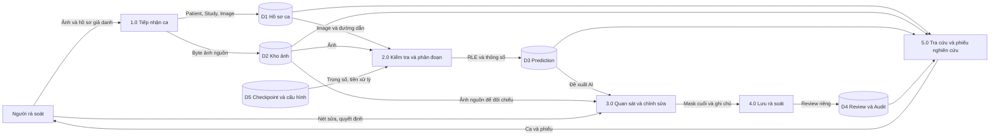

*Hình 3.5: DFD mức 0 của luồng dữ liệu nghiên cứu*

Nguồn: Tác giả thiết kế theo API và mô hình dữ liệu [17], [18].

### 3.2.6. DFD mức 1 của tiếp nhận ảnh

Tiến trình tiếp nhận được phân rã để thấy hai loại bất biến: tính hợp lệ của tệp và tính nhất quán liên kết ca. Hash được tính trên byte file nhận được; kiểm tra trùng được thực hiện sớm ở ứng dụng để trả thông báo rõ và được cưỡng chế lần nữa bằng unique constraint trong DB để chống hai request đồng thời. Tên file vật lý dùng UUID, còn tên gốc được giữ như metadata. Thiết kế này giảm va chạm đường dẫn nhưng chưa tương đương khử định danh chữ trong ảnh hay DICOM tag.

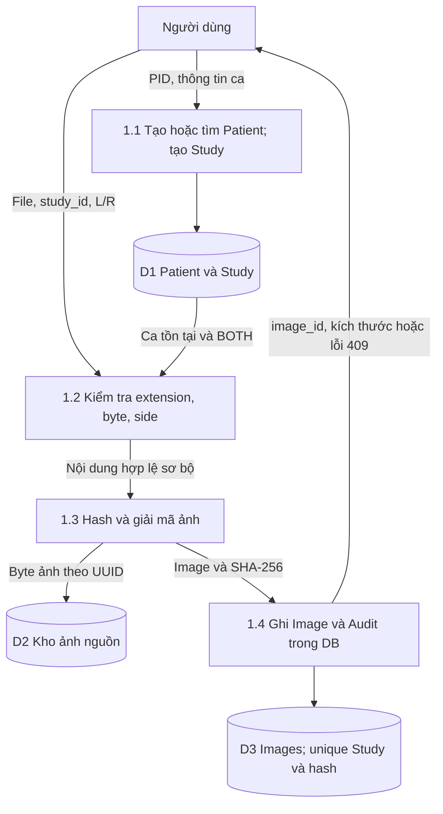

*Hình 3.6: DFD mức 1 của chức năng tiếp nhận ca và ảnh*

Nguồn: Tác giả đối chiếu `cases.py`, `inference.py` và schema [17].

### 3.2.7. DFD mức 1 của kiểm tra và phân đoạn AI

Suy luận sử dụng file ảnh đã lưu, không dùng mask tham chiếu để định vị tổn thương. Khâu tiền xử lý xác định không gian model và ghi thông tin biến đổi cần cho việc đưa mask trở lại ảnh nguồn. Mô hình tạo logits hoặc xác suất theo adapter; hậu xử lý tạo mask nhị phân và đo hình học. Việc quản trị chất lượng ở đây là các kiểm tra kỹ thuật và cờ cảnh báo của phần mềm, không phải một bộ phân loại xác định ảnh có thể dùng để chẩn đoán trong mọi tình huống.

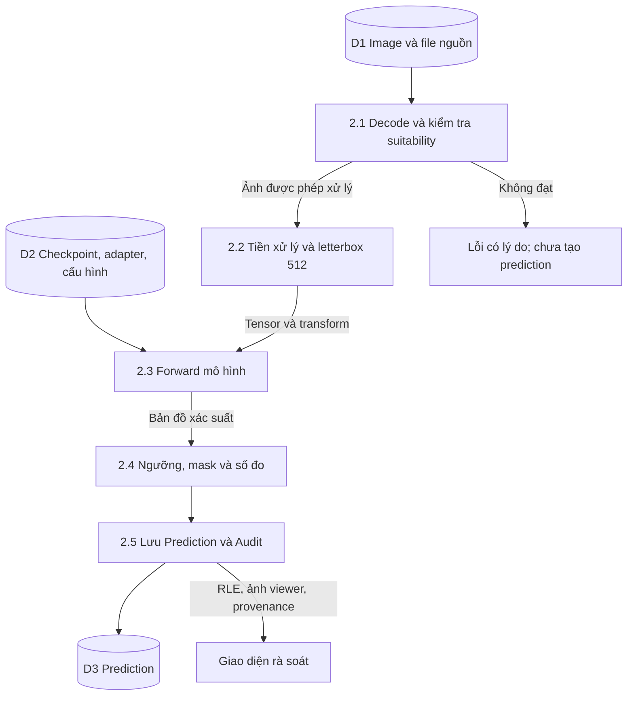

*Hình 3.7: DFD mức 1 của pipeline kiểm tra và phân đoạn*

Nguồn: Tác giả đối chiếu router suy luận và pipeline mô hình [17].

### 3.2.8. DFD mức 1 của rà soát và phiếu nghiên cứu

Rà soát không dùng các số đo vật lý do client gửi làm nguồn tin cậy. Backend kiểm tra quan hệ giữa Image và Prediction, kiểm tra RLE và tính lại hình học trên ảnh nguồn nếu còn giải mã được. Điều này hạn chế trường hợp client sửa số đo nhưng giữ mặt nạ khác. Nếu ảnh nguồn không còn, luồng tương thích không gán số vật lý từ hình học model-space; các trường vật lý được lưu null. Phiếu nghiên cứu đọc dữ liệu đã lưu và thông tin nguồn, không biến nó thành báo cáo lâm sàng.

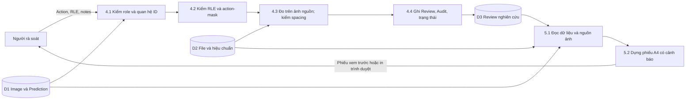

*Hình 3.8: DFD mức 1 của lưu rà soát và trình bày phiếu nghiên cứu*

Nguồn: Tác giả đối chiếu API Review và module phiếu [17], [18].

### 3.2.9. Biểu đồ Use Case tổng quát

Biểu đồ Use Case dưới dạng Mermaid thể hiện tác nhân và các ca sử dụng trong ranh giới bản mẫu. Mermaid không cung cấp ký pháp UML Use Case chuyên biệt nên sơ đồ dùng các nút dạng tròn cho chức năng và ghi rõ ý nghĩa quan hệ. Vai trò TK nằm trong một vùng mở rộng để người đọc không suy ra quyền này đã có ở backend hiện hữu. Các chức năng chẩn đoán bản chất lành/ác không nằm trong sơ đồ.

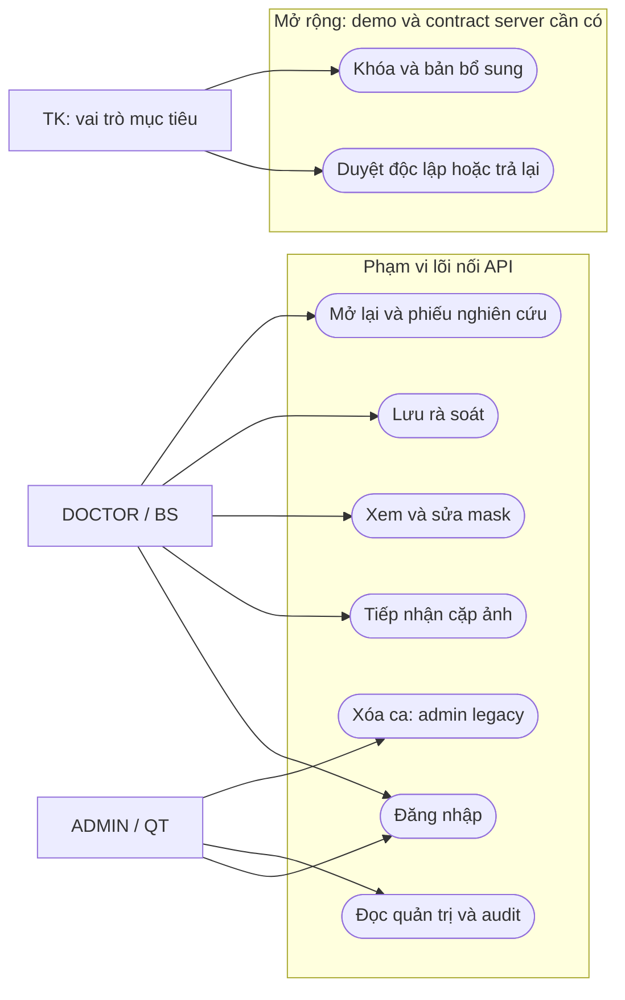

*Hình 3.9: Use Case tổng quát, phân biệt lõi và workflow mở rộng*

Nguồn: Tác giả đối chiếu code và đặc tả quyền [17], [18].

### 3.2.10. Biểu đồ tuần tự của một ảnh trong ca hai bên

Biểu đồ tuần tự mô tả điểm chuyển trách nhiệm giữa UI, API, model, DB và kho file. Với ca hai bên, chuỗi xử lý Image được thực hiện cho L và R; ca chỉ có ý nghĩa hoàn tất rà soát khi cả hai phía đáp ứng điều kiện. API legacy không gói hai lần review thành một transaction ký duyệt, do đó giao diện cần thông báo lỗi từng bên và giữ nháp phía chưa lưu.

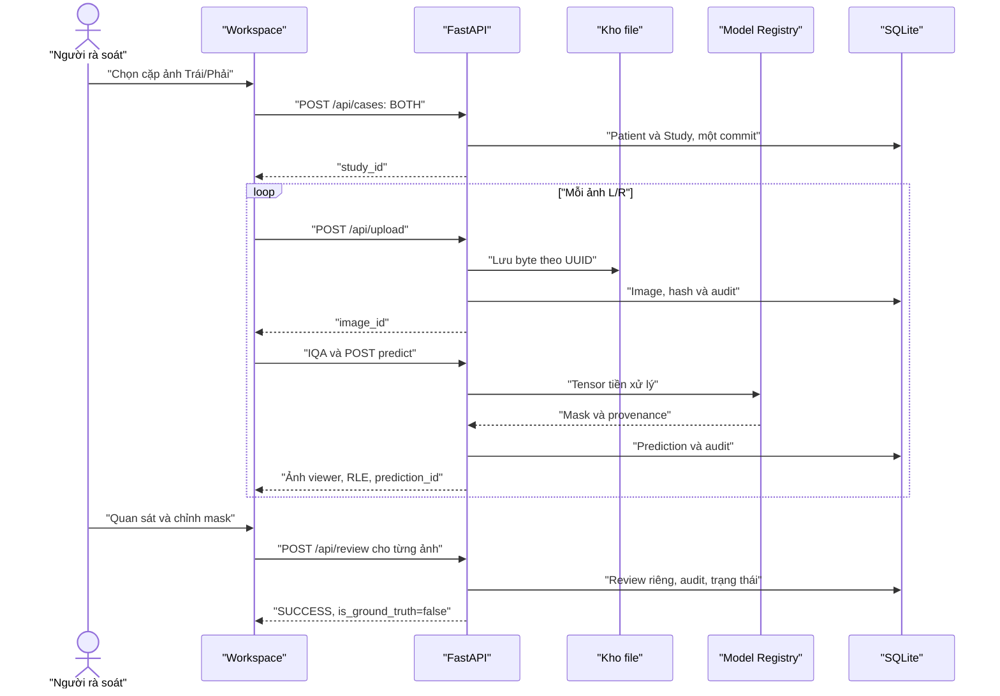

*Hình 3.10: Sequence của luồng lõi từ cặp ảnh đến rà soát nghiên cứu*

Nguồn: Tác giả đối chiếu endpoint đang sử dụng [17], [18].

### 3.2.11. Máy trạng thái hiện hữu và máy trạng thái mục tiêu

Máy trạng thái hiện hữu của Study có PENDING, ANALYZED, PARTIALLY_REVIEWED và REVIEWED. PENDING xuất hiện khi tạo ca; router predict chuyển sang ANALYZED khi có dự đoán cho một ảnh và ca còn PENDING. Bản mẫu hai bên cần theo dõi từng Image bởi trạng thái ANALYZED không chứng minh cả hai prediction đã hoàn tất. Khi lưu review cho một ảnh của ca BOTH, backend kiểm tập bên đã có review để đặt PARTIALLY_REVIEWED hoặc REVIEWED. Nếu ca cũ đơn bên, việc lưu một review chuyển Study thành REVIEWED [17].

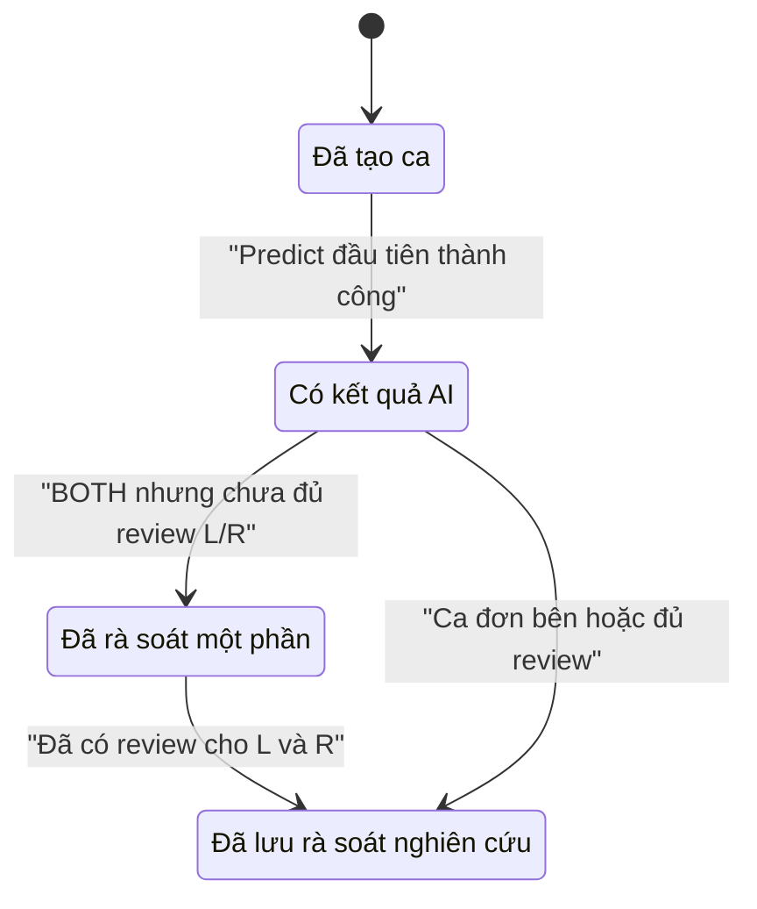

*Hình 3.11: Máy trạng thái Study của backend hiện hữu*

Nguồn: Tác giả đọc trực tiếp router tạo ca, suy luận và review [17].

Máy trạng thái mục tiêu bổ sung ký sơ bộ, duyệt độc lập, từ chối và khóa. REVIEWED của legacy không được ánh xạ tự động thành APPROVED vì hai trạng thái không có cùng bằng chứng. Khi người có quyền tạo bản bổ sung cho ca khóa, bản cũ vẫn phải bất biến; mũi tên mở lại thể hiện tạo một phiên bản công việc mới, không sửa bản đã ký. Cần thêm bảng phiên bản hoặc cấu trúc tương đương, trường owner/khoa, người ký/người duyệt và quy tắc transition ở server trước khi đưa quy trình này vào sử dụng thật.

```mermaid
stateDiagram-v2
    state "Đã tải đủ ảnh" as UPLOADED
    state "AI hoàn tất hai bên" as AI_DONE
    state "Đang rà soát" as IN_REVIEW
    state "Đã ký sơ bộ" as SIGNED_PRELIM
    state "Đã duyệt" as APPROVED
    state "Bị trả lại" as REJECTED
    state "Đã khóa" as LOCKED
    [*] --> UPLOADED
    UPLOADED --> AI_DONE: "Hai prediction hoàn tất"
    AI_DONE --> IN_REVIEW: "Bắt đầu rà soát"
    IN_REVIEW --> SIGNED_PRELIM: "BS xem đủ hai ảnh và gửi phiên bản"
    SIGNED_PRELIM --> APPROVED: "TK khác người ký duyệt"
    SIGNED_PRELIM --> REJECTED: "TK trả lại kèm lý do"
    REJECTED --> IN_REVIEW: "Sửa theo phản hồi"
    APPROVED --> LOCKED: "Khóa phiên bản"
    LOCKED --> IN_REVIEW: "Tạo bản bổ sung; giữ bản cũ"
```

*Hình 3.12: Máy trạng thái workflow mục tiêu, chưa được backend legacy thực thi đầy đủ*

Nguồn: Thiết kế Workspace và contract mở rộng [18].

## 3.3. Kiến trúc hệ thống và giao tiếp API

### 3.3.1. Kiến trúc tổng thể và phân chia trách nhiệm

Hệ thống được xây dựng theo kiến trúc client–server. Trình duyệt thực thi HTML, CSS và các ES module; FastAPI phục vụ entrypoint, tài nguyên frontend và các REST API. PyTorch nằm trong quá trình backend để thực hiện suy luận thông qua Model Registry; SQLAlchemy quản lý các bản ghi trong SQLite, còn byte ảnh nguồn được lưu trong upload root. Kiến trúc hiện tại phù hợp bản mẫu chạy cục bộ và kiểm thử có cô lập, chưa phải mô tả một hạ tầng PACS/RIS đã triển khai trong bệnh viện [17], [18].

Frontend chịu trách nhiệm tổ chức luồng thao tác, trạng thái hiển thị và mặt nạ đang làm việc. Các module `state.js`, `navigation.js`, `intake.js`, `upload.js`, `viewer.js`, `review.js` phối hợp để giữ một ca hiện hành và hai Image. Backend chịu trách nhiệm xác minh phiên, dữ liệu, liên kết ID, thực hiện model và lưu kết quả. DB không lưu mỗi lần con trỏ di chuyển; việc lưu xảy ra ở các mốc upload, prediction, review và audit. Sự phân chia này giữ phản hồi thao tác vẽ ở phía client trong khi các quyết định thay đổi dữ liệu bền vững vẫn được server kiểm tra.

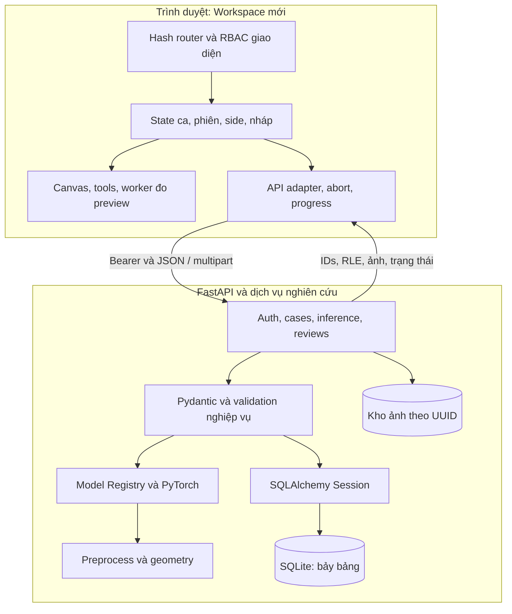

*Hình 3.13: Kiến trúc logic của frontend, backend, model và lưu trữ*

Nguồn: Tác giả đối chiếu cấu trúc mã nguồn [17], [18].

Đề cương ban đầu đề cập React, trong khi hiện thực được đối chiếu dùng SPA thuần và ES module. Báo cáo ghi theo sản phẩm đã xây dựng, đồng thời giữ mục tiêu tương tác của đề cương. Việc đổi framework không làm đổi bất biến HITL; các vấn đề về mask, đơn vị, quyền và trạng thái vẫn phải giải quyết. Frontend hiện không có bước build bắt buộc hay dependency runtime của một framework giao diện [12], [18].

### 3.3.2. Hợp đồng API của luồng lõi

Hợp đồng API được trình bày theo đúng tên endpoint đã đọc trong implementation. Điểm đáng chú ý là API lưu rà soát có đường dẫn số ít `/api/review`, không phải `/api/reviews`. Thông tin này cần thống nhất trong tài liệu, code client và bộ test vì một đường dẫn sai có thể dẫn đến nhận 404 rồi bị hiểu thành lỗi nghiệp vụ. Request tạo ca sử dụng `CreateCaseRequest`; prediction và review có response model Pydantic, còn một số endpoint ca trả dict trực tiếp [17].

*Bảng 3.9: Hợp đồng API chính đang được sử dụng*

| Method và endpoint | Request quan trọng | Response quan trọng | Điều kiện/lỗi cần xử lý |
|---|---|---|---|
| POST `/api/auth/login` | username, password | access_token, expires_in, user | 401 sai đăng nhập; 503 chưa cấu hình JWT secret |
| GET `/api/auth/current-user` | Bearer token | UserProfile | 401 hết hạn hoặc account unavailable |
| POST `/api/cases` | patient_id, study_date, active_ovary_side | study_id, study_code, status | Phiên được kiểm ở router đăng ký; schema enum side |
| GET `/api/cases` | search, status, date | Danh sách tối đa 50 ca | Chưa có total/page và ownership theo khoa |
| GET `/api/cases/{study_id}` | study_id | images, prediction, review, calibration | 404 không tìm thấy ca |
| POST `/api/upload` | Multipart file, study_id, laterality | image_id, dimensions, dicom_metadata | 400 file; 404 Study; 409 trùng; 422 side/spacing |
| POST `/api/validate-image` | image_id qua query | is_acceptable, details, iqa_score | 404 record/file; 400 decode |
| POST `/api/predict/{image_id}` | image_id; spacing tùy chọn | PredictionResponse, RLE, provenance | 422 gate; 503 model chưa nạp |
| GET `/api/images/{id}/viewer-source` | image_id | PNG base64 đã tiền xử lý | 404 thiếu nguồn; 422 decode |
| GET `/api/images/{id}/source.png` | image_id | PNG ảnh nguồn đã giải mã | Không áp dụng CLAHE hay letterbox |
| POST `/api/images/{id}/measurements` | rle_mask | Hình học source-space, calibration | RLE theo schema 512×512; không lưu review |
| POST `/api/images/{id}/calibrate` | spacing hoặc distance qua query | spacing, measurements | 422 hệ số không hợp lệ; actor từ token |
| POST `/api/review` | image_id, prediction_id, action, RLE | review_id, SUCCESS, is_ground_truth | 403 role; 422 mismatch; False về GT |
| GET `/api/images/{id}/mask.png` | kind=ai/reviewed | PNG mask ở ảnh nguồn | 404 chưa có mask; header coordinate-space |
| DELETE `/api/cases/{study_id}` | study_id, token ADMIN | SUCCESS | 403 non-admin; commit DB trước unlink |
| POST `/api/generate-report` | Payload dict | Lỗi 501 | Chưa hỗ trợ PDF lâm sàng |

Nguồn: Mã nguồn routers và Pydantic schemas [17].

RLE là định dạng trung gian giữa client và server. `shape` phải bằng `[512,512]`; `first_val` phải là số nguyên 0 hoặc 1; `counts` là danh sách số nguyên dương có tổng 262.144. Pydantic dùng kiểm tra kiểu chặt ở những điều kiện này để không coi `true` là giá trị pixel đầu tiên hợp lệ hoặc chấp nhận độ dài âm. Frontend decoder cũng chặn run vượt quá số pixel và thiếu pixel. Sau kiểm tra cấu trúc, service tiếp tục kiểm action-mask: chấp nhận nguyên trạng phải phù hợp mask AI, sửa phải thể hiện thay đổi theo quy tắc service, từ chối toàn bộ phải trả mask rỗng.

`DoctorReviewRequest.doctor_id` tồn tại để tương thích nhưng không phải nguồn định danh tác nhân khi lưu. Router lấy `current_user.username` từ phiên đã xác thực, tránh để client tự gửi một tên người khác và được ghi nhận như người thực hiện. `prediction_id` được kiểm có tồn tại và thuộc đúng image_id; nếu có study_id trong request, nó phải khớp ca của Image. Các kiểm tra này bảo vệ liên kết dữ liệu, song chưa thay cho ownership vì backend chưa gắn người sở hữu vào Study.

Response suy luận chứa các trường kỹ thuật ngoài vùng giao diện cốt lõi, gồm acoustic profile, uncertainty hoặc CDSS. Khóa luận không diễn giải sự tồn tại của trường response thành bằng chứng về khả năng chẩn đoán. UI Workspace tập trung vào mask, số đo và cảnh báo; không đưa kết luận lành/ác. Một adapter có trả confidence cũng không làm con số đó trở thành xác suất đúng đã hiệu chuẩn. Provenance được ưu tiên để người dùng biết kết quả phát sinh từ model nào, ở phiên xử lý nào.

### 3.3.3. Quản lý trạng thái, request và lỗi giao diện

`state.js` giữ user, token, chế độ demo, route, ca hiện hành, bên đang xem, cờ dirty/busy và preferences. Token phiên được đọc từ sessionStorage; nháp và tùy chọn được lưu trong localStorage với namespace riêng. Nháp có khóa chứa chế độ, user.id và study_id, qua đó giảm nguy cơ dùng nhầm dữ liệu giữa hai tài khoản hoặc giữa demo và thật. Thiết kế vẫn cần chính sách lưu trữ trên máy dùng chung trước khi cho sử dụng dữ liệu thật; localStorage không phải kho dữ liệu được mã hóa theo người dùng [18].

API adapter gắn Bearer token và AbortSignal của route. Sau khi fetch xong, adapter kiểm phiên và mode có còn như lúc bắt đầu hay không; response của phiên cũ bị bỏ bằng AbortError. Nếu trả 401, ứng dụng phát sự kiện phiên hết hạn thay vì tiếp tục cập nhật màn hình như một lần tải dữ liệu rỗng. Nếu JSON 200 không đọc được, adapter báo malformed response. Các lỗi 404/405/501 được giải thích là máy chủ chưa hỗ trợ chức năng; chúng không bị chuyển thành success giả.

Progress upload dùng XMLHttpRequest vì cần sự kiện upload.onprogress để phản ánh số byte. Hủy phía trình duyệt có thể dừng việc chờ hoặc ngắt request gửi, nhưng một job suy luận đã chạy trên server chưa có contract cancel riêng. Khi nói về nút Hủy trong báo cáo phải phân biệt hủy tác vụ hiển thị/request với hủy tính toán server. API inference jobs được đề xuất để bổ sung hủy có xác nhận và trạng thái job; bản mẫu chưa thể tuyên bố bảo đảm tiết kiệm tài nguyên GPU sau mọi thao tác cancel.

Nháp được tự lưu với base_version và tập base_reviews. Khi mở lại, frontend so sánh version và review_id để xác định nháp còn phù hợp. Nếu dữ liệu server thay đổi, ứng dụng tạo draftConflict và không tự restore mask. Người dùng có thể giữ bản server và lưu nháp xung đột sang khóa riêng để tránh mất dữ liệu. Đây là bảo vệ chống ghi đè ở trình duyệt; chống hai người trên hai máy cùng lưu cần optimistic locking và lease được server kiểm trong mutation.

*Bảng 3.10: Phân loại lỗi và phản hồi mong đợi của giao diện*

| Trường hợp | Dữ liệu phải giữ | Phản hồi người dùng | Hành động tiếp theo |
|---|---|---|---|
| File sai hoặc decode lỗi | File còn hợp lệ của bên còn lại | Lỗi tại đúng ô ảnh | Thay file lỗi; chưa chạy cặp thiếu |
| IQA không đạt gate | image_id và kết quả IQA | Lý do cụ thể; không báo AI hoàn tất | Chọn ảnh khác hoặc nhánh có capability phù hợp |
| 409 hash trùng | Ca đang có và IDs | Ảnh đã tồn tại trong ca | Không tạo bản trùng; mở ảnh đã có nếu flow hỗ trợ |
| Model chưa nạp | Study/Image đã upload | Dịch vụ mô hình chưa sẵn sàng | Retry sau khôi phục; không upload lại vô lý |
| Mạng lỗi khi sửa | Mask làm việc và nháp | Banner chưa đồng bộ | Retry theo ID và phiên hiện tại |
| Phiên hết hạn | Nháp gắn đúng tài khoản | Trang expired và lời nhắc đăng nhập | Khôi phục sau xác thực; không đổi actor |
| Response cũ sau đổi route | Trạng thái route mới | Không hiển thị response đã hủy | Abort và cleanup tài nguyên |
| Nháp lệch phiên bản | Nháp xung đột và bản server | Banner conflict | Chọn bản và kiểm thủ công; không ghi đè tự động |
| API mở rộng chưa có | Trạng thái trước thao tác | Lỗi chức năng chưa hỗ trợ | Dùng demo để xem thiết kế; không giả transition |

Nguồn: Tác giả phân tích API adapter, state và contract [18].

### 3.3.4. Thiết kế chuyển đổi tọa độ Canvas và đo hình học

Viewer có bốn không gian: tọa độ màn hình từ sự kiện con trỏ, tọa độ viewport tương đối Canvas, tọa độ model 512×512 và tọa độ ảnh nguồn. Một nét cọ được xác định trong model-space để phù hợp RLE; một số đo cần trả về source-space trước khi nhân spacing. Zoom và pan chỉ thay phép chiếu model lên viewport, không làm thay đổi kích thước tổn thương hoặc nội dung RLE. Resize phải đọc lại bounding rectangle và tính phép fit hiện hành; nếu tái sử dụng rect cũ, điểm brush có thể lệch khỏi con trỏ.

Với điểm màn hình `(x_s,y_s)`, bounding rect của Canvas `(left,top)`, pan `(p_x,p_y)` và hệ số view `z`, điểm model là `x_m=(x_s-left-p_x)/z`, `y_m=(y_s-top-p_y)/z`. Phép chiếu ngược dùng `x_v=z×x_m+p_x`, `y_v=z×y_m+p_y`. Hàm trong `coordinates.js` gom quy tắc này để brush, eraser và thao tác khác không tự viết những công thức gần giống nhưng khác điểm gốc. Giá trị ở ngoài khung phải được chặn hoặc bỏ theo tool để không ghi sai bộ nhớ mask.

Letterbox dùng hệ số `s=min(512/W,512/H)`; kích thước nội dung sau làm tròn là `(w,h)` và padding `(l,t)`. Phép đổi model sang nguồn sử dụng `x_o=(x_m-l)×W/w`, `y_o=(y_m-t)×H/h`. Dùng w và h thực sau làm tròn tránh coi một hệ số lý thuyết là chính xác tuyệt đối trong cả hai chiều. Với pipeline có crop, cần thêm offset ROI trong phép đổi ngược; không được dùng công thức full-image letterbox để đo một mask đã đi qua crop mà không lưu transform.

```mermaid
flowchart LR
    S["Màn hình: clientX, clientY"] -->|"Trừ rect và pan; chia zoom"| M["Model-space 512 x 512"]
    M -->|"Bỏ padding; scale và offset nguồn"| O["Ảnh nguồn: W x H"]
    O -->|"Chỉ khi spacing hợp lệ"| P["Kích thước vật lý: mm, cm2"]
    O -->|"Thiếu spacing"| X["Chỉ báo px và px2"]
    M -->|"Encode mask nhị phân"| R["RLE gửi API"]
```

*Hình 3.14: Các không gian tọa độ và điều kiện chuyển sang đơn vị vật lý*

Nguồn: Tác giả tổng hợp từ coordinates và source measurements [17], [18].

Tính số đo trên mask đang sửa có hai tầng. Worker phía client tạo preview hình học để thanh đo cập nhật mà không chặn thao tác. API measurements tính trên ảnh nguồn đã giải mã theo pipeline server để phục vụ kết quả có thể lưu và trình bày. Khi review được gửi, server tiếp tục tính lại; không dùng preview như một số đo lâm sàng độc lập. Service nguồn hiện báo phương pháp `external_contour_min_area_rectangle`, chọn đường kính theo contour có diện tích lớn nhất và bỏ các contour dưới 50 px² ảnh nguồn. Phương pháp này khác rotating calipers dùng cho preview phía client, vì vậy không được gọi các số server lưu là đường kính Feret chính xác. Tổng diện tích cộng các contour được giữ và không nhất thiết là diện tích của riêng thành phần được chọn để báo đường kính [17], [18].

Backend hiện trích spacing DICOM khi hai chiều hữu hạn, dương và gần bằng nhau trong giới hạn tương đối được đặt trong code; trường Image chỉ lưu một hệ số scalar. Nếu spacing hai chiều khác nhau, code hiện không ép chúng thành một hệ số tùy tiện. Đây là giới hạn phù hợp dữ liệu hiện tại nhưng cần mở rộng sang row/column spacing nếu muốn hỗ trợ đầy đủ ảnh bất đẳng hướng. Phiếu không được lấy spacing model-space hay mặc định một số mm/px để lấp chỗ thiếu.

### 3.3.5. Transaction, ràng buộc và quản lý file

Endpoint tạo ca truy vấn Patient theo PID đã trim, thêm Patient mới khi cần, tạo Study rồi commit một lần. Nếu một bước phát sinh exception, session rollback, do đó lỗi tạo Study trong endpoint này không giữ lại Patient vừa được tạo. Quan hệ `PatientModel.anonymized_pid` có unique constraint để nhận diện một mã nghiên cứu. Tuy vậy, get-or-create đồng thời có thể gặp conflict; code chưa biến mọi loại IntegrityError ở create thành một response nghiệp vụ cụ thể. Khóa luận mô tả điều đã bảo vệ và điểm còn cần hoàn thiện, thay vì kết luận toàn bộ concurrency đã giải quyết.

Trong upload, unique `(study_id,file_hash)` là điểm quyết định chống bản trùng dù hai request cùng vượt kiểm tra sớm. Nếu commit gặp IntegrityError của constraint này, router rollback, cố xóa file vừa ghi rồi trả 409 với thông báo ảnh đã tồn tại. Hash nullable để giữ tương thích bản ghi cũ; migration backfill tính SHA-256 từ file còn tồn tại và không gán hash cho bản legacy trùng đã có người nhận hash. Vì vậy, không thể nói mỗi ảnh lịch sử đều đã có hash hoặc mọi duplicate cũ đã bị xóa.

Luồng upload không truyền study_id vẫn còn khả năng tự tạo Patient và Study bằng các commit riêng trước khi ghi Image. Luồng Workspace mới tạo ca trước rồi truyền study_id nên không đi nhánh này. Sự khác biệt phải được ghi rõ khi bàn luận transaction: việc gộp transaction create-case không tự sửa toàn bộ nhánh upload legacy. Cùng cách đó, kiểm tra một Image cho mỗi laterality đang nằm ở ứng dụng; unique hash không cưỡng chế “mỗi bên đúng một ảnh” khi hai file khác hash được upload đồng thời. Đây là yêu cầu tích hợp tiếp theo nếu mở sử dụng đồng thời.

DELETE ca hiện yêu cầu ADMIN. Router thu thập đường dẫn ảnh, xóa Study cùng quan hệ ORM và commit DB, sau đó mới unlink các file nằm trong upload root đã resolve. File có tên bắt đầu bằng sample_ được giữ. Cách làm tránh mất file trước khi DB xóa thành công, nhưng lỗi unlink hiện được bỏ qua nên có thể để lại file mồ côi. Đây vẫn là xóa cứng legacy, chưa phải quy trình xóa mềm có phê duyệt hay lưu bản audit bất biến như thiết kế mục tiêu [17].

```mermaid
flowchart TD
    A["Upload đã vượt kiểm tra và ghi file UUID"] --> B["Thêm Image có study_id và file_hash"]
    B --> C["Thêm AuditLog"]
    C --> D{"Commit DB thành công?"}
    D -->|"Có"| E["Trả image_id"]
    D -->|"Conflict hash"| F["Rollback transaction"]
    F --> G["Thử xóa file mới"]
    G --> H["Trả HTTP 409"]
    D -->|"Lỗi khác"| I["Không tuyên bố upload thành công"]
```

*Hình 3.15: Ranh giới transaction và xử lý conflict hash trong upload*

Nguồn: Tác giả đối chiếu `inference.py` và constraint Image [17].

### 3.3.6. Giới hạn xác thực, quyền và hợp đồng phát triển tiếp

Mã xác thực dùng JWT HS256, có thời điểm phát hành và hết hạn; cấu hình APP_JWT_SECRET cần ít nhất 32 ký tự. `get_current_user` đọc token, tìm user trong DB và kiểm `is_active`; router lâm sàng được đăng ký với dependency xác thực chung. `require_admin` bảo vệ các thao tác quản trị tương ứng và endpoint xóa; review kiểm role DOCTOR riêng. Mật khẩu trong bản mẫu lấy theo role từ biến môi trường, không có trường password_hash ở User. Vì vậy, không mô tả sản phẩm hiện tại như hệ thống mật khẩu cá nhân đã hash hoặc đã có OTP/rate-limit đầy đủ [17].

Model RBAC mục tiêu của UI khác RBAC server legacy. UI QT không có viewer, patients, report và evaluation chứa ảnh; chỉ có metadata quản trị. Tuy nhiên, backend đang xác thực các router ảnh bằng user hợp lệ và chưa gắn quyền ownership/khoa cho từng tài nguyên. Hạn chế này cần được nêu thẳng trong báo cáo vì một giao diện không truy cập ảnh không ngăn tài khoản ADMIN dùng HTTP client gọi endpoint ảnh. Tính tách nhiệm vụ được demo để kiểm tra thiết kế, không được dùng làm chứng cứ server đã bảo vệ dữ liệu.

Đường dẫn mới `/api/workspace` được đề xuất để triển khai các chức năng có contract khác legacy. Worklist mới cần items, total, page và page_size; lọc quyền phải xảy ra trước phân trang. Sign-preliminary nhận version và cả hai ảnh trong một transaction, actor lấy từ token và cần idempotency. Transition kiểm role TK, cùng khoa, khác người ký, reason và trạng thái trước. Lease cần token hết hạn được kiểm lại trong request ghi. Các capability flag giúp frontend chỉ bật nhánh mới khi server có hỗ trợ, tránh suy ra năng lực từ một màn hình tồn tại.

*Bảng 3.11: Các hợp đồng server cần bổ sung để hoàn thiện workflow mục tiêu*

| Nhóm | Endpoint/contract đề xuất | Điều kiện backend cần thực thi |
|---|---|---|
| Worklist | GET `/api/workspace/cases` | Ownership/khoa; search/filter/sort; total và phân trang thật |
| Ký sơ bộ | POST `/api/workspace/cases/{id}/sign-preliminary` | Hai ảnh cùng transaction; version; idempotency; actor server |
| Duyệt | POST `/api/workspace/cases/{id}/transitions` | Role TK, khác người ký, reason, trạng thái hợp lệ |
| Lease và nháp | POST/DELETE lease; PUT draft | Quyền, expiry, token; 409 khi lệch version |
| Bản bổ sung | POST/PUT corrections | Giữ bản cũ; lý do; BS rà soát và ký lại |
| Quản trị | Users CRUD, departments, settings | QT; validation; không tự tăng quyền; audit |
| Xác thực mở rộng | Reset, change, OTP, refresh | Hash cá nhân, chống replay, rate-limit, lockout server |
| Ẩn danh và DICOM | Inspect, frames, deidentify | Quarantine; lọc metadata; chữ in cứng được kiểm; spacing bảo toàn |
| Suy luận job | POST/GET/DELETE inference jobs | Trạng thái và hủy thật; không ghi đè mask đang sửa |
| Phiếu và audit | report-export, audit-events/export | Quyền từng phiên bản; append audit; phân trang/export đầy đủ |

Nguồn: Tài liệu contract Workspace, chưa phải endpoint đã vận hành [18].

## 3.4. Thiết kế logic và cơ sở dữ liệu

### 3.4.1. Xác định các thực thể

Mô hình dữ liệu hiện hữu có bảy bảng được khai báo trong `backend/db/database.py`: patients, studies, images, predictions, reviews, audit_logs và users. Cách tổ chức bám trình tự nhận dạng đối tượng trong bài mẫu: xác định thực thể, xây dựng ERD, chuyển sang quan hệ rồi mô tả từng bảng [14]. Nội dung bảng và khóa được đọc từ ORM, không suy đoán từ tên màn hình hoặc từ một database mục tiêu chưa được triển khai.

Patient biểu diễn mã nghiên cứu giả danh, không lưu tên hoặc ngày sinh trong schema này. Study biểu diễn lần khảo sát và quản lý trạng thái tổng thể. Image lưu mỗi ảnh nguồn với bên, kích thước và spacing. Prediction lưu kết quả suy luận của một Image; nhiều lần chạy có thể tạo nhiều Prediction. Review lưu mặt nạ sau rà soát, quyết định và người thao tác. AuditLog ghi sự kiện trên các thực thể; User biểu diễn tài khoản phiên bản thử nghiệm. Các bảng khoa, phiên bản duyệt, thông báo và lease trong sản phẩm mục tiêu chưa có trong ORM này.

*Bảng 3.12: Các thực thể, mục đích và quan hệ nghiệp vụ*

| Thực thể | Mục đích | Khóa chính | Quan hệ được khai báo | Điểm cần lưu ý |
|---|---|---|---|---|
| Patient | PID giả danh và thông tin nhóm | id | Một–nhiều Study | PID unique; không tự chứng minh ảnh đã ẩn danh |
| Study | Lần khảo sát | id | Thuộc Patient; có nhiều Image | Chưa có owner/khoa và workflow version |
| Image | Ảnh nguồn và hình học | id | Thuộc Study; có Predictions/Reviews | Unique study/hash; laterality nullable cho legacy |
| Prediction | Kết quả model | id | Thuộc Image | Mask AI gốc; provenance đầy đủ chưa thành các cột riêng |
| Review | Kết quả rà soát | id | Thuộc Image | prediction_id không là FK trong ORM; GT False |
| AuditLog | Nhật ký thao tác | id số nguyên | Liên kết bằng entity_name/entity_id | Không có FK tới mọi entity; không phải kho bất biến mật mã |
| User | Hồ sơ tài khoản mẫu | id | Không có FK owner từ Study | Role DOCTOR/ADMIN; không có password_hash |

Nguồn: Mã ORM hiện hữu [17].

### 3.4.2. Mô hình thực thể–quan hệ ERD

ERD dưới đây biểu diễn các khóa ngoại vật lý khai báo trong ORM. Patient–Study, Study–Image, Image–Prediction và Image–Review là các quan hệ một–nhiều. Liên kết Review–Prediction và User–Review được giải thích trong văn bản như tham chiếu nghiệp vụ, không vẽ thành foreign key vật lý chưa có. Cách này tránh một lỗi tài liệu thường gặp: sơ đồ mô tả database như đã cưỡng chế nhiều điều hơn implementation.

```mermaid
erDiagram
    PATIENTS ||--o{ STUDIES : "có khảo sát"
    STUDIES ||--o{ IMAGES : "có ảnh"
    IMAGES ||--o{ PREDICTIONS : "có dự đoán"
    IMAGES ||--o{ REVIEWS : "có rà soát"
    PATIENTS {
        string id PK
        string anonymized_pid UK
    }
    STUDIES {
        string id PK
        string patient_id FK
    }
    IMAGES {
        string id PK
        string study_id FK
    }
    PREDICTIONS {
        string id PK
        string image_id FK
    }
    REVIEWS {
        string id PK
        string image_id FK
    }
    USERS {
        string id PK
        string username UK
    }
    AUDIT_LOGS {
        int id PK
    }
```

*Hình 3.16: ERD rút gọn, chỉ thể hiện các khóa ngoại vật lý hiện có*

Nguồn: Tác giả đọc các cột và relationship SQLAlchemy [17]. Hình chỉ giữ khóa nhận diện để dễ đọc khi in; toàn bộ thuộc tính được trình bày trong từ điển dữ liệu ở mục 3.4.4.

### 3.4.3. Mô hình quan hệ và mức chuẩn hóa

Mô hình quan hệ sử dụng UUID dạng chuỗi cho các thực thể nghiệp vụ và số nguyên tự tăng cho AuditLog. Các thuộc tính Patient không lặp trong Image; Study liên kết Patient bằng patient_id, Image liên kết Study bằng study_id. Vì vậy, một PID có nhiều lần khảo sát không cần sao chép lại toàn bộ thông tin ở từng prediction. Sự phân tách ảnh, dự đoán và rà soát cũng tránh lưu một cột mask duy nhất mang nhiều nghĩa tùy giai đoạn.

Các trường mask, measurements và feedback dùng JSON vì cấu trúc số phần tử thay đổi theo ảnh và số thành phần. Lựa chọn này giúp lưu bản mẫu nhanh nhưng giảm khả năng cưỡng chế chi tiết bằng database; phần lớn kiểm tra cấu trúc RLE và action nằm ở Pydantic/service. Không nên tuyên bố toàn bộ schema đã chuẩn hóa tới một mức cụ thể chỉ dựa trên số bảng. Với JSON, phải xét mục đích truy vấn và bất biến cần kiểm; khi cần thống kê từng tổn thương lâu dài, có thể cần một bảng lesion_measurements thay vì bóc tách JSON ở mọi báo cáo.

```mermaid
flowchart TD
    P["patients: PK id; UK anonymized_pid"] -->|"FK patient_id"| S["studies: PK id"]
    S -->|"FK study_id"| I["images: PK id; UK study_id + file_hash"]
    I -->|"FK image_id"| PR["predictions: PK id"]
    I -->|"FK image_id"| R["reviews: PK id"]
    PR -.->|"Tham chiếu được API kiểm; chưa có FK"| R
    U["users: PK id; UK username"] -.->|"Username actor; chưa có FK"| R
    U -.->|"actor_id chuỗi"| A["audit_logs: PK id tự tăng"]
```

*Hình 3.17: Mô hình quan hệ và các tham chiếu logic cần kiểm ở ứng dụng*

Nguồn: Mã ORM và router Review [17].

### 3.4.4. Từ điển dữ liệu của bảy bảng hiện hữu

Từ điển dưới đây giữ nguyên tên cột để người đọc có thể đối chiếu với implementation. “Cho phép null” được xác định từ Column SQLAlchemy: cột thường không đặt nullable=False cho phép null; khóa chính và các cột ghi rõ nullable=False không cho null. “Mặc định ORM” là giá trị do SQLAlchemy phía ứng dụng cung cấp khi insert, không được tự diễn giải thành server default trong mọi lệnh SQL trực tiếp. Với id UUID, code gọi tạo đối tượng phải cấp giá trị; ORM không khai báo hàm default UUID cho các cột này [8], [17].

*Bảng 3.13: Từ điển bảng patients*

| Cột | Kiểu ORM | Null | Khóa/ràng buộc | Mặc định ORM | Ý nghĩa |
|---|---|---|---|---|---|
| id | String(36) | Không | PK | Không; ứng dụng cấp UUID | Mã nội bộ Patient |
| anonymized_pid | String(64) | Không | Unique | Không | Mã nghiên cứu giả danh |
| age_bucket | String(20) | Có | Không | Không | Nhóm tuổi hoặc giá trị tương thích request |
| menopausal_status | String(20) | Có | Không | Không | Trạng thái mãn kinh nếu được cung cấp |
| created_at | DateTime | Có | Không | datetime.now(UTC) | Thời điểm tạo hồ sơ |

Patient được tra cứu bằng anonymized_pid đã trim ở endpoint create-case. Một PID giả danh ổn định hỗ trợ liên kết nhiều Study, nhưng không chứng minh patient-level split của dataset huấn luyện. Dataset cần manifest mapping riêng giữa file và bệnh nhân; các PID do frontend sinh cho ca demo hoặc upload không thể thay thế bằng chứng mapping nguồn. age_bucket hiện nhận `patient_age` từ request; trước khi dùng trong phân tích nhóm tuổi cần định nghĩa và kiểm tra quy tắc chuẩn hóa.

*Bảng 3.14: Từ điển bảng studies*

| Cột | Kiểu ORM | Null | Khóa/ràng buộc | Mặc định ORM | Ý nghĩa |
|---|---|---|---|---|---|
| id | String(36) | Không | PK | Ứng dụng cấp UUID | Mã nội bộ ca |
| patient_id | String(36) | Không | FK patients.id | Không | Liên kết Patient |
| study_code | String(64) | Có | Không unique | Không | Mã hiển thị ca |
| study_date | String(20) | Không | Không | Không | Ngày khảo sát dạng chuỗi |
| status | String(30) | Có | Không enum DB | PENDING | Trạng thái xử lý legacy |
| device_vendor | String(50) | Có | Không | Không | Hãng thiết bị nếu có |
| probe_type | String(50) | Có | Không | Không | Loại đầu dò |
| ovary_side | String(10) | Có | Không enum DB | RIGHT | RIGHT, LEFT, BOTH, UNKNOWN theo request |
| contralateral_status | String(30) | Có | Không enum DB | NOT_VISUALIZED | Thông tin bên đối diện của hồ sơ tương thích |
| clinical_indication | Text | Có | Không | Không | Lý do khảo sát/ghi chú tiếp nhận |
| created_at | DateTime | Có | Không | datetime.now(UTC) | Thời điểm tạo Study |

Study_date là chuỗi chứ chưa là Date trong ORM; báo cáo không suy ra database đã validate lịch. study_code được ứng dụng sinh nếu thiếu nhưng không có unique constraint. status cũng không được DB khóa bằng enum; máy trạng thái được điều phối trong code. Các trường legacy ovary_side và contralateral_status vẫn tồn tại dù giao diện mới ưu tiên BOTH và hai laterality. Khi chuyển sang workflow mục tiêu cần một migration có giải thích thay vì xóa trường và làm mất nghĩa hồ sơ cũ.

*Bảng 3.15: Từ điển bảng images*

| Cột | Kiểu ORM | Null | Khóa/ràng buộc | Mặc định ORM | Ý nghĩa |
|---|---|---|---|---|---|
| id | String(36) | Không | PK | Ứng dụng cấp UUID | Mã ảnh |
| study_id | String(36) | Không | FK studies.id; thuộc unique ghép | Không | Ca chứa ảnh |
| filename | String(255) | Không | Không | Không | Tên gốc đã basename |
| laterality | String(1) | Có | Không enum/unique DB | Không | R/L; null cho ảnh legacy |
| raw_path | String(500) | Không | Không | Không | Đường dẫn vật lý theo UUID |
| file_hash | String(64) | Có | Unique ghép với study_id | Không | SHA-256 byte file |
| width | Integer | Có | Không | 512 | Chiều rộng nguồn được cập nhật khi upload |
| height | Integer | Có | Không | 512 | Chiều cao nguồn được cập nhật khi upload |
| pixel_spacing_mm | Float | Có | Không check DB | Không | mm trên pixel nguồn nếu xác định được |
| is_empty_mask | Boolean | Có | Không | False | Cờ dữ liệu nguồn; không tự là chẩn đoán |
| dataset_split | String(20) | Có | Không enum DB | TRAIN | Metadata tương thích; không là chứng cứ split thực nghiệm |
| created_at | DateTime | Có | Không | datetime.now(UTC) | Thời điểm ghi ảnh |

Images là điểm nối giữa filesystem và database. raw_path không nên được trả tùy tiện cho client; các API ảnh dùng image_id và kiểm tra file tồn tại. file_hash xác định byte giống hệt, không nhận ra hai ảnh nhìn giống nhau nhưng khác nén hoặc metadata. Vì vậy, kiểm exact duplicate trong upload khác với audit gần trùng giữa các split nghiên cứu. Trường dataset_split mặc định TRAIN trên ảnh upload không được dùng để tuyên bố ảnh mới đã được phép đưa vào huấn luyện; việc tuyển dữ liệu cần một quy trình riêng có nguồn nhãn và manifest [15], [17].

*Bảng 3.16: Từ điển bảng predictions*

| Cột | Kiểu ORM | Null | Khóa/ràng buộc | Mặc định ORM | Ý nghĩa |
|---|---|---|---|---|---|
| id | String(36) | Không | PK | Ứng dụng cấp UUID | Mã lần dự đoán |
| image_id | String(36) | Không | FK images.id | Không | Ảnh được chạy |
| model_version | String(50) | Có | Không | Không | Tên/phiên bản model trả từ adapter |
| inference_time_ms | Integer | Có | Không | 450 | Giá trị thực được router ghi khi chạy |
| confidence_score | Float | Có | Không | 0.85 | Chỉ số kỹ thuật; không là xác suất đúng đã hiệu chuẩn |
| iqa_score | Float | Có | Không | 0.90 | Điểm IQA từ pipeline |
| raw_mask_rle | JSON | Không | Không | Không | Mặt nạ AI gốc |
| measurements | JSON | Không | Không | Không | Cấu trúc số đo và thành phần |
| created_at | DateTime | Có | Không | datetime.now(UTC) | Thời điểm dự đoán |

Các mặc định 450, 0.85 và 0.90 là giá trị trong định nghĩa ORM, không phải kết quả benchmark. Router suy luận thực ghi thời gian đo cùng kết quả confidence/IQA từ dịch vụ. Báo cáo không dùng các default này để lấp ô bảng thực nghiệm. Prediction hiện chưa có cột checkpoint_sha256, preprocessing_version, threshold hoặc source_transform riêng; response và audit có một phần provenance, nhưng muốn tái lập dự đoán lịch sử đầy đủ cần lưu theo từng Prediction. Không được dùng checksum model đang nạp để điền cho một prediction cũ.

*Bảng 3.17: Từ điển bảng reviews*

| Cột | Kiểu ORM | Null | Khóa/ràng buộc | Mặc định ORM | Ý nghĩa |
|---|---|---|---|---|---|
| id | String(36) | Không | PK | Ứng dụng cấp UUID | Mã rà soát |
| image_id | String(36) | Không | FK images.id | Không | Ảnh được rà soát |
| prediction_id | String(36) | Có | Không FK vật lý | Không | Prediction được xét, API kiểm liên kết |
| doctor_id | String(64) | Có | Không FK vật lý | UNVERIFIED_REVIEWER | Username phiên thực được router ghi |
| doctor_action | String(30) | Có | Không enum DB | ACCEPTED_RAW | ACCEPTED_RAW, MODIFIED, REJECTED_ALL theo schema |
| verified_mask_rle | JSON | Không | Không | Không | Mask sau rà soát nghiên cứu |
| max_diameter_mm | Float, evaluates_none | Có | Không | 0.0 | d₁ vật lý; router có thể ghi null |
| ortho_diameter_mm | Float, evaluates_none | Có | Không | 0.0 | d₂ vật lý; router có thể ghi null |
| total_area_cm2 | Float, evaluates_none | Có | Không | 0.0 | Diện tích vật lý; thiếu spacing thì null |
| lesion_type | String(100) | Có | Không | UNSPECIFIED | Mô tả người dùng; không suy ra mô bệnh học |
| clinical_notes | Text | Có | Không | Chuỗi rỗng | Ghi chú nghiên cứu |
| time_spent_seconds | Integer | Có | Không check DB | 15 | Thời gian gửi từ client; chưa là nghiên cứu người dùng |
| hitl_feedback | JSON | Có | Không | Không | Rating và loại lỗi nếu người dùng chọn |
| is_official_ground_truth | Boolean | Có | Không | False | Không tự thành nhãn chuyên gia chính thức |
| created_at | DateTime | Có | Không | datetime.now(UTC) | Thời điểm lưu rà soát |

`Float().evaluates_none()` cho các số đo cho phép None đi vào insert thay vì bị ORM thay bằng default 0.0. Sự phân biệt có ý nghĩa: 0 có thể là diện tích mask rỗng đã đo, còn null thể hiện thiếu điều kiện chuyển sang đơn vị vật lý. time_spent_seconds được schema chặn âm nhưng vẫn là dữ liệu client gửi; muốn báo thời gian thao tác bác sĩ phải có phương pháp đo, người tham gia và kịch bản được ghi nhận. Tương tự, hitl_feedback là chức năng thu phản hồi, chưa tự tạo điểm SUS hoặc bằng chứng chấp nhận lâm sàng.

*Bảng 3.18: Từ điển bảng audit_logs*

| Cột | Kiểu ORM | Null | Khóa/ràng buộc | Mặc định ORM | Ý nghĩa |
|---|---|---|---|---|---|
| id | Integer | Không | PK, autoincrement | DB cấp số | Mã sự kiện |
| entity_name | String(50) | Không | Không | Không | Nhóm thực thể |
| entity_id | String(36) | Không | Không FK vật lý | Không | Mã đối tượng |
| action_type | String(50) | Không | Không enum DB | Không | Loại thao tác |
| actor_id | String(64) | Không | Không FK vật lý | Không | Username hoặc service actor |
| details | JSON | Có | Không | Không | Payload truy vết theo sự kiện |
| timestamp | DateTime | Có | Không | datetime.now(UTC) | Thời điểm ghi nhật ký |

Audit hiện được thêm khi upload, kiểm IQA, chạy prediction, hiệu chuẩn và lưu review. Một số sự kiện dùng actor service thay vì người dùng vì tiến trình kỹ thuật thực thi; muốn truy đầy đủ chuỗi người khởi tạo và dịch vụ thực hiện cần bổ sung correlation hoặc initiating_actor. Không có endpoint sửa/xóa log trong thiết kế UI mới, nhưng schema này chưa có chữ ký, chuỗi băm hoặc quyền database bất biến. Báo cáo chỉ gọi đây là nhật ký ứng dụng, không khẳng định chống sửa đổi tuyệt đối.

*Bảng 3.19: Từ điển bảng users*

| Cột | Kiểu ORM | Null | Khóa/ràng buộc | Mặc định ORM | Ý nghĩa |
|---|---|---|---|---|---|
| id | String(36) | Không | PK | Ứng dụng cấp UUID | Mã tài khoản |
| username | String(50) | Không | Unique | Không | Tên đăng nhập |
| full_name | String(100) | Không | Không | Không | Tên hiển thị tài khoản |
| role | String(20) | Có | Không enum DB | DOCTOR | Role backend DOCTOR/ADMIN |
| department | String(100) | Có | Không FK khoa | Khoa Chẩn đoán Hình ảnh & Sản Phụ khoa | Nhãn hồ sơ, chưa là phạm vi quyền |
| title | String(50) | Có | Không | BS.CKI | Nhãn hiển thị; không là xác thực chuyên môn |
| hospital | String(100) | Có | Không | Bệnh viện ĐKQT Vinmec Times City | Nhãn tài khoản mẫu |
| avatar | String(255) | Có | Không | doctor_avatar.png | Tham chiếu avatar |
| is_active | Boolean | Có | Không | True | Điều kiện account available |
| created_at | DateTime | Có | Không | datetime.now(UTC) | Thời điểm tạo tài khoản |

User không có password_hash, bảng khoa hay quan hệ membership. Các giá trị title/hospital của tài khoản seed phục vụ trình bày demo, không phải xác nhận nhân sự của bệnh viện. Backend đọc mật khẩu role qua cấu hình môi trường và kiểm account active; triển khai nhiều cá nhân thật cần thiết kế danh tính riêng, thay đổi mật khẩu và kiểm quyền tài nguyên. Không được dùng tên hiển thị của seed để viết lời xác nhận rằng bác sĩ tương ứng đã ký Ground Truth hoặc đánh giá bản mẫu.

### 3.4.5. Ràng buộc, truy vấn và quản lý phiên bản schema

Quan hệ ORM Patient–Study và Study–Image đặt cascade all, delete-orphan, tương tự Image–Prediction và Image–Review. Điều này mô tả việc SQLAlchemy xóa các đối tượng liên quan trong session; không nên đồng nhất với mọi hành vi DELETE trực tiếp của SQLite vì cấu hình engine hiện không thể hiện listener bật foreign_keys. Việc cưỡng chế FK ở database, kiểm migration và phục hồi backup phải được xác minh bằng test trên bản đóng gói nếu chuyển sang triển khai nhiều người dùng [8], [11], [17].

Danh sách ca dùng joinedload cho Patient và selectinload cho Images, Predictions, Reviews để tránh truy vấn lazy theo từng ca. Với các quan hệ collection lồng nhau, số query không đơn giản chỉ một hoặc hai; nó phụ thuộc nhóm eager load, nhưng không tăng tuyến tính theo từng Study theo cách N+1 cũ. Endpoint hiện giới hạn 50 ca và chọn ảnh đầu tiên làm tóm tắt. Với cặp hai bên, thumbnail và số đo trên worklist mới cần contract tóm tắt L/R rõ ràng, không dùng first_img để đại diện ngầm cho cả ca.

Hàm `init_db()` tạo schema thiếu và kiểm cột SQLite để thêm study_code, trạng thái, side, laterality, file_hash, hitl_feedback tương thích legacy. Migration hash kiểm unique index hiện có, backfill các bản đọc được và tạo index khi cần. Cơ chế này giúp bản mẫu mở DB cũ nhưng chưa là hệ thống migration có phiên bản và rollback như Alembic. Khi bàn giao phải sao lưu DB, ghi version schema, chạy kiểm dữ liệu mồ côi và xác nhận migration trên bản sao trước khi áp dụng cho kho nghiên cứu.

Các giá trị trạng thái, quyết định và laterality được kiểm chủ yếu ở request/service. Nếu cần chống lỗi từ script nhập dữ liệu hoặc truy cập SQL trực tiếp, có thể bổ sung CHECK constraint tương ứng sau khi thống kê và làm sạch legacy. Không thêm unique `(study_id,laterality)` mà không xét ca nhiều ảnh/khung trong thiết kế tương lai. Đối với phiên bản hiện tại hai ảnh, constraint này có thể cần; đối với một Study chứa nhiều góc quét mỗi bên, mô hình nên thêm vai trò ảnh hoặc vị trí trong bộ ảnh trước khi quyết định cardinality.

Thiết kế logic đạt mục đích lưu vòng phân đoạn nghiên cứu nhưng vẫn còn khoảng cách tới hệ thống duyệt nghiệp vụ đầy đủ. Những khoảng cách được giữ thành yêu cầu tích hợp có thể kiểm chứng: danh tính cá nhân, ownership/khoa, phiên bản và khóa ca, provenance từng Prediction, idempotency và transaction hai bên, khử định danh có xác nhận. Việc trình bày chúng cùng schema hiện hữu giúp kết quả khóa luận có thể được tiếp quản mà không lẫn lộn sản phẩm đã xây dựng với mục tiêu chưa thực thi.

## 3.5. Thiết kế giải thuật và xây dựng mô hình AI

Mô hình phân đoạn là thành phần tạo gợi ý hình học cho quy trình rà soát. Với ảnh đầu vào và mặt nạ tham chiếu được đặt trong cùng hệ tọa độ, mạng học một ánh xạ từ cường độ ảnh sang khả năng mỗi pixel thuộc vùng tiền cảnh. Đầu ra được chuyển thành mặt nạ nhị phân, hiển thị lên ảnh gốc, rồi cho phép người sử dụng sửa hoặc từ chối. Khác với bài toán phân loại, hệ thống phải giữ được vị trí đường biên để các công cụ cọ vẽ, tẩy, đo và lưu phiên bản hoạt động nhất quán. Độ chồng khớp với mặt nạ tham chiếu là chỉ tiêu kỹ thuật của mô hình; quyền xác nhận nội dung chuyên môn vẫn thuộc người rà soát.

Phần này trình bày giải thuật theo đúng các tệp đã triển khai, từ tổ chức dữ liệu đến suy luận. Đề cương cung cấp mục tiêu nghiên cứu, trong khi manifest, mã huấn luyện và hồ sơ đánh giá cung cấp bằng chứng về thí nghiệm đã thực hiện. Khi hai loại hồ sơ khác nhau, báo cáo ghi rõ phiên bản và giới hạn thay vì ghép thành một kết quả duy nhất. Cách trình bày này bảo đảm người đọc có thể phân biệt một phương án đã đề xuất, một kết quả đã lưu và một chức năng đang hoạt động trong bản mẫu. [12], [15]–[18]

Trạng thái bằng chứng được hiểu theo phạm vi kiểm tra: cấu hình, số record và metric đọc trực tiếp từ mã hoặc tệp kết quả được ghi nhận [VERIFIED] ở cấp hồ sơ kỹ thuật; nguồn bệnh nhân, phê duyệt chuyên gia, giấy phép và khả năng khái quát hóa lâm sàng vẫn là [PARTIALLY VERIFIED] hoặc chưa có bằng chứng. Nhãn xác minh không mở rộng từ việc tệp tồn tại sang giá trị chuyên môn của tệp.

### 3.5.1. Tổ chức dữ liệu và kiểm soát rò rỉ

Đề cương sơ bộ nêu kho tiếp nhận 1.387 ảnh, trong đó 417 ảnh có mask ban đầu; 307 ảnh thuộc 185 bệnh nhân được dự kiến làm trọng tâm thực nghiệm. Phương án chia tập là khoảng 70% bệnh nhân cho Train, 15% cho Validation và 15% cho Test, tương ứng khoảng 215, 46 và 46 ảnh. Các con số này thuộc hồ sơ dự kiến của giai đoạn đầu. Kho dữ liệu và manifest sử dụng trong những lượt chạy tháng 10 có quy mô khác, nên không thể viết rằng toàn bộ kết quả bên dưới được tính trên đúng 307 ảnh ấy. Hồ sơ hiện có cũng chưa cung cấp khóa nối đầy đủ giữa danh sách trong đề cương và từng ảnh của phiên bản thí nghiệm. [12], [15]

Manifest `unified_vinmec_clean_2026-10-06` ghi 1.639 ảnh duy nhất trước loại trừ, 35 ảnh bị loại do liên kết nguồn dùng phương án dự phòng, còn 1.604 cặp ảnh–mask trong split. Train có 661 ảnh, Validation có 541 ảnh và Test có 402 ảnh. Chính sách khử trùng sử dụng SHA-256 của byte ảnh: mỗi nội dung ảnh duy nhất có một bản ghi chuẩn, và các mặt nạ liên quan phải thống nhất sau nhị phân hóa. Manifest ghi không có bất đồng target sau kiểm tra. Đây là bằng chứng về nhất quán tệp, không phải chứng nhận nhãn đúng theo đánh giá chuyên gia. [15]

*Bảng 3.20: Đối chiếu dữ liệu dự kiến và dữ liệu thực nghiệm*

| Nội dung | Đề cương sơ bộ | Manifest tháng 10 | Cách sử dụng trong báo cáo |
|---|---|---|---|
| Kho tiếp nhận | 1.387 ảnh | 1.639 ảnh duy nhất trước loại trừ | Hai mốc dữ liệu, chưa coi là cùng danh sách |
| Tập trọng tâm | 307 ảnh, 185 bệnh nhân được nêu | 1.604 cặp ảnh–mask | Metric báo theo phiên bản 1.604 cặp |
| Train | Khoảng 215 ảnh, 130 bệnh nhân dự kiến | 661 ảnh | Tối ưu trọng số và augmentation |
| Validation | Khoảng 46 ảnh, 27 bệnh nhân dự kiến | 541 ảnh | Chọn checkpoint và so cấu hình |
| Test | Khoảng 46 ảnh, 28 bệnh nhân dự kiến | 402 ảnh | Hồ sơ Test lịch sử Standard U-Net |
| Loại trừ ngoài split | Nhãn chờ duyệt tách riêng theo kế hoạch | 35 cặp theo quy tắc liên kết nguồn | Không gọi là 35 ca âm tính |
| Bảo đảm cấp bệnh nhân | Yêu cầu thiết kế | Nguồn Patient/Case ID chưa xác minh | Chưa công bố patient-level split đã chứng minh |

Khử trùng byte-level ngăn một tệp giống hệt xuất hiện ở nhiều tập, nhưng không giải quyết toàn bộ rò rỉ. Hai ảnh chụp từ cùng lần khám có thể khác byte, khác khung và khác tên tệp mà vẫn chia sẻ đặc điểm người bệnh. Tương tự, một bản sao đã đổi kích thước hoặc mức nén có SHA-256 khác. Vì vậy, chính sách mục tiêu là nhóm tất cả ảnh của cùng bệnh nhân vào một split. Manifest hiện tại tự ghi giới hạn: chưa có mã bệnh nhân hoặc mã ca nguồn được kiểm chứng; chỉ bảo đảm tách nội dung ảnh theo hash. Báo cáo giữ nguyên giới hạn này khi diễn giải Dice và khi đề xuất bước đánh giá tiếp theo. [15]

Hồ sơ đối chiếu bổ sung ngày 08/10/2026 ghi workbook có 1.639 dòng ảnh, 820 chuỗi mã Patient và 1.234 chuỗi mã Case khác nhau. Toàn bộ 1.604 ảnh trong split nối được với workbook theo nhóm nguồn và tên ảnh, đồng thời khớp SHA-256 ảnh. Giao chuỗi mã Patient, Case và SHA-256 giữa từng cặp Train, Validation, Test bằng 0 trên phiên bản workbook được kiểm. Đây là bằng chứng về phép đối chiếu tệp và chuỗi mã; chưa xác nhận mã giữ ổn định cho cùng người bệnh ở mọi ảnh. Vì còn thiếu hồ sơ bàn giao và quy tắc cấp mã từ nguồn, báo cáo chưa kết luận độc lập cấp bệnh nhân thực. Số chuỗi mã không được đổi thành số người bệnh đã xác minh [15].

Hậu kiểm của dự án từng ghi 59 cặp gần trùng xuyên split theo hash cảm nhận, trong đó 22 cặp có tương quan sau resize từ 0,95. Cả 59 cặp có chuỗi mã Patient và Case khác nhau trong workbook, nhưng điều đó chưa chứng minh chúng thuộc những người bệnh khác nhau. Các ứng viên này là danh sách cần đối chiếu nguồn, không tự động là chứng cứ cùng bệnh nhân. Để xử lý đúng, cần giữ cặp ảnh, mã nguồn, phiên bản xử lý và kết quả rà soát; nếu xác nhận trùng người giữa các tập, phải xây dựng split mới rồi huấn luyện và đánh giá lại. Tự chuyển vài ảnh sau khi đã xem kết quả Test sẽ làm thay đổi protocol đánh giá và khiến số liệu cũ không còn đại diện cho split mới.

```mermaid
flowchart TB
 A["Kho ảnh và mặt nạ"] --> B["Đối chiếu cặp và SHA-256 ảnh"]
 B --> C["1.639 nội dung ảnh duy nhất"]
 C --> D["35 cặp ngoài split theo manifest"]
 C --> E["1.604 cặp trong split đóng băng"]
 E --> F["Train: 661 ảnh"]
 E --> G["Validation: 541 ảnh"]
 E --> H["Test: 402 ảnh"]
 F --> I["Kiểm hash giao tập và nguồn mã"]
 G --> I
 H --> I
 I --> J["Độc lập bệnh nhân: cần xác minh nguồn"]
```

*Hình 3.18: Tổ chức phiên bản dữ liệu và giới hạn kiểm soát rò rỉ*

Nguồn: tác giả mô hình hóa từ manifest [15]. Số ảnh là đơn vị cặp tệp; chưa chuyển thành số bệnh nhân độc lập.

Các nhóm thư mục có tên Vinmec, 2D hoặc 3D được dùng để giải đường dẫn và truy vết thành viên nguồn. Tên thư mục không đủ chứng minh địa điểm thu ảnh, giấy phép hay phương thức chụp. Loader xử lý từng file ảnh hai chiều, kể cả khi đường dẫn chứa `3d`; do đó báo cáo không mô tả một mạng U-Net ba chiều hoặc dữ liệu thể tích. Việc đối chiếu với bộ MMOTU trong nghiên cứu liên quan cần dựa vào tài liệu nguồn và hash, không suy ra danh tính dataset chỉ từ sự giống nhau về số lượng. Đây là ranh giới giữa mô tả dữ liệu cục bộ và tuyên bố nguồn học thuật. [3], [15]

### 3.5.2. Chuẩn hóa ảnh và mặt nạ về không gian mô hình

Lớp `OvarianUltrasoundDataset` đọc ảnh thang xám và mask từ CSV. Trình đọc dùng byte tệp cùng `cv2.imdecode` để hỗ trợ đường dẫn có Unicode trên Windows. Nếu ảnh hoặc mask không giải mã được, loader phát sinh lỗi có đường dẫn liên quan, không âm thầm thay bằng mẫu rỗng. Mặt nạ được nhị phân hóa theo điều kiện giá trị lớn hơn 0. Cách này thống nhất tệp lưu theo 0/255 với target 0/1 mà hàm mất mát cần, nhưng cũng yêu cầu nhãn nguồn thật sự có ý nghĩa nhị phân; không được gộp các lớp khác nhau rồi diễn giải là đã học phân loại bệnh học. [17]

Kích thước ảnh được chuẩn hóa bằng letterbox 512×512. Với chiều rộng nguồn W và chiều cao H, tỷ lệ lý tưởng là s = min(512/W, 512/H). Mã nguồn tính chiều mới bằng phần nguyên của sW và sH, đặt ảnh co giãn vào giữa canvas rồi đệm phần còn lại. Ảnh dùng nội suy song tuyến tính, mask dùng lân cận gần nhất để tránh tạo nhãn trung gian. Cặp ảnh–mask phải nhận cùng phép hình học; nếu chỉ resize ảnh rồi giữ nguyên mask, loss sẽ học một sự lệch vị trí do xử lý dữ liệu thay vì đường biên cần tìm.

Letterbox bảo toàn tỷ lệ toàn cục tốt hơn kéo riêng hai chiều vào hình vuông. Tuy nhiên, phép làm tròn kích thước khiến tỷ lệ thực theo trục x và y có thể khác tỷ lệ lý tưởng một lượng nhỏ. Khi ánh xạ ngược, mã đo ở không gian nguồn tính lại các hệ số từ kích thước thực đã làm tròn, thay vì mặc định dùng s ở mọi chỗ. Phần đệm không đại diện cho mô giải phẫu; các hình minh họa phải thể hiện đủ phép biến đổi để người đọc biết vùng nào là ảnh nguồn, vùng nào là canvas bổ sung.

Ảnh sau letterbox được tăng tương phản cục bộ bằng CLAHE, với `clipLimit=2.0` và lưới 8×8 theo cấu hình mặc định của bộ tiền xử lý. Sau đó cường độ được chia 255 để đưa về [0,1]. Với hai cấu hình so sánh đồng chuẩn hóa, tensor còn được biến đổi bằng mean 0,449 và standard deviation 0,226. Vì vậy, đầu vào thực của mạng không còn bị giới hạn trong [0,1]. Chuỗi chuẩn hóa này là một phần của checkpoint; nạp đúng trọng số nhưng áp sai mean/std vẫn làm thay đổi phân bố đầu vào và kết quả suy luận. [16], [17]

```mermaid
flowchart LR
 A["Ảnh nguồn xám"] --> B["Letterbox 512×512; bilinear"]
 M["Mask nguồn > 0"] --> N["Letterbox đồng bộ; nearest"]
 B --> C["CLAHE: clip 2, grid 8×8"]
 C --> D["Augmentation nếu là Train"]
 N --> D
 D --> E["Ảnh /255; mask 0/1"]
 E --> F["Mean 0,449; std 0,226 cho comparator"]
 F --> G["Tensor B×1×512×512"]
```

*Hình 3.19: Chuỗi xử lý cặp ảnh–mask của các lượt chạy so sánh*

Nguồn: tác giả tổng hợp từ `dataset_loader.py` và hai script huấn luyện [16], [17]. Validation không áp augmentation.

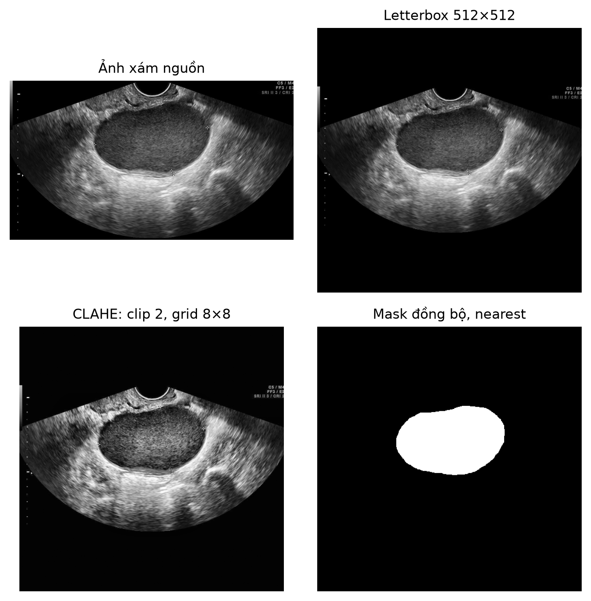

*Hình 3.20: Minh họa letterbox và CLAHE từ ảnh nguồn thực tế*

Nguồn: `dataset/2d/images/159.JPG`, xử lý bằng mã dự án. Hình mô tả tiền xử lý, không phải bằng chứng chẩn đoán; đã kiểm tra trực quan không thấy tên, ngày sinh hoặc PID trong các pixel được trình bày.

Đề cương từng đề xuất cắt vùng quạt quét tự động trước chuẩn hóa. Trong phiên bản loader dùng cho các run ở đây, hàm crop không được gọi: toàn ảnh được letterbox và áp CLAHE. Bộ tiền xử lý có hàm median và hàm xác định vùng quét, nhưng chuỗi suy luận hiện tại cũng áp CLAHE trực tiếp để khớp loader, không thêm median. Sự tồn tại của một hàm trong repository không chứng minh nó tham gia thí nghiệm. Báo cáo vì vậy không gán mức cải thiện kết quả cho ROI crop hoặc lọc speckle nếu những bước ấy chưa có lượt đối chứng riêng. [12], [17]

Augmentation chỉ xuất hiện sau chia tập và chỉ ở Train. Mã sử dụng lật ngang với xác suất 0,5; thay đổi sáng và tương phản trong biên ±0,1 với xác suất 0,4; dịch chuyển đến 5%, thay đổi tỷ lệ đến 5% và quay đến 10 độ với xác suất 0,4. Các phép hình học được đồng bộ cho ảnh và mask, còn biến đổi cường độ chỉ tác động ảnh. Những giới hạn này mô tả cấu hình đã dùng, chưa phải chứng minh chúng là tối ưu hay được chuyên gia xác nhận cho mọi loại hình siêu âm.

### 3.5.3. Kiến trúc Standard U-Net và cấu hình U-Net++

Standard U-Net trong dự án có một kênh vào và một kênh logits ra. Bốn mức encoder sử dụng số kênh 32, 64, 128 và 256; tầng cầu nối có 512 kênh. Mỗi `ConvBlock` gồm hai chuỗi Conv2d 3×3, BatchNorm2d và ReLU; padding 1 giữ kích thước không gian trong khối. MaxPool2d 2×2 giảm kích thước giữa các mức. Với ảnh 512×512, bản đồ đặc trưng lần lượt có cạnh 512, 256, 128, 64 và 32. Đây là biến thể triển khai của U-Net, không phải sao chép nguyên cấu hình số kênh của bài báo gốc. [1], [17]

Decoder dùng ConvTranspose2d 2×2 để tăng kích thước, nối đặc trưng từ encoder cùng mức rồi áp ConvBlock. Phép nối theo chiều kênh giữ thông tin định vị mà đường co giảm có thể làm mất. Tầng cuối là tích chập 1×1 tạo một giá trị logits cho mỗi pixel. Mạng không áp sigmoid ngay trong `forward`; hàm mất mát nhận logits, còn bước đánh giá và suy luận mới dùng sigmoid. Cách tách này giúp BCEWithLogitsLoss thực hiện tính toán ổn định số học và tránh áp sigmoid hai lần.

*Bảng 3.21: Kích thước đặc trưng Standard U-Net khi đầu vào 512×512*

| Giai đoạn | Phép chính | Kênh ra | Kích thước không gian | Vai trò |
|---|---|---:|---|---|
| Encoder 1 | Hai Conv 3×3 + BN + ReLU | 32 | 512×512 | Chi tiết cục bộ, skip mức 1 |
| Encoder 2 | Pool 2×2 và ConvBlock | 64 | 256×256 | Skip mức 2 |
| Encoder 3 | Pool 2×2 và ConvBlock | 128 | 128×128 | Skip mức 3 |
| Encoder 4 | Pool 2×2 và ConvBlock | 256 | 64×64 | Skip mức 4 |
| Bottleneck | Pool 2×2 và ConvBlock | 512 | 32×32 | Biểu diễn ở mức co giảm sâu nhất |
| Decoder 4 | Up 2×2, nối skip, ConvBlock | 256 | 64×64 | Khôi phục không gian mức 4 |
| Decoder 3 | Up 2×2, nối skip, ConvBlock | 128 | 128×128 | Khôi phục không gian mức 3 |
| Decoder 2 | Up 2×2, nối skip, ConvBlock | 64 | 256×256 | Khôi phục không gian mức 2 |
| Decoder 1 | Up 2×2, nối skip, ConvBlock | 32 | 512×512 | Khôi phục mức đầy đủ |
| Đầu ra | Conv 1×1 | 1 | 512×512 | Logits tiền cảnh từng pixel |

```mermaid
flowchart TB
 I["Input 1×512×512"] --> E1["Encoder 32×512×512"]
 E1 --> E2["Encoder 64×256×256"]
 E2 --> E3["Encoder 128×128×128"]
 E3 --> E4["Encoder 256×64×64"]
 E4 --> B["Bottleneck 512×32×32"]
 B --> D4["Up + concat + ConvBlock; 256×64×64"]
 E4 -. "Skip trực tiếp" .-> D4
 D4 --> D3["Up + concat + ConvBlock; 128×128×128"]
 E3 -. "Skip trực tiếp" .-> D3
 D3 --> D2["Up + concat + ConvBlock; 64×256×256"]
 E2 -. "Skip trực tiếp" .-> D2
 D2 --> D1["Up + concat + ConvBlock; 32×512×512"]
 E1 -. "Skip trực tiếp" .-> D1
 D1 --> O["Conv 1×1; logits 1×512×512"]
```

*Hình 3.21: Kiến trúc Standard U-Net đúng theo module mô hình của dự án*

Nguồn: tác giả mô hình hóa từ `backend/models/unet.py` và `ConvBlock` [17]. Kích thước không bao gồm chiều batch.

Cấu hình cải tiến được huấn luyện là `smp.UnetPlusPlus` với encoder ResNet34, trọng số khởi tạo ImageNet, một kênh vào, một lớp ra và `activation=None`. U-Net++ sử dụng các đường skip dạng lồng để tích hợp đặc trưng ở các mức biểu diễn khác nhau. Trong báo cáo, sơ đồ nguyên lý skip lồng chỉ dùng giải thích kiến trúc; bảng kết quả phải gắn với cấu hình thư viện và encoder đã ghi trong run config. Lượt chạy dùng Segmentation Models PyTorch phiên bản 0.5.0. Khi triển khai lại, cấu hình encoder và cấu trúc state_dict phải khớp, thay vì nạp checkpoint vào một Standard U-Net có tên tệp tương tự. [2], [16]

Repository còn có Attention U-Net và module attention gate. Standard U-Net dùng lại lớp ConvBlock từ tệp đó nhưng không gọi attention gate trong `forward`. Vì vậy, tên module được import không làm Standard U-Net thành Attention U-Net; đồng thời không thể gọi cấu hình U-Net++/ResNet34 là Attention U-Net. Việc phân biệt này cần thiết khi đối chiếu sơ đồ, số tham số, checkpoint và phần bàn luận. Trong phạm vi hai run kiểm soát được trình bày, mô hình là Standard U-Net và U-Net++/ResNet34.

```mermaid
flowchart LR
 I["Ảnh xám chuẩn hóa"] --> E["Encoder ResNet34; khởi tạo ImageNet"]
 E --> F1["Đặc trưng nhiều độ phân giải"]
 F1 --> N["Decoder U-Net++; các skip lồng"]
 N --> H["Đầu ra 1 lớp, activation=None"]
 H --> L["Logits 512×512"]
 L --> S["Sigmoid khi đánh giá/suy luận"]
```

*Hình 3.22: Cấu hình U-Net++/ResNet34 được huấn luyện trong dự án*

Nguồn: mã `train_unetplusplus_resnet34.py` [16]. Đây là sơ đồ cấu hình, không minh họa attention gate hoặc mạng ba chiều.

Hai cấu hình cùng dữ liệu và lịch huấn luyện nhưng khác cả decoder lẫn cách khởi tạo encoder: Standard bắt đầu ngẫu nhiên, U-Net++ nhận trọng số ImageNet. Do đó phép so sánh trả lời cấu hình nào có kết quả Validation tốt hơn trong ngân sách đã dùng. Nó chưa tách riêng tác động của skip lồng. Muốn phát biểu lợi ích riêng của kiến trúc, cần thí nghiệm bổ sung có cách khởi tạo tương đương, nhiều seed và protocol được xác định trước. Kết quả hiện tại không được diễn giải thành một ablation chỉ thay một thành phần.

### 3.5.4. Hàm mất mát, cập nhật trọng số và chọn checkpoint

Hai script so sánh đều import `ComboLoss` từ `train_baseline_unet.py`, với trọng số 0,5 cho BCEWithLogitsLoss và 0,5 cho SoftDiceLoss. Công thức là L = 0,5L_BCE + 0,5L_Dice. BCE xét sự phù hợp pixel theo logits; Dice mềm xét mức chồng khớp tổng thể giữa xác suất và target. Trong lớp SoftDiceLoss thực tế, tử số là hai lần tổng tích xác suất–target cộng hệ số làm trơn 1,0; mẫu số là tổng xác suất và target cộng 1,0. Các tổng được lấy trên tensor batch, không phải trung bình Dice riêng từng ảnh. [16], [17]

Sự khác biệt giữa loss Dice trên batch và metric Dice theo ảnh cần được ghi rõ. Một batch có hai vùng tiền cảnh rất khác kích thước có thể đóng góp vào loss theo tổng pixel, trong khi metric macro cho hai ảnh trọng số bằng nhau. Hai đại lượng cùng có từ Dice nhưng không thay thế nhau. Ngoài ra, repository có lớp ComboLoss khác trong `backend/models/losses.py` chứa thêm Focal Loss. Lớp đó không được hai trainer này sử dụng; báo cáo vì vậy không mô tả thí nghiệm đang bàn như Dice–Focal–BCE hoặc suy ra loss từ tên file model.

AdamW được dùng với learning rate ban đầu 10⁻⁴ và weight decay 10⁻⁴. Scheduler CosineAnnealingLR giảm learning rate theo lịch cosine với `eta_min=10⁻⁶` và `T_max=30`. Batch size thực tế là 2 trong cả hai run config, dù giá trị mặc định của hàm huấn luyện U-Net++ là 1. Báo cáo dùng tham số đã chạy, không lấy default trong chữ ký hàm làm bằng chứng. Mỗi epoch thực hiện Train, sau đó Validation; scheduler được cập nhật sau hai pha. [16]

*Bảng 3.22: Cấu hình huấn luyện của hai lượt so sánh đồng chuẩn hóa*

| Tham số | Standard U-Net | U-Net++/ResNet34 |
|---|---|---|
| Khởi tạo | Ngẫu nhiên | Encoder ImageNet pretrained |
| Đầu vào | Xám, 512×512, CLAHE | Xám, 512×512, CLAHE |
| Mean/std | 0,449 / 0,226 | 0,449 / 0,226 |
| Loss | 0,5 BCEWithLogits + 0,5 SoftDice | 0,5 BCEWithLogits + 0,5 SoftDice |
| Optimizer | AdamW, weight decay 10⁻⁴ | AdamW, weight decay 10⁻⁴ |
| Learning rate | 10⁻⁴, minimum 10⁻⁶ | 10⁻⁴, minimum 10⁻⁶ |
| Scheduler | CosineAnnealingLR | CosineAnnealingLR |
| Batch size thực chạy | 2 | 2 |
| Seed | 42 | 42 |
| Epoch yêu cầu / hoàn tất | 30 / 30 | 30 / 30 |
| Patience | 6 epoch không cải thiện | 6 epoch không cải thiện |
| Best epoch | 28 | 30 |
| GPU theo hồ sơ | RTX 3050 Laptop GPU | RTX 3050 Laptop GPU |
| Thời gian ghi nhận | 1.800,52 giây | 3.014,39 giây |
| Test trong trainer | Không truy cập | Không truy cập |

Nguồn: hai `run_config.json` của ngày 06/10/2026 [16]. Thời gian phụ thuộc máy và lượt chạy, không là cam kết hiệu năng.

Mã cố định seed cho Python, NumPy và PyTorch, đồng thời đặt cuDNN deterministic và tắt benchmark khi có CUDA. DataLoader Train dùng generator có seed và shuffle; Validation không shuffle. Autocast và GradScaler được kích hoạt trên CUDA để dùng mixed precision. Các biện pháp này hỗ trợ tái lập trong môi trường đã ghi, nhưng không đủ để bảo đảm bitwise identical giữa mọi phiên bản thư viện, driver và phần cứng. Vì vậy một hồ sơ tái lập cần lưu thêm môi trường, CSV, manifest, checkpoint và lịch sử metric. [7], [16]

```mermaid
flowchart TB
 A["Kiểm manifest; khởi tạo mạng,<br/>AdamW và scheduler"] --> C["Train từng batch:<br/>forward → ComboLoss → backward<br/>GradScaler và optimizer step"]
 C --> H["Validation: no_grad,<br/>macro Dice và scheduler step"]
 H --> J{"Dice tốt hơn best?"}
 J -->|"Có"| K["Lưu best;<br/>reset patience"]
 J -->|"Không"| L["Tăng số epoch<br/>không cải thiện"]
 K --> M["Lưu last và training_history"]
 L --> M
 M --> N{"Đủ epoch hoặc<br/>hết patience?"}
 N -->|"Chưa"| C
 N -->|"Rồi"| O["Lưu run config và SHA-256"]
```

*Hình 3.23: Vòng huấn luyện và lựa chọn checkpoint trên Validation*

Nguồn: tác giả mô hình hóa mã trainer [16]. Test không nằm trong vòng tối ưu hay chọn best checkpoint.

Checkpoint tốt nhất được chọn bằng Dice trung bình theo ảnh của Validation tại ngưỡng 0,5. Script lưu `best` khi có cải thiện, đồng thời lưu `last` sau mỗi epoch. Hai file phục vụ mục đích khác nhau: last cho biết trạng thái cuối, best cho biết cấu hình được chọn theo tiêu chí Validation. Với Standard đồng chuẩn hóa, best ở epoch 28; với U-Net++, best ở epoch 30. Trong run này early stopping không làm dừng trước ngân sách 30 epoch. Lịch sử Train/Validation vẫn được giữ đầy đủ để phân tích diễn biến, thay vì chỉ công bố một con số cực đại.

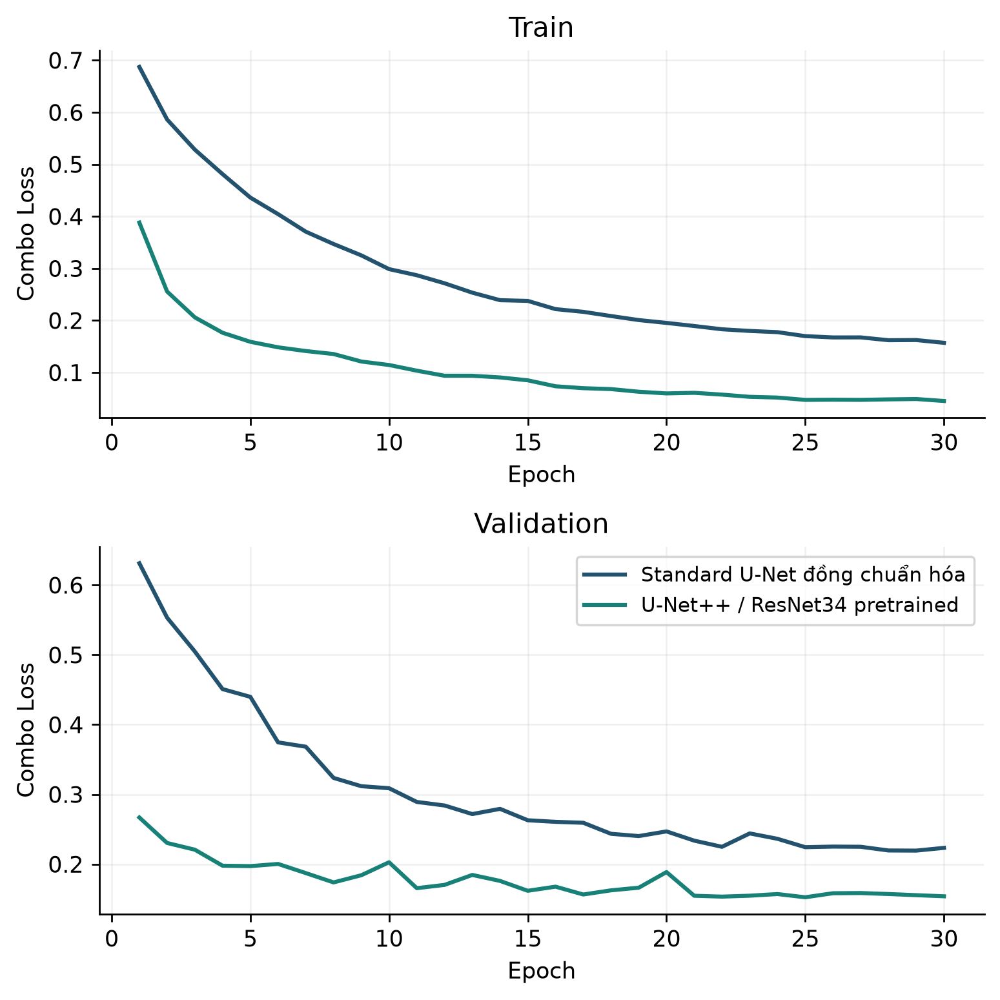

*Hình 3.24: Loss theo epoch của hai lượt so sánh đồng chuẩn hóa*

Nguồn: `training_history.json` của Standard đồng chuẩn hóa và U-Net++/ResNet34 [16]. Hình được vẽ lại từ 30 record mỗi run; không tạo thêm điểm dữ liệu.

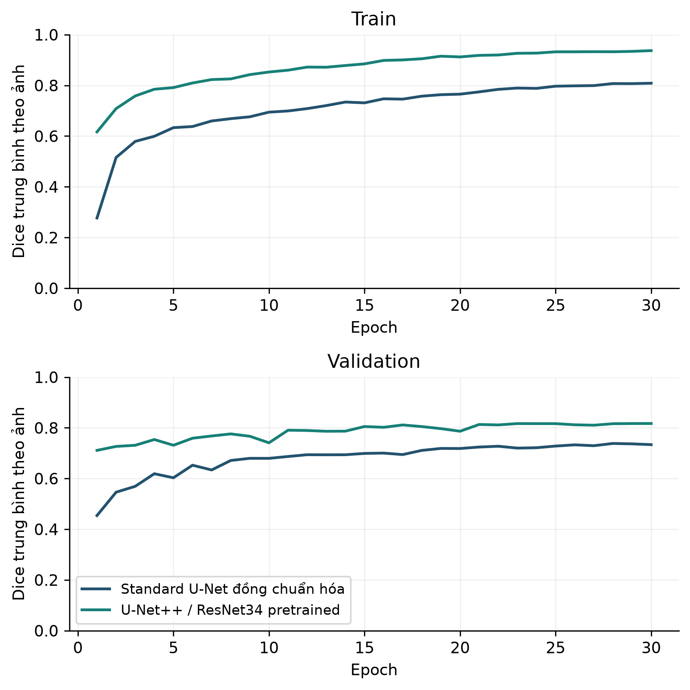

*Hình 3.25: Dice theo epoch và khoảng cách giữa Train với Validation*

Nguồn: lịch sử hai run [16]. Train có augmentation và được đánh giá trong quá trình huấn luyện; Validation ở chế độ đánh giá, nên khoảng cách không được coi là phép đo thuần túy của một nguyên nhân duy nhất.

### 3.5.5. Chỉ số đánh giá và quy ước trường hợp rỗng

Sau sigmoid, prediction nhị phân được lấy tại ngưỡng 0,5. TP là pixel cả prediction và mask tham chiếu đều thuộc tiền cảnh; FP là pixel chỉ prediction thuộc tiền cảnh; FN là pixel tham chiếu thuộc tiền cảnh nhưng prediction bỏ sót; TN là pixel cả hai thuộc nền. Dice bằng 2TP/(2TP+FP+FN), IoU bằng TP/(TP+FP+FN), Recall bằng TP/(TP+FN), Precision bằng TP/(TP+FP), Specificity bằng TN/(TN+FP). Đây là ma trận nhầm lẫn ở cấp pixel, không phải ma trận chẩn đoán bệnh nhân. Một FN của phân đoạn chỉ là khác biệt với mask tham chiếu ở vị trí ấy. [16], [17]

Metric được tính cho từng ảnh rồi trung bình macro. Cách này cho ảnh có vùng tiền cảnh nhỏ cùng trọng số với ảnh có vùng lớn. Nếu cộng toàn bộ TP, FP và FN trước rồi chia, kết quả là micro và có thể khác đáng kể. Vì vậy tên cột phải nêu cách tổng hợp; người đọc không nên so hai số Dice của hai công trình nếu một số macro và số kia micro mà không có giải thích. Trong hồ sơ thí nghiệm hiện tại, tiêu chí chọn best là macro Dice trên 541 ảnh Validation.

```mermaid
flowchart TB
 A["Mask tham chiếu Y"] --> C["Đối chiếu từng pixel 512×512"]
 B["Prediction tại ngưỡng 0,5"] --> C
 C --> T["TP: cả hai tiền cảnh"]
 C --> P["FP: chỉ prediction tiền cảnh"]
 C --> N["FN: chỉ tham chiếu tiền cảnh"]
 C --> Z["TN: cả hai nền"]
 T --> D["Dice, IoU, Recall, Precision theo ảnh"]
 P --> D
 N --> D
 Z --> S["Specificity nền pixel"]
 D --> M["Trung bình macro trên tập"]
```

*Hình 3.26: Luồng tính các chỉ số phân đoạn ở cấp pixel và cấp tập ảnh*

Nguồn: mã `batch_metrics` của hai trainer [16]. Những chỉ số này không xác định lành tính, ác tính hoặc giá trị chẩn đoán.

Trong hai script comparator, mẫu số Dice hoặc IoU bằng 0 được quy ước score 1,0; Recall có tham chiếu rỗng cũng được quy ước 1,0; Precision có prediction rỗng được quy ước 1,0. Quy ước cuối cần được công bố vì prediction rỗng trước một tham chiếu không rỗng có thể nhận Precision 1 dù Recall và Dice bằng 0. Nó là chi tiết phép tính log, không có nghĩa mô hình chính xác trong tình huống đó. Hàm metric ở một trainer lịch sử khác có quy tắc Precision rỗng khác, nên không gộp log giữa các phiên bản mà bỏ qua định nghĩa.

Tập Test được lưu trong hồ sơ này có 402 mask tham chiếu đều chứa tiền cảnh. `empty_mask_specificity` trong summary không có giá trị đo vì số ca rỗng bằng 0. Specificity 0,983647 đo khả năng tránh FP trên nền pixel của những ảnh ấy; không được diễn giải là tỷ lệ nhận diện đúng ca không tổn thương. Muốn kiểm tra chức năng cho phép lưu mask rỗng và đánh giá âm tính giả ở cấp ca, cần một tập tham chiếu rỗng được xác nhận riêng, ngoài các test phần mềm kiểm hợp đồng mask rỗng. [16], [19]

### 3.5.6. Kết quả Validation và hồ sơ Test lịch sử

Hai run đồng chuẩn hóa dùng cùng Train/Validation CSV, cùng CLAHE, cùng mean/std, cùng augmentation, batch size, seed và ngân sách epoch. Hồ sơ so sánh ghi đã kiểm nạp lại checkpoint strict. SHA-256 best Standard bắt đầu `1269a7d3`, còn best U-Net++ bắt đầu `ce758032`. Tại best epoch, Standard đạt Validation Dice 0,738296 và U-Net++ đạt 0,817036. Hiệu số tuyệt đối là 0,078740, tương đương khoảng 7,874 điểm phần trăm trên thang phần trăm của score. Không diễn giải hiệu số này là tỷ lệ ca chẩn đoán được cải thiện. [16]

*Bảng 3.23: So sánh hai cấu hình trên cùng 541 ảnh Validation*

| Chỉ số | Standard đồng chuẩn hóa | U-Net++/ResNet34 | Hiệu số U-Net++ trừ Standard |
|---|---:|---:|---:|
| Loss | 0,219616 | 0,153952 | −0,065664 |
| Dice macro | 0,738296 | 0,817036 | 0,078740 |
| IoU macro | 0,626416 | 0,732287 | 0,105871 |
| Recall macro | 0,815941 | 0,834509 | 0,018568 |
| Precision macro theo quy ước run | 0,744424 | 0,854472 | 0,110048 |
| Specificity nền pixel | 0,973879 | 0,985123 | 0,011245 |
| Dice Train tại best epoch | 0,807145 | 0,937059 | 0,129914 |
| Khoảng cách Dice Train–Validation | 0,068849 | 0,120023 | 0,051174 |

Nguồn: `model_comparison_validation.json` [16]. Bảng là so sánh cấu hình, không là ablation chỉ thay kiến trúc.

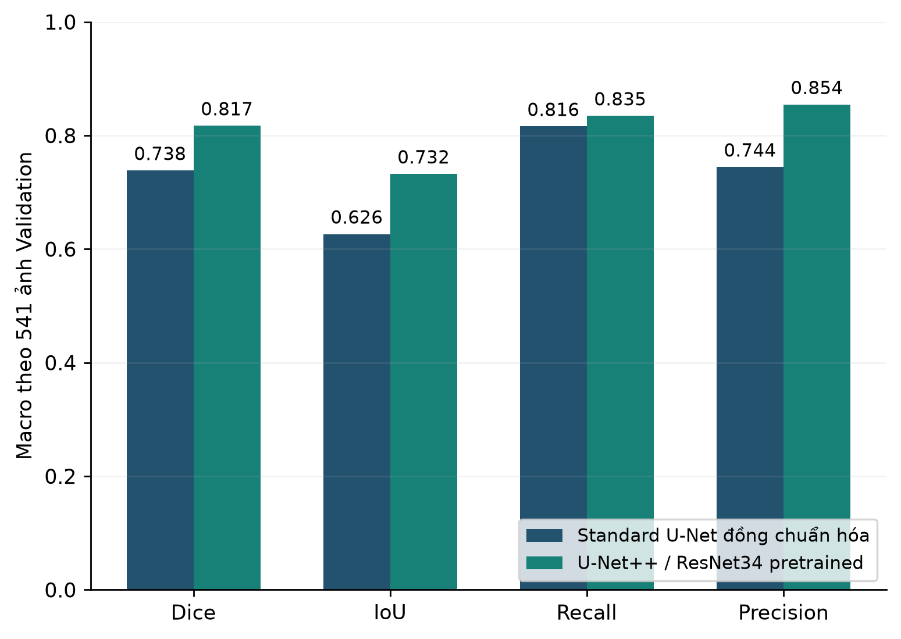

*Hình 3.27: Dice, IoU, Recall và Precision tại best checkpoint của hai cấu hình*

Nguồn: hồ sơ so sánh Validation [16]. Cùng 541 ảnh và ngưỡng 0,5; Precision sử dụng quy ước rỗng đã nêu.

Khoảng cách Train–Validation ở U-Net++ lớn hơn Standard comparator. Nó cho thấy score trên hai pha không đồng đều và nhắc cần kiểm tra tổng quát hóa, nhưng không xác định nguyên nhân chỉ bằng một đường cong. Train có augmentation và model ở chế độ train, còn Validation không augmentation và model ở chế độ eval. Hơn nữa, khởi tạo pretrained khác ngẫu nhiên và chỉ có một seed. Vì vậy, kết luận phù hợp là U-Net++ có Validation Dice cao hơn trong hai run đã ghi, đồng thời cần đánh giá độc lập trước khi nâng cấu hình thành mô hình mặc định.

Hồ sơ Test khác sử dụng Standard U-Net lịch sử, checkpoint SHA-256 `417828fa74349d0f7909434f9ad1ad7cb3258b64d41d3d756e2e80569744697d`, được chọn ở epoch 20 bằng Validation Dice 0,672438. Checkpoint này khác Standard đồng chuẩn hóa trong bảng trên. Trên 402 ảnh Test, Dice trung bình là 0,729749 với độ lệch chuẩn 0,230365; IoU là 0,618615 với độ lệch chuẩn 0,247552. Precision trung bình là 0,812902 và Recall trung bình là 0,731142. Các số này gắn đúng checkpoint lịch sử, không chuyển sang checkpoint `1269a7d3` hoặc U-Net++ chỉ vì đều nằm trong repository. [16]

*Bảng 3.24: Kết quả Test lịch sử của Standard U-Net tích hợp*

| Nội dung | Giá trị đã ghi | Phạm vi diễn giải |
|---|---|---|
| Số ảnh | 402 | Ảnh, chưa xác nhận 402 bệnh nhân |
| Ngưỡng | 0,5 | Khóa theo cấu hình của checkpoint |
| Test loss | 0,219987 | Loss của lượt đánh giá lịch sử |
| Dice trung bình ± độ lệch chuẩn | 0,729749 ± 0,230365 | Chồng khớp mask theo ảnh |
| IoU trung bình ± độ lệch chuẩn | 0,618615 ± 0,247552 | Chồng khớp mask theo ảnh |
| Recall trung bình | 0,731142 | Pixel tiền cảnh tham chiếu |
| Precision trung bình | 0,812902 | Pixel tiền cảnh dự đoán |
| Specificity | 0,983647 | Nền pixel, không là specificity cấp bệnh nhân |
| Số mask tham chiếu rỗng | 0 | Không đo hiệu năng ca tham chiếu rỗng |
| Test cho U-Net++ candidate | Chưa thực hiện trong hồ sơ so sánh | Không đưa số thay thế |

Test này đã từng được mở cho checkpoint Standard trước giai đoạn refine; summary tự ghi rõ lịch sử tái sử dụng. Vì vậy không gọi đây là một cohort mới hoàn toàn hoặc thử nghiệm mù đầu tiên. Hai trainer so sánh đồng chuẩn hóa không truy cập Test, và hồ sơ so sánh candidate ghi `candidate_deployed=false`, chưa đổi lựa chọn mặc định. Thí nghiệm tích hợp candidate trong môi trường cô lập không đồng nghĩa đã triển khai bệnh viện hay đã có bằng chứng thắng trên Test. Những mốc này phải được giữ tách biệt trong cả bảng và phần kết luận.

### 3.5.7. Phân tích sai số và kết quả trực quan

Giá trị trung bình che khuất phân bố lỗi. Tính lại thống kê mô tả từ CSV Test lịch sử cho trung vị Dice 0,805712, phân vị 25% là 0,630706 và phân vị 75% là 0,901048. Có 61 ảnh ở mức Dice không quá 0,5; 100 ảnh trên 0,5 đến 0,75; 139 ảnh trên 0,75 đến 0,9; 102 ảnh trên 0,9. Các khoảng này được chọn để mô tả phân bố, không phải ngưỡng chấp nhận y khoa. Độ lệch chuẩn lớn và các ảnh score thấp cho thấy cần xem từng trường hợp trước khi khẳng định tính ổn định của model.

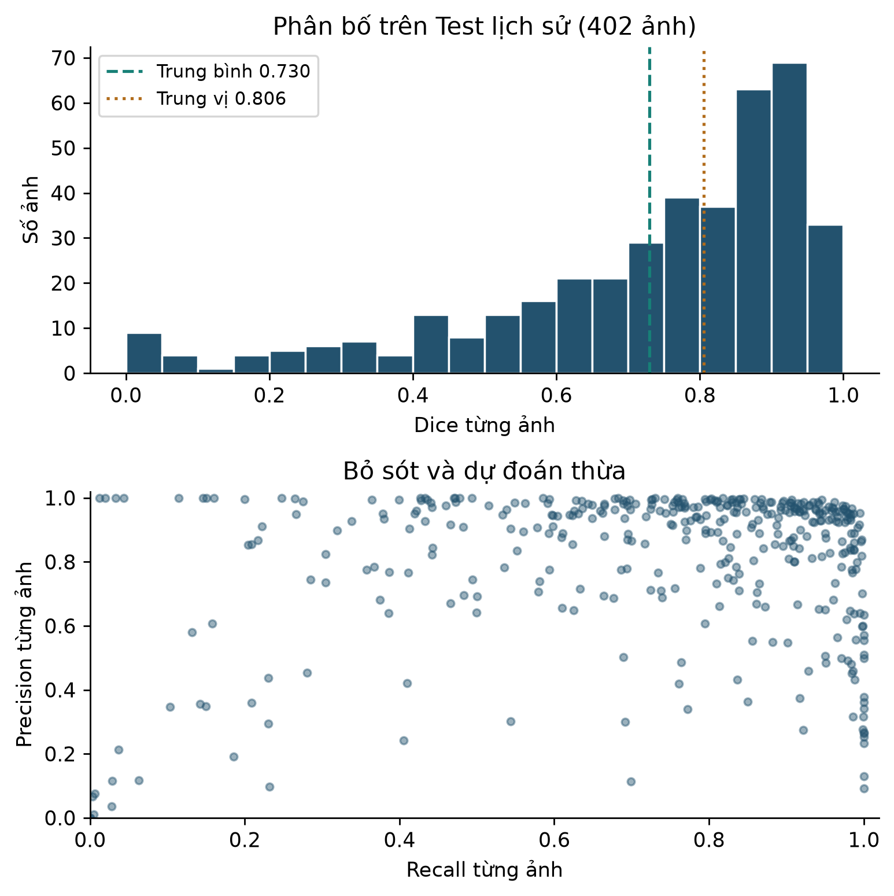

*Hình 3.28: Phân bố chất lượng từng ảnh của Standard U-Net trên Test lịch sử*

Nguồn: 402 dòng `test_per_image.csv` [16]. Hình được tính từ metric đã lưu; không chạy suy luận mới và không cung cấp khoảng tin cậy cấp bệnh nhân.

Ảnh `159.JPG` có Dice 0,975435, TP 21.681 pixel, FP 749 pixel và FN 343 pixel trong không gian 512×512. Ảnh `1295.JPG` có Dice 0, TP 0, FP 75 và FN 12.128. Hai ví dụ cùng checkpoint, cùng Test và cùng ngưỡng, được chọn để minh họa hai mức sai khác rất khác nhau. Chúng không đại diện ngẫu nhiên cho toàn bộ Test và cũng không chứng minh loại bệnh tương ứng. Báo cáo giữ ảnh gốc, mask tham chiếu, prediction và error overlay trong bố cục bốn ô để người đọc thấy trực tiếp vị trí chồng khớp hoặc bỏ sót.

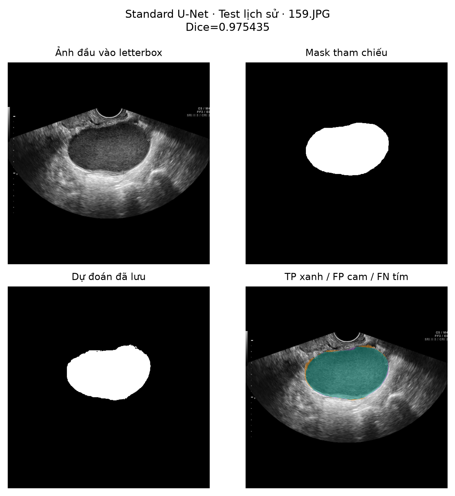

*Hình 3.29: Ví dụ Standard U-Net chồng khớp cao với mask tham chiếu trên Test*

Nguồn: ảnh `159.JPG`, mask nguồn và prediction lưu dưới sample hash `5ed60f60…`; checkpoint `417828fa…`, ngưỡng 0,5 [16]. TP màu xanh, FP cam, FN tím. Hình không xác định bản chất bệnh học.

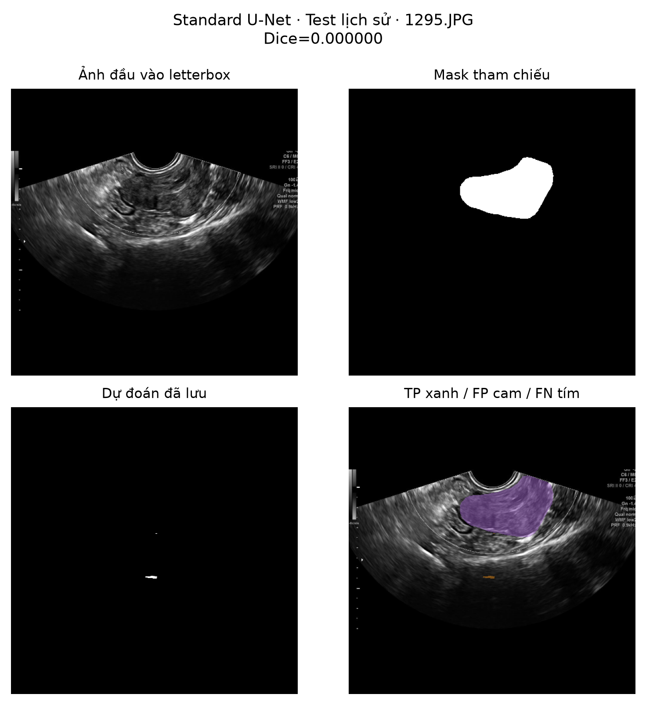

*Hình 3.30: Ví dụ prediction bỏ sót vùng tiền cảnh của mask tham chiếu*

Nguồn: ảnh `1295.JPG`, mask nguồn và prediction `2e9db9a9…`, cùng checkpoint lịch sử [16]. Màu tím biểu thị FN; không diễn giải nguyên nhân lâm sàng từ score bằng 0.

Trên Validation của U-Net++, hồ sơ phân tích lỗi lưu các ví dụ tốt và các ví dụ FP/FN cao. `1225.JPG` có Dice 0,989372; `958.JPG` có Dice 0,011773, FP 62.993 và FN 3.822; `376.JPG` có Dice 0, FP 40.158 và FN 29.972. Việc đồng thời có nhiều TP ở đa số ảnh và thất bại nặng ở một số ảnh giải thích vì sao phải xem error map, không chỉ một cột trung bình. Mỗi ví dụ cần ghi resolution, threshold và trạng thái nhãn tham chiếu để tránh so trực quan giữa các điều kiện khác nhau.

*Bảng 3.25: Một số mẫu lỗi truy được về hồ sơ thí nghiệm*

| Mô hình / tập | Ảnh | Dice | TP | FP | FN | Điều quan sát được |
|---|---|---:|---:|---:|---:|---|
| Standard / Test lịch sử | 159.JPG | 0,975435 | 21.681 | 749 | 343 | Chồng khớp cao ở độ phân giải đánh giá |
| Standard / Test lịch sử | 1295.JPG | 0,000000 | 0 | 75 | 12.128 | Không giao với foreground tham chiếu |
| U-Net++ / Validation | 1225.JPG | 0,989372 | 33.840 | 654 | 73 | FP và FN thấp so với vùng tham chiếu |
| U-Net++ / Validation | 958.JPG | 0,011773 | 398 | 62.993 | 3.822 | Dự đoán thừa lớn |
| U-Net++ / Validation | 376.JPG | 0,000000 | 0 | 40.158 | 29.972 | Vùng dự đoán và tham chiếu không giao |

Nguồn: Test per-image và error-analysis Validation [16]. Đếm pixel thuộc canvas 512×512; không đổi sang diện tích sinh học.

FP có thể liên quan vùng có cấu trúc giống tiền cảnh, còn FN có thể liên quan biên mờ, vùng nhỏ hoặc khác biệt quy ước nhãn. Đây là các giả thuyết cần kiểm, không là kết luận cho từng ảnh trong bảng. Trước khi quy lỗi cho mạng, cần rà cặp ảnh–mask, đường dẫn, phép letterbox và tính nhất quán của annotation. Nếu nhãn nguồn khoanh một đối tượng khác với mục tiêu đang mô tả, Dice thấp phản ánh cả sự lệch định nghĩa nhiệm vụ. Việc mời người chuyên môn rà các ảnh lỗi là bước cần thiết để phân biệt lỗi dữ liệu, lỗi mô hình và giới hạn của bài toán.

```mermaid
flowchart TB
 A["Ảnh có Dice thấp hoặc FP/FN lớn"] --> B["Kiểm cặp ảnh-mask và đường dẫn"]
 B --> C["Kiểm letterbox, threshold, checkpoint"]
 C --> D["Đối chiếu quy ước nhãn và ảnh gốc"]
 D --> E["Rà soát chuyên môn nếu có hồ sơ hợp lệ"]
 E --> F{"Nguồn sai khác đã xác minh?"}
 F -->|"Dữ liệu/nhãn"| G["Sửa phiên bản dữ liệu; lưu lịch sử"]
 F -->|"Mô hình"| H["Thí nghiệm mới theo protocol"]
 F -->|"Chưa rõ"| I["Giữ kết luận mở; không gán nguyên nhân"]
```

*Hình 3.31: Quy trình phân tích nguyên nhân sai khác giữa prediction và mask tham chiếu*

Nguồn: tác giả thiết kế từ nhu cầu kiểm toán thực nghiệm. Sơ đồ mô tả phương pháp rà soát; không hàm ý mọi bước đã được bác sĩ thực hiện.

Các hình có prediction thật được dựng lại từ tệp đã lưu, không dùng ảnh siêu âm sinh tổng hợp. Script xuất hình kiểm tra TP, FP và FN từ mask nguồn sau letterbox cùng prediction, rồi đối chiếu với CSV trước khi lưu PNG/SVG. Các ảnh được chọn đã kiểm tra trực quan không thấy tên, ngày sinh hoặc PID; điều này không thay thế xác minh giấy phép và quyền sử dụng từ đơn vị cung cấp. Bản công bố bên ngoài vẫn cần hồ sơ nguồn thích hợp. Cách ghi nguồn giúp truy vết mà không làm người đọc hiểu nhầm một hình đẹp là bằng chứng nhãn đã được phê duyệt.

### 3.5.8. Suy luận, đo hình học và liên kết Human-in-the-Loop

Suy luận dùng bộ tiền xử lý khớp với cấu hình checkpoint, chuyển tensor lên thiết bị, chạy một forward trong `torch.no_grad`, áp sigmoid rồi lấy mask theo threshold đã khóa. Hàm `post_process_mask` hiện chỉ nhị phân hóa; không tự loại thành phần nhỏ hoặc làm mịn mặt nạ AI. Tham số `min_area_px` xuất hiện trong chữ ký không có nghĩa lọc diện tích đang hoạt động ở bước này. Sau đó mask được mã hóa RLE để truyền qua API và có thể khôi phục đúng pixel. Các thao tác Fill, Smooth hoặc xóa mảnh ở viewer là chỉnh sửa do người dùng yêu cầu, cần phân biệt với prediction gốc. [17], [18]

```mermaid
sequenceDiagram
 participant U as "Người rà soát"
 participant V as "Viewer Canvas"
 participant A as "API"
 participant P as "Preprocessor"
 participant M as "Model đã nạp checkpoint"
 U->>V: "Mở ảnh đã tải"
 V->>A: "Yêu cầu prediction theo image_id"
 A->>P: "Ảnh nguồn và cấu hình chuẩn hóa"
 P-->>A: "Tensor, transform letterbox"
 A->>M: "Forward trong no_grad"
 M-->>A: "Logits"
 A->>A: "Sigmoid, threshold, RLE, provenance"
 A-->>V: "Mask AI và thông tin mô hình"
 V-->>U: "Ảnh gốc, đường viền và cảnh báo"
 U->>V: "Rà soát hoặc chỉnh mask"
 V->>A: "Mask sau chỉnh và quyết định review"
 A-->>V: "Review riêng, không là ground truth chính thức"
```

*Hình 3.32: Luồng suy luận đến rà soát và lưu mask do người sử dụng kiểm soát*

Nguồn: mã suy luận, router và viewer [17], [18]. Chức năng ký duyệt nghiên cứu không chứng minh quy trình phê duyệt lâm sàng bệnh viện.

Provenance đi cùng kết quả gồm tên model, phiên bản, checksum checkpoint, phiên bản tiền xử lý, thiết bị, threshold và pixel spacing nếu có. Checksum tránh việc hai tệp cùng tên nhưng trọng số khác bị coi là cùng mô hình. Tuy nhiên, chuỗi version do mã khai báo không thay thế hash nội dung; nếu chỉnh tiền xử lý mà quên cập nhật version thì tái lập vẫn sai. Một lần xuất phiếu cần lấy thông tin từ prediction đã lưu, không lấy tên model đang hiện ở giao diện rồi gán ngược cho mọi ca lịch sử.

Đo kích thước phải xác định đúng không gian. Mặt nạ AI ở canvas 512×512 có vùng đệm và hệ số resize, nên không thể nhân trực tiếp chiều dài trên canvas với spacing của ảnh nguồn rồi gọi là mm. Module `source_measurements.py` đảo letterbox về ảnh đã giải mã, tìm contour và tính hình học trong không gian nguồn. Đường kính lấy từ contour có diện tích lớn nhất; tổng diện tích cộng các contour giữ lại. Bộ đo hiện dùng hình chữ nhật bao diện tích nhỏ nhất và bỏ contour dưới 50 pixel vuông của ảnh nguồn. Đây là quy tắc giải thuật, chưa là ngưỡng tổn thương lâm sàng. [17]

Ở frontend, Web Worker hỗ trợ tính hình học từ mask để phản hồi trong khi chỉnh, còn endpoint đo nguồn giúp hiển thị số đo được xác nhận theo phương pháp backend. Hai phương pháp có thể khác: đường kính Feret qua bao lồi và cạnh dài của minimum-area rectangle không đồng nhất trong mọi hình dạng. Vì vậy, báo cáo ghi rõ phương pháp khi nói về d₁, d₂ hoặc diện tích; không gộp các số đo chỉ vì giao diện dùng chung nhãn. Sai số do nhị phân hóa, đảo letterbox và rời rạc contour cũng là giới hạn riêng ngoài sai số phân đoạn. [17], [18]

Không có spacing hợp lệ, hệ thống phải hiển thị px hoặc px² và nhãn chưa hiệu chuẩn. Module đo nguồn trả các trường mm, cm² là giá trị không có khi thiếu spacing; không biến hệ số 1,0 dùng nội bộ để lấy hình học thành hiệu chuẩn thật. Khi có spacing đẳng hướng đã xác nhận, chiều dài nguồn nhân spacing, còn diện tích nhân bình phương spacing. Metadata nêu nguồn DICOM hoặc nhập tay. DICOM spacing hai trục không gần bằng nhau không được tự gom thành một hệ số trong phương án hiện tại; cần giải thuật hỗ trợ anisotropic spacing trước khi mở rộng. [17]

Entropy nhị phân và trung bình xác suất pixel được engine dùng tạo cảnh báo heuristic. Chúng chưa được hiệu chuẩn thành xác suất mask đúng, chưa được kiểm định làm cổng an toàn và không tương đương mức nguy cơ ác tính. Phiên bản suy luận trả cấu trúc CDSS và mô tả âm học rỗng; hình học mask không đủ để suy ra IOTA hay O-RADS. Do vậy report giữ phạm vi phân đoạn và đo hình thái, không tự phân loại lành/ác, không tự tạo chiều d₃ hoặc thể tích từ một mặt cắt 2D. [5], [17]

Benchmark candidate trong môi trường cô lập với 24 ảnh Validation và ba request đo mỗi ảnh sau warm-up ghi 72 request thành công. Trung vị tổng HTTP là 146,47 ms và p95 là 170,54 ms; trung vị forward GPU khoảng 56,59 ms. Những mốc này có biên đo khác nhau: tổng HTTP còn gồm phần xử lý, lưu và serialization; forward chỉ đo một chặng. Benchmark một máy localhost không chứng minh thời gian một ca hai ảnh, hiệu năng đồng thời hoặc thời gian bác sĩ hoàn tất review. Nút tiến trình trên UI nên phản ánh cả upload, kiểm ảnh, phân đoạn và đo thay vì chỉ hiển thị số forward. [16], [18]

Giá trị của giải thuật đối với hệ thống thông tin là tạo một gợi ý có thể xem, sửa và truy vết. Mask AI phải giữ riêng với mask sau chỉnh; quyết định review cùng ghi chú có thể lưu mà không tự trở thành ground truth chính thức. Phiếu và workstation đều nêu đây là bản mẫu nghiên cứu. Kết quả có căn cứ hiện tại là so sánh hai cấu hình trên Validation và hồ sơ Standard Test lịch sử với những giới hạn dữ liệu đã trình bày. Muốn trả lời câu hỏi giảm thời gian, tăng tính hữu dụng hoặc chất lượng chuyên môn sau HITL, cần nghiên cứu người dùng và bộ tham chiếu được phê duyệt riêng; các đường cong huấn luyện không thay thế bằng chứng đó.

## 3.6. Thiết kế giao diện người dùng

### 3.6.1. Nguyên tắc thiết kế và tổ chức không gian làm việc

Thiết kế giao diện được xây dựng từ yêu cầu người rà soát phải kiểm tra được vùng máy đề xuất và giữ quyền chỉnh sửa. Với một công cụ đọc ảnh, ưu tiên của màn hình là ảnh, công cụ thao tác và thông tin giúp nhận diện trạng thái; các phần giới thiệu sản phẩm không chiếm diện tích của vùng chuyên môn. Ứng dụng sử dụng tên làm việc Ova cho không gian nghiên cứu. Tên này nhận diện bản mẫu trong trình duyệt, không phải tên thiết bị y tế đã được cấp phép. Mọi màn nghiệp vụ giữ dòng “Bản mẫu nghiên cứu – Không thay thế chẩn đoán y khoa”. Khi mở chế độ demo, một banner riêng giải thích dữ liệu minh họa không ghi vào máy chủ. Hai thông báo có mục đích khác nhau: một thông báo xác định phạm vi nghiên cứu, thông báo còn lại xác định nguồn dữ liệu đang quan sát [18].

Giao diện được chia thành khung điều hướng và vùng nội dung. Thanh trên chứa tên ứng dụng, tìm nhanh, thông báo, tác vụ chuyển ca và menu cá nhân. Sidebar nhóm chức năng theo nhiệm vụ; người dùng không phải đi qua một trang giới thiệu trước khi tiếp nhận ảnh. Trong Workstation, sidebar được ẩn để dành không gian cho ảnh. Thanh trạng thái dưới hiển thị kết nối và thông tin phiên bản khi nguồn dữ liệu có cung cấp. Breadcrumb được dùng ở các trang chi tiết để người đọc biết quan hệ giữa ca, lần khảo sát và màn hiện tại. Bố cục này tạo sự thống nhất mà không buộc màn quản lý và màn đọc ảnh có cùng mật độ hay cùng nền màu.

Design token được định nghĩa bằng CSS Variables trong `workspace-tokens.css`. Các thành phần dùng chung gồm button, input, tab, bảng, badge, chip, dialog, toast, banner, skeleton và empty state. Hệ thống dùng màu trung tính cùng màu nhấn xanh ngọc; thành công, cảnh báo và lỗi có nhãn chữ để tránh phụ thuộc vào màu. Số đo được trình bày bằng chữ số tabular nhằm hạn chế dịch chuyển độ rộng khi cập nhật. Workstation dùng nền xám than, không dùng nền đen tuyệt đối; các màn quản lý có thể dùng nền sáng. Chuyển theme là tùy chọn hiển thị, không thay đổi màu hay dữ liệu gốc của ảnh.

*Bảng 3.26: Nguyên tắc giao diện và cách kiểm tra*

| Nguyên tắc | Hiện thực trong bản mẫu | Tiêu chí kiểm tra |
|---|---|---|
| Ảnh là nội dung ưu tiên | Sidebar ẩn trong Workstation, ảnh ở vùng trung tâm | Ảnh và công cụ không bị che bởi điều hướng |
| AI chỉ đề xuất | Có ảnh gốc, mask AI và mask rà soát riêng | Thay đổi mask làm việc không ghi đè prediction gốc |
| Không nhầm đơn vị | Badge hiệu chuẩn và chữ px/mm đi cùng số đo | Thiếu spacing không xuất số đo vật lý |
| Trạng thái có ý nghĩa | Loading, empty, error và ready dùng thành phần chung | API thiếu không bị hiển thị như danh sách rỗng thành công |
| Quyền được phản ánh trong giao diện | Menu và thao tác lọc theo BS/TK/QT trong demo | QT không mở route ảnh lâm sàng bằng menu hoặc hash |
| Không đánh đồng demo với vận hành | Banner demo, nguồn ảnh sơ đồ, không số metric giả | Người xem nhận ra dữ liệu minh họa trên mỗi màn liên quan |
| Tiếp cận bằng bàn phím | Native form/dialog, nhãn icon, focus, shortcut có giới hạn | Tab không bị chiếm dụng để đổi bên |

Nguồn: tác giả đối chiếu các module giao diện và tài liệu thiết kế [18]. Tiêu chí truy cập được tham chiếu WCAG 2.2 [10]; bản mẫu chưa có chứng nhận đạt toàn bộ WCAG AA.

Các hình giao diện trong mục này là ảnh chụp ứng dụng đang hoạt động, lưu trong `artifacts/workspace-v2`. Ảnh sơ đồ được dùng để minh họa tương tác và không phải ảnh bệnh nhân. Các màn duyệt hai cấp, OTP và quản trị mở rộng trình bày thiết kế đã hiện thực phía frontend trong demo; endpoint server tương ứng còn là phần tích hợp tiếp theo. Đối với luồng thật, ứng dụng đã kết nối đăng nhập, tiếp nhận đủ hai ảnh, IQA, suy luận, đo, hiệu chuẩn và lưu review nghiên cứu. Phân biệt này được giữ trong chú thích và khi đánh giá mức hoàn thành, không chỉ đặt một lần ở phần hạn chế.

### 3.6.2. Giao diện truy cập và xử lý phiên

Màn đăng nhập đặt biểu mẫu ở vị trí dễ nhận diện, gồm tên đăng nhập, mật khẩu và thao tác hiện hoặc ẩn mật khẩu. Nhãn trường gắn với input, giúp thao tác bằng bàn phím và công nghệ hỗ trợ. Nút gửi phản ánh trạng thái đang xử lý nhằm hạn chế nhiều lần gửi cùng một yêu cầu. Đăng nhập thật nhận token từ backend và ánh xạ vai trò hiện có sang menu phù hợp. Ba nút demo được đặt ở vùng riêng và ghi tên vai trò; việc chọn demo là chủ động, không được dùng làm cơ chế dự phòng khi xác thực thật thất bại. Nhờ vậy, một lỗi máy chủ không thể âm thầm biến thành phiên đăng nhập giả.


*Hình 3.33: Giao diện đăng nhập và lựa chọn chế độ demo*

Nguồn: ảnh chụp ứng dụng, `artifacts/workspace-v2/01-login.png` [18]. Các tài khoản demo chỉ minh họa vai trò.

Quên mật khẩu và đặt lại mật khẩu là hai màn khác nhau. Màn yêu cầu khôi phục nhận thông tin cần thiết theo contract dự kiến, còn màn đặt lại kiểm tra mật khẩu mới và xác nhận khớp trước khi gửi. Một UI báo “đã gửi thư” khi backend chưa hỗ trợ sẽ tạo nhận định sai về an toàn tài khoản. Vì thế phiên bản hiện tại chỉ thông báo thành công khi nhận response hợp lệ; khi endpoint chưa tồn tại, lỗi được giữ để người dùng biết thao tác chưa hoàn tất. Reset token, thời hạn, chống sử dụng lại và giới hạn số lần thử phải thuộc server, không thể chứng minh bằng một ô nhập đẹp.

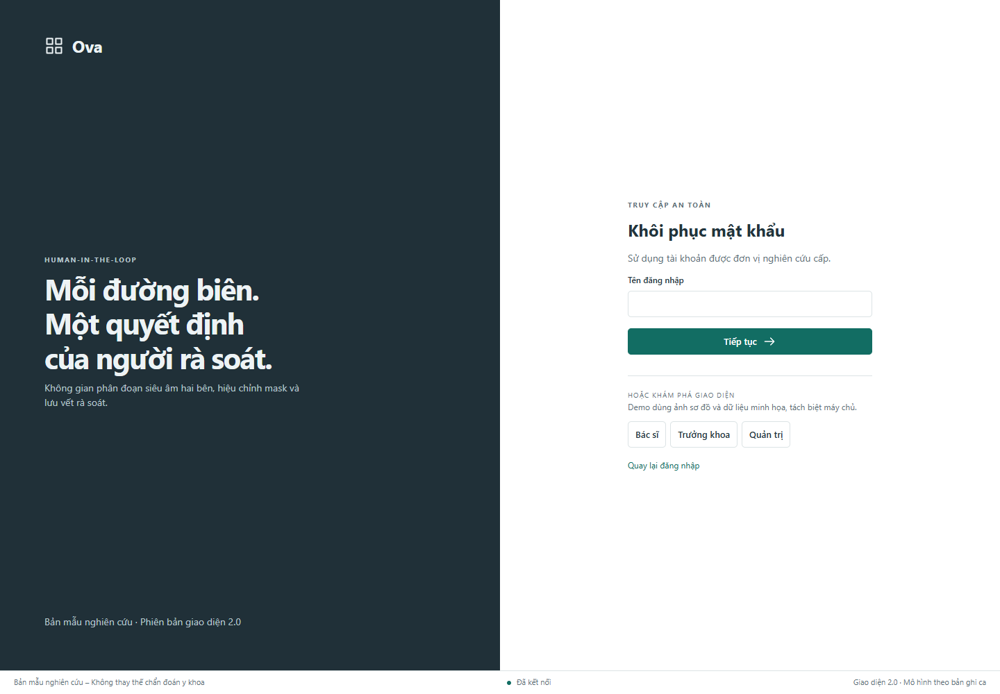

*Hình 3.34: Màn yêu cầu khôi phục mật khẩu trong luồng thiết kế*

Nguồn: ảnh chụp frontend; chức năng server khôi phục mật khẩu chưa được tích hợp [18].


*Hình 3.35: Màn đặt lại mật khẩu và kiểm tra dữ liệu nhập*

Nguồn: ảnh chụp frontend; không phải bằng chứng đã có dịch vụ gửi thư hoặc token reset [18].

Đổi mật khẩu lần đầu được thiết kế thành một bước có mục tiêu rõ ràng, tránh trộn vào trang tùy chọn. Màn OTP hiển thị nơi nhập mã, trạng thái gửi lại và thông báo lỗi. Trong nghiên cứu này, các màn đó kiểm tra cấu trúc luồng giao diện; chưa có căn cứ nói backend đã thực thi OTP, lockout hay refresh token. Phân quyền UI và kiểm tra form chỉ là lớp phản hồi cho người dùng. Những điều kiện bảo mật phải được kiểm tra từ request thật và dữ liệu server trước khi mở tính năng trên môi trường sử dụng.

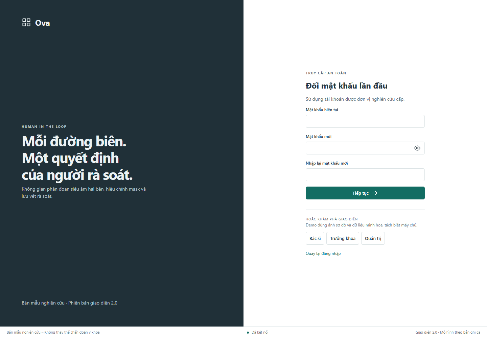

*Hình 3.36: Màn đổi mật khẩu lần đầu*

Nguồn: ảnh chụp frontend trong bộ giao diện nghiên cứu [18].

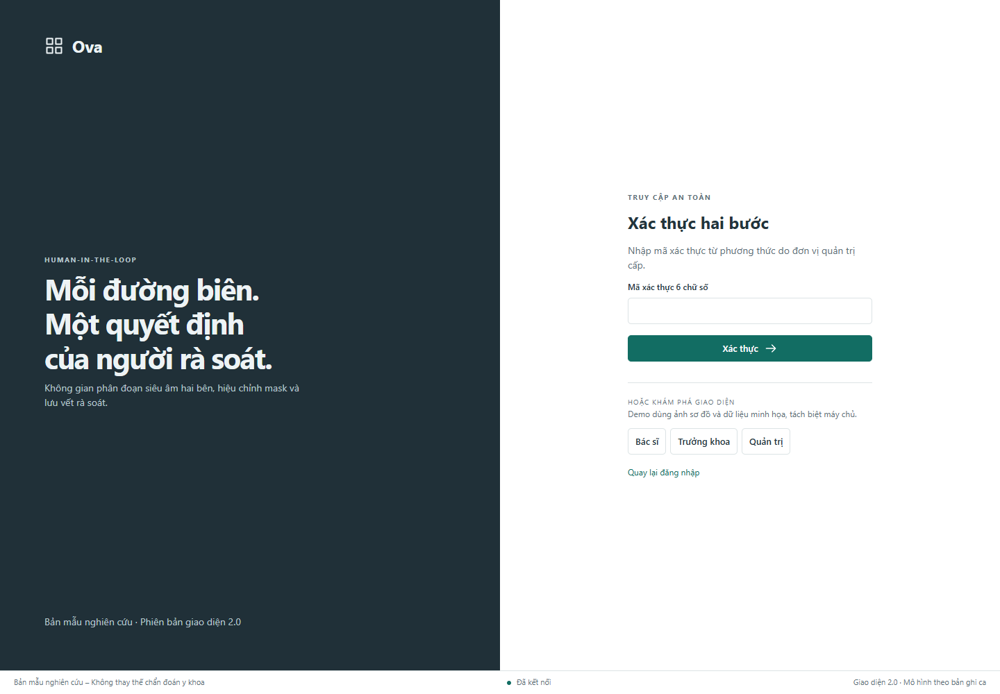

*Hình 3.37: Màn xác thực OTP theo thiết kế frontend*

Nguồn: ảnh chụp frontend; xác thực OTP thật cần endpoint backend bổ sung [18].

Khi phiên hết hạn, nội dung ảnh và trạng thái ca đang hoạt động cần được thu hồi khỏi giao diện để tránh tiếp tục thao tác bằng quyền đã mất. Người dùng được hướng dẫn đăng nhập lại; bản nháp chỉ được khôi phục khi định danh, quyền và phiên bản ca còn phù hợp. Không tự gửi lại một thao tác ký sau khi thay đổi phiên vì tác vụ đó phải thể hiện ý chí xác nhận của người dùng. Thử nghiệm hồi quy đã kiểm tra tình huống hết phiên trong lúc lưu và việc xóa trạng thái ca khỏi UI. Cách xử lý này giúp phân biệt “giữ công việc” với “giữ quyền truy cập cũ”.

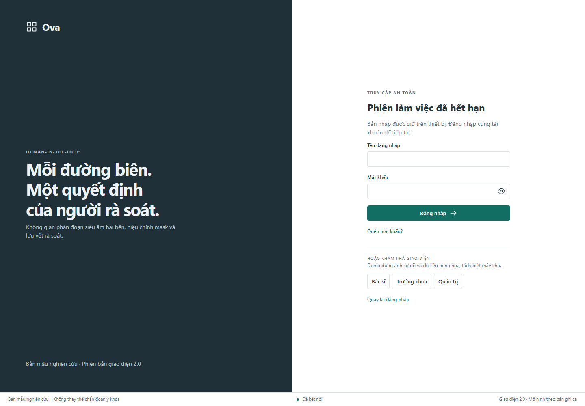

*Hình 3.38: Thông báo phiên hết hạn và đường quay lại đăng nhập*

Nguồn: ảnh chụp ứng dụng; kiểm thử phiên được trình bày ở mục 3.7 [18], [19].

### 3.6.3. Dashboard theo vai trò

Dashboard bác sĩ tập trung vào các việc đang dở, ca cần sửa và lối vào tiếp nhận ảnh mới. Số liệu có tính điều hành được đặt cùng hành động liên quan; không dùng các thẻ quảng bá tính năng để thay thế dữ liệu công việc. Một danh sách rỗng cần có chỉ dẫn bắt đầu, còn lỗi tải dữ liệu phải có thử lại. Trong demo, dữ liệu là các ca minh họa; đối với danh sách có phạm vi “của tôi” thật, backend phải lọc theo người dùng trước khi phân trang. Thống kê trên frontend không thể sửa một contract trả về toàn bộ ca mà chưa kiểm quyền.

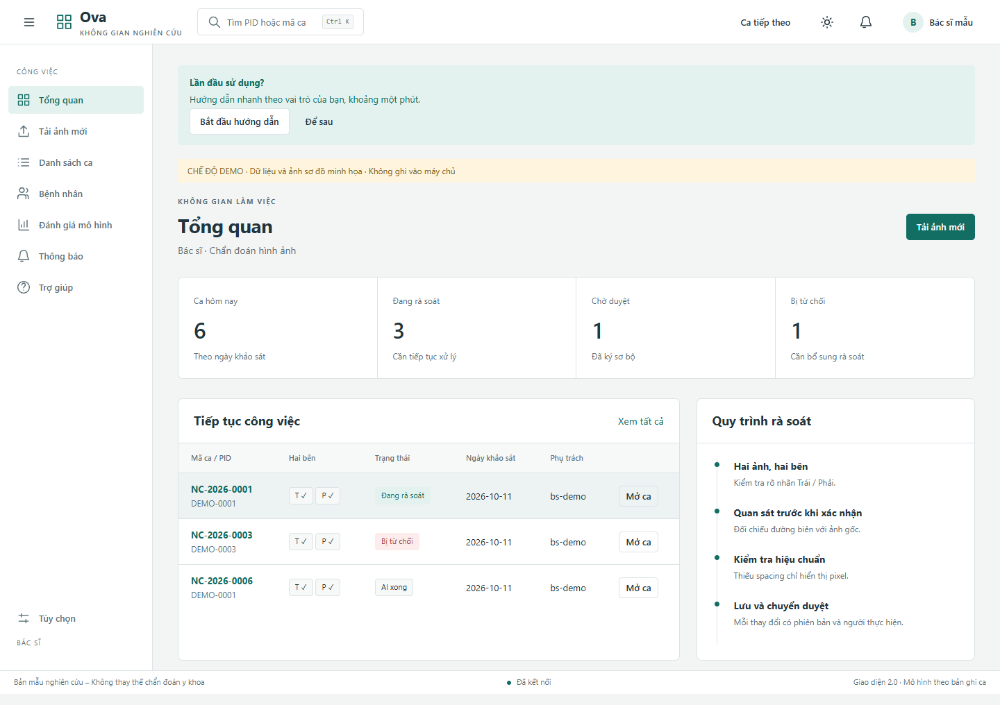

*Hình 3.39: Dashboard bác sĩ với các tác vụ cần xử lý*

Nguồn: ảnh chụp chế độ demo, dữ liệu minh họa [18].

Dashboard trưởng khoa ưu tiên hàng chờ duyệt và ca cần chú ý. Nút duyệt ca tiếp theo đưa người dùng vào tác vụ cụ thể, giúp giảm tìm kiếm lặp lại. Các số liệu khoa chỉ có ý nghĩa khi xác định đúng khoa và quyền của người xem. Trong trạng thái thiết kế, vai trò TK được tách khỏi bác sĩ tạo ca để mô hình hóa kiểm soát hai cấp. Tuy nhiên backend hiện có DOCTOR/ADMIN; sự tồn tại của dashboard TK trong demo chưa xác nhận tài khoản TK hay cơ chế ngăn tự duyệt trên server. Báo cáo giữ vai trò này như thiết kế mở rộng đã thể hiện được phía frontend.

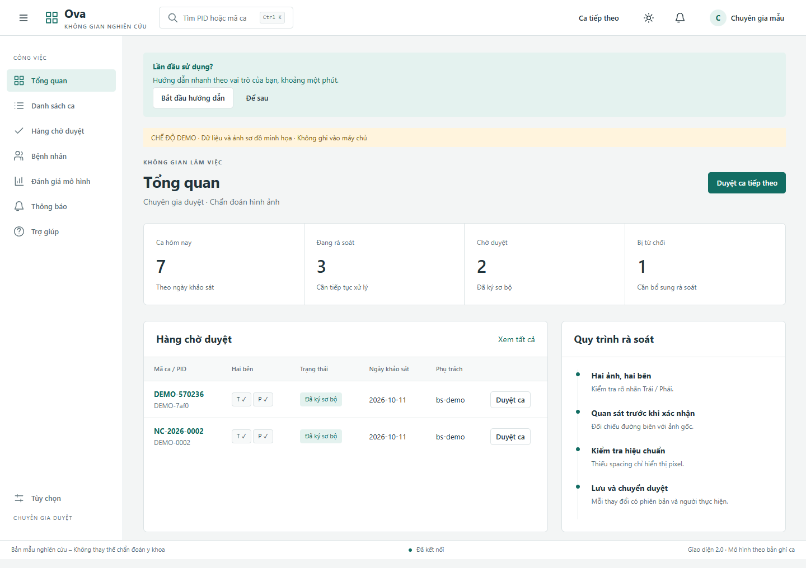

*Hình 3.40: Dashboard trưởng khoa và hàng chờ duyệt trong demo*

Nguồn: ảnh chụp demo; workflow duyệt hai cấp cần tích hợp server [18].

Dashboard quản trị trình bày sức khỏe hệ thống, người dùng và cảnh báo kỹ thuật. QT không nhận một bản sao dashboard bác sĩ chỉ đổi tiêu đề. Nội dung được giới hạn vào metadata, trạng thái và hành động quản trị. Việc tách lối vào giảm nhầm trách nhiệm khi một người vận hành máy chủ không có vai trò chuyên môn. Trong bản mẫu, menu và route lâm sàng bị chặn theo vai trò giao diện; để bảo vệ dữ liệu thật, endpoint cũng phải áp dụng quyền tương ứng. Đây là một yêu cầu còn cần củng cố ở backend khi triển khai mô hình quyền mới.

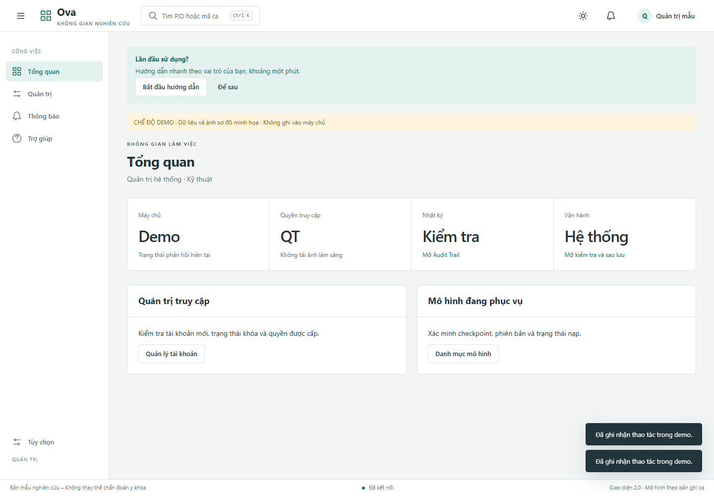

*Hình 3.41: Dashboard quản trị hệ thống, tách khỏi công việc đọc ảnh*

Nguồn: ảnh chụp demo quản trị [18].

### 3.6.4. Tiếp nhận ca và hai ảnh trái–phải

Màn tiếp nhận có hai ô tải ảnh độc lập mang nhãn Trái và Phải. Nhãn được giữ cùng thumbnail, trạng thái kiểm tra và tiến trình từng ảnh, tránh ghi nhớ một lựa chọn bên trong radio trước đó. Dữ liệu ca dùng PID giả danh; trường trống có thể được tạo mã theo quy tắc ứng dụng. Hệ thống không đưa tên hay ngày sinh thật vào biểu mẫu chính. Lý do khảo sát hỗ trợ diễn giải công việc nhưng không trở thành nhãn bệnh học cho mô hình. Để chạy chuỗi tự động, cả hai slot phải có tệp hợp lệ theo kiểm tra định dạng và kích thước.

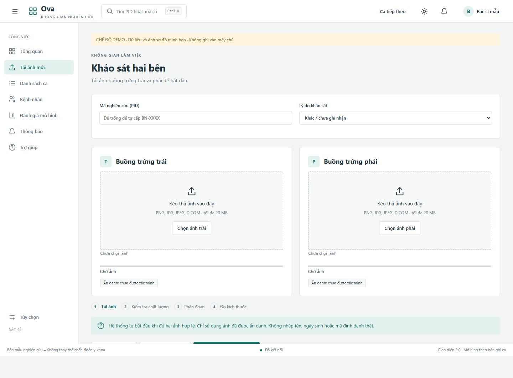

*Hình 3.42: Màn tiếp nhận với hai ô tải Trái và Phải riêng biệt*

Nguồn: ảnh chụp frontend; không chứa ảnh bệnh nhân [18].

Sau khi đủ cặp, frontend tạo ca, upload từng ảnh, gọi IQA và suy luận, giữ lại study_id và image_id để có thể thử lại mà không tạo thêm ca vô lý. Progress upload phản ánh dữ liệu truyền, còn phân đoạn được biểu diễn thành một trạng thái riêng. Cách chia này cho người dùng biết đang chờ mạng hay chờ mô hình. Nếu một bên lỗi, bên đã có ID vẫn được giữ; retry phải đi vào bước chưa hoàn tất. Không chạy song song hai chuỗi thiếu kiểm soát rồi dùng response đến sau để ghi đè bên đang xem. Test luồng thật đã kiểm tra việc thiếu một ảnh không được tiếp tục và hai ảnh được liên kết đúng bên [19].

Đối với DICOM, frontend có điểm tích hợp inspect và chọn frame nhưng chỉ bật khi server công bố capability tương ứng. Backend hiện tại chưa cung cấp chuỗi inspect nhiều frame và pipeline ẩn danh/OCR hoàn chỉnh. Vì vậy UI không tự khẳng định đã loại bỏ chữ nhận diện in cứng chỉ vì metadata được đọc. Trạng thái ẩn danh được trình bày là thông tin cần xác minh. Thiếu PixelSpacing dẫn đến đơn vị px, không tự lấy một hệ số mặc định để làm cho báo cáo trông đầy đủ. Đây là ràng buộc dữ liệu ảnh hưởng trực tiếp đến thanh đo và phiếu kết quả.

### 3.6.5. Worklist và thao tác danh sách

Worklist tổ chức ca dưới dạng bảng với tìm kiếm, trạng thái, ngày, người phụ trách, sắp xếp và phân trang. Tab phạm vi được xác định theo vai trò; người dùng không được thấy một nút “tất cả” rồi mới bị từ chối sau khi đã tải dữ liệu. Hai thumbnail thể hiện đủ cặp trái–phải; badge trạng thái kết hợp màu với chữ. Bộ lọc lưu được giúp người dùng quay lại một tập công việc quen thuộc mà không thiết lập lại. Tự làm mới phải giữ điều kiện tìm kiếm và tránh kéo người đang đọc sang trang khác. Hiển thị số lượng tổng cần lấy từ server, không suy từ một trang kết quả có giới hạn.

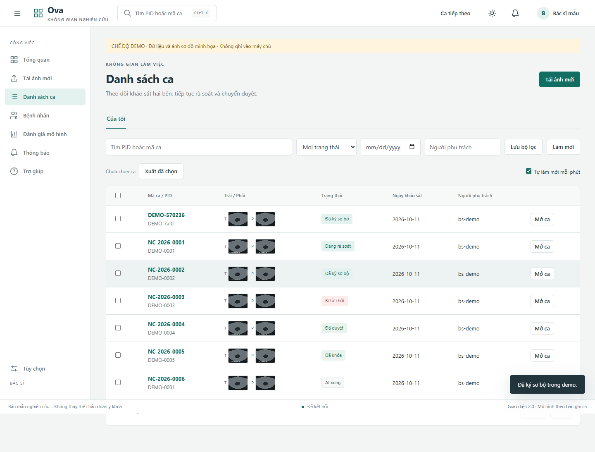

*Hình 3.43: Worklist với tìm kiếm, bộ lọc và trạng thái ca*

Nguồn: ảnh chụp demo; tìm kiếm và phân trang theo quyền thật cần contract worklist mới [18].

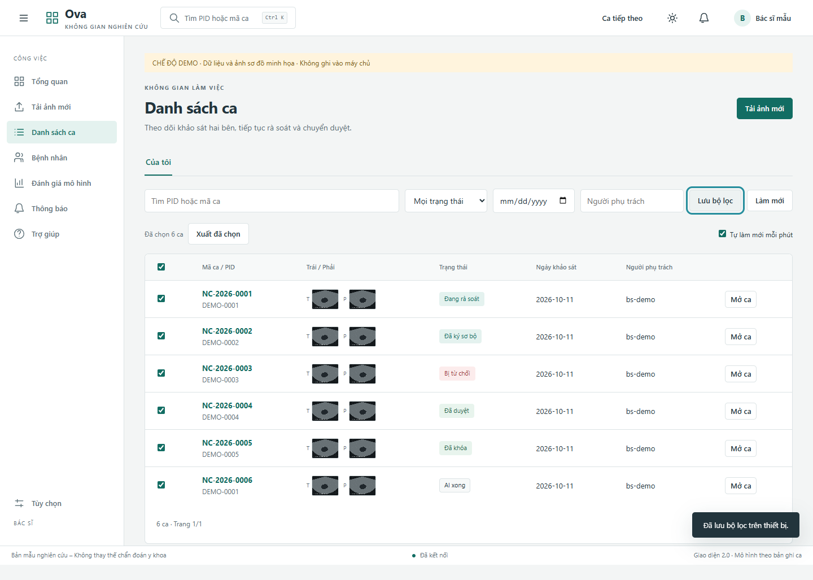

*Hình 3.44: Trạng thái chọn nhiều ca và thanh thao tác hàng loạt*

Nguồn: ảnh chụp demo; endpoint export/gán phụ trách được đặc tả riêng [18].

Chọn nhiều ca là một trạng thái tác vụ có thời hạn, không phải một quyền mới. Khi xuất hoặc gán phụ trách, mỗi ID vẫn phải được kiểm quyền và trạng thái phía server. Ca đã khóa không được mở cho chỉnh sửa chỉ vì nằm trong danh sách đã chọn. Một thao tác hàng loạt cần báo phần thành công và phần thất bại nếu backend hỗ trợ kết quả từng mục; nếu contract chỉ hỗ trợ transaction toàn bộ thì UI phải phản ánh đúng kiểu thất bại đó. Phiên bản demo giúp kiểm tra bố cục và tương tác, còn tính toàn vẹn của xử lý batch phải được chứng minh bằng API bổ sung.

### 3.6.6. Workstation đọc và hiệu chỉnh mặt nạ

Workstation chia thành thanh công cụ, viewer trung tâm và panel thông tin. Người đọc chuyển nhanh Trái/Phải hoặc mở đối chiếu hai bên; mỗi ảnh có prediction, mask làm việc, lịch sử, notes và trạng thái đo riêng. Thanh công cụ gồm brush, eraser, polygon, pan và các thao tác làm sạch vùng. Undo/redo lưu lịch sử giới hạn; hủy một dialog reset không được xóa redo. Reset về mask AI yêu cầu xác nhận và không làm mất bản gốc. Tác vụ “không có vùng tổn thương cần phân đoạn” cho phép mask rỗng, nhưng văn bản không kết luận người bệnh không có bệnh.

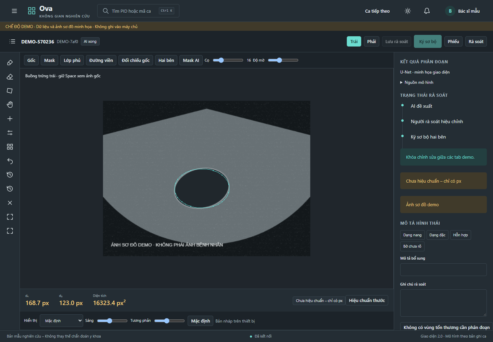

*Hình 3.45: Workstation dark theme với đường viền và công cụ rà soát*

Nguồn: ảnh chụp demo. Hình siêu âm trong viewer là ảnh sơ đồ, không phải kết quả thực nghiệm mô hình [18].

Đường viền mảnh được dùng mặc định để người đọc còn quan sát được mức xám ở trong và sát biên. Lớp phủ màu có opacity riêng; thay opacity chỉ thay hiển thị, không thay pixel mask. Giữ Space để tạm xem ảnh gốc, thả phím để trở về trạng thái trước. Preset sáng–tương phản mang tên hiển thị như “Ít chói” hoặc “Tăng tương phản”, không gán tên bệnh lý hay hàm ý preset đã được bác sĩ thẩm định. Nếu heatmap bất định không được server cung cấp đúng model-space, nút này không tự sinh một lớp màu nhằm làm phong phú giao diện.

Brush và eraser tác động vào lưới mask 512×512. Tọa độ màn hình đi qua phép biến đổi viewport rồi ánh xạ sang model-space; phép letterbox tiếp tục nối model-space với ảnh nguồn. Một ảnh không vuông có padding, vì thế chia đơn giản tọa độ chuột cho kích thước canvas mà bỏ scale/pan sẽ gây lệch. Module `coordinates.js` giữ một cách chuyển đổi chung. Viewer sử dụng offscreen source/mask và requestAnimationFrame, cập nhật vùng bẩn khi thao tác; zoom/pan thay ma trận hiển thị. Khi resize, phép đo rect và fit phải được cập nhật. Test tọa độ sử dụng ảnh không vuông và quy tắc làm tròn đồng nhất backend.

Thanh đo hiển thị d₁, d₂ và diện tích cùng badge hiệu chuẩn. Nếu chưa có hệ số hợp lệ, số đo dùng px và px² với cách trình bày dễ phân biệt. Nút hiệu chuẩn đặt ngay cạnh số đo để người dùng hiểu việc cần làm. Các phép đo preview tính ở Worker; request server cập nhật số đo nguồn sau chỉnh sửa. Một response đo cũ không được cập nhật lên mask mới hay ảnh bên kia. Hai trục được dùng để mô tả hình học của vùng trong lát cắt, không phải ba kích thước trực giao của thể tích. Phiếu vì thế không suy ra thể tích bằng cách nhân một trục thứ ba giả định.

Panel phải chứa thông tin model, hash nếu bản ghi cung cấp, notes, chip mô tả và cảnh báo cần xem kỹ. Chip là văn bản do người dùng chọn; không được trình bày như mô hình đã nhận biết phần đặc, nhú hoặc bản chất tổn thương. Cảnh báo như chưa hiệu chuẩn, IQA kém hoặc mask cần đối chiếu chỉ định hướng kiểm tra. Confidence trung bình pixel không được dùng như xác suất chẩn đoán hay điểm tin cậy đã hiệu chuẩn. Khi mất lease hoặc hết quyền, việc chặn phải áp dụng tới brush, notes, chip và biên lưu API, tránh một phần UI bị khóa nhưng phần khác vẫn sửa dữ liệu.

*Bảng 3.27: Phím tắt và điều kiện sử dụng trong Workstation*

| Phím | Hành vi | Điều kiện hoặc giới hạn |
|---|---|---|
| 1 / 2 / 3 | Ảnh gốc / Mask / Overlay | Không xử lý khi đang nhập văn bản |
| Space giữ | Tạm xem ảnh gốc | Thả phím phục hồi chế độ hiển thị trước |
| C / K / F | Đối chiếu / Đường viền / Toàn màn hình | Không thay dữ liệu mask |
| B / E / L / H | Brush / Eraser / Polygon / Pan | Công cụ chỉnh chỉ bật khi có quyền và lease |
| X | Đổi brush và eraser | Không dùng khi focus ở input |
| [ / ] | Giảm hoặc tăng cỡ bút | Giới hạn cỡ bút hợp lệ |
| Alt + cuộn | Đổi cỡ bút | Giữ tâm thao tác, không gửi API |
| ← / → | Chuyển bên Trái / Phải | Mask và notes mỗi bên độc lập |
| S | Làm trơn mask | Có lịch sử undo; không phải xác nhận chuyên môn |
| R | Reset về mask AI | Hộp xác nhận; hủy không mất redo |
| Shift + R | Xóa mask làm việc | Có xác nhận và undo |
| Ctrl + Z / Y | Undo / Redo | Lịch sử giới hạn, không vượt về prediction khác |
| Ctrl + Enter | Mở ký sơ bộ | Cả hai ảnh đã xem và điều kiện rà soát phù hợp |
| N / P | Ca tiếp hoặc ca trước | Phụ thuộc hàng chờ; cảnh báo khi chưa lưu |
| Ctrl + K / ? | Tìm nhanh / Trợ giúp phím | Không bỏ qua quyền route |
| Tab | Di chuyển focus chuẩn | Không chiếm dụng để chuyển bên |

Nguồn: mã giao diện và bộ kiểm thử logic [18], [19].

### 3.6.7. Tóm tắt và ký sơ bộ hai bên

Modal ký sơ bộ đặt hai ảnh và thông tin hai bên trong cùng một lần rà soát. Trước khi mở xác nhận, người dùng phải đã hiển thị đủ ảnh và cảnh báo. Tóm tắt ghi d₁, d₂, diện tích, đơn vị, hiệu chuẩn, mask đã sửa hay giữ nguyên và notes. Thiếu hiệu chuẩn là cảnh báo minh bạch, không được xử lý bằng cách tự gán mm. Đánh giá nhanh AI là tùy chọn; khi người dùng nêu lỗi mới mở nhóm bỏ sót, khoanh thừa hoặc biên chưa khít. Dữ liệu phản hồi là quan sát của reviewer, không phải nhãn chuyên gia đã duyệt lại dùng huấn luyện ngay.

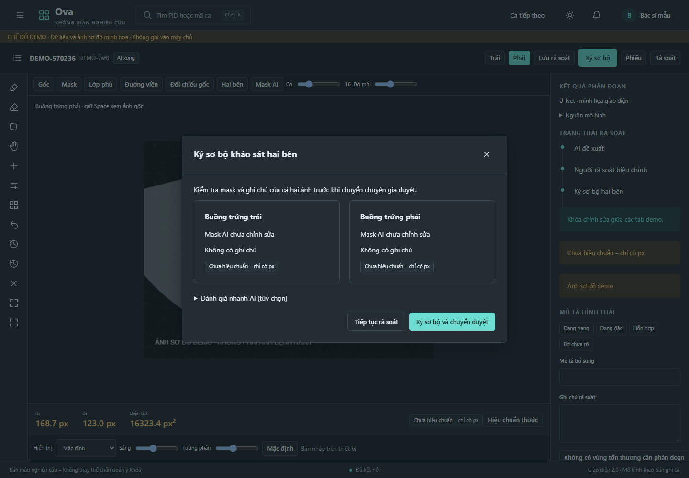

*Hình 3.46: Modal tóm tắt hai bên trước ký sơ bộ trong demo*

Nguồn: ảnh chụp demo; ký hai ảnh trong một transaction cần endpoint workspace bổ sung [18].

Trong luồng thật hiện có, lưu review thực hiện theo từng ảnh qua endpoint `/api/review`. Hai review thành công không được báo thành workflow duyệt hai cấp hoàn chỉnh nếu endpoint ký chưa có. Bản mẫu hiện lỗi rõ ràng ở tác vụ chưa được backend hỗ trợ; không dùng một trạng thái nội bộ để giả lập server thành công. Cách phân biệt này quan trọng khi demo sản phẩm: người xem có thể đánh giá luồng dự kiến nhưng vẫn biết đoạn nào đã lưu thật. Cờ `is_official_ground_truth=False` tiếp tục giữ nguyên; việc bấm xác nhận nghiên cứu không thay thế quy trình thẩm định nhãn của cơ sở y tế [17].

### 3.6.8. Hàng chờ và giao diện duyệt chính thức

Hàng chờ duyệt dành cho TK gồm các ca đã qua ký sơ bộ, thông tin phụ trách và dấu hiệu cần ưu tiên. Lý do bị từ chối được giữ trong lịch sử và xuất hiện ở đầu panel khi trả về người tạo ca. Trong màn duyệt, ảnh nguồn, mask bác sĩ và mask AI gốc có thể đối chiếu để phân biệt thay đổi của con người với gợi ý ban đầu. Approve và Reject là hai tác vụ khác nhau; Reject phải có lý do có thể hiểu. TK tự sửa tạo phiên bản mới để BS phụ trách rà soát và ký lại, tránh gắn một chữ ký cũ lên dữ liệu vừa thay đổi.

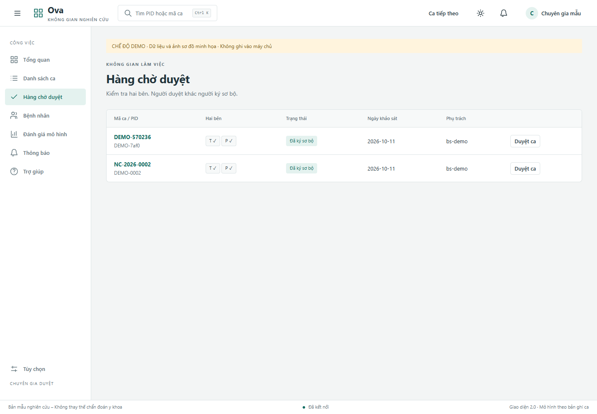

*Hình 3.47: Hàng chờ duyệt theo thiết kế vai trò trưởng khoa*

Nguồn: ảnh chụp demo; chưa phải danh sách lâm sàng vận hành [18].

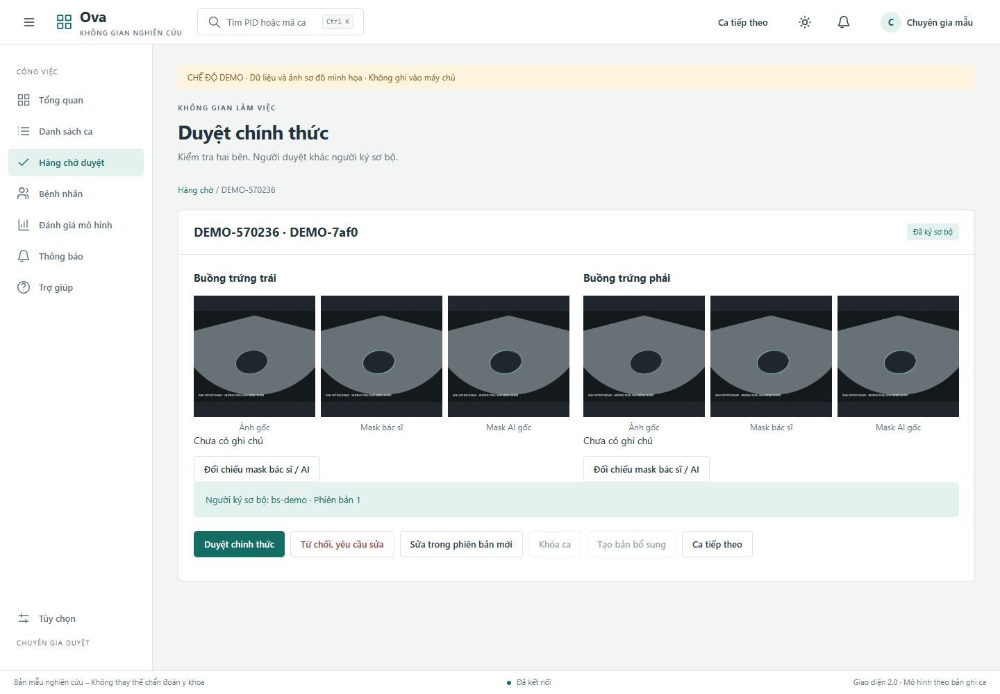

*Hình 3.48: Màn đối chiếu ảnh, mask rà soát và mask AI khi duyệt*

Nguồn: ảnh chụp demo; Approve/Reject thật cần backend workflow [18].

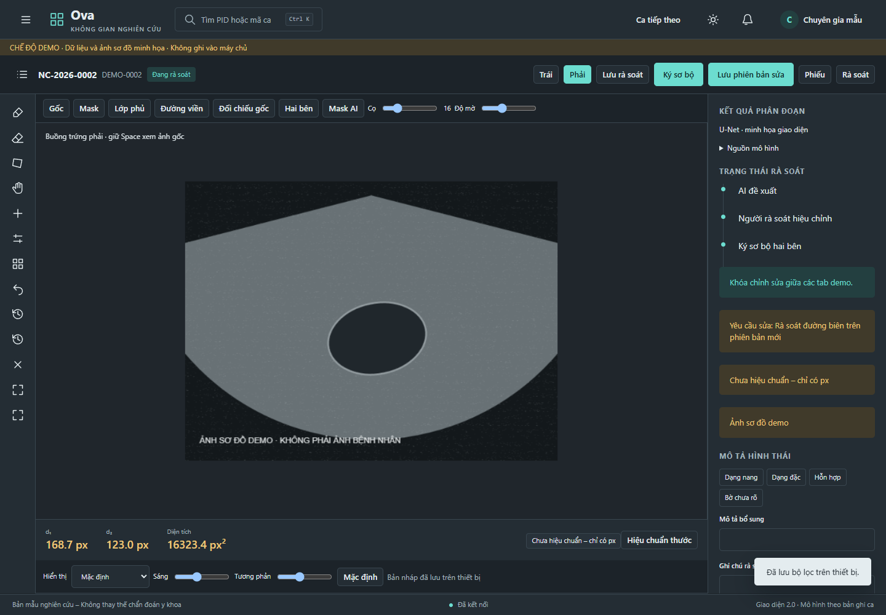

*Hình 3.49: Trạng thái tạo phiên bản hiệu chỉnh và giữ bản trước*

Nguồn: ảnh chụp demo; không chứng minh đã có cơ chế phiên bản bất biến phía server [18].

Nguyên tắc người ký sơ bộ không tự duyệt được thể hiện trong logic demo và ma trận quyền. Tuy nhiên nó phải được kiểm tại transition endpoint bằng định danh từ token, không nhận actor_id tùy ý từ client. Tương tự, khóa ca là trạng thái lưu bền, mọi mutation phải kiểm trạng thái khóa và phiên bản. Khóa chỉ bằng CSS hay disable button không bảo vệ API. Các hình minh họa góp phần làm rõ yêu cầu và cách thao tác; báo cáo không dùng chúng để tuyên bố đã đạt bảo mật quy trình bệnh viện.

### 3.6.9. Chi tiết ca và phiếu kết quả

Chi tiết ca trình bày timeline trạng thái, ảnh trái–phải, bản ghi model và phiên bản rà soát. Cách thể hiện ai làm gì, lúc nào giúp truy về quyết định thay vì chỉ nhìn badge cuối. Nếu ca được mở lại hoặc hiệu chỉnh, bản cũ vẫn cần tham chiếu được. Timeline demo minh họa mô hình dữ liệu cần mở rộng; lịch sử đầy đủ phía server phải được cung cấp bởi endpoint mới. Trong luồng hiện có, Prediction và Review được giữ thành hai nhóm bản ghi riêng, tạo nền tảng cho việc truy vết nhưng chưa thay thế toàn bộ yêu cầu addendum của hồ sơ lâm sàng.

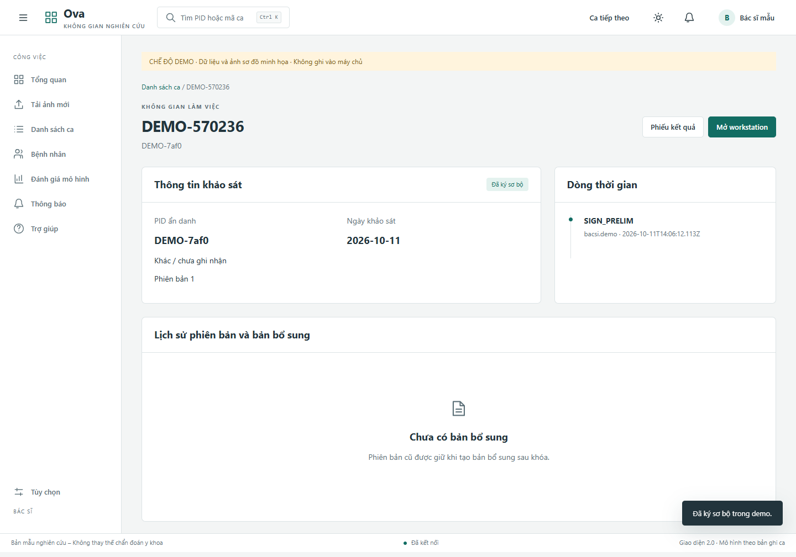

*Hình 3.50: Chi tiết ca với timeline và lịch sử phiên bản trong demo*

Nguồn: ảnh chụp demo [18].

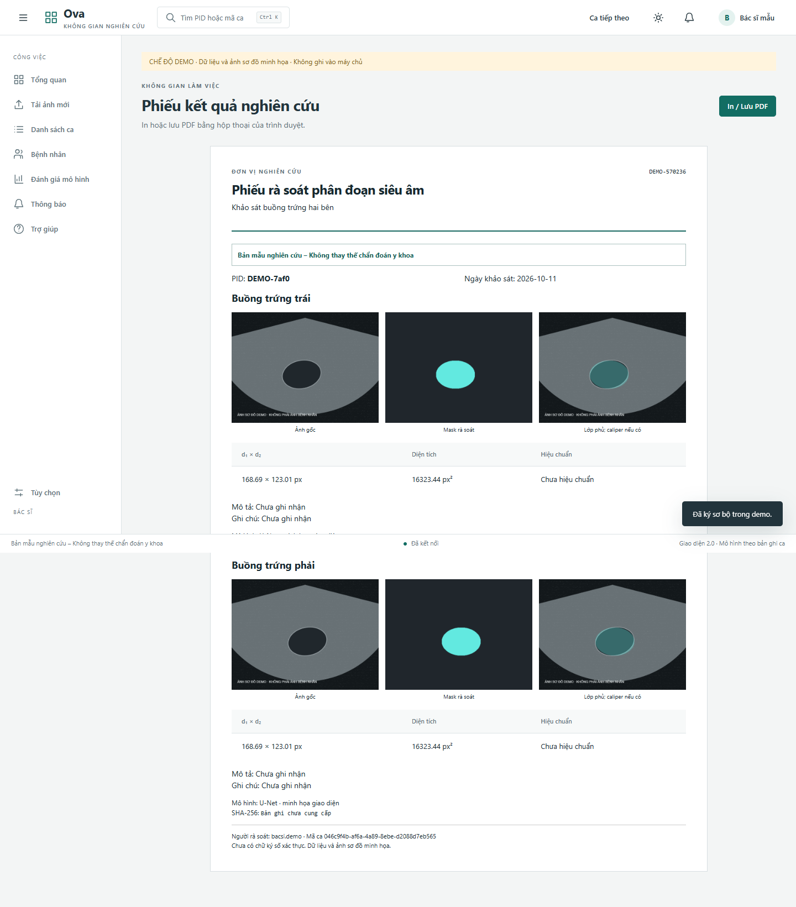

*Hình 3.51: Phiếu kết quả nghiên cứu A4 với ba hình cho mỗi bên*

Nguồn: ảnh chụp demo; ảnh sơ đồ minh họa, không phải phiếu kết quả bệnh nhân [18].

Phiếu tóm tắt dùng khổ A4, gồm mã ca, PID, thời điểm khảo sát, ảnh gốc, mask và overlay mỗi bên, số đo cùng trạng thái hiệu chuẩn, notes và thông tin model nếu bản ghi có. Dòng nghiên cứu xuất hiện trong nội dung in, không chỉ trên thanh trạng thái bị ẩn bởi CSS print. Header ghi đơn vị nghiên cứu, tránh một tên hoặc biểu tượng bệnh viện tạo cảm giác phiếu đã là tài liệu y bạ. Mã ca được dùng để tra cứu; bản hiện tại không tự tạo QR hay chữ ký số chưa có. Bản ghi không cung cấp hash phải nêu thiếu nguồn, không lấy hash model đang nạp để điền cho một prediction lịch sử.

Chức năng In/Lưu PDF gọi hộp thoại trình duyệt và áp dụng `@media print` để ẩn điều hướng. Đây là khả năng xuất qua trình duyệt, khác dịch vụ PDF server. Endpoint tạo báo cáo lâm sàng chưa hỗ trợ không được giới thiệu như đã có. Việc xuất cần audit receipt khi triển khai workflow mới; hiện đó là contract bổ sung. Đơn vị trong phiếu theo dữ liệu từng ảnh, nên hai bên có thể khác trạng thái hiệu chuẩn. Không ép đồng nhất đơn vị bằng cách suy một hệ số từ bên đã hiệu chuẩn sang bên còn lại.

### 3.6.10. Tra cứu PID và so sánh các lần khảo sát

Màn bệnh nhân dùng PID giả danh làm khóa tìm kiếm. Các lần khảo sát được tổ chức theo timeline, giúp người dùng chọn hai lần để xem đối chiếu. Hiển thị này không đưa thông tin định danh thật vào giao diện. Với quyền BS chỉ ca của mình, server phải kiểm phạm vi ở truy vấn lịch sử PID; một PID tồn tại không có nghĩa mọi tài khoản được xem tất cả Study của PID đó. Trong demo, thao tác chọn lần khảo sát và so sánh được dùng để kiểm tra trải nghiệm; endpoint timeline có quyền còn nằm trong danh sách mở rộng.

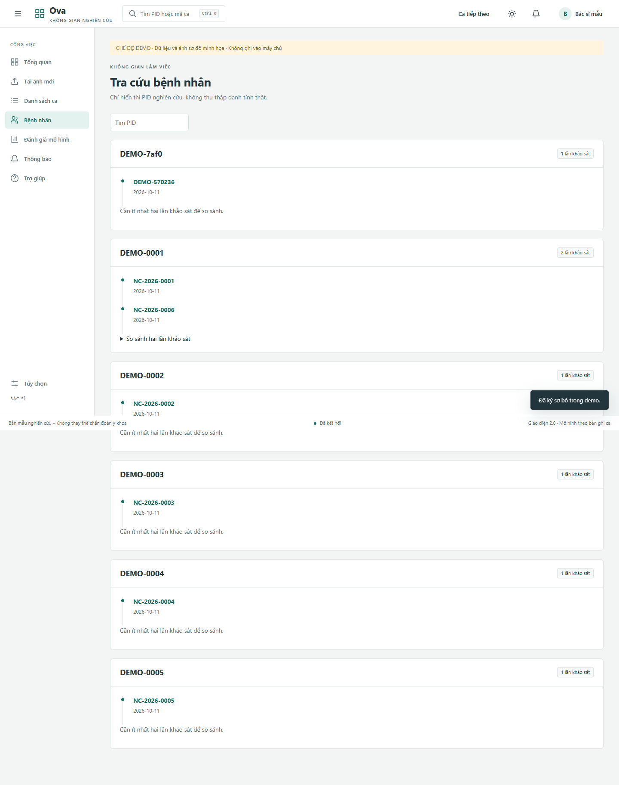

*Hình 3.52: Tra cứu PID giả danh và lịch sử khảo sát minh họa*

Nguồn: ảnh chụp demo, không có hồ sơ bệnh nhân thật [18].

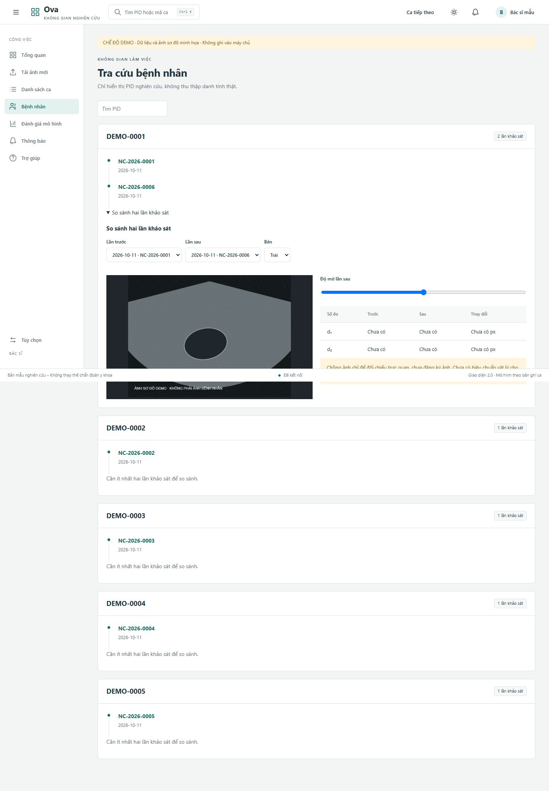

*Hình 3.53: Đối chiếu hai lần khảo sát và bảng số đo*

Nguồn: ảnh chụp demo; chồng ảnh chưa thực hiện đăng ký hình học [18].

Chồng hai ảnh bằng opacity chỉ giúp quan sát, không phải phép đăng ký ảnh đã hiệu chuẩn. Khác góc quét, scale hoặc lát cắt có thể tạo thay đổi biểu kiến dù cấu trúc không thay đổi. Vì vậy bảng so sánh phải ghi đơn vị và nguồn hiệu chuẩn của từng lần; chênh lệch px không được gọi là tăng kích thước vật lý. Không áp dụng một kết luận tiến triển bệnh dựa vào hai mask trong demo. Hệ thống giữ chức năng này như công cụ đối chiếu trực quan và đặt việc diễn giải chuyên môn ở người sử dụng.

### 3.6.11. Đánh giá mô hình và dữ liệu tham chiếu

Màn đánh giá mô hình tập trung metric theo tập, bảng theo ảnh, lọc nhóm lỗi và đối chiếu ảnh gốc–mask tham chiếu–AI–error map. Dice/IoU không xuất hiện như độ tin cậy của một ca đang đọc. Khi demo không có artifact đánh giá, màn hình thể hiện trạng thái rỗng có hướng dẫn thay vì gán một số điểm đẹp. Dữ liệu thật được tải qua API đánh giá lịch sử và giữ checkpoint/split tương ứng. Một bản đồ lỗi chỉ tính được khi hai mask cùng hệ tọa độ, kích thước và quy ước nhãn; ứng dụng không tự đoán transform khi chúng khác nhau.

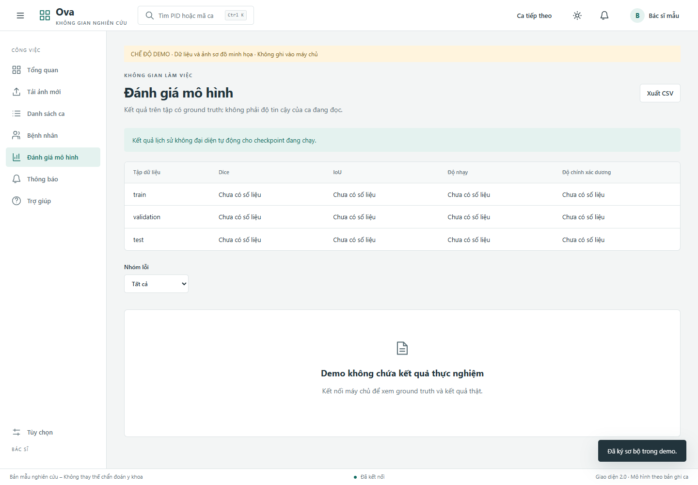

*Hình 3.54: Màn đánh giá mô hình, phân biệt dữ liệu thật và trạng thái demo*

Nguồn: ảnh chụp demo; số liệu thực nghiệm được trình bày từ artifact tại mục 3.5 [16], [18].

Xuất CSV lấy các bản ghi phù hợp bộ lọc và cần giữ metadata phép đánh giá. Nếu chỉ xuất một trang hiện tại, nhãn hành động phải phản ánh phạm vi đó; không gọi là xuất toàn bộ tập. Ảnh tải xuống dùng cho phân tích lỗi và phải kiểm thông tin nhận diện, quyền sử dụng khi chia sẻ. Metric Validation của U-Net++ không được trộn với Test của checkpoint Standard U-Net lịch sử để xếp hạng chung. Màn hình đánh giá có trách nhiệm làm rõ nguồn đo, còn người viết khóa luận có trách nhiệm giải thích giới hạn phương pháp của mỗi bảng.

### 3.6.12. Phân hệ quản trị

Quản trị gồm người dùng, khoa, model registry, audit, metadata ca, cấu hình và sức khỏe/sao lưu. Phân tách các nhóm giúp QT xử lý nhiệm vụ kỹ thuật mà không đi vào màn đọc ảnh. CRUD người dùng phải có validate, khóa hoặc mở khóa rõ ràng và quy tắc ngăn xóa tài khoản đang dùng hoặc có lịch sử trong demo. Một lần đổi role ảnh hưởng quyền phiên tiếp theo và cần ghi audit. Hành vi đó chưa được xem là đã có phía server chỉ vì danh sách mẫu thay đổi ngay sau khi bấm lưu.

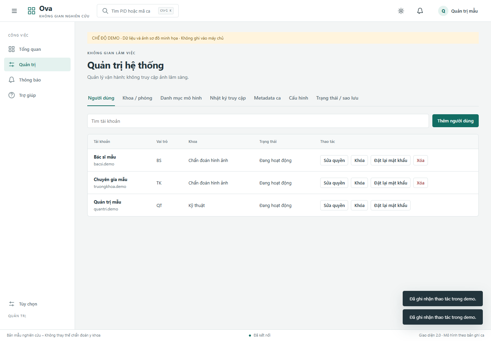

*Hình 3.55: Quản trị người dùng, vai trò và trạng thái tài khoản trong demo*

Nguồn: ảnh chụp demo; CRUD server mới chưa tích hợp [18].

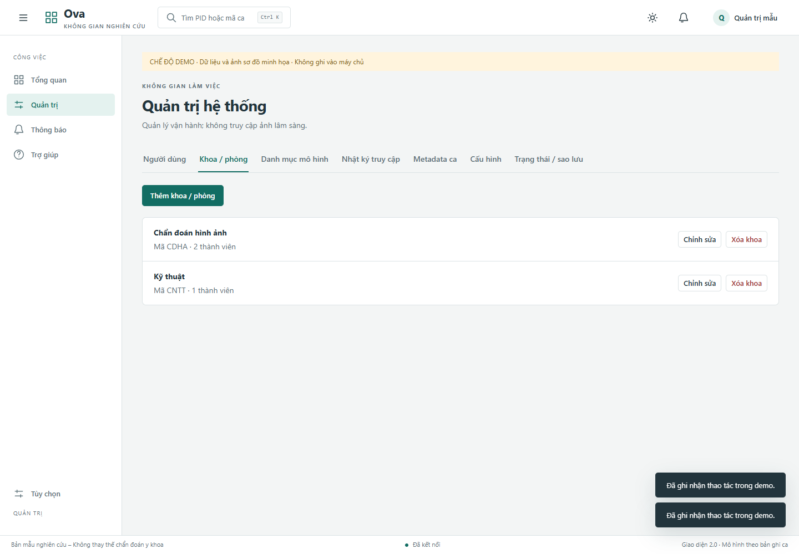

*Hình 3.56: Quản lý khoa/phòng và liên kết người dùng trong demo*

Nguồn: ảnh chụp demo; membership khoa cần ràng buộc phía server [18].

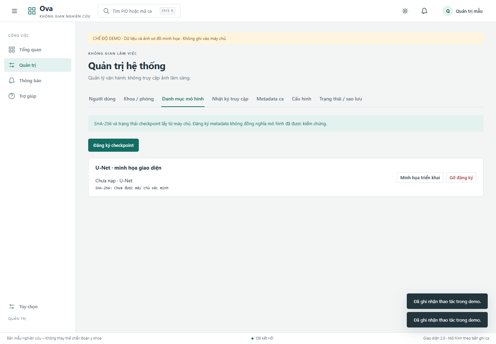

*Hình 3.57: Model Registry và trạng thái triển khai mô hình*

Nguồn: ảnh chụp demo; checkpoint thật được nhận diện riêng trong phần thực nghiệm [16], [18].

Model Registry cần thể hiện tên, kiến trúc, artifact và trạng thái nạp. Hash phải tính từ artifact ở server, không tin vào chuỗi người dùng nhập. Không cho gỡ model đang dùng nếu chưa có quy trình thay thế an toàn; provenance prediction lịch sử vẫn phải giữ sau triển khai model mới. Giao diện demo kiểm tra luồng đăng ký/triển khai/gỡ và phản hồi; registry thật hiện có endpoint đọc nhưng workflow ghi mới cần server hỗ trợ. Việc đưa U-Net++ vào bảng so sánh không đồng nghĩa mọi ca đang được suy luận bằng U-Net++.


*Hình 3.58: Audit Trail với danh sách sự kiện chỉ đọc*

Nguồn: ảnh chụp demo; API audit hiện có và API audit phân trang mở rộng được phân biệt [18].


*Hình 3.59: Bộ lọc audit theo tác nhân, hành vi và thời gian*

Nguồn: ảnh chụp demo [18].

Audit không có nút sửa hoặc xóa. Bộ lọc người thực hiện, hành vi, khoảng thời gian và tìm kiếm hỗ trợ truy vết theo ca. Tuy nhiên “append-only trên giao diện” không chứng minh bảng DB chống sửa bởi tài khoản kỹ thuật. Cơ chế quyền database, lưu trữ ngoài và giám sát toàn vẹn cần thiết kế riêng khi mở rộng. Báo cáo chỉ mô tả đúng mức đã hiện thực: UI chỉ đọc và contract đề xuất không có endpoint sửa/xóa; chưa tuyên bố có log chain bất biến. Bản xuất audit toàn bộ bộ lọc cũng cần server pagination/export tương ứng.


*Hình 3.60: Danh sách metadata ca dành cho quản trị, không hiển thị ảnh*

Nguồn: ảnh chụp demo [18].


*Hình 3.61: Cấu hình IQA, đơn vị và mẫu phiếu trong demo*

Nguồn: ảnh chụp demo; chỉnh cấu hình thật cần validation và version phía server [18].


*Hình 3.62: Trạng thái hệ thống và tác vụ sao lưu*

Nguồn: ảnh chụp demo; API sức khỏe/sao lưu hiện hữu phải kiểm riêng trong luồng thật [18].

Cấu hình đơn vị không được làm mất quy tắc spacing: lựa chọn hiển thị mm không tạo dữ liệu vật lý khi ảnh chỉ có px. Ngưỡng IQA là tham số kỹ thuật chưa hiệu chuẩn lâm sàng, cần có validation và lịch sử thay đổi. Sao lưu metadata khác sao lưu gồm tệp ảnh; UI phải nêu phạm vi để người vận hành không hiểu một archive DB là đủ phục hồi toàn bộ ca. Khi chưa có endpoint cấu hình, trạng thái error/retry được dùng để báo chưa kết nối; không chuyển sang empty success làm người quản trị tin đã lưu.

### 3.6.13. Hồ sơ, tùy chọn, thông báo và trợ giúp

Màn cá nhân giúp người dùng kiểm tra tài khoản, vai trò và thông tin phục vụ giao diện. Đổi mật khẩu là tác vụ xác thực có validation riêng, không gộp vào chỉnh theme. Tùy chọn gồm theme, ngôn ngữ, bố cục viewer và phím tắt. Cơ chế i18n tạo điểm nối cho ngôn ngữ khác nhưng bản sử dụng hiện ưu tiên tiếng Việt. Thay đổi layout không làm biến đổi mask đang chỉnh; một tùy chọn cần được lưu theo phạm vi phù hợp, tránh dùng localStorage chung rồi vô tình áp dụng thiết lập cá nhân của người trước cho người sau trên máy dùng chung.


*Hình 3.63: Hồ sơ và thông tin tài khoản người sử dụng*

Nguồn: ảnh chụp demo [18].


*Hình 3.64: Tùy chọn giao diện, ngôn ngữ và thao tác viewer*

Nguồn: ảnh chụp ứng dụng trong demo [18].


*Hình 3.65: Danh sách thông báo và phân biệt chưa đọc*

Nguồn: ảnh chụp demo; thông báo thật cần endpoint theo ownership [18].


*Hình 3.66: Trạng thái đánh dấu thông báo đã đọc*

Nguồn: ảnh chụp demo [18].

Thông báo dẫn tới tác vụ liên quan nhưng vẫn phải kiểm quyền khi mở route. Đánh dấu đã đọc không làm thay đổi trạng thái chuyên môn của ca. Mọi request thông báo thật phải gắn actor từ phiên, tránh cho phép một người đánh dấu thông báo của người khác bằng ID đoán được. Help cung cấp bảng phím, hướng dẫn theo vai trò, phiên bản và gửi góp ý. Onboarding dùng bước ngắn gắn với control thật, không che cả màn bằng một bài thuyết trình. Nội dung góp ý cần tránh đưa định danh bệnh nhân vào một kênh kỹ thuật.


*Hình 3.67: Trợ giúp, phím tắt và hướng dẫn dùng bản mẫu*

Nguồn: ảnh chụp demo [18].

### 3.6.14. Màn lỗi, ngoại lệ và thích ứng tablet

403, 404 và bảo trì được thiết kế riêng. 403 báo người dùng thiếu quyền, 404 báo tài nguyên hoặc đường dẫn không tồn tại, còn bảo trì báo trạng thái dịch vụ. Không dùng cùng một thông báo “có lỗi xảy ra” cho cả ba vì hành động tiếp theo khác nhau. Nút quay lại cần dẫn tới một route người dùng được phép vào. Màn lỗi không giữ ảnh lâm sàng phía sau sau khi phiên hoặc quyền đã mất. Với dữ liệu đang tải, skeleton giữ bố cục; lỗi API có retry rõ ràng và không reset dữ liệu form hợp lệ một cách vô lý.


*Hình 3.68: Màn không đủ quyền truy cập*

Nguồn: ảnh chụp frontend [18].


*Hình 3.69: Màn không tìm thấy đường dẫn hoặc tài nguyên*

Nguồn: ảnh chụp frontend [18].


*Hình 3.70: Màn thông báo bảo trì và khả năng thử lại*

Nguồn: ảnh chụp frontend [18].

Trên tablet, các màn Dashboard, Worklist và duyệt vẫn giữ nội dung thiết yếu, sử dụng vùng cuộn có chủ đích cho bảng thay vì ép chữ nhỏ. Workstation ưu tiên desktop cho thao tác biên chính xác; ảnh chụp tablet kiểm tra bố cục không thay thế thử nghiệm thao tác với bút trên thiết bị thật. Khả năng focus, nhãn icon và tương phản được thiết kế từ đầu, nhưng chưa có khảo sát screen reader toàn diện. Vì vậy kết quả trình bày là thiết kế và kiểm tra kỹ thuật giao diện, chưa phải chứng nhận đạt chuẩn truy cập toàn bộ.


*Hình 3.71: Bố cục Worklist trên tablet*

Nguồn: ảnh chụp demo tại viewport tablet [18], [19].


*Hình 3.72: Bố cục hàng chờ duyệt trên tablet*

Nguồn: ảnh chụp demo tại viewport tablet [18], [19].

Thiết kế ngoại lệ bao gồm mất mạng khi đang sửa, draft lệch phiên bản, hai tab mở một ca và đóng tab khi chưa lưu. Bản nháp cục bộ có metadata phiên bản để không ghi đè bản server mới hơn. Khi xung đột, giao diện cho tải bản nháp cũ hoặc giữ bản máy chủ; chưa có thuật toán merge nhiều thiết bị. Lease local chỉ bảo vệ giữa tab cùng trình duyệt, không thay thế lease server. Các trường hợp này được nêu cùng giao diện để người đánh giá hiểu hiệu ứng mỗi nút, đồng thời xác định việc còn cần triển khai trên server.

## 3.7. Kiểm thử và đánh giá hệ thống

### 3.7.1. Mục tiêu và phạm vi kiểm thử

Kiểm thử phần mềm xác định các chức năng có thực hiện đúng contract và bất biến đã đặc tả hay không. Đối với hệ thống này, bất biến quan trọng gồm liên kết đúng ảnh với ca và bên, mặt nạ có đúng 512×512, không tự tạo đơn vị vật lý, prediction không bị ghi đè khi sửa, review không được gọi là ground truth chính thức và người không có quyền không thực hiện mutation. Một giao diện hiển thị được không đủ để chứng minh các bất biến đó; cần kiểm request, response và dữ liệu lưu. Vì vậy quy trình kết hợp kiểm thử Python, logic JavaScript, thao tác trình duyệt và kiểm tra luồng API thật [17]–[19].

Bằng chứng phần mềm trong báo cáo lấy từ các log kiểm thử lưu ngày 11/10/2026 của phiên bản Workspace V2. Đây là kết quả của lượt chạy đã có trong dự án, không được trình bày như một lượt chạy mới trong quá trình biên soạn tài liệu. Bộ Python ghi `180 passed, 3 warnings`; bộ frontend ghi 11 script thành công. Khi chốt mã nguồn để nộp, cần chạy lại đúng bộ lệnh trên phiên bản đóng gói. Báo cáo không lấy số ca kiểm thử kỹ thuật làm số bác sĩ tham gia khảo sát và không dùng thời gian chạy test như thời gian rà soát một ca khám.

*Bảng 3.28: Các lớp kiểm thử và bằng chứng hiện có*

| Lớp kiểm thử | Mục đích | Bằng chứng | Giới hạn |
|---|---|---|---|
| Python toàn repository | API, dữ liệu, mô hình, contract và scope guard | Log 180 passed, 3 warnings, 69,35 giây | Không bao quát mọi tải đồng thời hoặc môi trường bệnh viện |
| Syntax ES modules | Phát hiện lỗi parse các module frontend | `node --check` trong script xác minh | Không kiểm hành vi runtime chỉ bằng syntax |
| Logic thuần JavaScript | Tọa độ, letterbox, RLE, mask và transition | `workspace_v2_logic.mjs` và `frontend_review_logic.js` | Dùng dữ liệu kiểm thử có kiểm soát |
| Browser demo | Route, quyền giao diện, ký/duyệt/khóa minh họa | `workspace_v2_e2e.js` và `workspace_v2_features.js` | Không chứng minh server đã có workflow hai cấp |
| Browser API thật | Upload đủ L/R, IQA, predict, đo, undo và lưu review | `workspace_v2_live.js` và log runtime-live | Chạy trên server cô lập, không có bác sĩ thật |
| Hồi quy bất đồng bộ | Response cũ, hết phiên, draft, lease và JSON abort | Các script races/draft_conflict/lease_guards/api_abort | Lease đa thiết bị phía server chưa có |
| Khảo sát người dùng | Thời gian, khả năng sử dụng, mức sửa | Protocol và phiếu dự kiến trong phụ lục | Chưa có dữ liệu người tham gia |

Nguồn: log và mã kiểm thử trong dự án [19].

### 3.7.2. Môi trường kiểm thử và dữ liệu kiểm thử

Browser regression dùng server cô lập tại cổng 8027 thông qua `tests.serve_isolated_app`; database và uploads đặt ở thư mục artifact dành cho kiểm thử. Thiết kế này giúp những ca được tạo hoặc xóa khi chạy test không tác động cơ sở dữ liệu làm việc. Credentials kiểm thử được cấu hình theo môi trường server, không chép mật khẩu vào báo cáo hoặc hình. Demo dùng dữ liệu trong bộ nhớ và ảnh sơ đồ, còn test live tạo tệp ảnh kiểm thử để đi qua API thật. Hai kiểu dữ liệu được tách mục đích: demo kiểm trải nghiệm theo vai trò, live kiểm phần tích hợp đã được backend hỗ trợ.

Một kiểm thử có giá trị phải kiểm đầu ra liên quan đến rủi ro. Chẳng hạn test lưu review kiểm bản ghi trong DB và cờ nghiên cứu, thay vì chỉ nhìn toast. Test xóa ca kiểm việc commit DB trước unlink và đường dẫn nằm trong upload root, thay vì chỉ kiểm HTTP 200. Test mask kiểm tổng run RLE bằng 262.144 pixel và quy tắc đầu vào, thay vì tạo encoder và decoder giống nhau rồi chỉ xác nhận chúng tự khớp. Test tọa độ có ảnh không vuông và padding, vì trường hợp ảnh vuông ở mức zoom mặc định khó phát hiện sai ánh xạ.

Các lỗi môi trường và warning được giữ trong hồ sơ. Hai warning Albumentations liên quan ShiftScaleRotate và một warning scheduler phát sinh ở bài kiểm AMP overflow mô phỏng. Lượt chạy ghi pass nhưng warning không bị xóa khỏi kết quả. Browser kiểm syntax và runtime của SPA; dự án không có bước bundler nên không dùng một lệnh build không tồn tại để tạo cảm giác đã kiểm. Chưa có audit screen reader toàn diện, benchmark 60 fps trên máy phòng đọc ảnh hay kiểm tải đồng thời ở quy mô vận hành; các mục này thuộc kế hoạch tiếp theo.

### 3.7.3. Báo cáo kiểm thử các chức năng cốt lõi

*Bảng 3.29: Kiểm thử tiếp nhận hai ảnh và chặn ca thiếu bên*

| Nội dung | Kết quả hoặc mô tả |
|---|---|
| Mã kịch bản | TC-INTAKE-01 |
| Tiền điều kiện | Phiên bác sĩ kiểm thử hợp lệ; chưa có ca đang xử lý |
| Dữ liệu | Tệp raster kiểm thử hợp lệ cho hai slot L/R; không dùng ảnh bệnh nhân |
| Các bước | Chọn ảnh Trái; quan sát chưa chạy; chọn ảnh Phải; chờ create/upload/IQA/predict |
| Mong đợi | Thiếu một bên không chạy; đủ cặp tạo một ca, giữ ID hai ảnh và bên tương ứng |
| Bằng chứng thực tế | Log live ghi mandatory pair upload/IQA/predict thành công |
| Nguồn kiểm thử | `tests/workspace_v2_live.js` và `runtime-live-verification.log` |
| Giới hạn | Không xác nhận DICOM nhiều frame hoặc ẩn danh chữ in cứng |

*Bảng 3.30: Kiểm thử chuyển đổi tọa độ và bảo toàn letterbox*

| Nội dung | Kết quả hoặc mô tả |
|---|---|
| Mã kịch bản | TC-VIEW-01 |
| Tiền điều kiện | Có kích thước nguồn không vuông, rect viewport, zoom và pan đã xác định |
| Các bước | Ánh xạ source → model → screen và chiều ngược; đối chiếu padding/làm tròn backend |
| Mong đợi | Điểm quay lại đúng hệ nguồn trong sai số tính toán; không bỏ padding |
| Bằng chứng thực tế | Log logic ghi source/model/screen round trips và backend letterbox rounding thành công |
| Nguồn kiểm thử | `tests/workspace_v2_logic.mjs`; `frontend/app/coordinates.js` |
| Tác động nghiệp vụ | Nét sửa mask và vùng xem phải trùng vị trí người dùng chọn |
| Giới hạn | Chưa đo thao tác bằng bút trên thiết bị phòng đọc ảnh thật |

*Bảng 3.31: Kiểm thử lưu hai review và bảo toàn phạm vi nghiên cứu*

| Nội dung | Kết quả hoặc mô tả |
|---|---|
| Mã kịch bản | TC-REVIEW-01 |
| Tiền điều kiện | Ca đủ hai ảnh, mỗi ảnh có prediction; phiên có quyền lưu |
| Các bước | Chỉnh mask; undo/redo; lưu rà soát; chờ xác nhận; kiểm DB |
| Mong đợi | Hai review lưu đúng ảnh; không ghi đè prediction; không ký sơ bộ giả khi endpoint thiếu |
| Bằng chứng thực tế | Log live ghi persisted two reviews, no false preliminary signoff thành công |
| Nguồn kiểm thử | `tests/workspace_v2_live.js`; `tests/test_hitl_contract.py` |
| Bất biến | `is_official_ground_truth=False`; thiếu hiệu chuẩn không tạo mm |
| Giới hạn | Endpoint review từng ảnh chưa phải transaction ký hai cấp toàn ca |

*Bảng 3.32: Kiểm thử phân quyền xóa và tính nguyên tử khi tạo ca*

| Nội dung | Kết quả hoặc mô tả |
|---|---|
| Mã kịch bản | TC-DATA-01 |
| Dữ liệu | Token DOCTOR kiểm thử; Patient/Study trong DB cô lập |
| Các bước | Gọi DELETE bằng DOCTOR; gây lỗi chèn Study khi tạo Patient mới; kiểm DB sau rollback |
| Mong đợi | DELETE trả 403; lỗi Study không để lại Patient mới mồ côi |
| Nguồn kiểm thử | `test_delete_case_requires_admin_even_with_doctor_token`; `test_failed_study_insert_rolls_back_new_patient` |
| Bằng chứng tổng | Hai bài kiểm thuộc bộ Python ghi 180 passed |
| Kiểm liên quan | Xóa chỉ unlink tệp sở hữu sau commit; không xóa ngoài upload root |
| Giới hạn | Không suy thành soft-delete hoặc audit bất biến nếu mã hiện chưa có |

*Bảng 3.33: Kiểm thử draft, lease và request cũ*

| Nội dung | Kết quả hoặc mô tả |
|---|---|
| Mã kịch bản | TC-ASYNC-01 |
| Tình huống | Response L/R đảo thứ tự; session hết hạn khi lưu; draft cũ; mất lease |
| Mong đợi | Response cũ không ghi đè ảnh mới; thu hồi UI khi hết phiên; không lưu draft cũ; chặn mutation sau mất lease |
| Bằng chứng thực tế | Log races, draft conflict và lease guards đều ghi PASS |
| Nguồn kiểm thử | `workspace_v2_races.js`; `workspace_v2_draft_conflict.js`; `workspace_v2_lease_guards.js` |
| Kiểm thêm | Hủy confirmation giữ redo; Escape hủy dialog dùng lại; JSON abort không thành thành công rỗng |
| Giới hạn | Khóa local giữa tab không bảo vệ nhiều máy; server legacy vẫn cần version/lease |

Nguồn các bảng kiểm thử: mã và log kiểm thử được lưu trong dự án [19]. Các kết quả nêu ở đây thuộc lượt chạy ngày 11/10/2026.

### 3.7.4. Kết quả hồi quy và rủi ro còn lại

Bộ frontend ghi 11 script thành công, bao gồm hai script logic và chín script dùng trình duyệt. Các nhóm kiểm tra route, cặp ảnh, ký/duyệt demo, quyền QT, sáu ảnh trong phiếu, thiết bị desktop/tablet, API live, race L/R, hết phiên, bản nháp, lease và abort request. Log server cô lập mới dùng kiểm luồng live không có ASGI exception trong phần đã ghi. Những kết quả này chứng minh các hành vi được nêu trong test tại phiên bản kiểm tra; không chứng minh mọi đường đi của ứng dụng không có lỗi.

Một log server cũ từng ghi `StaleDataError` khi test xóa ca trong lúc review còn xử lý. Test cleanup được sửa để chờ xác nhận hai review và kiểm DB trước khi xóa. Kết quả runtime mới và log cũ không được trộn thành một trạng thái chung. Tuy vậy race review/delete giữa người dùng thật vẫn là rủi ro backend cần xử lý bằng boundary transaction, kiểm trạng thái hoặc lease/version và lỗi xung đột dễ hiểu. Việc làm test chờ đúng thứ tự tránh một cleanup sai; nó không tự giải quyết mọi concurrency trong sản phẩm.

Các endpoint mở rộng như OTP, phân quyền theo khoa, transition hai cấp, lease server, DICOM inspect nhiều frame, IQA override và heatmap chưa được kiểm với backend thật vì chưa có implementation tương ứng. UI báo thiếu khả năng hoặc lỗi retry. Tình trạng này phải được xem là phần tích hợp còn lại trong nghiệm thu, không hạ xuống một lỗi mỹ thuật. Những thao tác đã hiện thực trong demo có thể dùng trình diễn yêu cầu, nhưng điều kiện cho dữ liệu thật luôn phải xác nhận ở server.

### 3.7.5. Thiết kế đánh giá tính hữu dụng và thời gian thao tác

Đề cương đặt câu hỏi HITL có hỗ trợ giảm thời gian khoanh vùng và tăng tính thuận tiện hay không. Để trả lời, cần so sánh cùng nhiệm vụ trên những ca có mức khó tương đương giữa vẽ thủ công và rà soát gợi ý AI. Thời gian đo nên bắt đầu khi ảnh cần phân đoạn đã sẵn sàng cho người sử dụng, kết thúc khi mask cuối được lưu thành công. Thời gian upload hoặc chờ mô hình có thể ghi riêng và cộng vào một chỉ số end-to-end nếu protocol quy định. Không lấy độ trễ inference để thay cho tổng thời gian thao tác của bác sĩ.

Một protocol khả thi là chọn tập ca được phép dùng, chuẩn hóa hướng dẫn nhiệm vụ, tổ chức phiên làm quen trước, rồi dùng thứ tự tác vụ đối cân bằng để giảm ảnh hưởng học thuộc ca. Người tham gia là vai trò mục tiêu có hồ sơ đồng ý tham gia; cần ghi kinh nghiệm đọc ảnh theo nhóm, không ghi dữ liệu định danh vào bản công bố. Mỗi tác vụ thu thời gian, số thao tác sửa, action cuối, sự cố UI và nhận xét. Các mask sau sửa vẫn giữ nguồn reviewer và trạng thái nghiên cứu, không tự chuyển thành dữ liệu Test mới.

SUS có thể dùng như thang đo cảm nhận khả năng sử dụng theo kế hoạch đề cương. Ngưỡng 75/100 trong kế hoạch chỉ là kỳ vọng tham chiếu, không phải kết quả đạt được. Khi triển khai thang đo, cần sử dụng phiên bản câu hỏi và cách tính đã được xác minh, giữ các câu theo đúng chiều điểm; phụ lục của báo cáo này trước hết cung cấp phiếu tác vụ và câu hỏi phản hồi, không bịa một bộ phiếu đã được bác sĩ điền. Hiện chưa có số người tham gia, phân phối thời gian, điểm SUS hay kiểm định thống kê. Kết luận hiệu quả thực tiễn do đó vẫn để mở.

### 3.7.6. Bàn luận về mức hoàn thành

Phần thuật toán đã có model, cấu hình, lịch sử và phép đo trên bộ ảnh hiện hữu. Phần hệ thống đã có contract và kiểm thử cho các thao tác cốt lõi, đồng thời có bộ giao diện mở rộng giúp mô hình hóa nhiều vai trò. Phần người dùng chưa có khảo sát đủ hồ sơ. Tách ba mức này giúp đánh giá sản phẩm đúng với chứng cứ: có thể khẳng định prototype cho phép xem, sửa và lưu mask, nhưng chưa khẳng định giảm bao nhiêu phần trăm thời gian bác sĩ hay đạt mức an toàn vận hành bệnh viện. Báo cáo đầy đủ không cần mọi ô đều là một kết quả tích cực; cần mọi kết quả có nguồn và mọi thiếu hụt có điều kiện xử lý.

## 3.8. Cài đặt, đào tạo và triển khai bản mẫu

### 3.8.1. Môi trường phần mềm và lựa chọn hạ tầng

Hệ thống được chạy theo kiến trúc client–server trên môi trường local của dự án. Trình duyệt tải HTML/CSS/ES modules từ FastAPI; backend tiếp nhận REST request, thao tác SQLAlchemy/SQLite và gọi dịch vụ PyTorch. Frontend không có bước build React hoặc bundler. Vì dùng module, Worker và API cùng origin, không mở trực tiếp `index.html` bằng đường dẫn tệp. Cách triển khai tối thiểu là chạy Uvicorn ở địa chỉ localhost và mở URL server. Cấu hình này phù hợp kiểm tra và trình diễn học thuật, không được gọi là đã triển khai nội bộ bệnh viện [17], [18].

Run config của hai mô hình đối sánh ghi GPU NVIDIA GeForce RTX 3050 Laptop GPU, batch size 2, ngân sách 30 epoch. Đây là môi trường đã chạy thí nghiệm, không phải cấu hình tối thiểu đã đo để khuyến nghị mua máy. Một máy trạm chỉ hiển thị giao diện không cần GPU suy luận nếu API chạy ở máy khác. Ngược lại, máy chủ có model cần đủ bộ nhớ cho trọng số, tensor đầu vào và request đồng thời. Các cấu hình CPU fallback, nhiều worker và đồng thời cần đo riêng; nhân số worker mà không tính bộ nhớ model có thể nạp nhiều bản trọng số gây thiếu tài nguyên.

*Bảng 3.34: Môi trường và trạng thái xác minh*

| Thành phần | Cấu hình hoặc cách dùng | Trạng thái |
|---|---|---|
| Backend | Python, FastAPI, Uvicorn theo môi trường `.venv` của dự án | Có mã và log API thật |
| AI | PyTorch; Standard U-Net và U-Net++/ResNet34 | Có run config và checkpoint |
| Thí nghiệm huấn luyện | RTX 3050 Laptop GPU, batch 2, 30 epoch | Ghi trong cấu hình chạy |
| Database | SQLite qua SQLAlchemy | Prototype local, chưa kiểm tải bệnh viện |
| Frontend | HTML5/CSS3/JavaScript ES modules, Canvas 2D, Worker | Không có bước bundler |
| Browser regression | Playwright-core và Chrome trên Windows | Có log kiểm thử lưu |
| Xuất phiếu | Print CSS và hộp thoại trình duyệt | Không phải dịch vụ PDF lâm sàng server |
| Word khóa luận | Times New Roman 13, A4, ảnh nhúng và trường mục lục | Kiểm tra trong hồ sơ biên soạn |

Nguồn: run config, README frontend, mã backend và log [16]–[19].

### 3.8.2. Các bước cài đặt và khởi động

Người triển khai chuẩn bị repository, môi trường Python và dependencies theo hồ sơ cài đặt của dự án, sau đó chọn đúng model artifact. Không đổi tên một checkpoint bất kỳ thành tên model mong muốn; kiến trúc nạp và trạng thái tensor phải tương thích. SHA-256 checkpoint được lưu để đối chiếu. Cấu hình dữ liệu, upload root và database phải tách khỏi thư mục dùng chạy kiểm thử. Khi sao chép dự án sang máy mới, cần kiểm đường dẫn tương đối và quyền ghi, vì một absolute path còn trỏ máy phát triển có thể làm mất khả năng mở lại ảnh.

Các biến môi trường xác thực gồm `APP_JWT_SECRET`, `APP_ADMIN_PASSWORD` và `APP_DOCTOR_PASSWORD` theo cấu hình hiện có. Bí mật thật được thiết lập ngoài báo cáo và ngoài screenshot. Tài khoản theo role hiện tại là cơ chế prototype, chưa thay thế tài khoản cá nhân có password hash và quản lý đầy đủ. Không thể ghi danh tính chuyên môn có giá trị chỉ từ username mặc định. Nếu mở cho người dùng thật, tài khoản cá nhân, khóa/rate limit và quản lý phiên phải được triển khai phía server trước.

Lệnh khởi động local theo README frontend là `.venv\Scripts\python.exe -m uvicorn backend.app.main:app --host 127.0.0.1 --port 8000`. Sau khi máy chủ sẵn sàng, truy cập `http://127.0.0.1:8000`. Kiểm `/api/health`, trạng thái model, khả năng truy cập static và cấu hình API trước khi tiếp nhận tệp. Chế độ demo được chọn rõ trên màn đăng nhập; nó không tạo hoặc xóa bản ghi server. Đăng nhập thật sử dụng cấu hình đúng môi trường và chỉ dùng dữ liệu đã được phép nghiên cứu.

Để kiểm tra regression, chạy `.venv\Scripts\python.exe -m pytest -q --tb=short` và script `scripts/verify_workspace_v2.ps1`. Browser test cần server cô lập ở 8027 theo hướng dẫn; không chạy cleanup đối với ca làm việc. Kết quả được lưu với ngày, phiên bản và phạm vi môi trường. Đối với hồ sơ mô hình, dùng manifest và run config đi kèm, không thay đường dẫn tập Test hoặc threshold sau khi đã lấy metric rồi giữ nguyên tiêu đề bảng cũ.

### 3.8.3. Khởi tạo dữ liệu, kiểm tra schema và sao lưu

`init_db()` tạo schema và có logic bổ sung cột tương thích SQLite cũ. Cột laterality và file_hash giúp quản lý cặp ảnh và chống trùng trong Study. Unique index đảm bảo application check không phải lớp duy nhất chống upload trùng. Những bản ghi legacy thiếu hash hoặc side cần được nhận diện trong kế hoạch chuyển đổi; không tự suy một bên từ tên tệp rồi coi là dữ liệu đã xác nhận. Quá trình migration có thể thay đổi DB, nên thao tác trên bản sao để kiểm before/after và lưu lại bản gốc trước lần cập nhật schema.

Sao lưu có ít nhất hai thành phần: database chứa metadata và tệp ảnh/mask liên quan. Chỉ có DB mà raw_path trỏ tệp không tồn tại sẽ không đủ mở lại ca. Một archive cần có manifest đường dẫn, thời điểm, phạm vi, kiểm hash và hướng dẫn phục hồi. Thử restore trên môi trường cô lập là bằng chứng quan trọng hơn việc thấy một file backup đã được tạo. Hiện chưa có hồ sơ kiểm restore đầy đủ trong báo cáo; do đó khả năng phục hồi vận hành chưa được chứng nhận. Dữ liệu backup cần kiểm quyền truy cập như dữ liệu chính.

Đối với model, backup trọng số phải đi cùng kiến trúc, phiên bản tiền xử lý, ngưỡng và hồ sơ đánh giá. Khi thay model đang nạp, prediction cũ không được cập nhật nguồn bằng checksum mới. Nếu rollback, hệ thống phải nhận diện phiên bản nào tạo prediction nào để không trộn hai loại kết quả trong một chỉ số. Registry trong demo mô hình hóa yêu cầu này, còn chính sách triển khai model thật cần kiểm API và transaction cấu hình. Tính tái lập ở cấp báo cáo dựa vào artifact, không dựa vào tên marketing của model.

### 3.8.4. Đào tạo sử dụng và kịch bản trình diễn

Đào tạo bản mẫu bắt đầu bằng phân biệt demo và live, PID giả danh và định danh thật, mask AI và mask rà soát. Người sử dụng được hướng dẫn tải cặp Trái/Phải, đọc trạng thái IQA, mở ảnh gốc, kiểm đường biên và chọn công cụ sửa. Một tác vụ thực hành nên yêu cầu người dùng sửa có chủ đích một vùng nhỏ rồi undo/reset để biết dữ liệu nào thay đổi. Sau đó giới thiệu hiệu chuẩn, đơn vị px/mm, tóm tắt hai bên và sự khác nhau giữa lưu review nghiên cứu với ký duyệt quy trình dự kiến.

Kịch bản BS gồm tiếp nhận hai ảnh, quan sát đủ hai bên, sửa khi cần, nhập notes và lưu. Kịch bản TK trong demo gồm mở hàng chờ, đối chiếu mask, Reject với lý do, sửa tạo phiên bản, duyệt và khóa. Kịch bản QT gồm xem metadata, người dùng, model, audit và cấu hình, không mở ảnh. Người hướng dẫn phải nói rõ màn nào đang dùng endpoint thật và màn nào mô hình hóa luồng chưa tích hợp. Không dùng một ca demo có đầy đủ badge để trình diễn như hồ sơ bệnh viện đã được duyệt.

Phần thực hành ngoại lệ gồm mất mạng, thử lại, thiếu một ảnh, AI lỗi, mask rỗng, hết phiên và draft cũ. Người dùng cần biết lưu nháp cục bộ không có nghĩa đã lưu server. Khi lỗi, không tải lại trang ngay nếu có thể giữ dữ liệu hợp lệ và thử đúng bước. Đối với ca chưa hiệu chuẩn, kết quả thực hành phải giữ px. Thông tin phản hồi đào tạo được ghi vào phiếu tác vụ, không tự tổng hợp thành một điểm SUS nếu chưa dùng thang đo đã kiểm chứng.

### 3.8.5. Giám sát, xử lý sự cố và kế hoạch mở rộng

Một lỗi vận hành cần được phân loại theo chặng: upload, IQA, suy luận, đo, review hay render. Thời gian từng chặng và mã tài nguyên giúp truy vết; log không ghi mật khẩu/token hoặc metadata định danh. Nếu upload thất bại nhưng Study đã có, retry dùng ID đang giữ; nếu suy luận lỗi, không tạo prediction giả để cho bước review đi tiếp. Nếu server đã lưu nhưng response bị mất, contract idempotency hoặc truy vấn trạng thái là cách giảm duplicate operation. Những yêu cầu đó phải được áp dụng vào API khi mở rộng, không vá bằng cách disable nút ở frontend.

Lộ trình mở rộng được sắp theo các phụ thuộc thực tế. Trước hết khóa provenance dữ liệu và nhãn, xác minh quyền dùng và mã bệnh nhân. Tiếp theo tạo cohort mới, chạy đối sánh mô hình có kiểm soát và khảo sát HITL với người dùng mục tiêu. Phần backend sau đó bổ sung ownership/khoa, tài khoản cá nhân, transition/version/lease, transaction hai ảnh và lịch sử bất biến. Cuối cùng mới xem xét tích hợp PACS/RIS, chuẩn DICOM vận hành và báo cáo được phê duyệt bởi cơ sở. Các module CDSS thử nghiệm không được mở thành kết luận chẩn đoán chỉ vì pipeline phân đoạn đã chạy.

### 3.8.6. Tiểu kết chương

Chương 3 chuyển bài toán đã xác định thành quy trình, yêu cầu, dữ liệu, thuật toán và giao diện có thể quan sát. Phần mô hình cung cấp bằng chứng định lượng theo checkpoint và split; phần phần mềm cung cấp các luồng upload, hiển thị, hiệu chỉnh và lưu review cùng kiểm thử. Bộ giao diện nhiều vai trò giúp làm rõ hướng mở rộng nghiệp vụ nhưng không che phần server còn thiếu. Kết quả có ý nghĩa của chương là một prototype nghiên cứu có khả năng truy vết, với mức hoàn thành và giới hạn được chỉ ra đến từng nhóm chức năng.

# KẾT LUẬN

## Kết quả đạt được

Đề tài xây dựng một cách tiếp cận liên kết ba thành phần: quy trình nghiệp vụ có người kiểm soát, mô hình phân đoạn pixel và bản mẫu web tương tác. Phần tổng quan xác định phạm vi hỗ trợ khoanh vùng trên ảnh siêu âm hai chiều, không kết luận bệnh học từ mask. Phần lý thuyết lựa chọn U-Net làm mô hình cơ sở, U-Net++/ResNet34 làm cấu hình đối chứng, cùng các phương pháp phân tích MIS và quản trị dữ liệu. Phần triển khai chuyển yêu cầu đó thành sơ đồ chức năng, luồng dữ liệu, cơ sở dữ liệu, API và giao diện có thể rà soát từng ảnh.

Về mô hình, hai cấu hình đối sánh có run config và lịch sử 30 epoch, dùng cùng 661 ảnh Train và 541 ảnh Validation, loss kết hợp BCE–Dice, threshold 0,5. Validation Dice của Standard U-Net comparator là 0,738296, của U-Net++ là 0,817036; Validation IoU lần lượt 0,626416 và 0,732287. Các con số phản ánh hai cấu hình tổng thể, trong đó encoder U-Net++ pretrained còn Standard khởi tạo ngẫu nhiên. Không quy toàn bộ chênh lệch cho một thành phần skip connection. Kết quả Test Standard thuộc hồ sơ lịch sử của checkpoint khác; U-Net++ chưa có Test trong hồ sơ đối sánh. Do vậy khóa luận chưa kết luận mô hình cải tiến vượt trội trên một cohort lâm sàng mới [16].

Về phần mềm, bản mẫu có luồng đăng nhập, tiếp nhận đủ hai ảnh, IQA, suy luận, hiển thị mask/overlay, chỉnh sửa, đo và lưu review nghiên cứu. Prediction và Review được giữ độc lập để có thể truy vết. Giao diện mở rộng thể hiện Worklist, duyệt, lịch sử, phiếu, PID, đánh giá mô hình và quản trị theo vai trò. Bộ kiểm thử lưu ngày 11/10/2026 ghi 180 bài Python pass cùng 11 script frontend thành công. Những kết quả này hỗ trợ nhận định về chức năng tại phiên bản kiểm tra; chúng không chứng minh mọi endpoint mở rộng đã được backend hiện thực [17]–[19].

Về phương pháp của ngành Hệ thống Thông tin Quản lý, đóng góp là tổ chức trách nhiệm và bằng chứng quanh một đầu ra AI. Quy trình không chỉ hỏi model tạo gì mà còn xác định ai rà soát, sửa ở đâu, lưu phiên bản nào và xuất thông tin với đơn vị gì. Việc đối chiếu số liệu đề cương với manifest cho thấy quản trị nguồn gốc là một phần của bài toán kỹ thuật. Một chỉ số Dice chỉ có ý nghĩa khi gắn với nhãn, split, checkpoint và điều kiện phép đo. Một nút xác nhận chỉ có ý nghĩa khi dữ liệu cần thiết đã lưu theo contract phù hợp.

## Hạn chế của đề tài

Hạn chế dữ liệu là chưa có hồ sơ đủ để xác nhận mã bệnh nhân nguồn, toàn bộ phê duyệt mask và quyền công bố ảnh. Số 307 ảnh/185 bệnh nhân trong đề cương không được dùng làm kết quả đã xác nhận của manifest chạy mô hình. Split thực nghiệm gồm 1.604 ảnh bảo đảm không trùng SHA-256 xuyên tập, chưa bảo đảm độc lập bệnh nhân thật. Những cặp ảnh gần trùng còn cần rà lại. Tên thư mục hoặc số lượng trùng một dataset công khai không tự chứng minh nguồn. Vì vậy kết quả là mức khớp với mask tham chiếu hiện hữu, không phải chứng nhận hiệu năng lâm sàng của dữ liệu bệnh viện riêng [12], [15], [16].

Hạn chế thực nghiệm gồm một seed chính, khác biệt khởi tạo encoder, chưa có ablation tách từng quyết định tiền xử lý/loss và chưa có Test mới cho U-Net++. Test Standard đã được dùng trong các lượt trước nên không được coi là một phép kiểm định mù mới. Metric trung bình chưa thay thế phân tích các ca thất bại hoặc sự khác biệt giữa nguồn ảnh. Đo hình học hai trục trên lát cắt không cho phép suy thể tích hay áp dụng đầy đủ một hệ thống phân tầng nguy cơ. Thiếu spacing phải giữ px; mask rỗng chỉ phản ánh kết quả phân đoạn theo quy ước nhãn.

Hạn chế triển khai gồm backend hiện có hai vai trò DOCTOR/ADMIN, chưa có đầy đủ ownership theo khoa, tài khoản TK, OTP, lease server, workflow duyệt hai cấp, addendum bất biến hay pipeline ẩn danh/OCR vận hành. Các màn frontend tương ứng đã mô hình hóa được trong demo, nhưng demo không được dùng như bằng chứng server bảo vệ dữ liệu thật. Chưa có benchmark 60 fps trên máy bác sĩ, khảo sát screen reader đầy đủ hay hồ sơ restore dữ liệu vận hành. Mục tiêu thao tác nhanh và hiệu quả HITL chưa có số liệu người tham gia để kết luận [18], [19].

## Hướng phát triển

Ưu tiên tiếp theo là hoàn thiện hồ sơ dữ liệu: xác nhận nguồn, điều kiện sử dụng, danh mục ảnh và mapping bệnh nhân ổn định; rà các ảnh gần trùng; xác định trạng thái nhãn theo người tạo/người duyệt/phiên bản. Sau đó tạo một cohort đánh giá mới theo bệnh nhân, khóa checkpoint và threshold trước khi mở Test. Các lượt thí nghiệm tiếp theo nên giữ chính sách encoder có thể so sánh, chạy nhiều seed và phân tích thêm biên, vùng nhỏ, ca rỗng và ngoài miền. Những bước này tạo nền tảng cho kết luận mạnh hơn, thay vì chỉ tăng số kiến trúc trong bảng.

Phần hệ thống cần tích hợp API workspace có transaction cho hai ảnh, kiểm version/lease ở biên mutation, quyền theo người/khoa, lịch sử trạng thái và provenance prediction được lưu bền. Tài khoản cá nhân, quản lý phiên và audit server cần được xây dựng trước khi sử dụng dữ liệu thật. Ẩn danh cần xử lý cả metadata và chữ in cứng, giữ lại thông tin cần cho phép đo nhưng không tự xác nhận thành công bằng một flag frontend. Phiếu vẫn phải ghi phạm vi nghiên cứu cho tới khi có quy trình được đơn vị có thẩm quyền phê duyệt.

Đánh giá người dùng cần protocol, ca được phép sử dụng, người tham gia đúng vai trò và chỉ số thời gian/mức sửa được định nghĩa trước. Thử nghiệm pilot giúp sửa lỗi thao tác, sau đó mới tiến hành đo chính thức. Phản hồi mask của bác sĩ nếu dùng huấn luyện lại cần quy trình duyệt và phiên bản hóa, tránh làm thay đổi Test đã khóa. Hiệu quả của HITL được xác định từ công việc thực tế, không từ một giao diện đẹp hay độ trễ suy luận thấp.

Kết luận chung của khóa luận là đã hình thành một prototype nghiên cứu có đường đi rõ từ yêu cầu đến mô hình và vòng rà soát, cùng các artifact hỗ trợ kiểm tra lại. Báo cáo giữ những kết quả có nguồn, mô tả đầy đủ giao diện và kiến trúc, đồng thời chỉ ra chính xác điều kiện chưa hoàn tất. Đây là cơ sở để tiếp tục kiểm định và hoàn thiện sản phẩm trong một nghiên cứu có sự phối hợp của nguồn dữ liệu và người dùng chuyên môn.


# TÀI LIỆU THAM KHẢO

[1] O. Ronneberger, P. Fischer và T. Brox, “U-Net: Convolutional Networks for Biomedical Image Segmentation,” 2015, arXiv:1505.04597. [VERIFIED] [Bài báo gốc](https://arxiv.org/abs/1505.04597). Kiểm tra ngày 13/10/2026.

[2] Z. Zhou, M. M. R. Siddiquee, N. Tajbakhsh và J. Liang, “UNet++: A Nested U-Net Architecture for Medical Image Segmentation,” 2018, arXiv:1807.10165. [VERIFIED] [Bài báo gốc](https://arxiv.org/abs/1807.10165). Kiểm tra ngày 13/10/2026.

[3] Q. Zhao và cộng sự, “MMOTU: A Multi-Modality Ovarian Tumor Ultrasound Image Dataset for Unsupervised Cross-Domain Semantic Segmentation,” 2022, bản cập nhật 2023, arXiv:2207.06799. [VERIFIED] [Công bố tác giả](https://arxiv.org/abs/2207.06799). Nguồn công bố được xác minh; quan hệ với tệp dữ liệu dự án và quyền sử dụng tệp hiện hữu vẫn [PARTIALLY VERIFIED].

[4] A. Diaz-Pinto và cộng sự, “MONAI Label: A framework for AI-assisted Interactive Labeling of 3D Medical Images,” 2022, bản cập nhật 2023, arXiv:2203.12362. [VERIFIED] [Công bố tác giả](https://arxiv.org/abs/2203.12362).

[5] American College of Radiology, “O-RADS Ultrasound,” tài liệu chính thức và bộ tài nguyên thuật ngữ O-RADS US. [VERIFIED] [Trang tài nguyên ACR](https://www.acr.org/Clinical-Resources/Clinical-Tools-and-Reference/Reporting-and-Data-Systems/O-RADS/Ultrasound). Dùng định vị thuật ngữ và giới hạn phạm vi; không xác nhận prototype thực hiện đầy đủ hệ thống phân tầng nguy cơ.

[6] FastAPI, “Tutorial – User Guide,” tài liệu chính thức. [VERIFIED] [Hướng dẫn FastAPI](https://fastapi.tiangolo.com/tutorial/). Kiểm tra ngày 13/10/2026.

[7] PyTorch, “Learn the Basics,” tài liệu chính thức. [VERIFIED] [Hướng dẫn PyTorch](https://docs.pytorch.org/tutorials/beginner/basics/intro.html). Phiên bản thư viện chạy dự án lấy từ môi trường/run config, không suy từ phiên bản website.

[8] SQLAlchemy, “Transactions and Connection Management,” tài liệu ORM 2.0. [VERIFIED] [Tài liệu transaction](https://docs.sqlalchemy.org/en/20/orm/session_transaction.html).

[9] MDN Web Docs, “Transformations – Canvas API Tutorial.” [VERIFIED] [Tài liệu Canvas](https://developer.mozilla.org/en-US/docs/Web/API/Canvas_API/Tutorial/Transformations). Implementation và phép biến đổi cụ thể đối chiếu mã nguồn [18].

[10] World Wide Web Consortium, “Web Content Accessibility Guidelines (WCAG) 2.2.” [VERIFIED] [Tiêu chuẩn WCAG](https://www.w3.org/TR/WCAG22/). Tham chiếu tiêu chí thiết kế, không phải chứng nhận ứng dụng đã đạt AA.

[11] SQLite, “SQLite Is Transactional,” tài liệu chính thức. [VERIFIED] [Tài liệu SQLite](https://www.sqlite.org/transactional.html).

[12] Nguyễn Hữu Dũng, “Đề cương sơ bộ khóa luận tốt nghiệp,” tệp MSV_11235559_NguyenHuuDung_DeCuongSoBo.docx, tài liệu sinh viên cung cấp. [VERIFIED: tài liệu hiện hữu] Các số liệu 307 ảnh/185 bệnh nhân, phê duyệt nhãn và ẩn danh trong kế hoạch là [PARTIALLY VERIFIED] khi đối chiếu hồ sơ nguồn hiện trạng.

[13] Khoa Hệ thống Thông tin Quản lý, Đại học Kinh tế Quốc dân, “Hướng dẫn viết chuyên đề thực tập/khóa luận tốt nghiệp,” tệp K.HTTTQL.HƯỚNG-DẪN-VIẾT-KHÓA-LUẬN-TỐT-NGHIỆP-1.docx, tài liệu được cung cấp. [VERIFIED: đã đọc toàn bộ tệp].

[14] Đinh Mạnh Hòa, “Xây dựng ứng dụng web quản lý cho thuê xe máy tại Công ty TNHH BIGTOWN Việt Nam,” khóa luận mẫu, 12/2025, tệp Khóa luận - Đinh Mạnh Hòa - 11222416 - final.docx. [VERIFIED: đã đọc toàn bộ tệp] Chỉ dùng làm mẫu kết cấu, bố trí chương mục và trình bày, không làm nguồn dữ liệu y tế.

[15] Dự án UNet-Vinmec-KhoaLuan, manifest unified_vinmec_clean_2026-10-06, danh mục Train/Validation/Test, hồ sơ kiểm toán ảnh gần trùng; M3_Bang_Chung_Du_Lieu_2026-10-08.md và workbook Mau_Xin_Danh_Muc_Anh_Patient_Case_ID_2026-10-07.xlsx. [VERIFIED: artifact và phép đối chiếu chuỗi mã/tệp] [PARTIALLY VERIFIED: tính ổn định mã bệnh nhân nguồn, provenance và quyền sử dụng] Đường dẫn tái lập ở Phụ lục A.

[16] Dự án UNet-Vinmec-KhoaLuan, run config/training history Standard U-Net comparator và U-Net++/ResNet34 ngày 06/10/2026; model_comparison_validation.json, test_summary.json, test_per_image.csv và predictions thuộc evaluation/milestone_3_2026-10-06; error_analysis_summary.json và api_latency_summary.json thuộc evaluation/milestone_3_audit_2026-10-06/validation_lock/. [VERIFIED: số liệu trích từ artifact] [PARTIALLY VERIFIED: diễn giải hiệu năng lâm sàng].

[17] Dự án UNet-Vinmec-KhoaLuan, mã backend: backend/models/unet.py, backend/services/preprocessor.py, backend/services/inference_engine.py, backend/services/source_measurements.py, backend/app/routers/, backend/schemas/schemas.py và backend/db/database.py; đọc trong phiên biên soạn ngày 13/10/2026. [VERIFIED: implementation được đối chiếu].

[18] Dự án UNet-Vinmec-KhoaLuan, frontend/app, frontend/css, frontend/README.md, Workspace_V2_Design_and_API.md và ảnh chụp artifacts/workspace-v2. [VERIFIED: giao diện và nguồn demo] [PARTIALLY VERIFIED: tính hữu dụng thực địa và backend của các chức năng mở rộng].

[19] Dự án UNet-Vinmec-KhoaLuan, mã tests và các log backend-verification.log, frontend-verification.log, runtime-live-verification.log, kết quả lưu ngày 11/10/2026. [VERIFIED: log hiện hữu] Không trình bày như lượt test mới ngày biên soạn; chưa có dữ liệu đánh giá người dùng lâm sàng.


# PHỤ LỤC

## Phụ lục A. Danh mục hồ sơ để tái lập

| Hồ sơ | Đường dẫn trong repository | Mục đích |
|---|---|---|
| Đề cương | `docs/Email/attachments/MSV_11235559_NguyenHuuDung_DeCuongSoBo.docx` | Mục tiêu và kế hoạch gốc |
| Manifest | `ai_training/splits/unified_vinmec_clean_2026-10-06/manifest.json` | Số ảnh và giới hạn identity |
| Bằng chứng mapping | `docs/reports/M3_Bang_Chung_Du_Lieu_2026-10-08.md` | Đối chiếu chuỗi mã, tệp và giao tập |
| Workbook nguồn | `docs/reports/Mau_Xin_Danh_Muc_Anh_Patient_Case_ID_2026-10-07.xlsx` | Phiên bản 1.639 dòng; chưa xác minh tính ổn định mã |
| Comparator Standard | `checkpoints/standard_unet_gray_imagenet_norm_2026-10-06/run_config.json` | Cấu hình và Validation |
| Candidate U-Net++ | `checkpoints/unetplusplus_resnet34_2026-10-06/run_config.json` | Cấu hình và Validation |
| Test lịch sử | `evaluation/milestone_3_2026-10-06/test_summary.json` | Phạm vi Test Standard |
| Theo ảnh Test | `evaluation/milestone_3_2026-10-06/test_per_image.csv` | Phân phối và phân tích lỗi |
| Mã mô hình | `backend/models/unet.py` | Kiến trúc baseline |
| Tiền xử lý | `backend/services/preprocessor.py` | Letterbox và ánh xạ |
| Suy luận | `backend/services/inference_engine.py` | Checkpoint, threshold và đầu ra |
| Database | `backend/db/database.py` | ORM và ràng buộc |
| Frontend | `frontend/app/`, `frontend/css/` | Giao diện, state, viewer và quyền UI |
| Thiết kế/API | `docs/reports/Workspace_V2_Design_and_API.md` | Contract hiện có và cần bổ sung |
| Bằng chứng phần mềm | `artifacts/workspace-v2/*verification.log` | Log ngày 11/10/2026 |
| Ảnh giao diện | `artifacts/workspace-v2/*.png` | Ảnh chụp demo desktop/tablet |

## Phụ lục B. Phiếu ghi nhận tác vụ dự kiến

Phiếu này là công cụ chuẩn bị đánh giá người dùng, chưa có dữ liệu người tham gia. Mã người tham gia là mã nghiên cứu, không dùng tên thật trong bản công bố. Thời điểm bắt đầu/kết thúc phải đo theo protocol; nếu chưa đo, ghi “Chưa thu thập” thay cho số 0. Một tác vụ có lỗi kỹ thuật được ghi riêng, không loại bỏ âm thầm để làm thời gian trung bình đẹp hơn.

| Trường ghi nhận | Quy tắc nhập | Trạng thái hiện tại |
|---|---|---|
| Mã người tham gia | Mã nghiên cứu do protocol cấp | Chưa thu thập |
| Vai trò/nhóm kinh nghiệm | Nhóm phù hợp protocol, không định danh | Chưa thu thập |
| Mã ca và phiên bản | Liên kết đúng bộ ảnh được phép dùng | Chưa thu thập |
| Điều kiện tác vụ | Thủ công hoặc AI + HITL; thứ tự đối cân bằng | Chưa thu thập |
| Thời gian chuẩn bị | Tách upload/chờ AI nếu protocol yêu cầu | Chưa thu thập |
| Thời gian rà soát | Từ ảnh sẵn sàng đến lưu mask thành công | Chưa thu thập |
| Action cuối mỗi bên | Giữ AI / Sửa / Mask rỗng / Từ chối | Chưa thu thập |
| Mức sửa | Quy tắc định lượng/định tính đặt trước | Chưa thu thập |
| Lỗi và gián đoạn | Mạng, AI, viewer, đơn vị, lưu hoặc quyền | Chưa thu thập |
| Nhận xét | Vấn đề quan sát được, không nhập PHI | Chưa thu thập |

## Phụ lục C. Câu hỏi phỏng vấn sau tác vụ

Người tham gia được hỏi liệu có phân biệt rõ ảnh nguồn, mask AI và mask sau sửa không; trường hợp nào cần tắt overlay; các công cụ có đủ để sửa biên không; có nhận ra đơn vị px khi chưa hiệu chuẩn không; có biết tác vụ đã lưu server hay chỉ còn nháp không; có hiểu lý do bị từ chối và phiên bản ca đang sửa không. Với mỗi câu trả lời, người quan sát yêu cầu mô tả một thao tác hoặc một ca cụ thể để tránh nhận xét chung như “dễ dùng”.

Một câu hỏi bổ sung là trong điều kiện AI sai, người dùng có dễ bỏ mặt nạ và bắt đầu vẽ lại hay không. Câu hỏi khác kiểm việc cảnh báo ảnh kém có nói rõ lựa chọn tiếp theo không, và liệu ký tóm tắt hai bên có giúp phát hiện thiếu ảnh hoặc nhầm bên không. Những phản hồi này phục vụ cải tiến giao diện, không được chuyển tự động thành kết luận lâm sàng. Nếu áp dụng SUS, bổ sung thang đo đã xác minh và cách chấm đúng trước khi thu thập.

## Phụ lục D. Quy trình chốt gói nộp

Gói nộp gồm bản Word, bản PDF đối chiếu, Markdown nguồn, ảnh đã nhúng, mã sơ đồ và tài liệu nguồn. Đối với mã hệ thống, chốt phiên bản, chạy test lại trên môi trường cô lập và lưu log. Đối với mô hình, giữ checkpoint, run config, manifest và metric theo cùng phiên bản. Không đưa token, mật khẩu, raw metadata định danh hoặc tệp chưa rõ quyền chia sẻ vào gói công bố. Những thông tin chưa xác minh vẫn giữ nhãn trạng thái, không bỏ khỏi bản nộp chỉ để trông như mọi mục tiêu đều hoàn thành.

Mục lục và danh mục được tạo bằng trường Word, có thể cập nhật khi chỉnh sửa. Nếu di chuyển hoặc thay hình, cần cập nhật trường và xuất lại PDF để kiểm bố cục. Nguồn Mermaid cho phép sửa sơ đồ riêng mà không làm biến đổi mã chạy ứng dụng. Hình chụp demo trong báo cáo cần giữ nhãn demo khi tái sử dụng cho slide, vì việc cắt bỏ nhãn có thể làm người xem nhầm đó là hồ sơ thực nghiệm.
