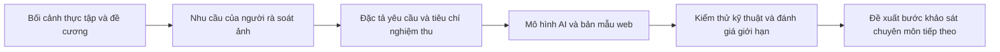
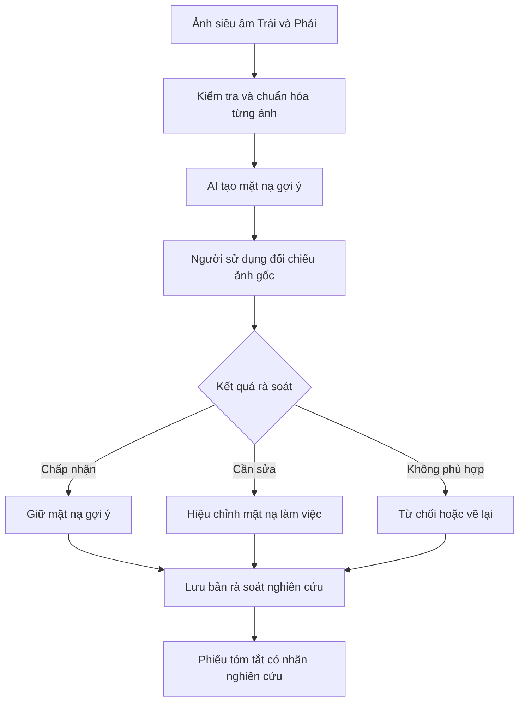

# CHƯƠNG 1. TỔNG QUAN VỀ CƠ SỞ THỰC TẬP, BỐI CẢNH ÁP DỤNG VÀ ĐỀ TÀI NGHIÊN CỨU

## 1.1. Giới thiệu tổng quan về cơ sở thực tập

### 1.1.1. Thông tin khái quát và căn cứ xác định cơ sở thực tập

Đề cương sơ bộ của sinh viên Nguyễn Hữu Dũng, mã sinh viên 11235559, lớp Hệ thống thông tin quản lý 65A, xác định VinSmart Future là nơi thực tập và định hướng nghề nghiệp là phân tích nghiệp vụ công nghệ thông tin, quản lý sản phẩm. Giảng viên hướng dẫn được ghi trong đề cương là ThS. Trần Thanh Hải. Đây là những thông tin về cơ sở thực tập và hồ sơ học thuật được sử dụng trong khóa luận [12]. Đề tài lựa chọn là “Xây dựng hệ thống hỗ trợ phân đoạn tổn thương trên ảnh siêu âm buồng trứng ứng dụng Deep Learning theo mô hình Human-in-the-Loop”. Tên đề tài thể hiện đồng thời đối tượng dữ liệu, phương pháp xử lý và cơ chế con người kiểm soát kết quả.

Hồ sơ được đối chiếu chưa cung cấp bản giới thiệu doanh nghiệp có xác nhận, sơ đồ tổ chức, danh mục sản phẩm hoặc văn bản mô tả nhiệm vụ của phòng ban tiếp nhận sinh viên. Vì vậy, phần giới thiệu cơ sở thực tập tập trung vào mối liên hệ giữa môi trường thực tập, định hướng chuyên môn và sản phẩm khóa luận. Báo cáo không suy diễn địa chỉ trụ sở, số lượng nhân viên, cơ cấu quản lý hoặc quan hệ tổ chức giữa VinSmart Future và đơn vị y tế chỉ từ tên gọi. Cách trình bày này giữ được chức năng của phần giới thiệu cơ sở thực tập trong bài mẫu, đồng thời bảo đảm mỗi thông tin tổ chức có căn cứ kiểm tra [12], [14].

Từ góc độ ngành Hệ thống thông tin quản lý, môi trường thực tập giúp sinh viên chuyển nhu cầu chuyên môn thành bài toán sản phẩm. Khóa luận cụ thể hóa định hướng phân tích nghiệp vụ bằng việc thiết kế quy trình tiếp nhận ảnh, nhận gợi ý phân đoạn, rà soát và lưu kết quả. Mô hình học sâu là một thành phần xử lý thông tin; phần mềm vẫn phải giải quyết quyền truy cập, trạng thái công việc và tính nhất quán của dữ liệu.

### 1.1.2. Vai trò của phân tích nghiệp vụ và phát triển sản phẩm trong đề tài

Phân tích nghiệp vụ giúp xác định vấn đề trước khi lựa chọn công nghệ. Với đề tài này, nhu cầu không dừng ở khả năng vẽ một vùng trên ảnh. Người sử dụng cần biết ảnh nào đang được xem, vùng nào do AI đề xuất, vùng nào đã được sửa, thao tác nào đã lưu thành công và kết quả nào được phép xuất. Một mô hình có độ chồng khớp cao với nhãn tham chiếu vẫn chưa đáp ứng đầy đủ các nhu cầu đó nếu giao diện che mất chi tiết ảnh hoặc lưu dữ liệu thiếu nguồn gốc.

Định hướng quản lý sản phẩm thể hiện ở cách phân biệt phạm vi cốt lõi và phần mở rộng. Phạm vi cốt lõi bao gồm tài liệu yêu cầu, mô hình phân đoạn và bản mẫu web cho phép người sử dụng kiểm tra, chỉnh sửa, lưu kết quả. Những nghiệp vụ như ký duyệt nhiều cấp, quản trị khoa, xác thực OTP, đồng bộ nhiều thiết bị và xuất hồ sơ lâm sàng cần các hợp đồng phần mềm riêng. Giao diện có thể mô phỏng chúng để đánh giá thiết kế, nhưng sự có mặt của màn hình không chứng minh chức năng máy chủ đã vận hành. Việc ghi rõ mức hoàn thành của từng lớp là một phần trách nhiệm quản lý phạm vi [12], [18].

Chuỗi hoạt động nghiên cứu được tổ chức từ nhu cầu đến bằng chứng. Yêu cầu “người sử dụng kiểm soát kết quả AI” được chuyển thành các chức năng xem ảnh gốc, bật tắt lớp phủ, sửa mặt nạ, hoàn tác và lưu bản rà soát. Mỗi chức năng tiếp tục được chuyển thành điều kiện nghiệm thu có thể kiểm tra. Nhờ đó, phần phân tích nghiệp vụ liên kết được với phần lập trình và kiểm thử, thay vì tồn tại như một nhóm sơ đồ tách rời sản phẩm.

*Hình 1.1: Mối liên hệ giữa bối cảnh thực tập, phân tích nghiệp vụ và sản phẩm khóa luận*

Nguồn: Tác giả tổng hợp từ đề cương sơ bộ và hồ sơ phần mềm [12], [17], [18].

### 1.1.3. Tổ chức công việc trong phạm vi khóa luận

Hoạt động thực hiện khóa luận được chia theo các nhóm trách nhiệm chuyên môn, gồm phân tích yêu cầu, quản trị dữ liệu, phát triển mô hình, lập trình hệ thống và kiểm thử. Đây là cách tổ chức công việc của đề tài, không phải sơ đồ tổ chức chính thức của VinSmart Future. Nhóm phân tích yêu cầu xác định tác nhân, điều kiện trước và sau của thao tác; nhóm dữ liệu kiểm tra cặp ảnh–mask, đơn vị chia tập và khả năng truy vết nguồn; nhóm mô hình thiết lập cấu hình huấn luyện và lưu kết quả; nhóm phần mềm xây dựng API, dữ liệu và giao diện; nhóm kiểm thử đối chiếu hành vi với tiêu chí đã xác định.

## 1.2. Tổng quan bối cảnh áp dụng tại cơ sở y tế

### 1.2.1. Bối cảnh dự kiến khảo sát và ranh giới triển khai

Đề cương xác định Bệnh viện Đa khoa Quốc tế Vinmec Times City là bối cảnh dự kiến khảo sát nghiệp vụ. Nội dung đó định hướng loại người sử dụng và tác vụ cần nghiên cứu; nó không đồng nghĩa hệ thống đã được tích hợp hoặc vận hành chính thức tại bệnh viện. Hồ sơ hiện có chưa cung cấp biên bản phỏng vấn, phê duyệt thử nghiệm lâm sàng, xác nhận triển khai hoặc báo cáo người sử dụng có chữ ký của đơn vị. Do vậy, khóa luận trình bày quy trình ở mức tham chiếu phục vụ thiết kế bản mẫu nghiên cứu độc lập [12].

Trong bối cảnh tham chiếu, người sử dụng trực tiếp là bác sĩ chẩn đoán hình ảnh hoặc sản phụ khoa cần quan sát ảnh siêu âm, xác định vùng quan tâm và kiểm tra hình thái. Một ca có thể có nhiều ảnh, nhiều lát cắt và các thông tin chuyên môn ngoài ảnh tĩnh. Hệ thống được xây dựng chỉ nhận từng ảnh hai chiều trong mỗi lượt suy luận. Kết quả của một ảnh không được dùng để suy ra tình trạng của toàn bộ buồng trứng hoặc thay thế đánh giá trên toàn bộ ca khám.

Thiết kế giao diện hiện tại yêu cầu tiếp nhận hai ảnh riêng biệt, có nhãn Trái và Phải, cho một ca thử nghiệm. Quy tắc này là yêu cầu sản phẩm của bản mẫu nhằm tránh nhầm bên và hỗ trợ đối chiếu; nó không được mô tả như quy trình bắt buộc của mọi cơ sở y tế. Từng ảnh có dữ liệu, mặt nạ, số đo và trạng thái rà soát riêng. Việc gom hai ảnh vào một ca giúp người sử dụng theo dõi đầy đủ hai bên, trong khi thao tác AI vẫn được thực hiện và lưu theo từng ảnh [18].

### 1.2.2. Đặc điểm thông tin của bài toán siêu âm buồng trứng

Ảnh siêu âm cung cấp thông tin hình thái để bác sĩ mô tả các cấu trúc vùng phần phụ. Bộ thuật ngữ O-RADS US của ACR phân biệt các đặc điểm như số khoang, thành, vách, thành phần đặc và bóng cản âm. Các đặc điểm này đòi hỏi quan sát chuyên môn và không được mã hóa đầy đủ trong một mặt nạ nhị phân [5]. Trong phạm vi khóa luận, mặt nạ biểu diễn vùng được chú giải là tiền cảnh theo quy ước dữ liệu; giá trị nền không mặc nhiên có nghĩa mô lành và tiền cảnh không mặc nhiên có nghĩa ác tính.

Một khó khăn của dữ liệu là độ tương phản và hình dạng biên thay đổi theo điều kiện thu nhận. Ảnh có thể chứa nhiễu đốm, vùng bóng cản, chữ trên ảnh và khung ngoài vùng quét. Ranh giới được chú giải cũng có thể khác nhau giữa người vẽ hoặc giữa các quy ước gán nhãn. Vì vậy, bài toán học máy cần đồng thời xử lý đặc điểm ảnh và kiểm tra độ tin cậy của nhãn. Tăng số ảnh mà không xác định nguồn, quy tắc chú giải và đơn vị chia tập chưa đủ để cải thiện chất lượng bằng chứng.

Thông tin phục vụ quản lý quá trình gồm mã bệnh nhân giả danh, mã ca, bên trái/phải, ảnh nguồn, dự đoán AI, bản sửa của người sử dụng, thời điểm và phiên bản mô hình. Các trường này có chức năng khác nhau. Mã bệnh nhân phục vụ liên kết các lần khảo sát; mã ca định danh một ngữ cảnh công việc; mã ảnh định danh tệp đầu vào; mã dự đoán định danh kết quả của một lần chạy mô hình. Phân biệt các đơn vị ngay từ đầu giúp tránh tình trạng ghi đè mặt nạ của ảnh này lên ảnh khác hoặc so sánh các kết quả không cùng nguồn.

### 1.2.3. Hiện trạng ứng dụng công nghệ và nhu cầu của bản mẫu

Đề cương nêu nhu cầu hỗ trợ thao tác khoanh vùng và chưa ghi nhận công cụ AI phân đoạn trong phạm vi khảo sát dự kiến. Báo cáo sử dụng thông tin này làm động cơ nghiên cứu, không mở rộng thành kết luận rằng bệnh viện thiếu PACS, RIS, bệnh án điện tử hoặc hạ tầng công nghệ. Các hệ thống đó có vai trò khác với công cụ phân đoạn tương tác. Để khẳng định hiện trạng nội bộ cần hồ sơ khảo sát riêng; bản mẫu hiện tại được phát triển trên môi trường độc lập và không truy cập hệ thống vận hành của bệnh viện [12].

Nhu cầu cụ thể là tạo được vùng gợi ý có thể kiểm tra và sửa, đồng thời giữ lại dự đoán ban đầu để đối chiếu. Khi AI bỏ sót hoặc khoanh thừa, người sử dụng phải có khả năng chỉnh vùng ngay trên ảnh và ghi nhận quyết định. Khi thiếu pixel spacing, số đo phải ở đơn vị pixel, không tự đổi thành milimét. Khi API lưu thất bại, giao diện phải giữ bản nháp và hiển thị trạng thái chưa đồng bộ. Đây là các yêu cầu làm cho công cụ có thể được kiểm thử như một hệ thống thông tin, thay vì chỉ như một mô hình tạo ảnh kết quả.

*Bảng 1.1: Các nhu cầu thông tin và điểm kiểm soát của bản mẫu*

| Nhu cầu | Thông tin hoặc thao tác cần có | Điểm kiểm soát | Bằng chứng phù hợp |
|---|---|---|---|
| Tránh nhầm ảnh và nhầm bên | Mã ca, hai ô Trái/Phải, mã ảnh riêng | Chưa đủ hai ảnh thì không chạy luồng tự động | Kịch bản tiếp nhận và kiểm thử giao diện |
| Kiểm tra gợi ý AI | Ảnh gốc, mặt nạ AI, đường viền và lớp phủ | Người sử dụng luôn xem được ảnh gốc | Kiểm thử lớp hiển thị và ảnh chụp ứng dụng |
| Hiệu chỉnh kết quả | Cọ, tẩy, đa giác, hoàn tác, đặt lại | Bản sửa không ghi đè dự đoán gốc | Kiểm thử mặt nạ và truy vấn bản rà soát |
| Đọc số đo đúng đơn vị | d₁, d₂, diện tích, nguồn hiệu chuẩn | Không hiển thị mm khi chưa có spacing hợp lệ | Kiểm thử phép đo và trạng thái hiệu chuẩn |
| Truy vết quá trình | Phiên bản mô hình, mã dự đoán, thời điểm rà soát | Mỗi bản ghi gắn đúng ảnh và dự đoán | Hợp đồng API, lược đồ và nhật ký |
| Giữ phạm vi nghiên cứu | Thông báo bản mẫu và dấu nhận diện trên phiếu | Không phát hành kết luận lành/ác | Kiểm tra giao diện và bản in |

Nguồn: Tác giả phân tích từ đề cương, hợp đồng phần mềm và thiết kế Workspace 2.0 [12], [17], [18].

## 1.3. Tổng quan về đề tài nghiên cứu

### 1.3.1. Tính cấp thiết và phát biểu bài toán

Phân đoạn tự động có thể cung cấp một đường bao sơ bộ để người chuyên môn bắt đầu rà soát, nhưng giá trị thực tế phụ thuộc vào chất lượng gợi ý và khả năng kiểm soát của người sử dụng. Nếu vùng AI sai nhiều, thời gian sửa có thể vượt thời gian vẽ từ đầu. Nếu lớp phủ quá đậm hoặc trạng thái lưu không rõ, phần mềm có thể làm tăng tải thao tác. Vì vậy, đề tài đặt câu hỏi về sự kết hợp giữa mô hình phân đoạn và quy trình tương tác, không mặc định mọi ứng dụng AI đều tiết kiệm thời gian.

Từ phía dữ liệu, kết quả cần được gắn với đúng tập ảnh, mask tham chiếu, checkpoint và tiền xử lý. Những thông tin như “đã ẩn danh”, “ground truth chuyên gia” hoặc “chia theo bệnh nhân” là các điều kiện cần bằng chứng độc lập. Nếu chúng chỉ xuất hiện trong kế hoạch mà chưa có hồ sơ đối chiếu, báo cáo phải phân biệt mục tiêu với trạng thái thực hiện. Điều này đặc biệt cần thiết vì bộ dữ liệu trong đề cương và bộ dữ liệu huấn luyện hiện tại có quy mô khác nhau.

Bài toán được phát biểu như sau: từ ảnh siêu âm buồng trứng hai chiều đã được phép sử dụng nghiên cứu, xây dựng mô hình sinh mặt nạ nhị phân vùng quan tâm; tích hợp kết quả vào ứng dụng web để người sử dụng quan sát, chỉnh sửa và lưu bản rà soát có liên kết nguồn. Đầu ra cốt lõi gồm mặt nạ, lớp phủ, số đo hình học có đơn vị phù hợp và hồ sơ tương tác. Hệ thống không tự đưa ra kết luận bệnh học, không tính nguy cơ từ mặt nạ và không thay thế phiếu kết quả chẩn đoán chính thức.

*Hình 1.2: Bài toán hỗ trợ phân đoạn với người sử dụng giữ quyền quyết định*

Nguồn: Tác giả mô hình hóa phạm vi sản phẩm [12], [18].

### 1.3.2. Mục tiêu và nhiệm vụ nghiên cứu

Mục tiêu tổng quát là xây dựng bản mẫu hệ thống thông tin hỗ trợ phân đoạn tổn thương trên ảnh siêu âm buồng trứng theo cơ chế Human-in-the-Loop, có thể kiểm chứng ở cấp thuật toán và cấp phần mềm. Mục tiêu về người dùng là chuẩn bị cơ sở để đánh giá thời gian thao tác, mức chỉnh sửa và khả năng sử dụng khi có sự tham gia của người chuyên môn. Trong giai đoạn hiện tại, mục tiêu này được thể hiện bằng kịch bản đánh giá và công cụ ghi nhận, chưa được coi là kết quả thực địa.

Nhiệm vụ thứ nhất là phân tích bối cảnh và mô hình hóa quy trình tham chiếu. Những điểm cần làm rõ gồm tác nhân tạo ca, người rà soát, người quản trị, các trạng thái công việc và ranh giới giữa gợi ý của máy với quyết định của người. Nhiệm vụ thứ hai là kiểm tra dữ liệu, xây dựng manifest và chuẩn hóa cặp ảnh–mask. Nhiệm vụ thứ ba là triển khai Standard U-Net và cấu hình U-Net++ đối chứng, lưu siêu tham số, checkpoint và chỉ số. Nhiệm vụ thứ tư là xây dựng luồng web từ tiếp nhận hai ảnh đến lưu kết quả rà soát. Nhiệm vụ thứ năm là đối chiếu mức hoàn thành với yêu cầu và công bố các giới hạn còn lại.

### 1.3.3. Đối tượng, phạm vi và các thay đổi so với đề cương

Đối tượng nghiên cứu thuật toán là quan hệ giữa ảnh siêu âm và mặt nạ nhị phân tham chiếu. Đối tượng nghiên cứu hệ thống là luồng xử lý dữ liệu và quyết định trong quá trình tiếp nhận, suy luận, rà soát và lưu. Đối tượng sử dụng dự kiến gồm bác sĩ và nhân sự quản trị được giao quyền. Bệnh nhân là đối tượng hưởng lợi gián tiếp trong trường hợp những nghiên cứu tiếp theo chứng minh hiệu quả; đề tài hiện tại không đánh giá kết cục điều trị hoặc hiệu quả chẩn đoán.

Phạm vi dữ liệu trong đề cương gồm 1.387 ảnh tiếp nhận, 417 ảnh có mask, 307 ảnh được mô tả là đã duyệt từ 185 bệnh nhân và 110 ảnh chờ duyệt. Các con số này là nội dung kế hoạch được cung cấp [12]. Manifest hiện tại ghi 1.604 mẫu sau lọc, chia thành 661 Train, 541 Validation và 402 Test, với trạng thái sẵn sàng huấn luyện ở cấp ảnh. Manifest đồng thời nêu chưa có Patient/Case ID nguồn được xác minh [15]. Báo cáo sử dụng số liệu manifest để mô tả thí nghiệm thực tế và giữ số liệu đề cương trong bảng đối chiếu, không gộp hai nguồn thành cùng một tập đã xác nhận.

*Bảng 1.2: Đối chiếu kế hoạch đề cương với hồ sơ thực hiện hiện tại*

| Nội dung | Đề cương sơ bộ | Hồ sơ hiện tại dùng trong báo cáo | Cách diễn giải |
|---|---|---|---|
| Dữ liệu có nhãn trọng tâm | 307 ảnh từ 185 bệnh nhân | 1.604 mẫu trong manifest sau lọc | Hai phạm vi chưa có bảng ánh xạ xác nhận |
| Chia tập | Dự kiến theo bệnh nhân | Train 661, Validation 541, Test 402 ở cấp ảnh | Chưa khẳng định đạt chia độc lập bệnh nhân |
| Phê duyệt mask | Được mô tả là bác sĩ xác nhận | Chưa có sổ duyệt nối tới từng tệp hiện hành | Gọi là mask tham chiếu trong thực nghiệm |
| Ẩn danh | Đề cương nêu đã ẩn danh hoàn toàn | Chưa có hồ sơ kiểm DICOM, EXIF và chữ in cứng đầy đủ | Không chứng nhận ẩn danh toàn bộ dữ liệu |
| Mô hình cải tiến | Một kiến trúc phù hợp, có ví dụ Attention U-Net | U-Net++ với encoder ResNet34 pretrained có run config | So sánh cấu hình có bằng chứng thực nghiệm |
| Frontend | Dự kiến React.js và Canvas | HTML, CSS, JavaScript ES modules và Canvas | Mô tả công nghệ hiện thực, giữ mục tiêu tương tác |
| Quy trình nhiều vai trò | Tập trung rà soát nghiên cứu | BS/TK/QT có giao diện demo; máy chủ cũ có DOCTOR/ADMIN | Tách thiết kế giao diện khỏi quyền server đã hỗ trợ |
| Đánh giá người dùng | Dự kiến thời gian thao tác và SUS | Chưa có dữ liệu người tham gia | Trình bày kế hoạch, không tạo điểm đánh giá |

Nguồn: Đề cương, manifest, run config và tài liệu giao diện [12], [15], [16], [18].

Phạm vi kỹ thuật là bản mẫu chạy trên máy chủ thử nghiệm độc lập. Huấn luyện, suy luận và lưu bản rà soát được kiểm tra bằng dữ liệu và môi trường kỹ thuật; tích hợp PACS/RIS, ký duyệt chuyên môn chính thức, xác thực người hành nghề và vận hành bệnh viện nằm ngoài kết quả đã xác nhận. Trên giao diện mới, những bước duyệt nhiều cấp được trình bày như thiết kế đích và chỉ vận hành đầy đủ trong chế độ demo khi endpoint tương ứng chưa có. Các thao tác thật không được chuyển sang thành công giả khi máy chủ trả lỗi thiếu chức năng [18].

### 1.3.4. Phương pháp nghiên cứu

Nghiên cứu sử dụng phương pháp phân tích tài liệu để đối chiếu đề cương, hướng dẫn của khoa, bài mẫu và hồ sơ mã nguồn. Bài mẫu của Đinh Mạnh Hòa cung cấp cách tổ chức lập luận từ bối cảnh đến lý thuyết, sau đó đến mô hình hóa, dữ liệu, giải thuật, giao diện, kiểm thử và triển khai. Khóa luận áp dụng mạch đó cho bài toán phân đoạn siêu âm, không sao chép nội dung quản lý cho thuê xe hoặc suy ra cấu trúc tổ chức tương tự [13], [14].

Phương pháp tiếp cận hệ thống xem sản phẩm như tập hợp tác nhân, tiến trình, kho dữ liệu và quy tắc. Phân rã chức năng giúp chia bài toán thành các nhóm có trách nhiệm rõ; sơ đồ ngữ cảnh đặt ranh giới; luồng dữ liệu kiểm tra thông tin đi qua đâu; mô hình thực thể làm rõ những bản ghi cần lưu. Các mô hình này được dùng để kiểm tra nhất quán với API và giao diện thực tế. Một thông tin xuất hiện trên phiếu phải truy được về bản ghi; một thao tác làm thay đổi trạng thái phải có điều kiện trước và sau.

Phương pháp thực nghiệm thuật toán được triển khai bằng cấu hình huấn luyện có lưu seed, tập dữ liệu, tiền xử lý, loss, optimizer và checkpoint. Validation được dùng để chọn mô hình; việc diễn giải Test phải xem xét lịch sử truy cập tập đó. Kiểm thử phần mềm tập trung vào hành vi có thể tái hiện, gồm luồng hai ảnh, biến đổi tọa độ, mask rỗng, lưu dữ liệu, phiên hết hạn và đáp ứng lỗi. Đánh giá người dùng được thiết kế như một giai đoạn riêng cần protocol và người tham gia, không được thay thế bằng kiểm thử trình duyệt.

### 1.3.5. Đối tượng hưởng lợi và tiêu chí đánh giá

*Bảng 1.3: Đối tượng thụ hưởng, giá trị kỳ vọng và giới hạn chứng minh*

| Đối tượng | Giá trị kỳ vọng | Chỉ tiêu hoặc bằng chứng cần thu | Trạng thái trong phạm vi báo cáo |
|---|---|---|---|
| Người rà soát ảnh | Có gợi ý và công cụ kiểm tra, sửa vùng | Thời gian hoàn thành, mức sửa, lỗi thao tác | Có bản mẫu và kịch bản; chưa có khảo sát bác sĩ |
| Người quản lý nghiên cứu | Theo dõi nguồn dữ liệu và quyết định | Bản ghi prediction/review, phiên bản, nhật ký | Có mô hình dữ liệu và kiểm thử kỹ thuật |
| Nhóm phát triển AI | Phân tích lỗi gắn với từng ảnh | Dice, IoU, Recall, Precision và ảnh lỗi | Có run config và hồ sơ đánh giá được đối chiếu |
| Cơ sở y tế dự kiến khảo sát | Có phương án tham khảo quy trình hỗ trợ | Thẩm định quy trình, an toàn và khả năng tích hợp | Chưa xác nhận triển khai vận hành |
| Người bệnh | Lợi ích gián tiếp nếu công cụ được chứng minh | Nghiên cứu có thiết kế và kết cục phù hợp | Không đo trong khóa luận này |

Nguồn: Tác giả tổng hợp mục tiêu và phạm vi [12], [16], [18].

### 1.3.6. Kết cấu khóa luận và liên kết các phần

Khóa luận gồm ba chương chính theo hướng dẫn của khoa và mạch tổ chức bài mẫu. Chương 1 xác định bối cảnh, bài toán, mục tiêu, phạm vi và phương pháp. Chương 2 cung cấp các khái niệm, phương pháp mô hình hóa, cơ sở mạng phân đoạn và công cụ thực sự dùng trong dự án. Chương 3 triển khai giải pháp: mô tả quy trình và yêu cầu, xây dựng các mô hình hệ thống, thiết kế dữ liệu, giải thuật và kiến trúc AI, hiện thực giao diện, báo cáo thực nghiệm, kiểm thử và hướng dẫn triển khai. Các nội dung tương ứng với năm chương dự kiến trong đề cương được bảo toàn bên trong ba chương, tránh lược bỏ phần nghiệp vụ hoặc mô hình AI chỉ để phù hợp số chương [12]–[14].

Phần kết luận đánh giá mức hoàn thành, hạn chế và hướng phát triển. Phụ lục cung cấp các bảng đặc tả, công cụ khảo sát và thông tin hỗ trợ tái lập. Các phần được nối theo chuỗi nhu cầu, lựa chọn phương pháp và kiểm chứng triển khai.
