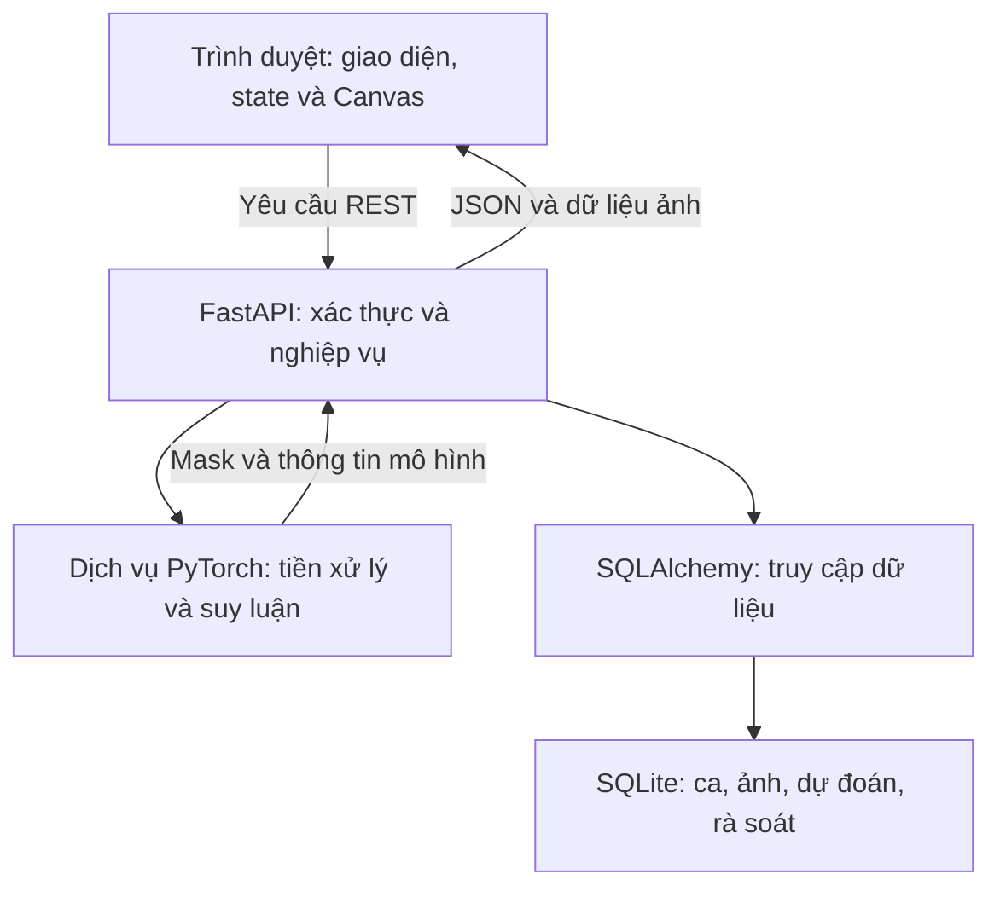
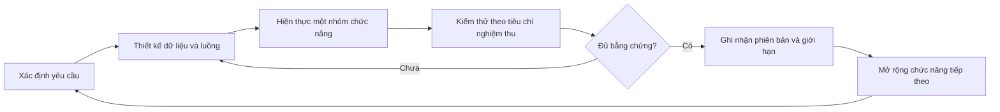
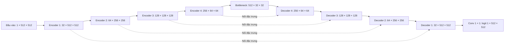
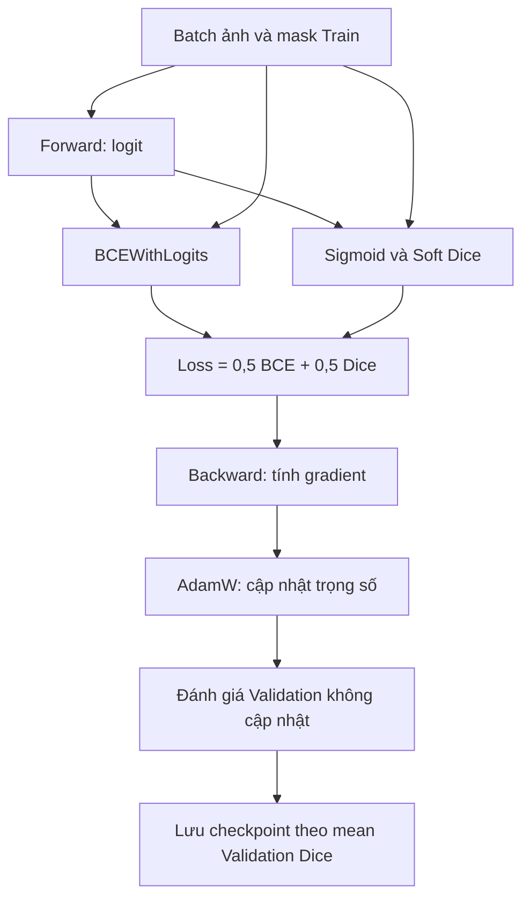
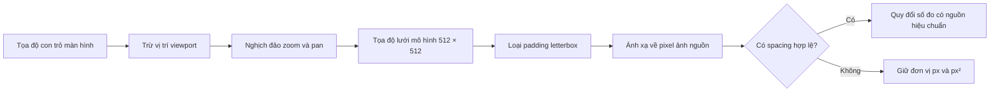

# CHƯƠNG 2. CƠ SỞ LÝ THUYẾT VÀ CÔNG CỤ HỖ TRỢ THỰC HIỆN ĐỀ TÀI

## 2.1. Các khái niệm cơ bản của đề tài nghiên cứu

### 2.1.1. Ảnh siêu âm, vùng quan tâm và mặt nạ phân đoạn

Ảnh đầu vào của đề tài là ảnh siêu âm hai chiều biểu diễn thông tin cường độ tại từng điểm ảnh. Trong xử lý số, ảnh xám được xem như ma trận có chiều cao H và chiều rộng W. Mặt nạ tham chiếu là ma trận nhị phân tương ứng, trong đó giá trị 1 chỉ vùng tiền cảnh theo quy ước chú giải, giá trị 0 chỉ các điểm còn lại. Phân đoạn ngữ nghĩa yêu cầu gán nhãn cho từng pixel, khác với phân loại chỉ gán một nhãn cho toàn ảnh. Đầu ra giữ thông tin vị trí và hình dạng, phù hợp tác vụ hiển thị đường bao và lớp phủ.

Ranh giới trong mask được xác định theo quy tắc của tập dữ liệu. Một mask viền ngoài không tự biểu diễn thành phần đặc, vách, nhú, tưới máu hoặc bản chất mô bệnh học. Thuật ngữ hình thái trên giao diện có thể tham khảo bộ từ vựng O-RADS US, nhưng các lựa chọn do người sử dụng ghi nhận không biến mô hình nhị phân thành bộ phân tầng nguy cơ [5]. Khóa luận đo mức phù hợp với mask tham chiếu và luôn giữ phạm vi hỗ trợ khoanh vùng.

### 2.1.2. Hệ thống thông tin và ứng dụng web

Hệ thống thông tin trong đề tài gồm con người, quy trình, dữ liệu và công nghệ phối hợp để tiếp nhận, xử lý, lưu và sử dụng kết quả phân đoạn. Trọng tâm quản lý là dữ liệu có nguồn và trạng thái rõ. Ảnh nguồn, dự đoán AI và bản rà soát là ba loại dữ liệu khác nhau: ảnh là đầu vào, dự đoán là kết quả thuật toán, bản rà soát là quyết định tương tác. Tách ba loại giúp kiểm tra AI đã tạo gì và người sử dụng đã thay đổi gì.

Ứng dụng web vận hành theo mô hình trình duyệt–máy chủ. Trình duyệt hiển thị giao diện, quản lý tương tác và gửi yêu cầu; API xác thực, kiểm tra dữ liệu, gọi dịch vụ suy luận và truy cập cơ sở dữ liệu. Dự án hiện dùng SPA thuần với HTML, CSS và JavaScript ES modules, không dùng React trong bundle chạy hiện tại [18]. Tổ chức theo module giúp phân tách state, điều hướng, tiếp nhận, viewer, rà soát và quản trị, đồng thời giữ một cơ chế lưu trạng thái nhất quán.

Kiến trúc có ba nhóm trách nhiệm là trình bày, xử lý ứng dụng và lưu trữ; thành phần PyTorch nằm trong dịch vụ xử lý mô hình. Phân lớp trách nhiệm không đồng nghĩa mỗi lớp phải chạy trên một máy riêng. Bản mẫu có thể triển khai trên một máy thử nghiệm, nhưng ranh giới giữa giao diện, API, mô hình và dữ liệu vẫn cần rõ để truy vết lỗi và kiểm thử [17], [18].

*Hình 2.1: Các nhóm trách nhiệm của kiến trúc ứng dụng web nghiên cứu*

Nguồn: Tác giả tổng hợp từ mã backend và frontend [17], [18].

### 2.1.3. Phương pháp phân tích và mô hình hóa hệ thống

Sơ đồ phân rã chức năng, BFD, trình bày hệ thống theo nhóm chức năng và các chức năng con. Nó giúp kiểm tra phạm vi: tiếp nhận dữ liệu, phân đoạn, rà soát, quản lý ca và quản trị phải có trách nhiệm riêng. BFD không thể hiện thứ tự thời gian hoặc quan hệ bảng. Sơ đồ ngữ cảnh, CD, đặt toàn bộ hệ thống như một tiến trình và mô tả luồng thông tin với tác nhân ngoài. Nó giúp xác định những ai gửi dữ liệu hoặc nhận kết quả và điều gì nằm ngoài ranh giới nghiên cứu.

DFD mô tả dữ liệu đi qua tiến trình và kho lưu trữ. Một tiến trình phải nhận dữ liệu để tạo đầu ra; kho dữ liệu không tự thực hiện nghiệp vụ. Khi phân rã DFD, luồng vào và ra phải cân bằng với mức trên. ERD chuyển sang câu hỏi dữ liệu được tổ chức như thế nào: Patient liên kết Study, Study chứa Image, Image có Prediction, Prediction được liên kết với Review. Các mô hình được sử dụng bổ sung cho nhau; trong Chương 3, chúng phải khớp với bảng và API thực tế, thay vì chỉ là hình minh họa [14], [17].

Use Case mô tả mục tiêu của tác nhân cùng luồng chính và ngoại lệ. User Story phát biểu nhu cầu từ vai trò, còn tiêu chí nghiệm thu chuyển nhu cầu thành điều kiện có thể kiểm tra. Với yêu cầu lưu mask, điều kiện cần bao gồm mã ảnh, mã dự đoán, mask nhị phân, quyền người sử dụng và phản hồi lưu. Nếu API lỗi, giao diện phải giữ bản nháp; nếu ca không còn cho chỉnh sửa, thao tác phải bị chặn. Đây là cách nối yêu cầu nghiệp vụ với kiểm thử.

### 2.1.4. Vòng đời phát triển và quản lý thay đổi

Vòng đời phát triển của đề tài đi qua xác định yêu cầu, thiết kế, hiện thực, kiểm thử và đánh giá. Với bản mẫu nghiên cứu, tiến trình được lặp theo nhóm chức năng: hoàn thành một luồng từ giao diện tới dữ liệu, kiểm tra rồi mở rộng. Cách tổ chức này phù hợp việc tiền xử lý, hợp đồng API và thao tác Canvas cần được đối chiếu nhiều lần. Mỗi thay đổi vẫn phải giữ mối liên hệ giữa yêu cầu, thiết kế và bằng chứng, tránh cập nhật giao diện làm mất hành vi dữ liệu đang đúng.

*Hình 2.2: Vòng phát triển và kiểm chứng được áp dụng cho bản mẫu*

Nguồn: Tác giả tổ chức phương pháp thực hiện từ yêu cầu đề cương [12].

### 2.1.5. Human-in-the-Loop và quản trị quyết định

Human-in-the-Loop đặt người sử dụng vào vòng kiểm tra sau gợi ý của mô hình. Người sử dụng được xem ảnh gốc, chấp nhận, sửa hoặc từ chối kết quả. MONAI Label là một nền tảng nghiên cứu về gán nhãn có AI hỗ trợ, cho thấy một hướng tổ chức tương tác người–mô hình [4]. Khóa luận vận dụng nguyên tắc kiểm soát này vào bản mẫu của mình, không lấy kết quả thời gian của nền tảng khác làm hiệu quả đã đạt.

Bản rà soát phải giữ liên kết với dự đoán gốc. Dữ liệu sau chỉnh sửa không tự trở thành ground truth chính thức; trong hệ thống hiện tại cờ `is_official_ground_truth=False` thể hiện giới hạn đó [17]. Muốn đưa bản sửa vào huấn luyện cần quy trình duyệt nhãn riêng. Tương tự, chuyển trạng thái trong chế độ demo chưa phải ký duyệt chuyên môn. Hành vi thật cần quyền server, transaction và phiên bản dữ liệu; kiểm tra quyền chỉ trên menu không đủ bảo vệ tài nguyên.

## 2.2. Cơ sở mô hình Deep Learning phân đoạn ảnh

### 2.2.1. Tích chập và biểu diễn đặc trưng

Tích chập học bộ lọc từ dữ liệu và áp dụng bộ lọc trên các vùng lân cận của ảnh. Kết quả là bản đồ đặc trưng có nhiều kênh, biểu diễn các quan hệ cục bộ hữu ích cho nhiệm vụ. Những tầng sâu kết hợp đặc trưng trên vùng cảm nhận rộng hơn. Khi giảm độ phân giải bằng pooling, mạng có thêm ngữ cảnh nhưng mất một phần chi tiết vị trí. Với phân đoạn, cần một nhánh phục hồi độ phân giải để đầu ra vẫn tương ứng từng pixel.

ConvBlock của Standard U-Net trong dự án gồm hai lần Conv2d 3×3, BatchNorm2d và ReLU; padding bằng 1 duy trì kích thước không gian. Pooling 2×2 giảm chiều cao và rộng còn một nửa. Các thông số này được đọc từ mã nguồn, không mặc định mọi triển khai U-Net có cùng block hoặc cùng số kênh [17]. Thiết kế cụ thể quyết định dung lượng bộ nhớ, số tham số và khả năng nạp checkpoint, vì vậy tên kiến trúc một mình chưa đủ định danh mô hình.

### 2.2.2. Standard U-Net làm mô hình cơ sở

U-Net của Ronneberger, Fischer và Brox đề xuất cấu trúc encoder–decoder kết hợp đường nối giữa các mức đặc trưng để phục vụ phân đoạn ảnh y sinh [1]. Trong dự án, baseline được hiện thực bằng `StandardUNet` với đầu vào một kênh, đầu ra một kênh và base_filters bằng 32. Encoder có các mức 32, 64, 128, 256 kênh, bottleneck 512 kênh; decoder dùng ConvTranspose2d và nối trực tiếp đặc trưng cùng mức [17].

Với ảnh 512×512, các kích thước encoder lần lượt là 512, 256, 128 và 64; bottleneck ở 32×32. Decoder phục hồi theo chiều ngược lại. Tầng cuối Conv2d 1×1 sinh logit, không trả nhãn bệnh học. Sigmoid chuyển logit thành xác suất pixel, sau đó ngưỡng được dùng để tạo mask. Đường nối tắt giữ thông tin vị trí từ encoder để decoder tái sử dụng khi dựng ranh giới.

*Hình 2.3: Kiến trúc Standard U-Net base_filters=32 được hiện thực trong dự án*

Nguồn: Tác giả vẽ từ `backend/models/unet.py` và ConvBlock [17]; nền tảng kiến trúc [1].

### 2.2.3. U-Net++ và nguyên tắc đối sánh cấu hình

UNet++ của Zhou và cộng sự sử dụng các đường nối lồng nhau giữa encoder và decoder để kết hợp đặc trưng ở nhiều mức [2]. Cấu hình đối chứng của dự án dùng U-Net++ trong Segmentation Models PyTorch với encoder ResNet34 có trọng số tiền huấn luyện ImageNet. Run config ghi phiên bản thư viện, cách chuẩn hóa, loss và checkpoint [16]. Báo cáo không mặc định mọi cơ chế trong bài báo gốc, như deep supervision, đều được bật trong cấu hình này.

Phép đối sánh được diễn giải ở mức cấu hình tổng thể. Standard U-Net khởi tạo ngẫu nhiên, trong khi encoder ResNet34 của U-Net++ được tiền huấn luyện. Dù cùng split, loss và ngân sách epoch, chênh lệch kết quả chưa tách được hiệu quả riêng của đường nối lồng nhau. Muốn kết luận nhân quả về từng thành phần cần thí nghiệm loại bỏ hoặc giữ cố định yếu tố khởi tạo. Những lựa chọn chưa có run config và kết quả không được đưa vào bảng như mô hình đã thực nghiệm.

### 2.2.4. Letterbox và sự tương ứng hình học

Resize trực tiếp một ảnh chữ nhật thành hình vuông có thể làm thay đổi tỷ lệ hình học. Letterbox sử dụng cùng một hệ số co giãn cho hai chiều rồi thêm vùng đệm. Với kích thước đích 512, hệ số r = min(512/W, 512/H); kích thước nội dung được tính theo quy tắc làm tròn của bộ xử lý, phần còn lại là padding. Dữ liệu biến đổi phải lưu kích thước nguồn, hệ số thực và vị trí vùng đệm để ánh xạ kết quả trở lại đúng ảnh.

Ảnh dùng nội suy liên tục, còn mask dùng nearest-neighbor để tránh sinh nhãn trung gian tại biên. Các phép tăng cường hình học phải biến đổi ảnh và mask đồng bộ; biến đổi cường độ chỉ áp dụng cho ảnh. Tăng cường chỉ dùng trên Train. Cấu hình huấn luyện được đối chiếu ở đây sử dụng ảnh xám CLAHE, letterbox 512×512, chuẩn hóa về [0,1], rồi chuẩn hóa với mean 0,449 và std 0,226 [16]. Đây là cấu hình cụ thể của lượt so sánh, không phải thông số chung bắt buộc cho mọi checkpoint.

### 2.2.5. Hàm mất mát và quá trình cập nhật trọng số

Binary Cross-Entropy phạt sai lệch ở từng pixel, còn Soft Dice đánh giá mức giao giữa xác suất dự đoán và nhãn. Sự kết hợp giúp tối ưu cả sai lệch cục bộ và mức chồng khớp vùng. Trong hai run config đối sánh, loss được ghi là L = 0,5 L_BCE + 0,5 L_Dice [16]. Tham số này phải đọc theo script thực nghiệm; không dùng mặc định của một lớp loss khác trong repository để mô tả lượt huấn luyện.

BCEWithLogits nhận logit trực tiếp. Soft Dice sử dụng xác suất sigmoid cùng nhãn nhị phân và một hằng số ổn định mẫu số. Sau forward, backward tính gradient và optimizer cập nhật trọng số. Validation không cập nhật trọng số và dùng để chọn checkpoint theo mean Dice từng ảnh. Một epoch là một lượt xử lý tập Train theo các batch; nó không đồng nghĩa đã đánh giá Test.

*Hình 2.4: Luồng tính loss và chọn checkpoint trong cấu hình đối sánh*

Nguồn: Tác giả tổng hợp các script và run config thực nghiệm [16].

### 2.2.6. Chỉ số đánh giá và quy ước tổng hợp

Với mask dự đoán P và mask tham chiếu G, TP là vùng giao, FP là vùng dự đoán thừa, FN là vùng tham chiếu bị bỏ sót. Dice = 2TP/(2TP+FP+FN); IoU = TP/(TP+FP+FN); Recall = TP/(TP+FN); Precision = TP/(TP+FP). Recall phản ánh phần tiền cảnh tham chiếu được giữ lại, Precision phản ánh mức dự đoán tiền cảnh đúng theo nhãn. Các chỉ số hỗ trợ phân tích lỗi khác nhau và phải được đọc cùng ảnh thực tế.

Tính từng ảnh rồi lấy trung bình khác với gộp toàn bộ pixel trước khi tính. Cách gộp có thể ưu tiên ảnh chứa vùng lớn; trung bình từng ảnh cho mỗi ảnh một trọng số như nhau. Trường hợp cả dự đoán và tham chiếu rỗng cần quy ước riêng, công bố cùng evaluator. Một mask rỗng không chứng minh người bệnh không có bệnh. Chỉ số pixel nền cũng không được đổi tên thành độ đặc hiệu chẩn đoán ở cấp bệnh nhân.

Validation được dùng cho lựa chọn cấu hình, ngưỡng và checkpoint. Test dùng cho đánh giá sau khi khóa các lựa chọn; nếu Test đã được xem nhiều lần, báo cáo phải công bố lịch sử đó. Điểm trung bình nên đi cùng phân bố và ca lỗi để tránh che những thất bại nặng. Các điều kiện nguồn nhãn và đơn vị split giới hạn ý nghĩa của mọi chỉ số.

### 2.2.7. Chia dữ liệu và truy vết nguồn

Chia theo bệnh nhân yêu cầu một khóa Patient nguồn ổn định; mọi ảnh của cùng bệnh nhân phải nằm trong một tập. Chia theo ảnh chỉ bảo đảm những điều kiện ở cấp ảnh, không tự loại bỏ trường hợp nhiều lát cắt cùng người xuất hiện ở hai tập. Hash SHA-256 phát hiện trùng byte, còn ảnh gần trùng sau nén hoặc thay đổi độ sáng cần phép kiểm bổ sung. Các bước kiểm không thay thế hồ sơ mapping nguồn.

Manifest của dự án công bố rõ chưa có Patient/Case ID được xác minh và chỉ bảo đảm phân tách nội dung ảnh theo chính sách đã ghi [15]. Vì vậy, thuật ngữ đúng cho thí nghiệm hiện tại là chia ở cấp ảnh có kiểm trùng, không phải chia độc lập bệnh nhân đã xác nhận. Tương tự, tồn tại một tệp mask chưa chứng minh có phê duyệt chuyên gia. Hồ sơ nhãn cần người tạo, phiên bản, tiêu chí và người duyệt để nâng mức chứng cứ.

## 2.3. Nghiên cứu liên quan và cơ sở lựa chọn giải pháp

Các nguồn liên quan được chọn theo vai trò: U-Net và UNet++ cung cấp cơ sở kiến trúc; MMOTU hướng tới phân đoạn ảnh siêu âm khối buồng trứng giữa các miền dữ liệu; MONAI Label cung cấp ví dụ tương tác gán nhãn có AI hỗ trợ [1]–[4]. Bài MMOTU mô tả tập ảnh hai chiều và ảnh tăng cường tương phản phục vụ nghiên cứu xuyên miền [3]. Các công trình không tự xác nhận nguồn dữ liệu hiện tại hoặc hiệu quả của bản mẫu này.

*Bảng 2.1: Vai trò của các công trình liên quan trong lựa chọn phương pháp*

| Nguồn | Nội dung được sử dụng | Quyết định trong đề tài | Giới hạn chuyển giao |
|---|---|---|---|
| U-Net, 2015 [1] | Encoder–decoder và đường nối cùng mức | Chọn Standard U-Net làm baseline | Chỉ số của bài gốc không phải chỉ số ảnh buồng trứng hiện tại |
| UNet++, 2018 [2] | Đường nối lồng nhau | Chọn cấu hình U-Net++ đối chứng | Cấu hình thực dùng encoder tiền huấn luyện, cần công bố khác biệt |
| MMOTU, 2022 [3] | Bài toán phân đoạn siêu âm buồng trứng và dịch miền | Đặt yêu cầu kiểm nguồn và khả năng tổng quát hóa | Tên hoặc số lượng thư mục không xác nhận provenance |
| MONAI Label, 2022 [4] | Tương tác gán nhãn có AI hỗ trợ | Thiết kế vòng gợi ý, kiểm tra và sửa | Chưa chứng minh giảm thời gian cho nhóm người dùng đề tài |

Nguồn: Tác giả đối chiếu phạm vi các công trình [1]–[4] với sản phẩm nghiên cứu.

Khoảng trống mà khóa luận xử lý là liên kết mô hình với quy trình có thể truy vết: dữ liệu phải rõ nguồn, dự đoán phải rõ checkpoint và người sử dụng phải sửa được. Đóng góp tập trung vào sự nhất quán giữa yêu cầu, mô hình dữ liệu, thuật toán và tương tác. Chứng minh lợi ích với bác sĩ hoặc khả năng vận hành bệnh viện vẫn cần các nghiên cứu và kiểm định tiếp theo.

## 2.4. Công cụ và công nghệ hỗ trợ thực hiện đề tài

### 2.4.1. Python, PyTorch và công cụ thực nghiệm

Python được dùng cho tiền xử lý, huấn luyện, đánh giá và backend. PyTorch cung cấp tensor, lớp mạng, tính gradient và optimizer [7]. Trong dự án, kiến trúc và loss được tổ chức thành module; trọng số lưu thành checkpoint, còn siêu tham số và chỉ số lưu trong JSON hoặc CSV. Cách lưu này hỗ trợ vẽ lại biểu đồ từ dữ liệu thật và đối chiếu kết quả theo phiên bản [16], [17]. Việc nạp checkpoint phải khớp kiến trúc và chuẩn hóa; không dùng tên tệp thay cho kiểm tra nội dung.

### 2.4.2. FastAPI và hợp đồng giao tiếp

FastAPI được dùng để cung cấp REST API và phục vụ tài nguyên giao diện [6], [17]. Request được kiểm tra theo schema, dependency xác thực xác định người gọi, router điều phối nghiệp vụ và dịch vụ mô hình xử lý suy luận. Hợp đồng phải chỉ rõ mã định danh, mặt nạ, lỗi và trạng thái lưu. API hiện dùng `/api/review` dạng số ít cho bản rà soát. Các endpoint workflow mới được ghi riêng trong tài liệu; giao diện không coi lỗi 404, 405 hoặc 501 là thành công [18].

### 2.4.3. SQLAlchemy và SQLite

SQLAlchemy ánh xạ đối tượng với bảng và quản lý session, query, transaction [8]. SQLite được dùng như cơ sở dữ liệu cho môi trường bản mẫu độc lập [11], [17]. Dữ liệu quan hệ lưu những thực thể cần truy vết, trong khi tệp ảnh và mask có chính sách đường dẫn riêng. Một transaction phải giữ nhất quán những thay đổi có quan hệ; khi lỗi cần rollback. Ràng buộc quyền, trùng dữ liệu và truy cập đồng thời phải được kiểm tại server hoặc database, không chỉ tại giao diện.

### 2.4.4. HTML, CSS, JavaScript và Canvas

HTML tổ chức cấu trúc ngữ nghĩa; CSS cung cấp tokens và bố cục; JavaScript ES modules điều khiển trạng thái và luồng tương tác. Canvas 2D hiển thị ảnh và mask bằng các lớp đệm, còn requestAnimationFrame điều phối cập nhật hiển thị [9], [18]. Thao tác zoom và pan thay đổi phép biến đổi hiển thị, không thay đổi nhãn pixel đã lưu. Cọ và tẩy chỉ tác động vào mask làm việc; opacity và độ sáng chỉ là thuộc tính xem.

Phép ánh xạ tọa độ cần nối vị trí con trỏ trong trình duyệt với viewport, lưới 512×512 và ảnh nguồn. Phép nghịch đảo zoom/pan được thực hiện trước, rồi loại padding và áp dụng nghịch đảo letterbox. Sau resize viewport, bounding box và transform phải được cập nhật. Sai số ở chuỗi này khiến vị trí chỉnh sửa hoặc số đo sai dù con trỏ nhìn đúng, vì vậy kiểm thử ảnh không vuông là yêu cầu thiết yếu [18].

*Hình 2.5: Chuỗi chuyển đổi tọa độ và điều kiện quy đổi đơn vị đo*

Nguồn: Tác giả tổng hợp thiết kế tọa độ và phép đo của giao diện [18].

### 2.4.5. Công cụ mô hình hóa, quản lý mã và kiểm tra giao diện

Mermaid và tệp draw.io giúp lưu sơ đồ dưới dạng có thể sửa, hỗ trợ đối chiếu khi yêu cầu thay đổi. Các sơ đồ trong báo cáo được dựng theo mô hình của đề tài, không dùng logo công nghệ để thay thế nội dung phân tích. Visual Studio Code là công cụ soạn mã phù hợp với Python và JavaScript; Git ghi lịch sử phiên bản. Tuy nhiên, khả năng hỗ trợ của công cụ không được diễn giải thành bằng chứng rằng mọi thay đổi đã commit hoặc được phát hành.

Các thành phần giao diện dùng nhãn, trạng thái tải, rỗng, lỗi và có dữ liệu nhất quán. WCAG cung cấp cơ sở về tương phản, bàn phím và khả năng tiếp cận [10]. Dự án vận dụng native form, dialog, focus và nhãn icon; việc có những kỹ thuật này chưa chứng nhận đầy đủ WCAG AA. Kiểm thử trình duyệt xác nhận hành vi cụ thể, còn đánh giá với screen reader và môi trường bác sĩ vẫn là bước riêng.

## 2.5. Tiểu kết chương

Chương 2 thiết lập cơ sở để đọc đúng thiết kế và kết quả: mask là dữ liệu hình học; HITL là quy trình kiểm soát; mô hình được định danh bằng cấu hình và checkpoint; chất lượng phải xét cùng nhãn và split. Các công cụ được chọn theo implementation hiện tại. Chương 3 chuyển những cơ sở này thành yêu cầu, mô hình hệ thống, cấu trúc dữ liệu, giải thuật, giao diện và bằng chứng thực nghiệm cụ thể.
