## 3.6. Thiết kế giao diện người dùng

### 3.6.1. Nguyên tắc thiết kế và tổ chức không gian làm việc

Thiết kế giao diện được xây dựng từ yêu cầu người rà soát phải kiểm tra được vùng máy đề xuất và giữ quyền chỉnh sửa. Với một công cụ đọc ảnh, ưu tiên của màn hình là ảnh, công cụ thao tác và thông tin giúp nhận diện trạng thái; các phần giới thiệu sản phẩm không chiếm diện tích của vùng chuyên môn. Ứng dụng sử dụng tên làm việc Ova cho không gian nghiên cứu. Tên này nhận diện bản mẫu trong trình duyệt, không phải tên thiết bị y tế đã được cấp phép. Mọi màn nghiệp vụ giữ dòng “Bản mẫu nghiên cứu – Không thay thế chẩn đoán y khoa”. Khi mở chế độ demo, một banner riêng giải thích dữ liệu minh họa không ghi vào máy chủ. Hai thông báo có mục đích khác nhau: một thông báo xác định phạm vi nghiên cứu, thông báo còn lại xác định nguồn dữ liệu đang quan sát [18].

Giao diện được chia thành khung điều hướng và vùng nội dung. Thanh trên chứa tên ứng dụng, tìm nhanh, thông báo, tác vụ chuyển ca và menu cá nhân. Sidebar nhóm chức năng theo nhiệm vụ; người dùng không phải đi qua một trang giới thiệu trước khi tiếp nhận ảnh. Trong Workstation, sidebar được ẩn để dành không gian cho ảnh. Thanh trạng thái dưới hiển thị kết nối và thông tin phiên bản khi nguồn dữ liệu có cung cấp. Breadcrumb được dùng ở các trang chi tiết để người đọc biết quan hệ giữa ca, lần khảo sát và màn hiện tại. Bố cục này tạo sự thống nhất mà không buộc màn quản lý và màn đọc ảnh có cùng mật độ hay cùng nền màu.

Design token được định nghĩa bằng CSS Variables trong `workspace-tokens.css`. Các thành phần dùng chung gồm button, input, tab, bảng, badge, chip, dialog, toast, banner, skeleton và empty state. Hệ thống dùng màu trung tính cùng màu nhấn xanh ngọc; thành công, cảnh báo và lỗi có nhãn chữ để tránh phụ thuộc vào màu. Số đo được trình bày bằng chữ số tabular nhằm hạn chế dịch chuyển độ rộng khi cập nhật. Workstation dùng nền xám than, không dùng nền đen tuyệt đối; các màn quản lý có thể dùng nền sáng. Chuyển theme là tùy chọn hiển thị, không thay đổi màu hay dữ liệu gốc của ảnh.

*Bảng 3.1: Nguyên tắc giao diện và cách kiểm tra*

| Nguyên tắc | Hiện thực trong bản mẫu | Tiêu chí kiểm tra |
|---|---|---|
| Ảnh là nội dung ưu tiên | Sidebar ẩn trong Workstation, ảnh ở vùng trung tâm | Ảnh và công cụ không bị che bởi điều hướng |
| AI chỉ đề xuất | Có ảnh gốc, mask AI và mask rà soát riêng | Thay đổi mask làm việc không ghi đè prediction gốc |
| Không nhầm đơn vị | Badge hiệu chuẩn và chữ px/mm đi cùng số đo | Thiếu spacing không xuất số đo vật lý |
| Trạng thái có ý nghĩa | Loading, empty, error và ready dùng thành phần chung | API thiếu không bị hiển thị như danh sách rỗng thành công |
| Quyền được phản ánh trong giao diện | Menu và thao tác lọc theo BS/TK/QT trong demo | QT không mở route ảnh lâm sàng bằng menu hoặc hash |
| Không đánh đồng demo với vận hành | Banner demo, nguồn ảnh sơ đồ, không số metric giả | Người xem nhận ra dữ liệu minh họa trên mỗi màn liên quan |
| Tiếp cận bằng bàn phím | Native form/dialog, nhãn icon, focus, shortcut có giới hạn | Tab không bị chiếm dụng để đổi bên |

Nguồn: tác giả đối chiếu các module giao diện và tài liệu thiết kế [18]. Tiêu chí truy cập được tham chiếu WCAG 2.2 [10]; bản mẫu chưa có chứng nhận đạt toàn bộ WCAG AA.

Các hình giao diện trong mục này là ảnh chụp ứng dụng đang hoạt động, lưu trong `artifacts/workspace-v2`. Ảnh sơ đồ được dùng để minh họa tương tác và không phải ảnh bệnh nhân. Các màn duyệt hai cấp, OTP và quản trị mở rộng trình bày thiết kế đã hiện thực phía frontend trong demo; endpoint server tương ứng còn là phần tích hợp tiếp theo. Đối với luồng thật, ứng dụng đã kết nối đăng nhập, tiếp nhận đủ hai ảnh, IQA, suy luận, đo, hiệu chuẩn và lưu review nghiên cứu. Phân biệt này được giữ trong chú thích và khi đánh giá mức hoàn thành, không chỉ đặt một lần ở phần hạn chế.

### 3.6.2. Giao diện truy cập và xử lý phiên

Màn đăng nhập đặt biểu mẫu ở vị trí dễ nhận diện, gồm tên đăng nhập, mật khẩu và thao tác hiện hoặc ẩn mật khẩu. Nhãn trường gắn với input, giúp thao tác bằng bàn phím và công nghệ hỗ trợ. Nút gửi phản ánh trạng thái đang xử lý nhằm hạn chế nhiều lần gửi cùng một yêu cầu. Đăng nhập thật nhận token từ backend và ánh xạ vai trò hiện có sang menu phù hợp. Ba nút demo được đặt ở vùng riêng và ghi tên vai trò; việc chọn demo là chủ động, không được dùng làm cơ chế dự phòng khi xác thực thật thất bại. Nhờ vậy, một lỗi máy chủ không thể âm thầm biến thành phiên đăng nhập giả.

*Hình 3.1: Giao diện đăng nhập và lựa chọn chế độ demo*

Nguồn: ảnh chụp ứng dụng, `artifacts/workspace-v2/01-login.png` [18]. Các tài khoản demo chỉ minh họa vai trò.

Quên mật khẩu và đặt lại mật khẩu là hai màn khác nhau. Màn yêu cầu khôi phục nhận thông tin cần thiết theo contract dự kiến, còn màn đặt lại kiểm tra mật khẩu mới và xác nhận khớp trước khi gửi. Một UI báo “đã gửi thư” khi backend chưa hỗ trợ sẽ tạo nhận định sai về an toàn tài khoản. Vì thế phiên bản hiện tại chỉ thông báo thành công khi nhận response hợp lệ; khi endpoint chưa tồn tại, lỗi được giữ để người dùng biết thao tác chưa hoàn tất. Reset token, thời hạn, chống sử dụng lại và giới hạn số lần thử phải thuộc server, không thể chứng minh bằng một ô nhập đẹp.

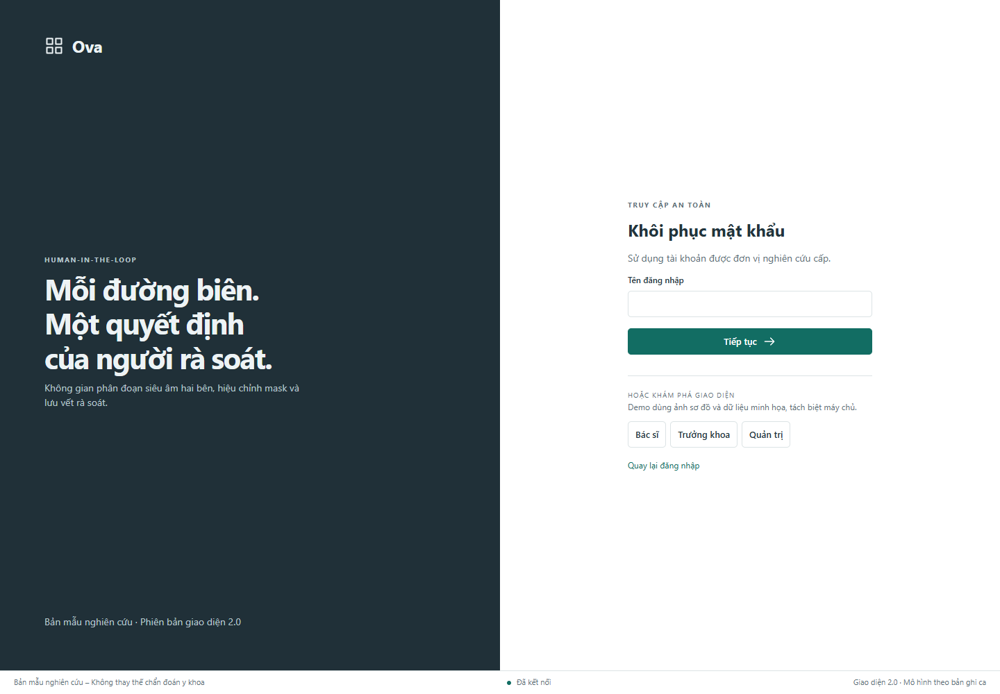

*Hình 3.2: Màn yêu cầu khôi phục mật khẩu trong luồng thiết kế*

Nguồn: ảnh chụp frontend; chức năng server khôi phục mật khẩu chưa được tích hợp [18].

*Hình 3.3: Màn đặt lại mật khẩu và kiểm tra dữ liệu nhập*

Nguồn: ảnh chụp frontend; không phải bằng chứng đã có dịch vụ gửi thư hoặc token reset [18].

Đổi mật khẩu lần đầu được thiết kế thành một bước có mục tiêu rõ ràng, tránh trộn vào trang tùy chọn. Màn OTP hiển thị nơi nhập mã, trạng thái gửi lại và thông báo lỗi. Trong nghiên cứu này, các màn đó kiểm tra cấu trúc luồng giao diện; chưa có căn cứ nói backend đã thực thi OTP, lockout hay refresh token. Phân quyền UI và kiểm tra form chỉ là lớp phản hồi cho người dùng. Những điều kiện bảo mật phải được kiểm tra từ request thật và dữ liệu server trước khi mở tính năng trên môi trường sử dụng.

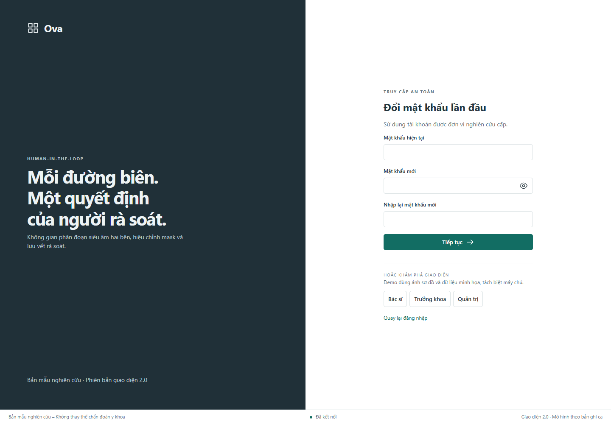

*Hình 3.4: Màn đổi mật khẩu lần đầu*

Nguồn: ảnh chụp frontend trong bộ giao diện nghiên cứu [18].

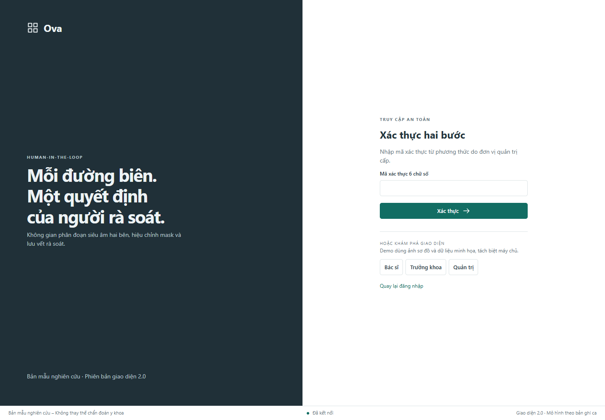

*Hình 3.5: Màn xác thực OTP theo thiết kế frontend*

Nguồn: ảnh chụp frontend; xác thực OTP thật cần endpoint backend bổ sung [18].

Khi phiên hết hạn, nội dung ảnh và trạng thái ca đang hoạt động cần được thu hồi khỏi giao diện để tránh tiếp tục thao tác bằng quyền đã mất. Người dùng được hướng dẫn đăng nhập lại; bản nháp chỉ được khôi phục khi định danh, quyền và phiên bản ca còn phù hợp. Không tự gửi lại một thao tác ký sau khi thay đổi phiên vì tác vụ đó phải thể hiện ý chí xác nhận của người dùng. Thử nghiệm hồi quy đã kiểm tra tình huống hết phiên trong lúc lưu và việc xóa trạng thái ca khỏi UI. Cách xử lý này giúp phân biệt “giữ công việc” với “giữ quyền truy cập cũ”.

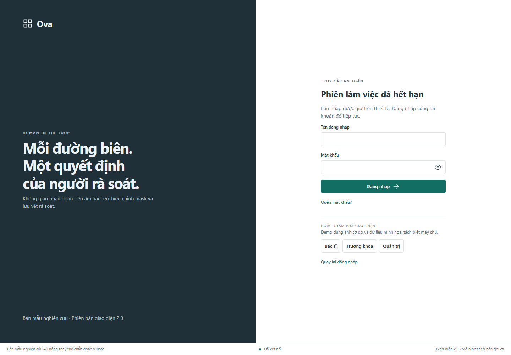

*Hình 3.6: Thông báo phiên hết hạn và đường quay lại đăng nhập*

Nguồn: ảnh chụp ứng dụng; kiểm thử phiên được trình bày ở mục 3.7 [18], [19].

### 3.6.3. Dashboard theo vai trò

Dashboard bác sĩ tập trung vào các việc đang dở, ca cần sửa và lối vào tiếp nhận ảnh mới. Số liệu có tính điều hành được đặt cùng hành động liên quan; không dùng các thẻ quảng bá tính năng để thay thế dữ liệu công việc. Một danh sách rỗng cần có chỉ dẫn bắt đầu, còn lỗi tải dữ liệu phải có thử lại. Trong demo, dữ liệu là các ca minh họa; đối với danh sách có phạm vi “của tôi” thật, backend phải lọc theo người dùng trước khi phân trang. Thống kê trên frontend không thể sửa một contract trả về toàn bộ ca mà chưa kiểm quyền.

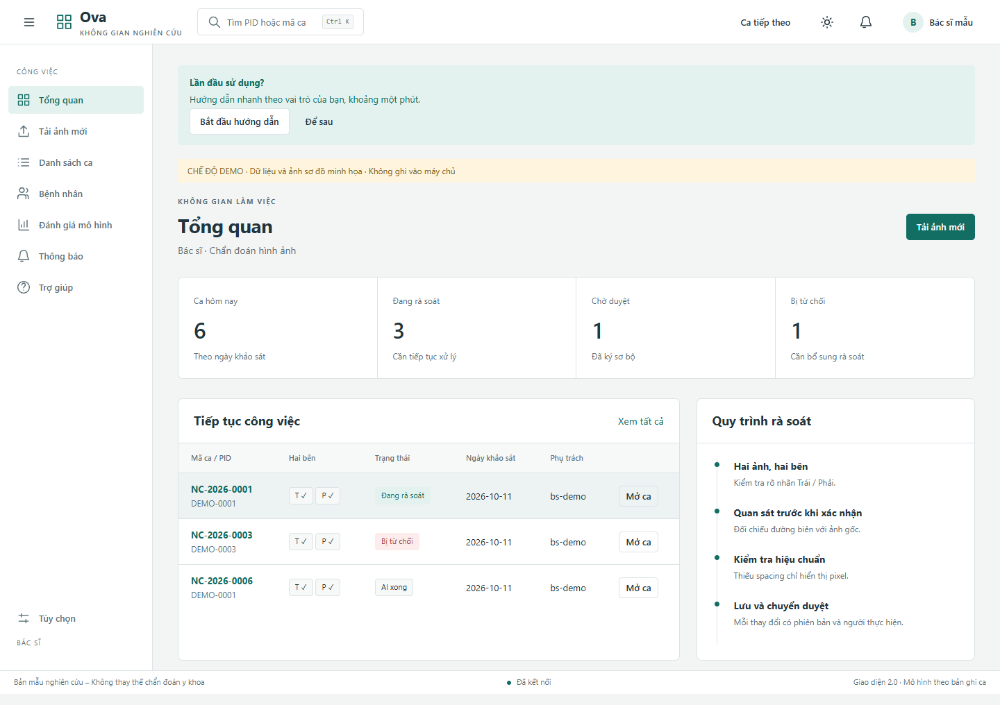

*Hình 3.7: Dashboard bác sĩ với các tác vụ cần xử lý*

Nguồn: ảnh chụp chế độ demo, dữ liệu minh họa [18].

Dashboard trưởng khoa ưu tiên hàng chờ duyệt và ca cần chú ý. Nút duyệt ca tiếp theo đưa người dùng vào tác vụ cụ thể, giúp giảm tìm kiếm lặp lại. Các số liệu khoa chỉ có ý nghĩa khi xác định đúng khoa và quyền của người xem. Trong trạng thái thiết kế, vai trò TK được tách khỏi bác sĩ tạo ca để mô hình hóa kiểm soát hai cấp. Tuy nhiên backend hiện có DOCTOR/ADMIN; sự tồn tại của dashboard TK trong demo chưa xác nhận tài khoản TK hay cơ chế ngăn tự duyệt trên server. Báo cáo giữ vai trò này như thiết kế mở rộng đã thể hiện được phía frontend.

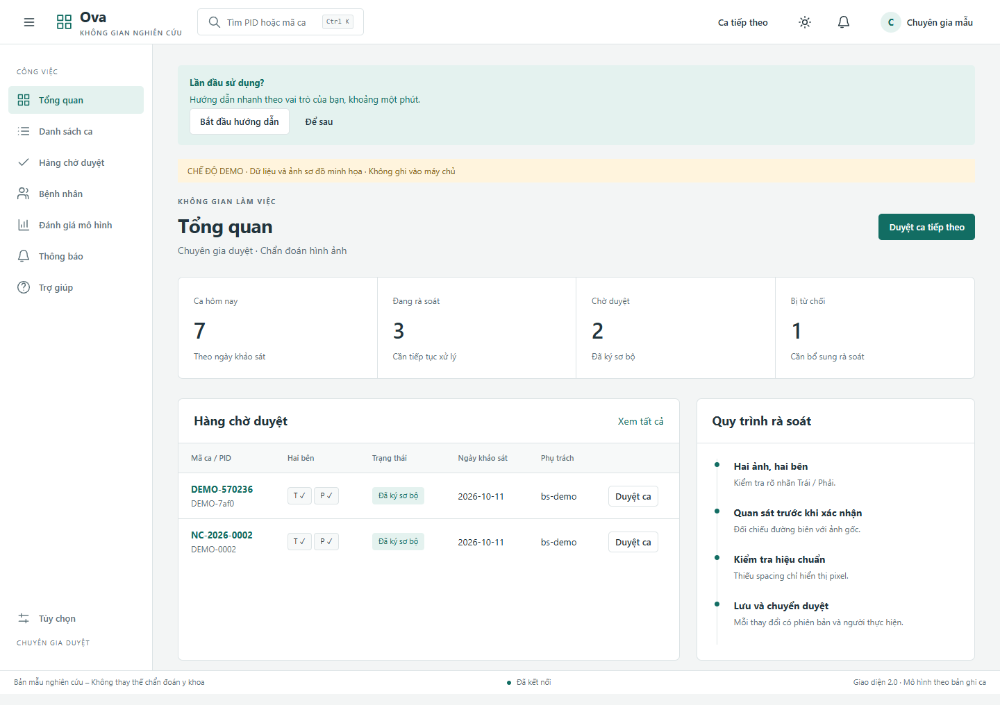

*Hình 3.8: Dashboard trưởng khoa và hàng chờ duyệt trong demo*

Nguồn: ảnh chụp demo; workflow duyệt hai cấp cần tích hợp server [18].

Dashboard quản trị trình bày sức khỏe hệ thống, người dùng và cảnh báo kỹ thuật. QT không nhận một bản sao dashboard bác sĩ chỉ đổi tiêu đề. Nội dung được giới hạn vào metadata, trạng thái và hành động quản trị. Việc tách lối vào giảm nhầm trách nhiệm khi một người vận hành máy chủ không có vai trò chuyên môn. Trong bản mẫu, menu và route lâm sàng bị chặn theo vai trò giao diện; để bảo vệ dữ liệu thật, endpoint cũng phải áp dụng quyền tương ứng. Đây là một yêu cầu còn cần củng cố ở backend khi triển khai mô hình quyền mới.

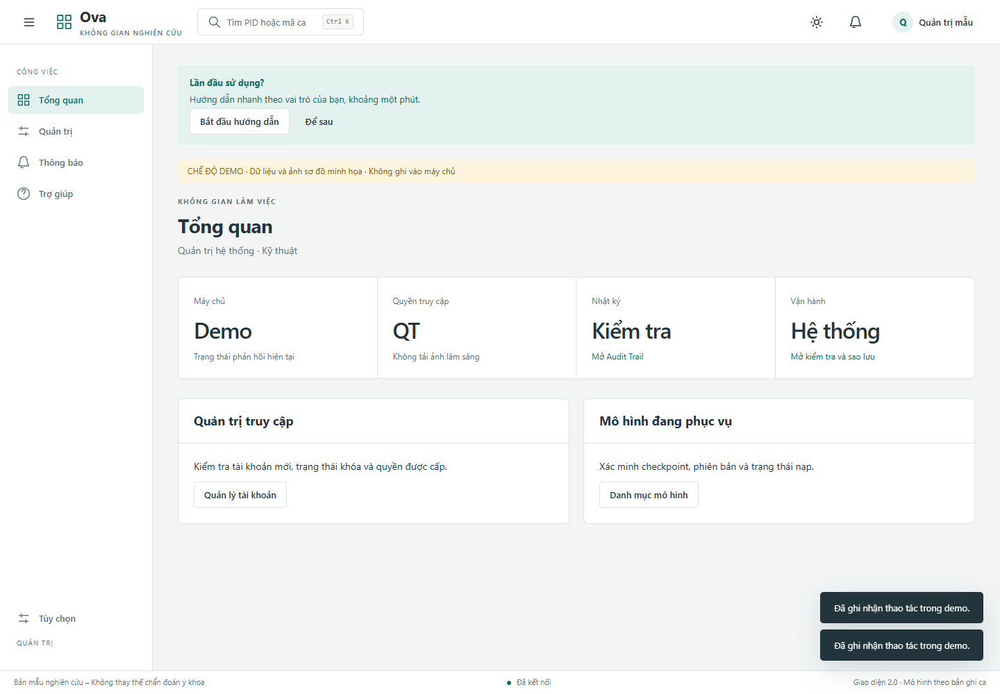

*Hình 3.9: Dashboard quản trị hệ thống, tách khỏi công việc đọc ảnh*

Nguồn: ảnh chụp demo quản trị [18].

### 3.6.4. Tiếp nhận ca và hai ảnh trái–phải

Màn tiếp nhận có hai ô tải ảnh độc lập mang nhãn Trái và Phải. Nhãn được giữ cùng thumbnail, trạng thái kiểm tra và tiến trình từng ảnh, tránh ghi nhớ một lựa chọn bên trong radio trước đó. Dữ liệu ca dùng PID giả danh; trường trống có thể được tạo mã theo quy tắc ứng dụng. Hệ thống không đưa tên hay ngày sinh thật vào biểu mẫu chính. Lý do khảo sát hỗ trợ diễn giải công việc nhưng không trở thành nhãn bệnh học cho mô hình. Để chạy chuỗi tự động, cả hai slot phải có tệp hợp lệ theo kiểm tra định dạng và kích thước.

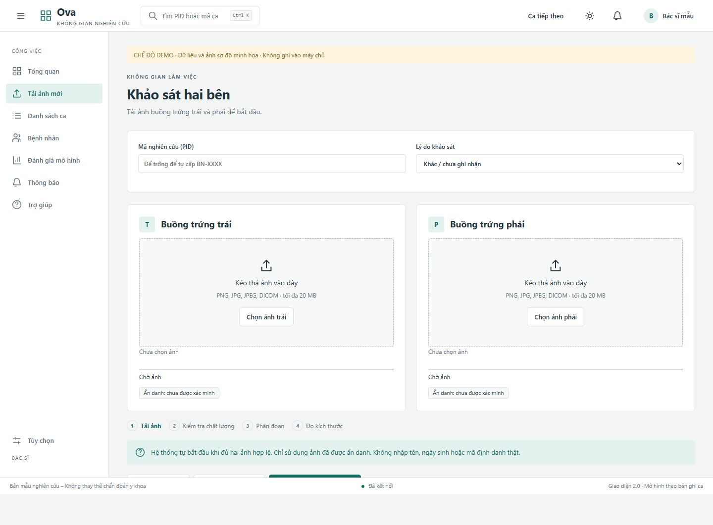

*Hình 3.10: Màn tiếp nhận với hai ô tải Trái và Phải riêng biệt*

Nguồn: ảnh chụp frontend; không chứa ảnh bệnh nhân [18].

Sau khi đủ cặp, frontend tạo ca, upload từng ảnh, gọi IQA và suy luận, giữ lại study_id và image_id để có thể thử lại mà không tạo thêm ca vô lý. Progress upload phản ánh dữ liệu truyền, còn phân đoạn được biểu diễn thành một trạng thái riêng. Cách chia này cho người dùng biết đang chờ mạng hay chờ mô hình. Nếu một bên lỗi, bên đã có ID vẫn được giữ; retry phải đi vào bước chưa hoàn tất. Không chạy song song hai chuỗi thiếu kiểm soát rồi dùng response đến sau để ghi đè bên đang xem. Test luồng thật đã kiểm tra việc thiếu một ảnh không được tiếp tục và hai ảnh được liên kết đúng bên [19].

Đối với DICOM, frontend có điểm tích hợp inspect và chọn frame nhưng chỉ bật khi server công bố capability tương ứng. Backend hiện tại chưa cung cấp chuỗi inspect nhiều frame và pipeline ẩn danh/OCR hoàn chỉnh. Vì vậy UI không tự khẳng định đã loại bỏ chữ nhận diện in cứng chỉ vì metadata được đọc. Trạng thái ẩn danh được trình bày là thông tin cần xác minh. Thiếu PixelSpacing dẫn đến đơn vị px, không tự lấy một hệ số mặc định để làm cho báo cáo trông đầy đủ. Đây là ràng buộc dữ liệu ảnh hưởng trực tiếp đến thanh đo và phiếu kết quả.

### 3.6.5. Worklist và thao tác danh sách

Worklist tổ chức ca dưới dạng bảng với tìm kiếm, trạng thái, ngày, người phụ trách, sắp xếp và phân trang. Tab phạm vi được xác định theo vai trò; người dùng không được thấy một nút “tất cả” rồi mới bị từ chối sau khi đã tải dữ liệu. Hai thumbnail thể hiện đủ cặp trái–phải; badge trạng thái kết hợp màu với chữ. Bộ lọc lưu được giúp người dùng quay lại một tập công việc quen thuộc mà không thiết lập lại. Tự làm mới phải giữ điều kiện tìm kiếm và tránh kéo người đang đọc sang trang khác. Hiển thị số lượng tổng cần lấy từ server, không suy từ một trang kết quả có giới hạn.

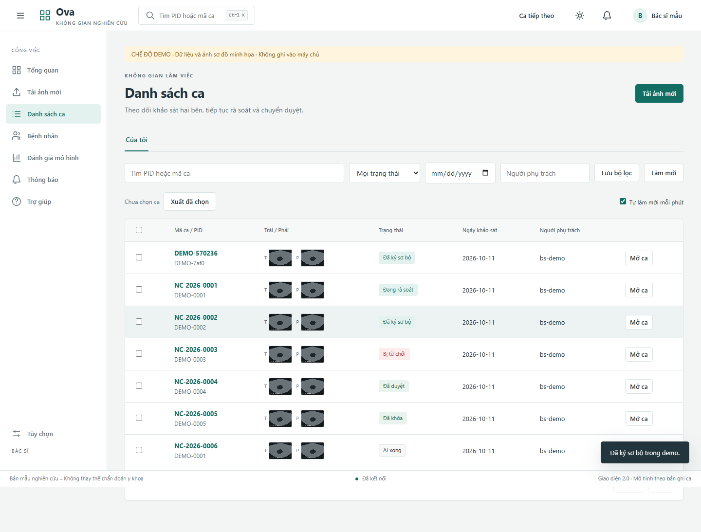

*Hình 3.11: Worklist với tìm kiếm, bộ lọc và trạng thái ca*

Nguồn: ảnh chụp demo; tìm kiếm và phân trang theo quyền thật cần contract worklist mới [18].

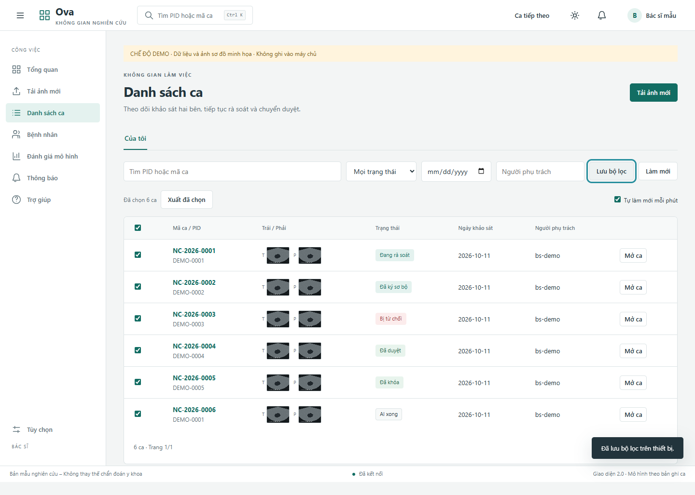

*Hình 3.12: Trạng thái chọn nhiều ca và thanh thao tác hàng loạt*

Nguồn: ảnh chụp demo; endpoint export/gán phụ trách được đặc tả riêng [18].

Chọn nhiều ca là một trạng thái tác vụ có thời hạn, không phải một quyền mới. Khi xuất hoặc gán phụ trách, mỗi ID vẫn phải được kiểm quyền và trạng thái phía server. Ca đã khóa không được mở cho chỉnh sửa chỉ vì nằm trong danh sách đã chọn. Một thao tác hàng loạt cần báo phần thành công và phần thất bại nếu backend hỗ trợ kết quả từng mục; nếu contract chỉ hỗ trợ transaction toàn bộ thì UI phải phản ánh đúng kiểu thất bại đó. Phiên bản demo giúp kiểm tra bố cục và tương tác, còn tính toàn vẹn của xử lý batch phải được chứng minh bằng API bổ sung.

### 3.6.6. Workstation đọc và hiệu chỉnh mặt nạ

Workstation chia thành thanh công cụ, viewer trung tâm và panel thông tin. Người đọc chuyển nhanh Trái/Phải hoặc mở đối chiếu hai bên; mỗi ảnh có prediction, mask làm việc, lịch sử, notes và trạng thái đo riêng. Thanh công cụ gồm brush, eraser, polygon, pan và các thao tác làm sạch vùng. Undo/redo lưu lịch sử giới hạn; hủy một dialog reset không được xóa redo. Reset về mask AI yêu cầu xác nhận và không làm mất bản gốc. Tác vụ “không có vùng tổn thương cần phân đoạn” cho phép mask rỗng, nhưng văn bản không kết luận người bệnh không có bệnh.

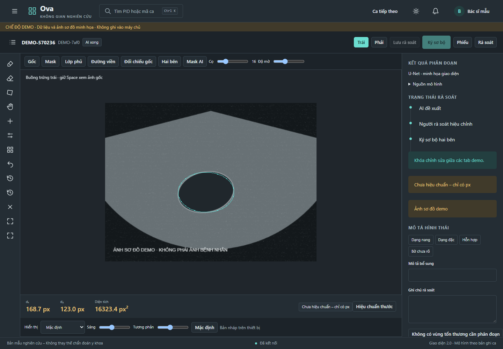

*Hình 3.13: Workstation dark theme với đường viền và công cụ rà soát*

Nguồn: ảnh chụp demo. Hình siêu âm trong viewer là ảnh sơ đồ, không phải kết quả thực nghiệm mô hình [18].

Đường viền mảnh được dùng mặc định để người đọc còn quan sát được mức xám ở trong và sát biên. Lớp phủ màu có opacity riêng; thay opacity chỉ thay hiển thị, không thay pixel mask. Giữ Space để tạm xem ảnh gốc, thả phím để trở về trạng thái trước. Preset sáng–tương phản mang tên hiển thị như “Ít chói” hoặc “Tăng tương phản”, không gán tên bệnh lý hay hàm ý preset đã được bác sĩ thẩm định. Nếu heatmap bất định không được server cung cấp đúng model-space, nút này không tự sinh một lớp màu nhằm làm phong phú giao diện.

Brush và eraser tác động vào lưới mask 512×512. Tọa độ màn hình đi qua phép biến đổi viewport rồi ánh xạ sang model-space; phép letterbox tiếp tục nối model-space với ảnh nguồn. Một ảnh không vuông có padding, vì thế chia đơn giản tọa độ chuột cho kích thước canvas mà bỏ scale/pan sẽ gây lệch. Module `coordinates.js` giữ một cách chuyển đổi chung. Viewer sử dụng offscreen source/mask và requestAnimationFrame, cập nhật vùng bẩn khi thao tác; zoom/pan thay ma trận hiển thị. Khi resize, phép đo rect và fit phải được cập nhật. Test tọa độ sử dụng ảnh không vuông và quy tắc làm tròn đồng nhất backend.

Thanh đo hiển thị d₁, d₂ và diện tích cùng badge hiệu chuẩn. Nếu chưa có hệ số hợp lệ, số đo dùng px và px² với cách trình bày dễ phân biệt. Nút hiệu chuẩn đặt ngay cạnh số đo để người dùng hiểu việc cần làm. Các phép đo preview tính ở Worker; request server cập nhật số đo nguồn sau chỉnh sửa. Một response đo cũ không được cập nhật lên mask mới hay ảnh bên kia. Hai trục được dùng để mô tả hình học của vùng trong lát cắt, không phải ba kích thước trực giao của thể tích. Phiếu vì thế không suy ra thể tích bằng cách nhân một trục thứ ba giả định.

Panel phải chứa thông tin model, hash nếu bản ghi cung cấp, notes, chip mô tả và cảnh báo cần xem kỹ. Chip là văn bản do người dùng chọn; không được trình bày như mô hình đã nhận biết phần đặc, nhú hoặc bản chất tổn thương. Cảnh báo như chưa hiệu chuẩn, IQA kém hoặc mask cần đối chiếu chỉ định hướng kiểm tra. Confidence trung bình pixel không được dùng như xác suất chẩn đoán hay điểm tin cậy đã hiệu chuẩn. Khi mất lease hoặc hết quyền, việc chặn phải áp dụng tới brush, notes, chip và biên lưu API, tránh một phần UI bị khóa nhưng phần khác vẫn sửa dữ liệu.

*Bảng 3.2: Phím tắt và điều kiện sử dụng trong Workstation*

| Phím | Hành vi | Điều kiện hoặc giới hạn |
|---|---|---|
| 1 / 2 / 3 | Ảnh gốc / Mask / Overlay | Không xử lý khi đang nhập văn bản |
| Space giữ | Tạm xem ảnh gốc | Thả phím phục hồi chế độ hiển thị trước |
| C / K / F | Đối chiếu / Đường viền / Toàn màn hình | Không thay dữ liệu mask |
| B / E / L / H | Brush / Eraser / Polygon / Pan | Công cụ chỉnh chỉ bật khi có quyền và lease |
| X | Đổi brush và eraser | Không dùng khi focus ở input |
| [ / ] | Giảm hoặc tăng cỡ bút | Giới hạn cỡ bút hợp lệ |
| Alt + cuộn | Đổi cỡ bút | Giữ tâm thao tác, không gửi API |
| ← / → | Chuyển bên Trái / Phải | Mask và notes mỗi bên độc lập |
| S | Làm trơn mask | Có lịch sử undo; không phải xác nhận chuyên môn |
| R | Reset về mask AI | Hộp xác nhận; hủy không mất redo |
| Shift + R | Xóa mask làm việc | Có xác nhận và undo |
| Ctrl + Z / Y | Undo / Redo | Lịch sử giới hạn, không vượt về prediction khác |
| Ctrl + Enter | Mở ký sơ bộ | Cả hai ảnh đã xem và điều kiện rà soát phù hợp |
| N / P | Ca tiếp hoặc ca trước | Phụ thuộc hàng chờ; cảnh báo khi chưa lưu |
| Ctrl + K / ? | Tìm nhanh / Trợ giúp phím | Không bỏ qua quyền route |
| Tab | Di chuyển focus chuẩn | Không chiếm dụng để chuyển bên |

Nguồn: mã giao diện và bộ kiểm thử logic [18], [19].

### 3.6.7. Tóm tắt và ký sơ bộ hai bên

Modal ký sơ bộ đặt hai ảnh và thông tin hai bên trong cùng một lần rà soát. Trước khi mở xác nhận, người dùng phải đã hiển thị đủ ảnh và cảnh báo. Tóm tắt ghi d₁, d₂, diện tích, đơn vị, hiệu chuẩn, mask đã sửa hay giữ nguyên và notes. Thiếu hiệu chuẩn là cảnh báo minh bạch, không được xử lý bằng cách tự gán mm. Đánh giá nhanh AI là tùy chọn; khi người dùng nêu lỗi mới mở nhóm bỏ sót, khoanh thừa hoặc biên chưa khít. Dữ liệu phản hồi là quan sát của reviewer, không phải nhãn chuyên gia đã duyệt lại dùng huấn luyện ngay.

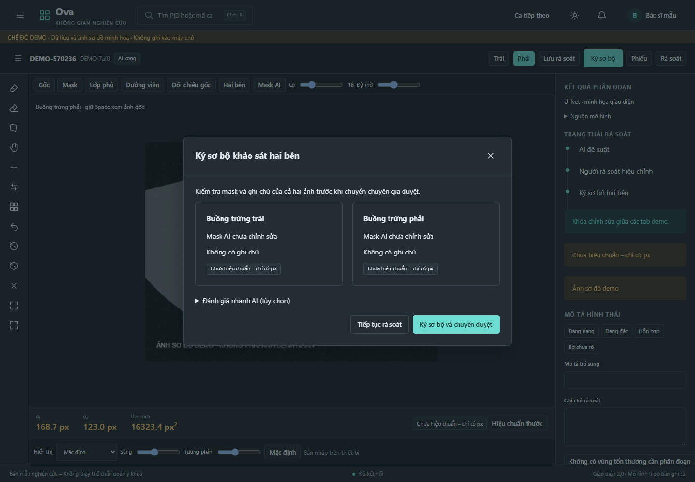

*Hình 3.14: Modal tóm tắt hai bên trước ký sơ bộ trong demo*

Nguồn: ảnh chụp demo; ký hai ảnh trong một transaction cần endpoint workspace bổ sung [18].

Trong luồng thật hiện có, lưu review thực hiện theo từng ảnh qua endpoint `/api/review`. Hai review thành công không được báo thành workflow duyệt hai cấp hoàn chỉnh nếu endpoint ký chưa có. Bản mẫu hiện lỗi rõ ràng ở tác vụ chưa được backend hỗ trợ; không dùng một trạng thái nội bộ để giả lập server thành công. Cách phân biệt này quan trọng khi demo sản phẩm: người xem có thể đánh giá luồng dự kiến nhưng vẫn biết đoạn nào đã lưu thật. Cờ `is_official_ground_truth=False` tiếp tục giữ nguyên; việc bấm xác nhận nghiên cứu không thay thế quy trình thẩm định nhãn của cơ sở y tế [17].

### 3.6.8. Hàng chờ và giao diện duyệt chính thức

Hàng chờ duyệt dành cho TK gồm các ca đã qua ký sơ bộ, thông tin phụ trách và dấu hiệu cần ưu tiên. Lý do bị từ chối được giữ trong lịch sử và xuất hiện ở đầu panel khi trả về người tạo ca. Trong màn duyệt, ảnh nguồn, mask bác sĩ và mask AI gốc có thể đối chiếu để phân biệt thay đổi của con người với gợi ý ban đầu. Approve và Reject là hai tác vụ khác nhau; Reject phải có lý do có thể hiểu. TK tự sửa tạo phiên bản mới để BS phụ trách rà soát và ký lại, tránh gắn một chữ ký cũ lên dữ liệu vừa thay đổi.

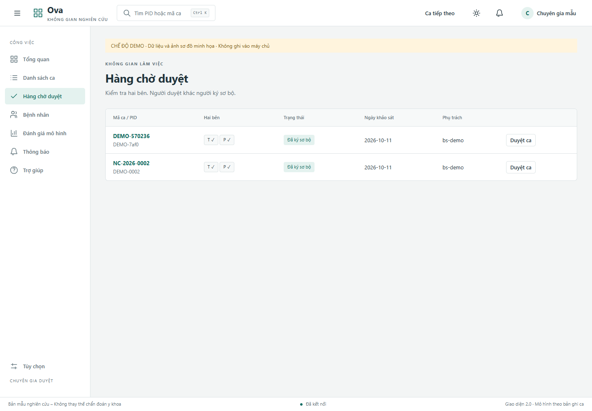

*Hình 3.15: Hàng chờ duyệt theo thiết kế vai trò trưởng khoa*

Nguồn: ảnh chụp demo; chưa phải danh sách lâm sàng vận hành [18].

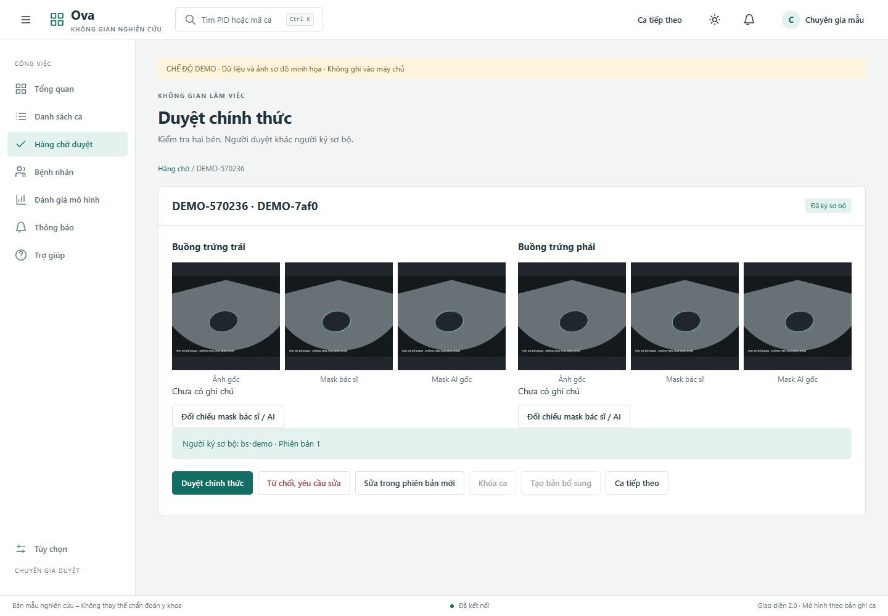

*Hình 3.16: Màn đối chiếu ảnh, mask rà soát và mask AI khi duyệt*

Nguồn: ảnh chụp demo; Approve/Reject thật cần backend workflow [18].

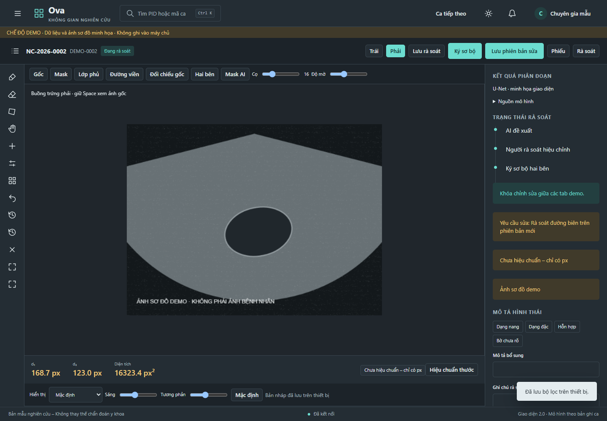

*Hình 3.17: Trạng thái tạo phiên bản hiệu chỉnh và giữ bản trước*

Nguồn: ảnh chụp demo; không chứng minh đã có cơ chế phiên bản bất biến phía server [18].

Nguyên tắc người ký sơ bộ không tự duyệt được thể hiện trong logic demo và ma trận quyền. Tuy nhiên nó phải được kiểm tại transition endpoint bằng định danh từ token, không nhận actor_id tùy ý từ client. Tương tự, khóa ca là trạng thái lưu bền, mọi mutation phải kiểm trạng thái khóa và phiên bản. Khóa chỉ bằng CSS hay disable button không bảo vệ API. Các hình minh họa góp phần làm rõ yêu cầu và cách thao tác; báo cáo không dùng chúng để tuyên bố đã đạt bảo mật quy trình bệnh viện.

### 3.6.9. Chi tiết ca và phiếu kết quả

Chi tiết ca trình bày timeline trạng thái, ảnh trái–phải, bản ghi model và phiên bản rà soát. Cách thể hiện ai làm gì, lúc nào giúp truy về quyết định thay vì chỉ nhìn badge cuối. Nếu ca được mở lại hoặc hiệu chỉnh, bản cũ vẫn cần tham chiếu được. Timeline demo minh họa mô hình dữ liệu cần mở rộng; lịch sử đầy đủ phía server phải được cung cấp bởi endpoint mới. Trong luồng hiện có, Prediction và Review được giữ thành hai nhóm bản ghi riêng, tạo nền tảng cho việc truy vết nhưng chưa thay thế toàn bộ yêu cầu addendum của hồ sơ lâm sàng.

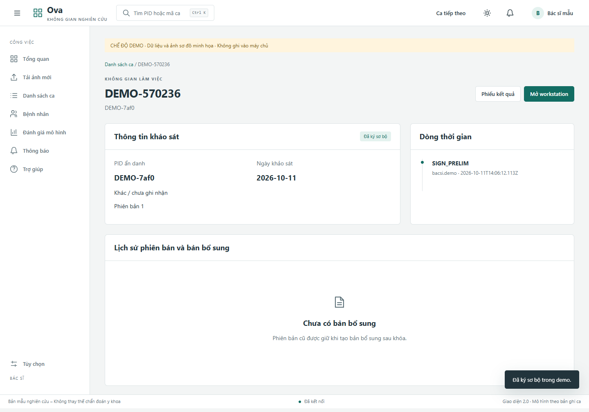

*Hình 3.18: Chi tiết ca với timeline và lịch sử phiên bản trong demo*

Nguồn: ảnh chụp demo [18].

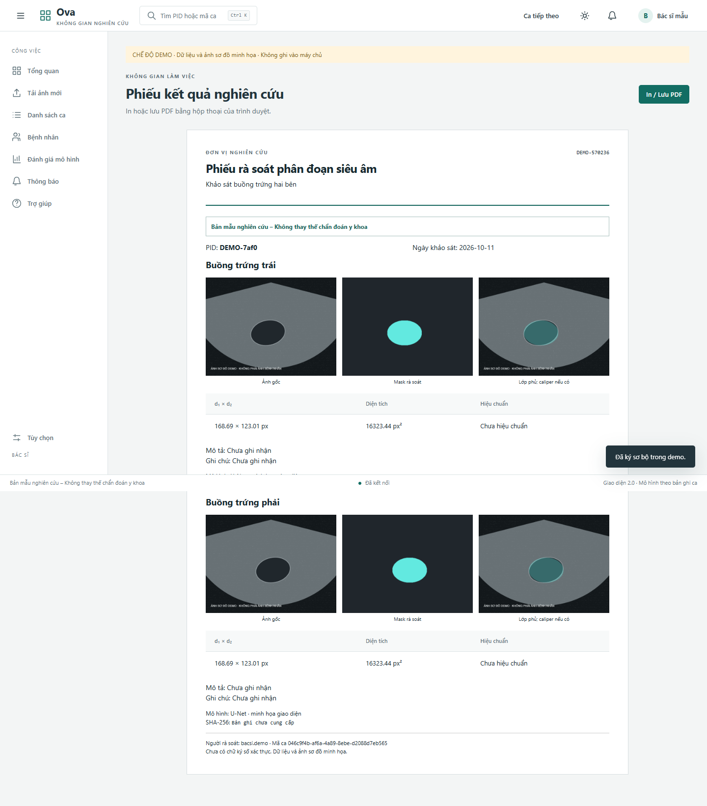

*Hình 3.19: Phiếu kết quả nghiên cứu A4 với ba hình cho mỗi bên*

Nguồn: ảnh chụp demo; ảnh sơ đồ minh họa, không phải phiếu kết quả bệnh nhân [18].

Phiếu tóm tắt dùng khổ A4, gồm mã ca, PID, thời điểm khảo sát, ảnh gốc, mask và overlay mỗi bên, số đo cùng trạng thái hiệu chuẩn, notes và thông tin model nếu bản ghi có. Dòng nghiên cứu xuất hiện trong nội dung in, không chỉ trên thanh trạng thái bị ẩn bởi CSS print. Header ghi đơn vị nghiên cứu, tránh một tên hoặc biểu tượng bệnh viện tạo cảm giác phiếu đã là tài liệu y bạ. Mã ca được dùng để tra cứu; bản hiện tại không tự tạo QR hay chữ ký số chưa có. Bản ghi không cung cấp hash phải nêu thiếu nguồn, không lấy hash model đang nạp để điền cho một prediction lịch sử.

Chức năng In/Lưu PDF gọi hộp thoại trình duyệt và áp dụng `@media print` để ẩn điều hướng. Đây là khả năng xuất qua trình duyệt, khác dịch vụ PDF server. Endpoint tạo báo cáo lâm sàng chưa hỗ trợ không được giới thiệu như đã có. Việc xuất cần audit receipt khi triển khai workflow mới; hiện đó là contract bổ sung. Đơn vị trong phiếu theo dữ liệu từng ảnh, nên hai bên có thể khác trạng thái hiệu chuẩn. Không ép đồng nhất đơn vị bằng cách suy một hệ số từ bên đã hiệu chuẩn sang bên còn lại.

### 3.6.10. Tra cứu PID và so sánh các lần khảo sát

Màn bệnh nhân dùng PID giả danh làm khóa tìm kiếm. Các lần khảo sát được tổ chức theo timeline, giúp người dùng chọn hai lần để xem đối chiếu. Hiển thị này không đưa thông tin định danh thật vào giao diện. Với quyền BS chỉ ca của mình, server phải kiểm phạm vi ở truy vấn lịch sử PID; một PID tồn tại không có nghĩa mọi tài khoản được xem tất cả Study của PID đó. Trong demo, thao tác chọn lần khảo sát và so sánh được dùng để kiểm tra trải nghiệm; endpoint timeline có quyền còn nằm trong danh sách mở rộng.

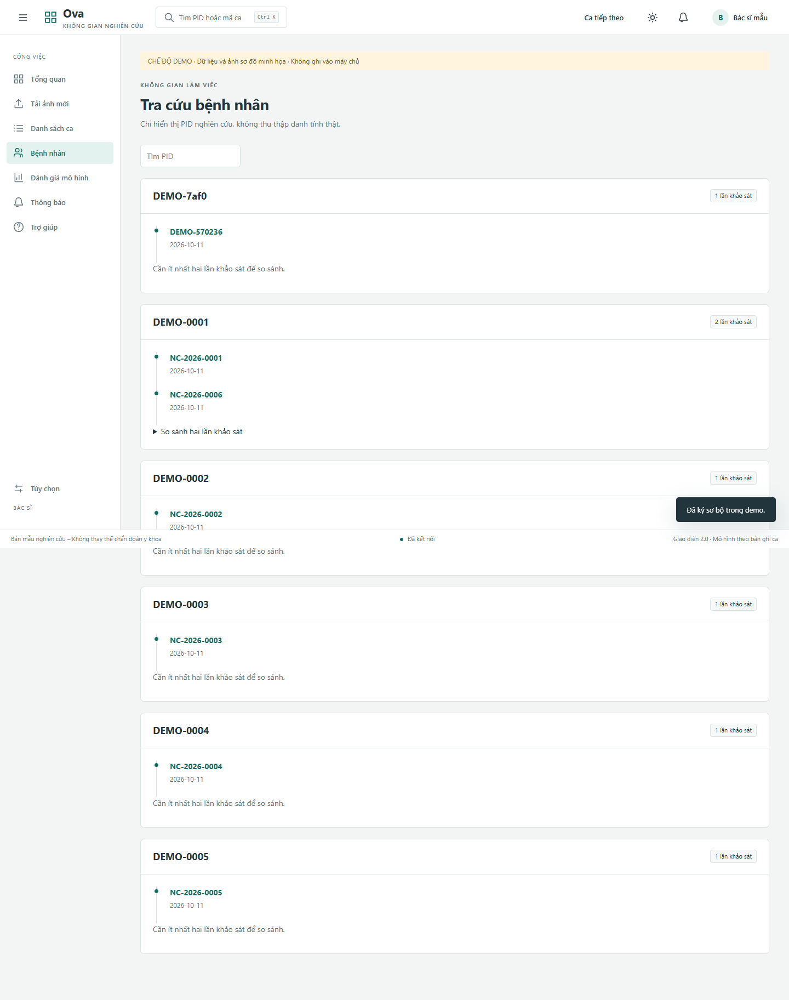

*Hình 3.20: Tra cứu PID giả danh và lịch sử khảo sát minh họa*

Nguồn: ảnh chụp demo, không có hồ sơ bệnh nhân thật [18].

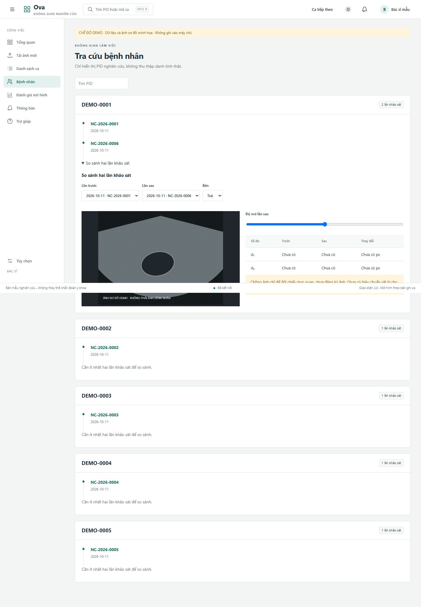

*Hình 3.21: Đối chiếu hai lần khảo sát và bảng số đo*

Nguồn: ảnh chụp demo; chồng ảnh chưa thực hiện đăng ký hình học [18].

Chồng hai ảnh bằng opacity chỉ giúp quan sát, không phải phép đăng ký ảnh đã hiệu chuẩn. Khác góc quét, scale hoặc lát cắt có thể tạo thay đổi biểu kiến dù cấu trúc không thay đổi. Vì vậy bảng so sánh phải ghi đơn vị và nguồn hiệu chuẩn của từng lần; chênh lệch px không được gọi là tăng kích thước vật lý. Không áp dụng một kết luận tiến triển bệnh dựa vào hai mask trong demo. Hệ thống giữ chức năng này như công cụ đối chiếu trực quan và đặt việc diễn giải chuyên môn ở người sử dụng.

### 3.6.11. Đánh giá mô hình và dữ liệu tham chiếu

Màn đánh giá mô hình tập trung metric theo tập, bảng theo ảnh, lọc nhóm lỗi và đối chiếu ảnh gốc–mask tham chiếu–AI–error map. Dice/IoU không xuất hiện như độ tin cậy của một ca đang đọc. Khi demo không có artifact đánh giá, màn hình thể hiện trạng thái rỗng có hướng dẫn thay vì gán một số điểm đẹp. Dữ liệu thật được tải qua API đánh giá lịch sử và giữ checkpoint/split tương ứng. Một bản đồ lỗi chỉ tính được khi hai mask cùng hệ tọa độ, kích thước và quy ước nhãn; ứng dụng không tự đoán transform khi chúng khác nhau.

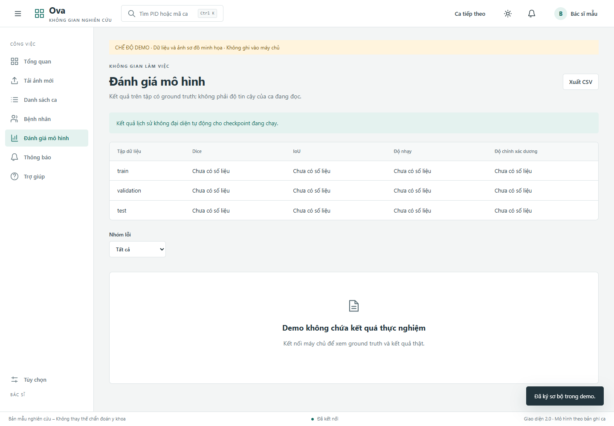

*Hình 3.22: Màn đánh giá mô hình, phân biệt dữ liệu thật và trạng thái demo*

Nguồn: ảnh chụp demo; số liệu thực nghiệm được trình bày từ artifact tại mục 3.5 [16], [18].

Xuất CSV lấy các bản ghi phù hợp bộ lọc và cần giữ metadata phép đánh giá. Nếu chỉ xuất một trang hiện tại, nhãn hành động phải phản ánh phạm vi đó; không gọi là xuất toàn bộ tập. Ảnh tải xuống dùng cho phân tích lỗi và phải kiểm thông tin nhận diện, quyền sử dụng khi chia sẻ. Metric Validation của U-Net++ không được trộn với Test của checkpoint Standard U-Net lịch sử để xếp hạng chung. Màn hình đánh giá có trách nhiệm làm rõ nguồn đo, còn người viết khóa luận có trách nhiệm giải thích giới hạn phương pháp của mỗi bảng.

### 3.6.12. Phân hệ quản trị

Quản trị gồm người dùng, khoa, model registry, audit, metadata ca, cấu hình và sức khỏe/sao lưu. Phân tách các nhóm giúp QT xử lý nhiệm vụ kỹ thuật mà không đi vào màn đọc ảnh. CRUD người dùng phải có validate, khóa hoặc mở khóa rõ ràng và quy tắc ngăn xóa tài khoản đang dùng hoặc có lịch sử trong demo. Một lần đổi role ảnh hưởng quyền phiên tiếp theo và cần ghi audit. Hành vi đó chưa được xem là đã có phía server chỉ vì danh sách mẫu thay đổi ngay sau khi bấm lưu.

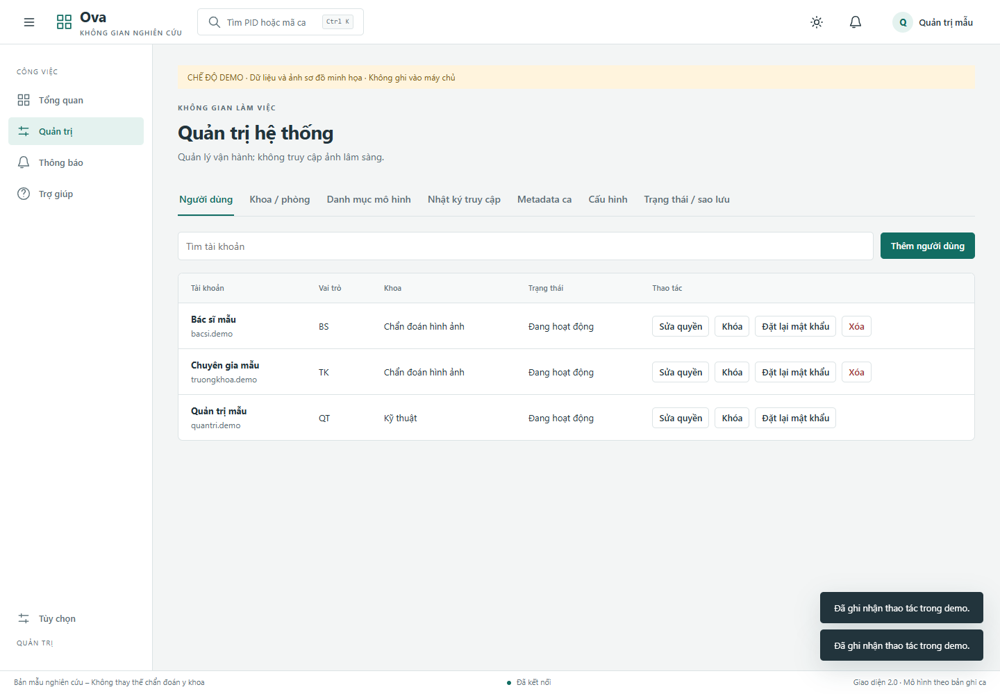

*Hình 3.23: Quản trị người dùng, vai trò và trạng thái tài khoản trong demo*

Nguồn: ảnh chụp demo; CRUD server mới chưa tích hợp [18].

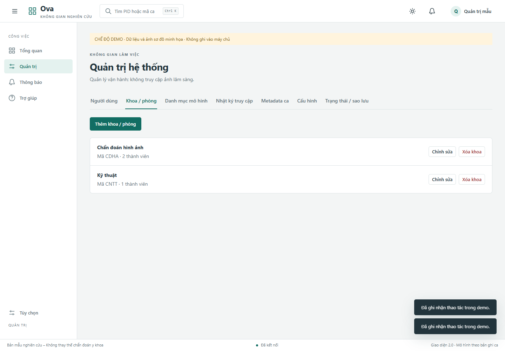

*Hình 3.24: Quản lý khoa/phòng và liên kết người dùng trong demo*

Nguồn: ảnh chụp demo; membership khoa cần ràng buộc phía server [18].

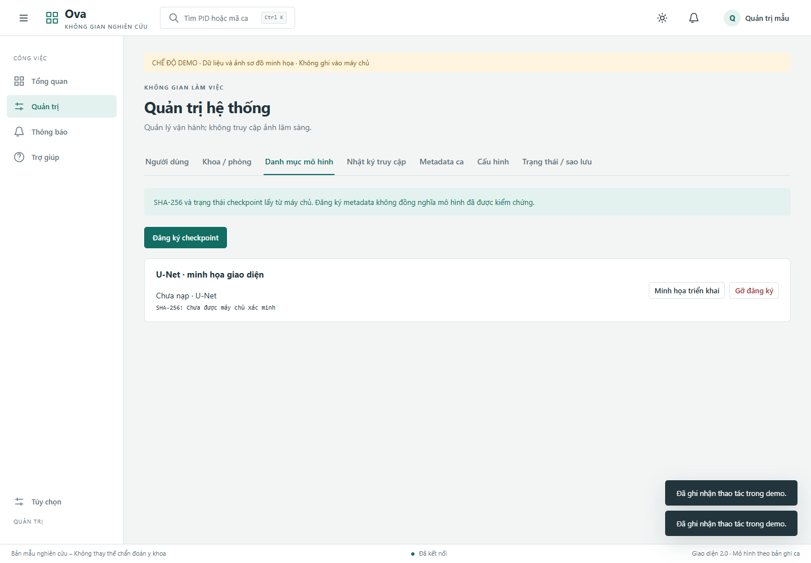

*Hình 3.25: Model Registry và trạng thái triển khai mô hình*

Nguồn: ảnh chụp demo; checkpoint thật được nhận diện riêng trong phần thực nghiệm [16], [18].

Model Registry cần thể hiện tên, kiến trúc, artifact và trạng thái nạp. Hash phải tính từ artifact ở server, không tin vào chuỗi người dùng nhập. Không cho gỡ model đang dùng nếu chưa có quy trình thay thế an toàn; provenance prediction lịch sử vẫn phải giữ sau triển khai model mới. Giao diện demo kiểm tra luồng đăng ký/triển khai/gỡ và phản hồi; registry thật hiện có endpoint đọc nhưng workflow ghi mới cần server hỗ trợ. Việc đưa U-Net++ vào bảng so sánh không đồng nghĩa mọi ca đang được suy luận bằng U-Net++.

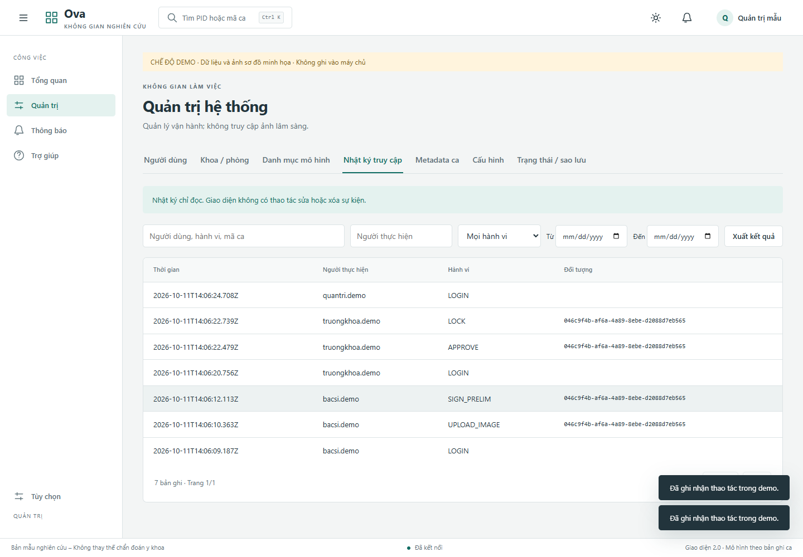

*Hình 3.26: Audit Trail với danh sách sự kiện chỉ đọc*

Nguồn: ảnh chụp demo; API audit hiện có và API audit phân trang mở rộng được phân biệt [18].

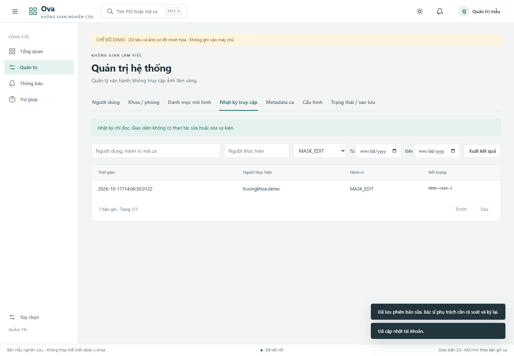

*Hình 3.27: Bộ lọc audit theo tác nhân, hành vi và thời gian*

Nguồn: ảnh chụp demo [18].

Audit không có nút sửa hoặc xóa. Bộ lọc người thực hiện, hành vi, khoảng thời gian và tìm kiếm hỗ trợ truy vết theo ca. Tuy nhiên “append-only trên giao diện” không chứng minh bảng DB chống sửa bởi tài khoản kỹ thuật. Cơ chế quyền database, lưu trữ ngoài và giám sát toàn vẹn cần thiết kế riêng khi mở rộng. Báo cáo chỉ mô tả đúng mức đã hiện thực: UI chỉ đọc và contract đề xuất không có endpoint sửa/xóa; chưa tuyên bố có log chain bất biến. Bản xuất audit toàn bộ bộ lọc cũng cần server pagination/export tương ứng.

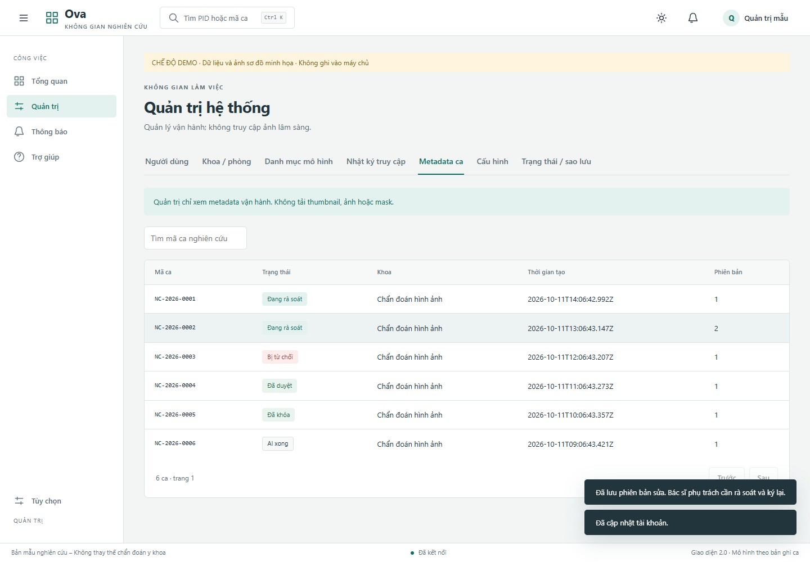

*Hình 3.28: Danh sách metadata ca dành cho quản trị, không hiển thị ảnh*

Nguồn: ảnh chụp demo [18].

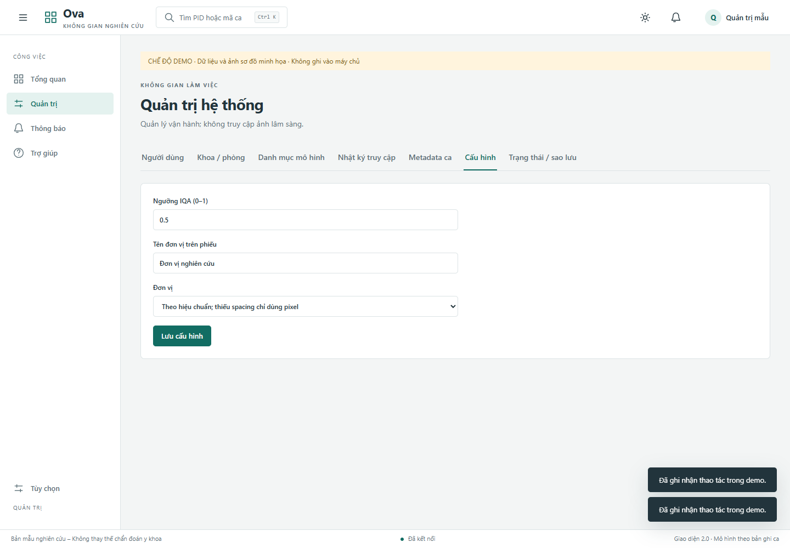

*Hình 3.29: Cấu hình IQA, đơn vị và mẫu phiếu trong demo*

Nguồn: ảnh chụp demo; chỉnh cấu hình thật cần validation và version phía server [18].

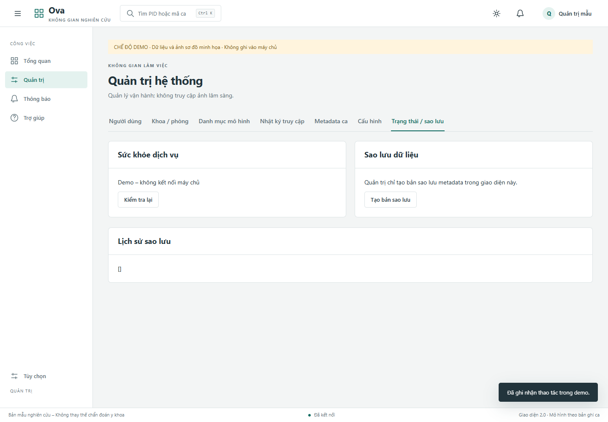

*Hình 3.30: Trạng thái hệ thống và tác vụ sao lưu*

Nguồn: ảnh chụp demo; API sức khỏe/sao lưu hiện hữu phải kiểm riêng trong luồng thật [18].

Cấu hình đơn vị không được làm mất quy tắc spacing: lựa chọn hiển thị mm không tạo dữ liệu vật lý khi ảnh chỉ có px. Ngưỡng IQA là tham số kỹ thuật chưa hiệu chuẩn lâm sàng, cần có validation và lịch sử thay đổi. Sao lưu metadata khác sao lưu gồm tệp ảnh; UI phải nêu phạm vi để người vận hành không hiểu một archive DB là đủ phục hồi toàn bộ ca. Khi chưa có endpoint cấu hình, trạng thái error/retry được dùng để báo chưa kết nối; không chuyển sang empty success làm người quản trị tin đã lưu.

### 3.6.13. Hồ sơ, tùy chọn, thông báo và trợ giúp

Màn cá nhân giúp người dùng kiểm tra tài khoản, vai trò và thông tin phục vụ giao diện. Đổi mật khẩu là tác vụ xác thực có validation riêng, không gộp vào chỉnh theme. Tùy chọn gồm theme, ngôn ngữ, bố cục viewer và phím tắt. Cơ chế i18n tạo điểm nối cho ngôn ngữ khác nhưng bản sử dụng hiện ưu tiên tiếng Việt. Thay đổi layout không làm biến đổi mask đang chỉnh; một tùy chọn cần được lưu theo phạm vi phù hợp, tránh dùng localStorage chung rồi vô tình áp dụng thiết lập cá nhân của người trước cho người sau trên máy dùng chung.

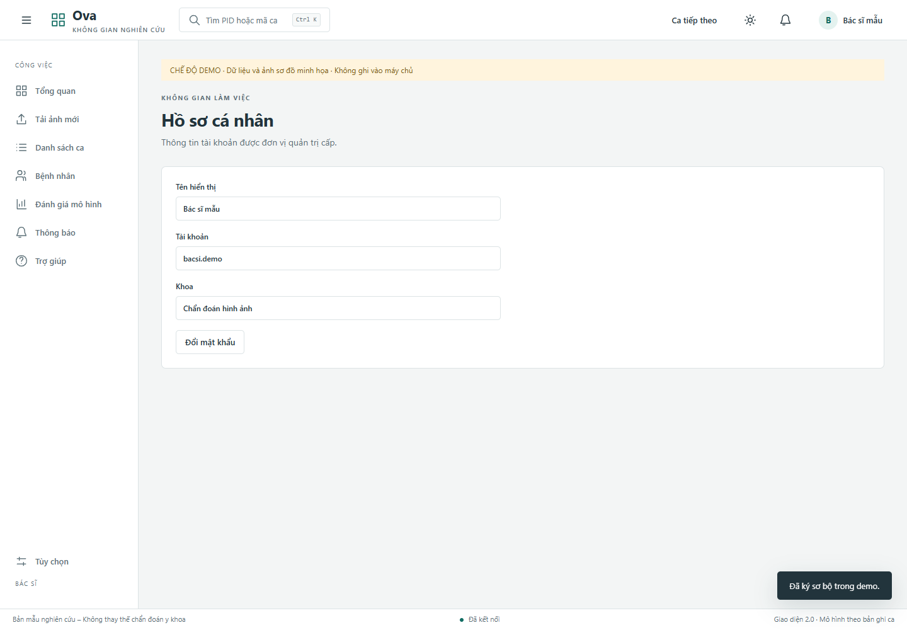

*Hình 3.31: Hồ sơ và thông tin tài khoản người sử dụng*

Nguồn: ảnh chụp demo [18].

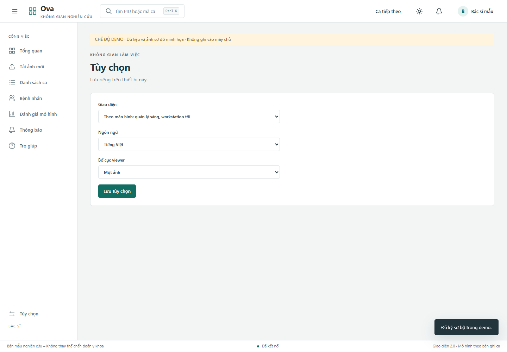

*Hình 3.32: Tùy chọn giao diện, ngôn ngữ và thao tác viewer*

Nguồn: ảnh chụp ứng dụng trong demo [18].

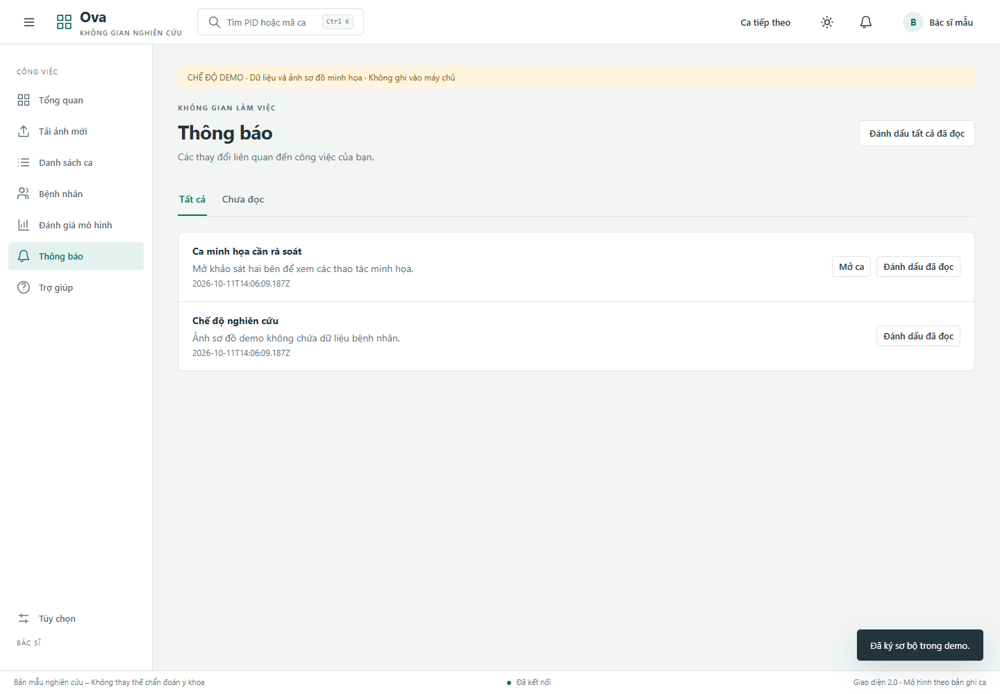

*Hình 3.33: Danh sách thông báo và phân biệt chưa đọc*

Nguồn: ảnh chụp demo; thông báo thật cần endpoint theo ownership [18].

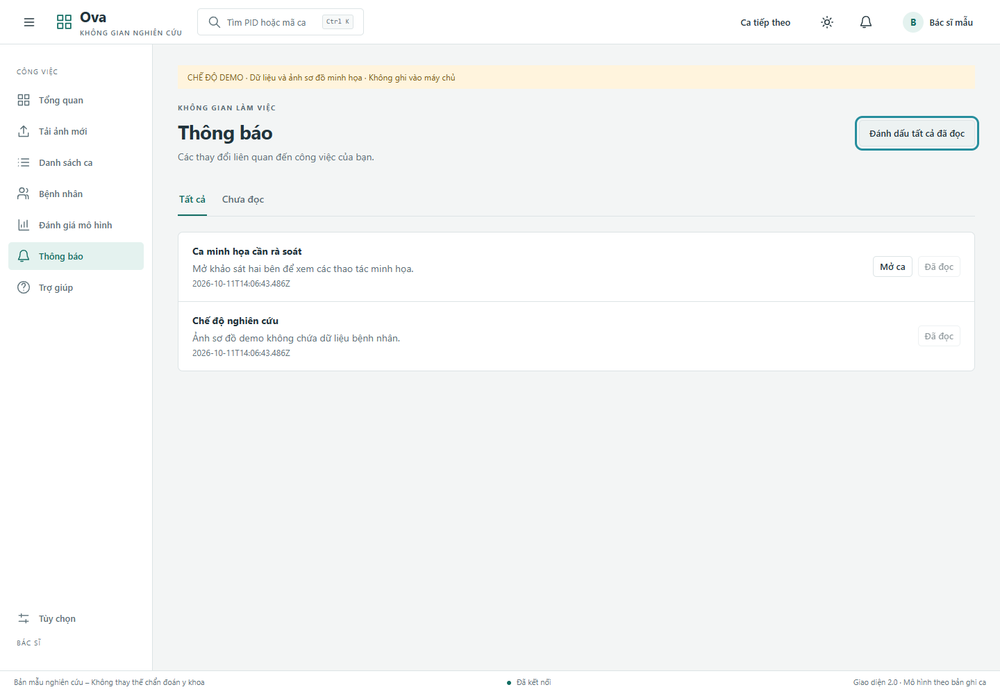

*Hình 3.34: Trạng thái đánh dấu thông báo đã đọc*

Nguồn: ảnh chụp demo [18].

Thông báo dẫn tới tác vụ liên quan nhưng vẫn phải kiểm quyền khi mở route. Đánh dấu đã đọc không làm thay đổi trạng thái chuyên môn của ca. Mọi request thông báo thật phải gắn actor từ phiên, tránh cho phép một người đánh dấu thông báo của người khác bằng ID đoán được. Help cung cấp bảng phím, hướng dẫn theo vai trò, phiên bản và gửi góp ý. Onboarding dùng bước ngắn gắn với control thật, không che cả màn bằng một bài thuyết trình. Nội dung góp ý cần tránh đưa định danh bệnh nhân vào một kênh kỹ thuật.

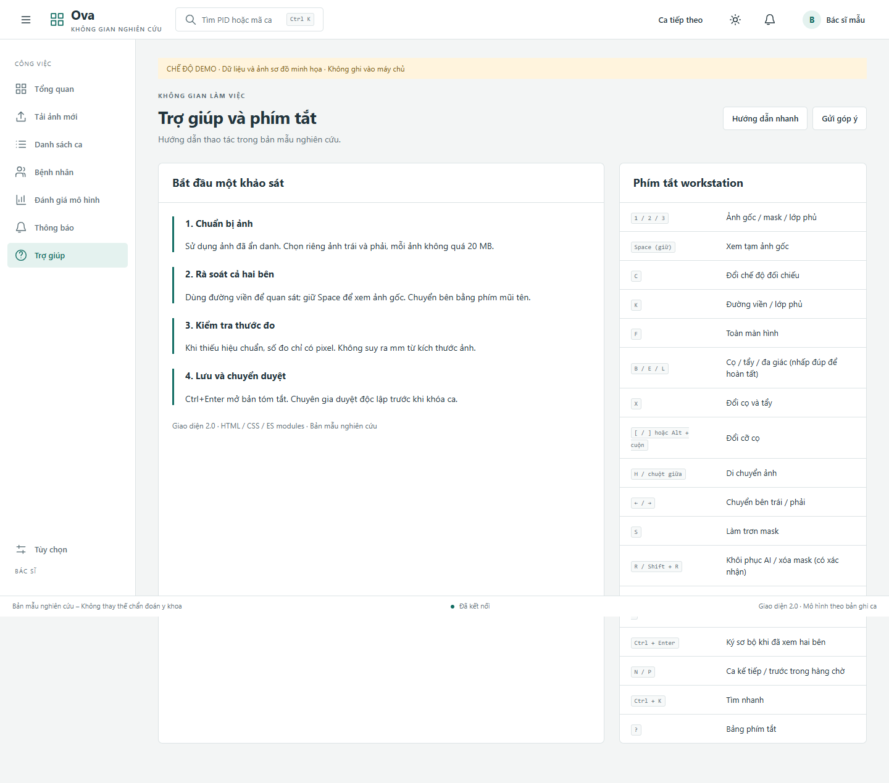

*Hình 3.35: Trợ giúp, phím tắt và hướng dẫn dùng bản mẫu*

Nguồn: ảnh chụp demo [18].

### 3.6.14. Màn lỗi, ngoại lệ và thích ứng tablet

403, 404 và bảo trì được thiết kế riêng. 403 báo người dùng thiếu quyền, 404 báo tài nguyên hoặc đường dẫn không tồn tại, còn bảo trì báo trạng thái dịch vụ. Không dùng cùng một thông báo “có lỗi xảy ra” cho cả ba vì hành động tiếp theo khác nhau. Nút quay lại cần dẫn tới một route người dùng được phép vào. Màn lỗi không giữ ảnh lâm sàng phía sau sau khi phiên hoặc quyền đã mất. Với dữ liệu đang tải, skeleton giữ bố cục; lỗi API có retry rõ ràng và không reset dữ liệu form hợp lệ một cách vô lý.

*Hình 3.36: Màn không đủ quyền truy cập*

Nguồn: ảnh chụp frontend [18].

*Hình 3.37: Màn không tìm thấy đường dẫn hoặc tài nguyên*

Nguồn: ảnh chụp frontend [18].

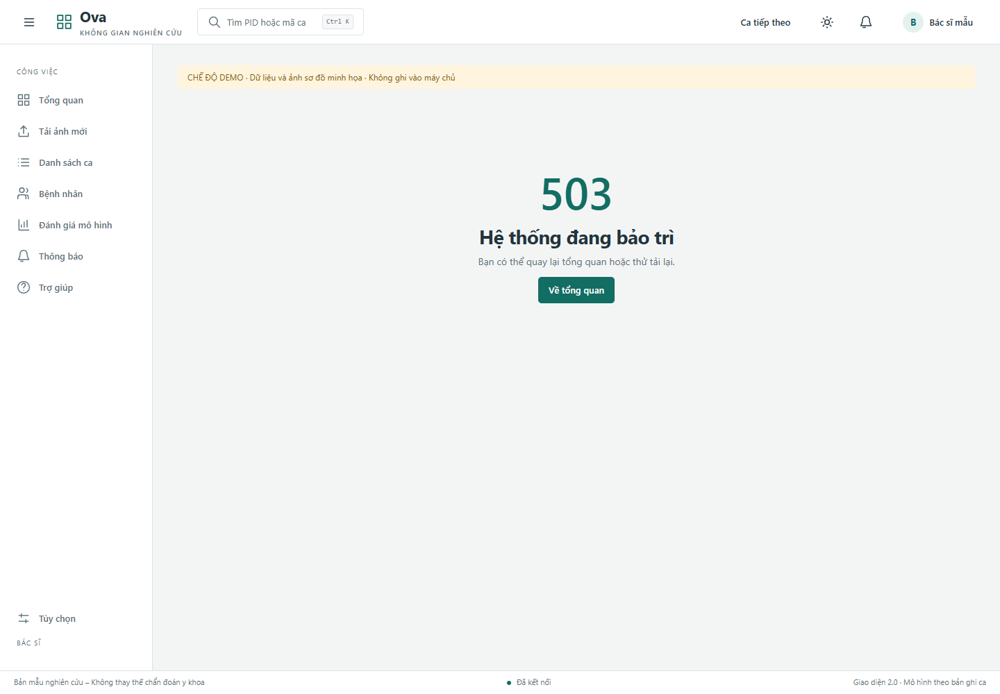

*Hình 3.38: Màn thông báo bảo trì và khả năng thử lại*

Nguồn: ảnh chụp frontend [18].

Trên tablet, các màn Dashboard, Worklist và duyệt vẫn giữ nội dung thiết yếu, sử dụng vùng cuộn có chủ đích cho bảng thay vì ép chữ nhỏ. Workstation ưu tiên desktop cho thao tác biên chính xác; ảnh chụp tablet kiểm tra bố cục không thay thế thử nghiệm thao tác với bút trên thiết bị thật. Khả năng focus, nhãn icon và tương phản được thiết kế từ đầu, nhưng chưa có khảo sát screen reader toàn diện. Vì vậy kết quả trình bày là thiết kế và kiểm tra kỹ thuật giao diện, chưa phải chứng nhận đạt chuẩn truy cập toàn bộ.

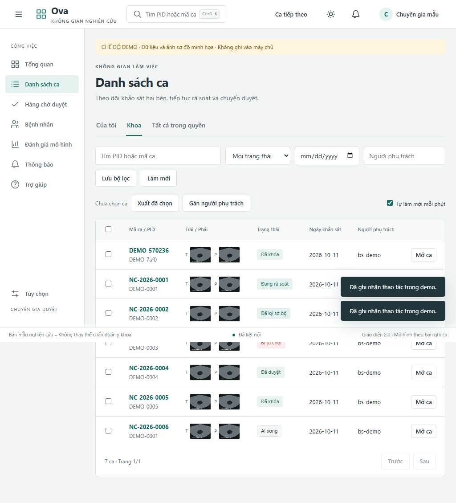

*Hình 3.39: Bố cục Worklist trên tablet*

Nguồn: ảnh chụp demo tại viewport tablet [18], [19].

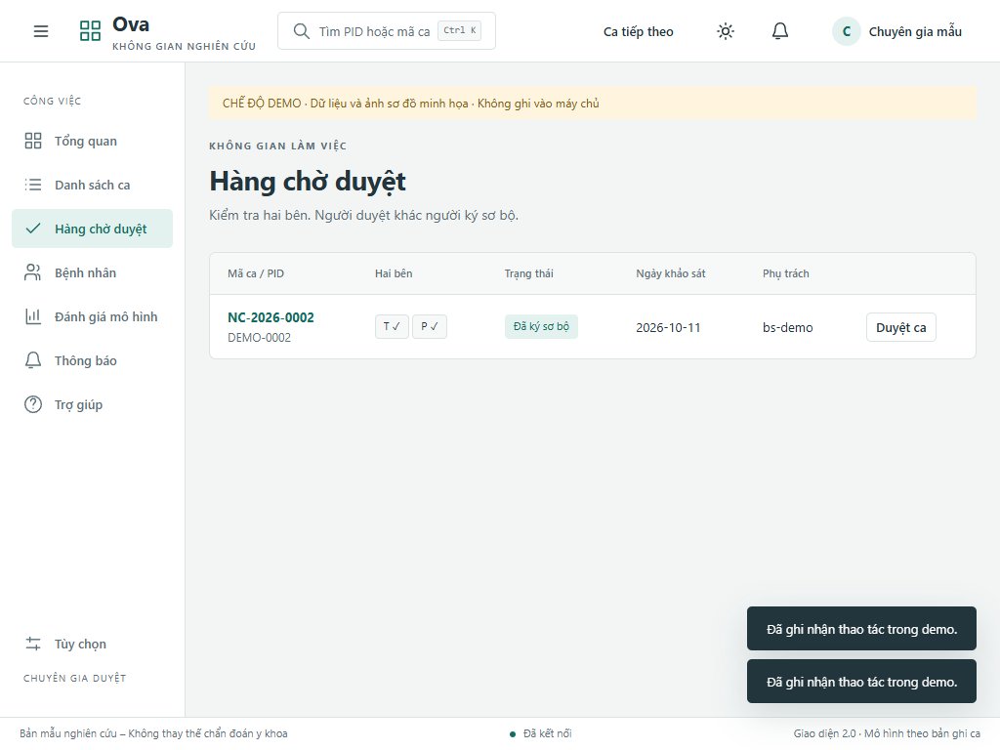

*Hình 3.40: Bố cục hàng chờ duyệt trên tablet*

Nguồn: ảnh chụp demo tại viewport tablet [18], [19].

Thiết kế ngoại lệ bao gồm mất mạng khi đang sửa, draft lệch phiên bản, hai tab mở một ca và đóng tab khi chưa lưu. Bản nháp cục bộ có metadata phiên bản để không ghi đè bản server mới hơn. Khi xung đột, giao diện cho tải bản nháp cũ hoặc giữ bản máy chủ; chưa có thuật toán merge nhiều thiết bị. Lease local chỉ bảo vệ giữa tab cùng trình duyệt, không thay thế lease server. Các trường hợp này được nêu cùng giao diện để người đánh giá hiểu hiệu ứng mỗi nút, đồng thời xác định việc còn cần triển khai trên server.
