## 3.5. Thiết kế giải thuật và xây dựng mô hình AI

Mô hình phân đoạn là thành phần tạo gợi ý hình học cho quy trình rà soát. Với ảnh đầu vào và mặt nạ tham chiếu được đặt trong cùng hệ tọa độ, mạng học một ánh xạ từ cường độ ảnh sang khả năng mỗi pixel thuộc vùng tiền cảnh. Đầu ra được chuyển thành mặt nạ nhị phân, hiển thị lên ảnh gốc, rồi cho phép người sử dụng sửa hoặc từ chối. Khác với bài toán phân loại, hệ thống phải giữ được vị trí đường biên để các công cụ cọ vẽ, tẩy, đo và lưu phiên bản hoạt động nhất quán. Độ chồng khớp với mặt nạ tham chiếu là chỉ tiêu kỹ thuật của mô hình; quyền xác nhận nội dung chuyên môn vẫn thuộc người rà soát.

Phần này trình bày giải thuật theo đúng các tệp đã triển khai, từ tổ chức dữ liệu đến suy luận. Đề cương cung cấp mục tiêu nghiên cứu, trong khi manifest, mã huấn luyện và hồ sơ đánh giá cung cấp bằng chứng về thí nghiệm đã thực hiện. Khi hai loại hồ sơ khác nhau, báo cáo ghi rõ phiên bản và giới hạn thay vì ghép thành một kết quả duy nhất. Cách trình bày này bảo đảm người đọc có thể phân biệt một phương án đã đề xuất, một kết quả đã lưu và một chức năng đang hoạt động trong bản mẫu. [12], [15]–[18]

Trạng thái bằng chứng được hiểu theo phạm vi kiểm tra: cấu hình, số record và metric đọc trực tiếp từ mã hoặc tệp kết quả được ghi nhận [VERIFIED] ở cấp hồ sơ kỹ thuật; nguồn bệnh nhân, phê duyệt chuyên gia, giấy phép và khả năng khái quát hóa lâm sàng vẫn là [PARTIALLY VERIFIED] hoặc chưa có bằng chứng. Nhãn xác minh không mở rộng từ việc tệp tồn tại sang giá trị chuyên môn của tệp.

### 3.5.1. Tổ chức dữ liệu và kiểm soát rò rỉ

Đề cương sơ bộ nêu kho tiếp nhận 1.387 ảnh, trong đó 417 ảnh có mask ban đầu; 307 ảnh thuộc 185 bệnh nhân được dự kiến làm trọng tâm thực nghiệm. Phương án chia tập là khoảng 70% bệnh nhân cho Train, 15% cho Validation và 15% cho Test, tương ứng khoảng 215, 46 và 46 ảnh. Các con số này thuộc hồ sơ dự kiến của giai đoạn đầu. Kho dữ liệu và manifest sử dụng trong những lượt chạy tháng 10 có quy mô khác, nên không thể viết rằng toàn bộ kết quả bên dưới được tính trên đúng 307 ảnh ấy. Hồ sơ hiện có cũng chưa cung cấp khóa nối đầy đủ giữa danh sách trong đề cương và từng ảnh của phiên bản thí nghiệm. [12], [15]

Manifest `unified_vinmec_clean_2026-10-06` ghi 1.639 ảnh duy nhất trước loại trừ, 35 ảnh bị loại do liên kết nguồn dùng phương án dự phòng, còn 1.604 cặp ảnh–mask trong split. Train có 661 ảnh, Validation có 541 ảnh và Test có 402 ảnh. Chính sách khử trùng sử dụng SHA-256 của byte ảnh: mỗi nội dung ảnh duy nhất có một bản ghi chuẩn, và các mặt nạ liên quan phải thống nhất sau nhị phân hóa. Manifest ghi không có bất đồng target sau kiểm tra. Đây là bằng chứng về nhất quán tệp, không phải chứng nhận nhãn đúng theo đánh giá chuyên gia. [15]

*Bảng 3.50: Đối chiếu dữ liệu dự kiến và dữ liệu thực nghiệm*

| Nội dung | Đề cương sơ bộ | Manifest tháng 10 | Cách sử dụng trong báo cáo |
|---|---|---|---|
| Kho tiếp nhận | 1.387 ảnh | 1.639 ảnh duy nhất trước loại trừ | Hai mốc dữ liệu, chưa coi là cùng danh sách |
| Tập trọng tâm | 307 ảnh, 185 bệnh nhân được nêu | 1.604 cặp ảnh–mask | Metric báo theo phiên bản 1.604 cặp |
| Train | Khoảng 215 ảnh, 130 bệnh nhân dự kiến | 661 ảnh | Tối ưu trọng số và augmentation |
| Validation | Khoảng 46 ảnh, 27 bệnh nhân dự kiến | 541 ảnh | Chọn checkpoint và so cấu hình |
| Test | Khoảng 46 ảnh, 28 bệnh nhân dự kiến | 402 ảnh | Hồ sơ Test lịch sử Standard U-Net |
| Loại trừ ngoài split | Nhãn chờ duyệt tách riêng theo kế hoạch | 35 cặp theo quy tắc liên kết nguồn | Không gọi là 35 ca âm tính |
| Bảo đảm cấp bệnh nhân | Yêu cầu thiết kế | Nguồn Patient/Case ID chưa xác minh | Chưa công bố patient-level split đã chứng minh |

Khử trùng byte-level ngăn một tệp giống hệt xuất hiện ở nhiều tập, nhưng không giải quyết toàn bộ rò rỉ. Hai ảnh chụp từ cùng lần khám có thể khác byte, khác khung và khác tên tệp mà vẫn chia sẻ đặc điểm người bệnh. Tương tự, một bản sao đã đổi kích thước hoặc mức nén có SHA-256 khác. Vì vậy, chính sách mục tiêu là nhóm tất cả ảnh của cùng bệnh nhân vào một split. Manifest hiện tại tự ghi giới hạn: chưa có mã bệnh nhân hoặc mã ca nguồn được kiểm chứng; chỉ bảo đảm tách nội dung ảnh theo hash. Báo cáo giữ nguyên giới hạn này khi diễn giải Dice và khi đề xuất bước đánh giá tiếp theo. [15]

Hồ sơ đối chiếu bổ sung ngày 08/10/2026 ghi workbook có 1.639 dòng ảnh, 820 chuỗi mã Patient và 1.234 chuỗi mã Case khác nhau. Toàn bộ 1.604 ảnh trong split nối được với workbook theo nhóm nguồn và tên ảnh, đồng thời khớp SHA-256 ảnh. Giao chuỗi mã Patient, Case và SHA-256 giữa từng cặp Train, Validation, Test bằng 0 trên phiên bản workbook được kiểm. Đây là bằng chứng về phép đối chiếu tệp và chuỗi mã; chưa xác nhận mã giữ ổn định cho cùng người bệnh ở mọi ảnh. Vì còn thiếu hồ sơ bàn giao và quy tắc cấp mã từ nguồn, báo cáo chưa kết luận độc lập cấp bệnh nhân thực. Số chuỗi mã không được đổi thành số người bệnh đã xác minh [15].

Hậu kiểm của dự án từng ghi 59 cặp gần trùng xuyên split theo hash cảm nhận, trong đó 22 cặp có tương quan sau resize từ 0,95. Cả 59 cặp có chuỗi mã Patient và Case khác nhau trong workbook, nhưng điều đó chưa chứng minh chúng thuộc những người bệnh khác nhau. Các ứng viên này là danh sách cần đối chiếu nguồn, không tự động là chứng cứ cùng bệnh nhân. Để xử lý đúng, cần giữ cặp ảnh, mã nguồn, phiên bản xử lý và kết quả rà soát; nếu xác nhận trùng người giữa các tập, phải xây dựng split mới rồi huấn luyện và đánh giá lại. Tự chuyển vài ảnh sau khi đã xem kết quả Test sẽ làm thay đổi protocol đánh giá và khiến số liệu cũ không còn đại diện cho split mới.

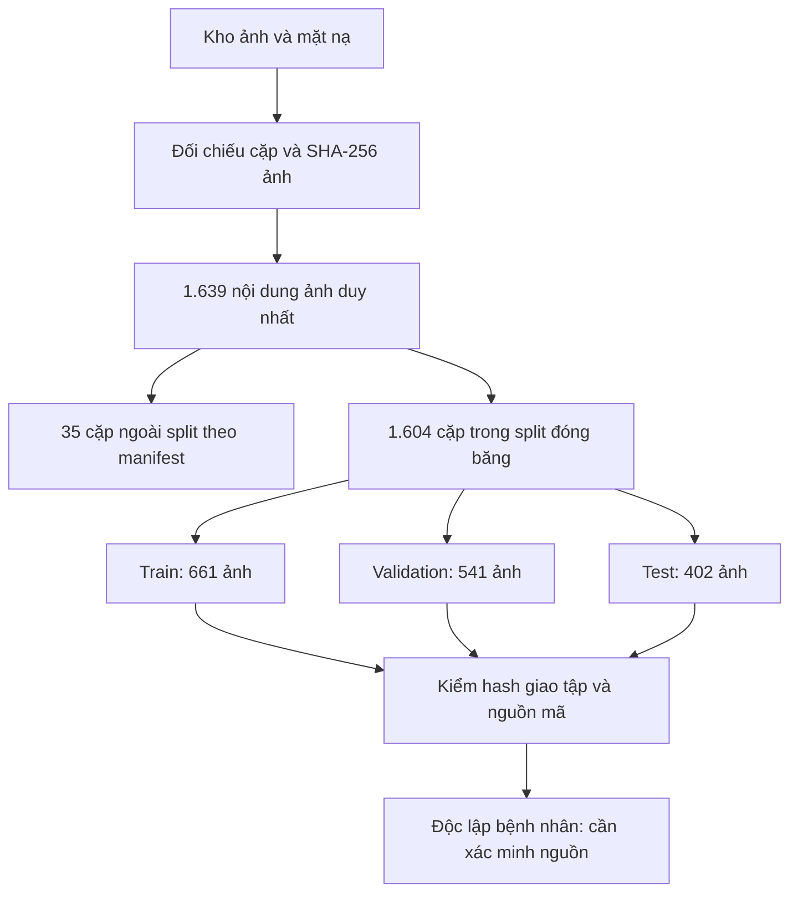

*Hình 3.50: Tổ chức phiên bản dữ liệu và giới hạn kiểm soát rò rỉ*

Nguồn: tác giả mô hình hóa từ manifest [15]. Số ảnh là đơn vị cặp tệp; chưa chuyển thành số bệnh nhân độc lập.

Các nhóm thư mục có tên Vinmec, 2D hoặc 3D được dùng để giải đường dẫn và truy vết thành viên nguồn. Tên thư mục không đủ chứng minh địa điểm thu ảnh, giấy phép hay phương thức chụp. Loader xử lý từng file ảnh hai chiều, kể cả khi đường dẫn chứa `3d`; do đó báo cáo không mô tả một mạng U-Net ba chiều hoặc dữ liệu thể tích. Việc đối chiếu với bộ MMOTU trong nghiên cứu liên quan cần dựa vào tài liệu nguồn và hash, không suy ra danh tính dataset chỉ từ sự giống nhau về số lượng. Đây là ranh giới giữa mô tả dữ liệu cục bộ và tuyên bố nguồn học thuật. [3], [15]

### 3.5.2. Chuẩn hóa ảnh và mặt nạ về không gian mô hình

Lớp `OvarianUltrasoundDataset` đọc ảnh thang xám và mask từ CSV. Trình đọc dùng byte tệp cùng `cv2.imdecode` để hỗ trợ đường dẫn có Unicode trên Windows. Nếu ảnh hoặc mask không giải mã được, loader phát sinh lỗi có đường dẫn liên quan, không âm thầm thay bằng mẫu rỗng. Mặt nạ được nhị phân hóa theo điều kiện giá trị lớn hơn 0. Cách này thống nhất tệp lưu theo 0/255 với target 0/1 mà hàm mất mát cần, nhưng cũng yêu cầu nhãn nguồn thật sự có ý nghĩa nhị phân; không được gộp các lớp khác nhau rồi diễn giải là đã học phân loại bệnh học. [17]

Kích thước ảnh được chuẩn hóa bằng letterbox 512×512. Với chiều rộng nguồn W và chiều cao H, tỷ lệ lý tưởng là s = min(512/W, 512/H). Mã nguồn tính chiều mới bằng phần nguyên của sW và sH, đặt ảnh co giãn vào giữa canvas rồi đệm phần còn lại. Ảnh dùng nội suy song tuyến tính, mask dùng lân cận gần nhất để tránh tạo nhãn trung gian. Cặp ảnh–mask phải nhận cùng phép hình học; nếu chỉ resize ảnh rồi giữ nguyên mask, loss sẽ học một sự lệch vị trí do xử lý dữ liệu thay vì đường biên cần tìm.

Letterbox bảo toàn tỷ lệ toàn cục tốt hơn kéo riêng hai chiều vào hình vuông. Tuy nhiên, phép làm tròn kích thước khiến tỷ lệ thực theo trục x và y có thể khác tỷ lệ lý tưởng một lượng nhỏ. Khi ánh xạ ngược, mã đo ở không gian nguồn tính lại các hệ số từ kích thước thực đã làm tròn, thay vì mặc định dùng s ở mọi chỗ. Phần đệm không đại diện cho mô giải phẫu; các hình minh họa phải thể hiện đủ phép biến đổi để người đọc biết vùng nào là ảnh nguồn, vùng nào là canvas bổ sung.

Ảnh sau letterbox được tăng tương phản cục bộ bằng CLAHE, với `clipLimit=2.0` và lưới 8×8 theo cấu hình mặc định của bộ tiền xử lý. Sau đó cường độ được chia 255 để đưa về [0,1]. Với hai cấu hình so sánh đồng chuẩn hóa, tensor còn được biến đổi bằng mean 0,449 và standard deviation 0,226. Vì vậy, đầu vào thực của mạng không còn bị giới hạn trong [0,1]. Chuỗi chuẩn hóa này là một phần của checkpoint; nạp đúng trọng số nhưng áp sai mean/std vẫn làm thay đổi phân bố đầu vào và kết quả suy luận. [16], [17]

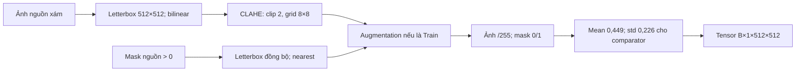

*Hình 3.51: Chuỗi xử lý cặp ảnh–mask của các lượt chạy so sánh*

Nguồn: tác giả tổng hợp từ `dataset_loader.py` và hai script huấn luyện [16], [17]. Validation không áp augmentation.

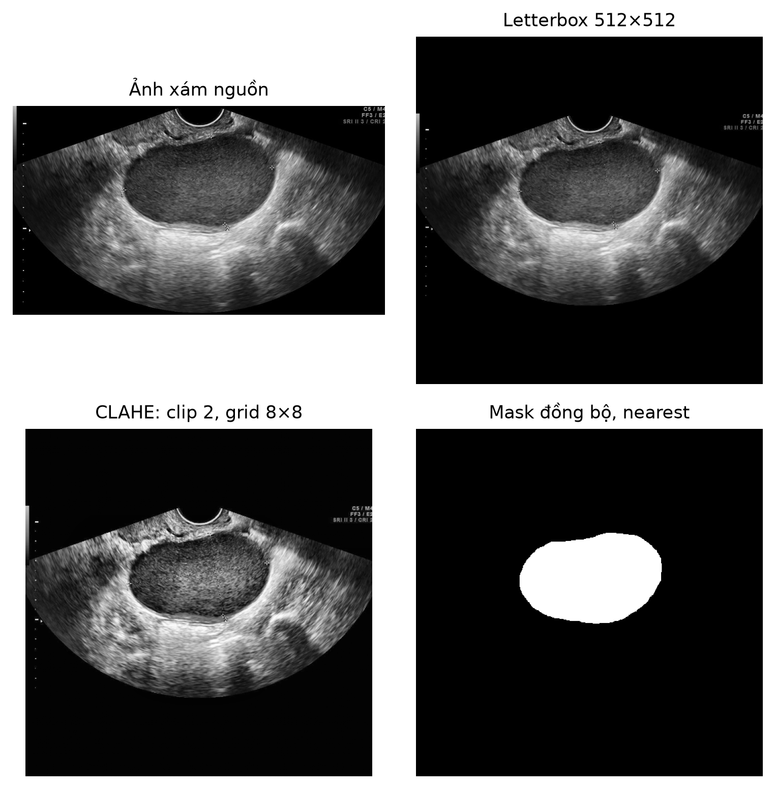

*Hình 3.52: Minh họa letterbox và CLAHE từ ảnh nguồn thực tế*

Nguồn: `dataset/2d/images/159.JPG`, xử lý bằng mã dự án. Hình mô tả tiền xử lý, không phải bằng chứng chẩn đoán; đã kiểm tra trực quan không thấy tên, ngày sinh hoặc PID trong các pixel được trình bày.

Đề cương từng đề xuất cắt vùng quạt quét tự động trước chuẩn hóa. Trong phiên bản loader dùng cho các run ở đây, hàm crop không được gọi: toàn ảnh được letterbox và áp CLAHE. Bộ tiền xử lý có hàm median và hàm xác định vùng quét, nhưng chuỗi suy luận hiện tại cũng áp CLAHE trực tiếp để khớp loader, không thêm median. Sự tồn tại của một hàm trong repository không chứng minh nó tham gia thí nghiệm. Báo cáo vì vậy không gán mức cải thiện kết quả cho ROI crop hoặc lọc speckle nếu những bước ấy chưa có lượt đối chứng riêng. [12], [17]

Augmentation chỉ xuất hiện sau chia tập và chỉ ở Train. Mã sử dụng lật ngang với xác suất 0,5; thay đổi sáng và tương phản trong biên ±0,1 với xác suất 0,4; dịch chuyển đến 5%, thay đổi tỷ lệ đến 5% và quay đến 10 độ với xác suất 0,4. Các phép hình học được đồng bộ cho ảnh và mask, còn biến đổi cường độ chỉ tác động ảnh. Những giới hạn này mô tả cấu hình đã dùng, chưa phải chứng minh chúng là tối ưu hay được chuyên gia xác nhận cho mọi loại hình siêu âm.

### 3.5.3. Kiến trúc Standard U-Net và cấu hình U-Net++

Standard U-Net trong dự án có một kênh vào và một kênh logits ra. Bốn mức encoder sử dụng số kênh 32, 64, 128 và 256; tầng cầu nối có 512 kênh. Mỗi `ConvBlock` gồm hai chuỗi Conv2d 3×3, BatchNorm2d và ReLU; padding 1 giữ kích thước không gian trong khối. MaxPool2d 2×2 giảm kích thước giữa các mức. Với ảnh 512×512, bản đồ đặc trưng lần lượt có cạnh 512, 256, 128, 64 và 32. Đây là biến thể triển khai của U-Net, không phải sao chép nguyên cấu hình số kênh của bài báo gốc. [1], [17]

Decoder dùng ConvTranspose2d 2×2 để tăng kích thước, nối đặc trưng từ encoder cùng mức rồi áp ConvBlock. Phép nối theo chiều kênh giữ thông tin định vị mà đường co giảm có thể làm mất. Tầng cuối là tích chập 1×1 tạo một giá trị logits cho mỗi pixel. Mạng không áp sigmoid ngay trong `forward`; hàm mất mát nhận logits, còn bước đánh giá và suy luận mới dùng sigmoid. Cách tách này giúp BCEWithLogitsLoss thực hiện tính toán ổn định số học và tránh áp sigmoid hai lần.

*Bảng 3.51: Kích thước đặc trưng Standard U-Net khi đầu vào 512×512*

| Giai đoạn | Phép chính | Kênh ra | Kích thước không gian | Vai trò |
|---|---|---:|---|---|
| Encoder 1 | Hai Conv 3×3 + BN + ReLU | 32 | 512×512 | Chi tiết cục bộ, skip mức 1 |
| Encoder 2 | Pool 2×2 và ConvBlock | 64 | 256×256 | Skip mức 2 |
| Encoder 3 | Pool 2×2 và ConvBlock | 128 | 128×128 | Skip mức 3 |
| Encoder 4 | Pool 2×2 và ConvBlock | 256 | 64×64 | Skip mức 4 |
| Bottleneck | Pool 2×2 và ConvBlock | 512 | 32×32 | Biểu diễn ở mức co giảm sâu nhất |
| Decoder 4 | Up 2×2, nối skip, ConvBlock | 256 | 64×64 | Khôi phục không gian mức 4 |
| Decoder 3 | Up 2×2, nối skip, ConvBlock | 128 | 128×128 | Khôi phục không gian mức 3 |
| Decoder 2 | Up 2×2, nối skip, ConvBlock | 64 | 256×256 | Khôi phục không gian mức 2 |
| Decoder 1 | Up 2×2, nối skip, ConvBlock | 32 | 512×512 | Khôi phục mức đầy đủ |
| Đầu ra | Conv 1×1 | 1 | 512×512 | Logits tiền cảnh từng pixel |

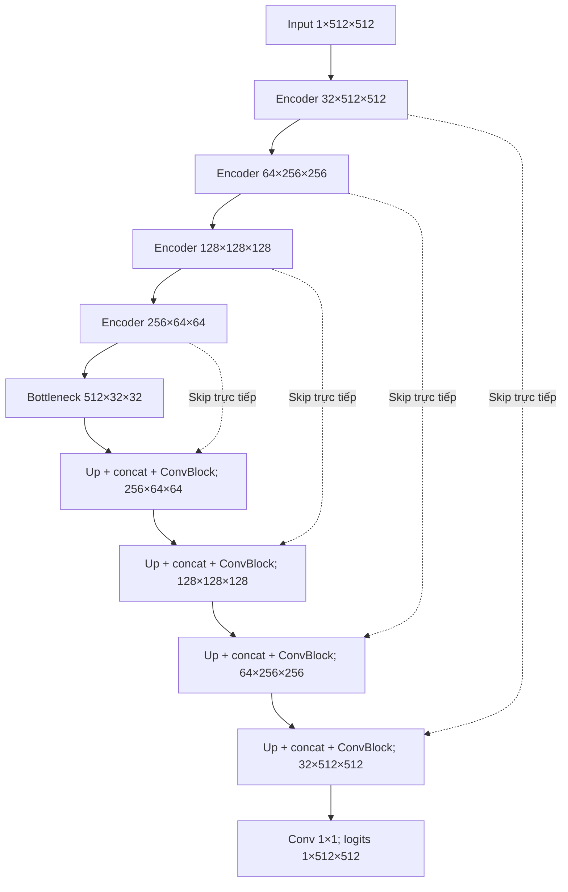

*Hình 3.53: Kiến trúc Standard U-Net đúng theo module mô hình của dự án*

Nguồn: tác giả mô hình hóa từ `backend/models/unet.py` và `ConvBlock` [17]. Kích thước không bao gồm chiều batch.

Cấu hình cải tiến được huấn luyện là `smp.UnetPlusPlus` với encoder ResNet34, trọng số khởi tạo ImageNet, một kênh vào, một lớp ra và `activation=None`. U-Net++ sử dụng các đường skip dạng lồng để tích hợp đặc trưng ở các mức biểu diễn khác nhau. Trong báo cáo, sơ đồ nguyên lý skip lồng chỉ dùng giải thích kiến trúc; bảng kết quả phải gắn với cấu hình thư viện và encoder đã ghi trong run config. Lượt chạy dùng Segmentation Models PyTorch phiên bản 0.5.0. Khi triển khai lại, cấu hình encoder và cấu trúc state_dict phải khớp, thay vì nạp checkpoint vào một Standard U-Net có tên tệp tương tự. [2], [16]

Repository còn có Attention U-Net và module attention gate. Standard U-Net dùng lại lớp ConvBlock từ tệp đó nhưng không gọi attention gate trong `forward`. Vì vậy, tên module được import không làm Standard U-Net thành Attention U-Net; đồng thời không thể gọi cấu hình U-Net++/ResNet34 là Attention U-Net. Việc phân biệt này cần thiết khi đối chiếu sơ đồ, số tham số, checkpoint và phần bàn luận. Trong phạm vi hai run kiểm soát được trình bày, mô hình là Standard U-Net và U-Net++/ResNet34.

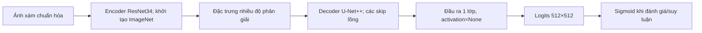

*Hình 3.54: Cấu hình U-Net++/ResNet34 được huấn luyện trong dự án*

Nguồn: mã `train_unetplusplus_resnet34.py` [16]. Đây là sơ đồ cấu hình, không minh họa attention gate hoặc mạng ba chiều.

Hai cấu hình cùng dữ liệu và lịch huấn luyện nhưng khác cả decoder lẫn cách khởi tạo encoder: Standard bắt đầu ngẫu nhiên, U-Net++ nhận trọng số ImageNet. Do đó phép so sánh trả lời cấu hình nào có kết quả Validation tốt hơn trong ngân sách đã dùng. Nó chưa tách riêng tác động của skip lồng. Muốn phát biểu lợi ích riêng của kiến trúc, cần thí nghiệm bổ sung có cách khởi tạo tương đương, nhiều seed và protocol được xác định trước. Kết quả hiện tại không được diễn giải thành một ablation chỉ thay một thành phần.

### 3.5.4. Hàm mất mát, cập nhật trọng số và chọn checkpoint

Hai script so sánh đều import `ComboLoss` từ `train_baseline_unet.py`, với trọng số 0,5 cho BCEWithLogitsLoss và 0,5 cho SoftDiceLoss. Công thức là L = 0,5L_BCE + 0,5L_Dice. BCE xét sự phù hợp pixel theo logits; Dice mềm xét mức chồng khớp tổng thể giữa xác suất và target. Trong lớp SoftDiceLoss thực tế, tử số là hai lần tổng tích xác suất–target cộng hệ số làm trơn 1,0; mẫu số là tổng xác suất và target cộng 1,0. Các tổng được lấy trên tensor batch, không phải trung bình Dice riêng từng ảnh. [16], [17]

Sự khác biệt giữa loss Dice trên batch và metric Dice theo ảnh cần được ghi rõ. Một batch có hai vùng tiền cảnh rất khác kích thước có thể đóng góp vào loss theo tổng pixel, trong khi metric macro cho hai ảnh trọng số bằng nhau. Hai đại lượng cùng có từ Dice nhưng không thay thế nhau. Ngoài ra, repository có lớp ComboLoss khác trong `backend/models/losses.py` chứa thêm Focal Loss. Lớp đó không được hai trainer này sử dụng; báo cáo vì vậy không mô tả thí nghiệm đang bàn như Dice–Focal–BCE hoặc suy ra loss từ tên file model.

AdamW được dùng với learning rate ban đầu 10⁻⁴ và weight decay 10⁻⁴. Scheduler CosineAnnealingLR giảm learning rate theo lịch cosine với `eta_min=10⁻⁶` và `T_max=30`. Batch size thực tế là 2 trong cả hai run config, dù giá trị mặc định của hàm huấn luyện U-Net++ là 1. Báo cáo dùng tham số đã chạy, không lấy default trong chữ ký hàm làm bằng chứng. Mỗi epoch thực hiện Train, sau đó Validation; scheduler được cập nhật sau hai pha. [16]

*Bảng 3.52: Cấu hình huấn luyện của hai lượt so sánh đồng chuẩn hóa*

| Tham số | Standard U-Net | U-Net++/ResNet34 |
|---|---|---|
| Khởi tạo | Ngẫu nhiên | Encoder ImageNet pretrained |
| Đầu vào | Xám, 512×512, CLAHE | Xám, 512×512, CLAHE |
| Mean/std | 0,449 / 0,226 | 0,449 / 0,226 |
| Loss | 0,5 BCEWithLogits + 0,5 SoftDice | 0,5 BCEWithLogits + 0,5 SoftDice |
| Optimizer | AdamW, weight decay 10⁻⁴ | AdamW, weight decay 10⁻⁴ |
| Learning rate | 10⁻⁴, minimum 10⁻⁶ | 10⁻⁴, minimum 10⁻⁶ |
| Scheduler | CosineAnnealingLR | CosineAnnealingLR |
| Batch size thực chạy | 2 | 2 |
| Seed | 42 | 42 |
| Epoch yêu cầu / hoàn tất | 30 / 30 | 30 / 30 |
| Patience | 6 epoch không cải thiện | 6 epoch không cải thiện |
| Best epoch | 28 | 30 |
| GPU theo hồ sơ | RTX 3050 Laptop GPU | RTX 3050 Laptop GPU |
| Thời gian ghi nhận | 1.800,52 giây | 3.014,39 giây |
| Test trong trainer | Không truy cập | Không truy cập |

Nguồn: hai `run_config.json` của ngày 06/10/2026 [16]. Thời gian phụ thuộc máy và lượt chạy, không là cam kết hiệu năng.

Mã cố định seed cho Python, NumPy và PyTorch, đồng thời đặt cuDNN deterministic và tắt benchmark khi có CUDA. DataLoader Train dùng generator có seed và shuffle; Validation không shuffle. Autocast và GradScaler được kích hoạt trên CUDA để dùng mixed precision. Các biện pháp này hỗ trợ tái lập trong môi trường đã ghi, nhưng không đủ để bảo đảm bitwise identical giữa mọi phiên bản thư viện, driver và phần cứng. Vì vậy một hồ sơ tái lập cần lưu thêm môi trường, CSV, manifest, checkpoint và lịch sử metric. [7], [16]

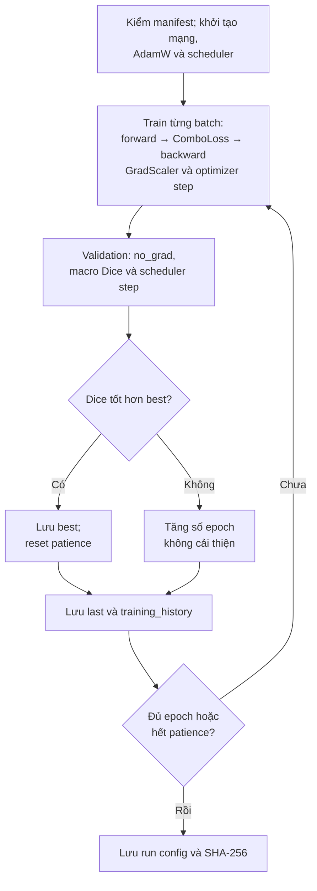

*Hình 3.55: Vòng huấn luyện và lựa chọn checkpoint trên Validation*

Nguồn: tác giả mô hình hóa mã trainer [16]. Test không nằm trong vòng tối ưu hay chọn best checkpoint.

Checkpoint tốt nhất được chọn bằng Dice trung bình theo ảnh của Validation tại ngưỡng 0,5. Script lưu `best` khi có cải thiện, đồng thời lưu `last` sau mỗi epoch. Hai file phục vụ mục đích khác nhau: last cho biết trạng thái cuối, best cho biết cấu hình được chọn theo tiêu chí Validation. Với Standard đồng chuẩn hóa, best ở epoch 28; với U-Net++, best ở epoch 30. Trong run này early stopping không làm dừng trước ngân sách 30 epoch. Lịch sử Train/Validation vẫn được giữ đầy đủ để phân tích diễn biến, thay vì chỉ công bố một con số cực đại.

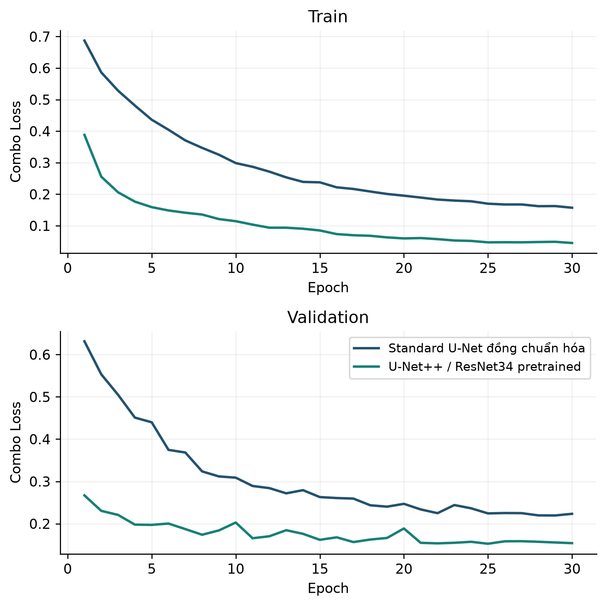

*Hình 3.56: Loss theo epoch của hai lượt so sánh đồng chuẩn hóa*

Nguồn: `training_history.json` của Standard đồng chuẩn hóa và U-Net++/ResNet34 [16]. Hình được vẽ lại từ 30 record mỗi run; không tạo thêm điểm dữ liệu.

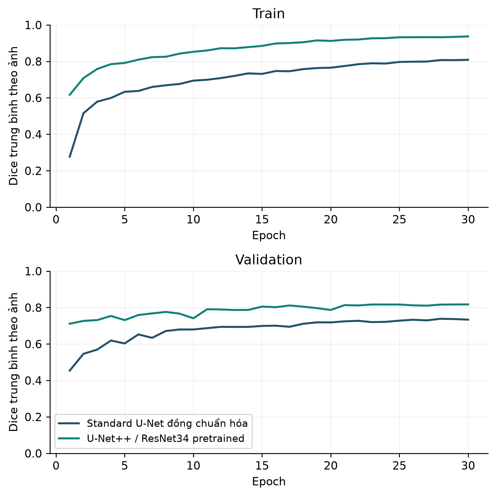

*Hình 3.57: Dice theo epoch và khoảng cách giữa Train với Validation*

Nguồn: lịch sử hai run [16]. Train có augmentation và được đánh giá trong quá trình huấn luyện; Validation ở chế độ đánh giá, nên khoảng cách không được coi là phép đo thuần túy của một nguyên nhân duy nhất.

### 3.5.5. Chỉ số đánh giá và quy ước trường hợp rỗng

Sau sigmoid, prediction nhị phân được lấy tại ngưỡng 0,5. TP là pixel cả prediction và mask tham chiếu đều thuộc tiền cảnh; FP là pixel chỉ prediction thuộc tiền cảnh; FN là pixel tham chiếu thuộc tiền cảnh nhưng prediction bỏ sót; TN là pixel cả hai thuộc nền. Dice bằng 2TP/(2TP+FP+FN), IoU bằng TP/(TP+FP+FN), Recall bằng TP/(TP+FN), Precision bằng TP/(TP+FP), Specificity bằng TN/(TN+FP). Đây là ma trận nhầm lẫn ở cấp pixel, không phải ma trận chẩn đoán bệnh nhân. Một FN của phân đoạn chỉ là khác biệt với mask tham chiếu ở vị trí ấy. [16], [17]

Metric được tính cho từng ảnh rồi trung bình macro. Cách này cho ảnh có vùng tiền cảnh nhỏ cùng trọng số với ảnh có vùng lớn. Nếu cộng toàn bộ TP, FP và FN trước rồi chia, kết quả là micro và có thể khác đáng kể. Vì vậy tên cột phải nêu cách tổng hợp; người đọc không nên so hai số Dice của hai công trình nếu một số macro và số kia micro mà không có giải thích. Trong hồ sơ thí nghiệm hiện tại, tiêu chí chọn best là macro Dice trên 541 ảnh Validation.

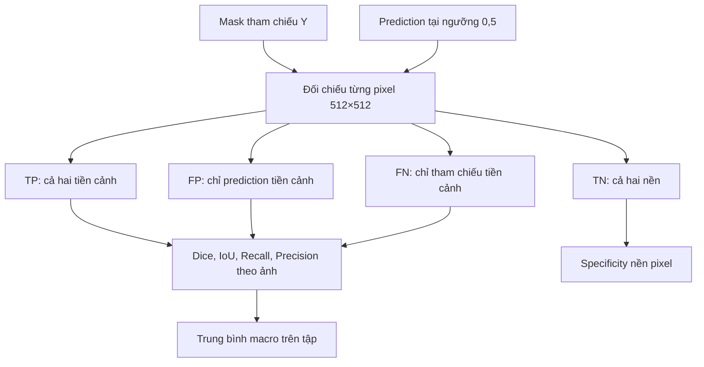

*Hình 3.58: Luồng tính các chỉ số phân đoạn ở cấp pixel và cấp tập ảnh*

Nguồn: mã `batch_metrics` của hai trainer [16]. Những chỉ số này không xác định lành tính, ác tính hoặc giá trị chẩn đoán.

Trong hai script comparator, mẫu số Dice hoặc IoU bằng 0 được quy ước score 1,0; Recall có tham chiếu rỗng cũng được quy ước 1,0; Precision có prediction rỗng được quy ước 1,0. Quy ước cuối cần được công bố vì prediction rỗng trước một tham chiếu không rỗng có thể nhận Precision 1 dù Recall và Dice bằng 0. Nó là chi tiết phép tính log, không có nghĩa mô hình chính xác trong tình huống đó. Hàm metric ở một trainer lịch sử khác có quy tắc Precision rỗng khác, nên không gộp log giữa các phiên bản mà bỏ qua định nghĩa.

Tập Test được lưu trong hồ sơ này có 402 mask tham chiếu đều chứa tiền cảnh. `empty_mask_specificity` trong summary không có giá trị đo vì số ca rỗng bằng 0. Specificity 0,983647 đo khả năng tránh FP trên nền pixel của những ảnh ấy; không được diễn giải là tỷ lệ nhận diện đúng ca không tổn thương. Muốn kiểm tra chức năng cho phép lưu mask rỗng và đánh giá âm tính giả ở cấp ca, cần một tập tham chiếu rỗng được xác nhận riêng, ngoài các test phần mềm kiểm hợp đồng mask rỗng. [16], [19]

### 3.5.6. Kết quả Validation và hồ sơ Test lịch sử

Hai run đồng chuẩn hóa dùng cùng Train/Validation CSV, cùng CLAHE, cùng mean/std, cùng augmentation, batch size, seed và ngân sách epoch. Hồ sơ so sánh ghi đã kiểm nạp lại checkpoint strict. SHA-256 best Standard bắt đầu `1269a7d3`, còn best U-Net++ bắt đầu `ce758032`. Tại best epoch, Standard đạt Validation Dice 0,738296 và U-Net++ đạt 0,817036. Hiệu số tuyệt đối là 0,078740, tương đương khoảng 7,874 điểm phần trăm trên thang phần trăm của score. Không diễn giải hiệu số này là tỷ lệ ca chẩn đoán được cải thiện. [16]

*Bảng 3.53: So sánh hai cấu hình trên cùng 541 ảnh Validation*

| Chỉ số | Standard đồng chuẩn hóa | U-Net++/ResNet34 | Hiệu số U-Net++ trừ Standard |
|---|---:|---:|---:|
| Loss | 0,219616 | 0,153952 | −0,065664 |
| Dice macro | 0,738296 | 0,817036 | 0,078740 |
| IoU macro | 0,626416 | 0,732287 | 0,105871 |
| Recall macro | 0,815941 | 0,834509 | 0,018568 |
| Precision macro theo quy ước run | 0,744424 | 0,854472 | 0,110048 |
| Specificity nền pixel | 0,973879 | 0,985123 | 0,011245 |
| Dice Train tại best epoch | 0,807145 | 0,937059 | 0,129914 |
| Khoảng cách Dice Train–Validation | 0,068849 | 0,120023 | 0,051174 |

Nguồn: `model_comparison_validation.json` [16]. Bảng là so sánh cấu hình, không là ablation chỉ thay kiến trúc.

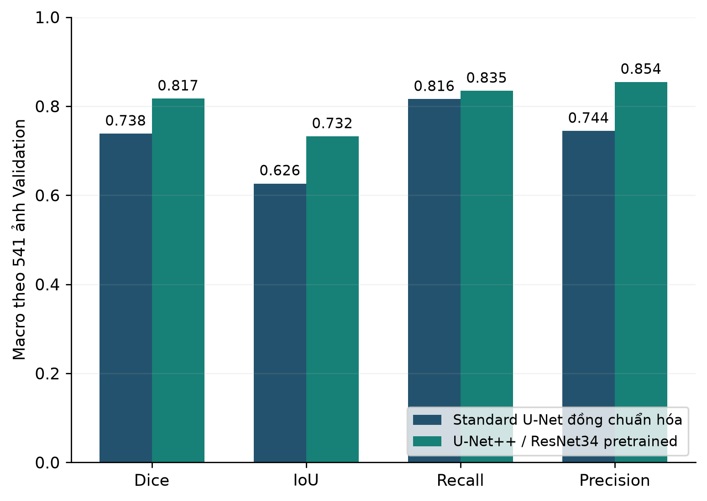

*Hình 3.59: Dice, IoU, Recall và Precision tại best checkpoint của hai cấu hình*

Nguồn: hồ sơ so sánh Validation [16]. Cùng 541 ảnh và ngưỡng 0,5; Precision sử dụng quy ước rỗng đã nêu.

Khoảng cách Train–Validation ở U-Net++ lớn hơn Standard comparator. Nó cho thấy score trên hai pha không đồng đều và nhắc cần kiểm tra tổng quát hóa, nhưng không xác định nguyên nhân chỉ bằng một đường cong. Train có augmentation và model ở chế độ train, còn Validation không augmentation và model ở chế độ eval. Hơn nữa, khởi tạo pretrained khác ngẫu nhiên và chỉ có một seed. Vì vậy, kết luận phù hợp là U-Net++ có Validation Dice cao hơn trong hai run đã ghi, đồng thời cần đánh giá độc lập trước khi nâng cấu hình thành mô hình mặc định.

Hồ sơ Test khác sử dụng Standard U-Net lịch sử, checkpoint SHA-256 `417828fa74349d0f7909434f9ad1ad7cb3258b64d41d3d756e2e80569744697d`, được chọn ở epoch 20 bằng Validation Dice 0,672438. Checkpoint này khác Standard đồng chuẩn hóa trong bảng trên. Trên 402 ảnh Test, Dice trung bình là 0,729749 với độ lệch chuẩn 0,230365; IoU là 0,618615 với độ lệch chuẩn 0,247552. Precision trung bình là 0,812902 và Recall trung bình là 0,731142. Các số này gắn đúng checkpoint lịch sử, không chuyển sang checkpoint `1269a7d3` hoặc U-Net++ chỉ vì đều nằm trong repository. [16]

*Bảng 3.54: Kết quả Test lịch sử của Standard U-Net tích hợp*

| Nội dung | Giá trị đã ghi | Phạm vi diễn giải |
|---|---|---|
| Số ảnh | 402 | Ảnh, chưa xác nhận 402 bệnh nhân |
| Ngưỡng | 0,5 | Khóa theo cấu hình của checkpoint |
| Test loss | 0,219987 | Loss của lượt đánh giá lịch sử |
| Dice trung bình ± độ lệch chuẩn | 0,729749 ± 0,230365 | Chồng khớp mask theo ảnh |
| IoU trung bình ± độ lệch chuẩn | 0,618615 ± 0,247552 | Chồng khớp mask theo ảnh |
| Recall trung bình | 0,731142 | Pixel tiền cảnh tham chiếu |
| Precision trung bình | 0,812902 | Pixel tiền cảnh dự đoán |
| Specificity | 0,983647 | Nền pixel, không là specificity cấp bệnh nhân |
| Số mask tham chiếu rỗng | 0 | Không đo hiệu năng ca tham chiếu rỗng |
| Test cho U-Net++ candidate | Chưa thực hiện trong hồ sơ so sánh | Không đưa số thay thế |

Test này đã từng được mở cho checkpoint Standard trước giai đoạn refine; summary tự ghi rõ lịch sử tái sử dụng. Vì vậy không gọi đây là một cohort mới hoàn toàn hoặc thử nghiệm mù đầu tiên. Hai trainer so sánh đồng chuẩn hóa không truy cập Test, và hồ sơ so sánh candidate ghi `candidate_deployed=false`, chưa đổi lựa chọn mặc định. Thí nghiệm tích hợp candidate trong môi trường cô lập không đồng nghĩa đã triển khai bệnh viện hay đã có bằng chứng thắng trên Test. Những mốc này phải được giữ tách biệt trong cả bảng và phần kết luận.

### 3.5.7. Phân tích sai số và kết quả trực quan

Giá trị trung bình che khuất phân bố lỗi. Tính lại thống kê mô tả từ CSV Test lịch sử cho trung vị Dice 0,805712, phân vị 25% là 0,630706 và phân vị 75% là 0,901048. Có 61 ảnh ở mức Dice không quá 0,5; 100 ảnh trên 0,5 đến 0,75; 139 ảnh trên 0,75 đến 0,9; 102 ảnh trên 0,9. Các khoảng này được chọn để mô tả phân bố, không phải ngưỡng chấp nhận y khoa. Độ lệch chuẩn lớn và các ảnh score thấp cho thấy cần xem từng trường hợp trước khi khẳng định tính ổn định của model.

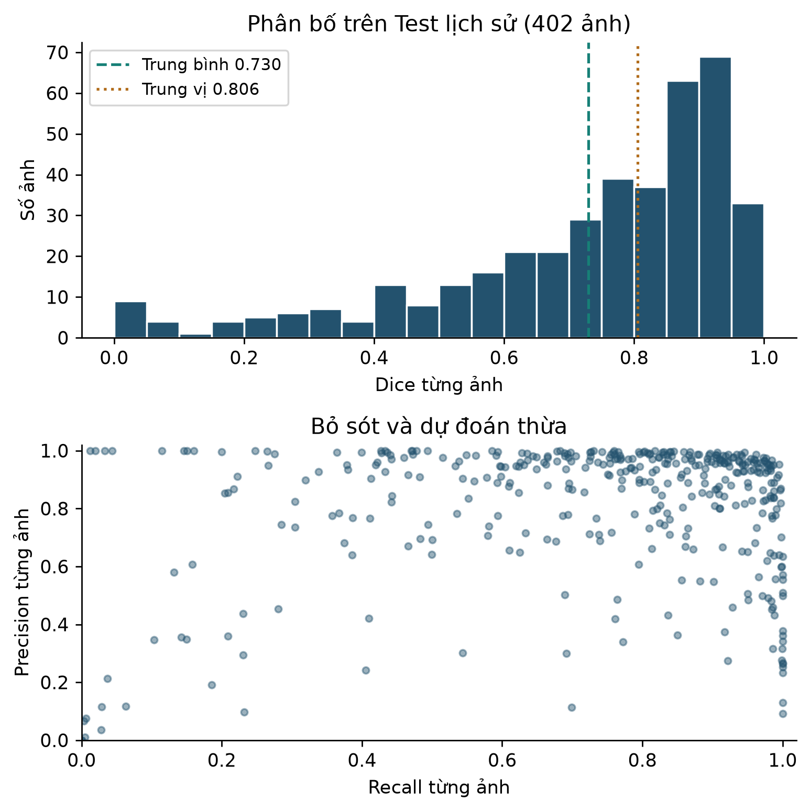

*Hình 3.60: Phân bố chất lượng từng ảnh của Standard U-Net trên Test lịch sử*

Nguồn: 402 dòng `test_per_image.csv` [16]. Hình được tính từ metric đã lưu; không chạy suy luận mới và không cung cấp khoảng tin cậy cấp bệnh nhân.

Ảnh `159.JPG` có Dice 0,975435, TP 21.681 pixel, FP 749 pixel và FN 343 pixel trong không gian 512×512. Ảnh `1295.JPG` có Dice 0, TP 0, FP 75 và FN 12.128. Hai ví dụ cùng checkpoint, cùng Test và cùng ngưỡng, được chọn để minh họa hai mức sai khác rất khác nhau. Chúng không đại diện ngẫu nhiên cho toàn bộ Test và cũng không chứng minh loại bệnh tương ứng. Báo cáo giữ ảnh gốc, mask tham chiếu, prediction và error overlay trong bố cục bốn ô để người đọc thấy trực tiếp vị trí chồng khớp hoặc bỏ sót.

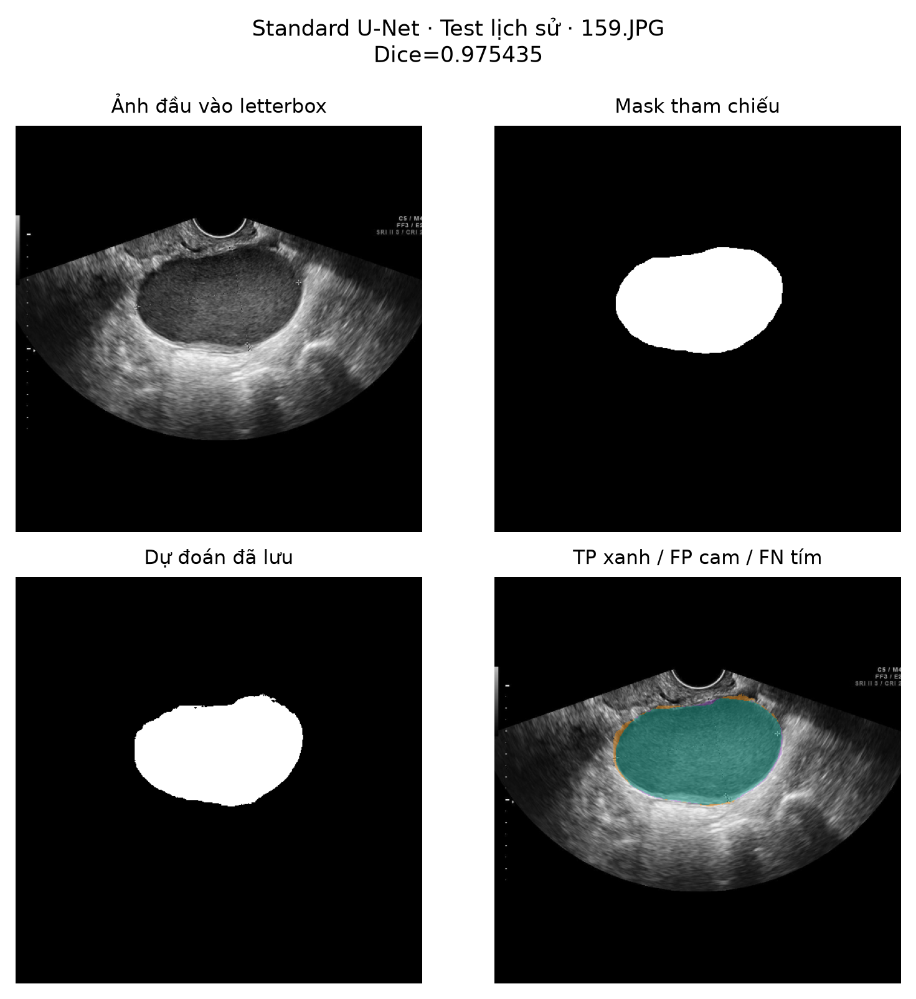

*Hình 3.61: Ví dụ Standard U-Net chồng khớp cao với mask tham chiếu trên Test*

Nguồn: ảnh `159.JPG`, mask nguồn và prediction lưu dưới sample hash `5ed60f60…`; checkpoint `417828fa…`, ngưỡng 0,5 [16]. TP màu xanh, FP cam, FN tím. Hình không xác định bản chất bệnh học.

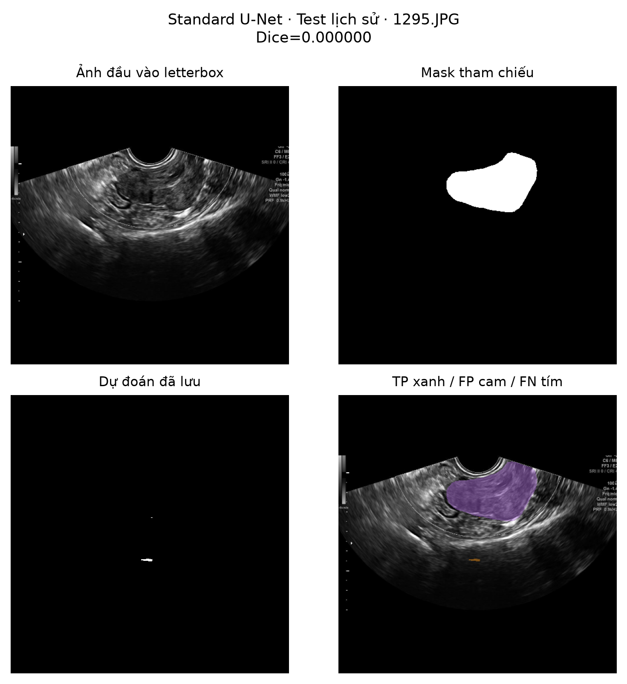

*Hình 3.62: Ví dụ prediction bỏ sót vùng tiền cảnh của mask tham chiếu*

Nguồn: ảnh `1295.JPG`, mask nguồn và prediction `2e9db9a9…`, cùng checkpoint lịch sử [16]. Màu tím biểu thị FN; không diễn giải nguyên nhân lâm sàng từ score bằng 0.

Trên Validation của U-Net++, hồ sơ phân tích lỗi lưu các ví dụ tốt và các ví dụ FP/FN cao. `1225.JPG` có Dice 0,989372; `958.JPG` có Dice 0,011773, FP 62.993 và FN 3.822; `376.JPG` có Dice 0, FP 40.158 và FN 29.972. Việc đồng thời có nhiều TP ở đa số ảnh và thất bại nặng ở một số ảnh giải thích vì sao phải xem error map, không chỉ một cột trung bình. Mỗi ví dụ cần ghi resolution, threshold và trạng thái nhãn tham chiếu để tránh so trực quan giữa các điều kiện khác nhau.

*Bảng 3.55: Một số mẫu lỗi truy được về hồ sơ thí nghiệm*

| Mô hình / tập | Ảnh | Dice | TP | FP | FN | Điều quan sát được |
|---|---|---:|---:|---:|---:|---|
| Standard / Test lịch sử | 159.JPG | 0,975435 | 21.681 | 749 | 343 | Chồng khớp cao ở độ phân giải đánh giá |
| Standard / Test lịch sử | 1295.JPG | 0,000000 | 0 | 75 | 12.128 | Không giao với foreground tham chiếu |
| U-Net++ / Validation | 1225.JPG | 0,989372 | 33.840 | 654 | 73 | FP và FN thấp so với vùng tham chiếu |
| U-Net++ / Validation | 958.JPG | 0,011773 | 398 | 62.993 | 3.822 | Dự đoán thừa lớn |
| U-Net++ / Validation | 376.JPG | 0,000000 | 0 | 40.158 | 29.972 | Vùng dự đoán và tham chiếu không giao |

Nguồn: Test per-image và error-analysis Validation [16]. Đếm pixel thuộc canvas 512×512; không đổi sang diện tích sinh học.

FP có thể liên quan vùng có cấu trúc giống tiền cảnh, còn FN có thể liên quan biên mờ, vùng nhỏ hoặc khác biệt quy ước nhãn. Đây là các giả thuyết cần kiểm, không là kết luận cho từng ảnh trong bảng. Trước khi quy lỗi cho mạng, cần rà cặp ảnh–mask, đường dẫn, phép letterbox và tính nhất quán của annotation. Nếu nhãn nguồn khoanh một đối tượng khác với mục tiêu đang mô tả, Dice thấp phản ánh cả sự lệch định nghĩa nhiệm vụ. Việc mời người chuyên môn rà các ảnh lỗi là bước cần thiết để phân biệt lỗi dữ liệu, lỗi mô hình và giới hạn của bài toán.

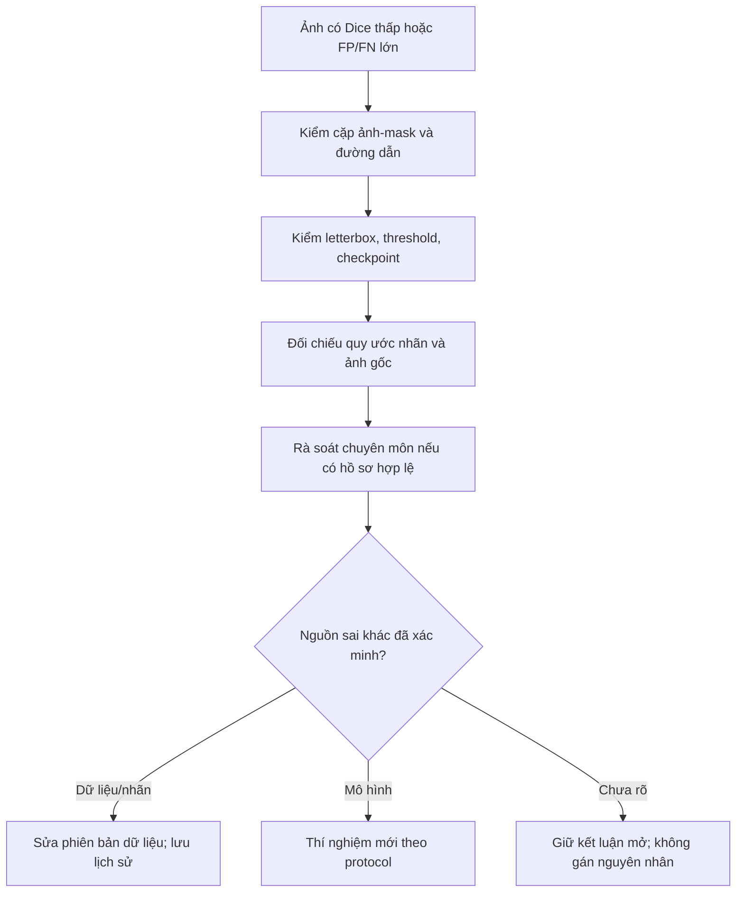

*Hình 3.63: Quy trình phân tích nguyên nhân sai khác giữa prediction và mask tham chiếu*

Nguồn: tác giả thiết kế từ nhu cầu kiểm toán thực nghiệm. Sơ đồ mô tả phương pháp rà soát; không hàm ý mọi bước đã được bác sĩ thực hiện.

Các hình có prediction thật được dựng lại từ tệp đã lưu, không dùng ảnh siêu âm sinh tổng hợp. Script xuất hình kiểm tra TP, FP và FN từ mask nguồn sau letterbox cùng prediction, rồi đối chiếu với CSV trước khi lưu PNG/SVG. Các ảnh được chọn đã kiểm tra trực quan không thấy tên, ngày sinh hoặc PID; điều này không thay thế xác minh giấy phép và quyền sử dụng từ đơn vị cung cấp. Bản công bố bên ngoài vẫn cần hồ sơ nguồn thích hợp. Cách ghi nguồn giúp truy vết mà không làm người đọc hiểu nhầm một hình đẹp là bằng chứng nhãn đã được phê duyệt.

### 3.5.8. Suy luận, đo hình học và liên kết Human-in-the-Loop

Suy luận dùng bộ tiền xử lý khớp với cấu hình checkpoint, chuyển tensor lên thiết bị, chạy một forward trong `torch.no_grad`, áp sigmoid rồi lấy mask theo threshold đã khóa. Hàm `post_process_mask` hiện chỉ nhị phân hóa; không tự loại thành phần nhỏ hoặc làm mịn mặt nạ AI. Tham số `min_area_px` xuất hiện trong chữ ký không có nghĩa lọc diện tích đang hoạt động ở bước này. Sau đó mask được mã hóa RLE để truyền qua API và có thể khôi phục đúng pixel. Các thao tác Fill, Smooth hoặc xóa mảnh ở viewer là chỉnh sửa do người dùng yêu cầu, cần phân biệt với prediction gốc. [17], [18]

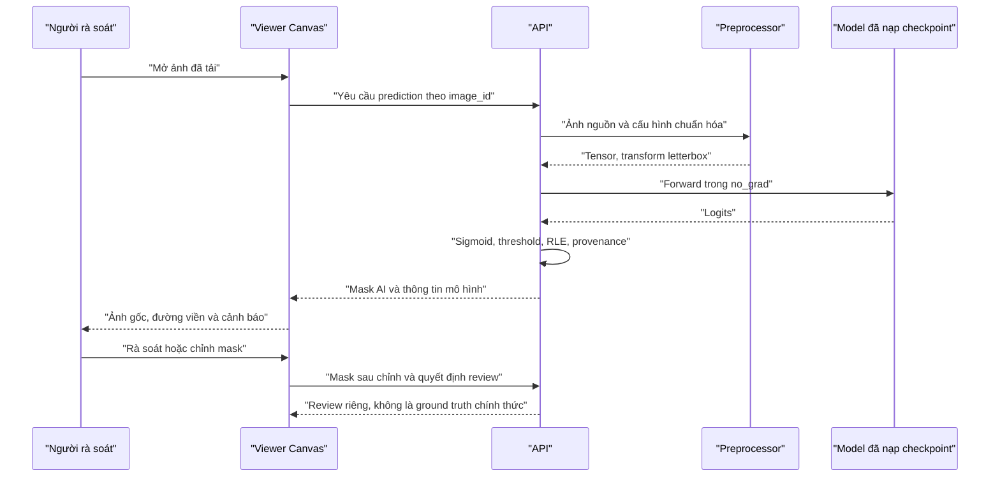

*Hình 3.64: Luồng suy luận đến rà soát và lưu mask do người sử dụng kiểm soát*

Nguồn: mã suy luận, router và viewer [17], [18]. Chức năng ký duyệt nghiên cứu không chứng minh quy trình phê duyệt lâm sàng bệnh viện.

Provenance đi cùng kết quả gồm tên model, phiên bản, checksum checkpoint, phiên bản tiền xử lý, thiết bị, threshold và pixel spacing nếu có. Checksum tránh việc hai tệp cùng tên nhưng trọng số khác bị coi là cùng mô hình. Tuy nhiên, chuỗi version do mã khai báo không thay thế hash nội dung; nếu chỉnh tiền xử lý mà quên cập nhật version thì tái lập vẫn sai. Một lần xuất phiếu cần lấy thông tin từ prediction đã lưu, không lấy tên model đang hiện ở giao diện rồi gán ngược cho mọi ca lịch sử.

Đo kích thước phải xác định đúng không gian. Mặt nạ AI ở canvas 512×512 có vùng đệm và hệ số resize, nên không thể nhân trực tiếp chiều dài trên canvas với spacing của ảnh nguồn rồi gọi là mm. Module `source_measurements.py` đảo letterbox về ảnh đã giải mã, tìm contour và tính hình học trong không gian nguồn. Đường kính lấy từ contour có diện tích lớn nhất; tổng diện tích cộng các contour giữ lại. Bộ đo hiện dùng hình chữ nhật bao diện tích nhỏ nhất và bỏ contour dưới 50 pixel vuông của ảnh nguồn. Đây là quy tắc giải thuật, chưa là ngưỡng tổn thương lâm sàng. [17]

Ở frontend, Web Worker hỗ trợ tính hình học từ mask để phản hồi trong khi chỉnh, còn endpoint đo nguồn giúp hiển thị số đo được xác nhận theo phương pháp backend. Hai phương pháp có thể khác: đường kính Feret qua bao lồi và cạnh dài của minimum-area rectangle không đồng nhất trong mọi hình dạng. Vì vậy, báo cáo ghi rõ phương pháp khi nói về d₁, d₂ hoặc diện tích; không gộp các số đo chỉ vì giao diện dùng chung nhãn. Sai số do nhị phân hóa, đảo letterbox và rời rạc contour cũng là giới hạn riêng ngoài sai số phân đoạn. [17], [18]

Không có spacing hợp lệ, hệ thống phải hiển thị px hoặc px² và nhãn chưa hiệu chuẩn. Module đo nguồn trả các trường mm, cm² là giá trị không có khi thiếu spacing; không biến hệ số 1,0 dùng nội bộ để lấy hình học thành hiệu chuẩn thật. Khi có spacing đẳng hướng đã xác nhận, chiều dài nguồn nhân spacing, còn diện tích nhân bình phương spacing. Metadata nêu nguồn DICOM hoặc nhập tay. DICOM spacing hai trục không gần bằng nhau không được tự gom thành một hệ số trong phương án hiện tại; cần giải thuật hỗ trợ anisotropic spacing trước khi mở rộng. [17]

Entropy nhị phân và trung bình xác suất pixel được engine dùng tạo cảnh báo heuristic. Chúng chưa được hiệu chuẩn thành xác suất mask đúng, chưa được kiểm định làm cổng an toàn và không tương đương mức nguy cơ ác tính. Phiên bản suy luận trả cấu trúc CDSS và mô tả âm học rỗng; hình học mask không đủ để suy ra IOTA hay O-RADS. Do vậy report giữ phạm vi phân đoạn và đo hình thái, không tự phân loại lành/ác, không tự tạo chiều d₃ hoặc thể tích từ một mặt cắt 2D. [5], [17]

Benchmark candidate trong môi trường cô lập với 24 ảnh Validation và ba request đo mỗi ảnh sau warm-up ghi 72 request thành công. Trung vị tổng HTTP là 146,47 ms và p95 là 170,54 ms; trung vị forward GPU khoảng 56,59 ms. Những mốc này có biên đo khác nhau: tổng HTTP còn gồm phần xử lý, lưu và serialization; forward chỉ đo một chặng. Benchmark một máy localhost không chứng minh thời gian một ca hai ảnh, hiệu năng đồng thời hoặc thời gian bác sĩ hoàn tất review. Nút tiến trình trên UI nên phản ánh cả upload, kiểm ảnh, phân đoạn và đo thay vì chỉ hiển thị số forward. [16], [18]

Giá trị của giải thuật đối với hệ thống thông tin là tạo một gợi ý có thể xem, sửa và truy vết. Mask AI phải giữ riêng với mask sau chỉnh; quyết định review cùng ghi chú có thể lưu mà không tự trở thành ground truth chính thức. Phiếu và workstation đều nêu đây là bản mẫu nghiên cứu. Kết quả có căn cứ hiện tại là so sánh hai cấu hình trên Validation và hồ sơ Standard Test lịch sử với những giới hạn dữ liệu đã trình bày. Muốn trả lời câu hỏi giảm thời gian, tăng tính hữu dụng hoặc chất lượng chuyên môn sau HITL, cần nghiên cứu người dùng và bộ tham chiếu được phê duyệt riêng; các đường cong huấn luyện không thay thế bằng chứng đó.
