## 3.1. Mô tả bài toán

### 3.1.1. Đặt vấn đề

Bài toán của khóa luận là xây dựng một hệ thống thông tin hỗ trợ tạo, quan sát, chỉnh sửa và lưu mặt nạ phân đoạn tổn thương trên ảnh siêu âm buồng trứng. Đầu vào trực tiếp của mô hình là ảnh; đầu ra trực tiếp là mặt nạ nhị phân trong đó mỗi điểm ảnh được gán vào vùng mục tiêu hoặc nền. Hệ thống Web bao quanh mô hình nhằm đưa đầu ra này vào một tác vụ có thể kiểm tra: người sử dụng thấy ảnh nguồn, đối chiếu mặt nạ gợi ý, chỉnh những vùng không phù hợp và lưu kết quả rà soát. Vì vậy, nhiệm vụ triển khai bao gồm cả thuật toán học sâu, quản lý dữ liệu và thiết kế tương tác; chỉ chạy được một notebook suy luận chưa giải quyết toàn bộ bài toán [12], [17], [18].

Trong quy trình đọc ảnh, một vùng sáng hoặc tối không tự mang ý nghĩa bệnh học xác định. Mặt nạ dự đoán có thể bỏ sót vùng cần khoanh, lan sang cấu trúc lân cận hoặc tạo mảnh nhỏ trên nền. Nếu người dùng chỉ nhận một điểm số tổng hợp mà không nhìn thấy vị trí dự đoán, họ khó xác định sai lệch nằm ở đâu. Khóa luận lựa chọn trực quan hóa bằng đường viền và lớp phủ để tạo một đối tượng có thể phản biện trực tiếp. Đường viền AI được xem như bản đề xuất hình học, còn mặt nạ sau rà soát là sản phẩm của một thao tác nghiên cứu có lưu dấu vết. Hai đối tượng này phải tồn tại độc lập trong hệ thống.

Sự độc lập giữa dự đoán và rà soát là một yêu cầu dữ liệu, không chỉ là yêu cầu hiển thị. Nếu mỗi nét vẽ ghi đè lên mặt nạ AI ban đầu, người mở lại sẽ không thể xác định người dùng đã sửa gì, đồng thời việc tính mức chỉnh sửa mất cơ sở đối chiếu. Thiết kế hiện có dùng `PredictionModel.raw_mask_rle` để lưu mặt nạ AI và `ReviewModel.verified_mask_rle` để lưu mặt nạ sau thao tác. Trường `prediction_id` trong Review liên kết tới lần dự đoán được xét. Với cách tổ chức này, có thể mở lại ảnh cùng hai phiên bản và truy thời điểm, tác nhân, quyết định đã ghi [17].

Một vấn đề khác là sự nhầm lẫn giữa hình học điểm ảnh và kích thước vật lý. Ảnh sau letterbox có lưới 512×512 nhưng đây là không gian tính toán của mô hình; nó không phải bằng chứng về kích thước thực của tổn thương. Muốn chuyển sang mm cần biết kích thước ảnh nguồn, phép biến đổi hình học và hệ số mm trên một điểm ảnh nguồn. Thiếu thông tin hiệu chuẩn, hệ thống chỉ được báo px và px². Quy tắc này được đưa vào SRS, hợp đồng API và giao diện vì một số đo có đơn vị sai vẫn có thể trông rất thuyết phục trên một phiếu trình bày đẹp.

Phiên bản giao diện hiện tại tiếp nhận một ca hai bên với hai ô ảnh Trái và Phải tách biệt. Người dùng phải cung cấp đủ hai ảnh hợp lệ trước khi luồng tự động tạo ca, tải ảnh, kiểm tra chất lượng và suy luận được kích hoạt. Mỗi ảnh có mã riêng, mặt nạ riêng, trạng thái hiệu chuẩn riêng và kết quả rà soát riêng. Quy tắc này được thực hiện trong frontend mới; API vẫn bảo tồn khả năng tiếp nhận ca đơn bên hoặc hồ sơ cũ. Do đó, tính bắt buộc hai bên là quy tắc của luồng Workspace mới, không phải một khẳng định rằng toàn bộ dữ liệu lịch sử đã được chuyển thành hồ sơ hai bên [18].

Bản mẫu không đưa kết luận lành tính hoặc ác tính, không thay thế diễn giải của bác sĩ và không tạo kết quả chẩn đoán chính thức. Đề cương xác định xác nhận mặt nạ là thao tác trong môi trường thử nghiệm. Mã nguồn lưu `is_official_ground_truth=False` cho mỗi Review; tên trường chứa từ “doctor” hoặc “verified” không làm dữ liệu tự trở thành Ground Truth đã được hội đồng chuyên môn duyệt. Khi mô tả báo cáo, khóa luận sử dụng các cụm “mặt nạ rà soát”, “kết quả phân đoạn thử nghiệm” và “phiếu nghiên cứu” để giữ đúng ý nghĩa của sản phẩm [12], [17].

### 3.1.2. Khảo sát quy trình tham chiếu và xác định khoảng trống

Quy trình As-Is trong khóa luận được xây dựng từ phát biểu vấn đề, mô tả công việc trong đề cương và nhu cầu tương tác đã được cụ thể hóa trong bản mẫu. Hồ sơ được đối chiếu chưa có biên bản quan sát bác sĩ tại bệnh viện, bảng thời gian thao tác hoặc kết quả phỏng vấn có chữ ký. Vì vậy, phần này là mô hình quy trình tham chiếu phục vụ phân tích yêu cầu, chưa phải báo cáo khảo sát hiện trường xác nhận mọi bước đang diễn ra tại Vinmec. Cách giới hạn bằng chứng này giúp phân biệt thông tin đã có với nội dung cần khảo sát bổ sung trước một đợt thử nghiệm chuyên môn [12], [18].

Ở giai đoạn tiếp nhận, người đọc cần một ảnh có thể giải mã và đủ bối cảnh để biết nó thuộc lần khảo sát nào, bên buồng trứng nào. Tên file do người gửi cung cấp thường không đủ làm khóa nhận diện ổn định; hai file có thể trùng tên nhưng khác nội dung, hoặc khác tên nhưng giống hoàn toàn. Hồ sơ nghiên cứu vì thế cần cấp mã Study và Image riêng, giữ quan hệ với PID giả danh, đồng thời lưu kích thước ảnh và dấu vân tay nội dung. Giai đoạn này cũng phải phân biệt ảnh raster với DICOM, bởi DICOM có thể chứa dữ liệu đa khung, metadata định danh và thông tin thước đo.

Ở giai đoạn quan sát, người sử dụng xem vùng quan tâm, xác định ranh giới và thao tác khoanh vùng. Các điều kiện như nhiễu, tương phản thấp, đường viền mờ hoặc nhiều cấu trúc sát nhau có thể làm thao tác khó hơn. Khóa luận không định lượng thời gian tăng thêm hay mức biến thiên giữa bác sĩ do chưa có số liệu quan sát. Tuy nhiên, từ yêu cầu thao tác có thể xác định những dữ liệu hệ thống phải bảo toàn: ảnh nguồn, mặt nạ được dùng, vị trí nét vẽ và hệ tọa độ. Nếu các đối tượng không đồng bộ, thao tác sửa sẽ không phản ánh đúng vùng người dùng đang nhìn.

Ở giai đoạn ghi nhận, người đọc hoàn tất một phiên bản khoanh vùng và lưu mô tả đi kèm. Nếu chỉ lưu ảnh chụp màn hình đã chồng màu, dữ liệu mất sự phân biệt giữa ảnh nền và nhãn; rất khó chỉnh lại hoặc tính toán diện tích một cách nhất quán. Nếu chỉ lưu mask, người mở lại thiếu nguồn ảnh và phiên bản mô hình để diễn giải. Thiết kế To-Be cần giữ liên kết giữa Image, Prediction và Review thay cho một tệp kết quả tổng hợp không có cấu trúc.

Ở giai đoạn tra cứu, người sử dụng tìm ca theo mã, ngày hoặc PID giả danh và cần biết trạng thái xử lý. Trạng thái “AI đã phân tích” khác với “người dùng đã lưu rà soát”; cả hai tiếp tục khác với ký duyệt chuyên môn chính thức. Một nhãn trạng thái dùng chung cho ba nghĩa này có thể gây hiểu sai khi xuất phiếu. Vì vậy, phân tích nghiệp vụ đặt việc định nghĩa trạng thái trước việc thiết kế badge hoặc màu sắc.

*Bảng 3.1: Đối chiếu các giai đoạn tham chiếu với giải pháp thông tin đề xuất*

| Giai đoạn | Vấn đề cần kiểm tra khi khảo sát thực địa | Giải pháp trong bản mẫu | Đối tượng dữ liệu | Giới hạn bằng chứng hiện có |
|---|---|---|---|---|
| Tiếp nhận | Cách gắn ảnh vào ca và xác định bên | Study có mã riêng, hai ô Trái/Phải | Patient, Study, Image | Đã có thiết kế và code; chưa có biên bản bệnh viện |
| Kiểm tra đầu vào | Định dạng, chất lượng, thước đo | Decode, IQA, trạng thái hiệu chuẩn | Image và thông tin IQA | Có kiểm tra kỹ thuật; IQA chưa là thang lâm sàng được thẩm định |
| Khoanh vùng | Ranh giới khó quan sát, số thao tác sửa | AI đề xuất; Canvas cho sửa, hoàn tác | Prediction, mask làm việc | Có bản mẫu; chưa có đo thời gian bác sĩ |
| Hoàn tất | Khó phân biệt bản AI với bản người sửa | Lưu Review riêng, liên kết Prediction | Review, AuditLog | Review nghiên cứu; không phải ký chuyên môn |
| Mở lại | Thiếu nguồn gốc và lịch sử | Mở ảnh, prediction, review gần nhất | Các mã và thời điểm | Lịch sử workflow nhiều cấp cần API mới |
| Tổng hợp | Dễ hiểu phiếu thử nghiệm thành phiếu chính thức | Cảnh báo nghiên cứu trên màn hình và phiếu | Phiếu từ dữ liệu ca | PDF lâm sàng server chưa hỗ trợ |

Nguồn: Tác giả tổng hợp từ đề cương, mã nguồn và tài liệu bàn giao Workspace [12], [17], [18].

Khoảng trống cần giải quyết trước hết là thiếu một chuỗi thao tác khép kín trong cùng hệ thống, từ ảnh tới kết quả rà soát có thể mở lại. Một mô hình tốt nhưng không cho người dùng sửa trực tiếp khó đáp ứng yêu cầu HITL. Ngược lại, một trình xem đẹp nhưng mất mặt nạ nguồn hoặc dùng sai đơn vị làm suy giảm giá trị kiểm tra. Hệ thống được thiết kế nhằm kết nối ba lớp: mô hình tạo đề xuất, giao diện cho phản biện và kho dữ liệu lưu nguồn gốc.

Quy trình To-Be vẫn đặt người dùng ở điểm quyết định cuối của tác vụ nghiên cứu. Tự động hóa được áp dụng cho tải ảnh, kiểm tra chất lượng và chạy phân đoạn; việc chấp nhận, sửa hoặc bỏ mặt nạ không diễn ra tự động. Trước khi mở modal tổng kết, giao diện yêu cầu cả hai ảnh đã được hiển thị và các cảnh báo đã xuất hiện. Đây là điều kiện kiểm soát tương tác có thể kiểm bằng test; nó chưa chứng minh người dùng thực sự đọc kỹ từng vùng và cũng không thay cho đánh giá thiên lệch tự động hóa trong nghiên cứu người dùng.

### 3.1.3. Phân tích yêu cầu hệ thống

#### 3.1.3.1. Phạm vi, tác nhân và nguyên tắc ưu tiên

Các yêu cầu được chia theo hai mức triển khai. Mức lõi là luồng đang nối backend: đăng nhập, tạo ca, upload, IQA, suy luận, chỉnh mask, đo, hiệu chuẩn và lưu rà soát. Mức mở rộng là workflow nhiều vai trò cùng các màn quản trị và quy trình duyệt hai cấp đã được dựng trong giao diện demo nhưng chưa có đầy đủ dịch vụ server. Việc gắn trạng thái triển khai vào yêu cầu tránh dùng độ phủ màn hình để suy ra độ phủ nghiệp vụ backend.

Tác nhân lõi gồm người rà soát nghiên cứu mang role backend `DOCTOR` và quản trị mang role `ADMIN`. Frontend ánh xạ hai role thành BS và QT. Vai trò TK tồn tại trong mô hình sản phẩm và môi trường demo để thể hiện hàng chờ, duyệt độc lập, trả lại và khóa ca; backend hiện tại chưa cung cấp role trưởng khoa tương đương. Tài khoản mẫu trong DB không phải bằng chứng rằng một bác sĩ có danh tính chuyên môn đã tham gia thử nghiệm [17], [18].

Ba nguyên tắc được áp dụng xuyên suốt. Thứ nhất, không ghi đè mặt nạ AI khi người dùng sửa. Thứ hai, không tự sinh đơn vị vật lý từ lưới mô hình hoặc từ thông số hiển thị. Thứ ba, không đổi một thao tác thất bại thành trạng thái thành công để làm giao diện liền mạch. Mọi thông báo “đã lưu” phải dựa trên phản hồi thành công của API; các endpoint chưa được hỗ trợ phải hiện lỗi có giải thích.

#### 3.1.3.2. Yêu cầu chức năng

*Bảng 3.2: Danh mục yêu cầu chức năng và mức triển khai*

| Mã | Yêu cầu | Dữ liệu vào/ra chính | Mức thực hiện tại bản mẫu | Tiêu chí kiểm tra trọng tâm |
|---|---|---|---|---|
| FR-01 | Đăng nhập và đọc hồ sơ phiên | Username, password → JWT, UserProfile | Backend và FE nối thật | Sai mật khẩu không cấp token; user vô hiệu hóa bị chặn |
| FR-02 | Khởi tạo ca nghiên cứu | PID, ngày, ghi chú → study_id | Nối thật | Patient và Study tại endpoint tạo ca cùng một commit |
| FR-03 | Tiếp nhận ảnh hai bên | File Trái/Phải → image_id L/R | Nối thật trong Workspace | Thiếu một ảnh chưa chạy luồng tự động |
| FR-04 | Kiểm tra file và ảnh trùng | Byte ảnh, hash, Study | Nối thật | File lỗi bị từ chối; cùng hash trong Study trả 409 |
| FR-05 | Kiểm tra chất lượng ảnh | Image → IQA và thông báo | Nối thật | Kết quả mỗi bên riêng; ảnh không phù hợp bị gate predict |
| FR-06 | Chạy mô hình đã nạp | image_id → prediction_id, RLE | Nối thật | Không có checkpoint hợp lệ trả 503 |
| FR-07 | Quan sát ảnh và mặt nạ | Ảnh, mask AI, mask làm việc | FE đã hiện thực | Đường viền mặc định; đổi lớp không thay dữ liệu |
| FR-08 | Chỉnh mặt nạ và hoàn tác | Nét cọ, tẩy, đa giác → mask mới | FE đã hiện thực | Sửa đúng tọa độ sau zoom/pan; undo không đổi AI gốc |
| FR-09 | Đo theo ảnh nguồn | RLE → d₁, d₂, diện tích | API và FE nối thật | Không hiệu chuẩn chỉ px; số vật lý nullable |
| FR-10 | Hiệu chuẩn thước | mm/px hoặc khoảng chuẩn | Nối thật | Chỉ nhận hệ số hữu hạn, dương |
| FR-11 | Lưu rà soát từng ảnh | Prediction, action, RLE, ghi chú | Nối thật | Mask/action hợp lệ; `is_ground_truth=False` |
| FR-12 | Mở lại ca đã lưu | study_id → ảnh, prediction, review | Nối thật | Review chỉ lại prediction được xét khi còn trong DB |
| FR-13 | Tìm danh sách ca legacy | Search, status, date → tối đa 50 ca | API hiện có | Trả tập giới hạn; không gọi là phân trang hoàn chỉnh |
| FR-14 | Nháp cục bộ và cảnh báo xung đột | Mask, notes, base version/review | FE đã hiện thực | Không tự phục hồi nháp lệch phiên bản |
| FR-15 | Ký sơ bộ hai bên nguyên tử | Hai review, version → signed | Demo và contract mới | Cần server transaction, idempotency, quyền |
| FR-16 | Duyệt, từ chối, khóa, bổ sung | Action, reason, version | Demo và contract mới | Không tự duyệt; không sửa bản đã khóa |
| FR-17 | Phiếu nghiên cứu A4 | Ảnh, mask, số đo, provenance | FE đã dựng | Hai bên, cảnh báo nghiên cứu; không tuyên bố PDF lâm sàng |
| FR-18 | Xem đánh giá mô hình lịch sử | Metrics và sample artifacts | API hiện có | Không dùng Dice tập test làm confidence ca đang đọc |
| FR-19 | Quản trị read và log | Users, models, audit | Một số API read hiện có | API quản trị dùng require_admin theo chức năng |
| FR-20 | Quản trị CRUD và khoa | User, department, settings | Demo và contract mới | Quyền và audit phải kiểm lại ở server |
| FR-21 | OTP, reset và refresh phiên | Challenge, mật khẩu, token | Màn hình và contract mới | Không xem UI lockout là kiểm soát server |
| FR-22 | Ẩn danh có kiểm chứng | DICOM, EXIF, vùng chữ | Trạng thái và contract đề xuất | Không báo đã ẩn danh khi chưa xử lý thật |

Nguồn: Đối chiếu mã nguồn và tài liệu Workspace [17], [18].

Nhóm tiếp nhận phải kết hợp kiểm tra cú pháp với kiểm tra khả năng giải mã. Extension nằm trong danh sách cho phép chưa đủ chứng minh nội dung là ảnh hợp lệ. Endpoint upload hiện kiểm `.png`, `.jpg`, `.jpeg`, `.dcm`, giới hạn 20 MB, từ chối nội dung quá nhỏ và giải mã để lấy kích thước. Với DICOM, backend hiện chỉ nhận siêu âm `Modality=US` có một frame; màn chọn frame đa khung trong giao diện là một hợp đồng mở rộng, không được mô tả thành tính năng server đã có.

Nhóm suy luận phải tách lỗi đầu vào khỏi lỗi hạ tầng mô hình. Một ảnh đọc được nhưng không vượt kiểm tra suitability có thể nhận lỗi 422; checkpoint chưa nạp hoặc không khớp điều kiện lựa chọn nhận 503. Frontend giữ image_id để retry đúng đối tượng thay vì tạo một ca mới sau mỗi lỗi. Thông tin IQA được trình bày như kết quả kiểm tra kỹ thuật của pipeline, không được xem là đánh giá chắc chắn về giá trị chẩn đoán của ảnh.

Nhóm tương tác phải phân biệt trạng thái đang làm việc với trạng thái đã lưu. Vẽ, tẩy, fill holes và smooth thay đổi mask trong bộ nhớ trình duyệt; đổi opacity, pan hoặc brightness chỉ thay cách nhìn. Sau khi lưu thành công, Review là bản ghi riêng trong DB. Nếu request lỗi, bản nháp còn tồn tại và nút thử lại không được gắn nhãn “đã xác nhận”. Các trường hợp mask rỗng được thể hiện bằng thao tác bỏ toàn bộ vùng đề xuất; điều này không phải kết luận người bệnh không có bệnh.

Nhóm quản trị và workflow cần xem xét như thiết kế tích hợp tiếp theo. UI đã có layout cho BS, TK và QT, nhưng ownership, giới hạn theo khoa, ký sơ bộ hai bên nguyên tử, tách nhiệm vụ và khóa hồ sơ phải được backend thực thi. Ẩn nút giúp người dùng đi đúng luồng, song một client khác vẫn có thể gọi API. Khóa luận vì thế không dùng câu “đã phân quyền toàn diện” khi dữ liệu Study chưa có owner_id và department_id.

#### 3.1.3.3. Yêu cầu phi chức năng

Yêu cầu phi chức năng được diễn đạt theo đối tượng cần quan sát và cách kiểm tra thay vì một cam kết định tính như “nhanh”, “an toàn” hoặc “thân thiện”. Mục tiêu hiệu năng render là khoảng 60 khung hình mỗi giây trong zoom/vẽ trên máy phù hợp; đây là mục tiêu kỹ thuật cần đo bằng profiler, không là số liệu đã đạt cho mọi thiết bị. Mục tiêu thao tác ít click cũng là giả thuyết UX, chưa được dùng để suy ra giảm thời gian lâm sàng.

*Bảng 3.3: Yêu cầu phi chức năng, phương pháp xác minh và giới hạn*

| Mã | Thuộc tính | Yêu cầu cụ thể | Cách xác minh | Tình trạng bằng chứng |
|---|---|---|---|---|
| NFR-01 | Chính xác hình học | Một phép đổi tọa độ dùng nhất quán; bảo toàn tỷ lệ | Unit test ảnh không vuông, letterbox, zoom/pan | Có module và test kỹ thuật; không suy ra chính xác đo lâm sàng |
| NFR-02 | Nhất quán đơn vị | Thiếu spacing không phát sinh mm/cm² | Test API và hiển thị null/px | Có bất biến trong luồng review/source measurement |
| NFR-03 | Truy vết | Giữ prediction và review riêng, actor từ token | Kiểm DB sau lưu và mở lại | Có dữ liệu cơ bản; provenance đầy đủ cần schema bổ sung |
| NFR-04 | Toàn vẹn | Commit Patient/Study cùng endpoint; chặn hash trùng | Test rollback, conflict 409 | Có sửa và kiểm thử phần lõi |
| NFR-05 | Quyền | Chỉ DOCTOR ghi review; ADMIN xóa ca | Test 401/403 theo endpoint | Có chặn chức năng; ownership/khoa chưa đủ |
| NFR-06 | Tính đáp ứng | Render theo requestAnimationFrame, worker đo preview | Browser test và profiler | Có hiện thực; chưa benchmark máy bác sĩ |
| NFR-07 | Khôi phục | Nháp gắn tài khoản/ca/version; không ghi đè server | Test offline, đổi phiên, stale draft | Có bảo vệ cục bộ; lease đa thiết bị cần server |
| NFR-08 | Tiếp cận | Focus rõ, nhãn nút, bàn phím, trạng thái có chữ | Kiểm keyboard và audit WCAG | Có thiết kế theo WCAG; chưa chứng nhận toàn diện |
| NFR-09 | Tương thích | Desktop; worklist/duyệt trên tablet | Kiểm viewport desktop/tablet | Có ảnh chụp và browser test bản mẫu |
| NFR-10 | Riêng tư | PID giả danh; không tự khẳng định ẩn danh ảnh | Kiểm metadata và chữ in cứng | Pipeline khử định danh đầy đủ chưa có |
| NFR-11 | Khả năng bảo trì | Module ES6, router/service/ORM tách trách nhiệm | Static review và chạy test hồi quy | Có kiến trúc hiện tại; vẫn có nợ schema legacy |
| NFR-12 | Phạm vi nghiên cứu | Cảnh báo nghiên cứu trên UI và bản in | Kiểm shell và print stylesheet | Đã có nội dung/thiết kế; chưa cấp phép lâm sàng |

Nguồn: Tác giả thiết kế và đối chiếu hiện thực [17], [18]; nguyên tắc tiếp cận tham khảo W3C [10].

#### 3.1.3.4. Đặc tả Use Case cốt lõi

Use Case được mô tả theo điều kiện trước, luồng chính, ngoại lệ và điều kiện sau để làm rõ thời điểm dữ liệu thay đổi. Một thao tác có nút trên giao diện nhưng chưa có endpoint không được tính là Use Case hoàn thành ở chế độ thật. Các Use Case lõi dưới đây sử dụng API đang tồn tại; Use Case duyệt chính thức được ghi riêng như thiết kế mở rộng.

*Bảng 3.4: Đặc tả UC-01 — Tiếp nhận ca và cặp ảnh hai bên*

| Thuộc tính | Đặc tả |
|---|---|
| Mục tiêu | Tạo một ca nghiên cứu có hai ảnh L/R hợp lệ, mỗi ảnh có mã ổn định |
| Tác nhân | Người dùng DOCTOR qua giao diện BS |
| Điều kiện trước | Đã đăng nhập; có quyền vào intake; hai file được người dùng chọn riêng |
| Kích hoạt | Đủ hai file hợp lệ trong hai dropzone |
| Luồng chính | FE xác minh định dạng/kích thước → tạo Study với BOTH → upload L và R → nhận image_id từng bên → chạy IQA → chuyển tới viewer khi đủ dữ liệu |
| Ngoại lệ | Thiếu bên: chưa chạy; file lỗi: yêu cầu chọn lại; upload lỗi: giữ ca/ID đã có và cho retry; cùng hash trong Study: 409 |
| Điều kiện sau | Study và hai Image được liên kết; chưa có kết luận lâm sàng; suy luận có trạng thái riêng |
| Dữ liệu cần bảo toàn | PID giả danh, study_id, image_id, laterality, dimensions, hash |

*Bảng 3.5: Đặc tả UC-02 — Suy luận và hiển thị mặt nạ đề xuất*

| Thuộc tính | Đặc tả |
|---|---|
| Mục tiêu | Nhận mặt nạ AI từ checkpoint đã nạp và hiển thị trên đúng ảnh |
| Tác nhân | Người rà soát; FE tự điều phối sau intake |
| Điều kiện trước | Image tồn tại; file giải mã được; gate chất lượng cho phép; model sẵn sàng |
| Luồng chính | Gọi predict theo image_id → tiền xử lý → model forward → hậu xử lý → ghi Prediction/Audit → trả RLE và provenance → FE tạo mask làm việc riêng |
| Ngoại lệ | 404: thiếu ảnh/file; 422: ảnh không phù hợp; 503: model chưa nạp; mất mạng: không tự báo hoàn tất |
| Điều kiện sau | Có prediction_id cho ảnh thật; mặt nạ AI gốc được giữ; Study legacy có thể chuyển ANALYZED |
| Giới hạn | ANALYZED không chứng minh đủ hai bên đã chạy xong; FE cần đọc trạng thái từng ảnh |

*Bảng 3.6: Đặc tả UC-03 — Chỉnh mặt nạ và lưu rà soát nghiên cứu*

| Thuộc tính | Đặc tả |
|---|---|
| Mục tiêu | Lưu mask cuối cùng cùng quyết định ACCEPTED_RAW, MODIFIED hoặc REJECTED_ALL |
| Tác nhân | Người dùng DOCTOR; actor lấy từ token |
| Điều kiện trước | Có Image và Prediction cùng ảnh; RLE đúng lưới 512×512; người dùng đang làm trên phiên hợp lệ |
| Luồng chính | Xem ảnh → sửa/hoàn tác nếu cần → tổng kết hai bên → gửi review từng ảnh → BE kiểm quan hệ và action-mask → đo trong ảnh nguồn nếu đọc được → ghi Review/Audit/trạng thái |
| Ngoại lệ | Prediction sai ảnh: 422; ID không tồn tại: 404; role sai: 403; RLE sai: 422; lưu một bên lỗi: giữ nháp và báo trạng thái từng bên |
| Điều kiện sau | Review lưu riêng với `is_official_ground_truth=False`; đủ L/R đã review thì Study REVIEWED, chưa đủ là PARTIALLY_REVIEWED |
| Giới hạn | API legacy ghi mỗi ảnh riêng; chưa là transaction ký hai bên và chưa có idempotency bắt buộc |

*Bảng 3.7: Đặc tả UC-04 — Mở lại ca và xem phiếu nghiên cứu*

| Thuộc tính | Đặc tả |
|---|---|
| Mục tiêu | Khôi phục đúng nguồn ảnh, prediction và review để quan sát hoặc trình bày |
| Tác nhân | Người rà soát được phép xem ca trong thiết kế mục tiêu |
| Điều kiện trước | study_id tồn tại; phiên đăng nhập còn hiệu lực |
| Luồng chính | Đọc detail → chọn review gần nhất → lấy prediction mà review tham chiếu → tải ảnh nguồn/ảnh model-space → decode RLE → hiển thị nguồn gốc và số đo → xem trước phiếu |
| Ngoại lệ | Thiếu file: báo lỗi; review tồn tại nhưng prediction tham chiếu mất: dùng dữ liệu còn có và báo hạn chế; API export chưa có: không tạo thông báo xuất thành công |
| Điều kiện sau | Không thay đổi mặt nạ đã lưu chỉ bởi việc xem hoặc in; phiếu có cảnh báo nghiên cứu |
| Giới hạn | Server generate-report hiện trả 501; quyền ownership và audit export phiên bản cần endpoint mới |

Use Case duyệt chính thức bổ sung một điều kiện nghiệp vụ khác với UC-03: người duyệt phải khác người ký sơ bộ, cùng phạm vi khoa được phép và làm việc trên phiên bản xác định. Reject cần lý do; sửa sau khóa cần tạo bản bổ sung. Những điều kiện này đã được mô phỏng trong môi trường demo và đặc tả contract, nhưng schema Study hiện chưa đủ trường để cưỡng chế. Khóa luận giữ Use Case này trong thiết kế phát triển, không báo nó là quy trình đã được bệnh viện vận hành.

#### 3.1.3.5. User Stories và tiêu chí nghiệm thu

User Stories chuyển mô tả chức năng thành mục đích của người dùng, còn Acceptance Criteria xác định biểu hiện quan sát được. Cặp tài liệu này hỗ trợ lựa chọn test có ý nghĩa: thay vì chỉ kiểm một hàm trả về giá trị, kiểm việc người dùng có thể hoàn tất thao tác mà không nhầm trạng thái hoặc mất dữ liệu. Các tiêu chí sau là đặc tả cần đáp ứng; trạng thái “có test kỹ thuật” không thay cho kết quả thử nghiệm bác sĩ.

*Bảng 3.8: User Stories và Acceptance Criteria của vòng HITL*

| Story | Mục đích người dùng | Given | When | Then |
|---|---|---|---|---|
| US-01 | Tôi muốn biết ảnh thuộc bên nào để tránh sửa nhầm | Intake có hai dropzone | Chọn ảnh vào ô Trái và Phải | Preview và request laterality tương ứng L/R |
| US-02 | Tôi muốn không chạy một ca thiếu dữ liệu hai bên | Chỉ có một file hợp lệ | Chờ luồng tự động | Không gọi create/upload/predict cho một cặp chưa đủ |
| US-03 | Tôi muốn nhận lỗi đầu vào rõ ràng | File sai hoặc lớn hơn 20 MB | Chọn hoặc thả file | Ô lỗi chỉ rõ lý do và cho thay file |
| US-04 | Tôi muốn xem AI khoanh ở đâu | Prediction hoàn tất | Mở viewer | Ảnh và đường viền cùng lưới; AI gốc độc lập mask sửa |
| US-05 | Tôi muốn sửa đúng chỗ dù đang zoom | Có mask và view transform | Vẽ/tẩy sau zoom/pan/resize | Điểm sửa trùng pixel mục tiêu; undo phục hồi |
| US-06 | Tôi muốn biết số đo có phải mm không | Ảnh thiếu spacing | Xem thanh đo | Chỉ px/px² và huy hiệu chưa hiệu chuẩn |
| US-07 | Tôi muốn bỏ toàn bộ đề xuất sai | Có prediction khác rỗng | Xóa mask và lưu REJECTED_ALL | Mask rỗng hợp lệ; không tạo kết luận lành tính |
| US-08 | Tôi muốn không mất việc khi mạng lỗi | Có mask đang sửa | Lưu gặp lỗi mạng | Nháp còn, trạng thái chưa đồng bộ, có retry |
| US-09 | Tôi muốn không dùng nhầm nháp cũ | Server review/version đã đổi | Mở lại ca có nháp | Báo conflict; không tự ghi đè bản server |
| US-10 | Tôi muốn biết ai lưu kết quả | Token hợp lệ | Gửi doctor_id tùy ý rồi lưu | BE dùng username từ token; không tin doctor_id client |
| US-11 | Tôi muốn mở đúng dự đoán đã được sửa | Ca có nhiều Prediction | Mở detail có Review | Ưu tiên Prediction theo review.prediction_id |
| US-12 | Tôi muốn phân biệt phiếu nghiên cứu | Có kết quả để xem trước | Mở hoặc in phiếu | Cảnh báo và watermark nghiên cứu hiện rõ |
| US-13 | Tôi muốn duyệt ca độc lập với người ký | Demo có SIGNED_PRELIM | TK thử duyệt ca tự ký | Bị chặn trong demo; BE tương lai cần cùng kiểm tra |
| US-14 | Tôi muốn quản trị không làm thay chuyên môn | Đang role QT trong UI mới | Điều hướng viewer/report | Menu không có; route bị chặn; bảo mật server là việc riêng |

Nguồn: Tác giả xây dựng từ SRS và đối chiếu các module hiện có [12], [17], [18].

## 3.2. Mô hình hóa hệ thống

### 3.2.1. Sơ đồ quy trình As-Is tham chiếu

Sơ đồ As-Is dưới đây thể hiện chuỗi công việc tối thiểu từ nhận ảnh tới lưu kết quả khoanh vùng. Hộp “quan sát và khoanh vùng” giữ vai trò quyết định của người đọc; không giả định mọi cơ sở đều thực hiện bằng phần mềm hay lưu cùng định dạng. Nhánh “ảnh chưa đủ điều kiện” giúp mô hình hóa việc quay lại nguồn ảnh thay vì buộc một ảnh không đọc được đi tiếp. Các khó khăn cụ thể về thời gian và cách lưu cần được xác nhận bằng khảo sát thực địa khi triển khai thử nghiệm.

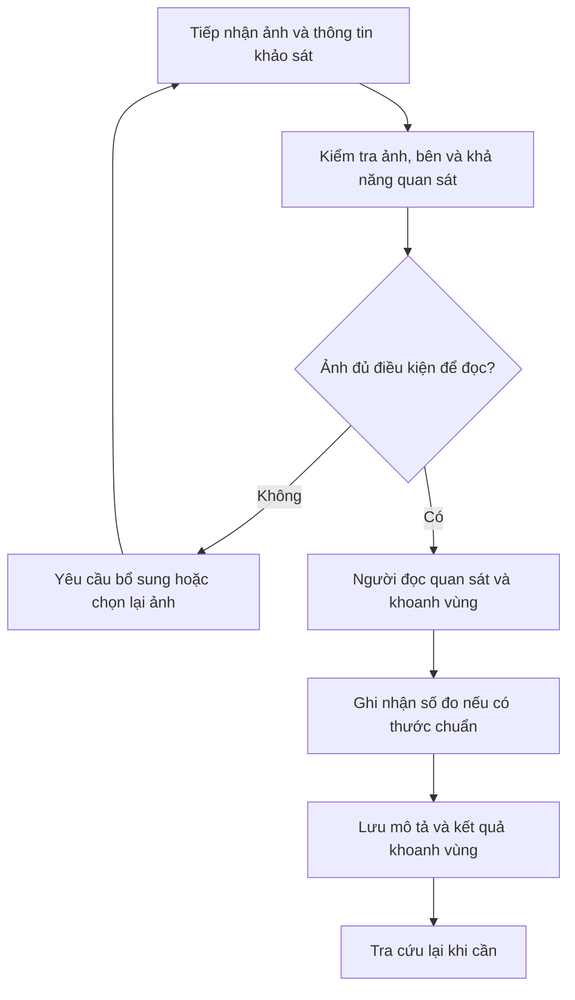

*Hình 3.1: Quy trình As-Is tham chiếu cho phân tích nghiệp vụ*

Nguồn: Tác giả mô hình hóa từ đề cương; chưa có biên bản quan sát tại bệnh viện [12].

### 3.2.2. Sơ đồ quy trình To-Be của bản mẫu hai bên

To-Be bổ sung AI ở giữa kiểm tra ảnh và rà soát, đồng thời tạo kho dữ liệu có cấu trúc cho từng bước. Tiếp nhận, IQA và prediction xảy ra theo từng Image; trạng thái tổng thể ca được hiển thị cùng trạng thái bên Trái và Phải để tránh hiểu một bên thành toàn bộ ca. Người dùng có quyền sửa hoặc bỏ đề xuất. Việc lưu Review hoàn tất vòng nghiên cứu, trong khi duyệt nhiều cấp là nhánh tương lai được tách khỏi sơ đồ lõi này.

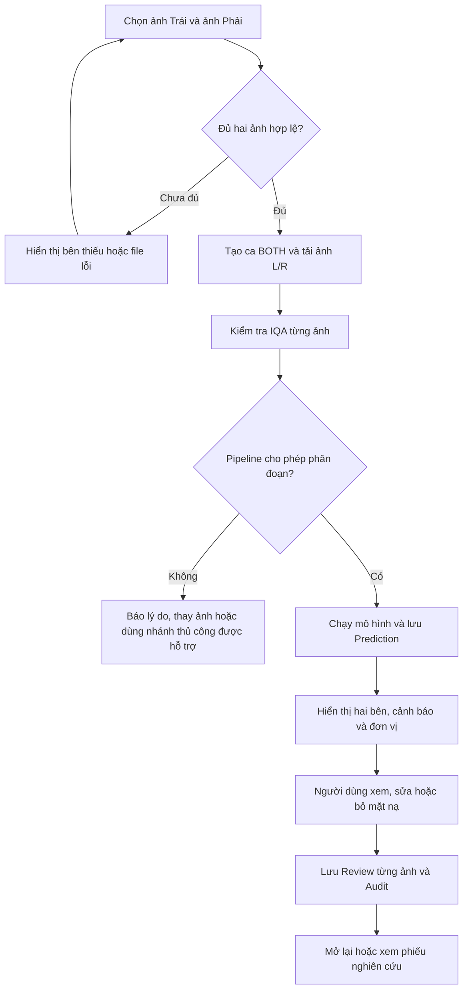

*Hình 3.2: Quy trình To-Be của luồng phân đoạn và rà soát nghiên cứu*

Nguồn: Tác giả tổng hợp từ mã nguồn Workspace và API [17], [18].

### 3.2.3. Sơ đồ phân rã chức năng BFD

BFD chia hệ thống thành các nhóm theo trách nhiệm nghiệp vụ, tương ứng cách bài mẫu tổ chức từ tiếp nhận đến vận hành và báo cáo [14]. Đối với đề tài này, nhóm danh mục được thay bằng dữ liệu ca giả danh và quản trị tài khoản; nghiệp vụ trung tâm là phân đoạn và rà soát. Nhánh duyệt nhiều cấp được ghi rõ là thiết kế mở rộng. BFD không trình bày thứ tự thời gian; thứ tự được làm rõ trong quy trình, DFD và sequence.

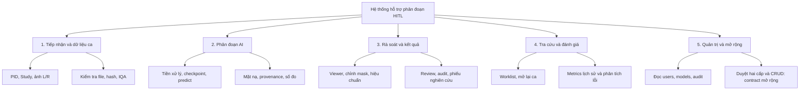

*Hình 3.3: Phân rã chức năng BFD của hệ thống nghiên cứu*

Nguồn: Tác giả thiết kế và đối chiếu hiện thực [17], [18].

### 3.2.4. Sơ đồ ngữ cảnh CD

Sơ đồ ngữ cảnh xem hệ thống như một tiến trình và mô tả trao đổi với tác nhân bên ngoài. Người rà soát cung cấp ảnh, chỉnh sửa và quyết định; hệ thống trả mặt nạ cùng trạng thái lưu. Quản trị yêu cầu cấu hình vận hành hoặc đọc nhật ký theo những endpoint đã có. Người nghiên cứu cung cấp checkpoint và artifact đánh giá qua quy trình nghiên cứu riêng, không thông qua việc chỉnh mask trong viewer. Kho lưu trữ không được vẽ thành tác nhân bên ngoài ở mức ngữ cảnh vì nó thuộc ranh giới hệ thống đang thiết kế.

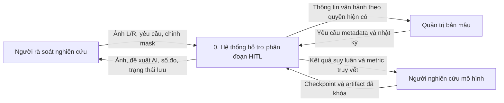

*Hình 3.4: Sơ đồ ngữ cảnh CD của phạm vi hệ thống*

Nguồn: Tác giả thiết kế; quyền theo khoa và vai trò TK thuộc kiến trúc mục tiêu [17], [18].

### 3.2.5. Sơ đồ DFD mức 0 của phân hệ phân đoạn và rà soát

DFD dưới đây phân rã phân hệ tiếp nhận, phân đoạn và rà soát thành năm tiến trình xử lý dữ liệu. Các trao đổi quản trị và cung cấp artifact của sơ đồ ngữ cảnh toàn hệ thống được mô tả riêng ở kiến trúc và hợp đồng API; sơ đồ này không thay thế DFD toàn bộ phân hệ quản trị. Trong sơ đồ, dữ liệu không đi trực tiếp từ người sử dụng tới một bảng DB; mọi cập nhật phải qua tiến trình nhận, kiểm tra hoặc lưu. Prediction và Review là hai kho khác nhau về ngữ nghĩa. Kho checkpoint và artifact đánh giá được giữ riêng vì việc lưu một review mới không tự sửa trọng số, không cập nhật metric lịch sử và không bổ sung ảnh vào tập Train.

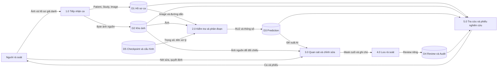

*Hình 3.5: DFD mức 0 của luồng dữ liệu nghiên cứu*

Nguồn: Tác giả thiết kế theo API và mô hình dữ liệu [17], [18].

### 3.2.6. DFD mức 1 của tiếp nhận ảnh

Tiến trình tiếp nhận được phân rã để thấy hai loại bất biến: tính hợp lệ của tệp và tính nhất quán liên kết ca. Hash được tính trên byte file nhận được; kiểm tra trùng được thực hiện sớm ở ứng dụng để trả thông báo rõ và được cưỡng chế lần nữa bằng unique constraint trong DB để chống hai request đồng thời. Tên file vật lý dùng UUID, còn tên gốc được giữ như metadata. Thiết kế này giảm va chạm đường dẫn nhưng chưa tương đương khử định danh chữ trong ảnh hay DICOM tag.

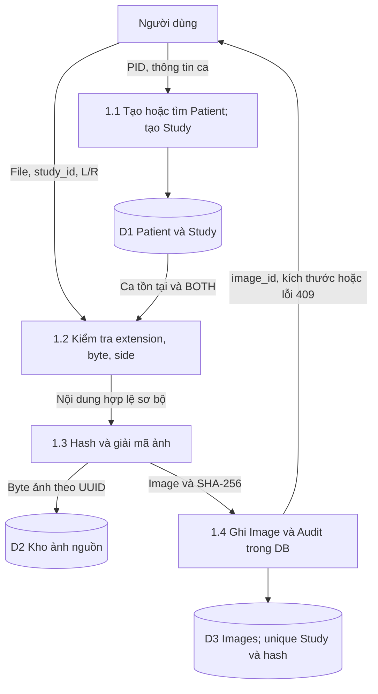

*Hình 3.6: DFD mức 1 của chức năng tiếp nhận ca và ảnh*

Nguồn: Tác giả đối chiếu `cases.py`, `inference.py` và schema [17].

### 3.2.7. DFD mức 1 của kiểm tra và phân đoạn AI

Suy luận sử dụng file ảnh đã lưu, không dùng mask tham chiếu để định vị tổn thương. Khâu tiền xử lý xác định không gian model và ghi thông tin biến đổi cần cho việc đưa mask trở lại ảnh nguồn. Mô hình tạo logits hoặc xác suất theo adapter; hậu xử lý tạo mask nhị phân và đo hình học. Việc quản trị chất lượng ở đây là các kiểm tra kỹ thuật và cờ cảnh báo của phần mềm, không phải một bộ phân loại xác định ảnh có thể dùng để chẩn đoán trong mọi tình huống.

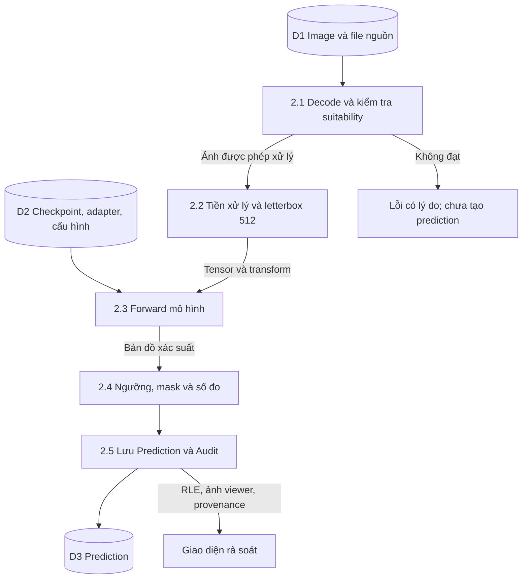

*Hình 3.7: DFD mức 1 của pipeline kiểm tra và phân đoạn*

Nguồn: Tác giả đối chiếu router suy luận và pipeline mô hình [17].

### 3.2.8. DFD mức 1 của rà soát và phiếu nghiên cứu

Rà soát không dùng các số đo vật lý do client gửi làm nguồn tin cậy. Backend kiểm tra quan hệ giữa Image và Prediction, kiểm tra RLE và tính lại hình học trên ảnh nguồn nếu còn giải mã được. Điều này hạn chế trường hợp client sửa số đo nhưng giữ mặt nạ khác. Nếu ảnh nguồn không còn, luồng tương thích không gán số vật lý từ hình học model-space; các trường vật lý được lưu null. Phiếu nghiên cứu đọc dữ liệu đã lưu và thông tin nguồn, không biến nó thành báo cáo lâm sàng.

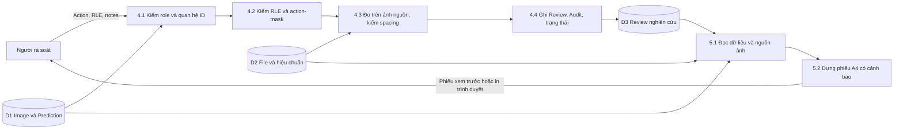

*Hình 3.8: DFD mức 1 của lưu rà soát và trình bày phiếu nghiên cứu*

Nguồn: Tác giả đối chiếu API Review và module phiếu [17], [18].

### 3.2.9. Biểu đồ Use Case tổng quát

Biểu đồ Use Case dưới dạng Mermaid thể hiện tác nhân và các ca sử dụng trong ranh giới bản mẫu. Mermaid không cung cấp ký pháp UML Use Case chuyên biệt nên sơ đồ dùng các nút dạng tròn cho chức năng và ghi rõ ý nghĩa quan hệ. Vai trò TK nằm trong một vùng mở rộng để người đọc không suy ra quyền này đã có ở backend hiện hữu. Các chức năng chẩn đoán bản chất lành/ác không nằm trong sơ đồ.

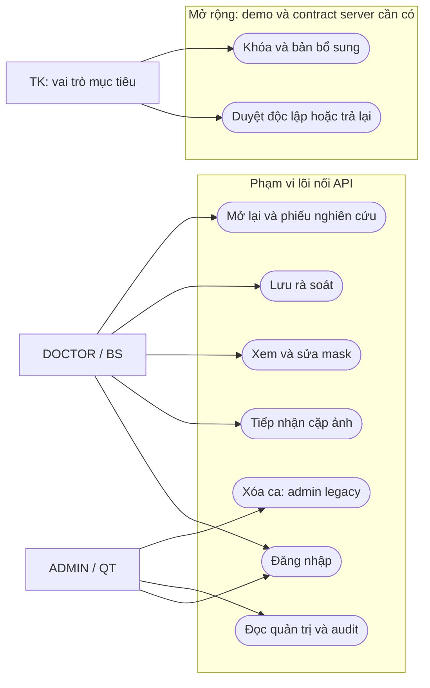

*Hình 3.9: Use Case tổng quát, phân biệt lõi và workflow mở rộng*

Nguồn: Tác giả đối chiếu code và đặc tả quyền [17], [18].

### 3.2.10. Biểu đồ tuần tự của một ảnh trong ca hai bên

Biểu đồ tuần tự mô tả điểm chuyển trách nhiệm giữa UI, API, model, DB và kho file. Với ca hai bên, chuỗi xử lý Image được thực hiện cho L và R; ca chỉ có ý nghĩa hoàn tất rà soát khi cả hai phía đáp ứng điều kiện. API legacy không gói hai lần review thành một transaction ký duyệt, do đó giao diện cần thông báo lỗi từng bên và giữ nháp phía chưa lưu.

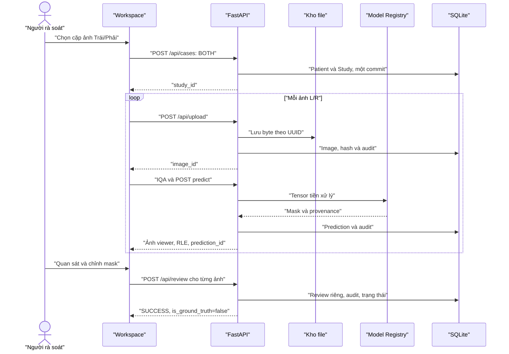

*Hình 3.10: Sequence của luồng lõi từ cặp ảnh đến rà soát nghiên cứu*

Nguồn: Tác giả đối chiếu endpoint đang sử dụng [17], [18].

### 3.2.11. Máy trạng thái hiện hữu và máy trạng thái mục tiêu

Máy trạng thái hiện hữu của Study có PENDING, ANALYZED, PARTIALLY_REVIEWED và REVIEWED. PENDING xuất hiện khi tạo ca; router predict chuyển sang ANALYZED khi có dự đoán cho một ảnh và ca còn PENDING. Bản mẫu hai bên cần theo dõi từng Image bởi trạng thái ANALYZED không chứng minh cả hai prediction đã hoàn tất. Khi lưu review cho một ảnh của ca BOTH, backend kiểm tập bên đã có review để đặt PARTIALLY_REVIEWED hoặc REVIEWED. Nếu ca cũ đơn bên, việc lưu một review chuyển Study thành REVIEWED [17].

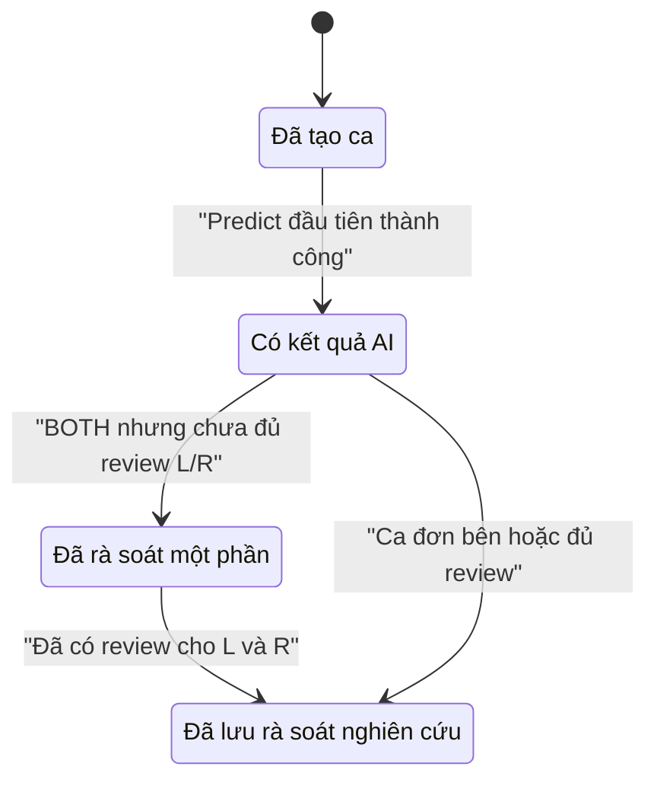

*Hình 3.11: Máy trạng thái Study của backend hiện hữu*

Nguồn: Tác giả đọc trực tiếp router tạo ca, suy luận và review [17].

Máy trạng thái mục tiêu bổ sung ký sơ bộ, duyệt độc lập, từ chối và khóa. REVIEWED của legacy không được ánh xạ tự động thành APPROVED vì hai trạng thái không có cùng bằng chứng. Khi người có quyền tạo bản bổ sung cho ca khóa, bản cũ vẫn phải bất biến; mũi tên mở lại thể hiện tạo một phiên bản công việc mới, không sửa bản đã ký. Cần thêm bảng phiên bản hoặc cấu trúc tương đương, trường owner/khoa, người ký/người duyệt và quy tắc transition ở server trước khi đưa quy trình này vào sử dụng thật.

```mermaid
stateDiagram-v2
    state "Đã tải đủ ảnh" as UPLOADED
    state "AI hoàn tất hai bên" as AI_DONE
    state "Đang rà soát" as IN_REVIEW
    state "Đã ký sơ bộ" as SIGNED_PRELIM
    state "Đã duyệt" as APPROVED
    state "Bị trả lại" as REJECTED
    state "Đã khóa" as LOCKED
    [*] --> UPLOADED
    UPLOADED --> AI_DONE: "Hai prediction hoàn tất"
    AI_DONE --> IN_REVIEW: "Bắt đầu rà soát"
    IN_REVIEW --> SIGNED_PRELIM: "BS xem đủ hai ảnh và gửi phiên bản"
    SIGNED_PRELIM --> APPROVED: "TK khác người ký duyệt"
    SIGNED_PRELIM --> REJECTED: "TK trả lại kèm lý do"
    REJECTED --> IN_REVIEW: "Sửa theo phản hồi"
    APPROVED --> LOCKED: "Khóa phiên bản"
    LOCKED --> IN_REVIEW: "Tạo bản bổ sung; giữ bản cũ"
```

*Hình 3.12: Máy trạng thái workflow mục tiêu, chưa được backend legacy thực thi đầy đủ*

Nguồn: Thiết kế Workspace và contract mở rộng [18].

## 3.3. Kiến trúc hệ thống và giao tiếp API

### 3.3.1. Kiến trúc tổng thể và phân chia trách nhiệm

Hệ thống được xây dựng theo kiến trúc client–server. Trình duyệt thực thi HTML, CSS và các ES module; FastAPI phục vụ entrypoint, tài nguyên frontend và các REST API. PyTorch nằm trong quá trình backend để thực hiện suy luận thông qua Model Registry; SQLAlchemy quản lý các bản ghi trong SQLite, còn byte ảnh nguồn được lưu trong upload root. Kiến trúc hiện tại phù hợp bản mẫu chạy cục bộ và kiểm thử có cô lập, chưa phải mô tả một hạ tầng PACS/RIS đã triển khai trong bệnh viện [17], [18].

Frontend chịu trách nhiệm tổ chức luồng thao tác, trạng thái hiển thị và mặt nạ đang làm việc. Các module `state.js`, `navigation.js`, `intake.js`, `upload.js`, `viewer.js`, `review.js` phối hợp để giữ một ca hiện hành và hai Image. Backend chịu trách nhiệm xác minh phiên, dữ liệu, liên kết ID, thực hiện model và lưu kết quả. DB không lưu mỗi lần con trỏ di chuyển; việc lưu xảy ra ở các mốc upload, prediction, review và audit. Sự phân chia này giữ phản hồi thao tác vẽ ở phía client trong khi các quyết định thay đổi dữ liệu bền vững vẫn được server kiểm tra.

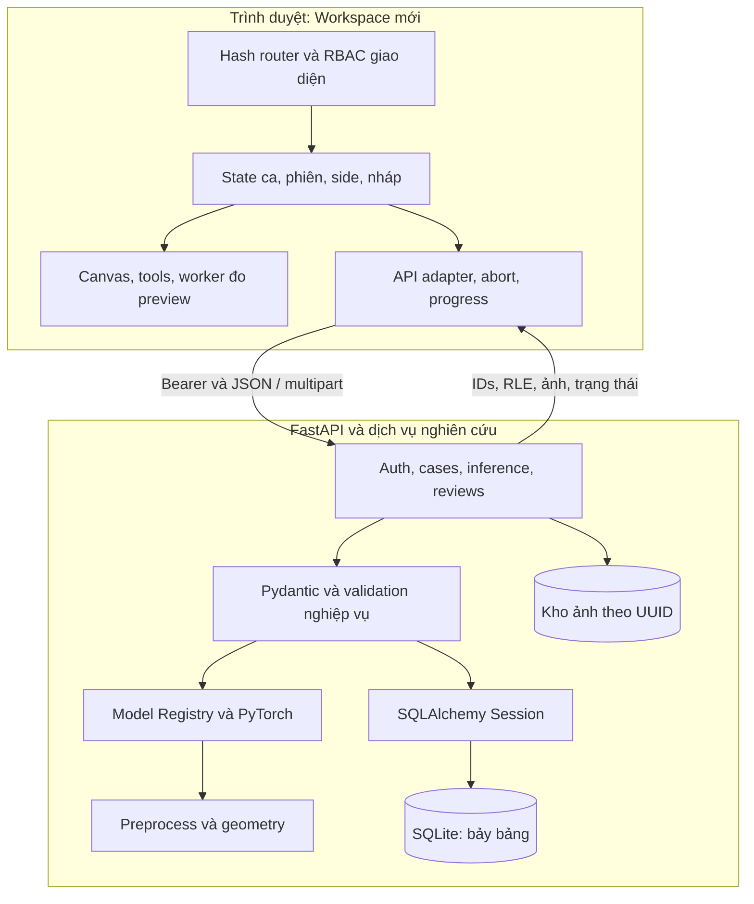

*Hình 3.13: Kiến trúc logic của frontend, backend, model và lưu trữ*

Nguồn: Tác giả đối chiếu cấu trúc mã nguồn [17], [18].

Đề cương ban đầu đề cập React, trong khi hiện thực được đối chiếu dùng SPA thuần và ES module. Báo cáo ghi theo sản phẩm đã xây dựng, đồng thời giữ mục tiêu tương tác của đề cương. Việc đổi framework không làm đổi bất biến HITL; các vấn đề về mask, đơn vị, quyền và trạng thái vẫn phải giải quyết. Frontend hiện không có bước build bắt buộc hay dependency runtime của một framework giao diện [12], [18].

### 3.3.2. Hợp đồng API của luồng lõi

Hợp đồng API được trình bày theo đúng tên endpoint đã đọc trong implementation. Điểm đáng chú ý là API lưu rà soát có đường dẫn số ít `/api/review`, không phải `/api/reviews`. Thông tin này cần thống nhất trong tài liệu, code client và bộ test vì một đường dẫn sai có thể dẫn đến nhận 404 rồi bị hiểu thành lỗi nghiệp vụ. Request tạo ca sử dụng `CreateCaseRequest`; prediction và review có response model Pydantic, còn một số endpoint ca trả dict trực tiếp [17].

*Bảng 3.9: Hợp đồng API chính đang được sử dụng*

| Method và endpoint | Request quan trọng | Response quan trọng | Điều kiện/lỗi cần xử lý |
|---|---|---|---|
| POST `/api/auth/login` | username, password | access_token, expires_in, user | 401 sai đăng nhập; 503 chưa cấu hình JWT secret |
| GET `/api/auth/current-user` | Bearer token | UserProfile | 401 hết hạn hoặc account unavailable |
| POST `/api/cases` | patient_id, study_date, active_ovary_side | study_id, study_code, status | Phiên được kiểm ở router đăng ký; schema enum side |
| GET `/api/cases` | search, status, date | Danh sách tối đa 50 ca | Chưa có total/page và ownership theo khoa |
| GET `/api/cases/{study_id}` | study_id | images, prediction, review, calibration | 404 không tìm thấy ca |
| POST `/api/upload` | Multipart file, study_id, laterality | image_id, dimensions, dicom_metadata | 400 file; 404 Study; 409 trùng; 422 side/spacing |
| POST `/api/validate-image` | image_id qua query | is_acceptable, details, iqa_score | 404 record/file; 400 decode |
| POST `/api/predict/{image_id}` | image_id; spacing tùy chọn | PredictionResponse, RLE, provenance | 422 gate; 503 model chưa nạp |
| GET `/api/images/{id}/viewer-source` | image_id | PNG base64 đã tiền xử lý | 404 thiếu nguồn; 422 decode |
| GET `/api/images/{id}/source.png` | image_id | PNG ảnh nguồn đã giải mã | Không áp dụng CLAHE hay letterbox |
| POST `/api/images/{id}/measurements` | rle_mask | Hình học source-space, calibration | RLE theo schema 512×512; không lưu review |
| POST `/api/images/{id}/calibrate` | spacing hoặc distance qua query | spacing, measurements | 422 hệ số không hợp lệ; actor từ token |
| POST `/api/review` | image_id, prediction_id, action, RLE | review_id, SUCCESS, is_ground_truth | 403 role; 422 mismatch; False về GT |
| GET `/api/images/{id}/mask.png` | kind=ai/reviewed | PNG mask ở ảnh nguồn | 404 chưa có mask; header coordinate-space |
| DELETE `/api/cases/{study_id}` | study_id, token ADMIN | SUCCESS | 403 non-admin; commit DB trước unlink |
| POST `/api/generate-report` | Payload dict | Lỗi 501 | Chưa hỗ trợ PDF lâm sàng |

Nguồn: Mã nguồn routers và Pydantic schemas [17].

RLE là định dạng trung gian giữa client và server. `shape` phải bằng `[512,512]`; `first_val` phải là số nguyên 0 hoặc 1; `counts` là danh sách số nguyên dương có tổng 262.144. Pydantic dùng kiểm tra kiểu chặt ở những điều kiện này để không coi `true` là giá trị pixel đầu tiên hợp lệ hoặc chấp nhận độ dài âm. Frontend decoder cũng chặn run vượt quá số pixel và thiếu pixel. Sau kiểm tra cấu trúc, service tiếp tục kiểm action-mask: chấp nhận nguyên trạng phải phù hợp mask AI, sửa phải thể hiện thay đổi theo quy tắc service, từ chối toàn bộ phải trả mask rỗng.

`DoctorReviewRequest.doctor_id` tồn tại để tương thích nhưng không phải nguồn định danh tác nhân khi lưu. Router lấy `current_user.username` từ phiên đã xác thực, tránh để client tự gửi một tên người khác và được ghi nhận như người thực hiện. `prediction_id` được kiểm có tồn tại và thuộc đúng image_id; nếu có study_id trong request, nó phải khớp ca của Image. Các kiểm tra này bảo vệ liên kết dữ liệu, song chưa thay cho ownership vì backend chưa gắn người sở hữu vào Study.

Response suy luận chứa các trường kỹ thuật ngoài vùng giao diện cốt lõi, gồm acoustic profile, uncertainty hoặc CDSS. Khóa luận không diễn giải sự tồn tại của trường response thành bằng chứng về khả năng chẩn đoán. UI Workspace tập trung vào mask, số đo và cảnh báo; không đưa kết luận lành/ác. Một adapter có trả confidence cũng không làm con số đó trở thành xác suất đúng đã hiệu chuẩn. Provenance được ưu tiên để người dùng biết kết quả phát sinh từ model nào, ở phiên xử lý nào.

### 3.3.3. Quản lý trạng thái, request và lỗi giao diện

`state.js` giữ user, token, chế độ demo, route, ca hiện hành, bên đang xem, cờ dirty/busy và preferences. Token phiên được đọc từ sessionStorage; nháp và tùy chọn được lưu trong localStorage với namespace riêng. Nháp có khóa chứa chế độ, user.id và study_id, qua đó giảm nguy cơ dùng nhầm dữ liệu giữa hai tài khoản hoặc giữa demo và thật. Thiết kế vẫn cần chính sách lưu trữ trên máy dùng chung trước khi cho sử dụng dữ liệu thật; localStorage không phải kho dữ liệu được mã hóa theo người dùng [18].

API adapter gắn Bearer token và AbortSignal của route. Sau khi fetch xong, adapter kiểm phiên và mode có còn như lúc bắt đầu hay không; response của phiên cũ bị bỏ bằng AbortError. Nếu trả 401, ứng dụng phát sự kiện phiên hết hạn thay vì tiếp tục cập nhật màn hình như một lần tải dữ liệu rỗng. Nếu JSON 200 không đọc được, adapter báo malformed response. Các lỗi 404/405/501 được giải thích là máy chủ chưa hỗ trợ chức năng; chúng không bị chuyển thành success giả.

Progress upload dùng XMLHttpRequest vì cần sự kiện upload.onprogress để phản ánh số byte. Hủy phía trình duyệt có thể dừng việc chờ hoặc ngắt request gửi, nhưng một job suy luận đã chạy trên server chưa có contract cancel riêng. Khi nói về nút Hủy trong báo cáo phải phân biệt hủy tác vụ hiển thị/request với hủy tính toán server. API inference jobs được đề xuất để bổ sung hủy có xác nhận và trạng thái job; bản mẫu chưa thể tuyên bố bảo đảm tiết kiệm tài nguyên GPU sau mọi thao tác cancel.

Nháp được tự lưu với base_version và tập base_reviews. Khi mở lại, frontend so sánh version và review_id để xác định nháp còn phù hợp. Nếu dữ liệu server thay đổi, ứng dụng tạo draftConflict và không tự restore mask. Người dùng có thể giữ bản server và lưu nháp xung đột sang khóa riêng để tránh mất dữ liệu. Đây là bảo vệ chống ghi đè ở trình duyệt; chống hai người trên hai máy cùng lưu cần optimistic locking và lease được server kiểm trong mutation.

*Bảng 3.10: Phân loại lỗi và phản hồi mong đợi của giao diện*

| Trường hợp | Dữ liệu phải giữ | Phản hồi người dùng | Hành động tiếp theo |
|---|---|---|---|
| File sai hoặc decode lỗi | File còn hợp lệ của bên còn lại | Lỗi tại đúng ô ảnh | Thay file lỗi; chưa chạy cặp thiếu |
| IQA không đạt gate | image_id và kết quả IQA | Lý do cụ thể; không báo AI hoàn tất | Chọn ảnh khác hoặc nhánh có capability phù hợp |
| 409 hash trùng | Ca đang có và IDs | Ảnh đã tồn tại trong ca | Không tạo bản trùng; mở ảnh đã có nếu flow hỗ trợ |
| Model chưa nạp | Study/Image đã upload | Dịch vụ mô hình chưa sẵn sàng | Retry sau khôi phục; không upload lại vô lý |
| Mạng lỗi khi sửa | Mask làm việc và nháp | Banner chưa đồng bộ | Retry theo ID và phiên hiện tại |
| Phiên hết hạn | Nháp gắn đúng tài khoản | Trang expired và lời nhắc đăng nhập | Khôi phục sau xác thực; không đổi actor |
| Response cũ sau đổi route | Trạng thái route mới | Không hiển thị response đã hủy | Abort và cleanup tài nguyên |
| Nháp lệch phiên bản | Nháp xung đột và bản server | Banner conflict | Chọn bản và kiểm thủ công; không ghi đè tự động |
| API mở rộng chưa có | Trạng thái trước thao tác | Lỗi chức năng chưa hỗ trợ | Dùng demo để xem thiết kế; không giả transition |

Nguồn: Tác giả phân tích API adapter, state và contract [18].

### 3.3.4. Thiết kế chuyển đổi tọa độ Canvas và đo hình học

Viewer có bốn không gian: tọa độ màn hình từ sự kiện con trỏ, tọa độ viewport tương đối Canvas, tọa độ model 512×512 và tọa độ ảnh nguồn. Một nét cọ được xác định trong model-space để phù hợp RLE; một số đo cần trả về source-space trước khi nhân spacing. Zoom và pan chỉ thay phép chiếu model lên viewport, không làm thay đổi kích thước tổn thương hoặc nội dung RLE. Resize phải đọc lại bounding rectangle và tính phép fit hiện hành; nếu tái sử dụng rect cũ, điểm brush có thể lệch khỏi con trỏ.

Với điểm màn hình `(x_s,y_s)`, bounding rect của Canvas `(left,top)`, pan `(p_x,p_y)` và hệ số view `z`, điểm model là `x_m=(x_s-left-p_x)/z`, `y_m=(y_s-top-p_y)/z`. Phép chiếu ngược dùng `x_v=z×x_m+p_x`, `y_v=z×y_m+p_y`. Hàm trong `coordinates.js` gom quy tắc này để brush, eraser và thao tác khác không tự viết những công thức gần giống nhưng khác điểm gốc. Giá trị ở ngoài khung phải được chặn hoặc bỏ theo tool để không ghi sai bộ nhớ mask.

Letterbox dùng hệ số `s=min(512/W,512/H)`; kích thước nội dung sau làm tròn là `(w,h)` và padding `(l,t)`. Phép đổi model sang nguồn sử dụng `x_o=(x_m-l)×W/w`, `y_o=(y_m-t)×H/h`. Dùng w và h thực sau làm tròn tránh coi một hệ số lý thuyết là chính xác tuyệt đối trong cả hai chiều. Với pipeline có crop, cần thêm offset ROI trong phép đổi ngược; không được dùng công thức full-image letterbox để đo một mask đã đi qua crop mà không lưu transform.

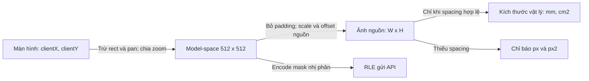

*Hình 3.14: Các không gian tọa độ và điều kiện chuyển sang đơn vị vật lý*

Nguồn: Tác giả tổng hợp từ coordinates và source measurements [17], [18].

Tính số đo trên mask đang sửa có hai tầng. Worker phía client tạo preview hình học để thanh đo cập nhật mà không chặn thao tác. API measurements tính trên ảnh nguồn đã giải mã theo pipeline server để phục vụ kết quả có thể lưu và trình bày. Khi review được gửi, server tiếp tục tính lại; không dùng preview như một số đo lâm sàng độc lập. Service nguồn hiện báo phương pháp `external_contour_min_area_rectangle`, chọn đường kính theo contour có diện tích lớn nhất và bỏ các contour dưới 50 px² ảnh nguồn. Phương pháp này khác rotating calipers dùng cho preview phía client, vì vậy không được gọi các số server lưu là đường kính Feret chính xác. Tổng diện tích cộng các contour được giữ và không nhất thiết là diện tích của riêng thành phần được chọn để báo đường kính [17], [18].

Backend hiện trích spacing DICOM khi hai chiều hữu hạn, dương và gần bằng nhau trong giới hạn tương đối được đặt trong code; trường Image chỉ lưu một hệ số scalar. Nếu spacing hai chiều khác nhau, code hiện không ép chúng thành một hệ số tùy tiện. Đây là giới hạn phù hợp dữ liệu hiện tại nhưng cần mở rộng sang row/column spacing nếu muốn hỗ trợ đầy đủ ảnh bất đẳng hướng. Phiếu không được lấy spacing model-space hay mặc định một số mm/px để lấp chỗ thiếu.

### 3.3.5. Transaction, ràng buộc và quản lý file

Endpoint tạo ca truy vấn Patient theo PID đã trim, thêm Patient mới khi cần, tạo Study rồi commit một lần. Nếu một bước phát sinh exception, session rollback, do đó lỗi tạo Study trong endpoint này không giữ lại Patient vừa được tạo. Quan hệ `PatientModel.anonymized_pid` có unique constraint để nhận diện một mã nghiên cứu. Tuy vậy, get-or-create đồng thời có thể gặp conflict; code chưa biến mọi loại IntegrityError ở create thành một response nghiệp vụ cụ thể. Khóa luận mô tả điều đã bảo vệ và điểm còn cần hoàn thiện, thay vì kết luận toàn bộ concurrency đã giải quyết.

Trong upload, unique `(study_id,file_hash)` là điểm quyết định chống bản trùng dù hai request cùng vượt kiểm tra sớm. Nếu commit gặp IntegrityError của constraint này, router rollback, cố xóa file vừa ghi rồi trả 409 với thông báo ảnh đã tồn tại. Hash nullable để giữ tương thích bản ghi cũ; migration backfill tính SHA-256 từ file còn tồn tại và không gán hash cho bản legacy trùng đã có người nhận hash. Vì vậy, không thể nói mỗi ảnh lịch sử đều đã có hash hoặc mọi duplicate cũ đã bị xóa.

Luồng upload không truyền study_id vẫn còn khả năng tự tạo Patient và Study bằng các commit riêng trước khi ghi Image. Luồng Workspace mới tạo ca trước rồi truyền study_id nên không đi nhánh này. Sự khác biệt phải được ghi rõ khi bàn luận transaction: việc gộp transaction create-case không tự sửa toàn bộ nhánh upload legacy. Cùng cách đó, kiểm tra một Image cho mỗi laterality đang nằm ở ứng dụng; unique hash không cưỡng chế “mỗi bên đúng một ảnh” khi hai file khác hash được upload đồng thời. Đây là yêu cầu tích hợp tiếp theo nếu mở sử dụng đồng thời.

DELETE ca hiện yêu cầu ADMIN. Router thu thập đường dẫn ảnh, xóa Study cùng quan hệ ORM và commit DB, sau đó mới unlink các file nằm trong upload root đã resolve. File có tên bắt đầu bằng sample_ được giữ. Cách làm tránh mất file trước khi DB xóa thành công, nhưng lỗi unlink hiện được bỏ qua nên có thể để lại file mồ côi. Đây vẫn là xóa cứng legacy, chưa phải quy trình xóa mềm có phê duyệt hay lưu bản audit bất biến như thiết kế mục tiêu [17].

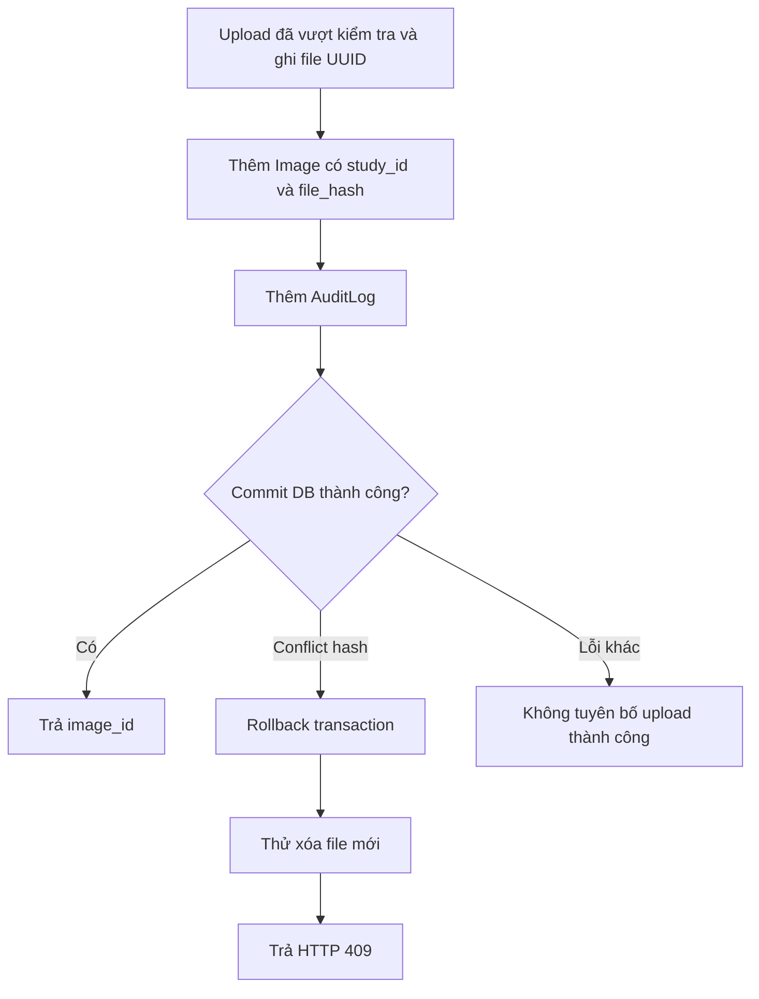

*Hình 3.15: Ranh giới transaction và xử lý conflict hash trong upload*

Nguồn: Tác giả đối chiếu `inference.py` và constraint Image [17].

### 3.3.6. Giới hạn xác thực, quyền và hợp đồng phát triển tiếp

Mã xác thực dùng JWT HS256, có thời điểm phát hành và hết hạn; cấu hình APP_JWT_SECRET cần ít nhất 32 ký tự. `get_current_user` đọc token, tìm user trong DB và kiểm `is_active`; router lâm sàng được đăng ký với dependency xác thực chung. `require_admin` bảo vệ các thao tác quản trị tương ứng và endpoint xóa; review kiểm role DOCTOR riêng. Mật khẩu trong bản mẫu lấy theo role từ biến môi trường, không có trường password_hash ở User. Vì vậy, không mô tả sản phẩm hiện tại như hệ thống mật khẩu cá nhân đã hash hoặc đã có OTP/rate-limit đầy đủ [17].

Model RBAC mục tiêu của UI khác RBAC server legacy. UI QT không có viewer, patients, report và evaluation chứa ảnh; chỉ có metadata quản trị. Tuy nhiên, backend đang xác thực các router ảnh bằng user hợp lệ và chưa gắn quyền ownership/khoa cho từng tài nguyên. Hạn chế này cần được nêu thẳng trong báo cáo vì một giao diện không truy cập ảnh không ngăn tài khoản ADMIN dùng HTTP client gọi endpoint ảnh. Tính tách nhiệm vụ được demo để kiểm tra thiết kế, không được dùng làm chứng cứ server đã bảo vệ dữ liệu.

Đường dẫn mới `/api/workspace` được đề xuất để triển khai các chức năng có contract khác legacy. Worklist mới cần items, total, page và page_size; lọc quyền phải xảy ra trước phân trang. Sign-preliminary nhận version và cả hai ảnh trong một transaction, actor lấy từ token và cần idempotency. Transition kiểm role TK, cùng khoa, khác người ký, reason và trạng thái trước. Lease cần token hết hạn được kiểm lại trong request ghi. Các capability flag giúp frontend chỉ bật nhánh mới khi server có hỗ trợ, tránh suy ra năng lực từ một màn hình tồn tại.

*Bảng 3.11: Các hợp đồng server cần bổ sung để hoàn thiện workflow mục tiêu*

| Nhóm | Endpoint/contract đề xuất | Điều kiện backend cần thực thi |
|---|---|---|
| Worklist | GET `/api/workspace/cases` | Ownership/khoa; search/filter/sort; total và phân trang thật |
| Ký sơ bộ | POST `/api/workspace/cases/{id}/sign-preliminary` | Hai ảnh cùng transaction; version; idempotency; actor server |
| Duyệt | POST `/api/workspace/cases/{id}/transitions` | Role TK, khác người ký, reason, trạng thái hợp lệ |
| Lease và nháp | POST/DELETE lease; PUT draft | Quyền, expiry, token; 409 khi lệch version |
| Bản bổ sung | POST/PUT corrections | Giữ bản cũ; lý do; BS rà soát và ký lại |
| Quản trị | Users CRUD, departments, settings | QT; validation; không tự tăng quyền; audit |
| Xác thực mở rộng | Reset, change, OTP, refresh | Hash cá nhân, chống replay, rate-limit, lockout server |
| Ẩn danh và DICOM | Inspect, frames, deidentify | Quarantine; lọc metadata; chữ in cứng được kiểm; spacing bảo toàn |
| Suy luận job | POST/GET/DELETE inference jobs | Trạng thái và hủy thật; không ghi đè mask đang sửa |
| Phiếu và audit | report-export, audit-events/export | Quyền từng phiên bản; append audit; phân trang/export đầy đủ |

Nguồn: Tài liệu contract Workspace, chưa phải endpoint đã vận hành [18].

## 3.4. Thiết kế logic và cơ sở dữ liệu

### 3.4.1. Xác định các thực thể

Mô hình dữ liệu hiện hữu có bảy bảng được khai báo trong `backend/db/database.py`: patients, studies, images, predictions, reviews, audit_logs và users. Cách tổ chức bám trình tự nhận dạng đối tượng trong bài mẫu: xác định thực thể, xây dựng ERD, chuyển sang quan hệ rồi mô tả từng bảng [14]. Nội dung bảng và khóa được đọc từ ORM, không suy đoán từ tên màn hình hoặc từ một database mục tiêu chưa được triển khai.

Patient biểu diễn mã nghiên cứu giả danh, không lưu tên hoặc ngày sinh trong schema này. Study biểu diễn lần khảo sát và quản lý trạng thái tổng thể. Image lưu mỗi ảnh nguồn với bên, kích thước và spacing. Prediction lưu kết quả suy luận của một Image; nhiều lần chạy có thể tạo nhiều Prediction. Review lưu mặt nạ sau rà soát, quyết định và người thao tác. AuditLog ghi sự kiện trên các thực thể; User biểu diễn tài khoản phiên bản thử nghiệm. Các bảng khoa, phiên bản duyệt, thông báo và lease trong sản phẩm mục tiêu chưa có trong ORM này.

*Bảng 3.12: Các thực thể, mục đích và quan hệ nghiệp vụ*

| Thực thể | Mục đích | Khóa chính | Quan hệ được khai báo | Điểm cần lưu ý |
|---|---|---|---|---|
| Patient | PID giả danh và thông tin nhóm | id | Một–nhiều Study | PID unique; không tự chứng minh ảnh đã ẩn danh |
| Study | Lần khảo sát | id | Thuộc Patient; có nhiều Image | Chưa có owner/khoa và workflow version |
| Image | Ảnh nguồn và hình học | id | Thuộc Study; có Predictions/Reviews | Unique study/hash; laterality nullable cho legacy |
| Prediction | Kết quả model | id | Thuộc Image | Mask AI gốc; provenance đầy đủ chưa thành các cột riêng |
| Review | Kết quả rà soát | id | Thuộc Image | prediction_id không là FK trong ORM; GT False |
| AuditLog | Nhật ký thao tác | id số nguyên | Liên kết bằng entity_name/entity_id | Không có FK tới mọi entity; không phải kho bất biến mật mã |
| User | Hồ sơ tài khoản mẫu | id | Không có FK owner từ Study | Role DOCTOR/ADMIN; không có password_hash |

Nguồn: Mã ORM hiện hữu [17].

### 3.4.2. Mô hình thực thể–quan hệ ERD

ERD dưới đây biểu diễn các khóa ngoại vật lý khai báo trong ORM. Patient–Study, Study–Image, Image–Prediction và Image–Review là các quan hệ một–nhiều. Liên kết Review–Prediction và User–Review được giải thích trong văn bản như tham chiếu nghiệp vụ, không vẽ thành foreign key vật lý chưa có. Cách này tránh một lỗi tài liệu thường gặp: sơ đồ mô tả database như đã cưỡng chế nhiều điều hơn implementation.

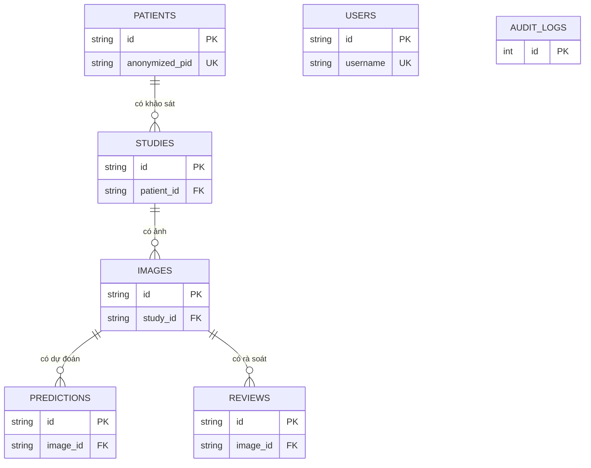

*Hình 3.16: ERD rút gọn, chỉ thể hiện các khóa ngoại vật lý hiện có*

Nguồn: Tác giả đọc các cột và relationship SQLAlchemy [17]. Hình chỉ giữ khóa nhận diện để dễ đọc khi in; toàn bộ thuộc tính được trình bày trong từ điển dữ liệu ở mục 3.4.4.

### 3.4.3. Mô hình quan hệ và mức chuẩn hóa

Mô hình quan hệ sử dụng UUID dạng chuỗi cho các thực thể nghiệp vụ và số nguyên tự tăng cho AuditLog. Các thuộc tính Patient không lặp trong Image; Study liên kết Patient bằng patient_id, Image liên kết Study bằng study_id. Vì vậy, một PID có nhiều lần khảo sát không cần sao chép lại toàn bộ thông tin ở từng prediction. Sự phân tách ảnh, dự đoán và rà soát cũng tránh lưu một cột mask duy nhất mang nhiều nghĩa tùy giai đoạn.

Các trường mask, measurements và feedback dùng JSON vì cấu trúc số phần tử thay đổi theo ảnh và số thành phần. Lựa chọn này giúp lưu bản mẫu nhanh nhưng giảm khả năng cưỡng chế chi tiết bằng database; phần lớn kiểm tra cấu trúc RLE và action nằm ở Pydantic/service. Không nên tuyên bố toàn bộ schema đã chuẩn hóa tới một mức cụ thể chỉ dựa trên số bảng. Với JSON, phải xét mục đích truy vấn và bất biến cần kiểm; khi cần thống kê từng tổn thương lâu dài, có thể cần một bảng lesion_measurements thay vì bóc tách JSON ở mọi báo cáo.

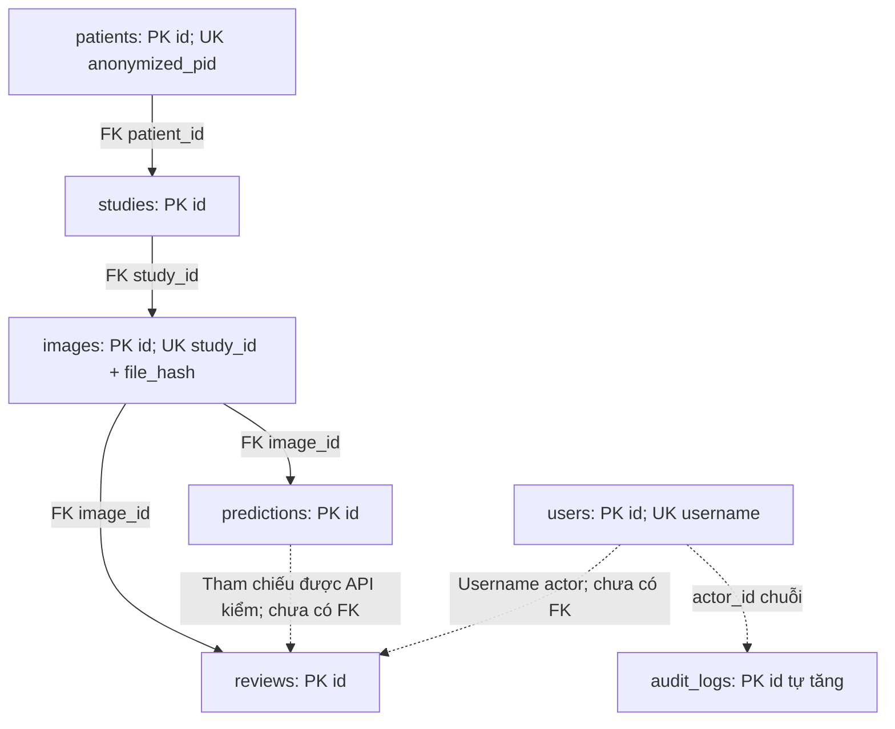

*Hình 3.17: Mô hình quan hệ và các tham chiếu logic cần kiểm ở ứng dụng*

Nguồn: Mã ORM và router Review [17].

### 3.4.4. Từ điển dữ liệu của bảy bảng hiện hữu

Từ điển dưới đây giữ nguyên tên cột để người đọc có thể đối chiếu với implementation. “Cho phép null” được xác định từ Column SQLAlchemy: cột thường không đặt nullable=False cho phép null; khóa chính và các cột ghi rõ nullable=False không cho null. “Mặc định ORM” là giá trị do SQLAlchemy phía ứng dụng cung cấp khi insert, không được tự diễn giải thành server default trong mọi lệnh SQL trực tiếp. Với id UUID, code gọi tạo đối tượng phải cấp giá trị; ORM không khai báo hàm default UUID cho các cột này [8], [17].

*Bảng 3.13: Từ điển bảng patients*

| Cột | Kiểu ORM | Null | Khóa/ràng buộc | Mặc định ORM | Ý nghĩa |
|---|---|---|---|---|---|
| id | String(36) | Không | PK | Không; ứng dụng cấp UUID | Mã nội bộ Patient |
| anonymized_pid | String(64) | Không | Unique | Không | Mã nghiên cứu giả danh |
| age_bucket | String(20) | Có | Không | Không | Nhóm tuổi hoặc giá trị tương thích request |
| menopausal_status | String(20) | Có | Không | Không | Trạng thái mãn kinh nếu được cung cấp |
| created_at | DateTime | Có | Không | datetime.now(UTC) | Thời điểm tạo hồ sơ |

Patient được tra cứu bằng anonymized_pid đã trim ở endpoint create-case. Một PID giả danh ổn định hỗ trợ liên kết nhiều Study, nhưng không chứng minh patient-level split của dataset huấn luyện. Dataset cần manifest mapping riêng giữa file và bệnh nhân; các PID do frontend sinh cho ca demo hoặc upload không thể thay thế bằng chứng mapping nguồn. age_bucket hiện nhận `patient_age` từ request; trước khi dùng trong phân tích nhóm tuổi cần định nghĩa và kiểm tra quy tắc chuẩn hóa.

*Bảng 3.14: Từ điển bảng studies*

| Cột | Kiểu ORM | Null | Khóa/ràng buộc | Mặc định ORM | Ý nghĩa |
|---|---|---|---|---|---|
| id | String(36) | Không | PK | Ứng dụng cấp UUID | Mã nội bộ ca |
| patient_id | String(36) | Không | FK patients.id | Không | Liên kết Patient |
| study_code | String(64) | Có | Không unique | Không | Mã hiển thị ca |
| study_date | String(20) | Không | Không | Không | Ngày khảo sát dạng chuỗi |
| status | String(30) | Có | Không enum DB | PENDING | Trạng thái xử lý legacy |
| device_vendor | String(50) | Có | Không | Không | Hãng thiết bị nếu có |
| probe_type | String(50) | Có | Không | Không | Loại đầu dò |
| ovary_side | String(10) | Có | Không enum DB | RIGHT | RIGHT, LEFT, BOTH, UNKNOWN theo request |
| contralateral_status | String(30) | Có | Không enum DB | NOT_VISUALIZED | Thông tin bên đối diện của hồ sơ tương thích |
| clinical_indication | Text | Có | Không | Không | Lý do khảo sát/ghi chú tiếp nhận |
| created_at | DateTime | Có | Không | datetime.now(UTC) | Thời điểm tạo Study |

Study_date là chuỗi chứ chưa là Date trong ORM; báo cáo không suy ra database đã validate lịch. study_code được ứng dụng sinh nếu thiếu nhưng không có unique constraint. status cũng không được DB khóa bằng enum; máy trạng thái được điều phối trong code. Các trường legacy ovary_side và contralateral_status vẫn tồn tại dù giao diện mới ưu tiên BOTH và hai laterality. Khi chuyển sang workflow mục tiêu cần một migration có giải thích thay vì xóa trường và làm mất nghĩa hồ sơ cũ.

*Bảng 3.15: Từ điển bảng images*

| Cột | Kiểu ORM | Null | Khóa/ràng buộc | Mặc định ORM | Ý nghĩa |
|---|---|---|---|---|---|
| id | String(36) | Không | PK | Ứng dụng cấp UUID | Mã ảnh |
| study_id | String(36) | Không | FK studies.id; thuộc unique ghép | Không | Ca chứa ảnh |
| filename | String(255) | Không | Không | Không | Tên gốc đã basename |
| laterality | String(1) | Có | Không enum/unique DB | Không | R/L; null cho ảnh legacy |
| raw_path | String(500) | Không | Không | Không | Đường dẫn vật lý theo UUID |
| file_hash | String(64) | Có | Unique ghép với study_id | Không | SHA-256 byte file |
| width | Integer | Có | Không | 512 | Chiều rộng nguồn được cập nhật khi upload |
| height | Integer | Có | Không | 512 | Chiều cao nguồn được cập nhật khi upload |
| pixel_spacing_mm | Float | Có | Không check DB | Không | mm trên pixel nguồn nếu xác định được |
| is_empty_mask | Boolean | Có | Không | False | Cờ dữ liệu nguồn; không tự là chẩn đoán |
| dataset_split | String(20) | Có | Không enum DB | TRAIN | Metadata tương thích; không là chứng cứ split thực nghiệm |
| created_at | DateTime | Có | Không | datetime.now(UTC) | Thời điểm ghi ảnh |

Images là điểm nối giữa filesystem và database. raw_path không nên được trả tùy tiện cho client; các API ảnh dùng image_id và kiểm tra file tồn tại. file_hash xác định byte giống hệt, không nhận ra hai ảnh nhìn giống nhau nhưng khác nén hoặc metadata. Vì vậy, kiểm exact duplicate trong upload khác với audit gần trùng giữa các split nghiên cứu. Trường dataset_split mặc định TRAIN trên ảnh upload không được dùng để tuyên bố ảnh mới đã được phép đưa vào huấn luyện; việc tuyển dữ liệu cần một quy trình riêng có nguồn nhãn và manifest [15], [17].

*Bảng 3.16: Từ điển bảng predictions*

| Cột | Kiểu ORM | Null | Khóa/ràng buộc | Mặc định ORM | Ý nghĩa |
|---|---|---|---|---|---|
| id | String(36) | Không | PK | Ứng dụng cấp UUID | Mã lần dự đoán |
| image_id | String(36) | Không | FK images.id | Không | Ảnh được chạy |
| model_version | String(50) | Có | Không | Không | Tên/phiên bản model trả từ adapter |
| inference_time_ms | Integer | Có | Không | 450 | Giá trị thực được router ghi khi chạy |
| confidence_score | Float | Có | Không | 0.85 | Chỉ số kỹ thuật; không là xác suất đúng đã hiệu chuẩn |
| iqa_score | Float | Có | Không | 0.90 | Điểm IQA từ pipeline |
| raw_mask_rle | JSON | Không | Không | Không | Mặt nạ AI gốc |
| measurements | JSON | Không | Không | Không | Cấu trúc số đo và thành phần |
| created_at | DateTime | Có | Không | datetime.now(UTC) | Thời điểm dự đoán |

Các mặc định 450, 0.85 và 0.90 là giá trị trong định nghĩa ORM, không phải kết quả benchmark. Router suy luận thực ghi thời gian đo cùng kết quả confidence/IQA từ dịch vụ. Báo cáo không dùng các default này để lấp ô bảng thực nghiệm. Prediction hiện chưa có cột checkpoint_sha256, preprocessing_version, threshold hoặc source_transform riêng; response và audit có một phần provenance, nhưng muốn tái lập dự đoán lịch sử đầy đủ cần lưu theo từng Prediction. Không được dùng checksum model đang nạp để điền cho một prediction cũ.

*Bảng 3.17: Từ điển bảng reviews*

| Cột | Kiểu ORM | Null | Khóa/ràng buộc | Mặc định ORM | Ý nghĩa |
|---|---|---|---|---|---|
| id | String(36) | Không | PK | Ứng dụng cấp UUID | Mã rà soát |
| image_id | String(36) | Không | FK images.id | Không | Ảnh được rà soát |
| prediction_id | String(36) | Có | Không FK vật lý | Không | Prediction được xét, API kiểm liên kết |
| doctor_id | String(64) | Có | Không FK vật lý | UNVERIFIED_REVIEWER | Username phiên thực được router ghi |
| doctor_action | String(30) | Có | Không enum DB | ACCEPTED_RAW | ACCEPTED_RAW, MODIFIED, REJECTED_ALL theo schema |
| verified_mask_rle | JSON | Không | Không | Không | Mask sau rà soát nghiên cứu |
| max_diameter_mm | Float, evaluates_none | Có | Không | 0.0 | d₁ vật lý; router có thể ghi null |
| ortho_diameter_mm | Float, evaluates_none | Có | Không | 0.0 | d₂ vật lý; router có thể ghi null |
| total_area_cm2 | Float, evaluates_none | Có | Không | 0.0 | Diện tích vật lý; thiếu spacing thì null |
| lesion_type | String(100) | Có | Không | UNSPECIFIED | Mô tả người dùng; không suy ra mô bệnh học |
| clinical_notes | Text | Có | Không | Chuỗi rỗng | Ghi chú nghiên cứu |
| time_spent_seconds | Integer | Có | Không check DB | 15 | Thời gian gửi từ client; chưa là nghiên cứu người dùng |
| hitl_feedback | JSON | Có | Không | Không | Rating và loại lỗi nếu người dùng chọn |
| is_official_ground_truth | Boolean | Có | Không | False | Không tự thành nhãn chuyên gia chính thức |
| created_at | DateTime | Có | Không | datetime.now(UTC) | Thời điểm lưu rà soát |

`Float().evaluates_none()` cho các số đo cho phép None đi vào insert thay vì bị ORM thay bằng default 0.0. Sự phân biệt có ý nghĩa: 0 có thể là diện tích mask rỗng đã đo, còn null thể hiện thiếu điều kiện chuyển sang đơn vị vật lý. time_spent_seconds được schema chặn âm nhưng vẫn là dữ liệu client gửi; muốn báo thời gian thao tác bác sĩ phải có phương pháp đo, người tham gia và kịch bản được ghi nhận. Tương tự, hitl_feedback là chức năng thu phản hồi, chưa tự tạo điểm SUS hoặc bằng chứng chấp nhận lâm sàng.

*Bảng 3.18: Từ điển bảng audit_logs*

| Cột | Kiểu ORM | Null | Khóa/ràng buộc | Mặc định ORM | Ý nghĩa |
|---|---|---|---|---|---|
| id | Integer | Không | PK, autoincrement | DB cấp số | Mã sự kiện |
| entity_name | String(50) | Không | Không | Không | Nhóm thực thể |
| entity_id | String(36) | Không | Không FK vật lý | Không | Mã đối tượng |
| action_type | String(50) | Không | Không enum DB | Không | Loại thao tác |
| actor_id | String(64) | Không | Không FK vật lý | Không | Username hoặc service actor |
| details | JSON | Có | Không | Không | Payload truy vết theo sự kiện |
| timestamp | DateTime | Có | Không | datetime.now(UTC) | Thời điểm ghi nhật ký |

Audit hiện được thêm khi upload, kiểm IQA, chạy prediction, hiệu chuẩn và lưu review. Một số sự kiện dùng actor service thay vì người dùng vì tiến trình kỹ thuật thực thi; muốn truy đầy đủ chuỗi người khởi tạo và dịch vụ thực hiện cần bổ sung correlation hoặc initiating_actor. Không có endpoint sửa/xóa log trong thiết kế UI mới, nhưng schema này chưa có chữ ký, chuỗi băm hoặc quyền database bất biến. Báo cáo chỉ gọi đây là nhật ký ứng dụng, không khẳng định chống sửa đổi tuyệt đối.

*Bảng 3.19: Từ điển bảng users*

| Cột | Kiểu ORM | Null | Khóa/ràng buộc | Mặc định ORM | Ý nghĩa |
|---|---|---|---|---|---|
| id | String(36) | Không | PK | Ứng dụng cấp UUID | Mã tài khoản |
| username | String(50) | Không | Unique | Không | Tên đăng nhập |
| full_name | String(100) | Không | Không | Không | Tên hiển thị tài khoản |
| role | String(20) | Có | Không enum DB | DOCTOR | Role backend DOCTOR/ADMIN |
| department | String(100) | Có | Không FK khoa | Khoa Chẩn đoán Hình ảnh & Sản Phụ khoa | Nhãn hồ sơ, chưa là phạm vi quyền |
| title | String(50) | Có | Không | BS.CKI | Nhãn hiển thị; không là xác thực chuyên môn |
| hospital | String(100) | Có | Không | Bệnh viện ĐKQT Vinmec Times City | Nhãn tài khoản mẫu |
| avatar | String(255) | Có | Không | doctor_avatar.png | Tham chiếu avatar |
| is_active | Boolean | Có | Không | True | Điều kiện account available |
| created_at | DateTime | Có | Không | datetime.now(UTC) | Thời điểm tạo tài khoản |

User không có password_hash, bảng khoa hay quan hệ membership. Các giá trị title/hospital của tài khoản seed phục vụ trình bày demo, không phải xác nhận nhân sự của bệnh viện. Backend đọc mật khẩu role qua cấu hình môi trường và kiểm account active; triển khai nhiều cá nhân thật cần thiết kế danh tính riêng, thay đổi mật khẩu và kiểm quyền tài nguyên. Không được dùng tên hiển thị của seed để viết lời xác nhận rằng bác sĩ tương ứng đã ký Ground Truth hoặc đánh giá bản mẫu.

### 3.4.5. Ràng buộc, truy vấn và quản lý phiên bản schema

Quan hệ ORM Patient–Study và Study–Image đặt cascade all, delete-orphan, tương tự Image–Prediction và Image–Review. Điều này mô tả việc SQLAlchemy xóa các đối tượng liên quan trong session; không nên đồng nhất với mọi hành vi DELETE trực tiếp của SQLite vì cấu hình engine hiện không thể hiện listener bật foreign_keys. Việc cưỡng chế FK ở database, kiểm migration và phục hồi backup phải được xác minh bằng test trên bản đóng gói nếu chuyển sang triển khai nhiều người dùng [8], [11], [17].

Danh sách ca dùng joinedload cho Patient và selectinload cho Images, Predictions, Reviews để tránh truy vấn lazy theo từng ca. Với các quan hệ collection lồng nhau, số query không đơn giản chỉ một hoặc hai; nó phụ thuộc nhóm eager load, nhưng không tăng tuyến tính theo từng Study theo cách N+1 cũ. Endpoint hiện giới hạn 50 ca và chọn ảnh đầu tiên làm tóm tắt. Với cặp hai bên, thumbnail và số đo trên worklist mới cần contract tóm tắt L/R rõ ràng, không dùng first_img để đại diện ngầm cho cả ca.

Hàm `init_db()` tạo schema thiếu và kiểm cột SQLite để thêm study_code, trạng thái, side, laterality, file_hash, hitl_feedback tương thích legacy. Migration hash kiểm unique index hiện có, backfill các bản đọc được và tạo index khi cần. Cơ chế này giúp bản mẫu mở DB cũ nhưng chưa là hệ thống migration có phiên bản và rollback như Alembic. Khi bàn giao phải sao lưu DB, ghi version schema, chạy kiểm dữ liệu mồ côi và xác nhận migration trên bản sao trước khi áp dụng cho kho nghiên cứu.

Các giá trị trạng thái, quyết định và laterality được kiểm chủ yếu ở request/service. Nếu cần chống lỗi từ script nhập dữ liệu hoặc truy cập SQL trực tiếp, có thể bổ sung CHECK constraint tương ứng sau khi thống kê và làm sạch legacy. Không thêm unique `(study_id,laterality)` mà không xét ca nhiều ảnh/khung trong thiết kế tương lai. Đối với phiên bản hiện tại hai ảnh, constraint này có thể cần; đối với một Study chứa nhiều góc quét mỗi bên, mô hình nên thêm vai trò ảnh hoặc vị trí trong bộ ảnh trước khi quyết định cardinality.

Thiết kế logic đạt mục đích lưu vòng phân đoạn nghiên cứu nhưng vẫn còn khoảng cách tới hệ thống duyệt nghiệp vụ đầy đủ. Những khoảng cách được giữ thành yêu cầu tích hợp có thể kiểm chứng: danh tính cá nhân, ownership/khoa, phiên bản và khóa ca, provenance từng Prediction, idempotency và transaction hai bên, khử định danh có xác nhận. Việc trình bày chúng cùng schema hiện hữu giúp kết quả khóa luận có thể được tiếp quản mà không lẫn lộn sản phẩm đã xây dựng với mục tiêu chưa thực thi.
